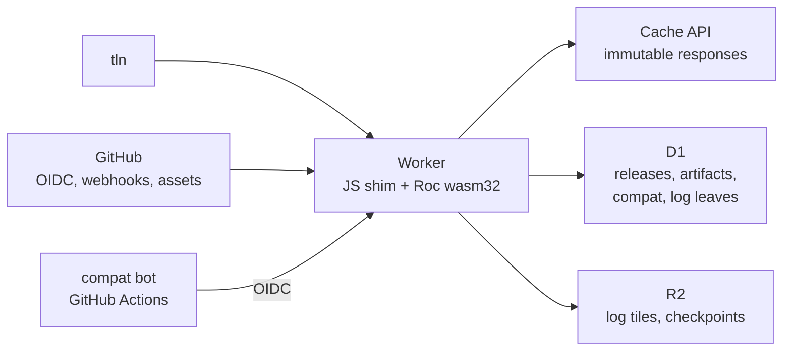
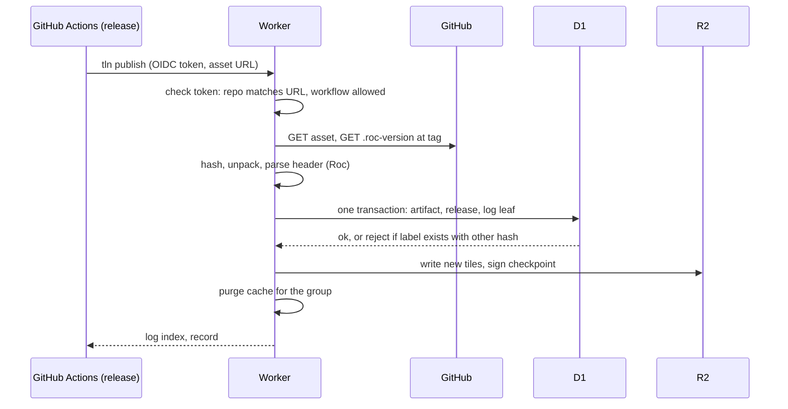

# Talon design: registry

Part of the Talon design. This file holds the registry on Cloudflare and the Worker host that runs it. `DESIGN.md` has the goals, the core model and the list of files.

A reference such as CLI 6.2 is section 6.2 of `DESIGN-CLI.md`. Design, Resolution and Registry name `DESIGN.md`, `DESIGN-RESOLUTION.md` and `DESIGN-REGISTRY.md`. A plain number is a section of this file.

## 1. Role

| The registry does | The registry does not |
| --- | --- |
| Index releases: labels, hash, URL, deps, platform, kind | Store package bytes (v1) |
| Map hash to labels | Own package names (GitHub does) |
| Hold the shared compatibility matrix | Run untrusted Roc code inside the Worker |
| Record publish provenance | Act as a single point of failure: `TALON_REGISTRY=direct` or `--registry direct` uses the GitHub API (precedence in CLI 1, rules in CLI 7.3). `direct` is also the built-in default until the registry runs (P2). |

## 2. Architecture

## 3. Storage choice

Draft 1 used one Durable Object per package. Draft 2 drops that. The reasons:

| Need | DO per package | D1 rows + log table |
| --- | --- | --- |
| Closure query across many packages | One DO call per package | One SQL query (recursive CTE) |
| Publish = insert version + append log leaf, atomically | Two objects, no shared transaction | One transaction |
| Unique (group, version) | Per object | `UNIQUE` index |
| Write rate | Scales per package. Not needed: Roc has tens of releases per day. | One writer is enough |
| Global reads | Each DO lives in one region | Read replicas (Sessions API) plus the Cache API |
| Backups | Manual | Time Travel (30 days) |
| Size limit | 10 GB per object | 10 GB per database. About 5 M versions at 2 KB each. |

Merkle log:

| Part | Where | Why |
| --- | --- | --- |
| Leaves `(index, group, version, hash, time)` | D1 table, written in the publish transaction | The log and the index cannot disagree |
| Compiler leaves, from P2 | Same table and form. One leaf for each asset of a compiler release: group `roc-lang/nightlies:<target>` (CLI 6.2, CV2), version the tag, hash `sha256:<hex>`. Written in the same transaction as the `toolchains` row (section 5). | `--snapshot log:N` then fixes the set of compilers too (Resolution 11) |
| Tiles and signed checkpoint | R2, write-once objects (C2SP tlog-tiles layout) | Tiles are immutable, so object storage plus the edge cache fits. This is how Sunlight serves CT logs. |
| Sequencing | The D1 transaction (`index = max + 1`) | No separate sequencer at this write rate |

KV is not used: eventual consistency (about 60 s) is wrong for the version list. Package bytes on R2 stay a phase 3 option (hash-keyed mirror).

## 4. HTTP API

| Method and path | Returns | Caching |
| --- | --- | --- |
| `GET /v1/pkg/{owner}/{repo}` | All labels, one JSON line each | ETag, 60 s, purge on publish |
| `GET /v1/hash/{hash}` | Artifact record and all its labels | Immutable, except new labels |
| `POST /v1/closure` | Body: direct groups + ranges. Returns records for all candidates and their closure, plus matrix rows for those hashes and the swept marks of the compiler releases (Registry 6, Resolution 4 EP2) | Not cached. One round trip per resolve. |
| `GET /v1/compat/{hash}` | Matrix rows for one hash | 5 min |
| `GET /v1/toolchains` | Nightly tags, assets, sha256, published_at, log_index | 5 min |
| `POST /v1/toolchains` | Add a new compiler release (compat bot with OIDC, section 7) | |
| `GET /v1/search?q=` | Ranked packages | 5 min |
| `POST /v1/publish` | Register a release (OIDC) | |
| `POST /v1/ingest` | Ask to index a public release URL | |
| `POST /v1/compat` | Add matrix rows (bot with OIDC, or user hint) | |
| `GET /log/checkpoint`, `/log/tile/...` | Served from R2 | Tiles immutable |

## 5. Records

| Table | Key | Fields |
| --- | --- | --- |
| `artifacts` | hash | kind, exposes, deps `[{alias, url, group, version, hash}]`, platform, targets, `roc:` pin, sizes |
| `releases` | (group, version) | hash, name, url, tag, `.roc-version`, published_at, log_index, provenance, yanked |
| `compat` | (hash, nightly, target) | result, error digest, source (bot, author, user), time |
| `toolchains` | (tag, target) | asset name, sha256, published_at, log_index |
| `log` | index | group, version, hash, time |

Artifact rows never change. Release rows change only in `yanked`. Toolchain rows never change.

## 6. Compatibility matrix

The matrix makes probes rare. A user who adds a common package gets a known answer.

| Producer | Runs | Trust |
| --- | --- | --- |
| Talon compat bot | A scheduled GitHub Actions workflow. For each new nightly, it runs unit probes on every indexed hash. For each new release, it searches the nightly range (Resolution 4). Posts results with an OIDC token. | Full |
| Release workflow | `tln probe --range <bundle file>`, then `tln publish` sends the facts (Resolution 4, PB5) | Full, tied to the publisher |
| Users | `tln probe --share` | Hint only (rank 6) |

When the bot has a result for each indexed hash on a release, it marks that release as swept. The matrix rows that the client gets carry the swept marks. The resolver finds epochs only between swept releases (Resolution 4, EP2).

Cost: about 50 packages times 1 new nightly a day, at under 2 s each, is under 2 minutes of CI a day.

## 7. Publish flow

| Path | Trigger | Auth |
| --- | --- | --- |
| `tln publish` in the release workflow | Author | GitHub OIDC (trusted publishing) |
| GitHub App webhook | `release.published` | App installation on the repo |
| `POST /v1/ingest` | Anyone, with a public URL | None. The bytes and the tag are public, and the hash checks them. |

`tln publish` also sends the real facts of the released hash (Resolution 4, PB5). The Worker writes them as `compat` rows with the source `author`, with the release.

For a GitHub release, each path selects the package asset and reads the version and the group with the rules of `direct` mode (CLI 7.3, DI3 to DI5). So the registry does not index a draft, a prerelease, or a release with 0 or 2 package assets, and `tln` sees the same candidates in both modes. A URL on another host gets the version and group from the roc rule (Design 2), as in DI5.

Compiler releases, from P2:

| Step | What happens |
| --- | --- |
| 1 | The compat bot (section 6) finds a new compiler release and calls `POST /v1/toolchains` with an OIDC token and the tag. |
| 2 | The Worker reads the release from the GitHub API itself. It does not trust the body of the bot for the sha256. It selects the assets with CV1 and CV2 (CLI 6.2) and takes each sha256 from the `digest` field. |
| 3 | One D1 transaction writes a `toolchains` row and a compiler log leaf (section 3) for each asset. A tag that already has rows is not written again. |
| 4 | If GitHub later shows another `digest` for a recorded asset, the Worker keeps the recorded row and returns it. `tln` then stops at CV4 with exit code 16. |

## 8. Worker host: JSPI

JSPI (JavaScript Promise Integration) lets a synchronous wasm import wait for a JS promise. So Roc code calls `fetch!` as a normal effect, and the Roc compiler needs no async support. The host is in Zig.

Evidence:

| Evidence | Result |
| --- | --- |
| Local test (`scratchpad/jspi/`, workerd `2026-10-12`, no compatibility flag) | An import wrapped in `WebAssembly.Suspending` waits on a timer and a subrequest. 3 parallel calls through `WebAssembly.promising` return correct values. |
| Community | workers-zig and Almide report JSPI on the Cloudflare edge (see Sources). |

Patterns of the Worker host:

| Pattern | Talon Worker |
| --- | --- |
| App API | `cloudflare-workers/API.md`. One entry `event! : Event => Outcome` for all Workers handler kinds. Typed modules (`Http`, `D1`, `R2`, `Cache`, `WebCrypto`, ..., signatures in `cloudflare-workers/MODULES.md`) build programs of JS ops, and one JSPI wait runs one program (`await!`). Sync JS APIs use `call!` with no wait. Zig code with no Workers API (zstd) uses `native!`. API.md 1 is the audit of what the registry needs (RN1 to RN15). |
| Arguments | JS reads them before its first `await`, because they can be on the stack. |
| Results | JS writes the body with `js_alloc` into a heap record, not the stack. |
| Tests | Pure logic: `roc test`. Handlers: in Miniflare with local D1 and R2 and a fake GitHub service (API.md 11). Not a scripted record in `roc test`: an `expect` cannot run an effect (`research/core-shape/`). |
| Shadow stack | JSPI keeps the wasm stack, not the shadow stack (`__stack_pointer`) in linear memory. The host copies the used stack to the heap at a wait and back at resume, so many tasks share one instance (`cloudflare-workers/host/host.zig`). The copy runs in a pool of instances. After a trap, the host frees the heap of the dead task (owner tags, see below). |

### Measurement: stack copy vs instance per request (Q12)

Code, reproduce commands and all tables: `cloudflare-workers/bench/README.md`. Setup: Roc wasm32 app on the Zig host in `cloudflare-workers/host/`, nightly 2026-10-09, local workerd 2026-10-12. Each request builds about 45 KB of JSON, recurses N levels, and waits twice on a service binding (5 ms). 0 wrong bodies in about 445,000 requests.

| Item | B: shared instance, stack copy | A: instance per request |
| --- | --- | --- |
| Copy cost per wait | 0.05 µs (2 KB), 0.2 µs (16 KB), 1.4 to 1.8 µs (64 KB), 5 to 7 µs (256 KB) | none |
| Instantiate per request | none | 28 to 36 µs (49 KB module), 516 to 639 µs (2.1 MB module) |
| CPU per request, full workload | 205 to 283 µs | 306 to 502 µs |
| req/s at concurrency 64, stack 63 KB | 1660 | 1278 |
| p50 at concurrency 64, stack 63 KB | 36.4 ms | 45.6 ms |
| Memory held by copies | concurrency × stack depth (4 MB at 64 × 63 KB) | 1.3 MB per live instance |
| wasm memory | Grows to the peak and never shrinks (50 MB at 64 × 250 KB) | Freed with the instance |
| Trap | Without owner tags: leaks the heap of that request, 61 KB per trap. With owner tags: 0 leak. Other waiting requests stay correct. | Nothing leaks |

The stack copy costs less than the noise up to 64 KB. Instantiation is the real cost, and it grows with module size: the registry app will be larger than 49 KB.

### Owner tags: free the heap of a task that trapped

A trap stops the task at once, so its refcount decrements never run. The stack is not the problem: a task traps only while it runs, so it has no saved copy, and `task_abort` moves the stack pointer back. The heap blocks of the task stay. Owner tags find them:

| Step | Code (`cloudflare-workers/`) |
| --- | --- |
| Each live span keeps its task id in the free-list word, which a live span does not use | `hostlib/alloc.zig` `hostAlloc`, `OWNER` |
| The host sets `OWNER` at `handle`, clears it at a wait, sets it again at the resume | `host/host.zig` `handle`, `waitBegin`, `waitEnd` |
| Blocks that JS fills (`js_alloc`) are host-owned (0) until the task adopts them. JS can call `js_alloc` after a trap, before the abort. | `hostlib/alloc.zig` `js_alloc`, `adopt` |
| After a trap, walk the spans of each bump region and free the sealed spans with that id | `hostlib/alloc.zig` `freeOwner`, `host/host.zig` `task_abort` |
| `task_abort` has no shadow-stack frame. A frame epilogue would write the old stack pointer back after the reset. | `host/host.zig` `task_abort`, `abortFree` |

Test: `bench/node-test.mjs` (200 requests at once with 4 traps, then 200 more on the same instance). With tags: live bytes 0, 237,632 bytes freed, 0 bad bodies. With `-Downer_tag=false`: live 237,632, the test fails.

Cost (`bench/owner.mjs`, Node, `track_live=false`):

| Item | Tags off | Tags on |
| --- | --- | --- |
| alloc + free pair | 2.6 to 3.2 ns | +0.2 to 0.7 ns |
| Whole request (depth 30, 200 JSON items), median of 7 | 200.6 to 203.5 µs | -0.4 to +4 µs (in the noise) |
| Memory | | 0 (no new header word) |
| Heap walk per trap | none | 1 to 15 ns per live span: 13 µs (10,000 small spans), 1 ms (30 MB of 200 B spans) |

Limits: tasks must share no heap. Roc values are immutable and top-level constants are static data, and the second batch of the test found no shared block. When the walk fails (more than 64 bump regions, or a bad span header), `task_abort` returns -1 and the instance is retired.

Decision: a pool of shared instances with owner tags and a recycle rule. This keeps the speed of B and the clean memory of A.

| Rule | Value (first guess, tune in P2) |
| --- | --- |
| Requests per instance at one time | Up to 16. A new request goes to the instance with the fewest; a new instance starts when all are full. |
| After a trap | Clean trap (Roc `crash`, stack canary, out of memory): free the task's spans, keep the instance. Engine fault (out-of-bounds access, `unreachable` in host code) or a failed walk: retire the instance, its memory may be corrupt. |
| Retire an instance | After an engine fault, or when its wasm memory passes 32 MB (wasm memory never shrinks). A retired instance takes no new requests, and is dropped when its last request ends. |
| Stack depth guard | Log the copy size. A copy over 256 KB is a warning: it means deep recursion in a handler. |

Fallback: if JSPI is ever removed, Talon returns effects as data, as Joy does. The Roc API (the modules of `cloudflare-workers/API.md`) does not change. Only the platform changes.

