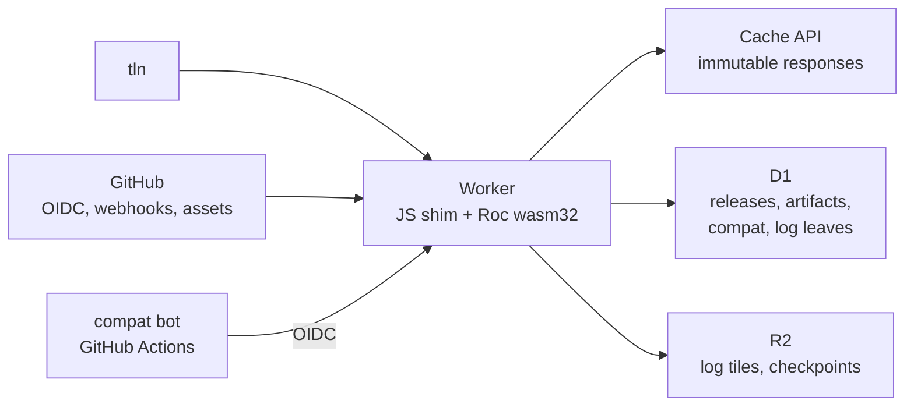
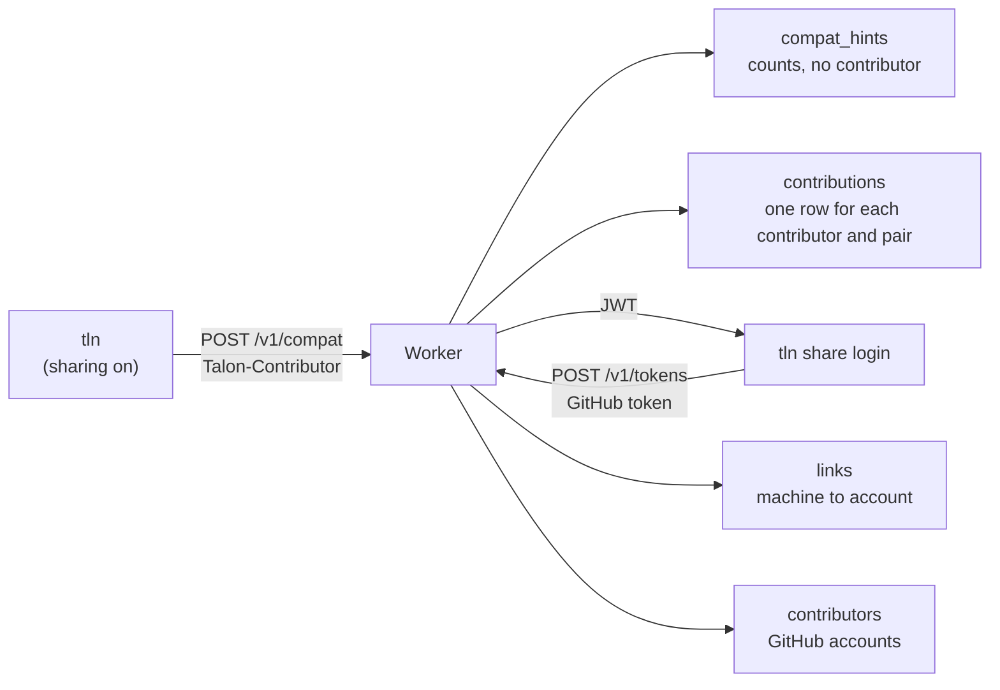
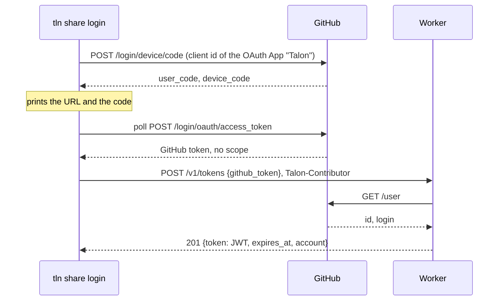
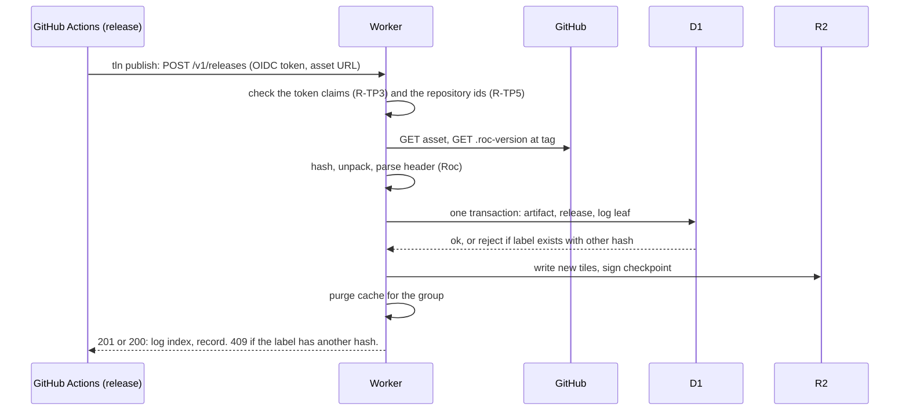

# Talon design: registry

Part of the Talon design. This file holds the registry on Cloudflare and the Worker host that runs it. `DESIGN.md` has the goals, the core model and the list of files.

A reference such as CLI 6.2 is section 6.2 of `DESIGN-CLI.md`. Design, Resolution and Registry name `DESIGN.md`, `DESIGN-RESOLUTION.md` and `DESIGN-REGISTRY.md`. A plain number is a section of this file.

## 1. Role

| # | The registry does | The registry does not |
| --- | --- | --- |
| R-RL1 | Index releases: labels, hash, URL, deps, platform, kind | Store package bytes (v1) |
| R-RL2 | Map hash to labels | Own package names (GitHub does) |
| R-RL3 | Hold the shared compatibility matrix | Run untrusted Roc code inside the Worker |
| R-RL4 | Record publish provenance | Act as a single point of failure: `TALON_REGISTRY=direct` or `--registry direct` uses the GitHub API (precedence in CLI 1, rules in CLI 7.3). `direct` is also the built-in default until the registry runs (P2). |

## 2. Architecture



## 3. Storage choice

R-SG1: The registry keeps its data in D1 rows and a log table, not in one Durable Object for each package (Draft 1). The reasons:

| Need | DO per package | D1 rows + log table |
| --- | --- | --- |
| Closure query across many packages | One DO call per package | One SQL query (recursive CTE) |
| Publish = insert version + append log leaf, atomically | Two objects, no shared transaction | One transaction |
| Unique (group, version) | Per object | `UNIQUE` index |
| Write rate | Scales per package. Not needed: Roc has tens of releases per day. | One writer is enough |
| Global reads | Each DO lives in one region | Read replicas (Sessions API) plus the Cache API |
| Backups | Manual | Time Travel (30 days) |
| Size limit | 10 GB per object | 10 GB per database. About 5 M versions at 2 KB each. |

Merkle log:

| # | Part | Where | Why |
| --- | --- | --- | --- |
| R-SG2 | Leaves `(index, group, version, hash, time)` | D1 table, written in the publish transaction | The log and the index cannot disagree |
| R-SG3 | Compiler leaves, from P2 | Same table and form. One leaf for each asset of a compiler release: group `roc-lang/nightlies:<target>` (CLI 6.2, R-CV2), version the tag, hash `sha256:<hex>`. Written in the same transaction as the `toolchains` row (section 5). | `--snapshot log:N` then fixes the set of compilers too (Resolution 11) |
| R-SG4 | Tiles and signed checkpoint | R2, write-once objects (C2SP tlog-tiles layout) | Tiles are immutable, so object storage plus the edge cache fits. This is how Sunlight serves CT logs. |
| R-SG5 | Sequencing | The D1 transaction (`index = max + 1`) | No separate sequencer at this write rate |

R-SG6: KV is not used: eventual consistency (about 60 s) is wrong for the version list. Package bytes on R2 stay a phase 3 option (hash-keyed mirror).

## 4. HTTP API

The API is plain HTTP with JSON, not full REST. Each resource name is a plural noun, and it is the name of its D1 table (section 5): `artifacts`, `releases`, `compat`, `compat_hints`, `sweeps`, `toolchains`, `contributors`. `packages` is a GitHub name (Design 4.1, R-ID3). `tokens` has no table, because the Worker stores no token (6.1, R-CT9). `me` names the contributor or the account of the request. Paths have no verbs. `POST /v1/closure` is a query with a body, and it changes no state. The log routes are outside `/v1`, because C2SP tlog-tiles sets their layout.

| # | Method and path | Request | Response | Success | Errors (section 4.2) | Caching |
| --- | --- | --- | --- | --- | --- | --- |
| R-AP1 | `GET /v1/packages/{owner}/{repo}/releases` | | `{releases, checked}`: each release (R-RE2) of each group of the repository, in all series and URL forms (CLI 7.3, R-DI6). `checked`: R-AP29. | 200, 304 | 404 `not-found`: the repository has no indexed release | `max-age=60`, ETag. The purge on publish waits for Q25. |
| R-AP2 | `GET /v1/artifacts/{hash}` | | The artifact record (R-RE1) and all its releases (R-RE2) | 200, 304 | 404 `not-found` | `max-age=60`, ETag. Not immutable: a new label or a yank changes the answer. |
| R-AP3 | `POST /v1/closure` | Body of R-AP16 | Answer of R-AP17 | 200 | 400 `bad-request` | `no-store`. One round trip per resolve. |
| R-AP4 | `GET /v1/artifacts/{hash}/compat` | | `{compat, hints}`: the matrix rows (R-RE3) of the hash, each with its `source`, and the `compat_hints` rows (R-RE12) of the hash | 200, 304 | 404 `not-found` | `max-age=300`, ETag |
| R-AP5 | `GET /v1/toolchains`, optional `?target=<target>` | | `{toolchains}`: the rows of R-RE4. With `target`, only the rows of that target. | 200, 304 | 400 `bad-request` | `max-age=300`, ETag |
| R-AP6 | `PUT /v1/toolchains/{tag}` | No body. The OIDC token of the compat bot (R-PU7). | `{toolchains}`: the rows of the tag | 201: new rows. 200: the tag has rows (R-PU9, R-PU10). | 401 `unauthenticated`, 403 `forbidden`, 404 `not-found` (GitHub has no such release), 422 `not-a-candidate` (no asset passes R-CV1 and R-CV2), 502 `upstream` | `no-store` |
| R-AP7 | `GET /v1/packages?q=<text>`, or `GET /v1/packages?short=<name>` (section 4.3) | | With `q`: `{packages}`, ranked packages for display only (R-SN5). With `short`: `{matches}`, the exact match set of a short name (R-SN1 to R-SN4). | 200, 304 | 400 `bad-request` | `q`: `max-age=300`, ETag. `short`: `max-age=60`, ETag. |
| R-AP8 | `POST /v1/releases` with `Authorization: Bearer <GitHub OIDC token>`: a publish (R-PU2) | `{url, compat}`: the asset URL, and the real facts of the released hash (R-PU5, optional) | The release record (R-RE2) and its log index | 201 with `Location: /v1/artifacts/{hash}`: new release. 200: the label exists with the same hash. | 400 `bad-request`, 401 `unauthenticated`, 403 `forbidden` (the token check of R-PU1 fails), 409 `label-conflict`, 409 `id-collision` (R-IK3), 422 `not-a-candidate` (R-PU6), 502 `upstream` | `no-store` |
| R-AP9 | `POST /v1/releases` with no `Authorization`: an ingest (R-PU4) | `{url}` | As R-AP8 | As R-AP8. 202 only if Q30 selects a queue. | As R-AP8, and 401 `unauthenticated` (R-AP26), 429 `rate-limited` | `no-store` |
| R-AP10 | `POST /v1/compat` | `{rows, sweep}`. `rows`: a list of `{hash, nightly, target, result, error_digest}`. A user hint row has no `error_digest` (R-CT2). `sweep`: `{nightly, target, upto_log_index}`, optional, bot only (R-MX4). The OIDC token of the compat bot, or no token for user hints (R-MX5). A user hint request also has the header `Talon-Contributor` and the body field `talon_version` (6.1, R-CT1, R-CT2). | `{written}`: the count of new `compat` rows, or of counted hints (R-RE13). For user hints also `first` (R-CT4) and `skipped` (R-CT14). | 201: at least one row is new. 200: each row was there (R-RE13 row 1), or each row was there already for this contributor (R-CT4). | 400 `bad-request`, 401 `unauthenticated`, 403 `forbidden`, 404 `not-found` (a bot row with a hash that is not indexed), 422 `sweep-incomplete` (R-MX4, R-MX9), 429 `rate-limited` (R-CT11, R-CT13) | `no-store` |
| R-AP11 | `GET /log/checkpoint`, `GET /log/tile/...` (hash tiles, entry tiles and partial tiles, in the C2SP tlog-tiles layout) | | From R2 | 200 | 404 `not-found` | Checkpoint: `max-age=5` (first guess, tune in P2). Tiles, also partial tiles: `max-age=31536000, immutable`. |
| R-AP12 | `POST /v1/webhooks/github` | A GitHub App event, signed with HMAC-SHA256 (`X-Hub-Signature-256`). Rules: R-PU3, R-PU11 to R-PU18. | No body | 202 | 401 `unauthenticated`: the signature is bad | `no-store` |
| R-AP13 | `GET /v1/releases?group=<URL form>`, optional `&series=<series>` | | `{releases, checked}`: the releases (R-RE2) of that group. With no `series`, all series of the URL form (CLI 7.3, R-DI6). The group can be on any host, also not `github.com` (CLI 7.3, R-DI11). `checked`: R-AP29, `null` for another host. | 200, 304 | 400 `bad-request` | `max-age=60`, ETag. The purge on publish waits for Q25. |
| R-AP14 | `GET /v1/releases?after=<log_index>` | | `{releases}`: the releases with a larger log index, in log index order, at most 1000 (first guess, tune in P2). For the next page, the client asks again with the last log index of the page. `after` and `group` can go together. With no `group` and no `after`, the answer is 400. | 200, 304 | 400 `bad-request` | `max-age=60`, ETag |
| R-AP35 | `GET /v1/contributors/me` | `Authorization: Bearer <JWT>` (6.1, R-CT9) | The tracker of the account (R-CT10) | 200 | 401 `unauthenticated`: no JWT, or a JWT that fails R-CT9 | `no-store` |
| R-AP36 | `DELETE /v1/contributors/me` | The JWT (the account), or `Talon-Contributor` with no JWT (one machine) (R-CT7) | No body | 204, also when nothing was stored | 400 `bad-request`, 401 `unauthenticated`, 429 `rate-limited` | `no-store` |
| R-AP37 | `POST /v1/tokens` | `{github_token}`: a token of the OAuth App `Talon` (R-CT8). `Talon-Contributor`, optional. | `{token, expires_at, account: {id, login}}`. `token` is the JWT of R-CT9. | 201 | 400 `bad-request`, 401 `unauthenticated` (GitHub refuses the token), 429 `rate-limited`, 502 `upstream` | `no-store` |
| R-AP38 | `DELETE /v1/tokens` | The JWT | No body. Each token of the account stops (R-CT9). | 204 | 401 `unauthenticated` | `no-store` |
| R-AP39 | `GET /v1/sweeps/{tag}`, optional `?target=<target>` (default `any`) | | `{sweep, log_size, members, missing}`: the `sweeps` row of the nightly and target or `null`, the log size now, the count of members of the bot set at that log size (R-MX11), and the hashes of the members that have no `bot` row. The work list of the bot (R-MX1). | 200 | 400 `bad-request`, 404 `not-found` (no such tag in `toolchains`) | `no-store` |
| R-AP40 | `GET /v1/compat_hints?audit=<n>` | | `{pairs}`: at most `n` (at most 1000) pairs `{hash, nightly, target, pass_count, fail_count, crash_count}` that have `compat_hints` rows and no `bot` row, with the largest total count first. Only unit checks (target `any`) and platform targets. The work list of the hint audit (R-MX13). | 200, 304 | 400 `bad-request` | `max-age=300`, ETag |

R-AP15: A group goes on the wire as two fields. `group` is its URL form: the group with no series (CLI 7.3, R-DI6), with `{v}` in place of the version and with no scheme and no hash, as in Design 4.1, R-ID2 (`github.com/roc-lang/unicode/releases/download/{v}/`). `series` is the series of Design 4.1, R-ID1 (`4`, `0.25`).

### 4.1 Closure query

R-AP16: The body of `POST /v1/closure`:

| Field | Value |
| --- | --- |
| `groups` | A list of `{group, series, range}`. `series` and `range` are optional. It holds each group that the resolve must choose a version for (CLI 7.3, R-DI1): each free direct dep, the platform, each `[overrides]` group (Resolution 6), the group of `tln add`, and the rows of `tln outdated`. With no `series`, all series of the URL form. `range` is a range in the form of `talon.toml` (Design 4.3). With a range, the answer has only the candidates in it. With no range, the answer has every release of the group, for example where R-UP1 (Resolution 10) says that the range does not apply. |
| `hashes` | The hashes whose records the client needs and that no group gives: the value of each header entry (Design 4.2), for example a hash of a hand edit (Design 4.1, R-ID7) |

R-AP17: The answer of `POST /v1/closure`:

| Field | Value |
| --- | --- |
| `artifacts` | The record (R-RE1) of each candidate, of each hash in `hashes`, and of each hash in their closure (the deps, to the end) |
| `releases` | The releases (R-RE2) of these hashes |
| `compat` | The matrix rows (R-RE3) of these hashes, each with its `source` |
| `hints` | The `compat_hints` rows (R-RE12) of these hashes |
| `sweeps` | Each row of the `sweeps` table (R-RE7) |
| `transitions` | Each row of the `transitions` table (R-RE23, R-MX12) |
| `log_size` | The size of the log in the database state that the answer comes from |
| `unknown` | Each hash of `hashes` that the registry does not index (Q33) |
| `checked` | For each `github.com` repository of a group in `groups`: `{name, checked_at, stale}` (R-AP29) |

R-AP18: All rows of one answer and `log_size` come from one state of the database. So each release in the answer has `log_index` at most `log_size`. For example, the Worker runs the reads in one D1 session (Sessions API) and reads `log_size` last, or runs them in one D1 batch.

R-AP19: The client applies `--snapshot log:N` to the answer. It hides each release with `log_index` greater than N, and each toolchain row of R-AP5 with `log_index` greater than N (Resolution 11, R-DT3). It does not hide `compat` and `sweeps` rows: they are evidence, not releases (R-DT5). With no `--snapshot`, `log_size` is the log size that R-DT5 prints (`resolved at log:<log_size>`).

R-AP20: The closure query changes no state. The client can send it again after a network error.

R-AP28: A hash in `unknown` (R-AP17) is a header value that the registry does not index. The closure query already ran the privacy guard of CLI 1, R-RG4 for each `github.com` group and hash in it, so a private repository never gets here. Talon checks the cases in this order, and the first case that applies is used:

| # | Case | What Talon does |
| --- | --- | --- |
| 1 | The answer has the label (group and version) of the URL with another hash | The R-PU19 case. Talon prints a warning that names the release and both hashes. It sends no ingest. |
| 2 | The URL is a `github.com` release asset URL (CLI 7.3, R-DI5) of a repository that the guard found public (CLI 1, R-RG5), and the command has no `--snapshot log:N` | Talon sends one ingest (R-AP9) for each such URL, at the same time, then sends the closure query again, once. This is the rule of CLI 2, R-AD35 for a header value. |
| 3 | Any other URL (another host, a loopback host, an ingest that gave 4xx), or `--snapshot log:N` | Talon sends no ingest. It reads the facts from the archive, as `direct` mode does (CLI 7.3, R-DI7). |

In all cases, the header value stays in the domain of its variable (Resolution 2, R-C9). In case 3, the other candidates of its group come from the registry when the answer has releases of that group. When it has none, the entry acts as an anchor at its header value, as in CLI 7.3, R-DI11, and `tln update`, `tln upgrade` and `tln outdated` print `fixed: not in the registry index`. Reasons: one command uses one index (Q34, CLI 7.3, R-DI14). Talon sends to the registry only a URL on `github.com`. The ingest downloads the asset with no token, so it can index only a public asset, and a URL on a private host never leaves the machine. An ingest adds releases to the log, so a log snapshot must not send one (CLI 2, R-AD36).

### 4.2 Rules for all routes

R-AP21: An error answer is RFC 9457 problem details: `Content-Type: application/problem+json`, with the fields `type`, `title`, `status` and `detail`. `type` is a stable value from the table below, a relative URI. The registry does not serve a page at that URI.

| `type` | Status | When |
| --- | --- | --- |
| `/errors/bad-request` | 400 | The body, the path or the query is not valid |
| `/errors/unauthenticated` | 401 | A token that the route needs is missing or not valid, a webhook signature is bad, or a release body has `compat` and no token (R-AP26) |
| `/errors/forbidden` | 403 | The token is valid, but it does not give this action. The `detail` names the claim that failed (R-TP3, R-TP7, R-TP8, R-YK2). |
| `/errors/repository-changed` | 403 | The repository id and the owner id of the name are both not the recorded ones: another account (R-TP9). The answer has the member `issues_url` (R-TP12). |
| `/errors/not-found` | 404 | The resource does not exist |
| `/errors/label-conflict` | 409 | The label (group, version) exists with another hash (R-PU1) |
| `/errors/id-collision` | 409 | A new hash or name has the id of another name (5.1, R-IK3). The `detail` names the other name. |
| `/errors/unsupported-media-type` | 415 | The request body is not `application/json` |
| `/errors/not-a-candidate` | 422 | The release fails the candidate rules (R-PU6), an ingest names a repository that is not found or not public (R-PU32), or a compiler release has no asset that R-CV1 and R-CV2 select |
| `/errors/successor-mismatch` | 422 | A successor that fails a check of R-AP31. The `detail` names the check, and lists the missing modules for the `exposes` check. |
| `/errors/sweep-incomplete` | 422 | A sweep without a `bot` row for each hash under its bound (R-MX4). The `detail` lists the missing hashes (R-MX9). |
| `/errors/rate-limited` | 429 | The client sent too many requests (R-AP25) |
| `/errors/internal` | 500 | A fault in the Worker |
| `/errors/upstream` | 502 | A read from GitHub failed |

R-AP22: In `tln`, CLI 3, R-E6 maps an error answer, a 5xx answer, or no answer to an exit code, when no other CLI rule handles that case: 20 (`rejected`) for a refused write, 15 (`network`) for a fault that a later run can fix. The message gives the `type` and the `detail`, and `--json` gives them in `error.details` (CLI 3, R-J7).

R-AP23: Media types: request bodies and answers are `application/json` in UTF-8. Errors are `application/problem+json`. The checkpoint is `text/plain; charset=utf-8`, and the tiles are `application/octet-stream`, as C2SP tlog-tiles gives.

R-AP24: Each 200 answer of a `GET` in `/v1` has an `ETag`. A request with an `If-None-Match` that is equal to the current ETag gets 304 with no body. `tln` keeps each answer and its ETag in `talon/index/` (CLI 6.1). It uses an answer that is younger than its `max-age` with no request, and sends `If-None-Match` for an older one, as for GitHub (CLI 7.3, R-DI2).

R-AP25: Any route can answer 429 `rate-limited` with a `Retry-After` header in seconds. Q30 sets the limits of ingests (R-AP9), and R-CT11 sets the limits of user hints. `tln` stops with exit code 15, and the message gives the time when it can try again, as for GitHub (CLI 7.3, R-DI13). The share queue is the exception: a 429 answer keeps its rows and changes no exit code (CLI 1, R-SH4).

R-AP26: A publish and an ingest use one route, `POST /v1/releases`. The `Authorization` header selects the path: a token is a publish (R-AP8), no header is an ingest (R-AP9). A token that fails the check gets 401 or 403, never an ingest. A body with `compat` and no token gets 401 `unauthenticated`, because author facts need the token (R-PU5).

R-AP27: `tln publish` sends no request when it has no OIDC token. In GitHub Actions, the token needs `permissions: id-token: write`. Talon stops, and the message names that permission. So a missing permission never gives an ingest with no provenance and no author facts. The exit code is 2 (CLI 3, R-EC2).

R-AP34: `tln publish`, `tln yank` and `tln move` send their request again after a 429 answer, a 5xx answer or no answer: at most 3 more times (first guess). Each wait is the `Retry-After` of the answer when it has one (at most 60 s), else 2 s, 8 s and then 30 s. After a 401 answer, they get a new OIDC token (7.1, R-TP2) and send the request once more, because a token lives a few minutes. These writes are idempotent (R-PU14, R-YK1, R-AP31), so a request that is sent again writes nothing twice. After the last try, R-AP22 applies. Other commands do not send a request again: an ingest (R-AP9) stops at once (CLI 2, R-AD35). A user hint (R-AP10) is idempotent, because a contributor counts once for a pair (6.1, R-CT4). But the command does not wait for it: the rows that were not sent stay in the queue, and a later command sends them (CLI 1, R-SH4).

R-AP29: `checked` tells how old the index of a GitHub repository is. `checked_at` is the last time that the Worker read the release list of that repository (R-PU21), or `null` when it has not read it since the first ingest. `stale` is true when `checked_at` is `null` or is older than 2 intervals of R-PU22 for that repository. The Worker computes `stale`, because only the Worker knows the interval of each repository.

R-AP30: When an answer has a `stale` repository, `tln update`, `tln outdated` and `tln add` print one note for each such repository: `index: <owner>/<repo> checked <age> ago`, or `index: <owner>/<repo> not checked since its first ingest`. The note does not change the exit code. The text and a `--json` field (`notes[]`, kind `index-stale`) are a proposal (CLI 3, R-OUT2).

R-AP32: Each answer that has releases of a `github.com` name (R-AP1, R-AP2, R-AP13, R-AP14, R-AP17) also has `repos`: one item for each such name, `{name, state, successor, state_at}` from the `repos` row (R-RE11, section 7.3). `state` is `active`, `missing` or `moved`. `successor` is the name of R-TP14, or `null`.

R-AP41: D1 round trips. Each D1 call is one network round trip from the Worker to a D1 instance: 70 to 98 ms from `TBS` to `EEUR` (section 8, edge results). Rows add less: 200 rows took about 15 ms more than 20 rows. So the time of a route is about the count of D1 calls that run one after the other times the round trip, plus the SQL time, plus the GitHub reads. Each route keeps to this budget:

| Route kind | D1 calls before the answer | How |
| --- | --- | --- |
| Read: R-AP1, R-AP2, R-AP3, R-AP4, R-AP5, R-AP7, R-AP13, R-AP14, R-AP35, R-AP39, R-AP40 | 1 | One statement or one batch |
| Write: R-AP6, R-AP8, R-AP9, R-AP10, R-AP31, R-AP36, R-AP37, R-AP38, R-YK1 | At most 2 | An optional read batch that can stop the request before a GitHub read or a download, then one write batch whose last statement reads the answer |
| Error detail (R-IK3, R-MX9) | 1 more | Only after the write batch failed |
| Work after `Ctx.respond!` (R-PU11, Q26) | Not counted | One batch for each step where it can |

| # | Rule for one call |
| --- | --- |
| 1 | A query that needs the result of an earlier query puts the dependency in SQL: a JOIN, a subquery, or a recursive CTE (the closure, the successor chain of R-AP33). In a batch, each statement can have the same CTE. The Worker computes each id with no read (R-IK2). |
| 2 | A list in a request (the groups and hashes of R-AP16, the names of R-SN1, the rows of R-CT4) goes as one JSON parameter, read with `json_each(?)`. Reason: one D1 statement has at most 100 bound parameters and 100 KB (Cloudflare D1 limits). |
| 3 | A write that must stop on a condition uses a trigger with `RAISE` (R-MX8, Q27) or a `WHERE` clause on the write. A read before the batch is only for a check that can end the request early, or that needs a value from outside D1. The write batch makes that check again, because another request can write between the 2 calls. |
| 4 | A filter that SQL cannot do (`VersionReq.matches`, R-IK5) reads a superset in SQL and filters in Roc. It does not add a call. |
| 5 | A read route runs its batch in one session, `with_session!(Any)`, so a read replica can answer. A batch is one transaction, so R-AP18 holds. Writes go to the primary. A read after a write of the same client: Q46. |
| 6 | A batch reads at most 1 MiB of rows (`cloudflare-workers/MODULES.md` MC11). Q29 decides how the closure answer gets past this limit. |

Tests:

| Rule | Test | Revert that must fail |
| --- | --- | --- |
| R-AP41 budget | Miniflare. A counting proxy on the D1 binding (or the shim op log) counts the `prepare`, `run` and `batch` calls of each route. Each count is at most the budget. | Split the closure batch into 2 calls: count 2 |
| R-AP41 row 2 | A closure with 60 groups (more than 100 parameters if each value were bound) gives 200 | Bind one parameter for each value: `D1Err` |
| R-AP41 row 3 | A publish with the label written by another request between the pre-read and the batch gives 409, and no second leaf | Remove the trigger |
| R-AP41 row 5, R-AP18 | A closure that runs at the same time as a publish: each `log_index` is at most `log_size` | Run the reads as separate calls with `log_size` first |

### 4.3 Short-name matches

R-SN1: `GET /v1/packages?short=<name>` gives the match set of a short name (CLI 2, R-SC8). The query can have up to 50 `short` values (first guess). The answer is `{matches}`: for each `short` value, the list of each indexed package whose repo name, or repo name minus a leading `roc-`, is equal to the value. The compare is ASCII case-insensitive, because GitHub names are case-insensitive. Each item is `{name, first_log_index, state}`, with the changes of R-AP33. The list is sorted by `name`. It is not ranked and not cut. An empty list means no match.

| `short` | Indexed packages | `matches` |
| --- | --- | --- |
| `parser` | `lukewilliamboswell/roc-parser` | `lukewilliamboswell/roc-parser` |
| `roc-parser` | `lukewilliamboswell/roc-parser` | `lukewilliamboswell/roc-parser` |
| `Parser` | `lukewilliamboswell/roc-parser`, `someone/parser` | both |
| `pars` | `lukewilliamboswell/roc-parser` | none |

R-SN2: An indexed package is an `owner/repo` name that has at least one release in the index, also a yanked or a withdrawn release (R-YK4, R-PU17), and also a name in the state `missing` (R-TP11). Reason: a match that is too wide only makes Talon stop and ask for the full name (CLI 2, R-AD4). A match that is too narrow can select a package that the user did not mean (typosquat, R-AD7). For example, when `lukewilliamboswell/roc-parser` is deleted and a stranger makes `someone/parser`, `parser` still gives 2 matches, not the new one alone. R-AP33 gives the change for a name in the state `moved`.

R-AP33: In the match set of R-SN1, the Worker replaces a name in the state `moved` with the end of its successor chain (R-TP14). The item then has `moved_from`, the old name. When the end is already in the set, the set has it once. Each item also has `state` (R-AP32). So a moved package does not tie with itself, and a `missing` package still ties with a new name. `tln add` prints `matched "json": acme/roc-json (moved from olduser/roc-json)` (CLI 2, R-AD3). The text is a proposal (CLI 3, R-OUT2).

R-SN3: A package on a host other than `github.com` never matches a short name. It has no `owner/repo` name (Design 4.1, R-ID3). The user types its full name `host/path` (CLI 2, R-SC7).

R-SN4: `first_log_index` is the smallest log index of the releases of that name. With `--snapshot log:N`, the client hides each match with `first_log_index` greater than N. So `tln install` of a short key (Design 4.3, R-I8) gives the same match set at the same snapshot (Design G3).

R-SN5: The ranked results of `?q=` are at most 20 packages (first guess), ranked by a text match on the name. Talon shows them only in messages, for example as suggestions after "no match" (CLI 2, R-AD5). Talon never selects a package from them (CLI 2, R-AD34).

## 5. Records

| # | Table | Key | Fields |
| --- | --- | --- | --- |
| R-RE1 | `artifacts` | artifact (5.1, R-IK2) | kind, exposes, platform (an artifact id), `roc:` pin, sizes. The hash is in `names` (R-RE22). The deps are in `deps` (R-RE19), and the targets in `artifact_targets` (R-RE20). |
| R-RE2 | `releases` | log_index (R-IK6) | form, version, version_text (the label, `UNIQUE` together, R-IK5), artifact, repo (null on another host), url, tag, `.roc-version`, published_at, yanked (R-YK4), withdrawn (R-PU17). Provenance is in its own table (R-PU15). |
| R-RE3 | `compat` | (artifact, nightly, target, source) | result, error digest, time, and for `author` the log index of the release that sent the row. `source` is `bot` or `author` (R-MX5). |
| R-RE4 | `toolchains` | (nightly, target) | tag, asset name, sha256, published_at, log_index. `target` is the asset target of CLI 6.2, R-CV8 (`linux_x86_64`) as text: a nightly has about 5 rows. |
| R-RE5 | `log` | index | group, version, hash, time, as text (R-IK1) |
| R-RE7 | `sweeps` | (nightly, target) | upto_log_index, time |
| R-RE9 | `provenance` | (release, via) | `via` (`oidc`, `webhook`, `poll`, `ingest`), the recorded claims (R-TP6, `oidc` only), the attestation result (Design 8, R-SE10, P3), time (R-PU15). `release` is the log index (R-IK6). |
| R-RE10 | `yanks` | (release, seq) | action (`yank`, `unyank`), by (`author`, `operator`), the recorded claims (R-TP6, `author` only), reason, time (R-YK4, P3) |
| R-RE11 | `repos` | repo (the id of the lower-case `owner/repo`, R-IK2) | repository_id, repository_owner_id, state (`active`, `missing`, `moved`), successor (a repo id), offer (P3), state_at, time (R-TP5, R-TP11, R-TP14) |
| R-RE15 | `repo_events` | (repo, seq) | action (`bind`, `transfer`, `rename`, `recreate`, `missing`, `found`, `successor-set`, `successor-removed`, `offer`, `operator`), the ids before and after, the successor, the recorded claims (R-TP6) for a token, time (R-TP13) |
| R-RE14 | `repo_checks` | repo | etag, checked_at, next_check_at, fail_count (R-PU37), app_installed. The state of the reconcile (R-PU21). Apart from `repos`, so that the binding of R-TP5 and the reconcile do not write the same row. |
| R-RE12 | `compat_hints` | (artifact, nightly, target, talon_version) | pass_count, fail_count, crash_count, first_time, last_time. The user hints of R-MX3 (R-RE13). `talon_version` is the version of the `tln` that sent the hint (R-CT12, R-IK5). It holds no contributor. |
| R-RE16 | `contributions` | (contributor, artifact, nightly, target) | result, talon_version, time. One user hint: who sent the result for the pair. Kept until the trim of its nightly (R-CT15) or a delete (R-CT7). `contributor` is one 64-bit id (R-CT3). |
| R-RE17 | `contributors` | contributor (a GitHub user id, R-CT3) | login, tokens_after, first_time, last_time. The index of the authors that logged in (R-CT8, R-CT9). A machine that never logged in has no row. |
| R-RE18 | `links` | machine (the id of a machine, R-CT3) | contributor (the account), time. A machine that logged in (R-CT8). |
| R-RE19 | `deps` | (artifact, alias) | dep (the artifact id of the dependency hash), form, version, version_text (null when the URL has no version, R-IK5), url. One row for each dependency in the header of the artifact. The closure query (R-AP17) follows `dep`. |
| R-RE20 | `artifact_targets` | (artifact, target) | None. The targets of a platform (R-MX10, R-CT2). |
| R-RE21 | `targets` | target (a code, R-IK7) | name (`UNIQUE`) |
| R-RE22 | `names` | id (R-IK2) | kind, value, `UNIQUE (kind, value)` (R-IK3) |
| R-RE23 | `transitions` | (nightly, target) | previous (the adjacent nightly before it), compared, changed (R-MX12) |
| R-RE24 | `hint_days` | day (days from 1970-01-01, UTC) | counted (R-CT13) |
| R-RE25 | `contributor_totals` | contributor (R-CT3) | counted, first, agreed, disagreed, unconfirmed, first_time. The totals of the rows that the trim removed (R-CT15). |

R-RE6: Artifact rows never change. Rows of `names`, `targets`, `deps` and `artifact_targets` are only added, never changed or deleted, so a name keeps its id. Release rows change only in `yanked` (R-YK4) and `withdrawn` (R-PU17, R-PU19). Toolchain rows never change. A `compat` row is written once and never changes (R-RE13). A `compat_hints` row changes only in its counts and `last_time`. A daily cron step deletes it when its pair has a `bot` row (R-CT5), and the operator can delete it (R-CT7). A `contributions` row changes only in `contributor`, when a login moves the rows of a machine to its account (R-CT8). A `contributor_totals` row changes only by a trim (R-CT15) or a login. A `contributors` row changes in `login`, `tokens_after` and `last_time`. A `links` row changes when the machine logs in again. The trim (R-CT15) deletes the `contributions` rows of an old compiler. Rows of `contributions`, `contributor_totals`, `contributors` and `links` are deleted by R-CT7. A `sweeps` row changes only to a larger `upto_log_index`. A `transitions` row changes only when a sweep of one of its 2 nightlies is written (R-MX12). A `hint_days` row changes only in `counted`, and the daily cron deletes the rows older than 2 days. Rows of `provenance` (R-PU15) and `yanks` (R-YK4) are only added, never changed. A `repo_checks` row (R-RE14) changes at each reconcile of its repository (R-PU21). It is state, not evidence: no rule reads it as a fact. A `repos` row (R-TP5) is never deleted. It changes only by the rules of R-TP9 to R-TP15, and each change adds a `repo_events` row (R-RE15). `repo_events` rows are only added.

R-RE8: The log index of a hash is the smallest `log_index` of its releases. A `sweeps` row says: when the Worker wrote it, the matrix had a `bot` row (R-RE3) on (nightly, target) for each member of the bot set at `upto_log_index` (R-MX11).

R-RE13: Matrix rows of one pair (hash, nightly, target):

| # | Rule |
| --- | --- |
| 1 | One pair has at most one `bot` row and one `author` row. The first write of a key wins. A later write of the same key changes nothing, and it is not an error: the bot can post a run again after a failure. Reason: a probe result for a pair does not change (Resolution 4, R-P4). |
| 2 | Two releases in two repositories can have one hash. Then the first publish writes the `author` row. The row keeps the log index of that release, so a reader can find the publisher. |
| 3 | A user hint never goes into `compat`. It adds 1 to `pass_count`, `fail_count` or `crash_count` of the `compat_hints` row of its pair and its Talon version, once for each contributor (R-CT4). A contributor id costs nothing to make (R-CT1), so a count is not a count of persons. The limits of R-CT11 apply. |
| 4 | The Worker sends all `compat` rows of a pair, and the `compat_hints` row (R-AP4, R-AP17). The client applies the precedence of Resolution 3, R-EF3. The registry does not merge rows. |

### 5.1 Integer keys

Each key and each reference in D1 is an integer. A hash, a name or a tag is stored once, in `names` (R-RE22) or in its own row, and other rows refer to it by its id. Reason: a text key is repeated in each row that refers to it, and again in each index. Test and measurement: `research/d1-int-keys/` (local D1 and SQLite, 12 cases, 2026-10-16 and 2026-10-17). The D1 module of `cloudflare-workers` has the integer rules and the constraint kinds that this section uses (`cloudflare-workers/MODULES.md` 5.1, `PLAN.md` "Status of step 8c, D1, Sql and Memo").

| `compat`, 1,000,000 rows (`size.mjs`, SQLite in memory) | Text keys | Text keys, `WITHOUT ROWID` | Integer keys | Integer keys, `WITHOUT ROWID` |
| --- | --- | --- | --- | --- |
| Bytes a row | 192 | 98 | 61 | 32 |
| Read the rows of 500 hashes (the closure answer) | 34 ms | 14 ms | 31 ms | 13 ms |
| 10,000 reads of one row | 35 ms | 28 ms | 25 ms | 19 ms |

R-IK1: Ids stay inside D1. The HTTP API (section 4), the log and the tiles (section 3) keep the text forms: a hash in base58, a group as its URL form (R-AP15), a version as `X.Y.Z`, a nightly as its tag. The Worker changes an id to text, and text to an id, at the edge. Reasons: a leaf is evidence that a client checks with no access to D1, so it must not depend on an id. And a change of the id scheme is then a migration of D1 only: `tln` does not change.

R-IK2: The ids:

| Value | Column | Size | Id |
| --- | --- | --- | --- |
| Artifact hash | `artifact` | 64 bits | `name_id(1, the 32 bytes of the BLAKE3 hash)` |
| Group URL form (R-AP15) | `form` | 64 bits | `name_id(2, the UTF-8 bytes of the URL form)` |
| GitHub name, lower case (`roc-lang/unicode`) | `repo` | 64 bits | `name_id(3, the UTF-8 bytes of the name)` |
| Contributor (6.1) | `contributor` | 64 bits | A machine: the first 8 bytes of HMAC-SHA256 with `CONTRIBUTOR_KEY`, with the top bit set (negative). A GitHub account: the GitHub user id (positive) (R-CT3). Not in `names`. |
| Nightly | `nightly` | under 47 bits | From the date and the sha of the tag (R-IK4) |
| Version of a release | `version`, and `version_text` | 64 bits, and a text only when the key is not exact | R-IK5 |
| Version of `tln` | `talon_version` | 64 bits | R-IK5 |
| Release | `log_index` | A sequence | R-IK6 |
| Value of a closed set, Roc target | A code | 1 byte | R-IK7 |
| GitHub user, repository, owner | The GitHub id | As GitHub gives it | GitHub ids are integers already |

`name_id(kind, bytes)` is the first 8 bytes of SHA-256(the kind byte, then the bytes), read as a big-endian signed integer (two's complement), so it uses all 64 bits of an SQLite INTEGER. The kind byte keeps the kinds apart. Example: `printf '\x02github.com/roc-lang/unicode/releases/download/{v}/' | sha256sum` starts with `dab544ab6661c1b9`, so the form id is -2687166099708853831 (case K8). Each id is a function of its name, so the Worker computes it with no read, and a D1 batch, which cannot branch (`cloudflare-workers/API.md` RF4), can use it.

A 64-bit id has a size of 2^53 or more in almost all cases (all but 1 in 1024). D1 takes no `BigInt` parameter (`D1_TYPE_ERROR`), and it gives an INTEGER of size 2^53 or more back as a rounded JS number with no error (`cloudflare-workers/MODULES.md` 5.1, "Integers in rows"). Case K3: the id 2^53 + 1 came back as 2^53, and a lookup with that value found another row. So these rules apply to each column of this table with 64 bits:

| Use | Rule | Case |
| --- | --- | --- |
| Write | The Worker binds the id as decimal text. The INTEGER affinity of the column stores it as an integer. The D1 module of the platform does this for each `Int` outside ±(2^53 - 1) (`cloudflare-workers/MODULES.md` 5.1, "Parameters"). | K3, K10 |
| Read | Each query that gives an id back has `CAST(id AS TEXT)`, also in `RETURNING`. Most queries give names and hashes back, not ids (R-IK1). | K10, K11 |
| Guard | The typed row of a query gives each id column the type `I64`. The D1 module reads the text of `CAST(id AS TEXT)` into the `I64` field. A read with no cast gives `BadData("column <name>: integer above 2^53, use CAST(<name> AS TEXT)")` for each id of size 2^53 or more, and an id below that size is exact (`cloudflare-workers/MODULES.md` 5.1, "Integers in rows"). A rounded id cannot get into the Worker. | K11, and the `d1` checks of `cloudflare-workers/conformance/` (`all! with no cast`, `all! of CAST(id AS TEXT)`) |
| Compare | A bound id is compared with a column: `WHERE id = ?`, a join of `json_each(?)` or of a `VALUES (?)` CTE to a column. `id = ? + 0` and `id = CAST(? AS INTEGER)` also convert the text. Never with another parameter or an expression only: `? = ? + 0` is false. | K10 |
| Store | Each table is `STRICT` (R-IK8). Then a text id that is not an integer in the i64 range is an error (`Constraint` of kind `Datatype`), not a TEXT or REAL value in an id column. | K12 |
| JSON parameter | The Worker writes an id as a JSON number. SQLite reads a 64-bit JSON integer exactly. | K10 |

The other integers (nightly, versions, codes, `log_index`, GitHub ids) are below 2^53, and they need no cast. `Sql.Info.last_row_id` is `Err(Rounded)` for a 64-bit rowid, so the Worker never reads the id of `names` from it: it computes the id (`name_id`).

R-IK3: `names` holds each name that has a `name_id`: `(id, kind, value)`, with `id` the primary key and `UNIQUE (kind, value)`. `value` is the 32 hash bytes for kind 1 and the UTF-8 text for kinds 2 and 3. The Worker inserts the names in the same batch as the rows that refer to them, with `INSERT INTO names ... ON CONFLICT (kind, value) DO NOTHING`:

| Case | Result |
| --- | --- |
| The name is in `names` | No change (case K4) |
| A new name | A new row |
| A new name with the id of another name: a collision | The primary key stops the batch, and nothing of the request is written (case K5). The D1 module gives `Constraint({ kind: PrimaryKey, message: "UNIQUE constraint failed: names.id" })` (`cloudflare-workers/MODULES.md` 5.1, "Constraint kinds"). The answer is 409 `id-collision`. |

The Worker compares the kind and the whole `message`, as in R-MX9. A `PrimaryKey` failure of another table is not a collision: it gives 500 `internal`. The message does not name the id, so for the `detail` the Worker then reads `SELECT CAST(id AS TEXT) AS id, kind, value FROM names WHERE id IN (...)` with the ids of the request. A row whose `(kind, value)` is not the name of the request with that id is the other name, and the `detail` names both. A batch that a collision stopped wrote nothing, so this read sees only the names from before.

The conflict target `(kind, value)` is necessary. A plain `ON CONFLICT DO NOTHING` also skips a collision with no error, and the other rows of the batch then refer to the other name (case K5 with `MUTATE=notarget`).

The registry cannot index a name with a collision, and the package still works: `tln` reads the facts from the archive, as for an ingest that gave a 4xx answer (R-AP28 case 3). For N names, a collision comes by chance with a probability of about N^2 / 2^65: 2.7 × 10^-8 at 1,000,000 names. To block one name that is not indexed yet, an attacker must find a second name with the same id: about 2^64 SHA-256 calls. The operator sees each collision in the logs of the Worker. Two machines with one id share their rows: a hint of one counts for both, and a delete of one deletes both (R-CT7). Nobody can make that on purpose without `CONTRIBUTOR_KEY`. A machine id and an account id cannot be equal: one is negative, the other positive (R-CT3).

R-IK4: The id of a nightly is `days × 2^28 + sha`. `days` is the count of days from 1970-01-01 to the date of the tag. `sha` is the first 7 hex digits of the sha of the tag (28 bits). So:

| Property | Reason |
| --- | --- |
| Both tag forms of CLI 6.2, R-CV1 (`nightly-2026-10-09-258ab27`, `nightly-2026-October-09-258ab27`) give one id | R-CV1 says that they name one nightly |
| The ids are in date order | A range of nightlies is a range of ids |
| Each id is under 2^47 until the year 3405 | 6 bytes in a row |

`toolchains` keeps the tag text (R-RE4). `PUT /v1/toolchains/{tag}` (R-AP6) for a tag with the id of another recorded tag gets 422 `not-a-candidate`. A tag that is not a nightly tag has no id: when roc publishes its first release that is not a nightly (R-CV1), a design change gives its id.

R-IK5: Versions. A version is one 64-bit order key in the column `version`, and a text in `version_text`. The key is a function of `roc-semver` (Design 6.1, R-PK2: `Semver.to_key`). Prior art: the OpenStack Glance spec for semver in a database packs major, minor and patch in 16 bits each, keeps 16 bits for a release flag, and keeps the pre-release label in a second column with one composite index. CPython `PY_VERSION_HEX` puts a release level (alpha, beta, candidate, final) and a serial in its low bits. Talon uses the Glance layout, and the low 16 bits are a pre-release code, so the key alone gives the order of most pre-releases too.

| Bits | Field | Value |
| --- | --- | --- |
| 63 to 48 | major | The major, or 0xFFFF when it is 0xFFFF or more |
| 47 to 32 | minor | The minor, or 0xFFFF when it, or a part above it, is 0xFFFF or more |
| 31 to 16 | patch | The same rule |
| 15 to 0 | Pre-release code | 0xFFFF: no pre-release, or a part above is 0xFFFF or more. A numeric first identifier n: 0x0001 + min(n, 0x0FFE). An alphanumeric first identifier: 0x1000 + 65 × r(c1) + r(c2), from its first 2 characters in ASCII order: r is 0 for no character, 1 for `-`, 2 to 11 for `0` to `9`, 12 to 37 for `A` to `Z`, 38 to 63 for `a` to `z`. The codes 0x0000 and 0x203F to 0xFFFE are not used. |

| # | Property | Use |
| --- | --- | --- |
| 1 | Monotone: when a comes before b by semver precedence, key(a) ≤ key(b). A key never gives the wrong order. | `ORDER BY` and ranges in SQL |
| 2 | Exact: when each part is below 0xFFFF and the version has no pre-release and no build metadata, the key gives the version back (`Semver.from_key`) | `version_text` is empty |
| 3 | Two versions with one key are compared with `Semver.order_relative_to` | The rest of the order |

Examples (hex): `1.2.3` is `100020003ffff`, `1.2.3-beta1` is `1000200031a11`, `1.2.3-alpha4` is `10002000319d7`. Semver compares `alpha4` and `alpha10` as one text identifier, so `1.2.3-alpha10` comes before `1.2.3-alpha4` (semver 11.4.2). A release level and a serial, as in CPython, would give the other order, so Talon does not read a number out of an identifier: both get the code of `al`, and property 3 orders them. The dotted form `alpha.4` < `alpha.10` compares numbers.

| Column | Rule |
| --- | --- |
| `version` | The key with the top bit flipped (`key XOR 2^63`), as a signed INTEGER. SQLite compares signed integers, so the order of the column is then the order of the keys. Most values have a size of 2^53 or more, so the rules of R-IK2 apply: bind as text, read with `CAST(version AS TEXT)`. |
| `version_text` | Empty for an exact key, else `Semver.to_str` of the version. `releases` has `UNIQUE (form, version, version_text)` (R-IK6). |

A release version has no pre-release. roc reads only the `X.Y.Z` run of a URL, each part a `u32` (`roc:src/base/url.zig:183-203`), and the text after the run is part of the group: the tag `0.26.0-rc1` gives the version 0.26.0 in another group (CLI 7.3, R-DI5). So the key of a release is exact, unless a part is 65535 or more. Such a release is still a candidate: its key saturates, `version_text` keeps the version, and the order is right by property 1 and 3. Two URLs whose versions are equal as numbers (`01.2.3` and `1.2.3`) have one label, because roc compares the numbers. The API gives `Semver.to_str` of the version, and `url` keeps the text of the URL.

| Query | SQL |
| --- | --- |
| `?series=` (R-AP13, Design 4.1, R-ID1) | Series `M`: keys from `M × 2^48` to `(M + 1) × 2^48 - 1`. Series `0.m`: keys from `m × 2^32` to `(m + 1) × 2^32 - 1`. For a series with a part of 65535 or more, the interval goes to the largest key, and the Worker checks the series of each row. |
| `range` of the closure query (R-AP16) | `version BETWEEN lo AND hi`, with the stored values of `VersionReq.key_bounds`. Each version that matches has its key in the bounds, but not each key in the bounds matches, so the Worker checks each row with `VersionReq.matches` (case S5). |

The version of `tln` (R-CT12) is the key of its version, so a pre-release of `tln` (`0.5.0-rc.1`) has its own value. `unknown` is the key 0: no version has the pre-release code 0x0000. Test: `research/semver-key/` (5 properties over 200,000 pairs of versions with the edge values 0xFFFE, 0xFFFF, 0x10000 and 2^32 - 1, and 2 mutations).

R-IK6: A release is named by its `log_index` (R-RE2). It never changes, and the API uses it already (R-YK1). `provenance` and `yanks` refer to it. The label is `UNIQUE (form, version, version_text)` in `releases`.

R-IK7: Codes. A column with a closed set of values holds the position of the value in the list of the rule that gives the set, from 0. For example, `source`: `bot` 0, `author` 1 (R-RE3). `result`: `pass` 0, `fail` 1, `hang` 2, `crash` 3 (Resolution 4, R-RC1 to R-RC4). A new value goes at the end of its list, so a code never changes. The Roc targets are not a closed set, so `targets` (R-RE21) gives each one a code:

| Code | Target |
| --- | --- |
| 0 | `any` (the unit check, Resolution 4, R-P4) |
| 1 to 35 | The values of `RocTarget` in `roc:src/target/mod.zig:405-454` (nightly `258ab27`), in that order: 1 `x64mac`, 2 `x64win`, 3 `x64mingw`, 4 `x64freebsd`, 5 `x64openbsd`, 6 `x64netbsd`, 7 `x64musl`, 8 `x64glibc`, 9 `x64linux`, 10 `x64elf`, 11 to 20 the same with `x64v1`, 21 `arm64mac`, 22 `arm64win`, 23 `arm64mingw`, 24 `arm64linux`, 25 `arm64musl`, 26 `arm64glibc`, 27 `arm64v1win`, 28 `arm64v1mingw`, 29 `arm64v1linux`, 30 `arm64v1musl`, 31 `arm64v1glibc`, 32 `arm32linux`, 33 `arm32musl`, 34 `wasm32`, 35 `wasm32v1` |
| 36 and up | A new target name in the `targets/` dir of a platform that the Worker indexes, in the order that the Worker sees them. Only a name that matches `[a-z0-9]{1,32}`. |

A row of `POST /v1/compat` (R-AP10) with a target that has no code gets 400 `bad-request`. A code takes 1 byte in place of 8 in each matrix row.

R-IK8: Each table is `STRICT`, with the column types `INTEGER`, `TEXT`, `BLOB` and, for `names.value`, `ANY` with `CHECK (typeof(value) = CASE kind WHEN 1 THEN 'blob' ELSE 'text' END)`. Reason: an INTEGER column of a table that is not `STRICT` stores a text parameter that is not an integer as TEXT, and an integer out of the i64 range as REAL, with no error (case K12: `abc` and `9223372036854775808`). In a `STRICT` table both are `Constraint` of kind `Datatype`. A 64-bit id as decimal text still goes in as an integer. Local D1 accepts `STRICT, WITHOUT ROWID` (K12).

A table with a composite key whose rows are small is `WITHOUT ROWID`: `compat`, `compat_hints`, `contributions`, `sweeps`, `deps`, `artifact_targets` and `toolchains`. Reason: a table with a rowid stores the composite key two times, in the table and in its index: 61 in place of 32 bytes a row (`size.mjs`). The other tables have a rowid. A table with one integer key uses it as the `INTEGER PRIMARY KEY`. A table with a large field (`provenance`, `yanks`, `repo_events`: the recorded claims) keeps its rowid, because SQLite advises `WITHOUT ROWID` only for rows under about 1/20 of a page (sqlite.org, "The WITHOUT ROWID Optimization", section 4). Case K9: local D1 accepts a `WITHOUT ROWID` table.

## 6. Compatibility matrix

The matrix makes probes rare. A user who adds a common package gets a known answer.

| # | Producer | Runs | Trust |
| --- | --- | --- | --- |
| R-MX1 | Talon compat bot | A scheduled GitHub Actions workflow. For each new nightly, it runs unit probes on each member of the bot set (R-MX11), not on each indexed hash. It gets the work list from `GET /v1/sweeps/{tag}` (R-AP39). For each new release, it searches the nightly range (Resolution 4). It also runs the smoke builds of the platforms in the set for each of their targets (R-MX10), and checks the pairs with the most user hints (R-MX13). Posts results with an OIDC token. | Full |
| R-MX2 | Release workflow | `tln probe --range <bundle file>`, then `tln publish` sends the facts (Resolution 4, R-PB5) | Full, tied to the publisher |
| R-MX3 | Users | `tln` with sharing on, and `tln probe --share` (6.1, CLI 1, R-SH1) | Hint only (rank 6) |

R-MX4: The bot sends a sweep with its matrix rows (R-AP10): `(nightly, target, upto_log_index)`. `upto_log_index` is a log size that the bot read before its run. The Worker writes the `sweeps` row (R-RE7, R-RE8), or raises it, only when the matrix then has a `bot` row on (nightly, target) for each member of the bot set at `upto_log_index` (R-MX11). An `author` row does not count. Reason: a sweep is a claim of the bot about its own runs, in one environment. Epochs (Resolution 4, R-EP4) spread the facts of a covered transition to other releases, so a wrong `author` row must not make a transition covered. Else the Worker writes nothing from the request and answers 422 `sweep-incomplete` (R-MX8, R-MX9). `upto_log_index` must be at most the log size, else the answer is 400 `bad-request`. The `target` of a sweep must be `any`, else 400 `bad-request`: smoke rows (R-MX10) have no sweep, and epochs use unit checks only (Resolution 4, R-EP2). A sweep never makes a row smaller: a sweep with a bound that is not larger than the row is complete by R-RE8 and changes nothing, with no error. The same batch writes the `transitions` rows of the nightly (R-MX12). The closure answer carries all `sweeps` and `transitions` rows (R-AP17). The resolver finds epochs only between swept releases (Resolution 4, R-EP2).

R-MX5: The Worker sets the `source` of each matrix row from the auth of the request, not from the body. A body that has a `source` field gets 400.

| Request | Auth | `source` |
| --- | --- | --- |
| `POST /v1/compat` (R-AP10) | The OIDC token of the compat bot (R-MX1) | `bot` |
| `POST /v1/releases` (R-AP8, R-PU5) | The publish token | `author` |
| `POST /v1/compat` (R-AP10) | No token, and the header `Talon-Contributor` (R-CT1) | None: a user hint goes to `compat_hints` (R-RE12, R-RE13) |
| `POST /v1/compat` (R-AP10) | Another token | None: 403 `forbidden` |

R-MX6: User hints (`POST /v1/compat` with no token) have the rate limit of R-CT11. A user hint is never a `compat` row, so it never goes into a sweep (R-MX4).

R-MX7: The bot finds new releases and new hashes with `GET /v1/releases?after=<log_index>` (R-AP14). It starts from the largest log index of its last run. The log entry tiles (R-AP11) give the same leaves, so the bot can also read them.

R-MX8: The database enforces R-MX4, not the Worker code. A `BEFORE INSERT` trigger and a `BEFORE UPDATE` trigger on `sweeps` stop the statement with `RAISE(ABORT, ...)` in these cases:

| Case | `RAISE` text |
| --- | --- |
| The bound is larger than the log size | `sweep-bound` |
| A member of the bot set at the bound (R-MX11) has no `bot` row on (nightly, target) (R-RE8) | `sweep-incomplete` |
| An `UPDATE` makes the bound smaller (R-RE6) | `sweep-smaller` |

The Worker sends one D1 batch for each request: first the matrix rows (`INSERT OR IGNORE`, R-RE13 row 1), then the sweep as an upsert that changes the row only to a larger bound. The batch is one transaction, so a `RAISE` rolls back the rows of the request too. Reasons: D1 has no interactive transaction and a batch cannot branch (`cloudflare-workers/API.md` RF4). The check runs in the same transaction as the write, so a publish or a second bot run cannot come between the check and the write. A new leaf gets a larger log index than each accepted bound, so a new release never joins the set of an accepted bound. A later yank or withdrawal can change the set at that bound, but the row stays: it is a claim about the set when the Worker wrote it, and no reader computes the set again. A yank between the read of the bot and its write gives `sweep-incomplete`, and the bot gets the new member from R-AP39. SQLite allows no `WITH` clause in a trigger, so the member condition of R-MX11 is correlated `NOT EXISTS` subqueries. One SQL text serves the triggers and R-AP39. Tests: `research/d1-sweep/` (the mechanism, 12 cases) and `research/bot-set/` (the set, the guard and the transitions, 13 cases, local D1 and SQLite). The guard costs 14 ms at 20,000 releases and 55 ms at 100,000 on plain SQLite, with the `UNIQUE (form, version, version_text)` index of R-IK6.

R-MX9: The Worker maps a batch error to an answer by its kind and `RAISE` text. A trigger `RAISE` gives `Constraint({ kind: Trigger, message })`, with `message` equal to the `RAISE` text (`cloudflare-workers/MODULES.md` 5.1, "Constraint kinds"). The Worker compares the whole `message`, not a substring: `sweep-incomplete` gives 422 `sweep-incomplete`, and `sweep-bound` gives 400 `bad-request`. Then the Worker reads the members of the set at the bound that have no `bot` row, and the `detail` of the 422 answer lists up to 100 of them, so the bot knows what to probe. A `Trigger` with another text, another kind of `Constraint`, or a `D1Err` gives 500 `internal`. A user hint request (R-MX6) has no sweep, so it never gets these errors.

R-MX10: Smoke builds of the bot (Resolution 4, R-SM1). The bot runs the smoke build of a platform hash for each target in the `targets` of its artifact record (R-RE1), on one Linux runner: roc links with the files of the platform only, so one machine builds each target (`research/smoke-app/`, 34 of 34 targets as a real app). It builds a pair (platform hash, nightly) only when the unit check of that pair passed, because a build after a failed check fails too.

| Event | Smoke builds |
| --- | --- |
| A new nightly | Each platform in the bot set (R-MX11), each of its targets, on that nightly |
| A new platform release | Each target, on each nightly where the range search of R-MX1 found a passing unit check |

The rows have the key (platform hash, nightly, target) and the source `bot`. The Worker accepts a real target only for an artifact of kind `platform` whose `targets` has that target, else 400 `bad-request`. A result whose error depends on the build machine, not on the platform (Resolution 4, R-SM7), gives no row.

Cost for each day, at under 2 s for each check:

| Work | Count | Time |
| --- | --- | --- |
| Unit checks on the new nightly | The members of the bot set (R-MX11): 30 in `conformance/compat-sweep/`, or 1,000 | 1 minute, or about 35 minutes |
| Smoke builds | About 10 platforms times 6 targets, at under 0.5 s | Under 1 minute |
| Range search of each new release (R-PB3) | About 10 to 20 checks | Some on older nightlies that the runner downloads (70 MB packed each) |
| Hint audit (R-MX13) | At most 200 checks | Grouped by nightly, so each older nightly downloads once |

The cost grows with the groups and their active series, not with the count of releases.

R-MX11: The bot set. On each new nightly, the bot checks the members of this set, not each indexed hash: the index only grows, and most old releases are in no new resolve. The set at log index L for nightly N:

| # | Rule |
| --- | --- |
| 1 | A release is live when its `log_index` is at most L, and it is not yanked (R-YK4) and not withdrawn (R-PU17) |
| 2 | For each group (URL form, R-AP15) and series (Design 4.1, R-ID1), the live release with the largest version (R-IK5) is a candidate. The candidate is chosen over all live releases of the group. |
| 3 | A candidate is a member when its release was published at most 18 months (first guess) before the `published_at` of N, or when it is the newest live release of its group |
| 4 | Only the hash of a package or a platform is a member (R-RE1). The bot runs no unit check of an app (R-CT5). |

Reasons:

| Choice | Reason |
| --- | --- |
| The newest release of each series, not each release | A resolve takes the newest release that works (Resolution 5, R-AL3). An older patch stays in old headers. It gets facts from epochs and from users (R-MX14). |
| Each series, not only the newest of the group | Below 1.0 each minor is a series (basic-cli 0.22 to 0.29), and an app can hold an old series for a long time |
| The age window | Without it, the set grows with each new series, for ever |
| Row 3, second case | A group with no release in the window still has one member, so its users keep real facts on new nightlies |
| The time of N, not the time of the run | The set of one nightly does not change when the bot runs late |

The size of the set is about the count of groups, plus the series that had a release in the window. In `conformance/compat-sweep/` (46 hashes), the set has 30. Test: `research/bot-set/` (B0 to B7).

R-MX12: Transitions. When the Worker writes a `sweeps` row of nightly N (R-MX4), an `AFTER` trigger writes one `transitions` row (R-RE23) for each nightly that is adjacent to N in the order of R-NS1 (Resolution 1) and is also swept. The row has the key of the later nightly:

| Field | Value |
| --- | --- |
| `previous` | The earlier nightly of the two |
| `compared` | The count of hashes with a `bot` code result (`pass` or `fail`, Resolution 4, R-EP1) on both. A hang or a crash is not compared (R-EP5). |
| `changed` | The count of these hashes with different results on the two nightlies |

The counts include each `bot` row, also of hashes outside the set. A row changes only when a sweep of one of its 2 nightlies is written again, so later rows from a range search or from the audit do not change it. The client uses the rows for the boundaries of R-EP3. Reason: the closure answer has the matrix rows of the closure only (R-AP17), so a client with few hashes saw few changes. Measured on `conformance/compat-sweep/` (`research/bot-set/boundaries.mjs`): with 1 changed hash or more as the threshold, the set of 30 finds the same 5 boundaries as all 46 hashes. With 2 or more, it misses the boundary of 2026-09-24, where roc-parser 2.0.0 is the one member that changed. Test: `research/bot-set/` (T0 to T4).

R-MX13: The hint audit. Each run, the bot also checks at most 200 pairs (first guess) that have user hints and no `bot` row, from `GET /v1/compat_hints?audit=200` (R-AP40): unit checks and smoke builds of platforms. The pairs with the largest total count come first. Reasons: user hints come mostly from hashes outside the set (R-MX14), so their counts show which old hashes people still use, with no log of who asked. A `bot` row then replaces the hints (Resolution 3, R-EF3), and the tracker can compare the hints with it (R-CT10). The bot builds no tool app, so it audits no app build. A false hint can make the bot check a pair that nobody uses. This costs at most 200 checks a run.

R-MX14: A hash outside the set has these facts on a new nightly:

| Source | Rank (Resolution 3) |
| --- | --- |
| The local probes of the user (Resolution 5, R-AL4) | 1 |
| The hint audit (R-MX13), and the `author` rows of its release (R-PB5) | 2 |
| Its `bot` rows from the time when it was a member, spread over flat transitions by epochs (Resolution 4, R-EP6) | Inferred |
| User hints (6.1) | 6 |

An inferred fact never decides (R-EP8), so a hash outside the set can cost a user a probe, never a wrong header.

### 6.1 Shared probe results

A user who turns sharing on (CLI 1, R-SH1) sends to `POST /v1/compat` the unit checks of public hashes, the smoke builds of public platforms (Resolution 4, R-SM1) and the builds of public tool apps (CLI 1, R-SH3). They are user hints: rank 6, search order only (Resolution 3). Most of them are for hashes outside the bot set (R-MX14): older patches in headers, old series, and tool apps. Their counts also select the pairs of the hint audit (R-MX13). Reads do not need sharing: each client gets all of the matrix (R-AP4, R-AP17). This section holds what the Worker keeps, for how long, and who can delete it.



R-CT1: A user hint request has no `Authorization` header, and it has the header `Talon-Contributor: <id>`. The id is 32 lowercase hex characters (16 random bytes, CLI 1, R-SH5). A request with no token and with no valid id gets 400 `bad-request`. A request with a token has no id: the token selects `bot` (R-MX5).

R-CT2: The Worker checks the body and each user hint row. A row that is not valid (a missing field, a field of the wrong form, a value that the table does not allow) makes the whole request 400 `bad-request`, and the Worker writes nothing. A valid row that names a hash, a nightly or a target that the registry does not have is skipped (R-CT14).

| Field | Rule |
| --- | --- |
| `hash` | Indexed (R-RE1). Else the row is skipped. |
| `nightly` | A tag in `toolchains` (R-RE4). Else the row is skipped. |
| `target` | `any` for a unit check (Resolution 4, R-P4). A real target only when the artifact kind is `app` (the build of a tool app, CLI 1, R-SH3) or `platform` (a smoke build, Resolution 4, R-SM1). Another kind or another target gets 400. A target with no code in `targets` is skipped (5.1, R-IK7). |
| `result` | `pass`, `fail` or `crash`. A hang is not a hint (CLI 1, R-SH3). |
| `error_digest` | Not allowed: 400. No table keeps the error of a user hint (R-RE12, R-RE16), and the first error line of a build can name a local path. |
| `talon_version` | The version of `tln` (R-CT12) |
| `rows` | At most 500 (first guess) |

R-CT3: A contributor is one signed 64-bit integer (5.1, R-IK2). Its sign tells the kind, so the two kinds never have the same id:

| Kind | Id | Row |
| --- | --- | --- |
| A machine (anonymous) | The first 8 bytes of HMAC-SHA256 of the id of the header (CLI 1, R-SH5) with the Worker secret `CONTRIBUTOR_KEY`, with the top bit set: a negative value | None. The Worker never stores the id of the header. |
| A GitHub account | The GitHub user id: a positive value | `contributors` (R-RE17), the index of the authors that logged in |

The contributor of a hint is the account of the machine when the machine logged in (`links`, R-RE18), else the machine. A new `CONTRIBUTOR_KEY` unlinks the rows of each machine from its id, so the stable id of CLI 1, R-SH5 stops working for them. The rows that moved to an account stay with it. The operator changes the key only after a leak of the key.

R-CT4: The Worker writes one user hint request as one D1 batch, in this order. The batch is one transaction (`cloudflare-workers/API.md` RF4).

| Step | Statement |
| --- | --- |
| 1 | `SELECT` the count of the distinct pairs (hash, nightly, target) of the rows that R-CT14 does not skip, that have no `compat` row and no `compat_hints` row. This is `first`. A skipped row is never `first` (`research/d1-contrib/` X2 found it). |
| 2 | `SELECT` the rows that R-CT14 skips: `skipped` |
| 3 | `INSERT ... SELECT COALESCE((SELECT contributor FROM links WHERE machine = ?), ?), ... ON CONFLICT (contributor, artifact, nightly, target) DO NOTHING RETURNING artifact` into `contributions` (R-RE16), with the rows that R-CT14 does not skip. The `COALESCE` gives the contributor of R-CT3. An `AFTER INSERT` trigger adds 1 to the count of the result in the `compat_hints` row of (artifact, nightly, target, talon_version), and enforces R-CT13. A row that the conflict skips fires no trigger, so a contributor counts once for a pair, and a request that `tln` sends again counts nothing twice (CLI 1, R-SH4). `written` is the count of returned rows. |

The answer is 201 when `written` is larger than 0, else 200. Two details that the test found (`research/d1-contrib/`, local D1 and SQLite, 22 cases):

| Detail | Reason |
| --- | --- |
| `ON CONFLICT DO NOTHING`, not `INSERT OR IGNORE` | `OR IGNORE` also skips a row that fails a `CHECK`, with no error. Then a bad row is lost and the rest of the request is written. With `DO NOTHING`, a `CHECK` failure stops the whole batch. |
| `written` from `RETURNING`, not from `meta.changes` | On D1, `meta.changes` also counts the rows that the trigger writes (9 in place of 3 for 3 new rows). Plain SQLite does not. |

R-CT5: There is no fold. A `contributions` row is the attribution of one result to one contributor, and it stays until its compiler is old (R-CT15), so the tracker computes each total from the rows when it is read (R-CT10). A daily cron step deletes each `compat_hints` row whose pair has a `bot` row: the hint has no use after it (Resolution 3, R-EF3), and the `contributions` rows keep the history. The hint audit (R-MX13) gives `bot` rows for the pairs with the most hints, so many hints get a `bot` row to compare with. The bot builds no tool app, so these builds stay `unconfirmed`. A smoke build of a user compares with the smoke row of the bot (R-MX10).

R-CT6: Retention:

| Data | Holds | Kept for |
| --- | --- | --- |
| `compat_hints` | Counts, with no contributor | Until its pair has a `bot` row (R-CT5), or until the trim of its nightly (R-CT15). The operator can delete the rows of one `talon_version` (R-CT7). |
| `contributions` | A contributor, a pair and its result | Until its compiler is older than 12 months (R-CT15), or R-CT7 deletes it. Then the totals of the contributor keep its class. |
| `contributor_totals` | A contributor and the totals of its trimmed rows, with no pair | Until R-CT7 deletes it |
| `contributors` | A GitHub user id and login | Until R-CT7 deletes it |
| `links` | A machine and its account | Until R-CT7 deletes it. A later login of the machine changes it. |
| The IP address | The key of the rate limit only (R-CT11) | Not written to D1 or to a log |
| D1 Time Travel (section 3) | Copies of each table | 30 days. So a deletion is complete 30 days after the request. |

Size: a `contributions` row is about 45 bytes (WITHOUT ROWID, R-IK8). The trim keeps the rows of 12 months of compilers, so the size stops growing. 1,000 users that send 20 new pairs a day hold about 330 MB. The daily limit of R-CT13 bounds a flood to 9 MB a day, and to about 3.3 GB at most, because the Worker skips rows of old compilers (R-CT14). D1 holds 10 GB (section 3). A `contributor_totals` row is about 50 bytes for each contributor.

R-CT7: Deletion. `DELETE /v1/contributors/me` (R-AP36) removes the linked data:

| Proof in the request | The Worker deletes |
| --- | --- |
| `Talon-Contributor`, with no JWT | The `contributions` and `contributor_totals` rows of that machine (the rows from before a login, R-CT8), and its `links` row |
| `Authorization: Bearer <JWT>` (R-CT9) | The `contributions` and `contributor_totals` rows of the account, the `links` rows to it, and its `contributors` row |

The Worker never changes `compat_hints` for a user. A count holds no contributor, so nothing ties a count to a person, and the Worker cannot find the counts of one contributor. This is the meaning of "a shared result cannot be retracted". The operator deletes the `compat_hints` rows of one `talon_version` when that version of `tln` sent wrong results.

R-CT8: Login (`POST /v1/tokens`, R-AP37). The account is a GitHub account:



| # | Rule |
| --- | --- |
| 1 | The OAuth App `Talon` belongs to the org `roc-talon`, with the client id `Ov23li2sxWgMaAvjaUbQ`. The client id is public: it is a constant in the `tln` binary. The app has the device flow on and asks for no scope, so the token can read only public data. It is not the GitHub App `Talon Indexer` (R-PU25). Test: `research/oauth-device-flow/check.sh`. |
| 2 | The Worker reads `GET /user` with the token, and keeps no GitHub token. It does not revoke the token: the token has no scope, so it can read only public data, and `tln` does not write it to a file (CLI 1, R-SH7). The device flow needs no client secret, so the Worker has none. The Worker does not check which app made the token: any token of the account proves the account. So a party that has a GitHub token of the user can get a JWT of that user (Design 8, R-SE16). |
| 3 | The Worker upserts the `contributors` row of the account, and upserts the `links` row of the machine of the header to the account. Then it moves the rows of the machine to the account: `UPDATE OR IGNORE ... SET contributor = <account> WHERE contributor = <machine>`, then `DELETE` the rows of the machine that stayed (pairs that the account has already). The `contributor_totals` of the machine are added to the totals of the account, then deleted. Accepted: two machines of one person have two anonymous ids (R-CT3), so a pair that both sent and that the trim (R-CT15) removed before the login counts twice in the totals of the account. The rows are gone, so nothing can find the copy, and the totals are for display only. One account can have many machines. Before a login, nothing ties a machine to a person. A later login of the machine with another account moves the link, so new rows go to the new account, and the old rows stay with the old one. Test: `research/d1-contrib/` (L1 to L4). |
| 4 | GitHub refuses the token: 401 `unauthenticated`. GitHub does not answer: 502 `upstream`. |

R-CT9: The JWT. The Worker signs it and the Worker checks it. No other party reads it.

| Part | Value |
| --- | --- |
| `alg` | `EdDSA` (Ed25519, WebCrypto) |
| `kid` | The id of the signing key |
| `iss`, `aud` | The origin of the registry |
| `sub` | The GitHub user id, as a string. Not the login: a login can change (R-TP10). |
| `iat`, `exp` | `exp` is `iat` plus 30 days |

The check: the signature with the public key of `kid`, `iss` and `aud` equal to the origin, `exp` after now, and `iat` not before `tokens_after` of the account (R-RE17). The private key is the Worker secret `TOKEN_KEY`. After a key change, the Worker keeps the old public key until the last token that it signed expires. `DELETE /v1/tokens` (R-AP38) sets `tokens_after` to now, so each token of the account stops. Reason for a JWT and not a session table: the check is one signature and the `contributors` read that the route does anyway.

R-CT10: The tracker. `GET /v1/contributors/me` (R-AP35) answers `{account: {id, login}, machines, counted, first, agreed, disagreed, unconfirmed, first_time, last_time}`. The Worker computes each total from the `contributions` rows of the account when it reads them, in one query (R-CT5), and adds the `contributor_totals` of the account (R-CT15):

| Total | Rows of the account |
| --- | --- |
| `machines` | The count of `links` rows to the account |
| `counted` | All |
| `first` | The pair has no `compat` row from before the row, and no row of another contributor from before it (on the same time, the smaller id is first) |
| `agreed` | The pair has a `bot` row with the same result class (R-RC1 to R-RC4 of Resolution 4) |
| `disagreed` | The pair has a `bot` row with another result class |
| `unconfirmed` | The pair has no `bot` row yet |
| `first_time`, `last_time` | The smallest and the largest `time`. `first_time` also from `contributor_totals`. | A request with no JWT gets 401: a user who has not logged in has only the tracker on the machine (CLI 1, R-SH6).

R-CT11: The rate limit of user hints is per IP address. The key is the IPv4 address, or the IPv6 /64 prefix. At most 30 requests a minute (first guess), with the rate limiting binding (`cloudflare-workers/API.md` RN10). `POST /v1/tokens` and `DELETE /v1/contributors/me` have at most 10 requests a minute for one key (first guess). Over the limit: 429 with `Retry-After` (R-AP25). The binding counts requests, not rows, and an id costs nothing, so R-CT13 also limits the rows of all users. The IP address is only the key of the binding: the Worker writes it to no table and no log.

R-CT12: `talon_version` is the version of `tln`, for example `0.4.1`. The Worker keeps it only when it is a release of Talon: a tag `v<version>` of `roc-talon/talon`, from the GitHub tag list that the Worker reads at most once an hour (`Memo`, `cloudflare-workers/API.md` 7.1). Any other value, also a build from source, is stored as `unknown` (the key 0, R-IK5). Reasons: the operator can delete the counts of one version after a fault of that version (R-CT7). And `talon_version` is part of the key of `compat_hints` (R-RE12), so a free value would let one client make a new row for each request, kept until a `bot` row comes.

R-CT13: A daily limit for all user hints. An `AFTER INSERT` trigger on `contributions` adds 1 to `counted` of the `hint_days` row (R-RE24) of the day of the row, and calls `RAISE(ABORT, 'hint-quota')` when `counted` is then above 200,000 (first guess). The abort stops the whole batch (R-CT4). The Worker maps `Constraint({ kind: Trigger, message: "hint-quota" })` to 429 `rate-limited` with `Retry-After` to the next UTC day (R-AP25). `tln` keeps the rows and sends them later (CLI 1, R-SH4). Reasons: a contributor id costs nothing and an IPv6 /48 has 65,536 keys of R-CT11, so the limit of R-CT11 alone allows about 21.6 million rows a day for each key (30 requests of 500 rows a minute). The daily limit bounds the growth of `contributions` and `compat_hints` to at most 200,000 rows a day in total. The trim removes old rows (R-CT15), so the limit also bounds the size that a flood can hold (R-CT6). A flood can use up the limit of one day. Then honest hints wait one day: they are rank 6, so no resolve depends on them. Test: `research/d1-contrib/` (Q1, Q2).

R-CT14: Skipped rows. The Worker does not count a valid row in these cases, and the answer lists it in `skipped`, as `{row, reason}` with the index of the row in the request:

| `reason` | Case |
| --- | --- |
| `unknown-hash` | The hash is not indexed |
| `unknown-nightly` | The nightly is not in `toolchains` |
| `unknown-target` | The target has no code (5.1, R-IK7) |
| `bot-row` | The pair has a `bot` row. `tln` does not send such a pair (CLI 1, R-SH3 filter 5), but its answer can be older than the row. Test: `research/d1-contrib/` (W6). |
| `old-nightly` | The `published_at` of the compiler is older than the age of R-CT15. The next trim would remove the row. Test: X2. |

The other rows of the request are written. Reasons: an old `tln` and a newer registry can disagree on one row, and with all or nothing, `tln` would drop the good rows of each request with that row (CLI 1, R-SH4). A pair with a `bot` row gets no use from a hint (Resolution 3, R-EF3).

R-CT15: The trim. The age of a pair is the age of its compiler: the `published_at` of its `toolchains` row (R-RE4), for a nightly and for a release. A daily cron step trims each compiler whose `published_at` is older than 12 months (first guess), the oldest first. One D1 batch for each compiler. When the batch of one compiler fails, the step writes a log line and goes on with the next compiler (R-PU35):

| Step | Statement |
| --- | --- |
| 1 | Upsert `contributor_totals` (R-RE25): for each contributor with rows on that compiler, add the classes of R-CT10 of these rows. The step runs before step 2, so the other rows of each pair are still there for `first`. |
| 2 | `DELETE` the `contributions` rows of that compiler |
| 3 | `DELETE` the `compat_hints` rows of that compiler |

The tracker of each contributor is the same before and after a trim (`research/d1-contrib/` X1). A class is fixed at the trim: a row with no `bot` row then stays `unconfirmed`.

Reasons for the time of the compiler, not the time of the first report of the pair: it needs no new column, because `toolchains` has it, and a nightly id is in date order (5.1, R-IK4). And a hint is old when its compiler is old: a report that comes today about a nightly of 2 years ago is a fact about an old compiler, which few resolves select (Resolution 2, R-C7). The `compat` rows are not trimmed: a sweep (R-MX4, R-MX8) and the epochs (Resolution 4, R-EP2) need the `bot` rows of old nightlies, and the bot set bounds their count (R-MX11). Not measured: the time of one batch for a compiler with many rows. If it is too long, the step runs for a range of contributors at a time.

## 7. Publish flow

R-PU1: A publish runs these steps:



| # | Path | Trigger | Auth |
| --- | --- | --- | --- |
| R-PU2 | `tln publish` in the release workflow | Author | GitHub OIDC (trusted publishing, section 7.1) |
| R-PU3 | GitHub App webhook (`POST /v1/webhooks/github`, R-AP12) | The `release` events of R-PU11 | App installation on the repo |
| R-PU4 | `POST /v1/releases` with no token (R-AP9) | Anyone, with a public URL | None. The bytes and the tag are public, and the hash checks them. The Worker checks that the repository is public (R-PU31, R-PU32). |

R-PU5: `tln publish` also sends the real facts of the released hash (Resolution 4, R-PB5). The Worker writes them as `compat` rows with the source `author`, with the release.

R-PU6: For a GitHub release, each path selects the package asset and reads the version and the group with the rules of `direct` mode (CLI 7.3, R-DI3 to R-DI5). So the registry does not index a draft, a prerelease, or a release with 0 or 2 package assets, and `tln` sees the same candidates in both modes. A URL on another host gets the version and group from the roc rule (Design 2), as in R-DI5.

Compiler releases, from P2:

| # | Step | What happens |
| --- | --- | --- |
| R-PU7 | 1 | The compat bot (section 6) finds a new compiler release and calls `PUT /v1/toolchains/{tag}` (R-AP6) with an OIDC token. |
| R-PU8 | 2 | The Worker reads the release from the GitHub API itself. It does not trust the body of the bot for the sha256. It selects the assets with R-CV1 and R-CV2 (CLI 6.2) and takes each sha256 from the `digest` field. |
| R-PU9 | 3 | One D1 transaction writes a `toolchains` row and a compiler log leaf (section 3) for each asset. A tag that already has rows is not written again. |
| R-PU10 | 4 | If GitHub later shows another `digest` for a recorded asset, the Worker keeps the recorded row and returns it. `tln` then stops at R-CV4 with exit code 16. |

Webhook, idempotency and provenance:

One release can come in on 3 paths (R-PU2 to R-PU4), in any order. GitHub sends no event when an asset is uploaded. Evidence, checked on 2026-10-16:

| Source | Result |
| --- | --- |
| GitHub OpenAPI description (`github/rest-api-description`, commit `51a4657888cc`, `x-webhooks`) | 275 webhooks. The release webhooks are `release-created`, `-deleted`, `-edited`, `-prereleased`, `-published`, `-released`, `-unpublished`. No webhook has `asset` in its name. The `changes` object of `release-edited` has only `body`, `make_latest`, `name` and `tag_name`. |
| `octokit/webhooks` payload schemas (commit `aa80c24a3f55`) | The same 7 actions of `release`, and no event for assets |
| GitHub docs, "Webhook events and payloads" | No asset event |

A schema shows the events that GitHub documents, not the events that it sends. A live test (`research/github-release-events/README.md`) confirms the result. Until then, R-PU13 does not depend on it: the retries also find an asset that comes with no event. So a release that gets its asset after it is published gives one event with 0 assets.

| # | Rule |
| --- | --- |
| R-PU11 | The GitHub App subscribes to the `release` event, to the `installation` and `installation_repositories` events for R-PU26, and to the `repository` event with the actions `privatized` and `publicized` for R-PU33. The Worker uses the actions `published`, `released`, `edited`, `prereleased`, `unpublished` and `deleted`, and ignores `created` (a draft). It checks the signature (R-AP12), answers 202 at once, and does the work after the answer (`Ctx.respond!`, then the work, or a queue). Reason: GitHub stops a delivery after 10 s, and a publish takes longer (Q28). |
| R-PU12 | The Worker does not use the release in the event body. It reads the release again from the GitHub API, as R-PU8 does for a compiler release. Reason: GitHub can send an event again later (redelivery), and its body can be old. |
| R-PU13 | For `published`, `released` and `edited`: when the release passes R-PU6, the Worker indexes it as an ingest of its asset URL (R-PU4), with the provenance `webhook` (R-PU15). When the release has no package asset, the Worker reads it again after 1, 5, 15 and 60 minutes (first guess), and indexes it when the asset is there. It stops early when the release is deleted. A release with 2 or more package assets is not a candidate (CLI 7.3, R-DI4), so the Worker does not read it again. |
| R-PU14 | Each path is idempotent for a label. When the label (group, version) exists with the same hash, the path writes no artifact, release or log row, and the answer is the existing record (200, R-AP8). The path adds only its own provenance row (R-PU15), and a publish also adds its author facts (R-PU16). When the label exists with another hash, a publish and an ingest get 409 `label-conflict`. The webhook path writes nothing and logs the conflict. |
| R-PU15 | The `provenance` table holds how each release came in. Key: (group, version, via). `via` is `oidc` (a publish), `webhook`, `poll` (a reconcile, R-PU21) or `ingest`. Fields: the recorded claims (R-TP6) for `oidc`, the attestation result (Design 8, R-SE10), time. A row is only added (`INSERT OR IGNORE`), never changed. When the row of that `via` exists, the path writes no new row. The release record in an answer carries all its provenance rows. `tln add` shows the strongest one: `oidc`, then `webhook`, then `poll`, then `ingest` (Design 8, R-SE3). |
| R-PU16 | A publish of a label that the webhook or an ingest indexed first, with the same hash: the Worker adds the `oidc` provenance row and the author facts (`compat` rows with the source `author`, R-PU5, R-MX5), and answers 200. The author facts are rows of `compat`, not of `releases`, so R-RE6 holds. A publish of a draft gets 422 `not-a-candidate`, and the `detail` says `draft`. So the release workflow publishes the GitHub release before `tln publish` (Resolution 4, R-PB5). |
| R-PU17 | A release that stops being a candidate on GitHub is withdrawn: the action `deleted`, `unpublished` (back to a draft), `prereleased`, or `edited` when the release is now a prerelease. The Worker sets `releases.withdrawn` to the action and the time. A reconcile also sets it (R-PU23), and R-PU24 adds the value `repo-missing`. A withdrawn release is not a candidate, as a deleted release in `direct` mode (CLI 7.3, R-DI3, R-DI14, Resolution 2, R-C6). It stays in the index and in the log, and its label keeps its hash (R-PU14). When the release is a candidate again with the same asset hash (`published`, `released` or `edited`), the Worker clears `withdrawn`. `tln audit` reports a withdrawn header value as it reports a yanked one. |
| R-PU18 | Without the App on a repository, the registry learns of a new release or a deletion only at the next reconcile of that repository (R-PU21). Until then, a new release is not in the index, and a deleted release stays a candidate whose download fails with a 404 (CLI 7.1, R-FE6). Answers show the age of the index (R-AP29). |
| R-PU19 | A label keeps its first hash. When a release shows a new package asset for a label that the index has with another hash (a tag that is released again), each path gets 409 `label-conflict`, and the registry indexes nothing new. The `detail` says to release a new version. Reasons: the log proves that a label has one hash (Design 8, R-SE2), roc rejects one label with two hashes in one build (Design 2, "Conflicting Package Contents"), and a changed asset for an old label is the attack that the log finds. Go checksum database and crates.io have the same rule. |
| R-PU20 | Each path that reads a release from GitHub (R-PU12, R-PU17, a 409 of R-PU19) also checks that the recorded asset `<hash>.tar.zst` of each indexed label of that release is still there. When it is not there, the Worker sets `releases.withdrawn` to `asset-replaced` and the time (R-PU17). A withdrawn release is not a candidate. When the recorded asset is there again, the Worker clears `withdrawn`. So after a tag is released again, the registry gives no candidate for that label, and `direct` mode gives the new hash only where R-DI15 (CLI 7.3) does not stop it. |

Reconcile, from P2:

R-PU21: The Worker reads each indexed GitHub repository again on a schedule (a reconcile). For each release in the list, the work is the same as an ingest (R-PU4), so R-PU6, R-PU14, R-PU17, R-PU19 and R-PU20 apply. The provenance is `poll` (R-PU15). Reasons: a repository with no App and no `tln publish` sends no signal (R-PU18), and GitHub does not send a failed webhook delivery again by itself (GitHub docs, "Handling failed webhook deliveries"). So a repository with the App can also miss a release.

| # | Rule |
| --- | --- |
| R-PU22 | Interval: 1 h for a repository with no App installation, 24 h for a repository with the App (`repo_checks.app_installed`, R-RE14). First guesses, tune in P2. The default `min-release-age` of 2 days (Resolution 2, R-C7) hides a new release for longer than each interval, so most users do not see the lag. |
| R-PU23 | Steps. A cron trigger (every 5 min, first guess) selects the `repo_checks` rows with `next_check_at` at or before now, oldest first, at most 500 rows (first guess). For each row, the Worker reads the release list of CLI 7.3, R-DI2 with `If-None-Match` and the stored `etag`. A 304 answer changes only `checked_at` and `next_check_at`. For a 200 answer, the Worker stores the new `etag`. Each new candidate goes to the index job of R-PU13 (`cloudflare-workers/API.md` RN16). Each indexed release that is not in the list gets `withdrawn` = `deleted`, and each one that is now a prerelease gets `withdrawn` = `prereleased` (R-PU17). The token of R-PU25 does not show drafts, so a release that is a draft again is also `deleted`. Then the Worker sets `checked_at` to now and `next_check_at` to now plus the interval. The cron only reads lists. It does not hash or unpack an archive, so it stays in the CPU limit of a cron (RN17). |
| R-PU24 | When GitHub answers 404 for the repository (it is deleted, or it is private and the App is not installed on it), or the visibility read of R-PU31 shows that it is not public (R-PU33), the Worker sets `withdrawn` = `repo-missing` on each release of that repository that is not withdrawn yet. The reconcile does not change the binding ids of the `repos` row (R-TP5). It sets the state `missing` (section 7.3, R-TP11). When a later reconcile reads the list again (200) and the binding of section 7.1 allows it, R-PU17 clears `repo-missing` for each release that is a candidate again with the same asset hash. |
| R-PU25 | Token: an installation token of the GitHub App `Talon Indexer`, which the organization `roc-talon` owns and on which it is installed (RN18). The Worker never uses the token of a user (CLI 1, R-RG3). A token lives 1 h (GitHub docs, "Generating an installation access token"), and the Worker keeps it until 5 min before its end. The installation can send 5,000 requests per hour (GitHub docs, "Rate limits for the REST API"). A 304 answer to a request with a token does not count (CLI 7.3, R-DI2). When `x-ratelimit-remaining` is under 10 % of the limit, the Worker moves `next_check_at` of the rest of the batch to the reset time (`x-ratelimit-reset`). |
| R-PU26 | The `repo_checks` row of a name is added with the first indexed release of that name, in the same write as the binding of R-TP5, with `next_check_at` = now plus the interval. The App events `installation` and `installation_repositories` (added, removed) set `app_installed` (R-PU11). |
| R-PU27 | A host other than `github.com` has no release list. The Worker does not read it again, and its releases change only through a new ingest (R-AP9). This is the same as CLI 7.3, R-DI11. Answers give `checked` only for `github.com` repositories (R-AP29). |

P2 check for R-PU25: the GitHub docs say that an installation token "cannot be granted access to repositories that the installation was not granted access to". They do not say if it can read a public repository that is not in the installation. Test this before the P2 reconcile code. If it cannot, the Worker uses a fine-grained token of a bot account with read access to public repositories only, with the same rules.

Public repositories only:

R-PU31: The registry indexes a release only when its repository is public (Design 1, N4). Each path gets the visibility from GitHub itself, before it writes anything. Reason: the App installation token of R-PU25 can read a private repository where the App is installed, so a read that succeeds does not prove that the repository is public.

| Path | Source of the visibility |
| --- | --- |
| Publish (R-AP8) | The claim `repository_visibility` of the token (R-TP3 row 6) |
| Webhook (R-PU11 to R-PU13) | `GET /repos/{owner}/{repo}`, read again as in R-PU12. The event body is not used. |
| Ingest (R-PU4, R-AP9) | `GET /repos/{owner}/{repo}`, the same read that gives the ids of R-TP5 |
| Reconcile (R-PU21 to R-PU24) | `GET /repositories/{repository_id}` with `If-None-Match`, before the release list. A 304 answer keeps the last result. This is also the read of R-TP10. |
| Move (R-AP31) | The claim `repository_visibility` of the token (R-TP15), and the successor must be `active` (R-AP31, check "Index"), so it is public by R-PU33 |

R-PU32: A repository is public when the read gives `visibility` = `public`. The values `private` and `internal` (GitHub Enterprise) are not public. For a name with no `repos` row, a repository that is not public makes the path write nothing: no `repos`, `repo_checks`, `repo_events`, `provenance`, `releases` or `artifacts` row, no log leaf, and no queue job that holds the name. The Workers log line of the refusal (RN13) has the problem `type`, not the name or the URL. So the server never stores the name of a private repository that it did not have before. CLI 1, R-RG4 to R-RG6 is the same guard on the client.

| Path | Answer for a repository that is not public |
| --- | --- |
| Publish | 403 `forbidden`, and the `detail` names the claim `repository_visibility` (R-TP3). The caller owns the repository, so the answer can name the cause. |
| Ingest | 422 `not-a-candidate`, with the `detail` `repository not found or not public`. A release that users cannot download is not a candidate (R-PU6, N4). The answer is the same for a private and a missing repository, so an ingest with no token cannot test if a private repository exists. |
| Webhook, reconcile | No answer to a client. The Worker writes nothing for a new name, and applies R-PU33 for a known name. |

R-PU33: An indexed repository that becomes private gets the state `missing` (R-TP11), and each of its releases gets `withdrawn` = `repo-missing` (R-PU24). The `repos` row stays, so the name stays bound (R-TP9 row 4). Rows that the registry wrote while the repository was public stay, because they were public data and the log is append-only (Design 8, R-SE2). The Worker finds the change in two ways: the App event `repository` with the action `privatized` (R-PU11), and the visibility read of each reconcile (R-PU31). The action `publicized` sets `next_check_at` of the row to now, so the next reconcile clears `repo-missing` (R-PU24). While a repository is not public, the Worker ignores its `release` events.

R-PU34: Ingest limits (Q30). An ingest (R-AP9) needs no login. These limits apply:

| # | Limit |
| --- | --- |
| 1 | For each IP address (the IPv4 address, or the IPv6 /64 prefix): at most 60 ingests a minute (first guess), with the rate limiting binding (`cloudflare-workers/API.md` RN10). `tln add` of a new repository sends one ingest for each candidate (CLI 2, R-AD35), so the limit must allow the releases of one repository. |
| 2 | For each owner: at most 20 new names a day from ingests (first guess). The Worker counts the `repos` rows of the owner whose `time` is after 00:00 UTC. Over the limit: 429 `rate-limited`, with `Retry-After` until 00:00 UTC. |
| 3 | The archive size limit of Q28 |
| 4 | The rules that exist: `github.com` release asset URLs only, public repositories only (R-PU31, R-PU32), one release for each label (R-PU14), the candidate rules (R-PU6) |

Reasons for no login: ordinary commands send an ingest (CLI 2, R-AD35, 4.1 R-AP28), also in CI, where nobody can log in. The webhook, the reconcile and `tln publish` index most releases, so an ingest is only the first sight of a repository. A login moves the abuse to free GitHub accounts, and the attacker still needs repositories with releases. A later option: a JWT of 6.1, R-CT9 gives a larger limit in row 1.

Cost, for 1,000 repositories with no App (first estimate):

| Item | Value | Limit or price |
| --- | --- | --- |
| GitHub list reads | 24,000 a day, most of them 304 answers | 5,000 counted requests per hour for the installation. The worst case, 1,000 answers of 200 per hour, is under it. |
| Cron runs | 288 a day, at most 500 reads each | Workers Paid: 30 s of CPU for a cron with an interval under 1 h, 10,000 subrequests per run (Cloudflare Workers limits) |
| Queue operations | Only for new candidates and retries (R-PU13) | Workers Paid includes 1,000,000 operations a month, then USD 0.40 per million (Cloudflare Queues pricing) |

### Scheduled jobs

R-PU35: Each scheduled job selects its work from the state of D1 or R2, not from the time of the last run. So when a run fails, or a planned time does not run, the work stays due, and a later run does it.

| Job | Cron | Due when | Unit | When one unit fails |
| --- | --- | --- | --- | --- |
| Reconcile (R-PU23) | 5 min | `next_check_at` is at or before now | One repository | R-PU37 |
| Index retries (R-PU13), when RN16 uses D1 rows (Q48) | 5 min | The pending row has `next_try_at` at or before now | One release | The attempt counts when it starts. After the last attempt (60 min), the Worker deletes the row and writes a log line. |
| Tile catch-up (Q26, `cloudflare-workers/API.md` RN11) | 5 min | The largest leaf index in D1 is larger than the size of the checkpoint | The tiles and the checkpoint | The next run tries again |
| Hint cleanup (R-CT5), `hint_days` (R-RE6) | daily | A `compat_hints` row whose pair has a `bot` row. A `hint_days` row older than 2 days. | One DELETE | The next run |
| Trim (R-CT15) | daily | A compiler older than 12 months that has `contributions` or `compat_hints` rows | One compiler, one batch | Write a log line, then go on with the next compiler |

R-PU36: Each job is safe when 2 runs overlap, and when 1 planned time runs 2 times. Reasons: production did not run a failed cron again in 1 hour (section 8, edge results), but the Cloudflare docs give no delivery promise for a cron (`cloudflare-workers/API.md` AQ12), and workerd keeps a retry flag (`cloudflare-workers/MODULES.md` 3). A run can last 15 min, and the reconcile runs every 5 min. A publish, a webhook or an ingest can write the same rows during a run.

| Job | How |
| --- | --- |
| Reconcile, index retries | The claim of R-PU37 row 1 |
| Tile catch-up | R2 compare and swap on the etag, only to a larger size (Q26) |
| Hint cleanup, trim | Each statement or batch selects by state in one transaction. A second run finds no rows. |

R-PU37: Failures in the reconcile (R-PU23):

| # | Rule |
| --- | --- |
| 1 | Claim. One statement selects the due rows and sets their `next_check_at` to now plus 15 min (the wall time of a scheduled run), with `RETURNING`. D1 runs one write at a time, so 2 runs never get the same row. A row of a run that stops is due again after 15 min. |
| 2 | One row at a time. An error of one row (a GitHub answer that is not valid, a D1 error in the batch of that row) does not stop the run. The run goes on with the next row, and the outcome of the run is `Done`. A trap (CPU, memory) stops the whole run. Row 1 then makes the rows that were not done due again. |
| 3 | Backoff. A failed row gets `fail_count` + 1 and `next_check_at` = now + min(interval, 5 min × 2^(`fail_count` − 1)). A row that passes gets `fail_count` = 0. So a row that always fails costs at most as much as a row that passes, and it does not stay at the start of the order. There is no dead-letter state: the cause can go away. |
| 4 | Log. Each failed row writes one log line (`cloudflare-workers/API.md` RN13) with the job, the repo id, `fail_count` and the error kind. The line does not have the name (R-PU32). The text is a proposal (CLI 3, R-OUT2). |
| 5 | Effects with the etag. The new `etag`, `checked_at`, `next_check_at` and `fail_count` of a row go in the same D1 batch as the `withdrawn` changes and the pending index rows of that row. When the index job is a queue, the Worker sends the messages first, then writes the batch. Reason: a stored etag makes the next read a 304, which changes nothing (R-PU23). So an effect that is not written with the etag is lost until the list changes. A message that is sent 2 times is not a fault (R-PU14). |

Tests (Miniflare handler tests, R-WH4, except the first):

| Rule | Test | Revert that must fail |
| --- | --- | --- |
| R-PU37 row 3 | `roc test` of the pure function `next_check(now, interval, fail_count)`: the cap at the interval, and 0 after a pass | Remove the cap |
| R-PU37 rows 2, 3 | Fake GitHub answers 500 for the oldest repo A and 200 for B and C. After one run: B and C are updated, A has `fail_count` 1 and is no longer first, and the outcome is `ok` | Stop the run at the first error: B and C are not updated |
| R-PU37 row 5 | A list with a new candidate, and the pending-row write (or the queue send) fails. The etag is not stored, the row stays due, and the next run indexes the candidate | Store the etag first: the candidate is never indexed |
| R-PU36, R-PU37 row 1 | Two `GET /cdn-cgi/local/scheduled` calls at once, and 2 calls with the same `time`. Fake GitHub counts 1 read for each repo, and the D1 state is the same as after 1 run | Select with no claim: 2 reads |
| R-PU35 trim | A `RAISE` for one compiler: the other compilers are still trimmed. 2 runs give the same `contributor_totals` | Stop at the first failure |
| R-PU35 index retries (D1 variant) | A job that traps counts 1 attempt. After the last attempt, the row is gone and there is a log line | Count the attempt after the work |

### 7.1 Trusted publishing

R-TP1: P2 has no per-repository publisher config. A fixed rule (R-TP3) selects the tokens that can publish. A person who can push a tag of the repository can publish its release. Reasons: GitHub owns the names (R-RL2), and the registry has no accounts. A tag push already needs write access to the repository. A config needs a place to keep it and an owner check for its writer, and that check is the same GitHub write access.

R-TP2: `tln publish` gets the token from GitHub Actions: a `GET` of `$ACTIONS_ID_TOKEN_REQUEST_URL` with `&audience=<registry base URL>`, and the header `Authorization: bearer $ACTIONS_ID_TOKEN_REQUEST_TOKEN`. With no such variables, it sends no request (R-AP27). P2 supports no other CI.

R-TP3: The Worker checks these claims of a publish token. Each failed check gives 401 `unauthenticated` (rows 1 to 3) or 403 `forbidden`, and the `detail` names the claim.

| # | Claim | Check |
| --- | --- | --- |
| 1 | Signature, `iss` | RS256 with a key of the GitHub JWKS (`kid`), API.md RN6. `iss` is `https://token.actions.githubusercontent.com`. |
| 2 | `aud` | Equal to the base URL of the registry, with no trailing `/` (the Worker setting `AUDIENCE`). Reason: a token for another service cannot publish here. |
| 3 | `exp`, `nbf` | The time is between `nbf` and `exp`, with 60 s of leeway |
| 4 | `repository` | Equal to `owner/repo` of the asset URL, ASCII case-insensitive. The host of the URL is `github.com`. |
| 5 | `repository_id`, `repository_owner_id` | At least one of the two is equal to the `repos` row of that name, when it has one (R-TP5, R-TP9) |
| 6 | `repository_visibility` | `public`. Reason: users fetch the asset with no token (CLI 7.1). |
| 7 | `ref_type`, `ref` | `ref_type` is `tag`, and `ref` is `refs/tags/<tag>` with the tag of the asset URL |
| 8 | `event_name` | `release`, `push` or `workflow_dispatch` |

R-TP4: Why rows 7 and 8 stop the known attacks:

| Event | Result | Why |
| --- | --- | --- |
| `pull_request` from a fork | No token | GitHub gives a fork pull request read-only permissions, so no `id-token: write` |
| `pull_request_target`, `workflow_run`, `issue_comment`, `schedule` | 403 | The ref is a branch of the base repository (row 7). Row 8 also refuses the event. |
| `push` of the tag, `release`, `workflow_dispatch` on the tag | Accepted | The workflow file comes from the commit of the tag, so the code that publishes is the code of the release |

R-TP5: The `repos` table binds a name to GitHub ids. Key: `name` (`owner/repo`, lower case). Fields: `repository_id`, `repository_owner_id`, the state and the successor of section 7.3, time. The first write of a release of that name adds the row. A publish takes the ids from the claims. The webhook and an ingest read them with `GET /repos/{owner}/{repo}` of the GitHub API. Each later write of that name follows R-TP9. Reason: when a repository is deleted, or its owner is renamed, another person can create a repository with the old name (repo-jacking). PyPI checks the owner id for the same reason. The registry trusts the owner of the recorded repository (R-TP9), and refuses only another account. Section 7.3 gives the states of a row, renames and moves.

R-TP6: The `oidc` provenance row (R-PU15) records these claims: `workflow_ref`, `workflow_sha`, `job_workflow_ref`, `event_name`, `run_id`, `run_attempt`, `actor_id`, `runner_environment`. The Worker does not check them. `tln add` shows the workflow and the commit (Design 8, R-SE3).

R-TP7: A compat bot token (R-MX1, R-AP6, R-AP10) passes rows 1 to 3 of R-TP3, and its `repository_id` and `workflow_ref` are equal to the Worker settings `BOT_REPOSITORY_ID` and `BOT_WORKFLOW_REF` (the bot workflow on the default branch). `event_name` is `schedule` or `workflow_dispatch`. Any other valid token on these routes gets 403 (R-MX5).

R-TP8: A yank token (R-YK2) passes rows 1 to 6 of R-TP3, for the repository of the release. Rows 7 and 8 do not apply. `event_name` is `workflow_dispatch`. Reason: a yank is a manual act. A person needs write access to start a `workflow_dispatch` run.

### 7.2 Yank (P3)

A yank stops new resolutions from choosing a release. It deletes nothing (Design 3, Cargo).

| # | Rule |
| --- | --- |
| R-YK1 | Routes: `PUT /v1/releases/{log_index}/yank` with the body `{reason}`, and `DELETE /v1/releases/{log_index}/yank`. The log index names one release on any host, and it never changes (R-RE2). Both routes are idempotent: a `PUT` on a yanked release and a `DELETE` on a release that is not yanked change nothing. The answer is the release record (200). Errors: 400 `bad-request`, 401 `unauthenticated`, 403 `forbidden`, 404 `not-found` (no release has that log index, for example a compiler leaf). Caching: `no-store`. |
| R-YK2 | Auth: a GitHub OIDC token of the repository of the release (R-TP8), or the operator key (the Worker secret `OPERATOR_KEY`, as `Authorization: Bearer`). A release on a host other than `github.com` has no GitHub identity, so only the operator can yank it. An author cannot remove a yank of the operator. |
| R-YK3 | `tln yank <tag> [--reason <text>]` and `tln yank <tag> --undo` (CLI 1, R-CM21) run in a `workflow_dispatch` job. The repository is `$GITHUB_REPOSITORY`. Talon finds the release of that tag with R-AP1, then sends R-YK1 with the token of R-TP2. A tag names one release, so one label (CLI 7.3, R-DI4, R-DI5). Outside GitHub Actions, Talon stops, as `tln publish` does (R-AP27). |
| R-YK4 | A yank sets `releases.yanked`, and adds a row to the `yanks` table: (group, version, seq), with the action (`yank` or `unyank`), `by` (`author` or `operator`), the claims of R-TP6 for `author`, the reason, and the time. Rows are only added. A yank adds no log leaf: the log proves which hash a label has (Design 8, R-SE2), and a yank does not change that. |
| R-YK5 | The current yank state applies to each resolve, also with `--snapshot log:N` (Resolution 2, R-C6). So a yank can change the result of a resolve at a snapshot. That is the purpose of a yank. A yank never hides the value that a header has now (Resolution 2, R-C9). `tln audit` reports it with its reason. |
| R-YK6 | `reason` is at most 500 bytes of UTF-8 with no control characters. Else the answer is 400. A yank with no reason is valid. |
| R-YK7 | A yank changes the answers of R-AP1, R-AP2, R-AP13, R-AP14 and R-AP17. It drops the same cache entries as a publish of the group (Q25). Until Q25 is closed, a client sees the yank after at most the `max-age` of these routes (60 s) plus its local copy (R-AP24). |

### 7.3 Repository identity and moves

The `repos` row of a name (R-TP5) records which GitHub repository owns the name. A rename, a transfer, a deleted repository and a move to another repository change that row. The rules trust the owner of the recorded repository, and refuse only another account. Roc names a package by its URL (Design 2), so no rule here changes a URL, a label or a log leaf.

R-TP9: A write of a release, or a read of the repository, compares its GitHub ids with the `repos` row of the name (P2):

| Ids against the row | Case | Result |
| --- | --- | --- |
| The same `repository_id` and `repository_owner_id` | The same repository | Accept |
| The same `repository_id`, another `repository_owner_id` | A transfer to another account. Only an admin of the repository can transfer it. | Accept. The row gets the new owner id. Event `transfer`. |
| The same `repository_owner_id`, another `repository_id` | The owner made the repository again, for example after a delete | Accept. The row gets the new repository id and the state `active`, and its successor is cleared. Event `recreate`. |
| Both ids are different | Another account has the name | 403 `repository-changed` (R-TP12). The webhook and the reconcile write nothing. |

R-TP10: A rename keeps the `repository_id` (GitHub docs, "Renaming a repository"). GitHub answers a read of the old name with a 301 to `/repositories/{id}`. The Worker `fetch` follows redirects (`cloudflare-workers/MODULES.md` section 4), so the Worker never sees the 301: it gets the 200 answer of the new location. A rename is a 200 answer whose `id` is the recorded `repository_id` and whose `full_name` is another name. When the Worker has only the id (the reconcile of R-PU31, R-TP11), it reads `GET /repositories/{repository_id}`, and the `full_name` of the answer gives the current name. When a write or a read finds a name with no `repos` row, and a row of another name has the same `repository_id`, the Worker adds the row of the new name with the same ids, and sets the old row to the state `moved` with the new name as `successor`. Events `rename` on both names. An owner account rename is a rename of each of its repositories. P2.

R-TP11: The states of a `repos` row:

| State | Set when | Effect |
| --- | --- | --- |
| `active` | The first release (R-TP5). A read of the repository succeeds again. | Normal |
| `missing` | GitHub answers 404 for `GET /repositories/{repository_id}` (the repository is deleted, or it is private), or the read shows that it is not public (R-PU33). Private packages are not supported (Design 1, N4). R-PU24 sets each release to `withdrawn` = `repo-missing`. | No release of the name is a candidate (Resolution 2, R-C6). A header value stays in its domain (Resolution 2, R-C9). The name stays in the short-name set (R-SN2). The binding stays, so another account cannot take the name (R-TP9 row 4). |
| `moved` | A rename (R-TP10) or a move (R-AP31) | The releases of the old name keep their own state. New releases come under the successor. `tln` shows the successor (R-PU28, R-PU29). |

A `missing` row gets `active` again (event `found`) when a read of the same `repository_id` succeeds, or by R-TP9 row 3 when the owner makes the repository again. R-PU24 then clears `repo-missing` for each release whose asset is there again.

R-TP12: An answer 403 `repository-changed` has the problem member `issues_url`: the Worker setting `ISSUES_URL`. For the Talon registry, its value is `https://github.com/roc-talon/talon/issues`, the issues page of the Talon repository, and ownership issues are handled there. Another registry sets its own value, because its operator is the person who can help. The URL is in this one setting only, and not in the Talon binary. `tln` prints it: `roc-lang/json is bound to another GitHub account (repository id 812345). Only the registry operator can change this. Open an issue: <issues_url>`. The text is a proposal (CLI 3, R-OUT2). The exit code is 20 `rejected` (CLI 3, R-E6). The operator can bind the name to the new account by hand, after a check. This adds the event `operator`.

R-TP13: The `repo_events` table (R-RE15) records each change of a `repos` row: the action, the ids before and after, the successor, the claims of R-TP6 when a token caused it, and the time. Rows are only added. With the log, it shows each change of owner of a name after the fact.

R-TP14: A successor is a link from an old name to another `github.com` name: "new releases of this package are there". It changes no URL in a header and no release of the old name. A rename gives it automatically (R-TP10). An owner sets it with R-AP31. The client follows a chain of successors up to 4 links. A cycle stops the chain, and the client prints a note.

R-AP31: The move route (P3). The client command is `tln move` (CLI 1, R-CM22, R-MV1 to R-MV5). `PUT /v1/packages/{owner}/{repo}/successor` with the body `{name}` sets the successor of the old name `{owner}/{repo}`. `DELETE` on the same path removes it. Both are idempotent: a `PUT` with the current successor and a `DELETE` with no successor change nothing (200). A `PUT` that sets a new successor answers 201, and one that changes it answers 200. The answer is the `repos` item of R-AP32. Errors: 400, 401, 403 `forbidden` (R-TP15), 404 (the old name has no `repos` row), 422 `successor-mismatch`. Caching: `no-store`. The Worker checks the successor:

| Check | Fails when |
| --- | --- |
| Index | The successor is not a `github.com` name with a `repos` row in the state `active` and at least one release that is a candidate |
| Kind | The newest candidate of the successor is not the same kind (`app`, `package` or `platform`, R-RE1) as the newest release of the old name |
| `exposes` | The `exposes` list (R-RE1) of the newest candidate of the successor does not have each module of the newest release of the old name |
| Chain | The successor chain from the successor comes back to the old name (R-TP14) |

R-TP15: Auth of R-AP31: a GitHub OIDC token with rows 1 to 3 and 6 of R-TP3, and `event_name` = `workflow_dispatch`, as for a yank (R-TP8), because a move is a manual act. Or the operator key (R-YK2).

| Token of | Condition | Result |
| --- | --- | --- |
| The successor repository | Its `repository_owner_id` is the owner id of the old row | The move is done |
| The old repository (state `active`) | | An offer: the row gets `offer` = the successor name, event `offer`, answer 202. Nothing else changes. |
| The successor repository | The old row has an offer that names it | The move is done, and the offer is cleared |
| Any other repository | | 403 `forbidden` |

The offer is for an owner who moves to another account with a new repository, not with a transfer. When the old repository is deleted and the owner account is also different, only the operator can set the successor (R-TP12). `DELETE` takes a token of the old repository, a token of the successor, or the operator key.

Why the check uses module names and not symbols. A Roc package header lists its modules (`package [Json, Decode] {...}`), and a type module exposes one type with the name of the module (`roc-syntax` reference). The Worker does not run the compiler (section 1, R-RL3), so it cannot compare types and functions. A missing module is a sure sign of another package. A missing function that an app uses is found by the client: `tln update` runs the whole-app check before it writes the header (R-PU28, Resolution 5, step 6). A `roc bump` check (Q31) can give a stronger check later.

| # | Rule |
| --- | --- |
| R-PU28 | `tln outdated` shows `moved to <successor>` in the row of each header entry whose name has a successor (R-AP32). `tln update` and `tln upgrade` with no names do not follow a successor: they print one note for each such entry, `json: moved to acme/roc-json. Run: tln update json`. `tln update <alias>` and `tln upgrade <alias>` follow it: Talon replaces the entry under the same alias with a release of the successor, as for a new series (Resolution 10, R-UP3), and runs the full resolve with its checks (Resolution 5). `min-release-age` (Resolution 2, R-C7) applies to the successor release. The text is a proposal (CLI 3, R-OUT2). |
| R-PU29 | `tln add <owner>/<repo>` of a name with a successor does not follow it. When the old name has a candidate, Talon adds it and prints the note of R-PU28. When it has none (state `missing`, or each release withdrawn), Talon stops with exit code 2, and the message names the successor. A short name gives the successor already (R-AP33). |
| R-PU30 | When the `repos` row of a header entry had a `transfer` or `recreate` event (R-TP13) after the release of the header value, `tln update` and `tln outdated` print one note: `json: the repository was made again by the same owner on <date>`, or `transferred to <owner> on <date>`. Reason: a person can see an owner change before an update takes a new release (Design 8, R-SE14). |

## 8. Worker host: JSPI

JSPI (JavaScript Promise Integration) lets a synchronous wasm import wait for a JS promise. So Roc code calls `fetch!` as a normal effect, and the Roc compiler needs no async support. The host is in Zig.

State of 2026-10-17: the platform is built (`cloudflare-workers/PLAN.md`, order of work rows 1 to 11). This section describes it as built. The first plan had a pool of instances (16 requests each, retire at 32 MB). `cloudflare-workers/PLAN.md:2990` (problem 12) replaced it with one instance for each isolate.

Evidence:

| Evidence | Result |
| --- | --- |
| Local test (`scratchpad/jspi/`, workerd `2026-10-12`, no compatibility flag) | An import wrapped in `WebAssembly.Suspending` waits on a timer and a subrequest. 3 parallel calls through `WebAssembly.promising` return correct values. |
| Edge run (2026-10-17, Free plan, colo `TBS`, `cloudflare-workers/PLAN.md:2709`) | The conformance checks of the platform run on the Cloudflare network. Run 1: 213 pass, 69 fail. Each fail is a check that cannot run on the edge, run data, or a real difference with its own row (E1 to E53). No row stops JSPI. |
| Community | workers-zig and Almide report JSPI on the Cloudflare edge (see Sources). |

Patterns of the Worker host:

| # | Pattern | Talon Worker |
| --- | --- | --- |
| R-WH1 | App API | `cloudflare-workers/API.md`. One entry `event! : Event => Outcome` for all Workers handler kinds. The app gives its handlers in a `Worker` record (`Worker.{ fetch!, scheduled!, ... }`, `cloudflare-workers/MODULES.md:122`). Typed modules (`Http`, `D1`, `R2`, `Cache`, `WebCrypto`, `Cbor`, ..., signatures in `cloudflare-workers/MODULES.md`) build programs of JS ops, and one JSPI wait runs one program (`await!`). Sync JS APIs use `call!` with no wait. Zig code with no Workers API (zstd) uses `native!`. The app takes the platform by release URL, and the platform brings the `Http` and `Cbor` packages (`cloudflare-workers/README.md:27`). API.md 1 is the audit of what the registry needs (RN1 to RN15). |
| R-WH2 | Arguments | JS reads them before its first `await`, because they can be on the stack. |
| R-WH3 | Results | JS writes the body with `js_alloc` into a heap record, not the stack. |
| R-WH4 | Tests | Pure logic: `roc test`. Handlers: in Miniflare with local D1 and R2 and a fake GitHub service (API.md 11). Not a scripted record in `roc test`: an `expect` cannot run an effect (`research/core-shape/`). |
| R-WH5 | Shadow stack | JSPI keeps the wasm stack, not the shadow stack (`__stack_pointer`) in linear memory. The host copies the used stack to the heap at a wait and back at resume, so many tasks share one instance (`cloudflare-workers/host/host.zig:213`, `:246`). One instance for each isolate takes all tasks (R-WH6). After a trap, the host frees the heap of the dead task (owner tags, see below). |

The host in one picture:

```
isolate (Cloudflare limit: 128 MB for JS and wasm together)
├─ JS shim (makeHandler): task table, deadlines, memory budget, global check
└─ ONE wasm instance (Zig host + Roc app)
   ├─ task 1: runs. Stack at the bottom of linear memory. Heap in its own 4 KB pages.
   ├─ task 2: waits (JSPI). Stack copied to its pages. Sum of its pages saved.
   └─ up to 254 tasks. Request 255: 503, the instance stays.
```

### Measurement: stack copy vs instance per request (Q12)

Code, reproduce commands and all tables: `cloudflare-workers/bench/README.md`. Setup: Roc wasm32 app on the Zig host in `cloudflare-workers/host/`, nightly 2026-10-09, local workerd 2026-10-12. Each request builds about 45 KB of JSON, recurses N levels, and waits twice on a service binding (5 ms). 0 wrong bodies in about 445,000 requests.

| Item | B: shared instance, stack copy | A: instance per request |
| --- | --- | --- |
| Copy cost per wait | 0.05 µs (2 KB), 0.2 µs (16 KB), 1.4 to 1.8 µs (64 KB), 5 to 7 µs (256 KB) | none |
| Instantiate per request | none | 28 to 36 µs (49 KB module), 516 to 639 µs (2.1 MB module) |
| CPU per request, full workload | 205 to 283 µs | 306 to 502 µs |
| req/s at concurrency 64, stack 63 KB | 1660 | 1278 |
| p50 at concurrency 64, stack 63 KB | 36.4 ms | 45.6 ms |
| Memory held by copies | concurrency × stack depth (4 MB at 64 × 63 KB) | 1.3 MB per live instance |
| wasm memory | Grows to the peak and never shrinks (50 MB at 64 × 250 KB) | Freed with the instance |
| Trap | Without owner tags: leaks the heap of that request, 61 KB per trap. With owner tags: 0 leak. Other waiting requests stay correct. | Nothing leaks |

The stack copy costs less than the noise up to 64 KB. Instantiation is the real cost, and it grows with module size: the registry app will be larger than 49 KB.

Later measure with the final host (v7 allocator, check at each resume, 64 requests at once, full app, `cloudflare-workers/PLAN.md:2990`):

| Items | A: instance per request | B: one instance, check at each resume (as built) |
| --- | --- | --- |
| 200 | 377 µs for each request, 152 MB | 221 µs (-41 %), 7.8 MB |
| 2,000 | 2,468 µs, 232 MB (over the limit of 128 MB) | 2,110 µs (-15 %), 52.9 MB |

Decision (Q12): B, with one instance for each isolate. On the edge A costs about 6 ms of CPU for each request, and most requests fail at concurrency 16 and 64 (Q13).

### Owner tags: free the heap of a task that trapped

A trap stops the task at once, so its refcount decrements never run. The stack is not the problem: a task traps only while it runs, so it has no saved copy, and `task_abort` moves the stack pointer back. The heap blocks of the task stay. Owner tags find them. The v7 allocator keeps the heap of each task in its own pages, so one list gives all of them:

| # | Step | Code (`cloudflare-workers/`) |
| --- | --- | --- |
| R-OT1 | Each 4 KB page, and each run of pages of a large block, belongs to one task. The tables of the allocator (about 26 bytes for each unit, outside the units) hold the owner. No block has a header word. | `hostlib/alloc.zig:38` (`U_SLOT`) |
| R-OT2 | The host sets `OWNER` at `handle` (the task id comes from JS), clears it at a wait, sets it again at the resume | `host/host.zig:489` (`handle`), `:213` (`waitBegin`), `:246` (`waitEnd`) |
| R-OT3 | Blocks that JS fills (`js_alloc`) belong to the JS slot until the task adopts them. JS can call `js_alloc` after a trap, before the abort. | `hostlib/alloc.zig:929` (`js_alloc`), `:763` (`adopt`) |
| R-OT4 | At the end of a task, and after a trap, `freeOwner` frees all pages and runs of the task. It takes time in proportion to the pages of the task, and does not walk the whole heap. | `hostlib/alloc.zig:812` (`taskEnd`), `:853` (`freeOwner`), `host/host.zig:565` (`task_abort`) |
| R-OT5 | `task_abort` sets the stack pointer to the top of the task before it calls anything, because after an overflow the stack pointer is wrapped. | `host/host.zig:565`, `:583` (`abortFree`) |

Test: `cloudflare-workers/bench/node-test.mjs` and the leak test (10,000 requests with a trap rate of 0.01): 0 bad bodies and live bytes 0 after the traps. A free of a block of another task is counted and not done (`dealloc_miss`), so a late double free cannot free a live block of another task.

Cost: no header word. The cost of freeing is in the cost of the checks (see "Checks at resume").

R-OT6: Tasks must share no heap. Roc values are immutable and top-level constants are static data. When `freeOwner` cannot walk a list (a damaged table), `task_abort` gives -1. That is an alarm (R-WH8): the global check runs, and the instance is replaced when it fails.

R-WH6: The host runs one wasm instance for each isolate, with owner tags and checks at resume. This keeps the speed of B and the clean memory of A. There is no pool and no draining instance.

| # | Rule | As built |
| --- | --- | --- |
| R-WH7 | Tasks at one time | Up to 254, one slot for each task (`cloudflare-workers/hostlib/alloc.zig:342`). A request that finds no free slot gets a 503 (shed) and the instance stays. Slot 0 is the host and slot 255 is JS. |
| R-WH8 | After a trap | A clean trap (Roc `crash`, stack overflow, out of memory, CPU signal, cancel): free the pages of the task, keep the instance, the request gets a 503. Any other trap (an engine fault, a trap in host code, a failed sum) is an alarm: the task gets a 503, its pages and slot are freed, and the global check runs before the next task enters. The instance stays when the check passes. When it fails, all tasks get a 503 and a new instance starts (`cloudflare-workers/PLAN.md:406`, M1). |
| R-WH9 | Memory | No retire at a size. The budget for wasm is `isolateBytes` less `jsReserveBytes` (defaults: 128 MB less 48 MB, so 80 MB). Each grow asks JS first (`js_grow`). A refused grow is a clean out-of-memory trap for that task. While memory is under pressure, new requests get a 503 for `graceMs` (1 s). A dropped instance counts in the budget until the runtime collects it. The allocator also has a cap of 128 MiB (`hostlib/alloc.zig:24`). A developer cap is the option `maxInstanceBytes`. See `cloudflare-workers/js/budget.js:9`. |
| R-WH10 | Stack | The stack of a task is at most 1 MB (`initial_stack_size` in the platform header, `cloudflare-workers/platform/main.roc:17`), and the layout is stack first, so an overflow does not write over data. A task that goes past it gets a clean trap (canary or out-of-bounds) and a 503. The copy at a wait is the used part only. The first plan had a log line for a copy over 256 KB. It is not built. |

### Checks at resume

```
task T waits:    copy stack ─> sum(T pages + Wait fields) ─> saved sum
other code runs in the instance (one of it may write a wrong address)
task T resumes:  other code ran since T waited?
                   no  ─> resume
                   yes ─> sum again ─ same ─> resume
                                     └ different ─> ALARM
unclean trap of a task ────────────────────────> ALARM

ALARM: the task gets a 503, its pages are freed (freeOwner)
       global check (check_heap) before the next task enters
       also: when the instance is idle, and every heapCheckEvery requests
       pass ─> the instance stays        fail ─> all tasks get a 503, new instance (M1)
```

The global check reads the allocator tables, the constant data and the host globals (`cloudflare-workers/host/host.zig:698`). The sum is Fletcher with SIMD.

| Item | Value | Source |
| --- | --- | --- |
| `resumeCheck` default | `"always"`: check at each resume after other code ran. `"afterAlarm"` is the cheaper option. | `cloudflare-workers/PLAN.md:3022` |
| `heapCheckEvery` default | 100 requests (the cost stays under 0.1 % of the CPU). It is set from the median request time of the app. | `cloudflare-workers/js/host.js:85` |
| Cost of `"always"` against no sums, full app, 64 at once | +3.3 % at 200 items, +4.9 % at 2,000 items (8 and 114 µs for each request) | `cloudflare-workers/PLAN.md:3135` |
| Time of the global check | 0.02 ms (5.8 MB of heap), 0.04 ms (47.9 MB). Cost with N = 100: 0.07 % and 0.02 %. | `cloudflare-workers/PLAN.md:3157` |
| Wild writes (20,000 requests, 0.5 % write 16 to 4,096 random words, then trap) | With sums: 0 wrong bodies with status 200. With no sums: 4 to 620. | `cloudflare-workers/PLAN.md:3045` |

Not found by the checks: a wild write into the memory of the task that writes it, and a change in a block that JS writes during a wait (the owner word and the length of the response block are checked).

### Cancel, CPU limit and memory limit

| Case | What the platform does | Source |
| --- | --- | --- |
| A wait that never settles | The shim cancels the task at its deadline. One wait of a `Fetch` task before the response: 120 s. A `Scheduled`, `Queue` or `Alarm` task: 15 min for the whole task. After the response: 30 s. A wait on a socket: no deadline. The request gets a 503 and the pages of the task go back at once. | `cloudflare-workers/API.md:655` (10.2) |
| The client goes away | `request.signal` cancels the task before the response (needs the flag `enable_request_signal`). The edge also cancels an open response stream. | `cloudflare-workers/API.md:655`, `cloudflare-workers/PLAN.md:2709` (E9, E11, E12) |
| CPU limit | Near the limit, workerd writes 24 to `__instance_signal`. The host checks it at each allocation and wait. The task gets a clean trap (503, cause `cpu`) and the instance stays. If the isolate is stopped (`__instance_terminated`), the next request replaces the instance. | `cloudflare-workers/hostlib/cpu.zig:30`, `cloudflare-workers/PLAN.md:847` (problem 5) |
| Memory limit | The budget (R-WH9) keeps wasm under the isolate limit, and a refused grow is a 503 for one request only. | `cloudflare-workers/PLAN.md:386` (problem 4) |

### Edge results that matter to the registry

Run on 2026-10-17, Workers Free plan, client in Tbilisi (colo `TBS`), D1 in `EEUR`. Source: `cloudflare-workers/PLAN.md:2709` (E1 to E53), `cloudflare-workers/edge/results/`.

| Item | Result on the edge | Effect for the registry |
| --- | --- | --- |
| 128 MB (E7, E8) | Wasm memory of 113 MB worked, and the isolate stayed. A grow over the allocator cap of 128 MiB is a clean out-of-memory 503 before JS is asked. Over the isolate limit (2 tries, 160 MB of JS, and 113 MB of wasm with 64 MB of JS): the request that went over finished, a request in flight finished, and the next request came to a new isolate. No request failed. | The budget of 80 MB for wasm keeps the clean 503. The edge did not fail the requests in flight in 2 tries: the old claim "all requests in flight fail" is not confirmed. Q28 (the largest archive) still needs a test with a real archive. |
| CPU signal (E2 to E5) | A wasm loop past the limit: 503 `trap cpu limit` after 0.9 to 2.0 s of wall time, live bytes 0. The same isolate served the next request, and the signal read 0 there. The Free plan refuses `limits.cpu_ms`. A request of about 1 s of CPU passed on the Free plan. | A request that uses too much CPU gets a 503 and does not stop the other requests. A paid plan is needed to set `cpu_ms` (Q14, Q28). |
| Cron, no retry (E13, AQ12) | A cron run that gives `Err` is not run again. 74 planned times in 61 minutes, 1 run for each time. `no_retry!` changes nothing that shows. | A failed run is not run again. The work stays due by the state of D1 (R-PU35), and each job is safe for 2 runs at once (R-PU36). |
| D1 BLOB (E34) | A BLOB comes to JS as an array of numbers (`[object Array]`), not as a `Uint8Array`. | The Worker reads each BLOB column as `List(U8)`: the 32 hash bytes of `names.value` (R-IK3, R-IK8). |
| D1 integers (E32) | An INTEGER of 2^53 or more as text, and a 64-bit rowid, pass. | The id rules of R-IK2 hold on the edge. |
| D1 query time (8g edge) | One query takes 70 to 98 ms from the Worker in `TBS` to D1 in `EEUR` (20 rows: 70 to 74 ms, 200 rows: 85 to 98 ms). The typed read of 200 rows is about 0.3 ms, under 1 % of a query. | Each D1 call that runs after another adds one round trip. Rows add less. R-AP41 gives the budget of each route. |
| One client, many isolates (E35) | 40 requests in a row from one client came to 2 isolates. | No state in memory is shared. `Memo` is for each isolate. This is the case of Q26. |
| JSPI crossing (8g edge) | A crossing costs about 2 times the local time (3 µs for `call!` of 1 op, 4 to 6 µs for `await!`). The check at resume adds 1 to 1.5 µs for an `await!` of 0 or 1 op. | A wait costs microseconds. A D1 round trip costs tens of milliseconds, so the wait cost is not the limit. |

Open for the registry app:

| Item | State | Where |
| --- | --- | --- |
| 12g: record the allocator calls of the registry app, replay them against the allocator, measure the heap waste (H7, H8), and set `heapCheckEvery` from the median request time | Waits for the registry app on the platform | `cloudflare-workers/PLAN.md:3133`, Design Q14 |
| A load test of the registry app on the paid plan with `cpu_ms` | Not done. The Free plan refuses `cpu_ms`. | Design Q14, Q28 |
| The example app deployed by the CI of the platform (11c) | Not done | `cloudflare-workers/PLAN.md:38` (row 11) |

R-WH11: If JSPI is ever removed, Talon returns effects as data, as Joy does. The Roc API (the modules of `cloudflare-workers/API.md`) does not change. Only the platform changes.
