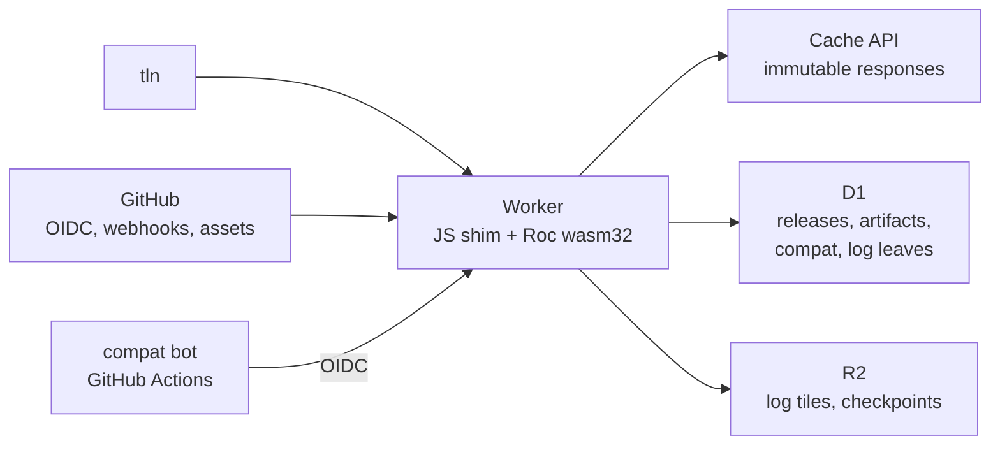
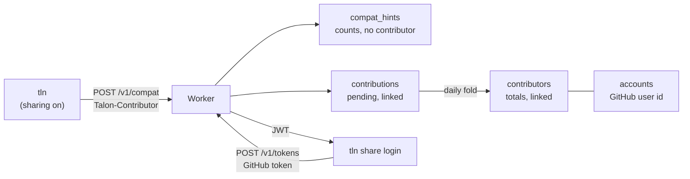
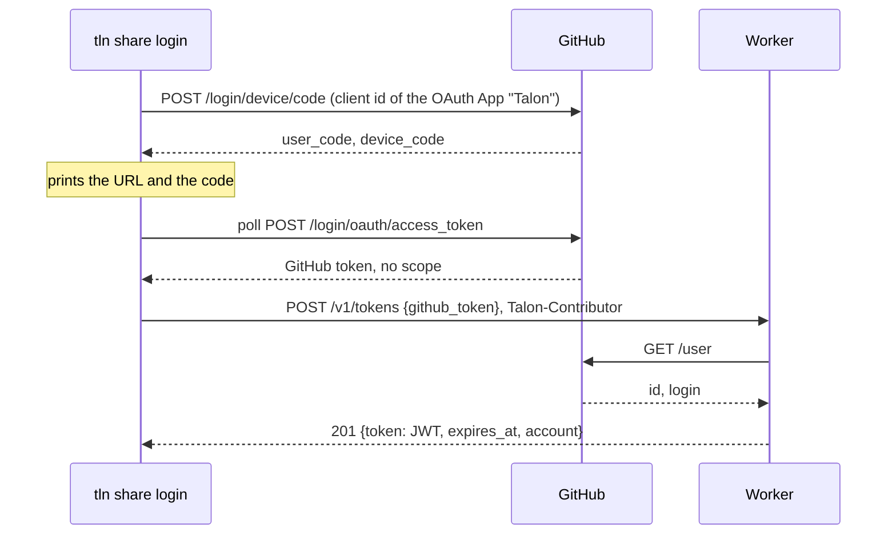
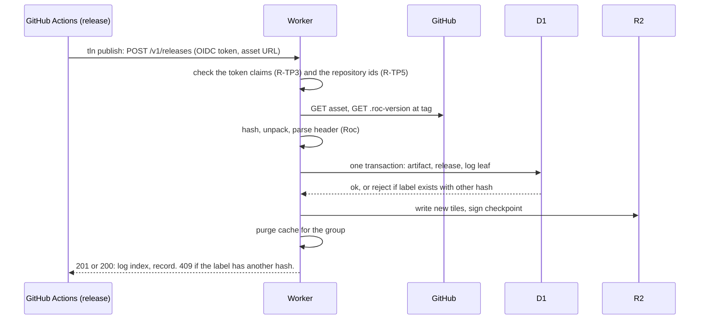

# Talon design: registry

Part of the Talon design. This file holds the registry on Cloudflare and the Worker host that runs it. `DESIGN.md` has the goals, the core model and the list of files.

A reference such as CLI 6.2 is section 6.2 of `DESIGN-CLI.md`. Design, Resolution and Registry name `DESIGN.md`, `DESIGN-RESOLUTION.md` and `DESIGN-REGISTRY.md`. A plain number is a section of this file.

## 1. Role

| # | The registry does | The registry does not |
| --- | --- | --- |
| R-RL1 | Index releases: labels, hash, URL, deps, platform, kind | Store package bytes (v1) |
| R-RL2 | Map hash to labels | Own package names (GitHub does) |
| R-RL3 | Hold the shared compatibility matrix | Run untrusted Roc code inside the Worker |
| R-RL4 | Record publish provenance | Act as a single point of failure: `TALON_REGISTRY=direct` or `--registry direct` uses the GitHub API (precedence in CLI 1, rules in CLI 7.3). `direct` is also the built-in default until the registry runs (P2). |

## 2. Architecture

## 3. Storage choice

R-SG1: The registry keeps its data in D1 rows and a log table, not in one Durable Object for each package (Draft 1). The reasons:

| Need | DO per package | D1 rows + log table |
| --- | --- | --- |
| Closure query across many packages | One DO call per package | One SQL query (recursive CTE) |
| Publish = insert version + append log leaf, atomically | Two objects, no shared transaction | One transaction |
| Unique (group, version) | Per object | `UNIQUE` index |
| Write rate | Scales per package. Not needed: Roc has tens of releases per day. | One writer is enough |
| Global reads | Each DO lives in one region | Read replicas (Sessions API) plus the Cache API |
| Backups | Manual | Time Travel (30 days) |
| Size limit | 10 GB per object | 10 GB per database. About 5 M versions at 2 KB each. |

Merkle log:

| # | Part | Where | Why |
| --- | --- | --- | --- |
| R-SG2 | Leaves `(index, group, version, hash, time)` | D1 table, written in the publish transaction | The log and the index cannot disagree |
| R-SG3 | Compiler leaves, from P2 | Same table and form. One leaf for each asset of a compiler release: group `roc-lang/nightlies:<target>` (CLI 6.2, R-CV2), version the tag, hash `sha256:<hex>`. Written in the same transaction as the `toolchains` row (section 5). | `--snapshot log:N` then fixes the set of compilers too (Resolution 11) |
| R-SG4 | Tiles and signed checkpoint | R2, write-once objects (C2SP tlog-tiles layout) | Tiles are immutable, so object storage plus the edge cache fits. This is how Sunlight serves CT logs. |
| R-SG5 | Sequencing | The D1 transaction (`index = max + 1`) | No separate sequencer at this write rate |

R-SG6: KV is not used: eventual consistency (about 60 s) is wrong for the version list. Package bytes on R2 stay a phase 3 option (hash-keyed mirror).

## 4. HTTP API

The API is plain HTTP with JSON, not full REST. Each resource name is a plural noun, and it is the name of its D1 table (section 5): `artifacts`, `releases`, `compat`, `toolchains`, `contributors`. `packages` is a GitHub name (Design 4.1, R-ID3). `tokens` has no table, because the Worker stores no token (6.1, R-CT9). `me` names the contributor or the account of the request. Paths have no verbs. `POST /v1/closure` is a query with a body, and it changes no state. The log routes are outside `/v1`, because C2SP tlog-tiles sets their layout.

| # | Method and path | Request | Response | Success | Errors (section 4.2) | Caching |
| --- | --- | --- | --- | --- | --- | --- |
| R-AP1 | `GET /v1/packages/{owner}/{repo}/releases` | | `{releases, checked}`: each release (R-RE2) of each group of the repository, in all series and URL forms (CLI 7.3, R-DI6). `checked`: R-AP29. | 200, 304 | 404 `not-found`: the repository has no indexed release | `max-age=60`, ETag. The purge on publish waits for Q25. |
| R-AP2 | `GET /v1/artifacts/{hash}` | | The artifact record (R-RE1) and all its releases (R-RE2) | 200, 304 | 404 `not-found` | `max-age=60`, ETag. Not immutable: a new label or a yank changes the answer. |
| R-AP3 | `POST /v1/closure` | Body of R-AP16 | Answer of R-AP17 | 200 | 400 `bad-request` | `no-store`. One round trip per resolve. |
| R-AP4 | `GET /v1/artifacts/{hash}/compat` | | `{compat, hints}`: the matrix rows (R-RE3) of the hash, each with its `source`, and the `compat_hints` rows (R-RE12) of the hash | 200, 304 | 404 `not-found` | `max-age=300`, ETag |
| R-AP5 | `GET /v1/toolchains`, optional `?target=<target>` | | `{toolchains}`: the rows of R-RE4. With `target`, only the rows of that target. | 200, 304 | 400 `bad-request` | `max-age=300`, ETag |
| R-AP6 | `PUT /v1/toolchains/{tag}` | No body. The OIDC token of the compat bot (R-PU7). | `{toolchains}`: the rows of the tag | 201: new rows. 200: the tag has rows (R-PU9, R-PU10). | 401 `unauthenticated`, 403 `forbidden`, 404 `not-found` (GitHub has no such release), 422 `not-a-candidate` (no asset passes R-CV1 and R-CV2), 502 `upstream` | `no-store` |
| R-AP7 | `GET /v1/packages?q=<text>`, or `GET /v1/packages?short=<name>` (section 4.3) | | With `q`: `{packages}`, ranked packages for display only (R-SN5). With `short`: `{matches}`, the exact match set of a short name (R-SN1 to R-SN4). | 200, 304 | 400 `bad-request` | `q`: `max-age=300`, ETag. `short`: `max-age=60`, ETag. |
| R-AP8 | `POST /v1/releases` with `Authorization: Bearer <GitHub OIDC token>`: a publish (R-PU2) | `{url, compat}`: the asset URL, and the real facts of the released hash (R-PU5, optional) | The release record (R-RE2) and its log index | 201 with `Location: /v1/artifacts/{hash}`: new release. 200: the label exists with the same hash. | 400 `bad-request`, 401 `unauthenticated`, 403 `forbidden` (the token check of R-PU1 fails), 409 `label-conflict`, 422 `not-a-candidate` (R-PU6), 502 `upstream` | `no-store` |
| R-AP9 | `POST /v1/releases` with no `Authorization`: an ingest (R-PU4) | `{url}` | As R-AP8 | As R-AP8. 202 only if Q30 selects a queue. | As R-AP8, and 401 `unauthenticated` (R-AP26), 429 `rate-limited` | `no-store` |
| R-AP10 | `POST /v1/compat` | `{rows, sweep}`. `rows`: a list of `{hash, nightly, target, result, error_digest}`. `sweep`: `{nightly, target, upto_log_index}`, optional, bot only (R-MX4). The OIDC token of the compat bot, or no token for user hints (R-MX5). A user hint request also has the header `Talon-Contributor` and the body field `talon_version` (6.1, R-CT1, R-CT2). | `{written}`: the count of new `compat` rows, or of counted hints (R-RE13). For user hints also `first` (R-CT4). | 201: at least one row is new. 200: each row was there (R-RE13 row 1), or each row is pending already for this contributor (R-CT4). | 400 `bad-request`, 401 `unauthenticated`, 403 `forbidden`, 404 `not-found` (a hash that is not indexed), 422 `sweep-incomplete` (R-MX4, R-MX9), 429 `rate-limited` (R-CT11) | `no-store` |
| R-AP11 | `GET /log/checkpoint`, `GET /log/tile/...` (hash tiles, entry tiles and partial tiles, in the C2SP tlog-tiles layout) | | From R2 | 200 | 404 `not-found` | Checkpoint: `max-age=5` (first guess, tune in P2). Tiles, also partial tiles: `max-age=31536000, immutable`. |
| R-AP12 | `POST /v1/webhooks/github` | A GitHub App event, signed with HMAC-SHA256 (`X-Hub-Signature-256`). Rules: R-PU3, R-PU11 to R-PU18. | No body | 202 | 401 `unauthenticated`: the signature is bad | `no-store` |
| R-AP13 | `GET /v1/releases?group=<URL form>`, optional `&series=<series>` | | `{releases, checked}`: the releases (R-RE2) of that group. With no `series`, all series of the URL form (CLI 7.3, R-DI6). The group can be on any host, also not `github.com` (CLI 7.3, R-DI11). `checked`: R-AP29, `null` for another host. | 200, 304 | 400 `bad-request` | `max-age=60`, ETag. The purge on publish waits for Q25. |
| R-AP14 | `GET /v1/releases?after=<log_index>` | | `{releases}`: the releases with a larger log index, in log index order, at most 1000 (first guess, tune in P2). For the next page, the client asks again with the last log index of the page. `after` and `group` can go together. With no `group` and no `after`, the answer is 400. | 200, 304 | 400 `bad-request` | `max-age=60`, ETag |
| R-AP35 | `GET /v1/contributors/me` | `Authorization: Bearer <JWT>` (6.1, R-CT9) | The tracker of the account (R-CT10) | 200 | 401 `unauthenticated`: no JWT, or a JWT that fails R-CT9 | `no-store` |
| R-AP36 | `DELETE /v1/contributors/me` | The JWT (the account), or `Talon-Contributor` with no JWT (one contributor) (R-CT7) | No body | 204, also when nothing was stored | 400 `bad-request`, 401 `unauthenticated`, 429 `rate-limited` | `no-store` |
| R-AP37 | `POST /v1/tokens` | `{github_token}`: a token of the OAuth App `Talon` (R-CT8). `Talon-Contributor`, optional. | `{token, expires_at, account: {id, login}}`. `token` is the JWT of R-CT9. | 201 | 400 `bad-request`, 401 `unauthenticated` (GitHub refuses the token), 429 `rate-limited`, 502 `upstream` | `no-store` |
| R-AP38 | `DELETE /v1/tokens` | The JWT | No body. Each token of the account stops (R-CT9). | 204 | 401 `unauthenticated` | `no-store` |

R-AP15: A group goes on the wire as two fields. `group` is its URL form: the group with no series (CLI 7.3, R-DI6), with `{v}` in place of the version and with no scheme and no hash, as in Design 4.1, R-ID2 (`github.com/roc-lang/unicode/releases/download/{v}/`). `series` is the series of Design 4.1, R-ID1 (`4`, `0.25`).

### 4.1 Closure query

R-AP16: The body of `POST /v1/closure`:

| Field | Value |
| --- | --- |
| `groups` | A list of `{group, series, range}`. `series` and `range` are optional. It holds each group that the resolve must choose a version for (CLI 7.3, R-DI1): each free direct dep, the platform, each `[overrides]` group (Resolution 6), the group of `tln add`, and the rows of `tln outdated`. With no `series`, all series of the URL form. `range` is a range in the form of `talon.toml` (Design 4.3). With a range, the answer has only the candidates in it. With no range, the answer has every release of the group, for example where R-UP1 (Resolution 10) says that the range does not apply. |
| `hashes` | The hashes whose records the client needs and that no group gives: the value of each header entry (Design 4.2), for example a hash of a hand edit (Design 4.1, R-ID7) |

R-AP17: The answer of `POST /v1/closure`:

| Field | Value |
| --- | --- |
| `artifacts` | The record (R-RE1) of each candidate, of each hash in `hashes`, and of each hash in their closure (the deps, to the end) |
| `releases` | The releases (R-RE2) of these hashes |
| `compat` | The matrix rows (R-RE3) of these hashes, each with its `source` |
| `hints` | The `compat_hints` rows (R-RE12) of these hashes |
| `sweeps` | Each row of the `sweeps` table (R-RE7) |
| `log_size` | The size of the log in the database state that the answer comes from |
| `unknown` | Each hash of `hashes` that the registry does not index (Q33) |
| `checked` | For each `github.com` repository of a group in `groups`: `{name, checked_at, stale}` (R-AP29) |

R-AP18: All rows of one answer and `log_size` come from one state of the database. So each release in the answer has `log_index` at most `log_size`. For example, the Worker runs the reads in one D1 session (Sessions API) and reads `log_size` last, or runs them in one D1 batch.

R-AP19: The client applies `--snapshot log:N` to the answer. It hides each release with `log_index` greater than N, and each toolchain row of R-AP5 with `log_index` greater than N (Resolution 11, R-DT3). It does not hide `compat` and `sweeps` rows: they are evidence, not releases (R-DT5). With no `--snapshot`, `log_size` is the log size that R-DT5 prints (`resolved at log:<log_size>`).

R-AP20: The closure query changes no state. The client can send it again after a network error.

R-AP28: A hash in `unknown` (R-AP17) is a header value that the registry does not index. The closure query already ran the privacy guard of CLI 1, R-RG4 for each `github.com` group and hash in it, so a private repository never gets here. Talon checks the cases in this order, and the first case that applies is used:

| # | Case | What Talon does |
| --- | --- | --- |
| 1 | The answer has the label (group and version) of the URL with another hash | The R-PU19 case. Talon prints a warning that names the release and both hashes. It sends no ingest. |
| 2 | The URL is a `github.com` release asset URL (CLI 7.3, R-DI5) of a repository that the guard found public (CLI 1, R-RG5), and the command has no `--snapshot log:N` | Talon sends one ingest (R-AP9) for each such URL, at the same time, then sends the closure query again, once. This is the rule of CLI 2, R-AD35 for a header value. |
| 3 | Any other URL (another host, a loopback host, an ingest that gave 4xx), or `--snapshot log:N` | Talon sends no ingest. It reads the facts from the archive, as `direct` mode does (CLI 7.3, R-DI7). |

In all cases, the header value stays in the domain of its variable (Resolution 2, R-C9). In case 3, the other candidates of its group come from the registry when the answer has releases of that group. When it has none, the entry acts as an anchor at its header value, as in CLI 7.3, R-DI11, and `tln update`, `tln upgrade` and `tln outdated` print `fixed: not in the registry index`. Reasons: one command uses one index (Q34, CLI 7.3, R-DI14). Talon sends to the registry only a URL on `github.com`. The ingest downloads the asset with no token, so it can index only a public asset, and a URL on a private host never leaves the machine. An ingest adds releases to the log, so a log snapshot must not send one (CLI 2, R-AD36).

### 4.2 Rules for all routes

R-AP21: An error answer is RFC 9457 problem details: `Content-Type: application/problem+json`, with the fields `type`, `title`, `status` and `detail`. `type` is a stable value from the table below, a relative URI. The registry does not serve a page at that URI.

| `type` | Status | When |
| --- | --- | --- |
| `/errors/bad-request` | 400 | The body, the path or the query is not valid |
| `/errors/unauthenticated` | 401 | A token that the route needs is missing or not valid, a webhook signature is bad, or a release body has `compat` and no token (R-AP26) |
| `/errors/forbidden` | 403 | The token is valid, but it does not give this action. The `detail` names the claim that failed (R-TP3, R-TP7, R-TP8, R-YK2). |
| `/errors/repository-changed` | 403 | The repository id and the owner id of the name are both not the recorded ones: another account (R-TP9). The answer has the member `issues_url` (R-TP12). |
| `/errors/not-found` | 404 | The resource does not exist |
| `/errors/label-conflict` | 409 | The label (group, version) exists with another hash (R-PU1) |
| `/errors/unsupported-media-type` | 415 | The request body is not `application/json` |
| `/errors/not-a-candidate` | 422 | The release fails the candidate rules (R-PU6), an ingest names a repository that is not found or not public (R-PU32), or a compiler release has no asset that R-CV1 and R-CV2 select |
| `/errors/successor-mismatch` | 422 | A successor that fails a check of R-AP31. The `detail` names the check, and lists the missing modules for the `exposes` check. |
| `/errors/sweep-incomplete` | 422 | A sweep without a `bot` row for each hash under its bound (R-MX4). The `detail` lists the missing hashes (R-MX9). |
| `/errors/rate-limited` | 429 | The client sent too many requests (R-AP25) |
| `/errors/internal` | 500 | A fault in the Worker |
| `/errors/upstream` | 502 | A read from GitHub failed |

R-AP22: In `tln`, CLI 3, R-E6 maps an error answer, a 5xx answer, or no answer to an exit code, when no other CLI rule handles that case: 20 (`rejected`) for a refused write, 15 (`network`) for a fault that a later run can fix. The message gives the `type` and the `detail`, and `--json` gives them in `error.details` (CLI 3, R-J7).

R-AP23: Media types: request bodies and answers are `application/json` in UTF-8. Errors are `application/problem+json`. The checkpoint is `text/plain; charset=utf-8`, and the tiles are `application/octet-stream`, as C2SP tlog-tiles gives.

R-AP24: Each 200 answer of a `GET` in `/v1` has an `ETag`. A request with an `If-None-Match` that is equal to the current ETag gets 304 with no body. `tln` keeps each answer and its ETag in `talon/index/` (CLI 6.1). It uses an answer that is younger than its `max-age` with no request, and sends `If-None-Match` for an older one, as for GitHub (CLI 7.3, R-DI2).

R-AP25: Any route can answer 429 `rate-limited` with a `Retry-After` header in seconds. Q30 sets the limits of ingests (R-AP9), and R-CT11 sets the limits of user hints. `tln` stops with exit code 15, and the message gives the time when it can try again, as for GitHub (CLI 7.3, R-DI13). The share queue is the exception: a 429 answer keeps its rows and changes no exit code (CLI 1, R-SH4).

R-AP26: A publish and an ingest use one route, `POST /v1/releases`. The `Authorization` header selects the path: a token is a publish (R-AP8), no header is an ingest (R-AP9). A token that fails the check gets 401 or 403, never an ingest. A body with `compat` and no token gets 401 `unauthenticated`, because author facts need the token (R-PU5).

R-AP27: `tln publish` sends no request when it has no OIDC token. In GitHub Actions, the token needs `permissions: id-token: write`. Talon stops, and the message names that permission. So a missing permission never gives an ingest with no provenance and no author facts. The exit code is 2 (CLI 3, R-EC2).

R-AP34: `tln publish`, `tln yank` and `tln move` send their request again after a 429 answer, a 5xx answer or no answer: at most 3 more times (first guess). Each wait is the `Retry-After` of the answer when it has one (at most 60 s), else 2 s, 8 s and then 30 s. After a 401 answer, they get a new OIDC token (7.1, R-TP2) and send the request once more, because a token lives a few minutes. These writes are idempotent (R-PU14, R-YK1, R-AP31), so a request that is sent again writes nothing twice. After the last try, R-AP22 applies. Other commands do not send a request again: an ingest (R-AP9) stops at once (CLI 2, R-AD35). A user hint (R-AP10) is idempotent, because a contributor counts once for a pair while its row is pending (6.1, R-CT4). But the command does not wait for it: the rows that were not sent stay in the queue, and a later command sends them (CLI 1, R-SH4).

R-AP29: `checked` tells how old the index of a GitHub repository is. `checked_at` is the last time that the Worker read the release list of that repository (R-PU21), or `null` when it has not read it since the first ingest. `stale` is true when `checked_at` is `null` or is older than 2 intervals of R-PU22 for that repository. The Worker computes `stale`, because only the Worker knows the interval of each repository.

R-AP30: When an answer has a `stale` repository, `tln update`, `tln outdated` and `tln add` print one note for each such repository: `index: <owner>/<repo> checked <age> ago`, or `index: <owner>/<repo> not checked since its first ingest`. The note does not change the exit code. The text and a `--json` field (`notes[]`, kind `index-stale`) are a proposal (CLI 3, R-OUT2).

R-AP32: Each answer that has releases of a `github.com` name (R-AP1, R-AP2, R-AP13, R-AP14, R-AP17) also has `repos`: one item for each such name, `{name, state, successor, state_at}` from the `repos` row (R-RE11, section 7.3). `state` is `active`, `missing` or `moved`. `successor` is the name of R-TP14, or `null`.

### 4.3 Short-name matches

R-SN1: `GET /v1/packages?short=<name>` gives the match set of a short name (CLI 2, R-SC8). The query can have up to 50 `short` values (first guess). The answer is `{matches}`: for each `short` value, the list of each indexed package whose repo name, or repo name minus a leading `roc-`, is equal to the value. The compare is ASCII case-insensitive, because GitHub names are case-insensitive. Each item is `{name, first_log_index, state}`, with the changes of R-AP33. The list is sorted by `name`. It is not ranked and not cut. An empty list means no match.

| `short` | Indexed packages | `matches` |
| --- | --- | --- |
| `parser` | `lukewilliamboswell/roc-parser` | `lukewilliamboswell/roc-parser` |
| `roc-parser` | `lukewilliamboswell/roc-parser` | `lukewilliamboswell/roc-parser` |
| `Parser` | `lukewilliamboswell/roc-parser`, `someone/parser` | both |
| `pars` | `lukewilliamboswell/roc-parser` | none |

R-SN2: An indexed package is an `owner/repo` name that has at least one release in the index, also a yanked or a withdrawn release (R-YK4, R-PU17), and also a name in the state `missing` (R-TP11). Reason: a match that is too wide only makes Talon stop and ask for the full name (CLI 2, R-AD4). A match that is too narrow can select a package that the user did not mean (typosquat, R-AD7). For example, when `lukewilliamboswell/roc-parser` is deleted and a stranger makes `someone/parser`, `parser` still gives 2 matches, not the new one alone. R-AP33 gives the change for a name in the state `moved`.

R-AP33: In the match set of R-SN1, the Worker replaces a name in the state `moved` with the end of its successor chain (R-TP14). The item then has `moved_from`, the old name. When the end is already in the set, the set has it once. Each item also has `state` (R-AP32). So a moved package does not tie with itself, and a `missing` package still ties with a new name. `tln add` prints `matched "json": acme/roc-json (moved from olduser/roc-json)` (CLI 2, R-AD3). The text is a proposal (CLI 3, R-OUT2).

R-SN3: A package on a host other than `github.com` never matches a short name. It has no `owner/repo` name (Design 4.1, R-ID3). The user types its full name `host/path` (CLI 2, R-SC7).

R-SN4: `first_log_index` is the smallest log index of the releases of that name. With `--snapshot log:N`, the client hides each match with `first_log_index` greater than N. So `tln install` of a short key (Design 4.3, R-I8) gives the same match set at the same snapshot (Design G3).

R-SN5: The ranked results of `?q=` are at most 20 packages (first guess), ranked by a text match on the name. Talon shows them only in messages, for example as suggestions after "no match" (CLI 2, R-AD5). Talon never selects a package from them (CLI 2, R-AD34).

## 5. Records

| # | Table | Key | Fields |
| --- | --- | --- | --- |
| R-RE1 | `artifacts` | hash | kind, exposes, deps `[{alias, url, group, version, hash}]`, platform, targets, `roc:` pin, sizes |
| R-RE2 | `releases` | (group, version) | hash, name, url, tag, `.roc-version`, published_at, log_index, yanked (R-YK4), withdrawn (R-PU17). Provenance is in its own table (R-PU15). |
| R-RE3 | `compat` | (hash, nightly, target, source) | result, error digest, time, and for `author` the log index of the release that sent the row. `source` is `bot` or `author` (R-MX5). |
| R-RE4 | `toolchains` | (tag, target) | asset name, sha256, published_at, log_index |
| R-RE5 | `log` | index | group, version, hash, time |
| R-RE7 | `sweeps` | (nightly, target) | upto_log_index, time |
| R-RE9 | `provenance` | (group, version, via) | `via` (`oidc`, `webhook`, `poll`, `ingest`), the recorded claims (R-TP6, `oidc` only), the attestation result (Design 8, R-SE10, P3), time (R-PU15) |
| R-RE10 | `yanks` | (group, version, seq) | action (`yank`, `unyank`), by (`author`, `operator`), the recorded claims (R-TP6, `author` only), reason, time (R-YK4, P3) |
| R-RE11 | `repos` | name (`owner/repo`, lower case) | repository_id, repository_owner_id, state (`active`, `missing`, `moved`), successor, offer (P3), state_at, time (R-TP5, R-TP11, R-TP14) |
| R-RE15 | `repo_events` | (name, seq) | action (`bind`, `transfer`, `rename`, `recreate`, `missing`, `found`, `successor-set`, `successor-removed`, `offer`, `operator`), the ids before and after, the successor, the recorded claims (R-TP6) for a token, time (R-TP13) |
| R-RE14 | `repo_checks` | name (`owner/repo`, lower case) | etag, checked_at, next_check_at, app_installed. The state of the reconcile (R-PU21). Apart from `repos`, so that the binding of R-TP5 and the reconcile do not write the same row. |
| R-RE12 | `compat_hints` | (hash, nightly, target, talon_version) | pass_count, fail_count, crash_count, first_time, last_time. The user hints of R-MX3 (R-RE13). `talon_version` is the version of the `tln` that sent the hint (R-CT12). It holds no contributor. |
| R-RE16 | `contributions` | (contributor, hash, nightly, target) | result, talon_version, time. A pending user hint, until the fold (R-CT5). `contributor` is the HMAC of the id (R-CT3). |
| R-RE17 | `contributors` | contributor | counted, first, agreed, disagreed, unconfirmed, first_time, last_time, account (a GitHub user id, or null) (R-CT4, R-CT5, R-CT8) |
| R-RE18 | `accounts` | GitHub user id | login, tokens_after, first_time, last_time (R-CT8, R-CT9) |

R-RE6: Artifact rows never change. Release rows change only in `yanked` (R-YK4) and `withdrawn` (R-PU17, R-PU19). Toolchain rows never change. A `compat` row is written once and never changes (R-RE13). A `compat_hints` row changes only in its counts and `last_time`, and only the operator deletes it (R-CT7). A `contributions` row is written once and deleted at the fold (R-CT5). A `contributors` row changes in its totals, `last_time` and `account`. An `accounts` row changes in `login`, `tokens_after` and `last_time`. Rows of `contributions`, `contributors` and `accounts` are deleted by the retention rules of R-CT6 and by R-CT7. A `sweeps` row changes only to a larger `upto_log_index`. Rows of `provenance` (R-PU15) and `yanks` (R-YK4) are only added, never changed. A `repo_checks` row (R-RE14) changes at each reconcile of its repository (R-PU21). It is state, not evidence: no rule reads it as a fact. A `repos` row (R-TP5) is never deleted. It changes only by the rules of R-TP9 to R-TP15, and each change adds a `repo_events` row (R-RE15). `repo_events` rows are only added.

R-RE8: The log index of a hash is the smallest `log_index` of its releases. A `sweeps` row says: the matrix has a `bot` row (R-RE3) on (nightly, target) for each hash whose log index is at most `upto_log_index`.

R-RE13: Matrix rows of one pair (hash, nightly, target):

| # | Rule |
| --- | --- |
| 1 | One pair has at most one `bot` row and one `author` row. The first write of a key wins. A later write of the same key changes nothing, and it is not an error: the bot can post a run again after a failure. Reason: a probe result for a pair does not change (Resolution 4, R-P4). |
| 2 | Two releases in two repositories can have one hash. Then the first publish writes the `author` row. The row keeps the log index of that release, so a reader can find the publisher. |
| 3 | A user hint never goes into `compat`. It adds 1 to `pass_count`, `fail_count` or `crash_count` of the `compat_hints` row of its pair and its Talon version, once for each contributor while its pending row exists (R-CT4). A contributor id costs nothing to make (R-CT1), so a count is not a count of persons. The limits of R-CT11 apply. |
| 4 | The Worker sends all `compat` rows of a pair, and the `compat_hints` row (R-AP4, R-AP17). The client applies the precedence of Resolution 3, R-EF3. The registry does not merge rows. |

## 6. Compatibility matrix

The matrix makes probes rare. A user who adds a common package gets a known answer.

| # | Producer | Runs | Trust |
| --- | --- | --- | --- |
| R-MX1 | Talon compat bot | A scheduled GitHub Actions workflow. For each new nightly, it runs unit probes on every indexed hash. For each new release, it searches the nightly range (Resolution 4). It also runs the smoke builds of each platform for each of its targets (R-MX10). Posts results with an OIDC token. | Full |
| R-MX2 | Release workflow | `tln probe --range <bundle file>`, then `tln publish` sends the facts (Resolution 4, R-PB5) | Full, tied to the publisher |
| R-MX3 | Users | `tln` with sharing on, and `tln probe --share` (6.1, CLI 1, R-SH1) | Hint only (rank 6) |

R-MX4: The bot sends a sweep with its matrix rows (R-AP10): `(nightly, target, upto_log_index)`. `upto_log_index` is a log size that the bot read before its run. The Worker writes the `sweeps` row (R-RE7, R-RE8), or raises it, only when the matrix then has a `bot` row on (nightly, target) for each hash whose log index is at most `upto_log_index`. An `author` row does not count. Reason: a sweep is a claim of the bot about its own runs, in one environment. Epochs (Resolution 4, R-EP4) spread the facts of a covered transition to other releases, so a wrong `author` row must not make a transition covered. Else the Worker writes nothing from the request and answers 422 `sweep-incomplete` (R-MX8, R-MX9). `upto_log_index` must be at most the log size, else the answer is 400 `bad-request`. The `target` of a sweep must be `any`, else 400 `bad-request`: smoke rows (R-MX10) have no sweep, and epochs use unit checks only (Resolution 4, R-EP2). A sweep never makes a row smaller: a sweep with a bound that is not larger than the row is complete by R-RE8 and changes nothing, with no error. The closure answer carries all `sweeps` rows (R-AP17). The resolver finds epochs only between swept releases (Resolution 4, R-EP2).

R-MX5: The Worker sets the `source` of each matrix row from the auth of the request, not from the body. A body that has a `source` field gets 400.

| Request | Auth | `source` |
| --- | --- | --- |
| `POST /v1/compat` (R-AP10) | The OIDC token of the compat bot (R-MX1) | `bot` |
| `POST /v1/releases` (R-AP8, R-PU5) | The publish token | `author` |
| `POST /v1/compat` (R-AP10) | No token, and the header `Talon-Contributor` (R-CT1) | None: a user hint goes to `compat_hints` (R-RE12, R-RE13) |
| `POST /v1/compat` (R-AP10) | Another token | None: 403 `forbidden` |

R-MX6: User hints (`POST /v1/compat` with no token) have the rate limit of R-CT11. A user hint is never a `compat` row, so it never goes into a sweep (R-MX4).

R-MX7: The bot finds new releases and new hashes with `GET /v1/releases?after=<log_index>` (R-AP14). It starts from the largest log index of its last run. The log entry tiles (R-AP11) give the same leaves, so the bot can also read them.

R-MX8: The database enforces R-MX4, not the Worker code. A `BEFORE INSERT` trigger and a `BEFORE UPDATE` trigger on `sweeps` stop the statement with `RAISE(ABORT, ...)` in these cases:

| Case | `RAISE` text |
| --- | --- |
| The bound is larger than the log size | `sweep-bound` |
| A release with `log_index` at most the bound has a hash with no `bot` row on (nightly, target) (R-RE8) | `sweep-incomplete` |
| An `UPDATE` makes the bound smaller (R-RE6) | `sweep-smaller` |

The Worker sends one D1 batch for each request: first the matrix rows (`INSERT OR IGNORE`, R-RE13 row 1), then the sweep as an upsert that changes the row only to a larger bound. The batch is one transaction, so a `RAISE` rolls back the rows of the request too. Reasons: D1 has no interactive transaction and a batch cannot branch (`cloudflare-workers/API.md` RF4). The check runs in the same transaction as the write, so a publish or a second bot run cannot come between the check and the write. And once a sweep is complete it stays complete: a new leaf gets a larger log index than each accepted bound, and a `compat` row is never deleted (R-RE6). Test and measurement: `research/d1-sweep/` (local D1 and SQLite, 12 cases; the guard costs about 7 to 10 ms of D1 time at 20,000 hashes).

R-MX9: The Worker maps a batch error to an answer by the `RAISE` text, as a substring of the D1 error message: `sweep-incomplete` gives 422 `sweep-incomplete`, and `sweep-bound` gives 400 `bad-request`. Then the Worker reads the hashes that have no `bot` row under the bound, and the `detail` of the 422 answer lists up to 100 of them, so the bot knows what to probe. A batch error with no known `RAISE` text gives 500 `internal`. A user hint request (R-MX6) has no sweep, so it never gets these errors.

R-MX10: Smoke builds of the bot (Resolution 4, R-SM1). The bot runs the smoke build of a platform hash for each target in the `targets` of its artifact record (R-RE1), on one Linux runner: roc links with the files of the platform only, so one machine builds each target (`research/smoke-app/`, 34 of 34 targets as a real app). It builds a pair (platform hash, nightly) only when the unit check of that pair passed, because a build after a failed check fails too.

| Event | Smoke builds |
| --- | --- |
| A new nightly | Each indexed platform, each of its targets, on that nightly |
| A new platform release | Each target, on each nightly where the range search of R-MX1 found a passing unit check |

The rows have the key (platform hash, nightly, target) and the source `bot`. The Worker accepts a real target only for an artifact of kind `platform` whose `targets` has that target, else 400 `bad-request`. A result whose error depends on the build machine, not on the platform (Resolution 4, R-SM7), gives no row.

Cost: about 50 packages times 1 new nightly a day, at under 2 s each, is under 2 minutes of CI a day. Smoke builds add about 10 platforms times 6 targets at under 0.5 s: under 1 minute.

### 6.1 Shared probe results

A user who turns sharing on (CLI 1, R-SH1) sends to `POST /v1/compat` the unit checks of public hashes, the smoke builds of public platforms (Resolution 4, R-SM1) and the builds of public tool apps (CLI 1, R-SH3). They are user hints: rank 6, search order only (Resolution 3). Reads do not need sharing: each client gets all of the matrix (R-AP4, R-AP17). This section holds what the Worker keeps, for how long, and who can delete it.

R-CT1: A user hint request has no `Authorization` header, and it has the header `Talon-Contributor: <id>`. The id is 32 lowercase hex characters (16 random bytes, CLI 1, R-SH5). A request with no token and with no valid id gets 400 `bad-request`. A request with a token has no id: the token selects `bot` (R-MX5).

R-CT2: The Worker checks the body and each user hint row. When one row fails a rule, the whole request gets the error of that rule, and the Worker writes nothing. The error is 404 `not-found` for an unknown hash, else 400 `bad-request`.

| Field | Rule |
| --- | --- |
| `hash` | Indexed (R-RE1). Else 404 `not-found`. |
| `nightly` | A tag in `toolchains` (R-RE4) |
| `target` | `any` for a unit check (Resolution 4, R-P4). A real target only when the artifact kind is `app` (the build of a tool app, CLI 1, R-SH3) or `platform` (a smoke build, Resolution 4, R-SM1). |
| `result` | `pass`, `fail` or `crash`. A hang is not a hint (CLI 1, R-SH3). |
| `error_digest` | Only with `fail`. At most 128 characters. |
| `talon_version` | The version of `tln` (R-CT12) |
| `rows` | At most 500 (first guess) |

R-CT3: The Worker never stores the id. It stores `contributor`: HMAC-SHA256 of the id with the Worker secret `CONTRIBUTOR_KEY`. A new key unlinks each stored row from its id, so the stable id of CLI 1, R-SH5 stops working for the totals. The operator changes the key only after a leak of the key.

R-CT4: The Worker writes one user hint request as one D1 batch, in this order. The batch is one transaction (`cloudflare-workers/API.md` RF4).

| Step | Statement |
| --- | --- |
| 1 | `SELECT` the count of the distinct pairs (hash, nightly, target) of the request that have no `compat` row and no `compat_hints` row. This is `first`. |
| 2 | Upsert the `contributors` row (R-RE17): `first` plus the count of step 1, and `last_time`. |
| 3 | `INSERT ... ON CONFLICT (contributor, hash, nightly, target) DO NOTHING RETURNING hash` into `contributions` (R-RE16). An `AFTER INSERT` trigger adds 1 to the count of the result in the `compat_hints` row of (hash, nightly, target, talon_version), and 1 to `counted` of the contributor. A skipped row fires no trigger, so a contributor counts once for a pair while its pending row exists, and a request that `tln` sends again counts nothing twice (CLI 1, R-SH4). `written` is the count of returned rows. |

The answer is 201 when `written` is larger than 0, else 200. Two details that the test found (`research/d1-contrib/`, local D1 and SQLite, 15 cases):

| Detail | Reason |
| --- | --- |
| `ON CONFLICT DO NOTHING`, not `INSERT OR IGNORE` | `OR IGNORE` also skips a row that fails a `CHECK`, with no error. Then a bad row is lost and the rest of the request is written. With `DO NOTHING`, a `CHECK` failure stops the whole batch. |
| `written` from `RETURNING`, not from `meta.changes` | On D1, `meta.changes` also counts the rows that the trigger writes (9 in place of 3 for 3 new rows). Plain SQLite does not. |

R-CT5: The fold. A daily cron step reads the `contributions` rows, changes the `contributors` row of each, and deletes them:

| Case | Change | Row |
| --- | --- | --- |
| The pair has a `bot` row with the same result class (R-RC1 to R-RC4 of Resolution 4) | `agreed` plus 1 | Deleted |
| The pair has a `bot` row with another result class | `disagreed` plus 1 | Deleted |
| No `bot` row, and the row is older than 30 days | `unconfirmed` plus 1 | Deleted |
| No `bot` row, and the row is younger | None | Kept |

The bot builds no tool app, so these builds are always `unconfirmed`. A smoke build of a user compares with the smoke row of the bot (R-MX10). Reason for the fold: after the `bot` row comes, the hint has no use (Resolution 3, R-EF3), and the link between a contributor and a pair can go.

R-CT6: Retention:

| Data | Holds | Kept for |
| --- | --- | --- |
| `compat_hints` | Counts, with no contributor | Always. The operator can delete the rows of one `talon_version` (R-CT7). |
| `contributions` | A contributor and a pair | Until the fold: at most 30 days (R-CT5) |
| `contributors` | A contributor and its totals, with no pair | Until R-CT7 deletes it, or 13 months after `last_time` |
| `accounts` | A GitHub user id and login | Until R-CT7 deletes it, or 13 months after the last login and the last contribution of its contributors |
| The IP address | The key of the rate limit only (R-CT11) | Not written to D1 or to a log |
| D1 Time Travel (section 3) | Copies of each table | 30 days. So a deletion is complete 30 days after the request. |

R-CT7: Deletion. `DELETE /v1/contributors/me` (R-AP36) removes the linked data:

| Proof in the request | The Worker deletes |
| --- | --- |
| `Talon-Contributor`, with no JWT | The `contributions` and `contributors` rows of that contributor |
| `Authorization: Bearer <JWT>` (R-CT9) | The `accounts` row, and the `contributions` and `contributors` rows of each contributor that is linked to it |

The Worker never changes `compat_hints` for a user. A count holds no contributor, so nothing ties a count to a person, and the Worker cannot find the counts of one contributor. This is the meaning of "a shared result cannot be retracted". The operator deletes the `compat_hints` rows of one `talon_version` when that version of `tln` sent wrong results.

R-CT8: Login (`POST /v1/tokens`, R-AP37). The account is a GitHub account:

| # | Rule |
| --- | --- |
| 1 | The OAuth App `Talon` belongs to the org `roc-talon`, with the client id `Ov23li2sxWgMaAvjaUbQ`. The client id is public: it is a constant in the `tln` binary. The app has the device flow on and asks for no scope, so the token can read only public data. It is not the GitHub App `Talon Indexer` (R-PU25). Test: `research/oauth-device-flow/check.sh`. |
| 2 | The Worker reads `GET /user` with the token, and keeps no GitHub token. It does not revoke the token: the token has no scope, so it can read only public data, and `tln` does not write it to a file (CLI 1, R-SH7). The device flow needs no client secret, so the Worker has none. The Worker does not check which app made the token: any token of the account proves the account. |
| 3 | The Worker upserts the `accounts` row, and links the contributor of the header to the account. One account can have many contributors: one for each machine. Before a login, nothing ties a contributor to a person. A login also links the totals that the contributor has from before. |
| 4 | GitHub refuses the token: 401 `unauthenticated`. GitHub does not answer: 502 `upstream`. |

R-CT9: The JWT. The Worker signs it and the Worker checks it. No other party reads it.

| Part | Value |
| --- | --- |
| `alg` | `EdDSA` (Ed25519, WebCrypto) |
| `kid` | The id of the signing key |
| `iss`, `aud` | The origin of the registry |
| `sub` | The GitHub user id, as a string. Not the login: a login can change (R-TP10). |
| `iat`, `exp` | `exp` is `iat` plus 30 days |

The check: the signature with the public key of `kid`, `iss` and `aud` equal to the origin, `exp` after now, and `iat` not before `tokens_after` of the account (R-RE18). The private key is the Worker secret `TOKEN_KEY`. After a key change, the Worker keeps the old public key until the last token that it signed expires. `DELETE /v1/tokens` (R-AP38) sets `tokens_after` to now, so each token of the account stops. Reason for a JWT and not a session table: the check is one signature and the `accounts` read that the route does anyway.

R-CT10: The tracker. `GET /v1/contributors/me` (R-AP35) answers `{account: {id, login}, contributors, counted, first, agreed, disagreed, unconfirmed, first_time, last_time}`. Each total is the sum over the contributors that are linked to the account. `contributors` is their count. A request with no JWT gets 401: a user who has not logged in has only the tracker on the machine (CLI 1, R-SH6).

R-CT11: The rate limit of user hints is per IP address. The key is the IPv4 address, or the IPv6 /64 prefix. At most 30 requests a minute (first guess), with the rate limiting binding (`cloudflare-workers/API.md` RN10). `POST /v1/tokens` and `DELETE /v1/contributors/me` have at most 10 requests a minute for one key (first guess). Over the limit: 429 with `Retry-After` (R-AP25). The IP address is only the key of the binding: the Worker writes it to no table and no log.

R-CT12: `talon_version` is the version of `tln`, for example `0.4.1`. A value that is not a version is stored as `unknown`. Reason: the operator can delete the counts of one version after a fault of that version (R-CT7).

## 7. Publish flow

R-PU1: A publish runs these steps:

| # | Path | Trigger | Auth |
| --- | --- | --- | --- |
| R-PU2 | `tln publish` in the release workflow | Author | GitHub OIDC (trusted publishing, section 7.1) |
| R-PU3 | GitHub App webhook (`POST /v1/webhooks/github`, R-AP12) | The `release` events of R-PU11 | App installation on the repo |
| R-PU4 | `POST /v1/releases` with no token (R-AP9) | Anyone, with a public URL | None. The bytes and the tag are public, and the hash checks them. The Worker checks that the repository is public (R-PU31, R-PU32). |

R-PU5: `tln publish` also sends the real facts of the released hash (Resolution 4, R-PB5). The Worker writes them as `compat` rows with the source `author`, with the release.

R-PU6: For a GitHub release, each path selects the package asset and reads the version and the group with the rules of `direct` mode (CLI 7.3, R-DI3 to R-DI5). So the registry does not index a draft, a prerelease, or a release with 0 or 2 package assets, and `tln` sees the same candidates in both modes. A URL on another host gets the version and group from the roc rule (Design 2), as in R-DI5.

Compiler releases, from P2:

| # | Step | What happens |
| --- | --- | --- |
| R-PU7 | 1 | The compat bot (section 6) finds a new compiler release and calls `PUT /v1/toolchains/{tag}` (R-AP6) with an OIDC token. |
| R-PU8 | 2 | The Worker reads the release from the GitHub API itself. It does not trust the body of the bot for the sha256. It selects the assets with R-CV1 and R-CV2 (CLI 6.2) and takes each sha256 from the `digest` field. |
| R-PU9 | 3 | One D1 transaction writes a `toolchains` row and a compiler log leaf (section 3) for each asset. A tag that already has rows is not written again. |
| R-PU10 | 4 | If GitHub later shows another `digest` for a recorded asset, the Worker keeps the recorded row and returns it. `tln` then stops at R-CV4 with exit code 16. |

Webhook, idempotency and provenance:

One release can come in on 3 paths (R-PU2 to R-PU4), in any order. GitHub sends no event when an asset is uploaded. Evidence, checked on 2026-10-16:

| Source | Result |
| --- | --- |
| GitHub OpenAPI description (`github/rest-api-description`, commit `51a4657888cc`, `x-webhooks`) | 275 webhooks. The release webhooks are `release-created`, `-deleted`, `-edited`, `-prereleased`, `-published`, `-released`, `-unpublished`. No webhook has `asset` in its name. The `changes` object of `release-edited` has only `body`, `make_latest`, `name` and `tag_name`. |
| `octokit/webhooks` payload schemas (commit `aa80c24a3f55`) | The same 7 actions of `release`, and no event for assets |
| GitHub docs, "Webhook events and payloads" | No asset event |

A schema shows the events that GitHub documents, not the events that it sends. A live test (`research/github-release-events/README.md`) confirms the result. Until then, R-PU13 does not depend on it: the retries also find an asset that comes with no event. So a release that gets its asset after it is published gives one event with 0 assets.

| # | Rule |
| --- | --- |
| R-PU11 | The GitHub App subscribes to the `release` event, to the `installation` and `installation_repositories` events for R-PU26, and to the `repository` event with the actions `privatized` and `publicized` for R-PU33. The Worker uses the actions `published`, `released`, `edited`, `prereleased`, `unpublished` and `deleted`, and ignores `created` (a draft). It checks the signature (R-AP12), answers 202 at once, and does the work after the answer (`Ctx.respond!`, then the work, or a queue). Reason: GitHub stops a delivery after 10 s, and a publish takes longer (Q28). |
| R-PU12 | The Worker does not use the release in the event body. It reads the release again from the GitHub API, as R-PU8 does for a compiler release. Reason: GitHub can send an event again later (redelivery), and its body can be old. |
| R-PU13 | For `published`, `released` and `edited`: when the release passes R-PU6, the Worker indexes it as an ingest of its asset URL (R-PU4), with the provenance `webhook` (R-PU15). When the release has no package asset, the Worker reads it again after 1, 5, 15 and 60 minutes (first guess), and indexes it when the asset is there. It stops early when the release is deleted. A release with 2 or more package assets is not a candidate (CLI 7.3, R-DI4), so the Worker does not read it again. |
| R-PU14 | Each path is idempotent for a label. When the label (group, version) exists with the same hash, the path writes no artifact, release or log row, and the answer is the existing record (200, R-AP8). The path adds only its own provenance row (R-PU15), and a publish also adds its author facts (R-PU16). When the label exists with another hash, a publish and an ingest get 409 `label-conflict`. The webhook path writes nothing and logs the conflict. |
| R-PU15 | The `provenance` table holds how each release came in. Key: (group, version, via). `via` is `oidc` (a publish), `webhook`, `poll` (a reconcile, R-PU21) or `ingest`. Fields: the recorded claims (R-TP6) for `oidc`, the attestation result (Design 8, R-SE10), time. A row is only added (`INSERT OR IGNORE`), never changed. When the row of that `via` exists, the path writes no new row. The release record in an answer carries all its provenance rows. `tln add` shows the strongest one: `oidc`, then `webhook`, then `poll`, then `ingest` (Design 8, R-SE3). |
| R-PU16 | A publish of a label that the webhook or an ingest indexed first, with the same hash: the Worker adds the `oidc` provenance row and the author facts (`compat` rows with the source `author`, R-PU5, R-MX5), and answers 200. The author facts are rows of `compat`, not of `releases`, so R-RE6 holds. A publish of a draft gets 422 `not-a-candidate`, and the `detail` says `draft`. So the release workflow publishes the GitHub release before `tln publish` (Resolution 4, R-PB5). |
| R-PU17 | A release that stops being a candidate on GitHub is withdrawn: the action `deleted`, `unpublished` (back to a draft), `prereleased`, or `edited` when the release is now a prerelease. The Worker sets `releases.withdrawn` to the action and the time. A reconcile also sets it (R-PU23), and R-PU24 adds the value `repo-missing`. A withdrawn release is not a candidate, as a deleted release in `direct` mode (CLI 7.3, R-DI3, R-DI14, Resolution 2, R-C6). It stays in the index and in the log, and its label keeps its hash (R-PU14). When the release is a candidate again with the same asset hash (`published`, `released` or `edited`), the Worker clears `withdrawn`. `tln audit` reports a withdrawn header value as it reports a yanked one. |
| R-PU18 | Without the App on a repository, the registry learns of a new release or a deletion only at the next reconcile of that repository (R-PU21). Until then, a new release is not in the index, and a deleted release stays a candidate whose download fails with a 404 (CLI 7.1, R-FE6). Answers show the age of the index (R-AP29). |
| R-PU19 | A label keeps its first hash. When a release shows a new package asset for a label that the index has with another hash (a tag that is released again), each path gets 409 `label-conflict`, and the registry indexes nothing new. The `detail` says to release a new version. Reasons: the log proves that a label has one hash (Design 8, R-SE2), roc rejects one label with two hashes in one build (Design 2, "Conflicting Package Contents"), and a changed asset for an old label is the attack that the log finds. Go checksum database and crates.io have the same rule. |
| R-PU20 | Each path that reads a release from GitHub (R-PU12, R-PU17, a 409 of R-PU19) also checks that the recorded asset `<hash>.tar.zst` of each indexed label of that release is still there. When it is not there, the Worker sets `releases.withdrawn` to `asset-replaced` and the time (R-PU17). A withdrawn release is not a candidate. When the recorded asset is there again, the Worker clears `withdrawn`. So after a tag is released again, the registry gives no candidate for that label, and `direct` mode gives the new hash only where R-DI15 (CLI 7.3) does not stop it. |

Reconcile, from P2:

R-PU21: The Worker reads each indexed GitHub repository again on a schedule (a reconcile). For each release in the list, the work is the same as an ingest (R-PU4), so R-PU6, R-PU14, R-PU17, R-PU19 and R-PU20 apply. The provenance is `poll` (R-PU15). Reasons: a repository with no App and no `tln publish` sends no signal (R-PU18), and GitHub does not send a failed webhook delivery again by itself (GitHub docs, "Handling failed webhook deliveries"). So a repository with the App can also miss a release.

| # | Rule |
| --- | --- |
| R-PU22 | Interval: 1 h for a repository with no App installation, 24 h for a repository with the App (`repo_checks.app_installed`, R-RE14). First guesses, tune in P2. The default `min-release-age` of 2 days (Resolution 2, R-C7) hides a new release for longer than each interval, so most users do not see the lag. |
| R-PU23 | Steps. A cron trigger (every 5 min, first guess) selects the `repo_checks` rows with `next_check_at` at or before now, oldest first, at most 500 rows (first guess). For each row, the Worker reads the release list of CLI 7.3, R-DI2 with `If-None-Match` and the stored `etag`. A 304 answer changes only `checked_at` and `next_check_at`. For a 200 answer, the Worker stores the new `etag`. Each new candidate goes to the index job of R-PU13 (`cloudflare-workers/API.md` RN16). Each indexed release that is not in the list gets `withdrawn` = `deleted`, and each one that is now a prerelease gets `withdrawn` = `prereleased` (R-PU17). The token of R-PU25 does not show drafts, so a release that is a draft again is also `deleted`. Then the Worker sets `checked_at` to now and `next_check_at` to now plus the interval. The cron only reads lists. It does not hash or unpack an archive, so it stays in the CPU limit of a cron (RN17). |
| R-PU24 | When GitHub answers 404 for the repository (it is deleted, or it is private and the App is not installed on it), or the visibility read of R-PU31 shows that it is not public (R-PU33), the Worker sets `withdrawn` = `repo-missing` on each release of that repository that is not withdrawn yet. The reconcile does not change the binding ids of the `repos` row (R-TP5). It sets the state `missing` (section 7.3, R-TP11). When a later reconcile reads the list again (200) and the binding of section 7.1 allows it, R-PU17 clears `repo-missing` for each release that is a candidate again with the same asset hash. |
| R-PU25 | Token: an installation token of the GitHub App `Talon Indexer`, which the organization `roc-talon` owns and on which it is installed (RN18). The Worker never uses the token of a user (CLI 1, R-RG3). A token lives 1 h (GitHub docs, "Generating an installation access token"), and the Worker keeps it until 5 min before its end. The installation can send 5,000 requests per hour (GitHub docs, "Rate limits for the REST API"). A 304 answer to a request with a token does not count (CLI 7.3, R-DI2). When `x-ratelimit-remaining` is under 10 % of the limit, the Worker moves `next_check_at` of the rest of the batch to the reset time (`x-ratelimit-reset`). |
| R-PU26 | The `repo_checks` row of a name is added with the first indexed release of that name, in the same write as the binding of R-TP5, with `next_check_at` = now plus the interval. The App events `installation` and `installation_repositories` (added, removed) set `app_installed` (R-PU11). |
| R-PU27 | A host other than `github.com` has no release list. The Worker does not read it again, and its releases change only through a new ingest (R-AP9). This is the same as CLI 7.3, R-DI11. Answers give `checked` only for `github.com` repositories (R-AP29). |

P2 check for R-PU25: the GitHub docs say that an installation token "cannot be granted access to repositories that the installation was not granted access to". They do not say if it can read a public repository that is not in the installation. Test this before the P2 reconcile code. If it cannot, the Worker uses a fine-grained token of a bot account with read access to public repositories only, with the same rules.

Public repositories only:

R-PU31: The registry indexes a release only when its repository is public (Design 1, N4). Each path gets the visibility from GitHub itself, before it writes anything. Reason: the App installation token of R-PU25 can read a private repository where the App is installed, so a read that succeeds does not prove that the repository is public.

| Path | Source of the visibility |
| --- | --- |
| Publish (R-AP8) | The claim `repository_visibility` of the token (R-TP3 row 6) |
| Webhook (R-PU11 to R-PU13) | `GET /repos/{owner}/{repo}`, read again as in R-PU12. The event body is not used. |
| Ingest (R-PU4, R-AP9) | `GET /repos/{owner}/{repo}`, the same read that gives the ids of R-TP5 |
| Reconcile (R-PU21 to R-PU24) | `GET /repositories/{repository_id}` with `If-None-Match`, before the release list. A 304 answer keeps the last result. This is also the read of R-TP10. |
| Move (R-AP31) | The claim `repository_visibility` of the token (R-TP15), and the successor must be `active` (R-AP31, check "Index"), so it is public by R-PU33 |

R-PU32: A repository is public when the read gives `visibility` = `public`. The values `private` and `internal` (GitHub Enterprise) are not public. For a name with no `repos` row, a repository that is not public makes the path write nothing: no `repos`, `repo_checks`, `repo_events`, `provenance`, `releases` or `artifacts` row, no log leaf, and no queue job that holds the name. The Workers log line of the refusal (RN13) has the problem `type`, not the name or the URL. So the server never stores the name of a private repository that it did not have before. CLI 1, R-RG4 to R-RG6 is the same guard on the client.

| Path | Answer for a repository that is not public |
| --- | --- |
| Publish | 403 `forbidden`, and the `detail` names the claim `repository_visibility` (R-TP3). The caller owns the repository, so the answer can name the cause. |
| Ingest | 422 `not-a-candidate`, with the `detail` `repository not found or not public`. A release that users cannot download is not a candidate (R-PU6, N4). The answer is the same for a private and a missing repository, so an ingest with no token cannot test if a private repository exists. |
| Webhook, reconcile | No answer to a client. The Worker writes nothing for a new name, and applies R-PU33 for a known name. |

R-PU33: An indexed repository that becomes private gets the state `missing` (R-TP11), and each of its releases gets `withdrawn` = `repo-missing` (R-PU24). The `repos` row stays, so the name stays bound (R-TP9 row 4). Rows that the registry wrote while the repository was public stay, because they were public data and the log is append-only (Design 8, R-SE2). The Worker finds the change in two ways: the App event `repository` with the action `privatized` (R-PU11), and the visibility read of each reconcile (R-PU31). The action `publicized` sets `next_check_at` of the row to now, so the next reconcile clears `repo-missing` (R-PU24). While a repository is not public, the Worker ignores its `release` events.

R-PU34: Ingest limits (Q30). An ingest (R-AP9) needs no login. These limits apply:

| # | Limit |
| --- | --- |
| 1 | For each IP address (the IPv4 address, or the IPv6 /64 prefix): at most 60 ingests a minute (first guess), with the rate limiting binding (`cloudflare-workers/API.md` RN10). `tln add` of a new repository sends one ingest for each candidate (CLI 2, R-AD35), so the limit must allow the releases of one repository. |
| 2 | For each owner: at most 20 new names a day from ingests (first guess). The Worker counts the `repos` rows of the owner whose `time` is after 00:00 UTC. Over the limit: 429 `rate-limited`, with `Retry-After` until 00:00 UTC. |
| 3 | The archive size limit of Q28 |
| 4 | The rules that exist: `github.com` release asset URLs only, public repositories only (R-PU31, R-PU32), one release for each label (R-PU14), the candidate rules (R-PU6) |

Reasons for no login: ordinary commands send an ingest (CLI 2, R-AD35, 4.1 R-AP28), also in CI, where nobody can log in. The webhook, the reconcile and `tln publish` index most releases, so an ingest is only the first sight of a repository. A login moves the abuse to free GitHub accounts, and the attacker still needs repositories with releases. A later option: a JWT of 6.1, R-CT9 gives a larger limit in row 1.

Cost, for 1,000 repositories with no App (first estimate):

| Item | Value | Limit or price |
| --- | --- | --- |
| GitHub list reads | 24,000 a day, most of them 304 answers | 5,000 counted requests per hour for the installation. The worst case, 1,000 answers of 200 per hour, is under it. |
| Cron runs | 288 a day, at most 500 reads each | Workers Paid: 30 s of CPU for a cron with an interval under 1 h, 10,000 subrequests per run (Cloudflare Workers limits) |
| Queue operations | Only for new candidates and retries (R-PU13) | Workers Paid includes 1,000,000 operations a month, then USD 0.40 per million (Cloudflare Queues pricing) |

### 7.1 Trusted publishing

R-TP1: P2 has no per-repository publisher config. A fixed rule (R-TP3) selects the tokens that can publish. A person who can push a tag of the repository can publish its release. Reasons: GitHub owns the names (R-RL2), and the registry has no accounts. A tag push already needs write access to the repository. A config needs a place to keep it and an owner check for its writer, and that check is the same GitHub write access.

R-TP2: `tln publish` gets the token from GitHub Actions: a `GET` of `$ACTIONS_ID_TOKEN_REQUEST_URL` with `&audience=<registry base URL>`, and the header `Authorization: bearer $ACTIONS_ID_TOKEN_REQUEST_TOKEN`. With no such variables, it sends no request (R-AP27). P2 supports no other CI.

R-TP3: The Worker checks these claims of a publish token. Each failed check gives 401 `unauthenticated` (rows 1 to 3) or 403 `forbidden`, and the `detail` names the claim.

| # | Claim | Check |
| --- | --- | --- |
| 1 | Signature, `iss` | RS256 with a key of the GitHub JWKS (`kid`), API.md RN6. `iss` is `https://token.actions.githubusercontent.com`. |
| 2 | `aud` | Equal to the base URL of the registry, with no trailing `/` (the Worker setting `AUDIENCE`). Reason: a token for another service cannot publish here. |
| 3 | `exp`, `nbf` | The time is between `nbf` and `exp`, with 60 s of leeway |
| 4 | `repository` | Equal to `owner/repo` of the asset URL, ASCII case-insensitive. The host of the URL is `github.com`. |
| 5 | `repository_id`, `repository_owner_id` | At least one of the two is equal to the `repos` row of that name, when it has one (R-TP5, R-TP9) |
| 6 | `repository_visibility` | `public`. Reason: users fetch the asset with no token (CLI 7.1). |
| 7 | `ref_type`, `ref` | `ref_type` is `tag`, and `ref` is `refs/tags/<tag>` with the tag of the asset URL |
| 8 | `event_name` | `release`, `push` or `workflow_dispatch` |

R-TP4: Why rows 7 and 8 stop the known attacks:

| Event | Result | Why |
| --- | --- | --- |
| `pull_request` from a fork | No token | GitHub gives a fork pull request read-only permissions, so no `id-token: write` |
| `pull_request_target`, `workflow_run`, `issue_comment`, `schedule` | 403 | The ref is a branch of the base repository (row 7). Row 8 also refuses the event. |
| `push` of the tag, `release`, `workflow_dispatch` on the tag | Accepted | The workflow file comes from the commit of the tag, so the code that publishes is the code of the release |

R-TP5: The `repos` table binds a name to GitHub ids. Key: `name` (`owner/repo`, lower case). Fields: `repository_id`, `repository_owner_id`, the state and the successor of section 7.3, time. The first write of a release of that name adds the row. A publish takes the ids from the claims. The webhook and an ingest read them with `GET /repos/{owner}/{repo}` of the GitHub API. Each later write of that name follows R-TP9. Reason: when a repository is deleted, or its owner is renamed, another person can create a repository with the old name (repo-jacking). PyPI checks the owner id for the same reason. The registry trusts the owner of the recorded repository (R-TP9), and refuses only another account. Section 7.3 gives the states of a row, renames and moves.

R-TP6: The `oidc` provenance row (R-PU15) records these claims: `workflow_ref`, `workflow_sha`, `job_workflow_ref`, `event_name`, `run_id`, `run_attempt`, `actor_id`, `runner_environment`. The Worker does not check them. `tln add` shows the workflow and the commit (Design 8, R-SE3).

R-TP7: A compat bot token (R-MX1, R-AP6, R-AP10) passes rows 1 to 3 of R-TP3, and its `repository_id` and `workflow_ref` are equal to the Worker settings `BOT_REPOSITORY_ID` and `BOT_WORKFLOW_REF` (the bot workflow on the default branch). `event_name` is `schedule` or `workflow_dispatch`. Any other valid token on these routes gets 403 (R-MX5).

R-TP8: A yank token (R-YK2) passes rows 1 to 6 of R-TP3, for the repository of the release. Rows 7 and 8 do not apply. `event_name` is `workflow_dispatch`. Reason: a yank is a manual act. A person needs write access to start a `workflow_dispatch` run.

### 7.2 Yank (P3)

A yank stops new resolutions from choosing a release. It deletes nothing (Design 3, Cargo).

| # | Rule |
| --- | --- |
| R-YK1 | Routes: `PUT /v1/releases/{log_index}/yank` with the body `{reason}`, and `DELETE /v1/releases/{log_index}/yank`. The log index names one release on any host, and it never changes (R-RE2). Both routes are idempotent: a `PUT` on a yanked release and a `DELETE` on a release that is not yanked change nothing. The answer is the release record (200). Errors: 400 `bad-request`, 401 `unauthenticated`, 403 `forbidden`, 404 `not-found` (no release has that log index, for example a compiler leaf). Caching: `no-store`. |
| R-YK2 | Auth: a GitHub OIDC token of the repository of the release (R-TP8), or the operator key (the Worker secret `OPERATOR_KEY`, as `Authorization: Bearer`). A release on a host other than `github.com` has no GitHub identity, so only the operator can yank it. An author cannot remove a yank of the operator. |
| R-YK3 | `tln yank <tag> [--reason <text>]` and `tln yank <tag> --undo` (CLI 1, R-CM21) run in a `workflow_dispatch` job. The repository is `$GITHUB_REPOSITORY`. Talon finds the release of that tag with R-AP1, then sends R-YK1 with the token of R-TP2. A tag names one release, so one label (CLI 7.3, R-DI4, R-DI5). Outside GitHub Actions, Talon stops, as `tln publish` does (R-AP27). |
| R-YK4 | A yank sets `releases.yanked`, and adds a row to the `yanks` table: (group, version, seq), with the action (`yank` or `unyank`), `by` (`author` or `operator`), the claims of R-TP6 for `author`, the reason, and the time. Rows are only added. A yank adds no log leaf: the log proves which hash a label has (Design 8, R-SE2), and a yank does not change that. |
| R-YK5 | The current yank state applies to each resolve, also with `--snapshot log:N` (Resolution 2, R-C6). So a yank can change the result of a resolve at a snapshot. That is the purpose of a yank. A yank never hides the value that a header has now (Resolution 2, R-C9). `tln audit` reports it with its reason. |
| R-YK6 | `reason` is at most 500 bytes of UTF-8 with no control characters. Else the answer is 400. A yank with no reason is valid. |
| R-YK7 | A yank changes the answers of R-AP1, R-AP2, R-AP13, R-AP14 and R-AP17. It drops the same cache entries as a publish of the group (Q25). Until Q25 is closed, a client sees the yank after at most the `max-age` of these routes (60 s) plus its local copy (R-AP24). |

### 7.3 Repository identity and moves

The `repos` row of a name (R-TP5) records which GitHub repository owns the name. A rename, a transfer, a deleted repository and a move to another repository change that row. The rules trust the owner of the recorded repository, and refuse only another account. Roc names a package by its URL (Design 2), so no rule here changes a URL, a label or a log leaf.

R-TP9: A write of a release, or a read of the repository, compares its GitHub ids with the `repos` row of the name (P2):

| Ids against the row | Case | Result |
| --- | --- | --- |
| The same `repository_id` and `repository_owner_id` | The same repository | Accept |
| The same `repository_id`, another `repository_owner_id` | A transfer to another account. Only an admin of the repository can transfer it. | Accept. The row gets the new owner id. Event `transfer`. |
| The same `repository_owner_id`, another `repository_id` | The owner made the repository again, for example after a delete | Accept. The row gets the new repository id and the state `active`, and its successor is cleared. Event `recreate`. |
| Both ids are different | Another account has the name | 403 `repository-changed` (R-TP12). The webhook and the reconcile write nothing. |

R-TP10: A rename keeps the `repository_id` (GitHub docs, "Renaming a repository"). GitHub answers a read of the old name with a 301 to `/repositories/{id}`. The Worker `fetch` follows redirects (`cloudflare-workers/MODULES.md` section 4), so the Worker never sees the 301: it gets the 200 answer of the new location. A rename is a 200 answer whose `id` is the recorded `repository_id` and whose `full_name` is another name. When the Worker has only the id (the reconcile of R-PU31, R-TP11), it reads `GET /repositories/{repository_id}`, and the `full_name` of the answer gives the current name. When a write or a read finds a name with no `repos` row, and a row of another name has the same `repository_id`, the Worker adds the row of the new name with the same ids, and sets the old row to the state `moved` with the new name as `successor`. Events `rename` on both names. An owner account rename is a rename of each of its repositories. P2.

R-TP11: The states of a `repos` row:

| State | Set when | Effect |
| --- | --- | --- |
| `active` | The first release (R-TP5). A read of the repository succeeds again. | Normal |
| `missing` | GitHub answers 404 for `GET /repositories/{repository_id}` (the repository is deleted, or it is private), or the read shows that it is not public (R-PU33). Private packages are not supported (Design 1, N4). R-PU24 sets each release to `withdrawn` = `repo-missing`. | No release of the name is a candidate (Resolution 2, R-C6). A header value stays in its domain (Resolution 2, R-C9). The name stays in the short-name set (R-SN2). The binding stays, so another account cannot take the name (R-TP9 row 4). |
| `moved` | A rename (R-TP10) or a move (R-AP31) | The releases of the old name keep their own state. New releases come under the successor. `tln` shows the successor (R-PU28, R-PU29). |

A `missing` row gets `active` again (event `found`) when a read of the same `repository_id` succeeds, or by R-TP9 row 3 when the owner makes the repository again. R-PU24 then clears `repo-missing` for each release whose asset is there again.

R-TP12: An answer 403 `repository-changed` has the problem member `issues_url`: the Worker setting `ISSUES_URL`. For the Talon registry, its value is `https://github.com/roc-talon/talon/issues`, the issues page of the Talon repository, and ownership issues are handled there. Another registry sets its own value, because its operator is the person who can help. The URL is in this one setting only, and not in the Talon binary. `tln` prints it: `roc-lang/json is bound to another GitHub account (repository id 812345). Only the registry operator can change this. Open an issue: <issues_url>`. The text is a proposal (CLI 3, R-OUT2). The exit code is 20 `rejected` (CLI 3, R-E6). The operator can bind the name to the new account by hand, after a check. This adds the event `operator`.

R-TP13: The `repo_events` table (R-RE15) records each change of a `repos` row: the action, the ids before and after, the successor, the claims of R-TP6 when a token caused it, and the time. Rows are only added. With the log, it shows each change of owner of a name after the fact.

R-TP14: A successor is a link from an old name to another `github.com` name: "new releases of this package are there". It changes no URL in a header and no release of the old name. A rename gives it automatically (R-TP10). An owner sets it with R-AP31. The client follows a chain of successors up to 4 links. A cycle stops the chain, and the client prints a note.

R-AP31: The move route (P3). The client command is `tln move` (CLI 1, R-CM22, R-MV1 to R-MV5). `PUT /v1/packages/{owner}/{repo}/successor` with the body `{name}` sets the successor of the old name `{owner}/{repo}`. `DELETE` on the same path removes it. Both are idempotent: a `PUT` with the current successor and a `DELETE` with no successor change nothing (200). A `PUT` that sets a new successor answers 201, and one that changes it answers 200. The answer is the `repos` item of R-AP32. Errors: 400, 401, 403 `forbidden` (R-TP15), 404 (the old name has no `repos` row), 422 `successor-mismatch`. Caching: `no-store`. The Worker checks the successor:

| Check | Fails when |
| --- | --- |
| Index | The successor is not a `github.com` name with a `repos` row in the state `active` and at least one release that is a candidate |
| Kind | The newest candidate of the successor is not the same kind (`app`, `package` or `platform`, R-RE1) as the newest release of the old name |
| `exposes` | The `exposes` list (R-RE1) of the newest candidate of the successor does not have each module of the newest release of the old name |
| Chain | The successor chain from the successor comes back to the old name (R-TP14) |

R-TP15: Auth of R-AP31: a GitHub OIDC token with rows 1 to 3 and 6 of R-TP3, and `event_name` = `workflow_dispatch`, as for a yank (R-TP8), because a move is a manual act. Or the operator key (R-YK2).

| Token of | Condition | Result |
| --- | --- | --- |
| The successor repository | Its `repository_owner_id` is the owner id of the old row | The move is done |
| The old repository (state `active`) | | An offer: the row gets `offer` = the successor name, event `offer`, answer 202. Nothing else changes. |
| The successor repository | The old row has an offer that names it | The move is done, and the offer is cleared |
| Any other repository | | 403 `forbidden` |

The offer is for an owner who moves to another account with a new repository, not with a transfer. When the old repository is deleted and the owner account is also different, only the operator can set the successor (R-TP12). `DELETE` takes a token of the old repository, a token of the successor, or the operator key.

Why the check uses module names and not symbols. A Roc package header lists its modules (`package [Json, Decode] {...}`), and a type module exposes one type with the name of the module (`roc-syntax` reference). The Worker does not run the compiler (section 1, R-RL3), so it cannot compare types and functions. A missing module is a sure sign of another package. A missing function that an app uses is found by the client: `tln update` runs the whole-app check before it writes the header (R-PU28, Resolution 5, step 6). A `roc bump` check (Q31) can give a stronger check later.

| # | Rule |
| --- | --- |
| R-PU28 | `tln outdated` shows `moved to <successor>` in the row of each header entry whose name has a successor (R-AP32). `tln update` and `tln upgrade` with no names do not follow a successor: they print one note for each such entry, `json: moved to acme/roc-json. Run: tln update json`. `tln update <alias>` and `tln upgrade <alias>` follow it: Talon replaces the entry under the same alias with a release of the successor, as for a new series (Resolution 10, R-UP3), and runs the full resolve with its checks (Resolution 5). `min-release-age` (Resolution 2, R-C7) applies to the successor release. The text is a proposal (CLI 3, R-OUT2). |
| R-PU29 | `tln add <owner>/<repo>` of a name with a successor does not follow it. When the old name has a candidate, Talon adds it and prints the note of R-PU28. When it has none (state `missing`, or each release withdrawn), Talon stops with exit code 2, and the message names the successor. A short name gives the successor already (R-AP33). |
| R-PU30 | When the `repos` row of a header entry had a `transfer` or `recreate` event (R-TP13) after the release of the header value, `tln update` and `tln outdated` print one note: `json: the repository was made again by the same owner on <date>`, or `transferred to <owner> on <date>`. Reason: a person can see an owner change before an update takes a new release (Design 8, R-SE14). |

## 8. Worker host: JSPI

JSPI (JavaScript Promise Integration) lets a synchronous wasm import wait for a JS promise. So Roc code calls `fetch!` as a normal effect, and the Roc compiler needs no async support. The host is in Zig.

Evidence:

| Evidence | Result |
| --- | --- |
| Local test (`scratchpad/jspi/`, workerd `2026-10-12`, no compatibility flag) | An import wrapped in `WebAssembly.Suspending` waits on a timer and a subrequest. 3 parallel calls through `WebAssembly.promising` return correct values. |
| Community | workers-zig and Almide report JSPI on the Cloudflare edge (see Sources). |

Patterns of the Worker host:

| # | Pattern | Talon Worker |
| --- | --- | --- |
| R-WH1 | App API | `cloudflare-workers/API.md`. One entry `event! : Event => Outcome` for all Workers handler kinds. Typed modules (`Http`, `D1`, `R2`, `Cache`, `WebCrypto`, ..., signatures in `cloudflare-workers/MODULES.md`) build programs of JS ops, and one JSPI wait runs one program (`await!`). Sync JS APIs use `call!` with no wait. Zig code with no Workers API (zstd) uses `native!`. API.md 1 is the audit of what the registry needs (RN1 to RN15). |
| R-WH2 | Arguments | JS reads them before its first `await`, because they can be on the stack. |
| R-WH3 | Results | JS writes the body with `js_alloc` into a heap record, not the stack. |
| R-WH4 | Tests | Pure logic: `roc test`. Handlers: in Miniflare with local D1 and R2 and a fake GitHub service (API.md 11). Not a scripted record in `roc test`: an `expect` cannot run an effect (`research/core-shape/`). |
| R-WH5 | Shadow stack | JSPI keeps the wasm stack, not the shadow stack (`__stack_pointer`) in linear memory. The host copies the used stack to the heap at a wait and back at resume, so many tasks share one instance (`cloudflare-workers/host/host.zig`). The copy runs in a pool of instances. After a trap, the host frees the heap of the dead task (owner tags, see below). |

### Measurement: stack copy vs instance per request (Q12)

Code, reproduce commands and all tables: `cloudflare-workers/bench/README.md`. Setup: Roc wasm32 app on the Zig host in `cloudflare-workers/host/`, nightly 2026-10-09, local workerd 2026-10-12. Each request builds about 45 KB of JSON, recurses N levels, and waits twice on a service binding (5 ms). 0 wrong bodies in about 445,000 requests.

| Item | B: shared instance, stack copy | A: instance per request |
| --- | --- | --- |
| Copy cost per wait | 0.05 µs (2 KB), 0.2 µs (16 KB), 1.4 to 1.8 µs (64 KB), 5 to 7 µs (256 KB) | none |
| Instantiate per request | none | 28 to 36 µs (49 KB module), 516 to 639 µs (2.1 MB module) |
| CPU per request, full workload | 205 to 283 µs | 306 to 502 µs |
| req/s at concurrency 64, stack 63 KB | 1660 | 1278 |
| p50 at concurrency 64, stack 63 KB | 36.4 ms | 45.6 ms |
| Memory held by copies | concurrency × stack depth (4 MB at 64 × 63 KB) | 1.3 MB per live instance |
| wasm memory | Grows to the peak and never shrinks (50 MB at 64 × 250 KB) | Freed with the instance |
| Trap | Without owner tags: leaks the heap of that request, 61 KB per trap. With owner tags: 0 leak. Other waiting requests stay correct. | Nothing leaks |

The stack copy costs less than the noise up to 64 KB. Instantiation is the real cost, and it grows with module size: the registry app will be larger than 49 KB.

### Owner tags: free the heap of a task that trapped

A trap stops the task at once, so its refcount decrements never run. The stack is not the problem: a task traps only while it runs, so it has no saved copy, and `task_abort` moves the stack pointer back. The heap blocks of the task stay. Owner tags find them:

| # | Step | Code (`cloudflare-workers/`) |
| --- | --- | --- |
| R-OT1 | Each live span keeps its task id in the free-list word, which a live span does not use | `hostlib/alloc.zig` `hostAlloc`, `OWNER` |
| R-OT2 | The host sets `OWNER` at `handle`, clears it at a wait, sets it again at the resume | `host/host.zig` `handle`, `waitBegin`, `waitEnd` |
| R-OT3 | Blocks that JS fills (`js_alloc`) are host-owned (0) until the task adopts them. JS can call `js_alloc` after a trap, before the abort. | `hostlib/alloc.zig` `js_alloc`, `adopt` |
| R-OT4 | After a trap, walk the spans of each bump region and free the sealed spans with that id | `hostlib/alloc.zig` `freeOwner`, `host/host.zig` `task_abort` |
| R-OT5 | `task_abort` has no shadow-stack frame. A frame epilogue would write the old stack pointer back after the reset. | `host/host.zig` `task_abort`, `abortFree` |

Test: `bench/node-test.mjs` (200 requests at once with 4 traps, then 200 more on the same instance). With tags: live bytes 0, 237,632 bytes freed, 0 bad bodies. With `-Downer_tag=false`: live 237,632, the test fails.

Cost (`bench/owner.mjs`, Node, `track_live=false`):

| Item | Tags off | Tags on |
| --- | --- | --- |
| alloc + free pair | 2.6 to 3.2 ns | +0.2 to 0.7 ns |
| Whole request (depth 30, 200 JSON items), median of 7 | 200.6 to 203.5 µs | -0.4 to +4 µs (in the noise) |
| Memory | | 0 (no new header word) |
| Heap walk per trap | none | 1 to 15 ns per live span: 13 µs (10,000 small spans), 1 ms (30 MB of 200 B spans) |

R-OT6: Tasks must share no heap. Roc values are immutable and top-level constants are static data, and the second batch of the test found no shared block. When the walk fails (more than 64 bump regions, or a bad span header), `task_abort` returns -1 and the instance is retired.

R-WH6: The host uses a pool of shared instances with owner tags and a recycle rule. This keeps the speed of B and the clean memory of A.

| # | Rule | Value (first guess, tune in P2) |
| --- | --- | --- |
| R-WH7 | Requests per instance at one time | Up to 16. A new request goes to the instance with the fewest; a new instance starts when all are full. |
| R-WH8 | After a trap | Clean trap (Roc `crash`, stack canary, out of memory): free the task's spans, keep the instance. Engine fault (out-of-bounds access, `unreachable` in host code) or a failed walk: retire the instance, its memory may be corrupt. |
| R-WH9 | Retire an instance | After an engine fault, or when its wasm memory passes 32 MB (wasm memory never shrinks). A retired instance takes no new requests, and is dropped when its last request ends. |
| R-WH10 | Stack depth guard | Log the copy size. A copy over 256 KB is a warning: it means deep recursion in a handler. |

R-WH11: If JSPI is ever removed, Talon returns effects as data, as Joy does. The Roc API (the modules of `cloudflare-workers/API.md`) does not change. Only the platform changes.

