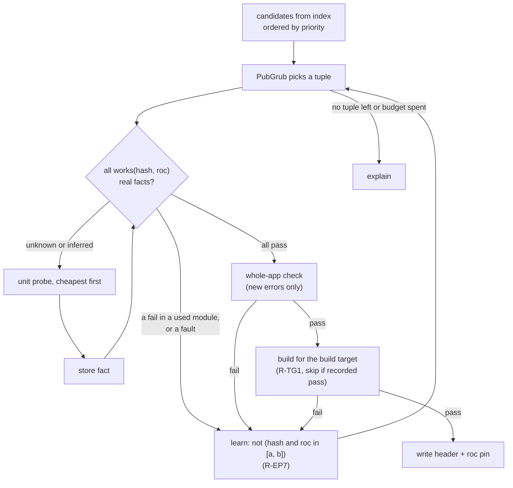

# Talon design: resolution

Part of the Talon design. This file holds how Talon selects versions in each context, and the probe rules. `DESIGN.md` has the goals, the core model and the list of files.

A reference such as CLI 6.2 is section 6.2 of `DESIGN-CLI.md`. Design, Resolution and Registry name `DESIGN.md`, `DESIGN-RESOLUTION.md` and `DESIGN-REGISTRY.md`. A plain number is a section of this file.

| Context | What Talon selects | Rules |
| --- | --- | --- |
| `tln add`, `install`, `update`, `upgrade`, `remove`, `verify` | Packages, platform and nightly of a project header | Sections 1 to 12 |
| `tln install --frozen` | Nothing. It verifies the header. | 12 |
| A `roc` run through the proxy | The compiler for that run | 13 |
| `tln tool install`, `tln x` | The compiler release for an app build | CLI 6.4 |
| `tln tool install`, `tln x` | A build that is already on this machine | CLI 6.4, R-B1, R-B2 |
| A ref typed in a command | How Talon reads a selector, and the meaning of no selector | CLI 2 |

## 1. Variables and anchors

R-VA1: Resolution picks one value for each free variable. The nightly is a variable like any package, but only `tln upgrade` frees it (R-RP1, section 9).

| # | Variable | Domain |
| --- | --- | --- |
| R-VA2 | `roc` | Nightly tags and releases of the compiler, as the `nightly` switch allows (below) |
| R-VA3 | `pf` | Platform releases |
| R-VA4 | each direct dep | Releases in range |

R-VA5: Any variable can be an anchor: a hard pin (`=`) in `talon.toml`, or a `tln add parser@2.0.0` (writes, CLI 2). The rest are free. A named anchor is free in `tln upgrade` (R-UP1). One exception: an entry with no index (R-DI11, CLI 7.3) is a fixed anchor. Its domain is its header value, and no command frees it, also when the user names it. Examples:

| Intent | talon.toml |
| --- | --- |
| "I need parser 2.0.0. I do not care which nightly." | `parser = "=2.0.0"`, `roc = "*"` |
| "My team uses nightly 10-09. Find packages that work with it." | `roc = "=nightly-2026-10-09-258ab27"` |
| "Keep the platform. Move the rest." | `pf = "=0.25.0"` |

R-VA6: When many tuples work, `priority` breaks ties: the solver maximizes (with `strategy = "lowest"`, minimizes) the version of the first name, then the second, and so on. The default is: direct deps in header order, then `pf`, then `roc`. `priority` orders only the free variables. A command can hold other variables for one run (section 9).

### The `nightly` switch

roc accepts two forms of compiler version in a header: nightly tags, and releases such as `0.1.0` or `1.0.0-rc1` (`roc:src/base/roc_version.zig:14-19`). `roc fmt` never rewrites a release pin (`roc_version.zig:101-108`). The Zig-based compiler has no release yet. Its only tags are the alpha tags of the old Rust compiler, which Talon does not support (N3). The switch states if nightlies are candidates.

| # | Priority | Source | Example |
| --- | --- | --- | --- |
| R-NS8 | 1 | Environment | `TALON_NIGHTLY=0` or `1` |
| R-NS9 | 2 | `talon.toml` | `[toolchain] nightly = false` |
| R-NS10 | 3 | `config.toml` (CLI 6.1) | `nightly = false` |
| R-NS11 | 4 | Default | `true` |

| # | Rule |
| --- | --- |
| R-NS1 | On (the default), the domain of `roc` is all nightlies and all releases. Talon orders them by date: the tag date of a nightly, the GitHub `published_at` of a release. On the same date, the release is newer. Two nightlies of one date (for example `nightly-2026-09-01-24e3995` and `nightly-2026-09-01-db83307`) are in the order of their GitHub `published_at`, then of the tag text. roc gives them the same rank (Design 2), so this order is Talon's own. It is total, so `@-1`, adjacent releases (R-EP1) and "newest" each have one answer (G3). |
| R-NS2 | Off, the domain is the releases only. Today that domain is empty: Talon knows no source of compiler releases yet (CLI 6.2, R-CV1). Then a command that must select a compiler stops with exit code 10 (`no_tuple`), and the error names the switch and its source. |
| R-NS3 | The switch applies where Talon selects a compiler by itself: the resolver, `tln upgrade` and `tln init` (section 10, CLI 5), `tln roc update` (R-RU1), the selector `@latest` and the relative selectors `@+N` and `@-N` in the `tln roc` scope (CLI 2), selection rank 4 (section 13), option 2 of R-NI8 (CLI 6.4), and probe searches (section 4). |
| R-NS4 | The switch does not apply to a compiler that the user names: a command argument, `roc +<id>`, `ROC_TOOLCHAIN`, `tln roc install <id>` and `tln roc default <id>`. A global default that is a nightly (rank 6) stays in use. This is for runs only: a compiler that Talon holds as the nightly or writes as the `roc:` pin is checked against the switch and the range (R-SO19, R-U5). |
| R-NS5 | A nightly `roc:` pin with the switch off is like a pin outside the `[toolchain] roc` range (R-RP2). The proxy runs it, because the header is the lock (rank 3). The commands of R-RP2 stop with exit code 10, and `--frozen` fails with exit code 14. `tln roc use <nightly>` stops (R-U5). `tln upgrade roc` moves the pin to a release. |
| R-NS6 | `git-*`, `link-*` and `copy-*` builds (CLI 6.6) are not nightlies and not releases. The switch never removes them, because Talon selects them only by name (R-R5). |
| R-NS7 | The `[toolchain] roc` range and the switch both apply. A semver range (`0.1.*`, `^1`) matches releases only. `*` matches both forms. A lower bound `>=<compiler id>` (a full nightly tag or a release version, CLI 2 prefix rules) matches each nightly and release that R-NS1 orders at or after that id. Use: a team states the oldest compiler that its code needs. It limits rank 4 of section 13, and `install` reports a `roc:` pin below it (R-RP2). There is no upper bound form: the `roc:` pin already holds the nightly, and only `tln upgrade` moves it (R-RP1). An anchor `=nightly-<tag>` with the switch off is a contradiction: Talon stops with exit code 2 and names both keys. |

R-NS12: Evidence and probes (sections 3 and 4) work the same for a release: a fact is `works(hash, compiler release)`. In the other rules, "the nightly" is the value of `roc`.

## 2. Constraints

| # | Constraint | Kind |
| --- | --- | --- |
| R-C1 | Range from `talon.toml`, or the implied range (Design 4.3) | Hard |
| R-C2 | Roc MVS: a direct pin is at least the highest version of that group in the closure | Hard |
| R-C3 | One platform: every package that names a platform names the app platform, byte for byte | Hard |
| R-C4 | Alias kind: a `platform` entry resolves only to a `platform` release, and a package entry resolves only to a `package` release. An `app` release is never a candidate. The kind is the first keyword of the release header (CLI 7.3, R-DI7). | Hard |
| R-C5 | Compatibility: every hash in the closure checks on the chosen nightly (sections 3 to 5) | Hard |
| R-C6 | Yanked releases are not chosen for a new resolution. Yank and advisory data come from the registry (Registry 5, Registry 7.2, advisories in Design 7, P3). A withdrawn release (Registry 7, R-PU17) is not a candidate. With `direct`, GitHub has no yank: a deleted release, a draft and a prerelease are not candidates (CLI 7.3, R-DI3), and there is no advisory data. Then each command that checks yanks or advisories (`tln audit`, R-B3 in CLI 6.4) prints one note: `no yank and advisory data without a registry`. | Hard |
| R-C7 | `min-release-age` and `snapshot` (log or time form, section 11) hide new releases. The default `min-release-age` is `2d`. Sources, from high to low: `talon.toml` `[resolution]`, `config.toml` (CLI 6.1), the default. `"0d"` turns it off. The release time is the GitHub `published_at`, from the registry or from GitHub (CLI 7.3, R-DI10). Both also apply where Talon selects a compiler by itself (R-NS3): `min-release-age` and the time form with the `published_at` of the nightly or release, the log form with its compiler log leaves (Registry 3). `min-release-age` and the time form of `snapshot` do not hide a version or a compiler that the user names (R-NS4, or an exact version such as `tln add X@1.2.3`). Then Talon prints a note with its age. | Hard |
| R-C8 | Two series of one package (two groups, Design 4.1) in the closure | Warning (type identity) |
| R-C9 | R-C6, R-C7 and a snapshot never hide the value that a header entry or the `roc:` pin has now. That value stays in the domain of its variable, so a hold, the implied range (Design 4.3) and `tln update` still work, for example after `tln add X@1.2.3` of a release that is 1 day old. They hide only the other candidates. `tln audit` reports a yanked value (R-C6). | Hard |
| R-C10 | Build target: the `targets` of the platform release have the build target of the app project file (section 4, R-TG1). A release with no such target is not a candidate. A release with no readable `targets` is a candidate (R-TG7). Reason: the release cannot build the app, and Talon knows it from the header with no probe. When the platform is held (section 9) and its release does not have the build target, no tuple exists: exit code 10 (`no_tuple`). | Hard |

## 3. Compatibility evidence

R-EF1: Evidence is a set of facts `works(hash, nightly) = pass | fail(error digest)`. Sources, from strong to weak:

| Rank | Source | Trust |
| --- | --- | --- |
| 1 | Local probe result (`talon/compat.db`) | Full |
| 2 | Registry matrix: `bot` rows from the Talon CI bot (unit checks, and smoke builds of platforms, R-SM6), and `author` rows from `tln publish` (Registry 5, R-RE3, Registry 6) | Full, signed |
| 3 | `roc:` pin in the release header | Hint: author says it passed |
| 4 | `.roc-version` at the release tag | Hint |
| 5 | Release date (nightlies of the 2 weeks before it) | Search order only |
| 6 | Probe results that other users share (CLI 1, R-SH1, and `tln probe --share`): the counts of `compat_hints` (Registry 5, R-RE12), added up over all Talon versions | Search order only |

R-EF2: Hints only order the search. Talon never writes a header on hints alone: the final tuple always gets a local whole-app check (section 5 step 6), unless the user passes `--no-check`. That check costs under 2 s. `--no-probe` does not turn it off. Only `--no-check` does (section 12).

R-EF3: When two sources have a fact for one pair (hash, nightly, target), Talon uses the fact of the source with the lowest rank number. In rank 2, a `bot` row wins over an `author` row. Reason: the bot runs each hash in one environment, and its rows also make the sweeps (Registry 6, R-MX4). Talon prints a note when a `bot` row and an `author` row of one pair have different results, and `--json` gives both. A rank 6 row is a `pass` hint when `pass_count` is larger than `fail_count` plus `crash_count`, a `fail` hint when `fail_count` plus `crash_count` is larger, and no hint when they are equal.

## 4. Probes

R-LD1: A probe runs one compiler on one target and classifies the result. Probes form a ladder. Each step runs only when the step before it passed.

| # | Step | Probe | Command | Blames |
| --- | --- | --- | --- | --- |
| R-LD2 | 1 | Unit | `roc check packages/<hash>/main.roc` with nightly N | The modules of the hash that have errors |
| R-LD3 | 1 | Platform | same, on the platform `main.roc` | The modules of the platform that have errors |
| R-LD4 | 2 | Whole app | `roc check main.roc` with the candidate header in a temp copy | The hash that owns the file of each new error (see "Baseline check"). The app itself if a new error is in app files: then Talon stops and reports, because the user code is not a free variable. Errors that the baseline already has are not blamed. |
| R-LD5 | 3 | Build | `roc build --target=<build target> main.roc --output=<tmp>`, for the build target of the project file (R-TG1) | Link or target-file errors blame the platform for that target. Other errors as in step 2. Talon can skip this step (see "Build skip"). |

R-LD6: Step 3 catches what `check` cannot see: a missing host file for the target, link errors, and code generation bugs. It runs once, on the final tuple. (Measured: 309 ms for a basic-cli app.)

R-LD7: A project file that is a package or a platform (CLI 1, R-PD8) has no app. Then step 2 runs `roc check` on that file, which works with no app (Design 2). Its own files count as app files. Step 3 does not run, because roc builds only an app, so there is no build skip. The lexical scan (below) starts at every module of the project file, not at the `import` lines of an app. `tln init package` follows this rule (CLI 5).

### Build target

Ladder step 3 builds the app for one target: the build target. A platform with no host target (for example `cloudflare-workers`, which has only `wasm32` in `targets`) then builds on each machine, and Talon does not blame the platform for a target that the app does not use (R-P4). Source: `research/talon-scripts/` 7.

| # | Rule |
| --- | --- |
| R-TG1 | The build target of an app project file is the first of: (1) `target` in the `[build]` table of its `talon.toml` (CLI 1, R-PD6); (2) the host target, when the `targets` of the platform header has it. The host target is the target that `roc build` uses with no `--target`: the musl target of the host, else its glibc target (CLI 6.4, R-T8); (3) the one target of the platform, when its `targets` has exactly one. Else Talon stops with exit code 2. The message lists the targets of the platform and names `[build] target`. |
| R-TG2 | Ladder step 3 (R-LD5) runs `roc build --target=<build target> main.roc --output=<tmp>`. The key of R-P4, of the build skip (R-BS1 row 1) and of the smoke build (R-SM3 row 1) has the build target. |
| R-TG3 | `[build] target` is one Roc target name (Registry R-IK7 list). Another value gives exit code 19. The constraint on platform releases is section 2, R-C10. |
| R-TG4 | A package or platform project file has no build (R-LD7). `[build]` in its `talon.toml` has no effect. |
| R-TG5 | In a workspace, each member has its own build target (R-TG1 with the member `talon.toml`). A Worker member builds `wasm32` and a script member on basic-cli builds the host target. `[build]` is allowed where `[dependencies]` is allowed (Design 4.4, R-WS5). |
| R-TG7 | A platform whose header has no readable `targets` list (an old platform, a header that does not parse, or a platform that is not in the package cache) gives no target to pick from. With no `[build] target`, Talon runs `roc build` with no `--target`, and the key of R-TG2 has the host target. R-C10 admits such a release, because the header cannot show a missing target. A `[build] target` (rule 1) still passes `--target`. |
| R-TG6 | The proxy does not use the build target: roc flags pass with no change (CLI 6.2, R-PX3). The build of a tool (CLI 6.4, R-T8) does not use it. `tln init --platform` uses R-TG1 rules 2 and 3 for the ladder of CLI 5, R-IN2, because there is no `talon.toml` yet (CLI R-IN5). |

For `cloudflare-workers`, rule 3 selects `wasm32` with no `talon.toml` key. The `--no-cache` flag of the platform build (a warm build cache gave other code) does not matter for step 3: Talon does not use the output.

### Baseline check

An app can already have compile errors when the user runs `tln add` or `tln update`. So step 2 compares two runs of the same check.

| # | Run | Header | Compiler |
| --- | --- | --- | --- |
| R-BL1 | Baseline | The current header, unchanged | The nightly in the current `roc:` pin, or the selected compiler (section 13) if there is no pin |
| R-BL2 | Candidate | The candidate header in a temp copy | The candidate nightly |

R-BL3: The baseline compiler is a required download (R-DL2, prompt R-NI5) when it is not installed. Talon never skips the baseline by itself: with no baseline, each error of the app is new, and R-P6 blames the wrong hash. In `install`, `add`, `update` and `remove`, the baseline compiler is the held nightly (R-RP2), and the candidate needs it too, so it adds no download. Only `tln upgrade` with a free nightly can need an extra download for the baseline. `--no-check` skips the baseline and its download.

R-BL4: Two errors are the same error when all of these are equal:

| Part | Value |
| --- | --- |
| File | The path in the app, or (hash, module path) for a package file. Never the cache path. |
| Kind | The error title in the header line of the error |
| Message | The error text with line numbers, column numbers and source excerpts removed |

R-BL5: Line numbers are not part of the identity, because they move when the user edits a file. Talon compares the two error sets and sorts each error:

| Error | Class | Action |
| --- | --- | --- |
| In the candidate only | New | Blame as in the table above |
| In both | Unchanged | Print as a note. Do not blame. |
| In the baseline only | Removed | Print as a note. This is good. |

Rules R-P6 to R-P8 (below) apply to the baseline check.

R-BL6: `--no-check` is a resolve flag (section 12). It skips the baseline check, the whole-app check (step 2) and the build (step 3). Unit probes still run. The header then carries no verified claim from step 2 or 3, and R-H6 keeps the old `roc:` pin. Talon prints `check: skipped` in the summary.

### Build skip

R-BS1: Step 3 costs time on each `tln add` and `tln update` (goal G5). Talon skips it when all of these are true:

| # | Condition |
| --- | --- |
| 1 | `compat.db` has a build pass with the key (platform hash, nightly, target). This is the R-P4 key for the target of the build. |
| 2 | That record also holds the used-closure digest of the build that passed. The digest of the candidate is equal. |
| 3 | Step 2 passed for the candidate with no new errors. |

R-BS2: The used-closure digest is a hash of the sorted list of hashes that the app uses (the packages with a used module, found by the lexical scan below, with their patches and overrides). A package that the app does not import is not in the digest. So `tln add` of a package that the app does not use yet keeps the digest, and Talon skips the build. A change to the platform hash, the nightly, the target or a used package changes the key or the digest, and Talon runs the build. A recorded fail never allows a skip. Talon prints `build: skipped (recorded pass)` in the summary. A skip also does not claim that the current app source builds: step 2 covers the app source.

### Smoke build

R-SM1: A smoke build is `roc build` of a small app that Talon makes from the platform header alone (R-SM2), for one target. It tells whether (platform hash, nightly, target) builds: the host files of the target, the link, and the platform code that the host calls. It holds no code of the user, so its result can be shared (CLI 1, R-SH3). It does not find a code generation bug in a function that only an app calls: ladder step 3 still builds the real app. Measured (`research/smoke-app/`): on 34 targets of 6 platforms, the same result and the same first error line as a real app, in 0.11 to 0.40 s and 150 to 220 MB.

R-SM2: The app gives the platform each value of its `requires` clause (Design 2):

| In `requires` | In the app |
| --- | --- |
| A function type | A lambda with one `_` for each argument, and no argument for `()`. The body is `crash "talon smoke test"`. |
| A record type | A record with a value for each field, by this table |
| `[Alias : var] for name : ...` | `Alias : {}` for each alias, and the app exposes each alias and `name` |
| Any other type | No smoke build: a top-level constant runs when roc compiles it, so a constant that crashes stops the build |
| A clause with 2 or more entries (the old form `requires {} { ... }` has 2 groups, and the entries are in the second) | Like "Any other type": no smoke build, and no stub for `tln init --platform` (CLI R-IN8) |

Talon reads the clause at the depth 0 of the platform header, with no token inside a comment or a string. An entry is `name : <type>` or `[Alias : var, ...] for name : <type>`. A comma at the depth 0 that is followed by the start of another entry (`name :` or `[`) ends an entry. A comma in an argument list does not: `respond! : Request, context => R` is one entry. The app exposes the aliases first, then the names, in the order of the source. The app is a function of the platform header only. So the key (platform hash, nightly, target) fixes the result, and the Talon version (Registry 6.1, R-CT12) names the generator. Talon writes the app in a temp dir (CLI 7.4, R-CC2), with the URL of the platform from the header of the project.

R-SM3: When Talon runs a smoke build: only when sharing is on (CLI 1, R-SH2), after the command did its work and before it sends the queue (CLI 1, R-SH4). One build for each key (platform hash, nightly, target) that the command built (ladder step 3, also when it used the build skip of R-BS1, and the build of a tool, CLI 6.4) when all of these are true:

| # | Condition |
| --- | --- |
| 1 | The target is the target of that build |
| 2 | The nightly is installed. A smoke build never downloads. |
| 3 | `compat.db` has no smoke result for the key |
| 4 | No answer of the registry in this command had a `bot` row for the key, or a `compat_hints` row with a total count of 3 or more (first guess) |
| 5 | The platform passes the filters 3 and 4 of CLI 1, R-SH3 |

R-SM4: A smoke build does not change the command. It uses no probe budget (R-P5, R-PP4) and runs after the result is fixed. Its result is not evidence for the solver or the build skip (R-BS1). It changes no output, no exit code and no `--json`. The timeout is `probe.timeout` (R-P5). Talon keeps the result in the table `smoke` of `compat.db`, only so that it does not build the key again (R-SM3 row 3), and puts it in the share queue (CLI 1, R-SH3). Reason: the setting `share` must not change the result of a command (Design G3). The smoke result of each machine reaches the solver only through the registry, as a rank 6 hint (section 3).

R-SM5: With sharing off, Talon runs no smoke build on the machine of the user: its only use is the shared matrix. The bot runs smoke builds for each target (Registry 6, R-MX10), and each user gets their rows.

R-SM6: A `bot` smoke row is a real fact of rank 2 (section 3) for (platform hash, nightly, target):

| Row | Use |
| --- | --- |
| `fail` on the target of the build | A fail of ladder step 3 for each app on that platform, blamed on the platform for that target (R-LD5). The solver learns `not (platform and roc in [a, b])` for that target (R-EP7) with no build. Reason: a smoke build fails only for host files, the link or the platform code that the host calls, and a real app needs each of them. |
| `pass` | Not a pass of step 3. Step 3 still builds the app, or uses the build skip of R-BS1, because a pass of the smoke app says nothing about the code of the app. |
| A row for another target | Not used by the resolve. `tln outdated` and `tln add --platform` can show it (the text is a proposal, CLI 3, R-OUT2). |

R-SM7: Machine errors. A few errors come from the build machine, not from the platform: roc looks outside the platform for them. The first one is `WindowsSDKNotFound` (nightly 10-06, `research/smoke-app/`). The bot posts no row for a result with such an error, and `tln` shares none (CLI 1, R-SH3 filter 6). Their list is a constant in Talon and in the bot. A new machine error found later goes into the list, and the operator deletes the `bot` rows that it made.

Result classes, all seen in the measurement below:

| # | Class | Signal | Meaning |
| --- | --- | --- | --- |
| R-RC1 | pass | `No errors found`, or `0 errors and N warnings` | Works |
| R-RC2 | fail | `N errors` with N > 0. Each error header names a file. | A code incompatibility, per module |
| R-RC3 | hang | No result in 30 s. A normal check takes under 2 s. | Compiler fault |
| R-RC4 | crash | A fault signal: SIGSEGV (exit 139 seen), SIGBUS, SIGILL, SIGFPE or SIGABRT. On Windows, a fault exception code, such as `0xC0000005` (access violation) or `0xC00000FD` (stack overflow). | Compiler fault |

Rules:

| # | Rule |
| --- | --- |
| R-P1 | `check` and `build` only. Talon never runs the output, so no host code runs. |
| R-P2 | Warnings do not fail a probe. |
| R-P3 | A download error gives no fact. A signal from outside the compiler gives no fact too: SIGKILL (also the OOM killer), SIGTERM, SIGINT and SIGHUP, and on Windows `0xC000013A` (Ctrl-C). Reason: up to 12 probes run at once (R-AL4), and a build takes 150 to 220 MB (R-SM1), so a small machine can kill one, and a fact never expires (R-P4). A hang or crash is a fact of its own class (compiler fault). |
| R-P4 | Results are stored per (hash, nightly, target) and never expire. `check` results use the target `any`. A fail stores the set of failing modules. A `build` result (pass, fail, hang or crash) also stores the used-closure digest (see "Build skip"), and the digest is part of its key: a build fact is one row for each (hash, nightly, target, digest). So 2 apps with one platform give 2 rows when their closures differ. A `check` result has no digest. |
| R-P5 | Budget: `probe.max` (default 100) checks, `probe.timeout` (default 30 s), and `probe.max-toolchains` (default 10) new compiler downloads. One nightly is about 70 MB packed and 228 MB unpacked. Installed nightlies are tried first, because they cost nothing to fetch. A new download needs consent (R-DL1 to R-DL6, CLI 6.2). The cap limits the downloads after consent. |
| R-P6 | Talon blames only new errors (see "Baseline check"). A candidate with no new errors passes step 2, also when the app has errors. |
| R-P7 | If the baseline is a hang or crash, Talon has no error set. It stops and tells the user to fix the compiler fault or to use `--no-check`. |
| R-P8 | An error that the baseline hid (for example behind an earlier error in the same module) can show as new. This is a conservative result. The user can fix the app or use `--no-check`. |

### Parallel probes

R-PP6: Talon runs more than one probe at the same time. A probe takes slots from a pool of 12 slots:

| Probe | Slots | Most at the same time |
| --- | --- | --- |
| Check (unit, baseline, whole-app) | 1 | 12 checks |
| Build (ladder step 3) | 4 | 3 builds |

R-PP7: So Talon runs up to 12 checks, or up to 3 builds, or a mix (for example 1 build and 8 checks). `probe.slots` in `talon.toml` (or `config.toml`, CLI 6.1) and `--slots <n>` change the pool size. The weights do not change.

Why these numbers: a check takes 0.4 s to 1.9 s and little memory. The Q11 sweep ran 12 checks at the same time on one shared cache, with no error (`conformance/compat-sweep/run.sh:15`). A build also links the host and uses about 250 MB. 3 builds at the same time on one cache passed 300 of 300 times, with the same bytes as a build that ran alone (Q18, `conformance/build-share/`). 3 builds take 1.03 s, 1 build takes 0.74 s.

| # | Rule |
| --- | --- |
| R-PP1 | Only a probe whose compiler is installed takes slots. A compiler download takes no slot. It runs at the same time as the probes, and a probe that needs it waits for it. |
| R-PP2 | These probes run at the same time: the unit checks of all packages of one candidate tuple (section 5 step 4); 3 nightlies of a nightly range in a search, so that one round cuts the range in 4 parts and not in 2; the baseline check and the first unit checks; the build of each workspace member (Design 4.4); the releases that option 2 of `tln tool install` tries (CLI 6.4). |
| R-PP3 | The result does not depend on the order in which probes end (G3). Before a round starts, Talon makes the list of probes of the round. When the round ends, Talon reads the results in the order of that list. |
| R-PP4 | Each probe that starts counts against `probe.max`, and its result goes in `compat.db`, also when the solver does not use it. So the same inputs give the same header and the same probe count. |
| R-PP5 | A probe that hangs keeps its slots until `probe.timeout` (30 s). The other probes continue. |

### A unit fail is per module

`roc check` on an app checks only the modules that the app imports. Measured on nightly 10-09 with roc-parser 2.0.0:

| Probe | Result |
| --- | --- |
| Unit: `roc check` on parser `main.roc` | fail: `redundant expose` in `Yaml.roc` |
| App that imports `parser.Parser` | pass, and `roc build` passes. The binary runs. |
| Same app, also imports `parser.Yaml` | fail |

R-UM1: So a unit fail is a hard incompatibility only when the app uses a failing module. Talon computes the modules that the app uses in each package: the `import` lines of the app, then the `import` lines inside the package, transitively. This is a lexical scan with the header parser package. If the set does not touch a failing module, the unit fail is ignored, and the whole-app check (step 2) decides.

### Measurement: islands and epochs (Q11)

Setup: 46 cached hashes (32 with a known release label) × 22 nightlies (2026-09-15 to 2026-10-12), Linux x86_64, unit probes, isolated caches. Script and raw data: `conformance/compat-sweep/`.

```text
nightly      09-15 .. 09-19 | 09-22 | 09-23 09-24 | 09-25 | 09-26 .. 09-29 | 09-30 10-01 | 10-02 .. 10-06 | 10-09 .. 10-12
basic-cli 0.22.x  pass      | pass  | HANG  HANG  | pass  | pass           | pass  pass  | fail           | fail
basic-cli 0.23.0  fail      | fail  | fail  fail  | fail  | pass           | pass  pass  | fail           | fail
basic-cli 0.24.0  fail      | fail  | fail  fail  | fail  | pass           | pass  pass  | pass           | fail
basic-cli 0.25.0  fail      | fail  | fail  fail  | fail  | fail           | fail  fail  | fail           | pass
basic-websrv 0.17 fail      | pass  | pass  pass  | pass  | pass           | CRASH CRASH | pass           | fail
roc-parser 2.0.0  fail      | fail  | fail  pass  | pass  | pass           | pass  pass  | fail (Yaml)    | fail (Yaml)
roc-ray 0.10.0    fail      | pass  | pass  pass  | pass  | pass           | pass  pass  | pass           | fail
basic-websrv 0.16 pass      | pass  | pass  pass  | pass  | pass           | CRASH CRASH | fail           | fail
joy 0.33, joy-html 0.16  pass on 09-15 .. 10-01, fail from 10-02
26 other hashes   pass on all 22 nightlies
4 other hashes    fail on all 22 (no main.roc, or written for an older compiler)

(basic-cli 0.22.x is 3 hashes, roc-ray 0.10.0 is 2 hashes. basic-cli 0.28.0 and 0.29.0 match 0.24.0 and 0.25.0.)
```

| Question | Measured |
| --- | --- |
| Transitions where any result changes | 8 of 21 |
| Code epochs (boundaries where a pass/fail result changes) | 6: boundaries at 09-22, 09-24, 09-26, 10-02, 10-09 |
| Fault windows (hang or crash) | 2: 09-23 to 09-24 (hang, basic-cli 0.22.x), 09-30 to 10-01 (segfault, basic-webserver) |
| Transitions where only one hash changes | 0. Each boundary moved 2 to 8 hashes. |
| Results that change inside an epoch | 0 |
| Hashes with more than one island | 4 of 46. All 4 gaps are hangs or crashes. |
| Hashes with more than one island, if faults do not split a range | 0 |

Conclusions for the search. The rules R-EP1 to R-EP9 below state them as a function.

| Measured | Rule |
| --- | --- |
| No result changed inside an epoch. 22 nightlies are 6 epochs. | Probe one release per epoch. A fact infers the other releases of its epoch (R-EP6). |
| Every island in the sample comes from a compiler fault, not from a code change. | A fault marks one release bad for one hash. It does not split a range (R-EP5). |
| All 5 code boundaries in the sample moved at least 2 hashes. | In the facts of the client, a boundary needs at least 2 hashes that change (R-EP3). A change in only one hash is not a boundary. The registry counts over the bot set, a sample of the index, so there 1 changed hash makes a boundary (Registry 6, R-MX12). That hash keeps its own facts, and Talon reports it to the bot. |
| The sample is small (46 hashes, 4 weeks). Islands from code changes stay possible. | An inferred fact never decides a result (R-EP8). A real code island costs probes, but never gives a wrong header. |
| Normal checks take under 2 s. The hangs ran for 600 s with no result. | Probe timeout 30 s (R-P5) |

### Epochs and inferred facts

R-EP10: The solver needs facts for pairs (hash, compiler release) that no probe has run on. It infers them from epochs. The epoch function is pure: the same inputs give the same epochs (G3).

```text
epochs : List(Release), Facts, Matrix -> { epochs : List(Interval), inferred : Facts }
```

| # | Input or output | Value |
| --- | --- | --- |
| R-EP11 | `List(Release)` | The domain D: every compiler release in the compiler list (CLI 6.2), in R-NS1 order. The `nightly` switch and the `[toolchain] roc` range select candidates in D. They do not remove releases from D, so they do not change the epochs. |
| R-EP12 | `Facts` | Real facts only: rank 1 (local `compat.db`) and rank 2 (registry matrix, `bot` and `author` rows) of section 3. When two sources have a fact for one pair, the precedence of R-EF3 selects one. Hints (ranks 3 to 6) are not inputs. They only order the search. The rank 2 facts are the `runs` and `nearest` of the closure answer (Registry 4, R-AP17): each fact in E, and outside E only the nearest code result on each side. That is all that R-EP6 reads for a compiler in W. A learned interval of R-EP7 and a range in a message end at the ends of E. |
| R-EP15 | `Matrix` | The registry data that R-EP2 to R-EP4 read: the `epochs` of the closure answer (Registry 4, R-AP17), and the `sweeps` and `transitions` rows (Registry 5). It has no real fact, so `Facts` does not carry it. With no registry it is empty, and R-EP4 gives each release an epoch of its own. |
| R-EP13 | `epochs` | A partition of D into intervals of adjacent releases |
| R-EP14 | `inferred` | Facts for pairs with no real fact. Each one is marked `inferred` and names the real fact it comes from. |

| # | Rule |
| --- | --- |
| R-EP1 | A code result is `pass` or `fail`. A fault (`hang`, `crash`) is not a code result. Two releases are adjacent when no release of D is between them. |
| R-EP2 | A release is swept when it has a row in the registry `sweeps` table (Registry 5, R-RE7 and R-RE8): the registry matrix has a `bot` row on it for each member of the bot set (Registry 6, R-MX11) at the `upto_log_index` of that row. The closure answer does not send these rows: it sends the epochs of the registry (Registry 4, R-AP17 `epochs`), and each transition inside such an epoch is covered and flat for case (a) of R-EP3. The compat bot sweeps each new nightly (Registry 6, R-MX4). A transition is the pair of a release and the release adjacent before it. A transition is covered when both releases are swept. |
| R-EP3 | A covered transition is a boundary in either case: (a) its `transitions` row (Registry 6, R-MX12) has `changed` of 1 or more, or (b) at least 2 hashes have a code result on both releases in the facts of the client, and the two results are different. Any other covered transition is flat. Reason for (a): the registry counts over the bot set, and with 1 changed hash it finds the boundaries of all hashes in the measured sample (Registry 6, R-MX12). A client sees only the rows of its closure. With a registry, the client applies case (b) only inside the epochs of the answer, where it has each fact of its closure (R-AP17 E). A transition between 2 epochs of the answer is already a boundary or not covered. |
| R-EP4 | An epoch is a maximal interval of D in which each transition is flat. A boundary or a transition that is not covered ends an epoch. So with no matrix (registry off, or a release that the bot did not sweep), each release is an epoch of its own. |
| R-EP5 | A fault fact marks one release bad for one hash. It is never part of a boundary, it never ends an epoch, and it never gives an inferred fact. |
| R-EP6 | A pair (h, r) with no real fact gets an inferred result X in one of two cases. (a) Same epoch: h has a real code result X on a release in the epoch of r. (b) Between: the nearest real code result of h before r and the nearest after r are both X. If one case gives `pass` and a case gives `fail`, the pair stays unknown. An unknown pair between a `pass` and a `fail` of one hash stays unknown: it is the place to probe. An inferred `fail` copies the set of failing modules of its source. |
| R-EP7 | A learned incompatibility is a hash and an interval of D: `not (h and roc in [a, b])`. [a, b] is the maximal interval around the failing release r in which each release of D has a `fail` for h (real or inferred) that touches a module the app uses. A fault gives the interval [r, r]. A run of inferred fails with no real fail also gives an incompatibility. It is inferred, so by R-EP8 it never decides alone: the step asks for a probe. |
| R-EP8 | An inferred fact never decides, except as R-EP9 states. The solver step (TESTING.md 2.2) returns `Done` only when each pair (hash, nightly) of the tuple has a real fact. It returns `Fail` only when the explanation uses real facts only. Else it returns `Need` with probes for the inferred facts that the tuple or the explanation uses. This is the second pass: it probes the inferred facts that blocked the best tuples, inside the budget (R-P5). The form: let A be the best tuple when inferred facts count, and B the best tuple when only real facts count (B is never worse than A). `Fail`: B does not exist. `Done`: A and B are equal and each pair of A has a real fact. Else `Need`: for the missing facts of A, or of B when A does not exist or B is better than A. |
| R-EP9 | With `--no-probe` (no new unit probes), the step runs in probe mode `Off`: it can return `Done` or `Fail` on inferred facts, it never asks for a probe (it can still ask for a header, R-AL8), and a pair with no fact at all is fit. Talon marks each inferred fact as `inferred` in the output and in `--json`. When the budget is spent, Talon saves the facts of the probes that ran (R-PP4) and stops at once with exit code 12 (R-UP7). It prints no explanation: the next run starts with the saved facts. The final ladder (steps 2 and 3) still runs on real probes, so Talon never writes a header on an inferred fact alone, unless `--no-check` also skips that ladder. |

With no bot data (registry off), each hash starts with the release date and `roc:` pin as hints (section 3). R-EP4 then gives one epoch per release, and only the "between" case of R-EP6 infers facts.

### `tln probe`

R-PB7: `tln probe` runs probes and prints the facts. It writes no project file. Its facts go in `compat.db` (R-P4), as the facts of a resolve do.

| # | Rule |
| --- | --- |
| R-PB1 | The target is one of three. A header alias: the hash of that entry. A path to a `<hash>.tar.zst` file: Talon checks its hash and extracts it as a package (CLI 7.1), and probes that hash. No argument: the project file (CLI 1, R-PD1 to R-PD8). The project file has no hash, so its results go in no `compat.db` row: Talon keeps them in memory and prints them. |
| R-PB2 | With no `--range`, Talon runs the ladder on the compiler that section 13 selects: step 1 for a hash, steps 2 and 3 for the project file (with the rule for a package or platform above). There is no baseline: each error counts. |
| R-PB3 | `--range` finds the range of the target in the domain D (EP rules): the maximal interval of D that contains the newest release with a real pass, in which each release has a pass, real or inferred (R-EP6). Talon probes only the candidates that the `nightly` switch and `min-release-age` allow (R-NS3, R-C7). It starts at the newest installed candidate. Each round probes 3 releases (R-PP2). An end of the range is a release with a real pass next to a release with a real fail, or an end of D. |
| R-PB4 | Compiler downloads are optional probe downloads (R-NI4, R-DL4, R-DL6), with the cap `probe.max-toolchains` and the budget `probe.max` (R-P5). When the budget is spent, or no download is allowed, Talon prints the range that it found, marks each end that is not a real fact as `unknown`, and exits with code 12 (`budget`). |
| R-PB5 | `tln publish` (Registry 7) sends the real facts of the released hash from `compat.db`. The release workflow runs `roc bundle`, `tln probe --range <bundle file>`, the upload of the asset, then `tln publish`. The registry stores these rows with the source `author` (Registry 5, 6). |
| R-PB6 | `--share` sends the real facts of the target hash to `POST /v1/compat` as user hints (rank 6, section 3), once, also when sharing is off (CLI 1, R-SH1). The flag is the consent for this command, so `CI` and `DO_NOT_TRACK` do not stop it (CLI 1, R-SH2). It sends the facts of `compat.db` for that hash on each nightly that pass the filters of CLI 1, R-SH3, except filter 1 (a probe of this command). It needs a registry: with `direct`, Talon stops with exit code 2. For a header entry on `github.com`, the privacy guard runs first (CLI 1, R-RG4). The project file has no hash, and a bundle file can be a hash before its release (R-SH3 filter 2), so `--share` with no argument or with a bundle file stops with exit code 2. |

## 5. Algorithm

PubGrub with a lazy oracle. A failed probe becomes a learned incompatibility, the same way a failed version constraint does.



| # | Step | Action |
| --- | --- | --- |
| R-AL1 | 1 | Collect variables, ranges and anchors (section 1). For a command that runs step 6, run the baseline check on the current header (section 4). |
| R-AL2 | 2 | With a registry, send one closure query (Registry 4.1). The second search of a held move can send one more (Resolution 9, R-SP24). An answer gives the header facts (R-AL8) of each candidate and of their closures, and the shared matrix for these hashes. With direct, this step sends nothing: steps 3 to 6 get each fact when they need it (R-AL8, source 4). |
| R-AL3 | 3 | PubGrub picks the best tuple by `priority`, under R-C1 to R-C4, R-C6, R-C7, R-C9 and R-C10. R-C2 and R-C3 also read the closure (R-AL9). The step checks the part between the slots, and the closure walk of the chosen tuple checks the rest (R-AL15). |
| R-AL4 | 4 | For each pair (hash, roc) with no fact, run a unit probe. Order: installed nightly first, then the strongest hint. Up to 12 checks run at the same time (section 4, "Parallel probes"). |
| R-AL5 | 5 | A fail in a module that the app uses, or a fault, adds an incompatibility for the hash and an interval of compiler releases (R-EP7). Go back to step 3. Inferred facts (R-EP6) order and prune the search, but the step needs real facts to finish (R-EP8). |
| R-AL6 | 6 | When all unit facts pass, run the whole-app check, then the build (ladder steps 2 and 3). Step 2 blames only errors that are new against the baseline (section 4). Step 3 is skipped when a recorded pass allows it (section 4). `--no-check` skips both. These catch errors that come from the combination (for example a raised transitive version) and from the target. In P0, steps 4 and 5 do not run (Design 7, P0 limits). |
| R-AL7 | 7 | Write the header and `roc:`. Print the tuple, the probe count and the evidence for each choice. |

R-AL8: Header facts. The header facts of a node are its kind, its deps (the URL entries and the path entries), its platform and its `roc:` pin. A node is a release (by hash) or a path file (R-H7). The hash fixes the facts of a release (Design 2.1), so each source gives the same value, and a fact never expires. The solver (steps 3 to 5) and the closure walk (CLI R-CM2, R-CM9, R-CM7) ask for facts in one form: the list of the nodes whose facts they lack. Talon gets the facts of all nodes of one list at the same time (CLI 7.5, R-DA5). For each node, the first source that has the facts is used:

| Source | Node | Cost |
| --- | --- | --- |
| 1 | The facts that this command has already | none |
| 2 | The closure answer of step 2, and of the second query of R-SP24, when the command sent them | none (one request in step 2, one in R-SP24) |
| 3 | `packages/<hash>/main.roc` when it exists, or the path file | one file read |
| 4 | A download of the archive (CLI 7.1, R-DI7), then source 3 | one archive, at most 10 MB |

A closure of depth d takes at most d lists. The registry makes it 1 request (step 2), and 1 more for the second search of a held move (R-SP24), unless the answer lacks a hash (Registry R-AP28 case 3).

R-AL9: The closure of a tuple is the closure that roc builds (Design 2): the header entries, the path entries and their entries (R-H7), and the deps of the winner of each group, to the end. The winner of a group is the highest version that an edge names. Talon never asks for the facts of a version that does not win, also when the registry answer has them. Each user of a closure applies this one rule: the solver for R-C2 and R-C3, `tln list`, `tln why`, and the walk before the ladder. A problem of the rule (a cycle, one label with two hashes, a header pin lower than a dep needs, two platforms) is a conflict of the tuple in steps 3 to 5: the solver tries the next tuple (P0: R-PH10). When no variable is free (`install --frozen`, `list`, `why`), it stops with exit code 10 (`no_tuple`) and names the problem.

### The solver step

The solver step is a pure function of its request (R-DT2): the same request gives the same answer, whatever the order of the lists in it. The request holds all the state. A step starts from the start each time, and what the search learns comes back in the next request as conflicts.

| # | Item | Rule |
| --- | --- | --- |
| R-AL13 | Variable and value | A variable is a slot: a free direct dep, the platform, or the compiler (`roc`). A transitive group is no variable (R-AL9). The values of a slot are the candidates that the rules of section 2 allow (R-C1, R-C6, R-C7, R-C9, and a named version, R-C7), best first: by semver, the highest first with `highest`, the lowest first with `lowest`. Two ids of one version are in the byte order of the ids. A version that does not parse is not a value. A range still excludes the value of a header entry (R-C9). The values of the compiler slot are the releases of the domain D (R-EP11), in the order of D. |
| R-AL14 | Request | The slots, the rules (`now`, `min-release-age`, `snapshot`, `strategy`), the header facts (R-AL8) that the command has, the conflicts of the caller (sets of choices that cannot all hold, for example 2 slots of one group, R-WS2), and the compatibility record: D, the unit checks (real or inferred, with the failing modules), the modules that the app uses, and the probe mode (`Allowed` or `Off`, R-EP9). |
| R-AL15 | Answer | `Need(List(Ask))`: an ask is `Header(id)` (R-AL8) or `Probe(id, nightly)` (R-AL4). The asks are for the best tuple only, headers before probes (a release with no header may be of a wrong kind, R-C4). `Done(List(Chosen))`: the best tuple, when each release of it has its facts (R-EP8). `Fail(Why)`: no tuple. A release with no fact is taken as fit until its fact comes. R-C3 is checked when the request has exactly one platform slot. R-C2 and R-C3 are checked only between the slots. The caller walks the closure of the chosen tuple (R-AL9) and gives a problem back as a conflict in the next request. |
| R-AL16 | Search | PubGrub with unit propagation and conflict learning (R-AL3). A learned incompatibility (R-EP7) and a conflict of the caller have one form: a set of terms that cannot all be true. |
| R-AL17 | Why | The explanation of a `Fail` is a graph of steps. Each step has terms (the slots, in the order of the slots, with their ids best first; a term with all values of its slot is left out) and a cause: `Probe` (a fail or a fault of a release on the compilers `from` to `to`, the failing modules that the app uses, and the compilers whose fail is inferred), `Dep` (a release needs a group at a version), `Pf` (a release names a platform), `Given` (a conflict of the caller), `NoValue` (a slot has no value), or `Derived` (the join of 2 earlier steps). The explanation is the part of the graph that the last step needs, in the order of the steps of the search. The text and `error.details` come from the `Probe` causes (R-AL10 to R-AL12). |

Example failure output, with measured ranges, for an app that imports `parser.Yaml`. It needs phase P1 (unit probes). The text is the output of the L3 case `exit/ex3-no-tuple-yaml` (TW16), which runs `tln upgrade roc` on the real facts of `conformance/compat-sweep`. The pin is `nightly-2026-09-30-4c37850`, and the compiler list is the real list of that sweep:

```text
$ tln upgrade roc
tln: error[no_tuple]: no tuple works: the unit check on nightly-2026-09-30-4c37850 fails for lukewilliamboswell/roc-parser 2.0.0 (Yaml.roc); the platform roc-lang/basic-cli 0.25.0 (no module is named)
  lukewilliamboswell/roc-parser 2.0.0 fails on nightly-2026-10-02-bba1acc .. nightly-2026-10-12-2664a27
  the platform roc-lang/basic-cli 0.25.0 fails on nightly-2026-09-15-fe09c42 .. nightly-2026-10-06-c34079d
  fix: tln roc use <id>
       or stop using parser.Yaml
```

The lines follow this form. A range is a fail run (R-EP7), not a pass run. Talon prints the runs that it knows.

| # | Line | Text |
| --- | --- | --- |
| R-AL10 | First line | `tln: error[no_tuple]: no tuple works: ` and the reason of the solver: the unit check on the held nightly fails for each release that the proof blames, with the failing modules that the app uses (`(Yaml.roc)`), or `(no module is named)` when the fail has no module (a platform fail, a fault). |
| R-AL11 | Cause lines | One line for each blamed release: `  <label> fails on <from> .. <to>`, the fail run of R-EP7 around the held nightly. `hangs` and `crashes` replace `fails` for a hang and a crash. A run of one compiler has `on <id>` and no range, and no line when it is the held nightly alone (the first line has it). An inferred compiler in the run gives the mark `(inferred on <id>, ...)` (R-EP9). |
| R-AL12 | Fix block | `  fix: <option>`, and `       or <option>` for each next option (7 spaces). Option 1: `tln roc use <id>`, with the oldest nightly that works when a probe or the matrix knows it, as `tln roc use <id> (the oldest nightly that works)` (R-RP2). Option 2: `tln upgrade roc` (R-RP2). It is left out when the failed command is `tln upgrade roc` (R-SP8), because that command just failed. One option for each module that a blamed release fails and the app imports: `stop using <alias>.<Module>` (R-UM1), with no repeat. A platform has no such option. |

The `--json` form of the same failure is `error.details` (R-J5): `compiler`, `causes[]` (`release`, `kind`, `modules`, `from`, `to`, `inferred`) and `hint`.

## 6. Overrides of transitive versions

R-OV1: To raise a transitive dependency (for example, a security fix), the app needs an alias for it in the same series (Design 4.1). Roc then uses that version for the whole graph. Section 2 of `DESIGN.md` confirms both parts: an unused alias is legal, and it raises the version for every package.

```toml
[overrides]
parser = "lukewilliamboswell/roc-parser@^2.0.3"   # the value form of Design 4.3, R-I2
```

R-OV2: The raise can break a package that was not written for the new version (the `http 1.9.0` test in Design 2). So the solver treats an override as a free variable, and the whole-app probe (section 5 step 6) covers it.

## 7. Patches

R-PA9: `tln patch json` copies the cached package of the header entry `json` to `.talon/patches/json/` for editing. `talon.toml` records the copy and the hash it came from:

```toml
[patch]
json = { path = "./.talon/patches/json/main.roc", base = "4W8SHzvwet9h..." }
```

R-PA10: The header does not change. The `roc` proxy (CLI 6.2) adds `--replace-dep <header URL> <path>` to each command. Probes and the whole-app check use the same flag. A unit probe (section 4) tests the release as it is, with no flag: its fact is about the hash, not about the copy. The copy is tested by the whole-app check and the build.

| # | Item | Where | In VCS |
| --- | --- | --- | --- |
| R-PA11 | The patch: the edited copy | `.talon/patches/<alias>/` | Yes |
| R-PA12 | The `[patch]` entry: path and base hash | `talon.toml` | Yes |
| R-PA13 | The original package | `packages/<base>/` in the roc cache | No. Talon fetches it by hash when it needs a diff (R-PA3, R-PA5). It finds the URL in the release list of the group of the entry (the asset is `<hash>.tar.zst`, CLI R-DI4). When no release of that group has the hash, the diff is not possible: Talon stops with exit code 14 and names the `base`, the alias and the two fixes of R-PA5. With `--offline` and no cached list, it stops with exit code 15 (CLI R-DI12). |

| # | Rule |
| --- | --- |
| R-PA1 | `tln patch <alias>` fetches the package of the header entry if it is not in the cache, copies it to `.talon/patches/<alias>/`, and writes the `[patch]` entry with `base` = the hash of the entry. It creates `talon.toml` if it is missing. If the directory exists, Talon stops with exit code 2 and names it. |
| R-PA2 | The copy is the patch. Talon writes no diff file, and `tln patch` has no `--commit`. The user commits the directory and `talon.toml`. A fresh clone needs no step: the proxy reads `[patch]` and passes the path. |
| R-PA3 | `tln patch <alias> --diff` prints the diff of the copy against `packages/<base>/`. It writes nothing. Use it to review a patch. |
| R-PA4 | A patched entry is an anchor in `update` and `upgrade` (section 1). Talon prints `json: patched, held`. A command that names the entry frees it. |
| R-PA5 | When a command moves a patched entry to a new release, Talon takes the diff of the copy against `packages/<base>/` and applies it to the new release in a temp copy. The probes of that release use the temp copy. A release on which the diff does not apply is not a candidate for that entry. When Talon writes the header, it replaces the copy and sets `base` to the new hash. When no candidate is left, Talon writes nothing and stops with exit code 10 (`no_tuple`). The explanation lists the files that do not apply, and names two fixes: edit the copy, or remove the `[patch]` entry. |
| R-PA6 | A `base` that is not the hash of the header entry (for example after a hand edit of the header) is a stale patch. The proxy does not run the compiler: it stops with exit code 14 and names `tln install`. `tln install` applies the patch to the header release as in R-PA5, and does not change the header. `tln install --frozen` fails with exit code 14. |
| R-PA7 | The diff of R-PA3 and R-PA5 is a unified diff with 3 lines of context, file by file. A pure function of Talon makes and applies it (`TESTING.md` 2.2, part A). A hunk applies when its context lines and old lines match the new release exactly, at one place in the file. That place can move by any number of lines. There is no fuzz: one changed context line makes the hunk fail. A file that the copy adds or deletes is added or deleted. A file that is not UTF-8 text is replaced whole. It applies only when the new release has the same bytes for it as `base`. |
| R-PA8 | `tln patch` of the platform entry stops with exit code 2. A platform archive holds host binaries (21 MB for basic-cli), which do not belong in VCS. To change a platform, use a fork and its release, or a path entry. |
| R-PA14 | `tln patch` of an unmanaged entry (Design 4.2, R-H4) stops with exit code 2. A path entry is local code: the user edits its file. A foreign URL has no release, so R-PA4 and R-PA5 cannot hold or move it. |

## 8. Libraries

| # | Task | Command |
| --- | --- | --- |
| R-LB1 | Record the lowest working versions in the package header | `tln update --strategy lowest` |
| R-LB2 | Test with the newest versions without editing the header | `tln verify --strategy highest` (uses `--replace-dep`, CLI 1) |
| R-LB3 | Record the compiler range that the package checks on | `roc bundle`, then `tln probe --range <bundle file>`. `tln publish` sends these facts with the release (section 4, R-PB5). |

R-LB4: `lowest` moves a version down only inside its range. The implied range (Design 4.3) starts at the header version, so with no `talon.toml` key, `tln update --strategy lowest` changes nothing. To lower `json`, set a range first, for example `json = "^2.0"`.

## 9. Scope of `update`, `upgrade` and `install`

R-SP1: A command can hold a variable: it fixes the variable at its current header value for one run. A hold is a temporary anchor. It is not written to `talon.toml`. The nightly is held at the `roc:` pin, or at the selected compiler (section 13) if there is no pin. Section 13, R-SO19 to R-SO22, tells how ranks 1 and 2 and the intent apply to the held nightly.

| # | Command | Free variables | Held variables |
| --- | --- | --- | --- |
| R-SP2 | `tln update` | All packages, inside their ranges | The nightly (R-RP2) |
| R-SP3 | `tln update X [Y...]` | Only the named ones | All others |
| R-SP4 | `tln update -i` | The ones the user picks in the picker (prompt R-NI2, CLI 4) | All others |
| R-SP5 | `tln update X@sel` | X, in the releases that match `sel`, also in a new series (section 10) | All others |
| R-SP6 | `tln upgrade` | All, with no package range (section 10) | Anchors (`=`), patched entries (R-PA4), fixed anchors (R-DI11) |
| R-SP7 | `tln upgrade X [Y...]` | Only the named ones, with no range. A named anchor is free too, except a fixed anchor (R-DI11). | All others |
| R-SP8 | `tln upgrade roc` | Only the nightly | All packages |
| R-SP9 | `tln upgrade X roc` | X and the nightly | All other packages |

| # | Case | `priority` (section 1) |
| --- | --- | --- |
| R-SP10 | `tln update` | As set, without `roc`: the nightly is held (R-RP2). The default order is direct deps, then `pf`. |
| R-SP11 | `tln update X Y` | Only X and Y are ordered, in the order of `priority`. A held variable has no rank. So `tln update json` cannot move `pf` or `roc`. |
| R-SP12 | `tln upgrade roc` | The nightly is the only free variable. It moves to the newest nightly that all held hashes pass on (section 3). |
| R-SP13 | `tln upgrade X roc` | The order of `priority` for X and `roc`. By default, X is first. |
| R-SP14 | `tln update -i` | The picker lists the free variables in `priority` order. The names that the user picks follow the `tln update X` row. The nightly is not in the list (R-RP1). |

### The `roc:` pin

| # | Rule | Why |
| --- | --- | --- |
| R-RP1 | Only two commands change a `roc:` entry that exists: `tln upgrade` when the nightly is free (no names, or the name `roc`), and `tln roc use` (R-U1 to R-U4). | The nightly has no semver ranges, so each move goes to a newer release and can break code. That is the job of `upgrade`. `tln update` stays the small, safe move. |
| R-RP2 | `install`, `add`, `update` and `remove` always hold the nightly, also with R-NI3, `--allow-moves` or `--yes`. When no tuple works on the held nightly, Talon writes nothing and stops with exit code 10 (`no_tuple`). The error names the oldest nightly that works, when a probe or the matrix knows it, and the commands `tln upgrade roc` and `tln roc use <id>`. A `roc:` pin that the `[toolchain] roc` range or the `nightly` switch does not admit (R-NS5) gives the same error, before the index and before any write, in each command that holds the nightly: `install`, `add`, `update`, `remove`, `verify`, and `upgrade` when the nightly is not free. The error names the range, or the switch and its source. `tln roc use` and `tln upgrade roc` do not stop for it: they are the fix. | One command moves the nightly, so the user always sees it move. |
| R-RP3 | A header with no `roc:` entry: a command that writes the header for another change writes the nightly that it held (the selected compiler, section 13) after the check passes (R-H6). A missing `roc:` entry alone is not a change: `tln install` with no names writes no `roc:` entry when it resolves nothing. | This records the lock. It does not move it. |
| R-RP4 | In `tln upgrade`, a move of a held variable (R-NI3) can include the nightly. | `upgrade` is allowed to move it. |

A held variable moves only when no tuple exists without moving it (R-RP2 excludes the nightly). Then Talon does not move it by itself:

| # | Case | Talon does |
| --- | --- | --- |
| R-SP15 | A tuple exists with all held variables fixed | Uses it. No held variable moves. |
| R-SP16 | No such tuple | Runs the second search (R-SP24), then the ladder on its tuple (section 4). Then it names each held variable that moves, its old and new value, why (for example `json 2.2.0 needs pf >= 0.26.0`), and the member files that the move writes (R-SP25). Asks for consent to move them: prompt R-NI3 (CLI 4), default no. The prompt is the last step before the write. No: Talon writes nothing and stops with exit code 13 (`consent`). With no tuple in the second search, or a ladder that fails, Talon stops with exit code 10 as before, and asks nothing. |
| R-SP17 | Non-interactive mode (CLI 4) and no `--yes` | Stops with the same report and exit code 13, after the same search and ladder. Writes nothing. With `--allow-moves` or `--yes`, moves the named variables, in both modes. `--allow-moves` only answers R-NI3: it does not change the search, the scope (R-SP2 to R-SP9) or the movable variables (R-SP23). |

R-SP18: `tln install` with no names keeps the lock (G1). With names, it is `tln add` (CLI 1).

| # | Header entry | Install does |
| --- | --- | --- |
| R-SP19 | Satisfies its range in `talon.toml`, or its implied range (Design 4.3) | Keeps it. The entry does not change. Install holds it, as in `tln update X`. |
| R-SP20 | Is missing from the header, or is out of range | Resolves it. This entry is the only free variable. |
| R-SP21 | `talon.toml` does not exist | Resolves nothing: each entry satisfies its implied range. Install only fetches the closure of the header, and writes nothing (R-RP3). |

R-SP22: A hold that cannot stay follows the consent rows above. `tln install --frozen` (section 12) runs the same check and resolves nothing: where plain `install` would resolve an entry, `--frozen` fails.

R-SP23: A movable variable is a variable that the command holds only because the user did not name it: R-SP3, R-SP4, R-SP7, R-SP9, R-SP19, and a group of other members (Design 4.4, R-WS12). These are never movable: the nightly outside `tln upgrade` (R-RP2, R-RP4), an anchor (`=`, R-VA5), a patched entry (R-PA4), a fixed anchor (R-DI11). The user frees them by name. An unmanaged entry (Design 4.2, R-H4) is no variable, so it is never movable. A moved variable keeps the constraints of a free variable of the command: R-C1 (its ranges; none in `upgrade`, R-UP1), R-C6, R-C7 and R-C9.

R-SP24: The second search is the search of section 5 with two changes. The order of the variables: the movable variables first, in `priority` order (section 1), then the free variables in `priority` order. The order of the values of a movable variable: its current value first, then the nearest values. With `strategy = "highest"`: the higher versions from low to high, then the lower versions from high to low. With `"lowest"`: the lower versions from high to low, then the higher versions from low to high. So a movable variable keeps its value when a tuple exists with it and the earlier movable variables, and else moves the smallest step. The moved variables are those whose value differs from the header. The candidates of the movable variables come from the index of the command: with a registry, from a second closure query that Talon sends only for this search (Registry 4.1, R-AP16); with `direct`, from the release lists (CLI 7.3, R-DI1).

R-SP25: A move writes each member that has an entry for the group of the moved variable (Design 4.4, R-WS1), with the same value. In `install`, `add` and `update` the new value is inside the ranges, so `talon.toml` does not change. In `upgrade`, R-UP5 applies to each moved variable.

R-SP26: `--dry-run` (R-LF4) does not ask R-NI3. It prints the report of R-SP16 and the header diff with the moves, writes nothing, and exits with code 0.

Project tools (CLI 6.4) are not variables of these tables. A tool has its own closure and nightly (CLI R-PT4), so its move holds or frees no project variable. `update`, `upgrade` and `install` move the `url` of a `[tools]` entry by CLI 6.4, R-PT5: `update` inside the `ref` range, `upgrade` to the newest release with R-UP5 on the `ref` range, and `install` with no names only for an entry with no `url`.

## 10. Upgrade and new series

`tln update` moves inside the ranges of `talon.toml`. `tln upgrade` moves to the newest releases, also to a new series, and changes the ranges to match. It is the Bun `update --latest` and the Cargo `cargo upgrade --incompatible`.

| # | Command | Domain of a free package | `talon.toml` | Nightly |
| --- | --- | --- | --- | --- |
| R-UP10 | `tln update [X...]` | Its range | Not changed | Held (R-RP1) |
| R-UP11 | `tln update X@sel` | The releases that match `sel`, in any series | As `tln add X@sel` (CLI 2). `@latest` follows R-UP5. | Held (R-RP1) |
| R-UP12 | `tln upgrade` | All releases, in any series | R-UP5 | Free |
| R-UP13 | `tln upgrade X [Y...]` | All releases, in any series | R-UP5 | Free only when `roc` is one of the names |

A project tool (CLI 6.4, R-PT5) follows the same domains: `update` inside its `ref` range, `upgrade` in all releases of its app, and R-UP5 changes the `ref` range to match. Its selection is CLI R-PT4, not this search.

| # | Rule |
| --- | --- |
| R-UP1 | The domain is every release that R-C6 and R-C7 allow (not yanked, older than `min-release-age`, inside the snapshot), and the header value (R-C9). A package range in `talon.toml` and the implied range (Design 4.3) do not apply. An anchor (`=`) holds its variable unless the user names it. A fixed anchor (R-DI11, section 1) stays held also when the user names it. A `[toolchain] roc` range and the `nightly` switch (R-NS3) still apply: they state which compilers the team can use. |
| R-UP2 | The goal is the same as for `update`: the newest version of each free variable, in `priority` order (section 1). So a new series of the first variable wins over newer versions of the later ones. Talon prints each variable that did not get its newest release, and why, for example `json 3.0.0 needs pf >= 0.27.0, which checks on no nightly that roc-parser 2.0.0 checks on`. |
| R-UP3 | A new series is a new group (Design 2, 4.1). Talon replaces the header entry under the same alias. It never adds a second entry. If a package in the closure still needs the old series, both series stay in the closure, and Talon prints warning R-C8. A move to a successor repository (Registry 7.3, R-PU28) uses the same replace. |
| R-UP4 | Moves of held variables follow section 9 (prompt R-NI3). |
| R-UP5 | A range that does not contain the new version gets the same form at the new version: `^2.1` becomes `^3.0`, `^0.25` becomes `^0.26`, `0.25.*` becomes `0.26.*`, `2` becomes `3`. A named anchor becomes `=<new version>`. A range that contains the new version does not change. Talon adds no key and does not create the file. |
| R-UP6 | When the nightly is free, the newest compiler release that the `nightly` switch (R-NS1, R-NS2) and `min-release-age` (R-C7) allow is a download that the command names: prompt R-NI12 (CLI 4), default yes. All other compiler downloads are optional probe downloads (R-NI4). |
| R-UP7 | Many free variables in all series give a large search. The budget R-P5 applies, and probes run in parallel (R-PP1). When the budget is spent, Talon writes nothing and stops with exit code 12 (`budget`). The error names `probe.max`. |
| R-UP8 | `--strategy lowest` is an error (exit code 2): `upgrade` only moves up. |
| R-UP9 | `--no-check` with a free nightly (no names, or the name `roc`) is an error (exit code 2): R-H6 lets no pin move without the check, as R-U4 (CLI 6.6). `tln upgrade X --no-check` holds the nightly and works. |

Example. It needs phase P2: the `log:` snapshot needs the registry.

```text
$ tln upgrade
resolved 9 packages in 62ms (log:184467)
probed 14 times on 3 nightlies (1 download, 70 MB), up to 12 at the same time

  main.roc
  ~ pf:     roc-lang/basic-cli  0.25.0 -> 0.27.1
  ~ json:   someone/roc-json    2.1.0  -> 3.0.2   new series
  ~ parser: lukewilliamboswell/roc-parser 2.0.0 (anchor, held)
  ~ roc:    nightly-2026-10-09-258ab27 -> nightly-2026-10-13-91fa0c2
  talon.toml: json = "^3.0" (was "^2.1"), pf = "0.27.*" (was "0.25.*")
```

## 11. Determinism

| # | Input | Output | Deterministic because |
| --- | --- | --- | --- |
| R-DT1 | Header | Build graph | Hashes are fixed. Roc MVS is a pure function of the headers. |
| R-DT2 | `talon.toml` + header + snapshot + evidence | New header | The resolver is a pure function. Probes only add evidence. A probe result for (hash, nightly) does not change. |

A snapshot fixes which releases exist. It has two forms:

| # | Form | Example | Hides | Works with | Strength |
| --- | --- | --- | --- | --- | --- |
| R-DT3 | Log | `log:184467` | Every release that the registry log (Registry 3) added after that size. From P2 the log also holds each compiler release, so the set of compilers is fixed too. | The registry only. With `TALON_REGISTRY=direct` there is no log, so Talon stops with an error. | Strong. The log is append-only, so the set of releases is fixed. |
| R-DT4 | Time | `2026-10-12T00:00:00Z` (UTC, RFC 3339) | Every release published after that time, compiler releases included. The time is the GitHub release `published_at`. | The registry and `direct` | Weaker. See below. |

The time form is the same idea as uv `exclude-newer`. It is weaker because GitHub can change a release after the fact: a maintainer can delete and publish a release again, or move a label to other assets. So a time snapshot can give another set of releases on a later day. The hash in the header still protects the build bytes.

R-DT5: `tln update` prints `resolved at log:184467, 4 probes`. The log size is the `log_size` of the closure answer, or N of `--snapshot log:N` (Registry 4, R-AP17, R-AP19). With no registry, it prints `resolved at 2026-10-14T09:30:00Z, 4 probes`. A human can repeat the resolve with `--snapshot log:184467` (or the time). The result is the same only if the evidence is the same. Local probe facts (rank 1 in section 3) are not shared, so a second machine can get a different tuple.

R-DT6: CI must not resolve again. CI runs `tln install --frozen` (section 12). It verifies the header that is in the repository: it fetches the closure, checks each hash, and fails if the header does not satisfy `talon.toml`. It needs no snapshot and no evidence.

## 12. Lock and frozen modes

These are resolve flags (CLI 1). They apply to commands that resolve.

| # | Flag | Meaning |
| --- | --- | --- |
| R-LF1 | `--frozen` | Do not resolve. Fetch the closure, check each hash, and fail if the header does not satisfy `talon.toml`, or `talon.toml` has a key that the header does not have (Design 4.3, R-I5), or a `[tools]` entry fails CLI 6.4, R-PT7. The fetch runs `roc unbundle` (CLI 7.1, R-FE2), so it uses the compiler of CLI R-FE4 (R-SO14 when nothing is installed). It runs no probe. Build each project tool that has no built binary (CLI R-PT6): that build selects its compiler as `tln x` does (R-SO22). Write nothing. For CI. Same idea as Bun `--frozen-lockfile`. It does not imply `--offline` (Cargo `--frozen` does). |
| R-LF2 | `--no-probe` | Run no new unit probes (ladder step 1). Use known evidence only. The final ladder (steps 2 and 3 of section 4) still runs. |
| R-LF3 | `--no-check` | Skip the baseline check and the final ladder: the whole-app check and the build (section 4, and section 5 step 6). Talon still writes the header, with no local proof for the tuple. R-H6 keeps the old `roc:` pin. |
| R-LF4 | `--dry-run` | Print the header diff and the `talon.toml` diff. Write no project file. Probe results still go in `compat.db`, because they are facts (section 3). Talon answers No to optional downloads (R-NI4), and prints the `skipped` line of R-DL4 when a search needs one. A required download follows the consent rules (R-DL1 to R-DL6). |

R-LF5: There is no `--locked`. Cargo and uv give that name a different meaning, so Talon does not use it.

Use `--no-check` only when one of these is true:

| Case | Why it is safe |
| --- | --- |
| The same build id (Design 4.1) has a recorded local pass for the whole-app check and the build, and the app source did not change | The skipped steps would give the same result |
| A later CI step runs `roc check` and `roc build` on the header before it is used | The proof moves to that step |
| The app has a compiler fault in the baseline (R-P7), or an error that the baseline hid (R-P8) | The user takes the risk and fixes the app first |

## 13. Compiler selection order

| # | Priority | Source | Example | Why this rank |
| --- | --- | --- | --- | --- |
| R-SO1 | 1 | Command argument | `roc +nightly-2026-10-06-c34079d check` | The user typed it for this one run. |
| R-SO2 | 2 | Environment | `ROC_TOOLCHAIN=nightly-2026-10-06-c34079d` | Set for a shell or a CI job. |
| R-SO3 | 3 | `roc:` entry of the target file header | `roc: "nightly-2026-10-09-258ab27"` | The header is the lock (G1). It is exact and it travels with the file. |
| R-SO4 | 4 | `[toolchain] roc` in the `talon.toml` of the project (CLI 1, R-PD6). In a workspace, the root file (Design 4.4, R-WS5). | newest installed in range (`*`, a semver range, or `>=nightly-2026-10-09-258ab27`, R-NS7), as the `nightly` switch allows (R-NS3) | Intent. It is a range, so it only chooses when the header has no pin. |
| R-SO5 | 5 | `.roc-version` in the nearest directory on the walk up from the target file (CLI 1, R-PD2) | package repos | Other people's convention. Used only when the project has no `talon.toml` (CLI 1, R-PD6). |
| R-SO6 | 6 | Global default | `tln roc default <tag>`, stored in `config.toml` (CLI 6.1) | Last resort of the toolchain manager. |
| R-SO7 | 7 | `roc` on `PATH` | `/usr/local/bin/roc`, a `roc` that the user installed by hand | Talon works with no installed compiler (Design 7, phase P0), as uv finds a Python on `PATH`. |

R-SO8: The proxy finds the target file (rank 3) in the `roc` arguments: the first argument that names a `.roc` file. With no such argument, it uses `main.roc` in the current directory, as roc does. A command with no file (`roc version`, `roc help`, `roc install`, `roc run` with a bundle URL or an install name) has no target file, so rank 3 does not apply. A `tln` command uses its project file (CLI 1, R-PD1 to R-PD8) as the target file. The proxy rule is R-PD7.

R-SO9: Rank 7 is the first `roc` on `PATH` that is not the Talon launcher (CLI 6.2). A file is the launcher when it has the same size and sha256 as the running `tln`. Talon keeps this result in `talon/path-roc.json` with the id, so it hashes each file once. An old copy of a launcher (another Talon version) is not equal, so the proxy also sets `TALON_IN_PROXY=1` for the compiler that it runs: a proxy that sees it does not use rank 7, and cannot run itself again and again. Talon runs `roc version` on it once for each binary, and keeps the id in `talon/path-roc.json` (CLI 6.1). The output `Roc compiler version <id>` gives its id:

| # | Id | Talon does |
| --- | --- | --- |
| R-SO10 | A nightly tag or a release | The binary counts as an installed compiler with that id, also for ranks 1 to 4. So a pin that names it needs no download. |
| R-SO11 | Another id (for example `debug-<sha>`) | It is a local build: Talon never writes it as a `roc:` pin (CLI 6.6, R-R4), and R-H6 keeps the old pin. |

| # | Case | Talon does |
| --- | --- | --- |
| R-SO12 | A rank selects a nightly that is not installed | A required download (R-DL2, prompt R-NI5) |
| R-SO13 | Rank 4 has a range, and no installed compiler is in it | The newest compiler release in the range that the `nightly` switch allows is a required download (R-NI5) |
| R-SO14 | No rank selects a compiler (the user removed every compiler, and no `roc` is on `PATH`, and `default-roc` is not set, and the project, if there is one, has no pin, no range and no `.roc-version`) | Talon does not stop and does not guess a wrong compiler. It picks one to download (R-DL2), by the first case that fits. (1) The command runs in a project (CLI 1, R-PD1 to R-PD8): Talon picks the compiler that suits that project. It is the newest compiler in the channel (R-SO15) that has a recorded `pass` (rank 1 or 2 of R-EF1) for each hash of the header entries that has a fact, and else the latest in the channel. It downloads that one and sets it as `default-roc` (R-SO15), so the only compiler on the machine is usable with no manual step, as `rustup` does. (2) The command runs outside a project: Talon downloads the latest compiler in the channel, which is the newest release that the `nightly` switch and `min-release-age` allow (CLI 6.6, R-RU1, R-NS3), and sets it as `default-roc` (R-SO15). When that compiler is already installed, Talon only sets the default. The download follows the consent rules R-DL1 to R-DL6 (prompt R-NI5, which names the compiler and that it becomes the default). The exit codes of a refusal are the codes of those rules: exit code 13 when the user refuses or no prompt is possible, `--offline` or `TALON_AUTO_INSTALL=no` included (R-DL5, CLI R-DI12); exit code 15 when no compiler list can be read; exit code 10 when the switch is off and no release exists (R-NS2). In P0 (Design 7, R-PH6) there is no download, so exit code 18 (`environment`, CLI 3, R-EC18) says that no `roc` is on `PATH`. A fetch of packages needs a compiler to unpack them (`roc unbundle`, CLI 7.1, R-FE2, R-FE4), so `install --frozen` also uses this rule when nothing is installed. A command with no fetch, no probe and no build (section 12, R-LF1) needs no compiler. |

R-SO15: Only a user act sets the global default (`default-roc`, rank 6). An act names a compiler for the machine, so the user chose it. A download that a command makes for its own work installs the compiler and never sets the default: a probe, `tln upgrade`, `tln init`, `tln roc use`, a tool pin (CLI 6.4), a project tool, `tln x`, and the `roc` proxy when a rank gives the compiler. So a compiler that Talon fetched for a build is not a choice of the user, and it never replaces a default that is set. Two cases set a default with no typed compiler. (1) `tln setup` on a machine with no default (the first install): Talon takes the latest compiler in the channel (the newest release that the `nightly` switch and `min-release-age` allow, as `tln roc update`, R-RU1). (2) R-SO14, when no rank selects a compiler: the compiler that Talon downloads becomes the default, in a project (the compiler that suits it) and outside a project (the latest in the channel). Both set a default only when none is set. The channel is the `nightly` switch (R-NS8 to R-NS11): with the default `true`, it is the newest nightly. Talon never takes any other installed compiler as the default by itself.

| Act | Effect on `default-roc` |
| --- | --- |
| `tln roc default <ref>` | Sets it, also when one is set (CLI 6.6, R-CS2). |
| `tln roc install <ref>`, also `--git` and `@<sha>` | Sets it when none is set, as `rustup toolchain install` does. It does so also when the compiler is already installed, because the user named it. It never changes a default that is set. |
| `tln roc update` | Moves or sets it (CLI 6.6, R-RU2). |
| `tln roc remove` of the default | Moves it (CLI 6.6, R-RR1). |
| `tln setup`, first install (CLI 6.7, R-ST16) | Sets the latest compiler in the channel when none is set. It downloads nothing: the compiler is downloaded when a command needs it (R-DL2). |
| A command with no compiler selected at all (R-SO14) | Sets the compiler that it downloads: in a project the one that suits it, outside a project the latest in the channel. It sets it only when no default is set. |
| Every other command | Never. |

R-SO16: Talon reads `.roc-version` but never writes it (G1: no second lock). `tln init` writes the nightly as the `roc:` entry of the header (CLI 1).

| # | Case | Talon does |
| --- | --- | --- |
| R-SO17 | The header `roc:` and `talon.toml` `[toolchain] roc` disagree | The proxy uses the header. The commands of R-RP2 stop with exit code 10. `tln install --frozen` fails with exit code 14 (section 12). |
| R-SO18 | `.roc-version` and the header `roc:` disagree | Talon prints one warning in `tln install` and in `tln ls`, for example `.roc-version names nightly-2026-10-06-c34079d, the header names nightly-2026-10-09-258ab27`. The proxy uses the header. Talon does not edit `.roc-version`. |

Sections 9 and 13 answer two questions. The held nightly (R-SP1) is what a command checks, probes and writes as the `roc:` pin. The run compiler is what runs a `roc` call. The ranks above give the run compiler. These rules give the held nightly.

| # | Case | Talon does |
| --- | --- | --- |
| R-SO19 | A command holds the nightly (R-RP2) | The held nightly is the `roc:` pin (rank 3). With no pin, it is the compiler that ranks 2, 4, 5, 6 and 7 select (a `tln` command has no rank 1). Before the index and before any write, Talon checks it against the `[toolchain] roc` range and the `nightly` switch (R-NS7). A pin that fails: R-RP2. No pin, and rank 4 finds no installed compiler in the range: R-SO13. No pin, and another rank selects a compiler that the switch or the range does not admit: exit code 10 (`no_tuple`, R-NS2). The error names the compiler, the rank that selected it (`ROC_TOOLCHAIN`, `.roc-version`, the global default or the `roc` on `PATH`), and the range or the switch and its source. A local build (R-SO11, R-NS6) is not checked: Talon never writes it. |
| R-SO20 | A command holds the nightly, the header has a pin, and `ROC_TOOLCHAIN` names another compiler | The held nightly stays the pin, and the probes run on it (R-BL1). Talon prints one note that names both ids and `tln roc use <id>`. `ROC_TOOLCHAIN` still selects the compiler of the proxy (R-U6). |
| R-SO21 | `tln verify` | It writes nothing, so its probes run on the run compiler: rank 2, then the held nightly of R-SO19. R-RP2 still checks the pin, because the pin is part of the header. Use: `ROC_TOOLCHAIN=<id> tln verify` tests the header on another compiler. |
| R-SO22 | The held nightly or the run compiler is not installed | It is a required download (R-DL2) at the first probe, not before. `--no-check` and `--frozen` run no probe, so they need no compiler for the project, and `ROC_TOOLCHAIN` does not stop them. One exception: `install --frozen` builds each project tool that has no built binary (CLI 6.4, R-PT6). That build selects its compiler as `tln x` does (CLI R-X1), and a missing compiler is a required download (R-DL2). The fetch of `--frozen` still runs `roc unbundle` with the compiler of CLI R-FE4. |

