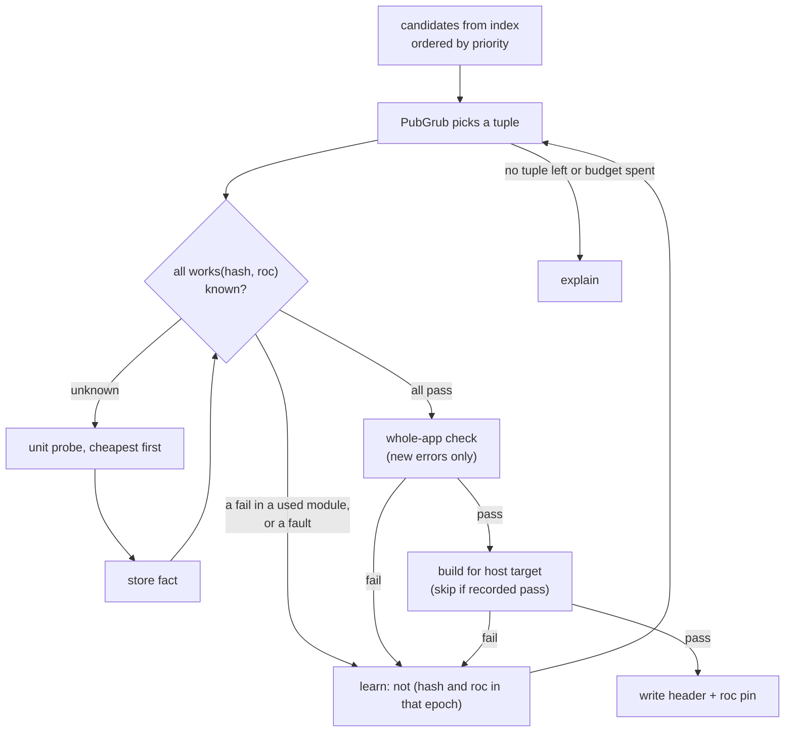

# Talon design: resolution

Part of the Talon design. This file holds how Talon selects versions in each context, and the probe rules. `DESIGN.md` has the goals, the core model and the list of files.

A reference such as CLI 6.2 is section 6.2 of `DESIGN-CLI.md`. Design, Resolution and Registry name `DESIGN.md`, `DESIGN-RESOLUTION.md` and `DESIGN-REGISTRY.md`. A plain number is a section of this file.

| Context | What Talon selects | Rules |
| --- | --- | --- |
| `tln add`, `install`, `update`, `upgrade`, `remove`, `verify` | Packages, platform and nightly of a project header | Sections 1 to 12 |
| `tln install --frozen` | Nothing. It verifies the header. | 12 |
| A `roc` run through the proxy | The compiler for that run | 13 |
| `tln tool install`, `tln x` | The compiler release for an app build | CLI 6.4 |
| `tln tool install`, `tln x` | A build that is already on this machine | CLI 6.4, B1, B2 |
| A ref typed in a command | How Talon reads a selector, and the meaning of no selector | CLI 2 |

## 1. Variables and anchors

Resolution picks one value for each free variable. The nightly is a variable like any package, but only `tln upgrade` frees it (RP1, section 9).

| Variable | Domain |
| --- | --- |
| `roc` | Nightly tags (and later, releases) |
| `pf` | Platform releases |
| each direct dep | Releases in range |

Any variable can be an anchor: a hard pin (`=`) in `talon.toml`, or a `tln add parser@2.0.0` (writes, CLI 2). The rest are free. Examples:

| Intent | talon.toml |
| --- | --- |
| "I need parser 2.0.0. I do not care which nightly." | `parser = "=2.0.0"`, `roc = "*"` |
| "My team uses nightly 10-09. Find packages that work with it." | `roc = "=nightly-2026-10-09-258ab27"` |
| "Keep the platform. Move the rest." | `pf = "=0.25.0"` |

When many tuples work, `priority` breaks ties: the solver maximizes the version of the first name, then the second, and so on. The default is: direct deps in header order, then `pf`, then `roc`. `priority` orders only the free variables. A command can hold other variables for one run (section 9).

## 2. Constraints

| # | Constraint | Kind |
| --- | --- | --- |
| C1 | Range from `talon.toml`, or the implied range (Design 4.3) | Hard |
| C2 | Roc MVS: a direct pin is at least the highest version of that group in the closure | Hard |
| C3 | One platform: every package that names a platform names the app platform, byte for byte | Hard |
| C4 | Alias kind: a `platform` entry resolves to a platform release | Hard |
| C5 | Compatibility: every hash in the closure checks on the chosen nightly (sections 3 to 5) | Hard |
| C6 | Yanked releases are not chosen for a new resolution | Hard |
| C7 | `min-release-age` and `snapshot` (log or time form, section 11) hide new releases | Hard |
| C8 | Two majors of one group in the closure | Warning (type identity) |

## 3. Compatibility evidence

Evidence is a set of facts `works(hash, nightly) = pass | fail(error digest)`. Sources, from strong to weak:

| Rank | Source | Trust |
| --- | --- | --- |
| 1 | Local probe result (`talon/compat.db`) | Full |
| 2 | Registry matrix, produced by the Talon CI bot (Registry 6) | Full, signed |
| 3 | `roc:` pin in the release header | Hint: author says it passed |
| 4 | `.roc-version` at the release tag | Hint |
| 5 | Release date (nightlies of the 2 weeks before it) | Search order only |
| 6 | Reports from other users (`tln probe --share`) | Search order only |

Hints only order the search. Talon never writes a header on hints alone: the final tuple always gets a local whole-app check (section 5 step 6), unless the user passes `--no-check`. That check costs under 2 s. `--no-probe` does not turn it off. Only `--no-check` does (section 12).

## 4. Probes

A probe runs one compiler on one target and classifies the result. Probes form a ladder. Each step runs only when the step before it passed.

| Step | Probe | Command | Blames |
| --- | --- | --- | --- |
| 1 | Unit | `roc check packages/<hash>/main.roc` with nightly N | The modules of the hash that have errors |
| 1 | Platform | same, on the platform `main.roc` | The modules of the platform that have errors |
| 2 | Whole app | `roc check main.roc` with the candidate header in a temp copy | The hash that owns the file of each new error (see "Baseline check"). The app itself if a new error is in app files: then Talon stops and reports, because the user code is not a free variable. Errors that the baseline already has are not blamed. |
| 3 | Build | `roc build main.roc --output=<tmp>` for the host target | Link or target-file errors blame the platform for that target. Other errors as in step 2. Talon can skip this step (see "Build skip"). |

Step 3 catches what `check` cannot see: a missing host file for the target, link errors, and code generation bugs. It runs once, on the final tuple. (Measured: 309 ms for a basic-cli app.)

### Baseline check

An app can already have compile errors when the user runs `tln add` or `tln update`. So step 2 compares two runs of the same check.

| Run | Header | Compiler |
| --- | --- | --- |
| Baseline | The current header, unchanged | The nightly in the current `roc:` pin, or the selected compiler (section 13) if there is no pin |
| Candidate | The candidate header in a temp copy | The candidate nightly |

Two errors are the same error when all of these are equal:

| Part | Value |
| --- | --- |
| File | The path in the app, or (hash, module path) for a package file. Never the cache path. |
| Kind | The error title in the header line of the error |
| Message | The error text with line numbers, column numbers and source excerpts removed |

Line numbers are not part of the identity, because they move when the user edits a file. Talon compares the two error sets and sorts each error:

| Error | Class | Action |
| --- | --- | --- |
| In the candidate only | New | Blame as in the table above |
| In both | Unchanged | Print as a note. Do not blame. |
| In the baseline only | Removed | Print as a note. This is good. |

Rules P6 to P8 (below) apply to the baseline check.

`--no-check` is a resolve flag (section 12). It skips the baseline check, the whole-app check (step 2) and the build (step 3). Unit probes still run. The header then carries no verified claim from step 2 or 3, and H6 keeps the old `roc:` pin. Talon prints `check: skipped` in the summary.

### Build skip

Step 3 costs time on each `tln add` and `tln update` (goal G5). Talon skips it when all of these are true:

| # | Condition |
| --- | --- |
| 1 | `compat.db` has a build pass with the key (platform hash, nightly, target). This is the P4 key for the target of the build. |
| 2 | That record also holds the used-closure digest of the build that passed. The digest of the candidate is equal. |
| 3 | Step 2 passed for the candidate with no new errors. |

The used-closure digest is a hash of the sorted list of hashes that the app uses (the packages with a used module, found by the lexical scan below, with their patches and overrides). A package that the app does not import is not in the digest. So `tln add` of a package that the app does not use yet keeps the digest, and Talon skips the build. A change to the platform hash, the nightly, the target or a used package changes the key or the digest, and Talon runs the build. A recorded fail never allows a skip. Talon prints `build: skipped (recorded pass)` in the summary. A skip also does not claim that the current app source builds: step 2 covers the app source.

Result classes, all seen in the measurement below:

| Class | Signal | Meaning |
| --- | --- | --- |
| pass | `No errors found`, or `0 errors and N warnings` | Works |
| fail | `N errors` with N > 0. Each error header names a file. | A code incompatibility, per module |
| hang | No result in 30 s. A normal check takes under 2 s. | Compiler fault |
| crash | Signal exit (139 seen) | Compiler fault |

Rules:

| # | Rule |
| --- | --- |
| P1 | `check` and `build` only. Talon never runs the output, so no host code runs. |
| P2 | Warnings do not fail a probe. |
| P3 | A download error gives no fact. A hang or crash is a fact of its own class (compiler fault). |
| P4 | Results are stored per (hash, nightly, target) and never expire. `check` results use the target `any`. A fail stores the set of failing modules. A `build` pass also stores the used-closure digest (see "Build skip"). |
| P5 | Budget: `probe.max` (default 100) checks, `probe.timeout` (default 30 s), and `probe.max-toolchains` (default 10) new compiler downloads. One nightly is about 70 MB packed and 228 MB unpacked. Installed nightlies are tried first, because they cost nothing to fetch. A new download needs consent (DL1 to DL6, CLI 6.2). The cap limits the downloads after consent. |
| P6 | Talon blames only new errors (see "Baseline check"). A candidate with no new errors passes step 2, also when the app has errors. |
| P7 | If the baseline is a hang or crash, Talon has no error set. It stops and tells the user to fix the compiler fault or to use `--no-check`. |
| P8 | An error that the baseline hid (for example behind an earlier error in the same module) can show as new. This is a conservative result. The user can fix the app or use `--no-check`. |

### Parallel probes

Talon runs more than one probe at the same time. A probe takes slots from a pool of 12 slots:

| Probe | Slots | Most at the same time |
| --- | --- | --- |
| Check (unit, baseline, whole-app) | 1 | 12 checks |
| Build (ladder step 3) | 4 | 3 builds |

So Talon runs up to 12 checks, or up to 3 builds, or a mix (for example 1 build and 8 checks). `probe.slots` in `talon.toml` (or `config.toml`, CLI 6.1) and `--slots <n>` change the pool size. The weights do not change.

Why these numbers: a check takes 0.4 s to 1.9 s and little memory. The Q11 sweep ran 12 checks at the same time on one shared cache, with no error (`conformance/compat-sweep/run.sh:15`). A build also links the host and uses about 250 MB. 3 builds at the same time on one cache passed 300 of 300 times, with the same bytes as a build that ran alone (Q18, `conformance/build-share/`). 3 builds take 1.03 s, 1 build takes 0.74 s.

| # | Rule |
| --- | --- |
| PP1 | Only a probe whose compiler is installed takes slots. A compiler download takes no slot. It runs at the same time as the probes, and a probe that needs it waits for it. |
| PP2 | These probes run at the same time: the unit checks of all packages of one candidate tuple (section 5 step 4); 3 nightlies of a nightly range in a search, so that one round cuts the range in 4 parts and not in 2; the baseline check and the first unit checks; the build of each workspace member (Design 4.4); the releases that option 2 of `tln tool install` tries (CLI 6.4). |
| PP3 | The result does not depend on the order in which probes end (G3). Before a round starts, Talon makes the list of probes of the round. When the round ends, Talon reads the results in the order of that list. |
| PP4 | Each probe that starts counts against `probe.max`, and its result goes in `compat.db`, also when the solver does not use it. So the same inputs give the same header and the same probe count. |
| PP5 | A probe that hangs keeps its slots until `probe.timeout` (30 s). The other probes continue. |

### A unit fail is per module

`roc check` on an app checks only the modules that the app imports. Measured on nightly 10-09 with roc-parser 2.0.0:

| Probe | Result |
| --- | --- |
| Unit: `roc check` on parser `main.roc` | fail: `redundant expose` in `Yaml.roc` |
| App that imports `parser.Parser` | pass, and `roc build` passes. The binary runs. |
| Same app, also imports `parser.Yaml` | fail |

So a unit fail is a hard incompatibility only when the app uses a failing module. Talon computes the modules that the app uses in each package: the `import` lines of the app, then the `import` lines inside the package, transitively. This is a lexical scan with the header parser package. If the set does not touch a failing module, the unit fail is ignored, and the whole-app check (step 2) decides.

### Measurement: islands and epochs (Q11)

Setup: 46 cached hashes (32 with a known release label) × 22 nightlies (2026-09-15 to 2026-10-12), Linux x86_64, unit probes, isolated caches. Script and raw data: `conformance/compat-sweep/`.

```text
nightly      09-15 .. 09-19 | 09-22 | 09-23 09-24 | 09-25 | 09-26 .. 09-29 | 09-30 10-01 | 10-02 .. 10-06 | 10-09 .. 10-12
basic-cli 0.22.x  pass      | pass  | HANG  HANG  | pass  | pass           | pass  pass  | fail           | fail
basic-cli 0.23.0  fail      | fail  | fail  fail  | fail  | pass           | pass  pass  | fail           | fail
basic-cli 0.24.0  fail      | fail  | fail  fail  | fail  | pass           | pass  pass  | pass           | fail
basic-cli 0.25.0  fail      | fail  | fail  fail  | fail  | fail           | fail  fail  | fail           | pass
basic-websrv 0.17 fail      | pass  | pass  pass  | pass  | pass           | CRASH CRASH | pass           | fail
roc-parser 2.0.0  fail      | fail  | fail  pass  | pass  | pass           | pass  pass  | fail (Yaml)    | fail (Yaml)
roc-ray 0.10.0    fail      | pass  | pass  pass  | pass  | pass           | pass  pass  | pass           | fail
basic-websrv 0.16 pass      | pass  | pass  pass  | pass  | pass           | CRASH CRASH | fail           | fail
joy 0.33, joy-html 0.16  pass on 09-15 .. 10-01, fail from 10-02
26 other hashes   pass on all 22 nightlies
4 other hashes    fail on all 22 (no main.roc, or written for an older compiler)

(basic-cli 0.22.x is 3 hashes, roc-ray 0.10.0 is 2 hashes. basic-cli 0.28.0 and 0.29.0 match 0.24.0 and 0.25.0.)
```

| Question | Measured |
| --- | --- |
| Transitions where any result changes | 8 of 21 |
| Code epochs (boundaries where a pass/fail result changes) | 6: boundaries at 09-22, 09-24, 09-26, 10-02, 10-09 |
| Fault windows (hang or crash) | 2: 09-23 to 09-24 (hang, basic-cli 0.22.x), 09-30 to 10-01 (segfault, basic-webserver) |
| Transitions where only one hash changes | 0. Each boundary moved 2 to 8 hashes. |
| Results that change inside an epoch | 0 |
| Hashes with more than one island | 4 of 46. All 4 gaps are hangs or crashes. |
| Hashes with more than one island, if faults do not split a range | 0 |

Conclusions for the search:

| Rule | Reason |
| --- | --- |
| Probe one nightly per epoch | No result changed inside an epoch. 22 nightlies are 6 epochs. |
| A fault (hang, crash) marks that nightly as bad for that hash. It does not split the pass range. | Every island in the sample comes from a compiler fault, not from a code change. |
| A boundary is a nightly where at least 2 hashes change | All 8 transitions in the sample had at least 2. A change in only one hash is still binary-searched and reported to the bot. |
| Islands from code changes stay possible | The sample is small (46 hashes, 4 weeks). The model keeps a map from nightly to result, so a real code island costs probes but never gives a wrong answer. |
| Probe timeout 30 s | Normal checks take under 2 s. The hangs ran for 600 s with no result. |

If the solver finds no tuple with inferred facts, it runs a second pass. That pass probes the inferred facts that blocked the best tuples, within the remaining budget. Talon never writes a wrong header because of an inferred fact: the final ladder (steps 2 and 3) always runs on real probes.

With no bot data (registry off), each hash starts with the release date and `roc:` pin as hints, and the epochs come from the local `compat.db` only.

## 5. Algorithm

PubGrub with a lazy oracle. A failed probe becomes a learned incompatibility, the same way a failed version constraint does.



| Step | Action |
| --- | --- |
| 1 | Collect variables, ranges and anchors (section 1). For `add` and `update`, run the baseline check on the current header (section 4). |
| 2 | Fetch metadata for the full closure in one request (Registry 4). It includes the shared matrix for these hashes. |
| 3 | PubGrub picks the best tuple by `priority`, under C1 to C4 and C6 to C7. |
| 4 | For each pair (hash, roc) with no fact, run a unit probe. Order: installed nightly first, then the strongest hint. Up to 12 checks run at the same time (section 4, "Parallel probes"). |
| 5 | A fail in a module that the app uses, or a fault, adds an incompatibility for (hash, that epoch). Go back to step 3. |
| 6 | When all unit facts pass, run the whole-app check, then the build (ladder steps 2 and 3). Step 2 blames only errors that are new against the baseline (section 4). Step 3 is skipped when a recorded pass allows it (section 4). `--no-check` skips both. These catch errors that come from the combination (for example a raised transitive version) and from the target. |
| 7 | Write the header and `roc:`. Print the tuple, the probe count and the evidence for each choice. |

Example failure output, with measured ranges, for an app that imports `parser.Yaml`:

```text
error: no tuple works

  lukewilliamboswell/roc-parser 2.0.0 (module Yaml)   checks on nightly 09-24 .. 10-01
  roc-lang/basic-cli 0.25.0                           checks on nightly 10-09 .. 10-12
  no nightly is in both ranges

  fix: relax pf to "0.24.*" (checks on 09-26 .. 10-06, overlap 09-26 .. 10-01)
       or stop using parser.Yaml (parser.Parser checks on 10-09)
```

## 6. Overrides of transitive versions

To raise a transitive dependency (for example, a security fix), the app needs an alias for it in the same major. Roc then uses that version for the whole graph. Section 2 of `DESIGN.md` confirms both parts: an unused alias is legal, and it raises the version for every package.

```toml
[overrides]
parser = { package = "lukewilliamboswell/roc-parser", version = "^2.0.3" }
```

The raise can break a package that was not written for the new version (the `http 1.9.0` test in Design 2). So the solver treats an override as a free variable, and the whole-app probe (section 5 step 6) covers it.

## 7. Patches

`tln patch json` copies the cached package to `.talon/patches/json/` for editing. `talon.toml` records it:

```toml
[patch]
json = "./.talon/patches/json/main.roc"
```

The header does not change. The `roc` proxy (CLI 6.2) adds `--replace-dep <header URL> <patch path>` to each command. `tln patch --commit` writes a diff file.

## 8. Libraries

| Task | Command |
| --- | --- |
| Record the lowest working versions in the package header | `tln update --strategy lowest` |
| Test with the newest versions without editing the header | `tln verify --strategy highest` (uses `--replace-dep`, CLI 1) |
| Record the nightly range that the package checks on | `tln probe --range` (publishes evidence with the release) |

## 9. Scope of `update`, `upgrade` and `install`

A command can hold a variable: it fixes the variable at its current header value for one run. A hold is a temporary anchor. It is not written to `talon.toml`. The nightly is held at the `roc:` pin, or at the selected compiler (section 13) if there is no pin.

| Command | Free variables | Held variables |
| --- | --- | --- |
| `tln update` | All, inside their ranges | None |
| `tln update X [Y...]` | Only the named ones | All others |
| `tln update -i` | The ones the user picks in the picker (prompt NI2, CLI 4) | All others |
| `tln update X@sel` | X, in the releases that match `sel`, also in a new major (section 10) | All others |
| `tln upgrade` | All, with no package range (section 10) | Anchors (`=`) |
| `tln upgrade X [Y...]` | Only the named ones, with no range. A named anchor is free too. | All others |
| `tln upgrade roc` | Only the nightly | All packages |
| `tln upgrade X roc` | X and the nightly | All other packages |

| Case | `priority` (section 1) |
| --- | --- |
| `tln update` | As set. The default is direct deps, then `pf`, then `roc`. |
| `tln update X Y` | Only X and Y are ordered, in the order of `priority`. A held variable has no rank. So `tln update json` cannot move `pf` or `roc`. |
| `tln upgrade roc` | The nightly is the only free variable. It moves to the newest nightly that all held hashes pass on (section 3). |
| `tln upgrade X roc` | The order of `priority` for X and `roc`. By default, X is first. |
| `tln update -i` | The picker lists the free variables in `priority` order. The names that the user picks follow the `tln update X` row. The nightly is not in the list (RP1). |

### The `roc:` pin

| # | Rule | Why |
| --- | --- | --- |
| RP1 | Only two commands change a `roc:` entry that exists: `tln upgrade` when the nightly is free (no names, or the name `roc`), and `tln roc use` (U1 to U4). | The nightly has no semver ranges, so each move goes to a newer release and can break code. That is the job of `upgrade`. `tln update` stays the small, safe move. |
| RP2 | `install`, `add`, `update` and `remove` always hold the nightly, also with NI3, `--allow-moves` or `--yes`. When no tuple works on the held nightly, Talon writes nothing and stops with exit code 10 (`no_tuple`). The error names the oldest nightly that works, when a probe or the matrix knows it, and the commands `tln upgrade roc` and `tln roc use <id>`. A `roc:` pin outside the `[toolchain] roc` range gives the same error in `install`. | One command moves the nightly, so the user always sees it move. |
| RP3 | A header with no `roc:` entry: the command writes the nightly that it held (the selected compiler, section 13) after the check passes (H6). | This records the lock. It does not move it. |
| RP4 | In `tln upgrade`, a move of a held variable (NI3) can include the nightly. | `upgrade` is allowed to move it. |

A held variable moves only when no tuple exists without moving it (RP2 excludes the nightly). Then Talon does not move it by itself:

| Case | Talon does |
| --- | --- |
| A tuple exists with all held variables fixed | Uses it. No held variable moves. |
| No such tuple | Names the variables that must move and why, for example `json 2.2.0 needs pf >= 0.26.0`. Asks for consent to move them. Prompt NI3 (CLI 4), default no. |
| Non-interactive mode (CLI 4) and no `--yes` | Stops with the same report and exit code 13. Writes nothing. With `--allow-moves` or `--yes`, moves the named variables. |

`tln install` with no names keeps the lock (G1). With names, it is `tln add` (CLI 1).

| Header entry | Install does |
| --- | --- |
| Satisfies its range in `talon.toml`, or its implied range (Design 4.3) | Keeps it. The entry does not change. Install holds it, as in `tln update X`. |
| Is missing from the header, or is out of range | Resolves it. This entry is the only free variable. |
| `talon.toml` does not exist | Resolves nothing. Install only fetches the closure of the header. |

A hold that cannot stay follows the consent rows above. `tln install --frozen` (section 12) runs the same check and resolves nothing: where plain `install` would resolve an entry, `--frozen` fails.

## 10. Upgrade and new majors

`tln update` moves inside the ranges of `talon.toml`. `tln upgrade` moves to the newest releases, also to a new major, and changes the ranges to match. It is the Bun `update --latest` and the Cargo `cargo upgrade --incompatible`.

| Command | Domain of a free package | `talon.toml` | Nightly |
| --- | --- | --- | --- |
| `tln update [X...]` | Its range | Not changed | Held (RP1) |
| `tln update X@sel` | The releases that match `sel`, in any major | As `tln add X@sel` (CLI 2). `@latest` follows UP5. | Held (RP1) |
| `tln upgrade` | All releases, in any major | UP5 | Free |
| `tln upgrade X [Y...]` | All releases, in any major | UP5 | Free only when `roc` is one of the names |

| # | Rule |
| --- | --- |
| UP1 | The domain is every release that C6 and C7 allow (not yanked, older than `min-release-age`, inside the snapshot). A package range in `talon.toml` and the implied range (Design 4.3) do not apply. An anchor (`=`) holds its variable unless the user names it. A `[toolchain] roc` range still applies: it states which compilers the team can use. |
| UP2 | The goal is the same as for `update`: the newest version of each free variable, in `priority` order (section 1). So a new major of the first variable wins over newer versions of the later ones. Talon prints each variable that did not get its newest release, and why, for example `json 3.0.0 needs pf >= 0.27.0, which checks on no nightly that roc-parser 2.0.0 checks on`. |
| UP3 | A new major is a new group (Design 2). Talon replaces the header entry under the same alias. It never adds a second entry. If a package in the closure still needs the old major, both majors stay in the closure, and Talon prints warning C8. |
| UP4 | Moves of held variables follow section 9 (prompt NI3). |
| UP5 | A range that does not contain the new version gets the same form at the new version: `^2.1` becomes `^3.0`, `0.25.*` becomes `0.26.*`, `2` becomes `3`. A named anchor becomes `=<new version>`. A range that contains the new version does not change. Talon adds no key and does not create the file. |
| UP6 | When the nightly is free, the newest nightly is a download that the command names: prompt NI12 (CLI 4), default yes. All other compiler downloads are optional probe downloads (NI4). |
| UP7 | Many free variables in all majors give a large search. The budget P5 applies, and probes run in parallel (PP1). When the budget is spent, Talon writes nothing and stops with exit code 12 (`budget`). The error names `probe.max`. |
| UP8 | `--strategy lowest` is an error (exit code 2): `upgrade` only moves up. |

```text
$ tln upgrade
resolved 9 packages in 62ms (log:184467)
probed 14 times on 3 nightlies (1 download, 70 MB), up to 12 at the same time

  main.roc
  ~ pf:     roc-lang/basic-cli  0.25.0 -> 0.27.1
  ~ json:   someone/roc-json    2.1.0  -> 3.0.2   new major
  ~ parser: lukewilliamboswell/roc-parser 2.0.0 (anchor, held)
  ~ roc:    nightly-2026-10-09-258ab27 -> nightly-2026-10-13-91fa0c2
  talon.toml: json = "^3.0" (was "^2.1"), pf = "0.27.*" (was "0.25.*")
```

## 11. Determinism

| Input | Output | Deterministic because |
| --- | --- | --- |
| Header | Build graph | Hashes are fixed. Roc MVS is a pure function of the headers. |
| `talon.toml` + header + snapshot + evidence | New header | The resolver is a pure function. Probes only add evidence. A probe result for (hash, nightly) does not change. |

A snapshot fixes which releases exist. It has two forms:

| Form | Example | Hides | Works with | Strength |
| --- | --- | --- | --- | --- |
| Log | `log:184467` | Every release that the registry log (Registry 3) added after that size | The registry only. With `TALON_REGISTRY=direct` there is no log, so Talon stops with an error. | Strong. The log is append-only, so the set of releases is fixed. |
| Time | `2026-10-12T00:00:00Z` (UTC, RFC 3339) | Every release published after that time. The time is the GitHub release `published_at`. | The registry and `direct` | Weaker. See below. |

The time form is the same idea as uv `exclude-newer`. It is weaker because GitHub can change a release after the fact: a maintainer can delete and publish a release again, or move a label to other assets. So a time snapshot can give another set of releases on a later day. The hash in the header still protects the build bytes.

`tln update` prints `resolved at log:184467, 4 probes`. With no registry, it prints `resolved at 2026-10-14T09:30:00Z, 4 probes`. A human can repeat the resolve with `--snapshot log:184467` (or the time). The result is the same only if the evidence is the same. Local probe facts (rank 1 in section 3) are not shared, so a second machine can get a different tuple.

CI must not resolve again. CI runs `tln install --frozen` (section 12). It verifies the header that is in the repository: it fetches the closure, checks each hash, and fails if the header does not satisfy `talon.toml`. It needs no snapshot and no evidence.

## 12. Lock and frozen modes

These are resolve flags (CLI 1). They apply to commands that resolve.

| Flag | Meaning |
| --- | --- |
| `--frozen` | Do not resolve. Fetch the closure, check each hash, and fail if the header does not satisfy `talon.toml`. Write nothing. For CI. Same idea as Bun `--frozen-lockfile`. It does not imply `--offline` (Cargo `--frozen` does). |
| `--no-probe` | Run no new unit probes (ladder step 1). Use known evidence only. The final ladder (steps 2 and 3 of section 4) still runs. |
| `--no-check` | Skip the baseline check and the final ladder: the whole-app check and the build (section 4, and section 5 step 6). Talon still writes the header, with no local proof for the tuple. H6 keeps the old `roc:` pin. |
| `--dry-run` | Print the header diff and the `talon.toml` diff. Write no project file. Probe results still go in `compat.db`, because they are facts (section 3). Talon answers No to optional downloads (NI4). A required download follows the consent rules (DL1 to DL6). |

There is no `--locked`. Cargo and uv give that name a different meaning, so Talon does not use it.

Use `--no-check` only when one of these is true:

| Case | Why it is safe |
| --- | --- |
| The same build id (Design 4.1) has a recorded local pass for the whole-app check and the build, and the app source did not change | The skipped steps would give the same result |
| A later CI step runs `roc check` and `roc build` on the header before it is used | The proof moves to that step |
| The app has a compiler fault in the baseline (P7), or an error that the baseline hid (P8) | The user takes the risk and fixes the app first |

## 13. Compiler selection order

| Priority | Source | Example | Why this rank |
| --- | --- | --- | --- |
| 1 | Command argument | `roc +nightly-2026-10-06-c34079d check` | The user typed it for this one run. |
| 2 | Environment | `ROC_TOOLCHAIN=nightly-2026-10-06-c34079d` | Set for a shell or a CI job. |
| 3 | `roc:` entry of the target file header | `roc: "nightly-2026-10-09-258ab27"` | The header is the lock (G1). It is exact and it travels with the file. |
| 4 | `talon.toml` `[toolchain] roc` | newest installed in range | Intent. It is a range, so it only chooses when the header has no pin. |
| 5 | `.roc-version` in the nearest parent directory | package repos | Other people's convention. Used only when no `talon.toml` is in a parent directory of the file. |
| 6 | Global default | `tln roc default <tag>`, stored in `config.toml` (CLI 6.1) | Last resort. |

The proxy finds the target file (rank 3) in the `roc` arguments: the first argument that names a `.roc` file. With no such argument, it uses `main.roc` in the current directory, as roc does. A command with no file (`roc version`, `roc help`) has no target file, so rank 3 does not apply.

| Case | Talon does |
| --- | --- |
| A rank selects a nightly that is not installed | A required download (DL2, prompt NI5) |
| Rank 4 has a range, and no installed nightly is in it | The newest nightly in the range is a required download (NI5) |
| No rank selects a compiler | Error with exit code 2 that names `tln roc install @latest` and `tln roc default`. Talon does not guess. |

The first compiler that Talon installs becomes the global default when none is set, as in rustup. So "no rank selects a compiler" happens only before the first install.

Talon reads `.roc-version` but never writes it (G1: no second lock). `tln init` writes the nightly as the `roc:` entry of the header (CLI 1).

| Case | Talon does |
| --- | --- |
| The header `roc:` and `talon.toml` `[toolchain] roc` disagree | The proxy uses the header. `tln install` and `tln install --frozen` report that the header does not satisfy `talon.toml`. `--frozen` fails (section 12). |
| `.roc-version` and the header `roc:` disagree | Talon prints one warning in `tln install` and in `tln ls`, for example `.roc-version names nightly-2026-10-06-c34079d, the header names nightly-2026-10-09-258ab27`. The proxy uses the header. Talon does not edit `.roc-version`. |

