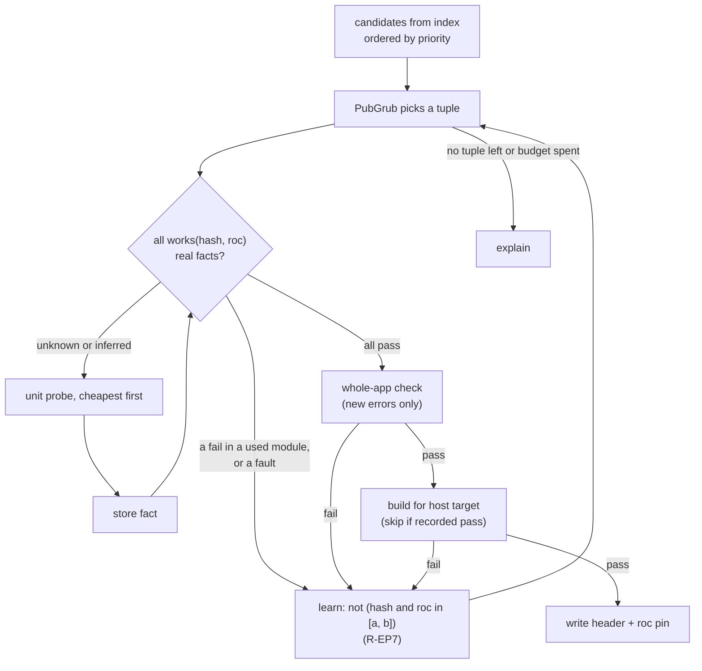

# Talon design: resolution

Part of the Talon design. This file holds how Talon selects versions in each context, and the probe rules. `DESIGN.md` has the goals, the core model and the list of files.

A reference such as CLI 6.2 is section 6.2 of `DESIGN-CLI.md`. Design, Resolution and Registry name `DESIGN.md`, `DESIGN-RESOLUTION.md` and `DESIGN-REGISTRY.md`. A plain number is a section of this file.

| Context | What Talon selects | Rules |
| --- | --- | --- |
| `tln add`, `install`, `update`, `upgrade`, `remove`, `verify` | Packages, platform and nightly of a project header | Sections 1 to 12 |
| `tln install --frozen` | Nothing. It verifies the header. | 12 |
| A `roc` run through the proxy | The compiler for that run | 13 |
| `tln tool install`, `tln x` | The compiler release for an app build | CLI 6.4 |
| `tln tool install`, `tln x` | A build that is already on this machine | CLI 6.4, R-B1, R-B2 |
| A ref typed in a command | How Talon reads a selector, and the meaning of no selector | CLI 2 |

## 1. Variables and anchors

R-VA1: Resolution picks one value for each free variable. The nightly is a variable like any package, but only `tln upgrade` frees it (R-RP1, section 9).

| # | Variable | Domain |
| --- | --- | --- |
| R-VA2 | `roc` | Nightly tags and releases of the compiler, as the `nightly` switch allows (below) |
| R-VA3 | `pf` | Platform releases |
| R-VA4 | each direct dep | Releases in range |

R-VA5: Any variable can be an anchor: a hard pin (`=`) in `talon.toml`, or a `tln add parser@2.0.0` (writes, CLI 2). The rest are free. A named anchor is free in `tln upgrade` (R-UP1). One exception: an entry with no index (R-DI11, CLI 7.3) is a fixed anchor. Its domain is its header value, and no command frees it, also when the user names it. Examples:

| Intent | talon.toml |
| --- | --- |
| "I need parser 2.0.0. I do not care which nightly." | `parser = "=2.0.0"`, `roc = "*"` |
| "My team uses nightly 10-09. Find packages that work with it." | `roc = "=nightly-2026-10-09-258ab27"` |
| "Keep the platform. Move the rest." | `pf = "=0.25.0"` |

R-VA6: When many tuples work, `priority` breaks ties: the solver maximizes (with `strategy = "lowest"`, minimizes) the version of the first name, then the second, and so on. The default is: direct deps in header order, then `pf`, then `roc`. `priority` orders only the free variables. A command can hold other variables for one run (section 9).

### The `nightly` switch

roc accepts two forms of compiler version in a header: nightly tags, and releases such as `0.1.0` or `1.0.0-rc1` (`roc:src/base/roc_version.zig:14-19`). `roc fmt` never rewrites a release pin (`roc_version.zig:101-108`). The Zig-based compiler has no release yet. Its only tags are the alpha tags of the old Rust compiler, which Talon does not support (N3). The switch states if nightlies are candidates.

| # | Priority | Source | Example |
| --- | --- | --- | --- |
| R-NS8 | 1 | Environment | `TALON_NIGHTLY=0` or `1` |
| R-NS9 | 2 | `talon.toml` | `[toolchain] nightly = false` |
| R-NS10 | 3 | `config.toml` (CLI 6.1) | `nightly = false` |
| R-NS11 | 4 | Default | `true` |

| # | Rule |
| --- | --- |
| R-NS1 | On (the default), the domain of `roc` is all nightlies and all releases. Talon orders them by date: the tag date of a nightly, the GitHub `published_at` of a release. On the same date, the release is newer. Two nightlies of one date (for example `nightly-2026-09-01-24e3995` and `nightly-2026-09-01-db83307`) are in the order of their GitHub `published_at`, then of the tag text. roc gives them the same rank (Design 2), so this order is Talon's own. It is total, so `@-1`, adjacent releases (R-EP1) and "newest" each have one answer (G3). |
| R-NS2 | Off, the domain is the releases only. Today that domain is empty: Talon knows no source of compiler releases yet (CLI 6.2, R-CV1). Then a command that must select a compiler stops with exit code 10 (`no_tuple`), and the error names the switch and its source. |
| R-NS3 | The switch applies where Talon selects a compiler by itself: the resolver, `tln upgrade` and `tln init` (section 10, CLI 5), `tln roc update` (R-RU1), the selector `@latest` and the relative selectors `@+N` and `@-N` in the `tln roc` scope (CLI 2), selection rank 4 (section 13), option 2 of R-NI8 (CLI 6.4), and probe searches (section 4). |
| R-NS4 | The switch does not apply to a compiler that the user names: a command argument, `roc +<id>`, `ROC_TOOLCHAIN`, `tln roc install <id>` and `tln roc default <id>`. A global default that is a nightly (rank 6) stays in use. |
| R-NS5 | A nightly `roc:` pin with the switch off is like a pin outside the `[toolchain] roc` range (R-RP2). The proxy runs it, because the header is the lock (rank 3). `tln install` reports it, and `--frozen` fails with exit code 14. `tln roc use <nightly>` stops (R-U5). `tln upgrade roc` moves the pin to a release. |
| R-NS6 | `git-*`, `link-*` and `copy-*` builds (CLI 6.6) are not nightlies and not releases. The switch never removes them, because Talon selects them only by name (R-R5). |
| R-NS7 | The `[toolchain] roc` range and the switch both apply. A semver range (`0.1.*`, `^1`) matches releases only. `*` matches both forms. A lower bound `>=<compiler id>` (a full nightly tag or a release version, CLI 2 prefix rules) matches each nightly and release that R-NS1 orders at or after that id. Use: a team states the oldest compiler that its code needs. It limits rank 4 of section 13, and `install` reports a `roc:` pin below it (R-RP2). There is no upper bound form: the `roc:` pin already holds the nightly, and only `tln upgrade` moves it (R-RP1). An anchor `=nightly-<tag>` with the switch off is a contradiction: Talon stops with exit code 2 and names both keys. |

R-NS12: Evidence and probes (sections 3 and 4) work the same for a release: a fact is `works(hash, compiler release)`. In the other rules, "the nightly" is the value of `roc`.

## 2. Constraints

| # | Constraint | Kind |
| --- | --- | --- |
| R-C1 | Range from `talon.toml`, or the implied range (Design 4.3) | Hard |
| R-C2 | Roc MVS: a direct pin is at least the highest version of that group in the closure | Hard |
| R-C3 | One platform: every package that names a platform names the app platform, byte for byte | Hard |
| R-C4 | Alias kind: a `platform` entry resolves only to a `platform` release, and a package entry resolves only to a `package` release. An `app` release is never a candidate. The kind is the first keyword of the release header (CLI 7.3, R-DI7). | Hard |
| R-C5 | Compatibility: every hash in the closure checks on the chosen nightly (sections 3 to 5) | Hard |
| R-C6 | Yanked releases are not chosen for a new resolution. Yank and advisory data come from the registry (Registry 5, Registry 7.2, advisories in Design 7, P3). A withdrawn release (Registry 7, R-PU17) is not a candidate. With `direct`, GitHub has no yank: a deleted release, a draft and a prerelease are not candidates (CLI 7.3, R-DI3), and there is no advisory data. Then each command that checks yanks or advisories (`tln audit`, R-B3 in CLI 6.4) prints one note: `no yank and advisory data without a registry`. | Hard |
| R-C7 | `min-release-age` and `snapshot` (log or time form, section 11) hide new releases. The default `min-release-age` is `2d`. Sources, from high to low: `talon.toml` `[resolution]`, `config.toml` (CLI 6.1), the default. `"0d"` turns it off. The release time is the GitHub `published_at`, from the registry or from GitHub (CLI 7.3, R-DI10). Both also apply where Talon selects a compiler by itself (R-NS3): `min-release-age` and the time form with the `published_at` of the nightly or release, the log form with its compiler log leaves (Registry 3). `min-release-age` does not hide a version or a compiler that the user names (R-NS4, or an exact version such as `tln add X@1.2.3`). Then Talon prints a note with its age. | Hard |
| R-C8 | Two series of one package (two groups, Design 4.1) in the closure | Warning (type identity) |
| R-C9 | R-C6, R-C7 and a snapshot never hide the value that a header entry or the `roc:` pin has now. That value stays in the domain of its variable, so a hold, the implied range (Design 4.3) and `tln update` still work, for example after `tln add X@1.2.3` of a release that is 1 day old. They hide only the other candidates. `tln audit` reports a yanked value (R-C6). | Hard |

## 3. Compatibility evidence

R-EF1: Evidence is a set of facts `works(hash, nightly) = pass | fail(error digest)`. Sources, from strong to weak:

| Rank | Source | Trust |
| --- | --- | --- |
| 1 | Local probe result (`talon/compat.db`) | Full |
| 2 | Registry matrix: `bot` rows from the Talon CI bot, and `author` rows from `tln publish` (Registry 5, R-RE3, Registry 6) | Full, signed |
| 3 | `roc:` pin in the release header | Hint: author says it passed |
| 4 | `.roc-version` at the release tag | Hint |
| 5 | Release date (nightlies of the 2 weeks before it) | Search order only |
| 6 | Reports from other users (`tln probe --share`): the counts of `compat_hints` (Registry 5, R-RE12) | Search order only |

R-EF2: Hints only order the search. Talon never writes a header on hints alone: the final tuple always gets a local whole-app check (section 5 step 6), unless the user passes `--no-check`. That check costs under 2 s. `--no-probe` does not turn it off. Only `--no-check` does (section 12).

R-EF3: When two sources have a fact for one pair (hash, nightly, target), Talon uses the fact of the source with the lowest rank number. In rank 2, a `bot` row wins over an `author` row. Reason: the bot runs each hash in one environment, and its rows also make the sweeps (Registry 6, R-MX4). Talon prints a note when a `bot` row and an `author` row of one pair have different results, and `--json` gives both. A rank 6 row is a `pass` hint when `pass_count` is larger than `fail_count`, a `fail` hint when `fail_count` is larger, and no hint when they are equal.

## 4. Probes

R-LD1: A probe runs one compiler on one target and classifies the result. Probes form a ladder. Each step runs only when the step before it passed.

| # | Step | Probe | Command | Blames |
| --- | --- | --- | --- | --- |
| R-LD2 | 1 | Unit | `roc check packages/<hash>/main.roc` with nightly N | The modules of the hash that have errors |
| R-LD3 | 1 | Platform | same, on the platform `main.roc` | The modules of the platform that have errors |
| R-LD4 | 2 | Whole app | `roc check main.roc` with the candidate header in a temp copy | The hash that owns the file of each new error (see "Baseline check"). The app itself if a new error is in app files: then Talon stops and reports, because the user code is not a free variable. Errors that the baseline already has are not blamed. |
| R-LD5 | 3 | Build | `roc build main.roc --output=<tmp>` for the host target | Link or target-file errors blame the platform for that target. Other errors as in step 2. Talon can skip this step (see "Build skip"). |

R-LD6: Step 3 catches what `check` cannot see: a missing host file for the target, link errors, and code generation bugs. It runs once, on the final tuple. (Measured: 309 ms for a basic-cli app.)

R-LD7: A project file that is a package or a platform (CLI 1, R-PD8) has no app. Then step 2 runs `roc check` on that file, which works with no app (Design 2). Its own files count as app files. Step 3 does not run, because roc builds only an app, so there is no build skip. The lexical scan (below) starts at every module of the project file, not at the `import` lines of an app. `tln init package` follows this rule (CLI 5).

### Baseline check

An app can already have compile errors when the user runs `tln add` or `tln update`. So step 2 compares two runs of the same check.

| # | Run | Header | Compiler |
| --- | --- | --- | --- |
| R-BL1 | Baseline | The current header, unchanged | The nightly in the current `roc:` pin, or the selected compiler (section 13) if there is no pin |
| R-BL2 | Candidate | The candidate header in a temp copy | The candidate nightly |

R-BL3: The baseline compiler is a required download (R-DL2, prompt R-NI5) when it is not installed. Talon never skips the baseline by itself: with no baseline, each error of the app is new, and R-P6 blames the wrong hash. In `install`, `add`, `update` and `remove`, the baseline compiler is the held nightly (R-RP2), and the candidate needs it too, so it adds no download. Only `tln upgrade` with a free nightly can need an extra download for the baseline. `--no-check` skips the baseline and its download.

R-BL4: Two errors are the same error when all of these are equal:

| Part | Value |
| --- | --- |
| File | The path in the app, or (hash, module path) for a package file. Never the cache path. |
| Kind | The error title in the header line of the error |
| Message | The error text with line numbers, column numbers and source excerpts removed |

R-BL5: Line numbers are not part of the identity, because they move when the user edits a file. Talon compares the two error sets and sorts each error:

| Error | Class | Action |
| --- | --- | --- |
| In the candidate only | New | Blame as in the table above |
| In both | Unchanged | Print as a note. Do not blame. |
| In the baseline only | Removed | Print as a note. This is good. |

Rules R-P6 to R-P8 (below) apply to the baseline check.

R-BL6: `--no-check` is a resolve flag (section 12). It skips the baseline check, the whole-app check (step 2) and the build (step 3). Unit probes still run. The header then carries no verified claim from step 2 or 3, and R-H6 keeps the old `roc:` pin. Talon prints `check: skipped` in the summary.

### Build skip

R-BS1: Step 3 costs time on each `tln add` and `tln update` (goal G5). Talon skips it when all of these are true:

| # | Condition |
| --- | --- |
| 1 | `compat.db` has a build pass with the key (platform hash, nightly, target). This is the R-P4 key for the target of the build. |
| 2 | That record also holds the used-closure digest of the build that passed. The digest of the candidate is equal. |
| 3 | Step 2 passed for the candidate with no new errors. |

R-BS2: The used-closure digest is a hash of the sorted list of hashes that the app uses (the packages with a used module, found by the lexical scan below, with their patches and overrides). A package that the app does not import is not in the digest. So `tln add` of a package that the app does not use yet keeps the digest, and Talon skips the build. A change to the platform hash, the nightly, the target or a used package changes the key or the digest, and Talon runs the build. A recorded fail never allows a skip. Talon prints `build: skipped (recorded pass)` in the summary. A skip also does not claim that the current app source builds: step 2 covers the app source.

Result classes, all seen in the measurement below:

| # | Class | Signal | Meaning |
| --- | --- | --- | --- |
| R-RC1 | pass | `No errors found`, or `0 errors and N warnings` | Works |
| R-RC2 | fail | `N errors` with N > 0. Each error header names a file. | A code incompatibility, per module |
| R-RC3 | hang | No result in 30 s. A normal check takes under 2 s. | Compiler fault |
| R-RC4 | crash | Signal exit (139 seen) | Compiler fault |

Rules:

| # | Rule |
| --- | --- |
| R-P1 | `check` and `build` only. Talon never runs the output, so no host code runs. |
| R-P2 | Warnings do not fail a probe. |
| R-P3 | A download error gives no fact. A hang or crash is a fact of its own class (compiler fault). |
| R-P4 | Results are stored per (hash, nightly, target) and never expire. `check` results use the target `any`. A fail stores the set of failing modules. A `build` pass also stores the used-closure digest (see "Build skip"). |
| R-P5 | Budget: `probe.max` (default 100) checks, `probe.timeout` (default 30 s), and `probe.max-toolchains` (default 10) new compiler downloads. One nightly is about 70 MB packed and 228 MB unpacked. Installed nightlies are tried first, because they cost nothing to fetch. A new download needs consent (R-DL1 to R-DL6, CLI 6.2). The cap limits the downloads after consent. |
| R-P6 | Talon blames only new errors (see "Baseline check"). A candidate with no new errors passes step 2, also when the app has errors. |
| R-P7 | If the baseline is a hang or crash, Talon has no error set. It stops and tells the user to fix the compiler fault or to use `--no-check`. |
| R-P8 | An error that the baseline hid (for example behind an earlier error in the same module) can show as new. This is a conservative result. The user can fix the app or use `--no-check`. |

### Parallel probes

R-PP6: Talon runs more than one probe at the same time. A probe takes slots from a pool of 12 slots:

| Probe | Slots | Most at the same time |
| --- | --- | --- |
| Check (unit, baseline, whole-app) | 1 | 12 checks |
| Build (ladder step 3) | 4 | 3 builds |

R-PP7: So Talon runs up to 12 checks, or up to 3 builds, or a mix (for example 1 build and 8 checks). `probe.slots` in `talon.toml` (or `config.toml`, CLI 6.1) and `--slots <n>` change the pool size. The weights do not change.

Why these numbers: a check takes 0.4 s to 1.9 s and little memory. The Q11 sweep ran 12 checks at the same time on one shared cache, with no error (`conformance/compat-sweep/run.sh:15`). A build also links the host and uses about 250 MB. 3 builds at the same time on one cache passed 300 of 300 times, with the same bytes as a build that ran alone (Q18, `conformance/build-share/`). 3 builds take 1.03 s, 1 build takes 0.74 s.

| # | Rule |
| --- | --- |
| R-PP1 | Only a probe whose compiler is installed takes slots. A compiler download takes no slot. It runs at the same time as the probes, and a probe that needs it waits for it. |
| R-PP2 | These probes run at the same time: the unit checks of all packages of one candidate tuple (section 5 step 4); 3 nightlies of a nightly range in a search, so that one round cuts the range in 4 parts and not in 2; the baseline check and the first unit checks; the build of each workspace member (Design 4.4); the releases that option 2 of `tln tool install` tries (CLI 6.4). |
| R-PP3 | The result does not depend on the order in which probes end (G3). Before a round starts, Talon makes the list of probes of the round. When the round ends, Talon reads the results in the order of that list. |
| R-PP4 | Each probe that starts counts against `probe.max`, and its result goes in `compat.db`, also when the solver does not use it. So the same inputs give the same header and the same probe count. |
| R-PP5 | A probe that hangs keeps its slots until `probe.timeout` (30 s). The other probes continue. |

### A unit fail is per module

`roc check` on an app checks only the modules that the app imports. Measured on nightly 10-09 with roc-parser 2.0.0:

| Probe | Result |
| --- | --- |
| Unit: `roc check` on parser `main.roc` | fail: `redundant expose` in `Yaml.roc` |
| App that imports `parser.Parser` | pass, and `roc build` passes. The binary runs. |
| Same app, also imports `parser.Yaml` | fail |

R-UM1: So a unit fail is a hard incompatibility only when the app uses a failing module. Talon computes the modules that the app uses in each package: the `import` lines of the app, then the `import` lines inside the package, transitively. This is a lexical scan with the header parser package. If the set does not touch a failing module, the unit fail is ignored, and the whole-app check (step 2) decides.

### Measurement: islands and epochs (Q11)

Setup: 46 cached hashes (32 with a known release label) × 22 nightlies (2026-09-15 to 2026-10-12), Linux x86_64, unit probes, isolated caches. Script and raw data: `conformance/compat-sweep/`.

```text
nightly      09-15 .. 09-19 | 09-22 | 09-23 09-24 | 09-25 | 09-26 .. 09-29 | 09-30 10-01 | 10-02 .. 10-06 | 10-09 .. 10-12
basic-cli 0.22.x  pass      | pass  | HANG  HANG  | pass  | pass           | pass  pass  | fail           | fail
basic-cli 0.23.0  fail      | fail  | fail  fail  | fail  | pass           | pass  pass  | fail           | fail
basic-cli 0.24.0  fail      | fail  | fail  fail  | fail  | pass           | pass  pass  | pass           | fail
basic-cli 0.25.0  fail      | fail  | fail  fail  | fail  | fail           | fail  fail  | fail           | pass
basic-websrv 0.17 fail      | pass  | pass  pass  | pass  | pass           | CRASH CRASH | pass           | fail
roc-parser 2.0.0  fail      | fail  | fail  pass  | pass  | pass           | pass  pass  | fail (Yaml)    | fail (Yaml)
roc-ray 0.10.0    fail      | pass  | pass  pass  | pass  | pass           | pass  pass  | pass           | fail
basic-websrv 0.16 pass      | pass  | pass  pass  | pass  | pass           | CRASH CRASH | fail           | fail
joy 0.33, joy-html 0.16  pass on 09-15 .. 10-01, fail from 10-02
26 other hashes   pass on all 22 nightlies
4 other hashes    fail on all 22 (no main.roc, or written for an older compiler)

(basic-cli 0.22.x is 3 hashes, roc-ray 0.10.0 is 2 hashes. basic-cli 0.28.0 and 0.29.0 match 0.24.0 and 0.25.0.)
```

| Question | Measured |
| --- | --- |
| Transitions where any result changes | 8 of 21 |
| Code epochs (boundaries where a pass/fail result changes) | 6: boundaries at 09-22, 09-24, 09-26, 10-02, 10-09 |
| Fault windows (hang or crash) | 2: 09-23 to 09-24 (hang, basic-cli 0.22.x), 09-30 to 10-01 (segfault, basic-webserver) |
| Transitions where only one hash changes | 0. Each boundary moved 2 to 8 hashes. |
| Results that change inside an epoch | 0 |
| Hashes with more than one island | 4 of 46. All 4 gaps are hangs or crashes. |
| Hashes with more than one island, if faults do not split a range | 0 |

Conclusions for the search. The rules R-EP1 to R-EP9 below state them as a function.

| Measured | Rule |
| --- | --- |
| No result changed inside an epoch. 22 nightlies are 6 epochs. | Probe one release per epoch. A fact infers the other releases of its epoch (R-EP6). |
| Every island in the sample comes from a compiler fault, not from a code change. | A fault marks one release bad for one hash. It does not split a range (R-EP5). |
| All 5 code boundaries in the sample moved at least 2 hashes. | A boundary needs at least 2 hashes that change (R-EP3). A change in only one hash is not a boundary. That hash keeps its own facts, and Talon reports it to the bot. |
| The sample is small (46 hashes, 4 weeks). Islands from code changes stay possible. | An inferred fact never decides a result (R-EP8). A real code island costs probes, but never gives a wrong header. |
| Normal checks take under 2 s. The hangs ran for 600 s with no result. | Probe timeout 30 s (R-P5) |

### Epochs and inferred facts

R-EP10: The solver needs facts for pairs (hash, compiler release) that no probe has run on. It infers them from epochs. The epoch function is pure: the same inputs give the same epochs (G3).

```text
epochs : List(Release), Facts -> { epochs : List(Interval), inferred : Facts }
```

| # | Input or output | Value |
| --- | --- | --- |
| R-EP11 | `List(Release)` | The domain D: every compiler release in the compiler list (CLI 6.2), in R-NS1 order. The `nightly` switch and the `[toolchain] roc` range select candidates in D. They do not remove releases from D, so they do not change the epochs. |
| R-EP12 | `Facts` | Real facts only: rank 1 (local `compat.db`) and rank 2 (registry matrix, `bot` and `author` rows) of section 3. When two sources have a fact for one pair, the precedence of R-EF3 selects one. Hints (ranks 3 to 6) are not inputs. They only order the search. |
| R-EP13 | `epochs` | A partition of D into intervals of adjacent releases |
| R-EP14 | `inferred` | Facts for pairs with no real fact. Each one is marked `inferred` and names the real fact it comes from. |

| # | Rule |
| --- | --- |
| R-EP1 | A code result is `pass` or `fail`. A fault (`hang`, `crash`) is not a code result. Two releases are adjacent when no release of D is between them. |
| R-EP2 | A release is swept when it has a row in the registry `sweeps` table (Registry 5, R-RE7 and R-RE8): the registry matrix has a `bot` row on it for each hash whose log index is at most the `upto_log_index` of that row. The closure answer gives the rows (Registry 4, R-AP17). The compat bot sweeps each new nightly (Registry 6, R-MX4). A transition is the pair of a release and the release adjacent before it. A transition is covered when both releases are swept. |
| R-EP3 | A covered transition is a boundary when at least 2 hashes have a code result on both releases, and the two results are different. Any other covered transition is flat. |
| R-EP4 | An epoch is a maximal interval of D in which each transition is flat. A boundary or a transition that is not covered ends an epoch. So with no matrix (registry off, or a release that the bot did not sweep), each release is an epoch of its own. |
| R-EP5 | A fault fact marks one release bad for one hash. It is never part of a boundary, it never ends an epoch, and it never gives an inferred fact. |
| R-EP6 | A pair (h, r) with no real fact gets an inferred result X in one of two cases. (a) Same epoch: h has a real code result X on a release in the epoch of r. (b) Between: the nearest real code result of h before r and the nearest after r are both X. If one case gives `pass` and a case gives `fail`, the pair stays unknown. An unknown pair between a `pass` and a `fail` of one hash stays unknown: it is the place to probe. An inferred `fail` copies the set of failing modules of its source. |
| R-EP7 | A learned incompatibility is a hash and an interval of D: `not (h and roc in [a, b])`. [a, b] is the maximal interval around the failing release r in which each release of D has a `fail` for h (real or inferred) that touches a module the app uses. A fault gives the interval [r, r]. |
| R-EP8 | An inferred fact never decides, except as R-EP9 states. The solver step (TESTING.md 2.2) returns `Done` only when each pair (hash, nightly) of the tuple has a real fact. It returns `Fail` only when the explanation uses real facts only. Else it returns `Need` with probes for the inferred facts that the tuple or the explanation uses. This is the second pass: it probes the inferred facts that blocked the best tuples, inside the budget (R-P5). |
| R-EP9 | With `--no-probe` (no new unit probes), the step can return `Done` or `Fail` on inferred facts. When the budget is spent, the explanation can use inferred facts. Talon marks each one as `inferred` in the output and in `--json`. A spent budget gives exit code 12 (R-UP7). The final ladder (steps 2 and 3) still runs on real probes, so Talon never writes a header on an inferred fact alone, unless `--no-check` also skips that ladder. |

With no bot data (registry off), each hash starts with the release date and `roc:` pin as hints (section 3). R-EP4 then gives one epoch per release, and only the "between" case of R-EP6 infers facts.

### `tln probe`

R-PB7: `tln probe` runs probes and prints the facts. It writes no project file. Its facts go in `compat.db` (R-P4), as the facts of a resolve do.

| # | Rule |
| --- | --- |
| R-PB1 | The target is one of three. A header alias: the hash of that entry. A path to a `<hash>.tar.zst` file: Talon checks its hash and extracts it as a package (CLI 7.1), and probes that hash. No argument: the project file (CLI 1, R-PD1 to R-PD8). The project file has no hash, so its results go in no `compat.db` row: Talon keeps them in memory and prints them. |
| R-PB2 | With no `--range`, Talon runs the ladder on the compiler that section 13 selects: step 1 for a hash, steps 2 and 3 for the project file (with the rule for a package or platform above). There is no baseline: each error counts. |
| R-PB3 | `--range` finds the range of the target in the domain D (EP rules): the maximal interval of D that contains the newest release with a real pass, in which each release has a pass, real or inferred (R-EP6). Talon probes only the candidates that the `nightly` switch and `min-release-age` allow (R-NS3, R-C7). It starts at the newest installed candidate. Each round probes 3 releases (R-PP2). An end of the range is a release with a real pass next to a release with a real fail, or an end of D. |
| R-PB4 | Compiler downloads are optional probe downloads (R-NI4, R-DL4, R-DL6), with the cap `probe.max-toolchains` and the budget `probe.max` (R-P5). When the budget is spent, or no download is allowed, Talon prints the range that it found, marks each end that is not a real fact as `unknown`, and exits with code 12 (`budget`). |
| R-PB5 | `tln publish` (Registry 7) sends the real facts of the released hash from `compat.db`. The release workflow runs `roc bundle`, `tln probe --range <bundle file>`, the upload of the asset, then `tln publish`. The registry stores these rows with the source `author` (Registry 5, 6). |
| R-PB6 | `--share` sends the real facts of the target hash to `POST /v1/compat` as user hints (rank 6, section 3). It needs a registry: with `direct`, Talon stops with exit code 2. For a header entry on `github.com`, the privacy guard runs first (CLI 1, R-RG4). The project file has no hash, so `--share` with no argument stops with exit code 2. |

## 5. Algorithm

PubGrub with a lazy oracle. A failed probe becomes a learned incompatibility, the same way a failed version constraint does.



| # | Step | Action |
| --- | --- | --- |
| R-AL1 | 1 | Collect variables, ranges and anchors (section 1). For a command that runs step 6, run the baseline check on the current header (section 4). |
| R-AL2 | 2 | Fetch metadata for the full closure in one request (Registry 4). It includes the shared matrix for these hashes. |
| R-AL3 | 3 | PubGrub picks the best tuple by `priority`, under R-C1 to R-C4, R-C6, R-C7 and R-C9. |
| R-AL4 | 4 | For each pair (hash, roc) with no fact, run a unit probe. Order: installed nightly first, then the strongest hint. Up to 12 checks run at the same time (section 4, "Parallel probes"). |
| R-AL5 | 5 | A fail in a module that the app uses, or a fault, adds an incompatibility for the hash and an interval of compiler releases (R-EP7). Go back to step 3. Inferred facts (R-EP6) order and prune the search, but the step needs real facts to finish (R-EP8). |
| R-AL6 | 6 | When all unit facts pass, run the whole-app check, then the build (ladder steps 2 and 3). Step 2 blames only errors that are new against the baseline (section 4). Step 3 is skipped when a recorded pass allows it (section 4). `--no-check` skips both. These catch errors that come from the combination (for example a raised transitive version) and from the target. In P0, steps 4 and 5 do not run (Design 7, P0 limits). |
| R-AL7 | 7 | Write the header and `roc:`. Print the tuple, the probe count and the evidence for each choice. |

Example failure output, with measured ranges, for an app that imports `parser.Yaml`. It needs phase P1 (unit probes):

```text
error: no tuple works

  lukewilliamboswell/roc-parser 2.0.0 (module Yaml)   checks on nightly 09-24 .. 10-01
  roc-lang/basic-cli 0.25.0                           checks on nightly 10-09 .. 10-12
  no nightly is in both ranges

  fix: relax pf to "0.24.*" (checks on 09-26 .. 10-06, overlap 09-26 .. 10-01)
       or stop using parser.Yaml (parser.Parser checks on 10-09)
```

## 6. Overrides of transitive versions

R-OV1: To raise a transitive dependency (for example, a security fix), the app needs an alias for it in the same series (Design 4.1). Roc then uses that version for the whole graph. Section 2 of `DESIGN.md` confirms both parts: an unused alias is legal, and it raises the version for every package.

```toml
[overrides]
parser = "lukewilliamboswell/roc-parser@^2.0.3"   # the value form of Design 4.3, R-I2
```

R-OV2: The raise can break a package that was not written for the new version (the `http 1.9.0` test in Design 2). So the solver treats an override as a free variable, and the whole-app probe (section 5 step 6) covers it.

## 7. Patches

R-PA9: `tln patch json` copies the cached package of the header entry `json` to `.talon/patches/json/` for editing. `talon.toml` records the copy and the hash it came from:

```toml
[patch]
json = { path = "./.talon/patches/json/main.roc", base = "4W8SHzvwet9h..." }
```

R-PA10: The header does not change. The `roc` proxy (CLI 6.2) adds `--replace-dep <header URL> <path>` to each command. Probes and the whole-app check use the same flag.

| # | Item | Where | In VCS |
| --- | --- | --- | --- |
| R-PA11 | The patch: the edited copy | `.talon/patches/<alias>/` | Yes |
| R-PA12 | The `[patch]` entry: path and base hash | `talon.toml` | Yes |
| R-PA13 | The original package | `packages/<base>/` in the roc cache | No. Talon fetches it by hash when it needs a diff (R-PA3, R-PA5). |

| # | Rule |
| --- | --- |
| R-PA1 | `tln patch <alias>` fetches the package of the header entry if it is not in the cache, copies it to `.talon/patches/<alias>/`, and writes the `[patch]` entry with `base` = the hash of the entry. It creates `talon.toml` if it is missing. If the directory exists, Talon stops with exit code 2 and names it. |
| R-PA2 | The copy is the patch. Talon writes no diff file, and `tln patch` has no `--commit`. The user commits the directory and `talon.toml`. A fresh clone needs no step: the proxy reads `[patch]` and passes the path. |
| R-PA3 | `tln patch <alias> --diff` prints the diff of the copy against `packages/<base>/`. It writes nothing. Use it to review a patch. |
| R-PA4 | A patched entry is an anchor in `update` and `upgrade` (section 1). Talon prints `json: patched, held`. A command that names the entry frees it. |
| R-PA5 | When a command moves a patched entry to a new release, Talon takes the diff of the copy against `packages/<base>/` and applies it to the new release in a temp copy. The probes of that release use the temp copy. A release on which the diff does not apply is not a candidate for that entry. When Talon writes the header, it replaces the copy and sets `base` to the new hash. When no candidate is left, Talon writes nothing and stops with exit code 10 (`no_tuple`). The explanation lists the files that do not apply, and names two fixes: edit the copy, or remove the `[patch]` entry. |
| R-PA6 | A `base` that is not the hash of the header entry (for example after a hand edit of the header) is a stale patch. The proxy does not run the compiler: it stops with exit code 14 and names `tln install`. `tln install` applies the patch to the header release as in R-PA5, and does not change the header. `tln install --frozen` fails with exit code 14. |
| R-PA7 | The diff of R-PA3 and R-PA5 is a unified diff with 3 lines of context, file by file. A pure function of Talon makes and applies it (`TESTING.md` 2.2, part A). A hunk applies when its context lines and old lines match the new release exactly, at one place in the file. That place can move by any number of lines. There is no fuzz: one changed context line makes the hunk fail. A file that the copy adds or deletes is added or deleted. A file that is not UTF-8 text is replaced whole. It applies only when the new release has the same bytes for it as `base`. |
| R-PA8 | `tln patch` of the platform entry stops with exit code 2. A platform archive holds host binaries (21 MB for basic-cli), which do not belong in VCS. To change a platform, use a fork and its release, or a path entry. |

## 8. Libraries

| # | Task | Command |
| --- | --- | --- |
| R-LB1 | Record the lowest working versions in the package header | `tln update --strategy lowest` |
| R-LB2 | Test with the newest versions without editing the header | `tln verify --strategy highest` (uses `--replace-dep`, CLI 1) |
| R-LB3 | Record the compiler range that the package checks on | `roc bundle`, then `tln probe --range <bundle file>`. `tln publish` sends these facts with the release (section 4, R-PB5). |

R-LB4: `lowest` moves a version down only inside its range. The implied range (Design 4.3) starts at the header version, so with no `talon.toml` key, `tln update --strategy lowest` changes nothing. To lower `json`, set a range first, for example `json = "^2.0"`.

## 9. Scope of `update`, `upgrade` and `install`

R-SP1: A command can hold a variable: it fixes the variable at its current header value for one run. A hold is a temporary anchor. It is not written to `talon.toml`. The nightly is held at the `roc:` pin, or at the selected compiler (section 13) if there is no pin.

| # | Command | Free variables | Held variables |
| --- | --- | --- | --- |
| R-SP2 | `tln update` | All packages, inside their ranges | The nightly (R-RP2) |
| R-SP3 | `tln update X [Y...]` | Only the named ones | All others |
| R-SP4 | `tln update -i` | The ones the user picks in the picker (prompt R-NI2, CLI 4) | All others |
| R-SP5 | `tln update X@sel` | X, in the releases that match `sel`, also in a new series (section 10) | All others |
| R-SP6 | `tln upgrade` | All, with no package range (section 10) | Anchors (`=`), patched entries (R-PA4), fixed anchors (R-DI11) |
| R-SP7 | `tln upgrade X [Y...]` | Only the named ones, with no range. A named anchor is free too, except a fixed anchor (R-DI11). | All others |
| R-SP8 | `tln upgrade roc` | Only the nightly | All packages |
| R-SP9 | `tln upgrade X roc` | X and the nightly | All other packages |

| # | Case | `priority` (section 1) |
| --- | --- | --- |
| R-SP10 | `tln update` | As set, without `roc`: the nightly is held (R-RP2). The default order is direct deps, then `pf`. |
| R-SP11 | `tln update X Y` | Only X and Y are ordered, in the order of `priority`. A held variable has no rank. So `tln update json` cannot move `pf` or `roc`. |
| R-SP12 | `tln upgrade roc` | The nightly is the only free variable. It moves to the newest nightly that all held hashes pass on (section 3). |
| R-SP13 | `tln upgrade X roc` | The order of `priority` for X and `roc`. By default, X is first. |
| R-SP14 | `tln update -i` | The picker lists the free variables in `priority` order. The names that the user picks follow the `tln update X` row. The nightly is not in the list (R-RP1). |

### The `roc:` pin

| # | Rule | Why |
| --- | --- | --- |
| R-RP1 | Only two commands change a `roc:` entry that exists: `tln upgrade` when the nightly is free (no names, or the name `roc`), and `tln roc use` (R-U1 to R-U4). | The nightly has no semver ranges, so each move goes to a newer release and can break code. That is the job of `upgrade`. `tln update` stays the small, safe move. |
| R-RP2 | `install`, `add`, `update` and `remove` always hold the nightly, also with R-NI3, `--allow-moves` or `--yes`. When no tuple works on the held nightly, Talon writes nothing and stops with exit code 10 (`no_tuple`). The error names the oldest nightly that works, when a probe or the matrix knows it, and the commands `tln upgrade roc` and `tln roc use <id>`. A `roc:` pin outside the `[toolchain] roc` range gives the same error in `install`. | One command moves the nightly, so the user always sees it move. |
| R-RP3 | A header with no `roc:` entry: a command that writes the header for another change writes the nightly that it held (the selected compiler, section 13) after the check passes (R-H6). A missing `roc:` entry alone is not a change: `tln install` with no names writes no `roc:` entry when it resolves nothing. | This records the lock. It does not move it. |
| R-RP4 | In `tln upgrade`, a move of a held variable (R-NI3) can include the nightly. | `upgrade` is allowed to move it. |

A held variable moves only when no tuple exists without moving it (R-RP2 excludes the nightly). Then Talon does not move it by itself:

| # | Case | Talon does |
| --- | --- | --- |
| R-SP15 | A tuple exists with all held variables fixed | Uses it. No held variable moves. |
| R-SP16 | No such tuple | Names the variables that must move and why, for example `json 2.2.0 needs pf >= 0.26.0`. Asks for consent to move them. Prompt R-NI3 (CLI 4), default no. |
| R-SP17 | Non-interactive mode (CLI 4) and no `--yes` | Stops with the same report and exit code 13. Writes nothing. With `--allow-moves` or `--yes`, moves the named variables. |

R-SP18: `tln install` with no names keeps the lock (G1). With names, it is `tln add` (CLI 1).

| # | Header entry | Install does |
| --- | --- | --- |
| R-SP19 | Satisfies its range in `talon.toml`, or its implied range (Design 4.3) | Keeps it. The entry does not change. Install holds it, as in `tln update X`. |
| R-SP20 | Is missing from the header, or is out of range | Resolves it. This entry is the only free variable. |
| R-SP21 | `talon.toml` does not exist | Resolves nothing: each entry satisfies its implied range. Install only fetches the closure of the header, and writes nothing (R-RP3). |

R-SP22: A hold that cannot stay follows the consent rows above. `tln install --frozen` (section 12) runs the same check and resolves nothing: where plain `install` would resolve an entry, `--frozen` fails.

## 10. Upgrade and new series

`tln update` moves inside the ranges of `talon.toml`. `tln upgrade` moves to the newest releases, also to a new series, and changes the ranges to match. It is the Bun `update --latest` and the Cargo `cargo upgrade --incompatible`.

| # | Command | Domain of a free package | `talon.toml` | Nightly |
| --- | --- | --- | --- | --- |
| R-UP10 | `tln update [X...]` | Its range | Not changed | Held (R-RP1) |
| R-UP11 | `tln update X@sel` | The releases that match `sel`, in any series | As `tln add X@sel` (CLI 2). `@latest` follows R-UP5. | Held (R-RP1) |
| R-UP12 | `tln upgrade` | All releases, in any series | R-UP5 | Free |
| R-UP13 | `tln upgrade X [Y...]` | All releases, in any series | R-UP5 | Free only when `roc` is one of the names |

| # | Rule |
| --- | --- |
| R-UP1 | The domain is every release that R-C6 and R-C7 allow (not yanked, older than `min-release-age`, inside the snapshot), and the header value (R-C9). A package range in `talon.toml` and the implied range (Design 4.3) do not apply. An anchor (`=`) holds its variable unless the user names it. A fixed anchor (R-DI11, section 1) stays held also when the user names it. A `[toolchain] roc` range and the `nightly` switch (R-NS3) still apply: they state which compilers the team can use. |
| R-UP2 | The goal is the same as for `update`: the newest version of each free variable, in `priority` order (section 1). So a new series of the first variable wins over newer versions of the later ones. Talon prints each variable that did not get its newest release, and why, for example `json 3.0.0 needs pf >= 0.27.0, which checks on no nightly that roc-parser 2.0.0 checks on`. |
| R-UP3 | A new series is a new group (Design 2, 4.1). Talon replaces the header entry under the same alias. It never adds a second entry. If a package in the closure still needs the old series, both series stay in the closure, and Talon prints warning R-C8. A move to a successor repository (Registry 7.3, R-PU28) uses the same replace. |
| R-UP4 | Moves of held variables follow section 9 (prompt R-NI3). |
| R-UP5 | A range that does not contain the new version gets the same form at the new version: `^2.1` becomes `^3.0`, `^0.25` becomes `^0.26`, `0.25.*` becomes `0.26.*`, `2` becomes `3`. A named anchor becomes `=<new version>`. A range that contains the new version does not change. Talon adds no key and does not create the file. |
| R-UP6 | When the nightly is free, the newest compiler release that the `nightly` switch (R-NS1, R-NS2) and `min-release-age` (R-C7) allow is a download that the command names: prompt R-NI12 (CLI 4), default yes. All other compiler downloads are optional probe downloads (R-NI4). |
| R-UP7 | Many free variables in all series give a large search. The budget R-P5 applies, and probes run in parallel (R-PP1). When the budget is spent, Talon writes nothing and stops with exit code 12 (`budget`). The error names `probe.max`. |
| R-UP8 | `--strategy lowest` is an error (exit code 2): `upgrade` only moves up. |
| R-UP9 | `--no-check` with a free nightly (no names, or the name `roc`) is an error (exit code 2): R-H6 lets no pin move without the check, as R-U4 (CLI 6.6). `tln upgrade X --no-check` holds the nightly and works. |

Example. It needs phase P2: the `log:` snapshot needs the registry.

```text
$ tln upgrade
resolved 9 packages in 62ms (log:184467)
probed 14 times on 3 nightlies (1 download, 70 MB), up to 12 at the same time

  main.roc
  ~ pf:     roc-lang/basic-cli  0.25.0 -> 0.27.1
  ~ json:   someone/roc-json    2.1.0  -> 3.0.2   new series
  ~ parser: lukewilliamboswell/roc-parser 2.0.0 (anchor, held)
  ~ roc:    nightly-2026-10-09-258ab27 -> nightly-2026-10-13-91fa0c2
  talon.toml: json = "^3.0" (was "^2.1"), pf = "0.27.*" (was "0.25.*")
```

## 11. Determinism

| # | Input | Output | Deterministic because |
| --- | --- | --- | --- |
| R-DT1 | Header | Build graph | Hashes are fixed. Roc MVS is a pure function of the headers. |
| R-DT2 | `talon.toml` + header + snapshot + evidence | New header | The resolver is a pure function. Probes only add evidence. A probe result for (hash, nightly) does not change. |

A snapshot fixes which releases exist. It has two forms:

| # | Form | Example | Hides | Works with | Strength |
| --- | --- | --- | --- | --- | --- |
| R-DT3 | Log | `log:184467` | Every release that the registry log (Registry 3) added after that size. From P2 the log also holds each compiler release, so the set of compilers is fixed too. | The registry only. With `TALON_REGISTRY=direct` there is no log, so Talon stops with an error. | Strong. The log is append-only, so the set of releases is fixed. |
| R-DT4 | Time | `2026-10-12T00:00:00Z` (UTC, RFC 3339) | Every release published after that time, compiler releases included. The time is the GitHub release `published_at`. | The registry and `direct` | Weaker. See below. |

The time form is the same idea as uv `exclude-newer`. It is weaker because GitHub can change a release after the fact: a maintainer can delete and publish a release again, or move a label to other assets. So a time snapshot can give another set of releases on a later day. The hash in the header still protects the build bytes.

R-DT5: `tln update` prints `resolved at log:184467, 4 probes`. The log size is the `log_size` of the closure answer, or N of `--snapshot log:N` (Registry 4, R-AP17, R-AP19). With no registry, it prints `resolved at 2026-10-14T09:30:00Z, 4 probes`. A human can repeat the resolve with `--snapshot log:184467` (or the time). The result is the same only if the evidence is the same. Local probe facts (rank 1 in section 3) are not shared, so a second machine can get a different tuple.

R-DT6: CI must not resolve again. CI runs `tln install --frozen` (section 12). It verifies the header that is in the repository: it fetches the closure, checks each hash, and fails if the header does not satisfy `talon.toml`. It needs no snapshot and no evidence.

## 12. Lock and frozen modes

These are resolve flags (CLI 1). They apply to commands that resolve.

| # | Flag | Meaning |
| --- | --- | --- |
| R-LF1 | `--frozen` | Do not resolve. Fetch the closure, check each hash, and fail if the header does not satisfy `talon.toml`, or `talon.toml` has a key that the header does not have (Design 4.3, R-I5). Write nothing. For CI. Same idea as Bun `--frozen-lockfile`. It does not imply `--offline` (Cargo `--frozen` does). |
| R-LF2 | `--no-probe` | Run no new unit probes (ladder step 1). Use known evidence only. The final ladder (steps 2 and 3 of section 4) still runs. |
| R-LF3 | `--no-check` | Skip the baseline check and the final ladder: the whole-app check and the build (section 4, and section 5 step 6). Talon still writes the header, with no local proof for the tuple. R-H6 keeps the old `roc:` pin. |
| R-LF4 | `--dry-run` | Print the header diff and the `talon.toml` diff. Write no project file. Probe results still go in `compat.db`, because they are facts (section 3). Talon answers No to optional downloads (R-NI4). A required download follows the consent rules (R-DL1 to R-DL6). |

R-LF5: There is no `--locked`. Cargo and uv give that name a different meaning, so Talon does not use it.

Use `--no-check` only when one of these is true:

| Case | Why it is safe |
| --- | --- |
| The same build id (Design 4.1) has a recorded local pass for the whole-app check and the build, and the app source did not change | The skipped steps would give the same result |
| A later CI step runs `roc check` and `roc build` on the header before it is used | The proof moves to that step |
| The app has a compiler fault in the baseline (R-P7), or an error that the baseline hid (R-P8) | The user takes the risk and fixes the app first |

## 13. Compiler selection order

| # | Priority | Source | Example | Why this rank |
| --- | --- | --- | --- | --- |
| R-SO1 | 1 | Command argument | `roc +nightly-2026-10-06-c34079d check` | The user typed it for this one run. |
| R-SO2 | 2 | Environment | `ROC_TOOLCHAIN=nightly-2026-10-06-c34079d` | Set for a shell or a CI job. |
| R-SO3 | 3 | `roc:` entry of the target file header | `roc: "nightly-2026-10-09-258ab27"` | The header is the lock (G1). It is exact and it travels with the file. |
| R-SO4 | 4 | `[toolchain] roc` in the `talon.toml` of the project (CLI 1, R-PD6). In a workspace, the root file (Design 4.4, R-WS5). | newest installed in range (`*`, a semver range, or `>=nightly-2026-10-09-258ab27`, R-NS7), as the `nightly` switch allows (R-NS3) | Intent. It is a range, so it only chooses when the header has no pin. |
| R-SO5 | 5 | `.roc-version` in the nearest directory on the walk up from the target file (CLI 1, R-PD2) | package repos | Other people's convention. Used only when the project has no `talon.toml` (CLI 1, R-PD6). |
| R-SO6 | 6 | Global default | `tln roc default <tag>`, stored in `config.toml` (CLI 6.1) | Last resort of the toolchain manager. |
| R-SO7 | 7 | `roc` on `PATH` | `/usr/local/bin/roc`, a `roc` that the user installed by hand | Talon works with no installed compiler (Design 7, phase P0), as uv finds a Python on `PATH`. |

R-SO8: The proxy finds the target file (rank 3) in the `roc` arguments: the first argument that names a `.roc` file. With no such argument, it uses `main.roc` in the current directory, as roc does. A command with no file (`roc version`, `roc help`, `roc install`, `roc run` with a bundle URL or an install name) has no target file, so rank 3 does not apply. A `tln` command uses its project file (CLI 1, R-PD1 to R-PD8) as the target file. The proxy rule is R-PD7.

R-SO9: Rank 7 is the first `roc` on `PATH` that is not the Talon launcher (CLI 6.2). A file is the launcher when it has the same size and sha256 as the running `tln`. Talon keeps this result in `talon/path-roc.json` with the id, so it hashes each file once. An old copy of a launcher (another Talon version) is not equal, so the proxy also sets `TALON_IN_PROXY=1` for the compiler that it runs: a proxy that sees it does not use rank 7, and cannot run itself again and again. Talon runs `roc version` on it once for each binary, and keeps the id in `talon/path-roc.json` (CLI 6.1). The output `Roc compiler version <id>` gives its id:

| # | Id | Talon does |
| --- | --- | --- |
| R-SO10 | A nightly tag or a release | The binary counts as an installed compiler with that id, also for ranks 1 to 4. So a pin that names it needs no download. |
| R-SO11 | Another id (for example `debug-<sha>`) | It is a local build: Talon never writes it as a `roc:` pin (CLI 6.6, R-R4), and R-H6 keeps the old pin. |

| # | Case | Talon does |
| --- | --- | --- |
| R-SO12 | A rank selects a nightly that is not installed | A required download (R-DL2, prompt R-NI5) |
| R-SO13 | Rank 4 has a range, and no installed compiler is in it | The newest compiler release in the range that the `nightly` switch allows is a required download (R-NI5) |
| R-SO14 | No rank selects a compiler | Error with exit code 2 that names `tln roc install @latest` and `tln roc default`. Talon does not guess. |

R-SO15: The first compiler that Talon installs becomes the global default when none is set, as in rustup. So "no rank selects a compiler" happens only before the first install, when no `roc` is on `PATH`.

R-SO16: Talon reads `.roc-version` but never writes it (G1: no second lock). `tln init` writes the nightly as the `roc:` entry of the header (CLI 1).

| # | Case | Talon does |
| --- | --- | --- |
| R-SO17 | The header `roc:` and `talon.toml` `[toolchain] roc` disagree | The proxy uses the header. `tln install` and `tln install --frozen` report that the header does not satisfy `talon.toml`. `--frozen` fails (section 12). |
| R-SO18 | `.roc-version` and the header `roc:` disagree | Talon prints one warning in `tln install` and in `tln ls`, for example `.roc-version names nightly-2026-10-06-c34079d, the header names nightly-2026-10-09-258ab27`. The proxy uses the header. Talon does not edit `.roc-version`. |

