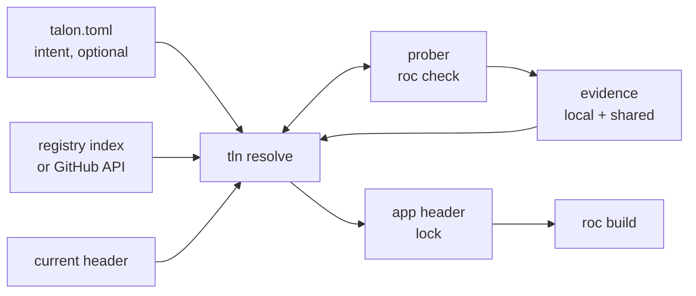
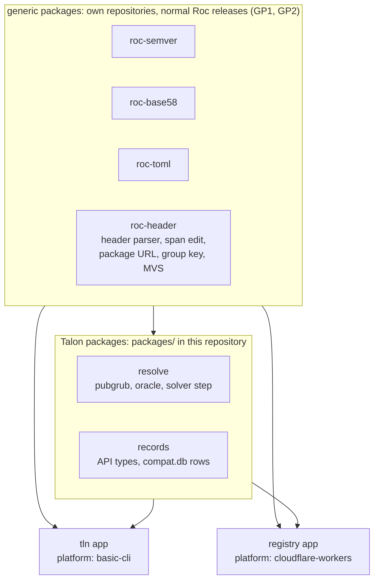

# Talon design

Talon is a package manager and compiler manager for Roc. The CLI is `tln`.

| Item | Value |
| --- | --- |
| Status | Draft 3, 2026-10-14. Split into 4 files on 2026-10-15 (table below). CLI audit fixes: `docs/cli-audit.md` (rounds 1 and 2). Prompts and non-interactive mode: CLI 4. Round 3 (2026-10-15): the `nightly` switch (Resolution 1), install scripts (CLI 6.5), ideas from rocup (section 3), no `deps.toml` (Q19). Round 4 (2026-10-15): readiness audit, 18 gaps fixed (`docs/cli-audit.md`, round 4). Round 5 (2026-10-15): consistency audit, 19 fixes (`docs/cli-audit.md`, round 5). Round 6 (2026-10-15): audit, 22 fixes (`docs/cli-audit.md`, round 6). |
| Target compiler | Zig-based Roc, `nightly-2026-10-09-258ab27`. Source facts from roc-lang/roc at `2664a27`. |
| Scope | CLI, resolver, compatibility prober, toolchain manager, registry on Cloudflare |
| Language | Roc for the CLI and the registry Worker (section 6) |

In these files, `roc:src/...` is a path in the roc-lang/roc repository at `2664a27`. "The nightly" as a resolve variable is the compiler release that Talon selects. Today that is always a nightly. When the compiler has releases, it can be a release (the `nightly` switch, Resolution 1).

| File | Content | Sections |
| --- | --- | --- |
| `DESIGN.md` | Goals, facts about Roc, prior art, core model, components, implementation, phases, security, questions | 1 to 9 |
| `DESIGN-CLI.md` | Commands, references, exit codes, prompts, `tln init`, toolchain manager, store and fetch | 1 to 7 |
| `DESIGN-RESOLUTION.md` | How Talon selects versions in each context: variables, constraints, evidence, probes, the algorithm, command scopes, determinism, resolve flags, compiler selection | 1 to 13 |
| `DESIGN-REGISTRY.md` | The registry on Cloudflare: role, storage, API, records, compatibility matrix, publish flow, Worker host | 1 to 8 |
| `TESTING.md` | Test layers, the code shape for tests (pure decisions, `Fx` record), command and CLI tests, roc-fuzz, the agent TDD workflow. Not part of the spec. | 1 to 8 |

A reference to a section of the same file is a number, for example 4.2 or section 4. A reference to another file starts with the name of that file: Design, CLI, Resolution or Registry. For example, CLI 6.2 is section 6.2 of `DESIGN-CLI.md`. Rule ids (H6, P5, NI3) are unique in all files. Section 5 lists where each group of ids is.

## 1. Goals and non-goals

| # | Goal |
| --- | --- |
| G1 | The app header is the lockfile. Talon adds no second lock. |
| G2 | `talon.toml` holds intent only (ranges, pins, policy). It is optional. A project with no `talon.toml` works. |
| G3 | Resolution is deterministic: same intent + same registry snapshot + same evidence gives the same header. |
| G4 | Talon installs and selects Roc compilers. It uses the cache directory that `roc` uses today. |
| G5 | Bun-class speed and ergonomics: one binary, one round trip to resolve, parallel fetch. |
| G6 | The registry is an index, not a store. Packages stay on GitHub Release assets. |
| G7 | The registry is optional. With no registry, Talon still works against GitHub directly. |
| G8 | Talon finds a working tuple (nightly, platform, packages) even when releases record no compiler version. It probes the compiler when evidence is missing (Resolution 4). |
| G9 | Talon and its registry are written in Roc. |

| # | Non-goal (for v1) |
| --- | --- |
| N1 | Host package bytes on Cloudflare (planned as an optional mirror later, see section 7). |
| N2 | Replace `roc` commands (`check`, `build`, `test`). Talon calls `roc`. |
| N3 | Support the old Rust compiler and `.tar.br` bundles. |

## 2. Facts about Roc that shape the design

Each fact was checked in the compiler source or with a test on `nightly-2026-10-09-258ab27`.

| Fact | Source | Consequence for Talon |
| --- | --- | --- |
| A header entry is `alias: "https://.../<version>/<hash>.tar.zst"`. The hash is base58(BLAKE3) of the compressed `.tar.zst` bytes. | `roc:src/bundle/streaming_writer.zig:125-129`, `roc:src/bundle/bundle.zig:231-240` | The header pins exact bytes. It is a lockfile. Talon only chooses which URL to write. |
| Package identity ("group") is the URL minus scheme, minus the one `X.Y.Z` run (a whole path segment, or part of one, as in the tag `v1.9.0-rc2`), minus the hash, plus the series: the major, or `0.minor` below 1.0 (4.1). The host is part of it. | `roc:src/base/url.zig:238-281`, `roc:src/compile/package_resolution.zig:1322-1338` | Two URLs on different hosts are two packages. Talon never rewrites a host (rule H5). |
| Per group, the highest version that any edge names wins for the whole graph. Only the winner's deps are followed. | `package_resolution.zig:816-838` | Roc does MVS by itself. Talon uses the same rule, or Talon and `roc` disagree. |
| An app pin that is lower than a dependency needs fails with "Package Version Conflict". An app pin that is higher wins silently. | `package_resolution.zig:1433-1486`. Test: an app alias `http` at `1.9.0` replaced the `http 1.0.0` of basic-cli, and the platform modules failed against it. | A raise can break a dependency at compile time. Talon checks every raise (Resolution 6). |
| Same group and version with two hashes fails with "Conflicting Package Contents". | `package_resolution.zig:903-921` | A version label maps to one hash per URL group. |
| One hash can carry many version labels. | `roc-lang/http` 1.0.0 and 2.0.0 are both `6ZUwqYhC...`. roc-parser 1.0.1 and 1.0.2 are both `FrnJ4RGD...`. | The registry keys facts by hash. A version is a label that points to a hash. |
| Platforms are not solved. Every platform declaration in a build must have the same group, version and hash. | `package_resolution.zig:1644-1693` | Hard constraint: a package that names a platform works only with that exact release. |
| An alias that no module imports gives no warning. It is still fetched and still joins version selection. | `package_resolution.zig:1963-1966`. Test: app with an unused `rand` alias passes `roc check`. | Overrides of transitive versions work with no compiler change (Resolution 6). |
| `roc:` in any header is a warning only ("Roc Version Mismatch"). `roc fmt` moves a nightly pin forward, never back. | `roc:src/canonicalize/Can.zig:6165-6178`, `roc:src/base/roc_version.zig:101-139` | A `roc:` pin is evidence, not a guarantee. Talon never runs `roc fmt` on a header (rule H2). |
| A nightly tag has two forms: `nightly-2026-08-05-24f0b47`, and the month as an English name in older tags: `nightly-2026-July-31-123c5d7`. roc reads both in a `roc:` pin. roc orders nightlies by date only, so two nightlies of one date are equal. | `roc:src/base/roc_version.zig:14-19, 60-70, 142-175`. The releases of `roc-lang/nightlies` on 2026-10-15: 331. The tags before 2026-08-06 have the month name. 2 dates have 2 nightlies (`nightly-2026-09-01-*`, `nightly-2026-July-23-*`). 3 asset names have another sha than their tag. 3 releases have no asset. | Talon reads both forms (CLI 6.2, CV1), and finds an asset by its target, not by the sha in the tag (CV2). Talon orders two nightlies of one date by itself (Resolution 1, NS1). |
| The compiler does not read `.roc-version`. It is a CI convention only. | No reader in `roc:src` | The registry reads it as weak evidence. Talon reads it but never writes it (Resolution 13). |
| `roc check` works on a package or platform `main.roc` with no app. It takes 0.4 s to 1.9 s on this machine. On an app, it checks only the modules that the app imports. | Tests, Resolution 4 | A compatibility probe is cheap. A unit fail is per module. |
| Only 3 of 46 cached packages pin `roc:` in their header. `lukewilliamboswell/roc-parser` (`7CLzCK6q...`) fails on the 10-09 nightly with "redundant expose". | Cache scan and test | Compatibility evidence is sparse. Talon must find it by itself. |
| `--replace-dep OLD NEW` swaps one source for one command. It edits no file. | `roc:src/cli/cli_args.zig:118-176` | Patches need no header edit. |
| Limits: 10 MB per package, 100 MB per closure (512 MB for a platform). | `roc-syntax` reference | Small enough to hash and inspect inside a Worker. |

### 2.1 What the hash fixes

| Item | Fixed by the hash? |
| --- | --- |
| Source of every module in the package | Yes |
| Declared dependency URLs (with their hashes) | Yes. They are in `main.roc` inside the archive. |
| Dependency versions used in a build | No. MVS can raise them (row 4 above). |
| Platform host files for all targets | Yes, when the publisher includes them. One archive holds all targets (`targets: { inputs_dir: ... }`). |
| Compiler version | No. A `roc:` pin inside is only a hint. |
| Version label | No. One hash can have many labels. |

So the identity of a build is the tuple (set of resolved hashes, nightly, target). A compatibility fact "hash H checks on nightly N" is stable, because H fixes all of its source.

### 2.2 Cache layout and cleanup

| Path | Root | Writer | Cleaned by roc? | Size seen |
| --- | --- | --- | --- | --- |
| `packages/<hash>/` | `$XDG_CACHE_HOME/roc`, else `~/.cache/roc` (`roc:src/compile/compile_build.zig:1602-1623`) | roc | No | 1.1 GB |
| `packages/<hash>.deps.json` | same | roc. Rebuilt from `main.roc` if missing (`package_resolution.zig:2160-2183`) | No | small |
| `compat-<id>/` | `$ROC_CACHE_DIR`, else as above (`roc:src/compile/cache_config.zig:337-344`) | roc. `<id>` is the compiler compatibility id (`roc:build.zig:1894-1925`). | Files inside expire after 30 days. The dir stays. | 1.1 GB |
| `nightly-<tag>/`, `debug-<sha>/` | same | Compilers before 2026-10-05 only | Files inside expire. The dir stays forever. | 3.1 GB |

`roc` has no `clean` command. It starts a background cleanup on each run (`roc:src/compile/cache_cleanup.zig:89`). That cleanup deletes old files inside the build caches. It never deletes a cache dir, a package or a sidecar. Talon fills that gap (CLI 6.3).

Note: the packages root ignores `$ROC_CACHE_DIR`. The build caches honor it. Talon uses the same two rules.

## 3. Prior art

| Tool | Idea | Talon decision |
| --- | --- | --- |
| Bun | One fast binary. `add`, `remove`, `update -i`, `outdated`, `why`, `x`, `patch`. Catalogs. `minimumReleaseAge`. Security scanner API. | Adopt the CLI shape, catalogs, release age, scanner hook. |
| uv | Manages the toolchain. Global cache. `--resolution lowest-direct`. `exclude-newer`. | Adopt toolchain install, lowest resolution for libraries, time-based snapshots. |
| Go modules | MVS needs no lockfile. `GOPROXY` is optional. Checksum database is a transparency log. `toolchain` directive downloads the compiler. | Adopt all four. Roc already uses MVS. |
| Cargo | Sparse HTTP index. MSRV-aware resolver. Yank, not delete. Trusted publishing. | Adopt yank. Make the resolver nightly-aware (the Roc form of MSRV-aware). |
| Rust crater, Stackage, Nix Hydra | Build every package against a compiler or a package set, and publish the pass/fail matrix. | Shared compatibility matrix keyed by (hash, nightly) (Registry 6). |
| Zig | URL + hash in the manifest. `zig fetch --save`. | Closest model to Roc. `tln add` does the same, plus ranges. |
| JSR | Names tied to a scope. Publish with GitHub OIDC. Provenance. | Publish with OIDC. |
| rustup | Proxy binaries, `+toolchain` argument, toolchain file. | Adopt the proxy model for `roc`. |
| rocup | Version manager for the Roc compiler: `curl \| sh` and `irm \| iex` installers, `+N` and `-N` steps through the nightlies, `prune`, local builds, `freeze` of a local build, `gh` for GitHub API calls | Adopt the installer structure (CLI 6.5), the relative selectors `@+N` and `@-N` (CLI 2), `tln roc link --copy` (CLI 6.6, LK1 to LK3), the default after a removal (RR1), and GitHub tokens (CLI 1). `tln cache gc` replaces `prune` (CLI 6.3). |
| PubGrub (uv, Dart pub) | Conflict-driven search that learns incompatibilities and explains failures. | Use PubGrub, fed by a lazy compatibility oracle (Resolution 5). |
| C2SP tlog-tiles, Sunlight | An append-only Merkle log served as static tiles from object storage. | Log leaves in D1, tiles in R2 (Registry 3). |

## 4. Core model

| Layer | File | Owner | Contains | Changes when |
| --- | --- | --- | --- | --- |
| Intent | `talon.toml` (optional) | Human | Ranges, anchors, policy, workspace | A human edits it, or `tln add` |
| Lock | App header in `main.roc`, the project file (CLI 1, PD1 to PD8) | Talon (humans may edit) | Exact URL + hash per direct dep, `roc:` pin | `tln add`, `tln update`, `tln install` |
| Evidence | `talon/compat.db` + registry matrix | Talon | Probe results per (hash, nightly) | Any probe |
| Store | roc cache dirs (2.2) | Talon + roc | Unpacked packages, compilers | Any fetch |



### 4.1 Identity

| Concept | Form | Example |
| --- | --- | --- |
| Series | The major of a version. Below 1.0, `0.minor`. The design files use this one term for the version part of a group. | `4.2.0` is in series `4`. `0.25.1` is in series `0.25`. |
| Group | Roc rule from section 2: URL minus version and hash, plus the series | `github.com/roc-lang/unicode/releases/download/{v}/` + series `4` |
| Name | `owner/repo` for GitHub URLs. Display and search only. | `roc-lang/unicode` |
| Label | group + version | `roc-lang/unicode@4.2.0` |
| Content id | Hash in the URL | `4W8SHzvwet9h...` |
| Build id | (resolved hashes, nightly, target) | |

Talon keeps facts per content id, and labels as pointers to it. So Talon can read a header that a human wrote by hand: it asks the registry for the hash, and gets back all labels for it.

### 4.2 The header as lockfile

```roc
app [main!] {
	pf: platform "https://github.com/roc-lang/basic-cli/releases/download/0.25.0/<hash>.tar.zst",
	json: "https://github.com/someone/roc-json/releases/download/2.1.0/<hash>.tar.zst",
	util: "../util/main.roc",
	roc: "nightly-2026-10-09-258ab27",
}
```

| # | Rule |
| --- | --- |
| H1 | Talon edits only string literals and whole entries. It keeps comments, order and formatting. It uses a span-based edit, not a reprint. |
| H2 | Talon never runs `roc fmt` on the header. (`roc fmt` moves the `roc:` pin.) |
| H3 | Every URL that Talon writes is a release URL with a version and a hash. |
| H4 | Talon never changes a path entry or a URL it cannot identify. It lists them as "foreign" in `tln ls`. |
| H5 | Talon never writes a mirror URL. The host is part of the group, so a mirror URL is a different package to Roc. Mirrors feed the cache only. |
| H6 | Talon writes `roc:` whenever it resolves the nightly. The pin records the nightly that the last probe passed with. With `--no-check` (Resolution 4), no whole-app probe ran, so Talon does not move the pin. It keeps the old `roc:` entry as it is, writes none if there was none, and resolves on that nightly only. The header then carries no verified pin claim for the new tuple. |
| H7 | A path entry is part of the closure, as in roc. Talon reads the header of the file that it names (relative to the project file). Its URL entries join the closure and MVS (section 2), its `import` lines join the lexical scan (Resolution 4), and GC counts its closure (CLI 1, PD12). A path entry is not a variable: it has no index and no version, and Talon never changes it (H4). A path entry in that header follows the same rule. |

A package header is also a lock, with one difference: consumers treat its versions as minimums (MVS). So a library records the lowest version it supports (Resolution 8).

### 4.3 talon.toml: intent only

Keys are header aliases. The header already gives the URL group, so most entries need only a range.

```toml
[toolchain]
roc = "*"                      # any compiler. Or a range, ">=nightly-2026-10-09-258ab27", or "=nightly-2026-10-09-258ab27" (NS7)
nightly = true                 # nightlies are candidates (the default). See Resolution 1.

[dependencies]
pf = "0.25.*"                  # the platform
parser = "=2.0.0"              # anchor: hard pin
json = "^2.1"
# util and others are absent: they follow the header with the default policy

[dependencies.http]            # a new dependency, not yet in the header
package = "roc-lang/http"
version = "^1"

[resolution]
priority = ["parser", "pf", "roc"]  # what to keep newest first, see Resolution 1
strategy = "highest"           # or "lowest" for libraries
min-release-age = "3d"         # the default is "2d" (Resolution 2, C7)
snapshot = "log:184467"        # registry log size. Or a time: "2026-10-12T00:00:00Z" (see Resolution 11)
probe = { max = 100, max-toolchains = 10, slots = 12 }
```

| In header | In talon.toml | Constraint |
| --- | --- | --- |
| yes | yes | The range in `talon.toml` |
| yes | no | Implied: `^<header version>`. That is the same series as the header version (4.1), never lower than it. For `0.25.0`: `>=0.25.0, <0.26.0`. For `2.1.0`: `>=2.1.0, <3.0.0`. |
| no | yes | `tln install` adds it to the header, after the group check below |
| no | no | Transitive. Set by package headers plus MVS. |

A caret range `^v` matches v and each newer version in the series of v. So `^2.1` is `>=2.1.0, <3.0.0`, and `^0.25.1` is `>=0.25.1, <0.26.0`. This is the npm and Cargo rule, and it follows the Roc group rule (section 2).

A user can rename an alias in the header. Then the key in `talon.toml` is "in talon.toml, not in header". So before `tln install` adds a header entry, it matches by group, not by alias:

| Case | Talon does |
| --- | --- |
| The group of the entry is not in the header | Adds the entry (row "no, yes" above) |
| The group is in the header under another alias | Adds nothing. Reports the stale key, for example `talon.toml: key "json" is "someone/roc-json", which the header names "js"`. Offers to rename the key in `talon.toml`. Prompt NI1 (CLI 4), default yes. |
| Non-interactive mode (CLI 4) and no `--yes` | Stops with the same report and exit code 13. Writes nothing. With `--rename-keys` or `--yes`, renames the key. |

Talon never adds a second entry for a group that the header already has. The same check runs in `tln add` (CLI 2).

| # | Rule |
| --- | --- |
| I1 | `talon.toml` is the intent of one project. Talon does not read a `talon.toml` that is in a package archive (a URL entry). Such a file has no effect on resolution, on the header or on probes. A package release does not need it, and Talon does not ask for a `deps.toml` (Q19). The compiler range of a package comes from evidence: `tln probe --range` in the release workflow and the compat bot (Registry 6). |

### 4.4 Workspaces

```toml
[workspace]
members = ["apps/*/main.roc", "examples/*.roc"]

[catalog]
"someone/roc-json" = "^2.1"
"roc-lang/basic-cli" = "^0.25"
```

A member can be an app or a package. One resolution covers all members. Its variables:

| Variable | In a workspace | Example |
| --- | --- | --- |
| `roc` | One for the workspace. Each member gets the same `roc:` value. | |
| Each group (4.1) that is a direct entry of a member | One variable for each group, whatever alias each member uses. Each member that has an entry for the group gets the same version. | `json` in `apps/a` and `js` in `apps/b`, both `someone/roc-json` series `2`: one variable |
| Each platform group | The same as a package group. Members on the same platform group share one variable. Members on other platforms have other variables. A package member has no platform. | `apps/cli` on basic-cli `0.25` and `apps/web` on basic-webserver: two variables |
| Transitive packages | Not variables (4.3). Roc MVS sets them in each member closure. | |

Two series of one package are two groups (section 2), so they are two variables. `apps/a` can use `roc-lang/http` series `1` while `apps/b` uses series `2`.

| # | Rule |
| --- | --- |
| WS1 | Talon matches member entries by group, not by alias, as in the group check of 4.3. |
| WS2 | A group variable has all constraints of each member entry for that group: the range in `talon.toml` or the implied range of that entry (4.3), and C1 to C9 (Resolution 2) in the closure of each member. |
| WS3 | Two members with different versions of one group do not satisfy WS2 together. `tln install` resolves that group as an entry out of range (Resolution 9). The implied ranges are never lower than a header version, so the result is at least the highest member version. `--frozen` fails with exit code 14. |
| WS4 | Two members with different `roc:` values have no nightly to hold (RP2). `install`, `add`, `update` and `remove` stop with exit code 2. The error lists the members and their pins, and names `tln roc use <id>` and `tln upgrade roc`. A member with no `roc:` entry gets the workspace value (RP3). |
| WS5 | The root `talon.toml` (the file with `[workspace]`) holds `[workspace]`, `[catalog]`, `[toolchain]` and `[resolution]`. It can also hold `[dependencies]`, `[overrides]` and `[patch]`, for each member whose nearest `talon.toml` is the root (CLI 1, PD6, and WS6). Each other `talon.toml` in the workspace holds only `[dependencies]`, `[overrides]` and `[patch]`. Talon does not merge two files: a member with a nearer `talon.toml` does not read these tables of the root. A key of a table that is not allowed in that file stops the command with exit code 2. So one `strategy` covers the workspace. The minimums in the header of a package member follow the versions of the apps, as in Cargo workspaces (Resolution 8). |
| WS6 | A `[dependencies]` key is an alias. It applies to each member under the directory of that `talon.toml` whose header has that alias. For a key that no such header has (row "no, yes" in 4.3), `tln install` adds the entry only when exactly one member is under that directory. Else it stops with exit code 2 and names `tln add --file <member file>` (CLI 1, PD5). |
| WS7 | A `[catalog]` key is a full name (CLI 2, form 2), because members can use different aliases. A member uses it with `<alias> = "catalog:"`: the catalog entry of the package of that alias. A catalog entry that no member uses has no effect. |
| WS8 | An alias that names different groups in different members is a tie (CLI 2). A command that takes names stops with exit code 2 and lists the full names. |

| Command | Members that it writes |
| --- | --- |
| `tln install` with no names, `update`, `upgrade` | Each member that has an entry for a group that moves (WS1). |
| `tln add`, `tln remove` | One member: the current member (CLI 1, PD4, PD5). `--file <member file>` names it. With no current member, Talon stops with exit code 2 and lists the members. A group that other members have is held at their version (Resolution 9). If that version must move, prompt NI3 asks, and the move writes those members too. |
| `tln roc use` | The `roc:` entry of each member, because the workspace has one nightly |

`talon.toml` writes of `tln add` (CLI 2) go to the nearest `talon.toml` on the path from the member file up to the workspace root.

## 5. Components

| Component | Job | Goals | Design |
| --- | --- | --- | --- |
| CLI (`tln`) | Commands, references, header edits, prompts, exit codes, `--json` | G1, G2, G5 | CLI 1 to 5 |
| Resolver | Selects one value for each free variable: packages, platform, nightly | G3, G8 | Resolution 1 to 12 |
| Compatibility prober | Runs `roc check` and `roc build` to find evidence, and keeps it in `compat.db` | G8 | Resolution 3, 4 |
| Toolchain manager | Installs and selects compilers, the `roc` proxy, global tools, cache GC, setup | G4 | CLI 6, Resolution 13 |
| Store and fetch | Fetches and verifies packages into the roc cache | G4, G5 | CLI 7 |
| Registry | Index of releases, shared compatibility matrix, publish log, on Cloudflare | G6, G7 | Registry 1 to 8 |
| Talon packages | Pure Roc logic of the CLI and the registry that has Talon concepts: records, the solver (`packages/` in this repository) | G9 | 6.1 |
| Generic packages | Pure Roc packages with no Talon concept: `roc-semver`, `roc-base58`, `roc-toml`, `roc-header`. Each in its own repository, released as a normal Roc package. | G9 | 6.1, GP1 to GP6 |

Rule ids, and where each group is:

| Ids | Topic | Where |
| --- | --- | --- |
| G1 to G9, N1 to N3 | Goals, non-goals | 1 |
| H1 to H7 | The header as lockfile | 4.2 |
| I1 | `talon.toml` of a dependency | 4.3 |
| NS1 to NS7 | The `nightly` switch | Resolution 1 |
| C1 to C9 | Constraints | Resolution 2 |
| P1 to P8 | Probe rules | Resolution 4 |
| PP1 to PP5 | Parallel probes | Resolution 4 |
| RP1 to RP4 | The `roc:` pin | Resolution 9 |
| UP1 to UP8 | Upgrade and new series | Resolution 10 |
| E1 to E4, J1 to J6 | Exit codes, `--json` | CLI 3 |
| NI1 to NI15, NR1 to NR6 | Prompts | CLI 4 |
| DL1 to DL6 | Download consent | CLI 6.2 |
| T1 to T9, X1 to X5, B1 to B8 | Global tools, `tln x`, build reuse | CLI 6.4 |
| S1 to S5, IS1 to IS8, RM1 to RM6 | Talon as a tool, install scripts, remove Talon | CLI 6.5 |
| R1 to R7, LK1 to LK4, U1 to U6, RU1 to RU4, RR1 to RR3, D1 to D3 | Compilers from source, links and copies, `tln roc use`, `tln roc update`, `tln roc remove`, Zig | CLI 6.6 |
| ST1 to ST11 | Setup, bin dir entries and launchers | CLI 6.7 |
| TF1 to TF6 | Talon files: formats and errors | CLI 6.1 |
| HF1 to HF11 | Effects that basic-cli does not have | 6.2 |
| DA1 to DA7 | Download adapter (`curl`, `wget`) | CLI 7.5 |
| CC1 to CC12 | Concurrent Talon processes | CLI 7.4 |
| CV1 to CV6 | Compiler list and sha256 | CLI 6.2 |
| DI1 to DI13 | Index with no registry (`direct`) | CLI 7.3 |
| WS1 to WS8 | Workspaces | 4.4 |
| EP1 to EP9 | Epochs and inferred facts | Resolution 4 |
| PA1 to PA8 | Patches | Resolution 7 |
| PD1 to PD13 | Project discovery, known projects | CLI 1 |
| OUT1 to OUT5 | Who decides the output | CLI 3 |
| GP1 to GP6 | Generic packages | 6.1 |
| P0 to P4 | Phases | 7 |
| Q1 to Q24 | Questions | 9 |

The phases P0 to P4 and the probe rules P1 to P8 use the same letter. The text near each id tells which one it is.


## 6. Implementation in Roc

### 6.1 Shape

All logic is pure Roc in packages. Generic packages have no Talon concept and live in their own repositories. Talon packages live in `packages/` of this repository. Two platforms supply the effects.



| Package | Kind | Contains | Spec | Used by |
| --- | --- | --- | --- | --- |
| `roc-semver` | Generic | Version parse, print and order. The range forms of 4.3 and CLI 2 (`^`, `=`, `*`, `x`, a major). | semver 2.0.0 | CLI, Worker |
| `roc-base58` | Generic | Encode and decode, Bitcoin alphabet | The hash form of roc (section 2) | CLI, Worker |
| `roc-toml` | Generic | TOML parse and print, and a span edit that keeps comments, order and formatting (as H1 for the header) | TOML 1.0.0 | CLI |
| `roc-header` | Generic | Parser for the header of an app, package or platform and for `import` lines (the lexical scan of Resolution 4). Span edit (H1). Package URL parse, group key and MVS (section 2). | roc source at the pinned commit, `roc fmt` output | CLI, Worker |
| `resolve` | Talon | PubGrub, the oracle interface and the solver step (`TESTING.md` 2.2, part B) | Resolution 5 | CLI |
| `records` | Talon | API types of the registry, `compat.db` rows, records (Registry 4, 5) | Registry | CLI, Worker |

| # | Rule |
| --- | --- |
| GP1 | A package is generic when its public API names no Talon concept (no `talon.toml` key, no registry record, no probe, no evidence), and its spec is outside the Talon design. The generic packages are the 4 in the table above. |
| GP2 | Each generic package has its own repository, and is released as a normal Roc package: a GitHub Release with a `<hash>.tar.zst` asset and an `X.Y.Z` tag. One repository holds one package. Reasons: the name of a package is `owner/repo` (4.1), and the default alias, the short name (CLI 2) and the `direct` index (CLI 7.3, DI6) all take one package for each repository. roc would accept two packages in one repository only with a tag prefix (`semver-1.2.0`, DI5, `research/roc-http-fetch/`), and the same tag for both would give one group (section 2). |
| GP3 | The Talon headers (`cli/`, `worker/`, `packages/*/`) name each generic package by a release URL with its hash (H3). The Talon repository never commits a path entry to a generic package. From P0, Talon manages these entries with `tln` itself. |
| GP4 | To change a generic package and Talon together, the developer runs `roc` with `--replace-dep <release URL> <local checkout>/main.roc` (section 2), or uses a `[patch]` entry (Resolution 7) from P1. The Talon change merges only after the package release, with the header moved to that release. |
| GP5 | Each generic package repository has its own tests: L0 (`roc test`) and L1 (roc-fuzz) (`TESTING.md` 1, 4), and its own CI on the nightly that Talon pins. Talon does not test a generic package again. Talon tests its own use of it: its decisions (L0 to L3), and the agreement with roc (L5, `conformance/`). |
| GP6 | A Talon package moves to its own repository only when GP1 holds for it. `resolve` stays: its API is the solver step with the probe oracle of Resolution 5. |

| Part | Platform | Notes |
| --- | --- | --- |
| CLI | basic-cli | basic-cli has blocking HTTP, files, `rename`, hard links, `Cmd` with `spawn!`, `try_wait!`, `kill!`, a working directory, inherited stdio and captured output, env, args, the program name, SQLite, sleep and the clock. Talon uses a basic-cli release as it is. There is no fork. For an effect that basic-cli does not have, Talon runs a child process: `curl` or `wget` for downloads (CLI 7.5), `roc unbundle` and `tar` for archives, `chmod`. The table HF in 6.2 has each effect. The upstream requests are a TTY test (HF1) and a process replacement (HF6). Talon does not wait for them. Talon ships the targets of basic-cli only: `x64musl`, `arm64musl`, `x64mac`, `arm64mac`, `x64win` (HF10, CLI 6.5 IS2). |
| Worker | `cloudflare-workers`: a new generic platform, wasm32 reactor (`output: Shared`), Zig host, small JS shim | Hosted functions in direct style through JSPI (Registry 8). It exposes the whole Workers runtime (all handler kinds, outbound fetch, D1, R2, KV, Cache API, Queues, Durable Objects, WebCrypto, env, secrets and the other bindings), not registry logic. The app API is `cloudflare-workers/API.md`. Any Roc app can use it. The registry is its first user. Its own repo and releases. |

The compiler supports this: `wasm32` freestanding target, linked with `wasm-ld` (`roc:src/target/mod.zig:468`, `roc:src/cli/linker.zig:691`, `roc:docs/langref/modules.md:536-556`).

### 6.2 Gaps to build

| Gap | Where | Plan |
| --- | --- | --- |
| Hosted functions of the CLI platform | basic-cli | Table HF below |
| zstd + tar decode in the Worker | No Roc library. roc-zip and roc-deflate exist in pure Roc. | Hosted fn in the `cloudflare-workers` host, from Zig `std.compress`, to read `main.roc`. The CLI uses `roc unbundle` (HF5). |
| BLAKE3, SHA-256, JSON | Builtins | None |
| base58 | Missing | Generic package `roc-base58` (6.1, GP2) |
| TOML | roc-toml is for the old compiler | Generic package `roc-toml` on roc-parser 2.0.0 (6.1, GP2) |
| Semver | roc-semver is for the old compiler | Port to the generic package `roc-semver` (6.1, GP2) |
| Header parser | The compiler parser is Zig | Generic package `roc-header` (6.1, GP2): own parser for the header subset in Roc. Fuzz it against `roc fmt` output. |

The generic packages are useful to the whole Roc ecosystem. Their rules are GP1 to GP6 (6.1).

Effects that basic-cli does not have, and how Talon gets each one. Checked in the source of a recent basic-cli (`Host.roc`, `Cmd.roc`). Talon does not fork basic-cli. A child process gives each effect, or a function that basic-cli has. When a program that Talon needs is not on `PATH`, the command stops with exit code 18 (`environment`, CLI 3) and names the program.

| # | Need | basic-cli today | Plan | Phase | Used by |
| --- | --- | --- | --- | --- | --- |
| HF1 | TTY test | `Tty` has raw mode only. No `isatty`. | Upstream PR: `Tty.is_terminal!(Stdin \| Stdout \| Stderr)`, with `isatty` on Unix and `GetConsoleMode` on Windows. Until a basic-cli release has it: on Unix, Talon runs `sh -c 'test -t 0; i=$?; test -t 2; echo $i $?'` as a child with inherited stdio, once for each command and only when a prompt or color output needs the answer. The output gives stdin and stderr apart: a prompt needs both (NR1), color needs stderr only (CLI 4). On Windows, Talon takes stdin and stderr as a TTY, and a prompt that reads the end of input takes the non-interactive answer (CLI 4). Color on Windows stays off until the PR. This is the one exception to NR1 (CLI 4). | P0 | NR1 and the terminal row of CLI 4, color and progress output |
| HF2 | Set the executable bit | No `chmod` | On Unix, a child `chmod 0755 <file>`. On Windows, nothing. `tar` keeps the mode bits of the files in a compiler archive. | P1 | A downloaded `tln` (CLI 6.5, S3), prebuilt tool binaries (CLI 6.4), the copy fallback of ST7 |
| HF3 | Lock between processes | No file lock | The lock interface of CLI 7.4 (CC3), implemented as a lock directory with a heartbeat (CC12). `Path.create_dir!` makes it, and that is atomic on all systems. | P0 | CLI 7.4 (CC4, CC6, CC10) |
| HF4 | Parallel and streaming download | `Http.send!` blocks and keeps the whole body in memory | The download adapter (CLI 7.5): one `curl` or `wget` child for each file, which writes to a temp file. Talon polls the children with `try_wait!` in the same loop as the probes (PP1). Small API answers (DI2, CV1, the registry) use `Http.send!`. | P0 (packages), P1 (compilers, Zig, binaries) | G5, CLI 7.1 "No waterfall", CV4, D2, S1 |
| HF5 | Archive extract | No Roc library | Packages (`.tar.zst`): `roc unbundle` (CLI 7.1). It checks the hash, the paths and the size limits (`research/roc-unbundle/`). Compilers (`.tar.gz`, `.zip` on Windows) and Zig (`.tar.xz`, `.zip`): `tar`, after the sha256 check (CV4, D2). The source archive of a git ref (CLI 6.6, R3): `tar`, with no published hash (R7). Linux, macOS and Windows 10 (1803 or later) have `tar`, and the Windows `tar` reads `.zip`. `tar` refuses an absolute member path and a path with `..`. A `.tar.xz` also needs `xz` on Linux. | P0 (`roc unbundle`), P1 (`tar`) | CLI 7.1, CLI 6.2, CLI 6.6 D2 |
| HF6 | Run a program in place of `tln` | `Cmd.exec!` starts a child and waits. No `execve`. | Upstream PR, together with HF1: `Cmd.exec_replace!(cmd)`. On Unix, `execve`: roc takes over the process id, so every signal, stdio and the exit code pass through, and no `tln` process stays alive. On Windows, which has no `execve`, the function runs the child with inherited stdio, waits, and exits with its exit code. On success it does not return. Until a basic-cli release has it, Talon uses the Windows form on all systems: a child with inherited stdio, then exit with the exit code of the child, or 128 + the signal number. Ctrl-C reaches the child (same process group or console). A signal that goes only to the `tln` process (`kill <pid>`, a CI timeout) does not reach the child until the PR is in. rustup and Go do the same split: `exec` on Unix, a child on Windows. | P1 | The `roc` proxy (CLI 6.2), `tln x` (X4), E1 |
| HF7 | Symlink create | None | Not needed. A bin dir entry is a hard link or a copy (ST7). A `link-<name>` compiler records the target path (LK4). `Path.hard_link!` exists. | | |
| HF8 | Signal handler | None | Not needed. Talon is safe after a crash, a kill or Ctrl-C: each write is a temp and a `rename`, and later runs remove stale temps (CLI 7.4, CC1, CC2). Ctrl-C in a terminal also stops the child processes, because they share the process group (Unix) or the console (Windows). The proxy uses HF6. | | |
| HF9 | Program name | `Env.program_name!` exists | Nothing to build. `tln` reads it to run as the `roc` proxy (ST8). | P1 | CLI 6.2 |
| HF10 | Target `arm64win` | Targets: `arm64mac`, `arm64musl`, `x64mac`, `x64musl`, `x64win` | Talon ships these 5 targets only. On Windows on ARM64, `install.ps1` installs `tln-x64win.exe`, and Windows 11 runs it by emulation (IS2). Talon adds `arm64win` when basic-cli has it. | P1 | CLI 6.5, IS2 |
| HF11 | Edit the user `Path` on Windows | No registry access | A child `powershell -NoProfile -NonInteractive -Command`. It reads the `Path` value of `HKCU\Environment` with no expansion of `%VAR%` references (`GetValue('Path', '', 'DoNotExpandEnvironmentNames')`), adds or removes the bin dir, writes the value back as `REG_EXPAND_SZ`, and sends `WM_SETTINGCHANGE`, as rustup does. Talon passes the bin dir in an environment variable of the child, so the command needs no quoting. Never `setx`: it cuts the value at 1024 characters. Windows PowerShell 5.1 is part of Windows 10 and 11. | P1 | CLI 6.7 ST4, CLI 6.5 (remove Talon) |

### 6.3 Repository layout

```text
talon/
  packages/      Talon packages, pure Roc: resolve, records (6.1). The generic packages are in their own repositories (GP2).
  cli/           tln app (Roc)
  worker/        registry app (Roc) + wrangler config
  cloudflare-workers/  submodule: the generic platform (Zig host, JS shim, bench/)
  install/       install.sh, install.ps1 and their test (CLI 6.5)
  sql/           D1 schema and migrations
  conformance/   fixtures run against each new nightly: group key, MVS, cache contract, header edits
  tests/         CLI scenario tests, fakes, the runner (TESTING.md 3)
  scripts/       rules.sh (rule coverage), revert-check.sh
  research/      measurements that are not conformance, for example test-fs/
  docs/          docs/slices/: one file per work slice (TESTING.md 7)
```

The `cloudflare-workers` platform lives in its own repository and is released like any Roc platform. It is a git submodule of Talon at `cloudflare-workers/`, so platform and registry changes can be developed together. Its `bench/` holds the JSPI measurements (Q12).

The conformance suite checks that Talon and `roc` agree on group keys, version selection and the cache layout, for every new nightly. The tests from section 2 are its first fixtures.

## 7. Phases

| Phase | Scope | Exit criteria |
| --- | --- | --- |
| P0 | First the generic packages, each in its own repository and released (6.1, GP1 to GP5): `roc-header` (group key and MVS first), `roc-semver`, `roc-base58`, `roc-toml`. Then one upstream PR to basic-cli for the TTY test and the process replacement (6.2, HF1, HF6). Talon does not wait for it. CLI with no registry: the GitHub API as index (CLI 7.3), header edits, the P0 commands below, with the P0 limits below. | `tln add` on a real app matches a hand edit. Conformance passes. |
| P1 | Toolchain manager, `roc` proxy, `tln cache gc`, local probes and the PubGrub oracle, `tln tool` (CLI 6.4), `install.sh`, `install.ps1` and prebuilt Talon binaries (CLI 6.5). | Talon finds a working tuple for parser 2.0.0 + basic-cli without help. GC frees the legacy dirs. |
| P2 | `cloudflare-workers` platform (JSPI, separate repo). Registry v1: D1, API, publish with OIDC, webhook, ingest. Compat bot. | All releases in the roc-awesome list are indexed with a nightly range. `POST /v1/closure` under 50 ms p50. |
| P3 | Log tiles in R2, signed checkpoints, hash-keyed mirror on R2, scanner hook, advisories | Client checks inclusion proofs. Mirror serves a deleted GitHub asset. |
| P4 | Upstream: print the compat id, a roc lock on `packages/` so that GC cannot remove a package while roc runs (CLI 7.4, CC10 accepts that risk until then), maybe `roc` reads `talon.toml` | |

Each phase only adds commands and steps. A rule that a phase implements does not change in a later phase. So a test of an earlier phase stays valid. A default that a later phase changes (the registry, CLI 1) does not break this, because each test sets it (`TESTING.md` 3.2). A design example that needs a later phase than its command states that phase (`TESTING.md` TW16).

| Phase | Commands |
| --- | --- |
| P0 | `install` (and `add`, `i`, `install --frozen`), `remove`, `update` (and `update -i`), `list`, `why`, `verify` |
| P1 | `upgrade`, `init`, `outdated`, `probe`, `patch`, `x`, `tool ...`, `roc ...`, `cache ...`, `setup`, the `roc` proxy |
| P2 | `publish`, `probe --share` |
| P3 | `audit` |

`init` and `upgrade` free the nightly and download it (NI12). `outdated` shows nightly ranges, which need evidence. `patch` needs the proxy (Resolution 7). `audit` needs yanks and advisories from the registry.

P0 limits. P0 runs the rules of the design as written, with less to work with. P1 adds the parts in the right column:

| Item | P0 | P1 adds |
| --- | --- | --- |
| Compiler | The only installed compiler is the `roc` on `PATH` (Resolution 13, rank 7). Ranks 1 to 4 can select it when they name its id. There is no `toolchains/` and no global default. | Installed compilers, ranks 1 to 6 with downloads |
| Compiler downloads | None. A rank that selects another compiler is a required download (DL2). P0 refuses it as `TALON_AUTO_INSTALL=no` does: exit code 13 (DL5). Prompts NI4, NI5, NI6 and NI12 never show. | The consent rules DL1 to DL6 |
| Nightly | Always held (RP2). With no `roc:` entry, Talon writes the id of the `roc` on `PATH` (RP3), if it is a nightly or a release. | `upgrade roc`, `roc use` |
| Probes | The baseline check, the whole-app check and the build (ladder steps 2 and 3, Resolution 4) on one tuple. No unit probes (step 1). No `compat.db`, so the build skip never applies. | Unit probes, `compat.db`, the build skip |
| Search | One tuple: the best one by `priority` under C1 to C4, C6, C7 and C9 (Resolution 5 step 3). If the ladder fails on it, Talon stops with exit code 10 and the blame of the ladder. | The PubGrub oracle loop (Resolution 5 steps 4 and 5), which tries other tuples |
| Index | `direct` (CLI 7.3). The built-in default is `direct` until P2 (CLI 1). DI7 extracts a candidate with `roc unbundle` of the `roc` on `PATH` (CLI 7.1), and reads its `main.roc`. | P2: the registry |
| Output of `why` | The paths from the app to a package | The evidence for each version |

A P0 test of a failed ladder uses a case where no other tuple exists (for example, one release in range). Then P1 gives the same result, and the test stays valid.

## 8. Security

| Threat | Mitigation |
| --- | --- |
| Tampered package bytes | Hash in the URL. Roc and Talon both check it. |
| Registry maps a label to a bad hash for some users | Append-only log with signed checkpoints and inclusion proofs (P3). The header keeps the hash, and later builds do not ask the registry. |
| Compromised maintainer pushes a release | `min-release-age` (default 2 days, C7 in Resolution 2). It also applies to the compilers that Talon selects by itself, and to the releases that `tln tool install`, `tln x` and `tln tool update` select, Talon included (CLI 6.4, T9). Provenance shown in `tln add`. Scanner hook. |
| Probes run untrusted code | Probes run `roc check` and `roc build` only (P1 in Resolution 4). Talon never runs the output. A build links the platform host files, but does not run them. Compile-time evaluation of constants stays a risk, the same as a normal `roc check`. |
| Poisoned shared matrix | Only bot and publisher rows are trusted. User rows only order the search. The final whole-app probe is always local, unless the user passes `--no-check` (Resolution 4). Then Talon keeps the old `roc:` pin (H6). |
| Release asset deleted | Mirror by hash (P3). The cache keeps old copies. |
| Platform ships native host binaries | `tln add` and `tln update` print a notice when a platform release changes. |
| A global tool links a host that nobody compiled on this machine, and the user runs the result | The install prints the platform URL and hash before the build (CLI 6.4). The app header hashes fix all of the source. Provenance is shown as in `tln add`. |
| Malicious tarball (path traversal, size bomb) | Packages: `roc unbundle` checks the paths and the Roc size limits (CLI 7.1). Compilers and Zig: Talon checks the sha256 before `tar` runs (CV4, D2), and `tar` refuses absolute paths and `..` (6.2, HF5). |
| Forged provenance | Some releases already ship `<hash>.tar.zst.intoto.jsonl` (in-toto attestation) and `.spdx.json` (SBOM), for example roc-parser 2.0.0. The registry checks the attestation at publish and stores the result in `releases.provenance`. |
| Compiler download tampered | sha256 check before extract (CLI 6.2, CV3, CV4). With `direct` (P1 and later), the sha256 is the GitHub asset `digest`. With a registry (P2 and later), it is the sha256 that the registry recorded the first time it saw the nightly, so a later swap of the asset fails. In both modes, `compat.db` keeps the first sha256 seen for each tag and target, and a different later value fails (CV6). From P2, each compiler asset is a log leaf (Registry 3), so `--snapshot log:N` fixes the set of compilers. P3 adds inclusion proofs for these leaves. |
| Source archive of a git ref tampered (`tln roc install --git`, `tln tool install --git`) | GitHub publishes no hash for it. The commit sha in the URL names the source, and the trust is TLS to `github.com`, the same as a `git clone`. A redirect never goes to `http://` (CLI 7.5, DA3). Talon records the sha256 that it computed (CLI 6.6, R7). |
| Talon download tampered (`install.sh`, `install.ps1`, `tln tool update talon`) | sha256 and attestation of the GitHub Release (CLI 6.5, S1, IS3) |

## 9. Questions

Settled:

| # | Question | Answer |
| --- | --- | --- |
| Q1 | What makes two URLs the same package? | The group key in section 2. The host is part of it. Confirmed in source and by test. |
| Q2 | Can Talon pre-fill `packages/<hash>/` without the sidecar? | Yes. roc rebuilds the sidecar (CLI 7.2). |
| Q3 | Is an unused alias legal? | Yes, with no warning. It also raises the version for the whole graph (Resolution 6). |
| Q4 | How does `compat-<id>` map to a compiler? | It is the compiler compatibility id from `roc:build.zig:1894-1925`. Talon learns it at install (CLI 6.3). |
| Q5 | File name | `talon.toml` for now. |
| Q6 | Own header parser or the compiler's? | Own parser in Roc (6.2). |
| Q7 | Does one nightly range per release hold? | Islands exist (4 of 46 hashes), but in the sample all gaps come from compiler hangs and crashes. The model is per-nightly facts plus epochs (Resolution 4, EP1 to EP9). |
| Q8 | Can Workers use JSPI? | Yes, with no flag. Tested on workerd `2026-10-12` and on the edge (Q13). |
| Q9 | Build after check? | Yes. Ladder step 3, on the final tuple only (Resolution 4). |
| Q10 | A nightly range syntax in headers | Dropped. A header entry holds one value, and that is correct for a lock. The range data belongs in the registry matrix. |
| Q11 | How many epochs, and changes inside an epoch? | 22 nightlies form 6 code epochs and 2 fault windows. 0 changes inside an epoch (Resolution 4). Run the sweep again on the bot data in P2. |
| Q12 | Instance per request or stack copy? | Stack copy in a recycled pool. The copy costs under 2 µs per wait up to 64 KB. A new instance costs 30 to 640 µs, depending on module size (Registry 8). |
| Q13 | Do the Q12 numbers hold on the Cloudflare edge? | The choice holds, the absolute numbers do not. Short test on 2026-10-14, free plan (10 ms CPU limit), colo TBS (`cloudflare-workers/bench/deploy.sh`, `edge.mjs`). JSPI works on the edge. B (stack copy): 0 errors and 0 bad bodies at concurrency 1, 16 and 64. A (instance per request): about 6 ms CPU per request at concurrency 1 (0.3 ms local), and at concurrency 16 and 64 most requests fail with `exceededCpu` (179 and 199 of 200). A new instance costs about 0.7 ms CPU (0.03 ms local). Not a full load test: that waits for the registry app (Q14). |
| Q15 | Does `roc check` on an app check only the imported modules on every nightly? | Yes on all 20 nightlies that have a working basic-cli (`conformance/check-scope/`). The app that imports `Good` passes, the app that imports `Bad` fails, the package `main.roc` fails. Found on the way: when `XDG_CACHE_HOME` contains `..`, `roc check` prints "No errors found" for any app. Talon passes only canonical cache paths to roc (CLI 6.2). |
| Q16 | Do platform hosts link statically? | Yes for musl. 6 platforms, all Linux targets (`conformance/host-link/`): each musl binary has no `NEEDED` and no interpreter. The only dynamic Linux binary is roc-ray, which has only a glibc target: `libc.so.6`, `libm.so.6`, `libX11.so.6`, with no symbol versions. No platform links OpenSSL. macOS binaries link only system libraries. Windows targets list only Windows system libraries. A tool records its libraries (T8). |
| Q17 | Can Talon build roc from a GitHub archive with no `.git`? | Yes. Tested on `2664a27` (nightly 10-12) with Zig 0.17.0: `zig build roc -Doptimize=ReleaseFast -Dcompiler-version=git-2664a278` passes. `roc version` prints `git-2664a278`, and `roc check` works. Without the flag, the code (`getCompilerVersionGit`) gives `release-fast-no-git` (not tested). So git is not a build dependency (CLI 6.6, R3). |
| Q19 | Split a tool-neutral `deps.toml` out of `talon.toml`, so that package authors who do not use Talon can adopt it? | No. (1) The tool-neutral manifest already exists: the header. roc reads it, and any tool can read it. (2) Talon reads no `talon.toml` of a dependency (I1). Its ranges are the intent of one project (4.3), and roc MVS ignores ranges (section 2). So a neutral file gives other projects and other tools nothing to use. (3) A package author already has nothing to adopt: `talon.toml` is optional (G2), and a package with only a header works with Talon. (4) A second file adds a merge rule (which file wins for a key) and one more name to learn. (5) A neutral name with no agreement from the Roc project is a Talon file with another name. If the Roc project defines a manifest later, Talon reads it. The `[dependencies]` and `[toolchain]` tables have no Talon-only syntax except `catalog:` (4.4), so that move is mechanical. |
| Q18 | Can 3 `roc build` runs share one compiler cache at the same time? | Yes. 100 iterations of 3 different apps, 50 on an empty cache and 50 on a warm cache, 2 runs: 600 of 600 builds pass, with the same output and the same bytes as a build that ran alone (`conformance/build-share/`). The build weight of 4 slots stays (Resolution 4). Found on the way: a warm build gives other bytes than a cold build, with the same output (T4). |
| Q20 | Before the registry exists, where does the sha256 of a compiler download come from, and how does Talon read a GitHub release as a package candidate? | The GitHub REST API. Checked on 2026-10-15 with `gh api repos/roc-lang/nightlies/releases`: each asset of the nightlies has a `digest` field (`sha256:<hex>`), and the asset names follow `roc_nightly-<target>-<date>-<sha7>` (CLI 6.2, CV1 to CV5). Package releases (`roc-lang/basic-cli`, `lukewilliamboswell/roc-parser`) have one `<hash>.tar.zst` asset next to other assets, and basic-cli marks its `0.26.0-rc1` and `0.26.0-rc2` tags as `prerelease`. roc reads the version as the one `X.Y.Z` run anywhere in the URL, and the text around it is part of the group (`roc:src/base/url.zig:152-203`). So DI3 to DI5 (CLI 7.3) select the asset, skip prereleases, and get the group from the tag. |
| Q22 | How does Talon find the project file, and how does a user name another one? | The walk of CLI 1, "The project" (PD1 to PD8): the nearest `main.roc` or workspace member, up to the repository root (`.git`), the home directory or `/`. The global flag `--file <path>` names another file. It replaces `--member`. The proxy keeps the target file of roc (PD7). `talon/projects.json` records each project that a command or the proxy uses (PD9 to PD13). |
| Q23 | One repository for all generic packages, or one for each? | One for each (GP2). The name `owner/repo` (4.1), the default alias, the short name and the `direct` index take one package for each repository. roc alone would accept a tag prefix (`research/roc-http-fetch/`). |
| Q24 | Does roc fetch a package from an `http://` URL? (`TESTING.md` TQ4) | Only from a loopback host: `127.0.0.1`, `::1`, `localhost`. Any other `http://` URL is the error "insecure package url", with no connection. Tested on `nightly-2026-10-09-258ab27` (`research/roc-http-fetch/`), and in `roc:src/unbundle/download.zig`. So a test with a `github.com` URL pre-fills `packages/<hash>/` (CLI 1, "Packages in tests"). |

Open:

| # | Question | How to settle |
| --- | --- | --- |
| Q14 | Pool values (16 requests per instance, 32 MB) for the real registry app | Load test the registry app in P2. Note: `cloudflare-workers/PLAN.md` problem 12 replaced the pool with one instance per isolate. Its order of work row 12 updates this row, Q12 and Registry 8. |
| Q25 | How does a publish make the edge caches drop the old version list? `cache.delete` purges one data center only (`cloudflare-workers/API.md` RF1). Options: purge by Cache-Tag with the zone purge API (needs a custom domain and an API token); no edge cache for the version list; or a short TTL with no purge (the 2-day `min-release-age` of C7 hides new releases anyway). | Choose before the P2 cache code. Registry 4 and 7 then change. |
| Q26 | Who writes the tiles and the checkpoint, when two publishes run in two isolates at once, or an R2 write fails after the D1 commit (API.md RF2, RF3)? Proposal: one idempotent step "build the tiles and sign up to the largest leaf index in D1". It runs after each publish (`Ctx.respond!`, then the step) and from a cron trigger. It writes the checkpoint with an R2 compare and swap on the etag, and only to a larger size. | Write it in Registry 3 and 7, with a test of 2 publishes at once |
| Q27 | How does the publish batch insert the leaf only when it inserts the release, and stop when the label has another hash? D1 has no interactive transaction, and a batch cannot branch (API.md RF4). Proposal: a `UNIQUE` index on (group, version), and a trigger on `releases` that writes the log leaf with `index = max + 1`. Then the log and the index cannot disagree by construction. Same label and same hash: a read before the batch returns the existing record. | Write it in Registry 5 and `sql/`, with a test of the 3 cases |
| Q28 | What is the largest archive that the registry indexes, and does it need the paid plan? A platform archive is 21 MB packed and 70 MB unpacked (basic-cli). The isolate has 128 MB, and the free plan gives 10 ms of CPU (API.md RF5, RF6). Above a limit, the Worker needs a streaming hash and zstd decode (API.md 8). | Measure a publish of basic-cli on the platform (BLAKE3 and zstd time, peak memory). Then set the limit in Registry 7. |
| Q29 | Should large reads (`POST /v1/closure`) be JSON that SQLite makes (`json_group_array`), passed to the client as a body with no decode in Roc? 200 rows cost about 84 µs to bring into typed Roc rows (API.md RF7, 5.1). | Measure the closure query both ways in P2 |
| Q30 | How is `POST /v1/ingest` kept from abuse? It has no auth, and each call can download and unpack an archive (API.md RF8). Options: a rate limit for each IP address, `github.com` release URLs only, one ingest for each URL, a queue. | Choose before P2 ingest. Registry 7 then changes. |

## Sources

- Roc compiler source, roc-lang/roc at `2664a27` (paths in sections 2 and 6, and in CLI 6 and 7).
- Roc reference via the `roc-syntax` MCP server: topics `packages`, `app_header`, `compiler`, `version_mismatch`.
- [roc-awesome](https://github.com/lukewilliamboswell/roc-awesome), [basic-cli](https://github.com/roc-lang/basic-cli), [Joy](https://github.com/niclas-ahden/joy), [roc-parser](https://github.com/lukewilliamboswell/roc-parser), [roc-platform-template-zig](https://github.com/lukewilliamboswell/roc-platform-template-zig)
- [rocup](https://github.com/imclerran/rocup) at `132c186`: installers and compiler version manager for Roc
- [Bun package manager docs](https://bun.com/docs/pm)
- [Cloudflare D1 read replication](https://developers.cloudflare.com/d1/best-practices/read-replication/), [D1 limits](https://developers.cloudflare.com/d1/platform/limits/), [Durable Objects limits](https://developers.cloudflare.com/durable-objects/platform/limits/)
- [C2SP tlog-tiles](https://github.com/C2SP/C2SP/blob/main/tlog-tiles.md), [Sunlight CT log](https://sunlight.dev/)
- [Go checksum database design (25530)](https://go.googlesource.com/proposal/+/refs/heads/master/design/25530-sumdb.md)
- [PubGrub](https://nex3.medium.com/pubgrub-2fb6470504f), [Rust crater](https://github.com/rust-lang/crater)
- [npm trusted publishers](https://docs.npmjs.com/trusted-publishers)
- [V8 JSPI](https://v8.dev/blog/jspi), [workers-zig (JSPI on Workers)](https://github.com/nilslice/workers-zig), [Almide JSPI on workerd and the edge](https://github.com/almide/almide/issues/3353)
