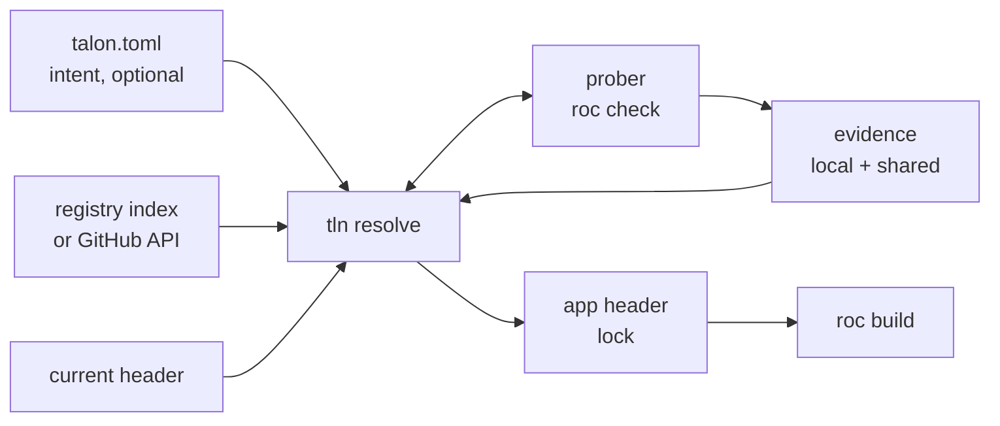
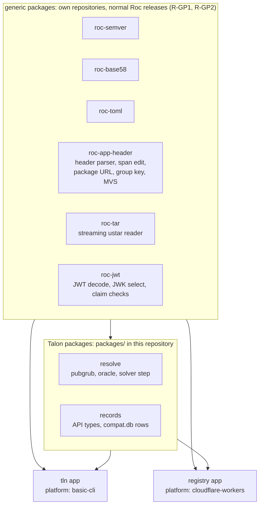

# Talon design

Talon is a package manager and compiler manager for Roc. The CLI is `tln`.

| Item | Value |
| --- | --- |
| Status | Draft 3, 2026-10-14. Split into 4 files on 2026-10-15 (table below). CLI audit fixes: `docs/cli-audit.md` (rounds 1 and 2). Prompts and non-interactive mode: CLI 4. Round 3 (2026-10-15): the `nightly` switch (Resolution 1), install scripts (CLI 6.5), ideas from rocup (section 3), no `deps.toml` (Q19). Round 4 (2026-10-15): readiness audit, 18 gaps fixed (`docs/cli-audit.md`, round 4). Round 5 (2026-10-15): consistency audit, 19 fixes (`docs/cli-audit.md`, round 5). Round 6 (2026-10-15): audit, 22 fixes (`docs/cli-audit.md`, round 6). Round 7 (2026-10-15): audit, 16 fixes (`docs/cli-audit.md`, round 7). Draft change of 2026-10-24: project scripts (`tln run`), `tln path`, project tools (`[tools]`), the build target, no hooks (`research/talon-scripts/` 13, `research/talon-scripts/design-draft/DIFF.md`). |
| Target compiler | Zig-based Roc, `nightly-2026-10-09-258ab27`. Source facts from roc-lang/roc at `2664a27`. |
| Scope | CLI, resolver, compatibility prober, toolchain manager, registry on Cloudflare |
| Language | Roc for the CLI and the registry Worker (section 6) |

In these files, `roc:src/...` is a path in the roc-lang/roc repository at `2664a27`. "The nightly" as a resolve variable is the compiler release that Talon selects. Today that is always a nightly. When the compiler has releases, it can be a release (the `nightly` switch, Resolution 1).

| File | Content | Sections |
| --- | --- | --- |
| `DESIGN.md` | Goals, facts about Roc, prior art, core model, components, implementation, phases, security, questions | 1 to 9 |
| `DESIGN-CLI.md` | Commands, references, exit codes, prompts, `tln init`, toolchain manager, store and fetch | 1 to 7 |
| `DESIGN-RESOLUTION.md` | How Talon selects versions in each context: variables, constraints, evidence, probes, the algorithm, command scopes, determinism, resolve flags, compiler selection | 1 to 13 |
| `DESIGN-REGISTRY.md` | The registry on Cloudflare: role, storage, API, records, compatibility matrix, publish flow, Worker host | 1 to 8 |
| `DESIGN_OVERVIEW.md` | A short map of the components: the job of each, and what is not its job. Not part of the spec. | |
| `TESTING.md` | Test layers, the code shape for tests (pure decisions, `Fx` record), command and CLI tests, roc-fuzz, the agent TDD workflow. Not part of the spec. | 1 to 8 |

A reference to a section of the same file is a number, for example 4.2 or section 4. A reference to another file starts with the name of that file: Design, CLI, Resolution or Registry. For example, CLI 6.2 is section 6.2 of `DESIGN-CLI.md`. A rule id starts with `R-`, then the group and a number (R-H6, R-P5, R-NI3). It is unique in all files, and a test names it (`TESTING.md` TW13). It is the first cell of a table row, or the start of a paragraph (`R-SL14: ...`). An id at the start of a paragraph that ends with a colon also covers the table or the block after it. Text with no id is an explanation, an example or a measurement: no test checks it. An id with no `R-` is not a rule: goals (G), non-goals (N), phases (P0 to P4) and questions (Q). Section 5 lists where each group of ids is.

## 1. Goals and non-goals

| # | Goal |
| --- | --- |
| G1 | The app header is the lockfile. Talon adds no second lock file. The one lock value outside the header is the `url` of each project tool in `[tools]` of `talon.toml` (CLI 6.4, R-PT1): a tool is an app, so it cannot be a header entry (Resolution 2, R-C4). |
| G2 | `talon.toml` holds intent (ranges, pins, policy, scripts, the build target), and the lock (`url`) of each project tool, next to its intent (`ref`). It is optional. A project with no `talon.toml` works. |
| G3 | Resolution is deterministic: same intent + same registry snapshot + same evidence gives the same header. |
| G4 | Talon installs and selects Roc compilers. It uses the cache directory that `roc` uses today. |
| G5 | Bun-class speed and ergonomics: one binary, one round trip to resolve, parallel fetch. |
| G6 | The registry is an index, not a store. Packages stay on GitHub Release assets. |
| G7 | The registry is optional. With no registry, Talon still works against GitHub directly. |
| G8 | Talon finds a working tuple (nightly, platform, packages) even when releases record no compiler version. It probes the compiler when evidence is missing (Resolution 4). |
| G9 | Talon and its registry are written in Roc. |

| # | Non-goal (for v1) |
| --- | --- |
| N1 | Host package bytes on Cloudflare (planned as an optional mirror later, see section 7). |
| N2 | Replace `roc` commands (`check`, `build`, `test`). Talon calls `roc`. |
| N3 | Support the old Rust compiler and `.tar.br` bundles. |
| N4 | Support private packages. A private GitHub release asset answers 404 to its download URL with no token, and roc and Talon send no token with a download (CLI 7.3, R-DI9). So a private package fails in both modes, at the download (exit code 15, CLI 7.1, R-FE6). With a registry, Talon also stops before it sends the name of a private `github.com` repository to the registry (CLI 1, R-RG4). Talon cannot check the visibility of a URL on another host, so the name of such a group goes to the registry in the closure query (Registry 4.1, R-AP16). |

## 2. Facts about Roc that shape the design

Each fact was checked in the compiler source or with a test on `nightly-2026-10-09-258ab27`.

| Fact | Source | Consequence for Talon |
| --- | --- | --- |
| A header entry is `alias: "https://.../<version>/<hash>.tar.zst"`. The hash is base58(BLAKE3) of the compressed `.tar.zst` bytes. | `roc:src/bundle/streaming_writer.zig:125-129`, `roc:src/bundle/bundle.zig:231-240` | The header pins exact bytes. It is a lockfile. Talon only chooses which URL to write. |
| Package identity ("group") is the URL minus scheme, minus the one `X.Y.Z` run (a whole path segment, or part of one, as in the tag `v1.9.0-rc2`), minus the hash, plus the series: the major, or `0.minor` below 1.0 (4.1). The host is part of it. | `roc:src/base/url.zig:238-281`, `roc:src/compile/package_resolution.zig:1322-1338` | Two URLs on different hosts are two packages. Talon never rewrites a host (rule R-H5). |
| Per group, the highest version that any edge names wins for the whole graph. Only the winner's deps are followed. | `package_resolution.zig:816-838` | Roc does MVS by itself. Talon uses the same rule, or Talon and `roc` disagree. |
| An app pin that is lower than a dependency needs fails with "Package Version Conflict". An app pin that is higher wins silently. | `package_resolution.zig:1433-1486`. Test: an app alias `http` at `1.9.0` replaced the `http 1.0.0` of basic-cli, and the platform modules failed against it. | A raise can break a dependency at compile time. Talon checks every raise (Resolution 6). |
| Same group and version with two hashes fails with "Conflicting Package Contents". | `package_resolution.zig:903-921` | A version label maps to one hash per URL group. |
| One hash can carry many version labels. | `roc-lang/http` 1.0.0 and 2.0.0 are both `6ZUwqYhC...`. roc-parser 1.0.1 and 1.0.2 are both `FrnJ4RGD...`. | The registry keys facts by hash. A version is a label that points to a hash. |
| Platforms are not solved. Every platform declaration in a build must have the same group, version and hash. | `package_resolution.zig:1644-1693` | Hard constraint: a package that names a platform works only with that exact release. |
| An alias that no module imports gives no warning. It is still fetched and still joins version selection. | `package_resolution.zig:1963-1966`. Test: app with an unused `rand` alias passes `roc check`. | Overrides of transitive versions work with no compiler change (Resolution 6). |
| `roc:` in any header is a warning only ("Roc Version Mismatch"). `roc fmt` moves a nightly pin forward, never back. | `roc:src/canonicalize/Can.zig:6165-6178`, `roc:src/base/roc_version.zig:101-139` | A `roc:` pin is evidence, not a guarantee. Talon never runs `roc fmt` on a header (rule R-H2). |
| A nightly tag has two forms: `nightly-2026-08-05-24f0b47`, and the month as an English name in older tags: `nightly-2026-July-31-123c5d7`. roc reads both in a `roc:` pin. roc orders nightlies by date only, so two nightlies of one date are equal. | `roc:src/base/roc_version.zig:14-19, 60-70, 142-175`. The releases of `roc-lang/nightlies` on 2026-10-15: 331. The tags before 2026-08-06 have the month name. 2 dates have 2 nightlies (`nightly-2026-09-01-*`, `nightly-2026-July-23-*`). 3 asset names have another sha than their tag. 3 releases have no asset. | Talon reads both forms (CLI 6.2, R-CV1), and finds an asset by its target, not by the sha in the tag (R-CV2). Talon orders two nightlies of one date by itself (Resolution 1, R-NS1). |
| The compiler does not read `.roc-version`. It is a CI convention only. | No reader in `roc:src` | The registry reads it as weak evidence. Talon reads it but never writes it (Resolution 13). |
| `roc check` works on a package or platform `main.roc` with no app. It takes 0.4 s to 1.9 s on this machine. On an app, it checks only the modules that the app imports. | Tests, Resolution 4 | A compatibility probe is cheap. A unit fail is per module. |
| Only 3 of 46 cached packages pin `roc:` in their header. `lukewilliamboswell/roc-parser` (`7CLzCK6q...`) fails on the 10-09 nightly with "redundant expose". | Cache scan and test | Compatibility evidence is sparse. Talon must find it by itself. |
| `--replace-dep OLD NEW` swaps one source for one command. It edits no file. | `roc:src/cli/cli_args.zig:118-176` | Patches need no header edit. |
| roc installs apps by itself. `roc install <name> <bundle URL>` builds an app bundle with `--opt=speed`. `roc run <name>` runs the binary, and `roc run <bundle URL>` builds and runs a bundle. An app release is a `<hash>.tar.zst` bundle, as a package release is. The installs are not in the cache: `$ROC_INSTALL_DIR`, else `$XDG_DATA_HOME/roc`, else `~/.local/share/roc` (`~/Library/Application Support/roc` on macOS, `%APPDATA%\Roc` on Windows), with one folder for each compiler version. | `roc:src/cli/install.zig:155-202`, `roc:src/cli/cli_args.zig:745-790`. In `roc help` of `nightly-2026-10-09-258ab27`. | An install of roc works only with the compiler that made it. After a change of the selected compiler, `roc run <name>` does not find it. This is roc behavior. The proxy passes `roc install` and `roc run` to roc with no change, and Talon never reads or removes these folders (CLI 6.2, 6.3, R-RM1). `tln tool install` keeps its own store (CLI 6.4, R-T3, R-T5). The source of a tool release is its app bundle (CLI 6.4, R-T10). |
| `roc deps <file>` prints the declared dependency tree of an app, package or platform, with full URLs. It downloads missing packages and compiles nothing. `roc bump` compares the public API of a package with an earlier version and reports the semver bump that it needs. | `roc help` of `nightly-2026-10-09-258ab27`. Test: `roc deps conformance/host-link/apps/basic-cli-0.25.0.roc` printed the platform and its `http 1.0.0` entry. | The conformance suite compares the closure that Talon reads with `roc deps` (6.3). `roc bump` is a possible check for `tln publish` (Q31). |
| Limits: 10 MB per package, 100 MB per closure (512 MB for a platform). | `roc-syntax` reference | Small enough to hash and inspect inside a Worker. |

### 2.1 What the hash fixes

| Item | Fixed by the hash? |
| --- | --- |
| Source of every module in the package | Yes |
| Declared dependency URLs (with their hashes) | Yes. They are in `main.roc` inside the archive. |
| Dependency versions used in a build | No. MVS can raise them (row 4 above). |
| Platform host files for all targets | Yes, when the publisher includes them. One archive holds all targets (`targets: { inputs_dir: ... }`). |
| Compiler version | No. A `roc:` pin inside is only a hint. |
| Version label | No. One hash can have many labels. |

So the identity of a build is the tuple (set of resolved hashes, nightly, target). A compatibility fact "hash H checks on nightly N" is stable, because H fixes all of its source.

### 2.2 Cache layout and cleanup

| Path | Root | Writer | Cleaned by roc? | Size seen |
| --- | --- | --- | --- | --- |
| `packages/<hash>/` | `$XDG_CACHE_HOME/roc`, else `~/.cache/roc` (`roc:src/compile/compile_build.zig:1602-1623`) | roc | No | 1.1 GB |
| `packages/<hash>.deps.json` | same | roc. Rebuilt from `main.roc` if missing (`package_resolution.zig:2160-2183`) | No | small |
| `compat-<id>/` | `$ROC_CACHE_DIR`, else as above (`roc:src/compile/cache_config.zig:337-344`) | roc. `<id>` is the compiler compatibility id (`roc:build.zig:1894-1925`). | Files inside expire after 30 days. The dir stays. | 1.1 GB |
| `nightly-<tag>/`, `debug-<sha>/` | same | Compilers up to the nightly of 2026-10-09 only (the nightly of 2026-10-11 is the first that writes `compat-*`) | Files inside expire. The dir stays forever. | 3.1 GB |

`roc` has no `clean` command. It starts a background cleanup on each run (`roc:src/compile/cache_cleanup.zig:89`). That cleanup deletes old files inside the build caches. It never deletes a cache dir, a package or a sidecar. Talon fills that gap (CLI 6.3).

R-CR1: The packages root ignores `$ROC_CACHE_DIR`. The build caches honor it. Talon uses the same two rules.

The app installs of `roc install` (section 2) are outside the cache root, one folder for each compiler version. They are not a cache. roc owns them, and Talon does not clean them (CLI 6.3, R-RM1).

## 3. Prior art

| Tool | Idea | Talon decision |
| --- | --- | --- |
| Bun | One fast binary. `add`, `remove`, `update -i`, `outdated`, `why`, `x`, `patch`. Catalogs. `minimumReleaseAge`. Security scanner API. | Adopt the CLI shape, release age, scanner hook. No catalogs: a workspace has one version of each group (4.4, R-WS7). |
| uv | Manages the toolchain. Global cache. `--resolution lowest-direct`. `exclude-newer`. | Adopt toolchain install, lowest resolution for libraries, time-based snapshots. |
| Go modules | MVS needs no lockfile. `GOPROXY` is optional. Checksum database is a transparency log. `toolchain` directive downloads the compiler. | Adopt all four. Roc already uses MVS. |
| Cargo | Sparse HTTP index. MSRV-aware resolver. Yank, not delete. Trusted publishing. | Adopt yank. Make the resolver nightly-aware (the Roc form of MSRV-aware). |
| Rust crater, Stackage, Nix Hydra | Build every package against a compiler or a package set, and publish the pass/fail matrix. | Shared compatibility matrix keyed by (hash, nightly) (Registry 6). |
| Zig | URL + hash in the manifest. `zig fetch --save`. | Closest model to Roc. `tln add` does the same, plus ranges. |
| JSR | Names tied to a scope. Publish with GitHub OIDC. Provenance. | Publish with OIDC. |
| rustup | Proxy binaries, `+toolchain` argument, toolchain file. | Adopt the proxy model for `roc`. |
| rocup | Version manager for the Roc compiler: `curl \| sh` and `irm \| iex` installers, `+N` and `-N` steps through the nightlies, `prune`, local builds, `freeze` of a local build, `gh` for GitHub API calls | Adopt the installer structure (CLI 6.5), the relative selectors `@+N` and `@-N` (CLI 2), `tln roc link --copy` (CLI 6.6, R-LK1 to R-LK3), the default after a removal (R-RR1), and GitHub tokens (CLI 1). `tln cache gc` replaces `prune` (CLI 6.3). |
| PubGrub (uv, Dart pub) | Conflict-driven search that learns incompatibilities and explains failures. | Use PubGrub, fed by a lazy compatibility oracle (Resolution 5). |
| C2SP tlog-tiles, Sunlight | An append-only Merkle log served as static tiles from object storage. | Log leaves in D1, tiles in R2 (Registry 3). |

## 4. Core model

| Layer | File | Owner | Contains | Changes when |
| --- | --- | --- | --- | --- |
| Intent | `talon.toml` (optional) | Human | Ranges, anchors, policy, workspace, scripts, build target, project tools (a `ref` and its locked `url`, G1) | A human edits it, or `tln add`. Only `add --tool`, `update`, `upgrade` and `install` write the `url` of a project tool (CLI 6.4, R-PT5) |
| Lock | App header in `main.roc`, the project file (CLI 1, R-PD1 to R-PD8) | Talon (humans may edit) | Exact URL + hash per direct dep, `roc:` pin | `tln add`, `tln update`, `tln install` |
| Evidence | `talon/compat.db` + registry matrix | Talon | Probe results per (hash, nightly) | Any probe |
| Store | roc cache dirs (2.2) | Talon + roc | Unpacked packages, compilers | Any fetch |



### 4.1 Identity

| # | Concept | Form | Example |
| --- | --- | --- | --- |
| R-ID1 | Series | The major of a version. Below 1.0, `0.minor`. The design files use this one term for the version part of a group. | `4.2.0` is in series `4`. `0.25.1` is in series `0.25`. |
| R-ID2 | Group | Roc rule from section 2: URL minus version and hash, plus the series | `github.com/roc-lang/unicode/releases/download/{v}/` + series `4` |
| R-ID3 | Name | `owner/repo` for GitHub URLs. Display and search only. An owner or a repo that is not a safe path part (Design 8, R-SE18) gives no name. | `roc-lang/unicode` |
| R-ID4 | Label | group + version | `roc-lang/unicode@4.2.0` |
| R-ID5 | Content id | Hash in the URL. A hash that is not a safe path part (Design 8, R-SE18) makes the URL foreign (R-H4). | `4W8SHzvwet9h...` |
| R-ID6 | Build id | (resolved hashes, nightly, target) | |

R-ID7: Talon keeps facts per content id, and labels as pointers to it. So Talon can read a header that a human wrote by hand: it asks the registry for the hash, and gets back all labels for it.

### 4.2 The header as lockfile

```roc
app [main!] {
	pf: platform "https://github.com/roc-lang/basic-cli/releases/download/0.25.0/<hash>.tar.zst",
	json: "https://github.com/someone/roc-json/releases/download/2.1.0/<hash>.tar.zst",
	util: "../util/main.roc",
	roc: "nightly-2026-10-09-258ab27",
}
```

| # | Rule |
| --- | --- |
| R-H1 | Talon edits only string literals and whole entries. It keeps comments, order and formatting. It uses a span-based edit, not a reprint. |
| R-H2 | Talon never runs `roc fmt` on the header. (`roc fmt` moves the `roc:` pin.) |
| R-H3 | Every URL that Talon writes is a release URL with a version and a hash. |
| R-H4 | An unmanaged entry is a path entry, or a foreign URL: a URL that is not a release URL of 4.1 (no version, no hash, 2 versions, `0.0.0`, for example the source archive of a git ref). Talon never writes the value of an unmanaged entry, never writes a new one (R-H3), and never edits the file that a path entry names. It changes an unmanaged entry only as a whole, and only when the user names its alias in a command that removes or replaces that entry (R-H9). A temp copy for a probe is not the project: there Talon rewrites path prefixes (Resolution 4, R-LD4). `tln ls` marks an unmanaged entry "foreign" (CLI 1, R-CM9). |
| R-H5 | Talon never writes a mirror URL. The host is part of the group, so a mirror URL is a different package to Roc. Mirrors feed the cache only. |
| R-H6 | Talon writes `roc:` whenever it resolves the nightly. The pin records the nightly that the last probe passed with. With `--no-check` (Resolution 4), no whole-app probe ran, so Talon does not move the pin. It keeps the old `roc:` entry as it is, writes none if there was none, and resolves on that nightly only. The header then carries no verified pin claim for the new tuple. |
| R-H7 | A path entry is part of the closure, as in roc. Talon reads the header of the file that it names (relative to the project file). Its URL entries join the closure and MVS (section 2), its `import` lines join the lexical scan (Resolution 4), and GC counts its closure (CLI 1, R-PD12). A path entry is not a variable: it has no index and no version, so Talon never moves it (R-H4). A path entry in that header follows the same rule, and no command removes or replaces it: it is not an entry of the project header. |

R-H8: A package header is also a lock, with one difference: consumers treat its versions as minimums (MVS). So a library records the lowest version it supports (Resolution 8).

R-H9: What each command does with an unmanaged entry (R-H4):

| Command | Talon does |
| --- | --- |
| `install`, `update`, `upgrade`, `verify` with no names | Keeps it byte for byte. It is no variable. The URL entries of a path file still join the closure and MVS (R-H7). A `talon.toml` or `[overrides]` key of its alias is no constraint (R-I3: the key is in the header) and adds no entry (R-I5). The key applies again when the entry is a release. |
| `update X`, `upgrade X`, `add X@sel` (form 1), where X is its alias | Exit code 2 (CLI 3, R-EC2). The message says that Talon never changes it, and names `tln add <name> --as X`. |
| `add X` (form 1, no selector) | Changes nothing (CLI 2, R-AD21). Exit code 0. |
| `add <name>`, and the default alias is its alias | Stops (CLI 2, R-AD18). |
| `add <name> --as X`, `add --platform <name>` | Replaces the whole entry with a release URL (CLI 2, R-AD38, R-AD31). |
| `remove X` | Removes the whole entry (CLI 2, R-RV5). Not the platform (R-RV3). |
| `patch X` | Exit code 2 (Resolution 7, R-PA14). |

### 4.3 talon.toml: intent, and the lock of project tools

R-I2: Keys are header aliases. A value is a range (`"^2.1"`), or a name and a range in the CLI ref form (`"roc-lang/http@^1"`, CLI 2, R-SL1). Talon reads `key = "<range>"` as the ref `key@<range>`, and `key = "<name>@<range>"` as `<name>@<range> --as key`. For a key that the header has, the header gives the URL group, so a range is enough. As with npm `package.json`, a user can add a dependency to `talon.toml` by hand, and `tln install` resolves it and writes the header entry (R-I5, R-I8).

```toml
[toolchain]
roc = "*"                      # any compiler. Or a range, ">=nightly-2026-10-09-258ab27", or "=nightly-2026-10-09-258ab27" (R-NS7)
nightly = true                 # nightlies are candidates (the default). See Resolution 1.

[dependencies]
pf = "0.25.*"                  # the platform
parser = "=2.0.0"              # anchor: hard pin
json = "^2.1"
http = "roc-lang/http@^1"      # not in the header yet: tln install adds it (R-I5)
# util and others are absent: they follow the header with the default policy

[resolution]
priority = ["parser", "pf", "roc"]  # what to keep newest first, see Resolution 1
strategy = "highest"           # or "lowest" for libraries
min-release-age = "3d"         # the default is "2d" (Resolution 2, R-C7)
min-release-age-exclude = ["acme/*", "roc-lang/basic-cli"]   # these owners skip the age (Resolution 2, R-C11 to R-C16)
snapshot = "log:184467"        # registry log size. Or a time: "2026-10-12T00:00:00Z" (see Resolution 11)
probe = { max = 100, max-toolchains = 10, slots = 12 }

[audit]
ignore = ["someone/roc-old@1.0.0:yanked"]   # accept one finding of tln audit (CLI 1, R-AU9)

[build]
# target = "x64musl"           # the target of ladder step 3. Usually not set: the platform targets give it (Resolution 4, R-TG1)

[tools]                        # project tools: intent (ref) and lock (url) (CLI 6.4, R-PT1). Phase P1
roc-cfw = { ref = "Karakatiza666/roc-cloudflare-workers-cli@^1", url = "https://github.com/Karakatiza666/roc-cloudflare-workers-cli/releases/download/1.0.3/<hash>.tar.zst" }

[scripts]                      # tln run <name> (CLI 1, R-RUN1). Phase P1
check = ["roc check main.roc", "roc test main.roc"]
notes = "scripts/notes.roc --since v0.3.0"   # a .roc script: an app with its own platform (R-RUN6)
release = ["@check", "roc-cfw sync --check"]  # roc-cfw: the [tools] key above (R-RUN3)
```

| # | In header | In talon.toml | Constraint |
| --- | --- | --- | --- |
| R-I3 | yes | yes | The range in `talon.toml` |
| R-I4 | yes | no | Implied: `^<header version>`. That is the same series as the header version (4.1), never lower than it. For `0.25.0`: `>=0.25.0, <0.26.0`. For `2.1.0`: `>=2.1.0, <3.0.0`. |
| R-I5 | no | yes | `tln install` adds it to the header, as `tln add` adds the same ref (R-I8). Until then the key has no effect. |
| R-I6 | no | no | Transitive. Set by package headers plus MVS. |

R-I7: A caret range `^v` matches v and each newer version in the series of v. So `^2.1` is `>=2.1.0, <3.0.0`, and `^0.25.1` is `>=0.25.1, <0.26.0`. This is the npm and Cargo rule, and it follows the Roc group rule (section 2).

R-I8: `tln install` finds the package of each key that the header does not have, with the lookup of `tln add` (CLI 2, R-AD1 to R-AD6). A full name needs no search. A short name (the key, or the name in the value) is a registry search. Talon looks up all such keys first. If it cannot identify one or more of them (no match, more than one match, or the registry is off), it writes nothing. It lists each of these keys with its matches as full names, and stops with exit code 2. A user can rename an alias in the header, so the key of a package that is in the header can be "in talon.toml, not in header". So before `tln install` adds a header entry, it matches by group, not by alias:

| Case | Talon does |
| --- | --- |
| The group of the entry is not in the header | Adds the entry (row "no, yes" above) |
| The group is in the header under another alias | Adds nothing. Reports the stale key, for example `talon.toml: key "json" is "someone/roc-json", which the header names "js"`. Offers to rename the key in `talon.toml`. Prompt R-NI1 (CLI 4), default yes. |
| Non-interactive mode (CLI 4) and no `--yes` | Stops with the same report and exit code 13. Writes nothing. With `--rename-keys` or `--yes`, renames the key. |

R-I9: Talon never adds a second entry for a group that the header already has. The same check runs in `tln add` (CLI 2).

| # | Rule |
| --- | --- |
| R-I1 | `talon.toml` is the intent of one project. Talon does not read a `talon.toml` that is in a package archive (a URL entry). Such a file has no effect on resolution, on the header or on probes. A package release does not need it, and Talon does not ask for a `deps.toml` (Q19). The compiler range of a package comes from evidence: `tln probe --range` in the release workflow and the compat bot (Registry 6). |

### 4.4 Workspaces

```toml
[workspace]
members = ["apps/*/main.roc", "examples/*.roc"]
```

R-WS9: A member can be an app or a package. One resolution covers all members. Its variables:

| Variable | In a workspace | Example |
| --- | --- | --- |
| `roc` | One for the workspace. Each member gets the same `roc:` value. | |
| Each group (4.1) that is a direct entry of a member | One variable for each group, whatever alias each member uses. Each member that has an entry for the group gets the same version. | `json` in `apps/a` and `js` in `apps/b`, both `someone/roc-json` series `2`: one variable |
| Each platform group | The same as a package group. Members on the same platform group share one variable. Members on other platforms have other variables. A package member has no platform. | `apps/cli` on basic-cli `0.25` and `apps/web` on basic-webserver: two variables |
| Transitive packages | Not variables (4.3). Roc MVS sets them in each member closure. | |

R-WS10: Two series of one package are two groups (section 2), so they are two variables. `apps/a` can use `roc-lang/http` series `1` while `apps/b` uses series `2`.

| # | Rule |
| --- | --- |
| R-WS1 | Talon matches member entries by group, not by alias, as in the group check of 4.3. |
| R-WS2 | A group variable has all constraints of each member entry for that group: the range in `talon.toml` or the implied range of that entry (4.3), and R-C1 to R-C9 (Resolution 2) in the closure of each member. |
| R-WS3 | Two members with different versions of one group do not satisfy R-WS2 together. `tln install` resolves that group as an entry out of range (Resolution 9). The implied ranges are never lower than a header version, so the result is at least the highest member version. `--frozen` fails with exit code 14. |
| R-WS4 | Two members with different `roc:` values have no nightly to hold (R-RP2). `install`, `add`, `update` and `remove` stop with exit code 2. The error lists the members and their pins, and names `tln roc use <id>` and `tln upgrade roc`. A member with no `roc:` entry gets the workspace value (R-RP3). |
| R-WS5 | The root `talon.toml` (the file with `[workspace]`) holds `[workspace]`, `[toolchain]`, `[resolution]`, `[audit]` (CLI 1, R-AU15) and `[tools]` (CLI 6.4, R-PT2). It can also hold `[dependencies]`, `[overrides]`, `[patch]` and `[build]`, for each member whose nearest `talon.toml` is the root (CLI 1, R-PD6, R-WS6, and Resolution 4, R-TG5), and `[scripts]` (CLI 1, R-RUN14). A `talon.toml` under the root is a file of the workspace only when a member file (CLI 1, R-PD3) is in its directory, or below it up to the next directory with a `talon.toml`. Any other `talon.toml` under the root is the file of a standalone project (CLI 1, R-PD5, R-PD6): the rules of this section do not apply to it, and it is not a node of `tln run --each` (CLI 1, R-EA1). Each other `talon.toml` of the workspace holds only `[dependencies]`, `[overrides]`, `[patch]`, `[build]`, `[scripts]` and `[run]` (CLI 1, R-EA3). Talon does not merge two files: a member with a nearer `talon.toml` does not read these tables of the root. A key of a table that is not allowed in that file stops the command with exit code 19 (`input`, CLI 3). So one `strategy` covers the workspace. The minimums in the header of a package member follow the versions of the apps, as in Cargo workspaces (Resolution 8). |
| R-WS6 | A `[dependencies]` key is an alias. It applies to each member under the directory of that `talon.toml` whose header has that alias. For a key that no such header has (row "no, yes" in 4.3), `tln install` adds the entry only when exactly one member is under that directory. Else it stops with exit code 2 and names `tln add --file <member file>` (CLI 1, R-PD5). Only `tln install` runs this check. `update`, `upgrade` and `verify` ignore the key (R-I5). |
| R-WS7 | A range in any `talon.toml` of the workspace constrains the group variable of all members (R-WS2). So one range is enough for a group that many members use. Talon has no catalog (Bun, pnpm): a catalog keeps the members on one version, and R-WS2 already does that. |
| R-WS8 | An alias that names different groups in different members is a tie (CLI 2). A command that takes names stops with exit code 2 and lists the groups as in the tie of CLI 2, R-SC14. |

| # | Command | Members that it writes |
| --- | --- | --- |
| R-WS11 | `tln install` with no names, `update`, `upgrade` | Each member that has an entry for a group that moves (R-WS1). |
| R-WS12 | `tln add`, `tln remove` | One member: the current member (CLI 1, R-PD4, R-PD5). `--file <member file>` names it. With no current member, Talon stops with exit code 2 and lists the members. A group that other members have is held at their version (Resolution 9). The range of the new entry joins the ranges of that group (R-WS2). If that version must move, prompt R-NI3 asks, and the move writes those members too (Resolution 9, R-SP23 to R-SP25). |
| R-WS13 | `tln roc use` | The `roc:` entry of each member, because the workspace has one nightly |

R-WS14: `talon.toml` writes of `tln add` (CLI 2) go to the nearest `talon.toml` on the path from the member file up to the workspace root.

## 5. Components

| Component | Job | Goals | Design |
| --- | --- | --- | --- |
| CLI (`tln`) | Commands, references, header edits, prompts, exit codes, `--json` | G1, G2, G5 | CLI 1 to 5 |
| Resolver | Selects one value for each free variable: packages, platform, nightly | G3, G8 | Resolution 1 to 12 |
| Compatibility prober | Runs `roc check` and `roc build` to find evidence, and keeps it in `compat.db` | G8 | Resolution 3, 4 |
| Toolchain manager | Installs and selects compilers, the `roc` proxy, global tools, cache GC, setup | G4 | CLI 6, Resolution 13 |
| Store and fetch | Fetches and verifies packages into the roc cache | G4, G5 | CLI 7 |
| Registry | Index of releases, shared compatibility matrix, publish log, on Cloudflare | G6, G7 | Registry 1 to 8 |
| Talon packages | Pure Roc logic of the CLI and the registry that has Talon concepts: records, the solver (`packages/` in this repository) | G9 | 6.1 |
| Generic packages | Pure Roc packages with no Talon concept: `roc-semver`, `roc-base58`, `roc-toml`, `roc-app-header`, `roc-tar`, `roc-jwt`. Each in its own repository, released as a normal Roc package. | G9 | 6.1, R-GP1 to R-GP7 |

Ids, and where each group is:

| Ids | Topic | Where |
| --- | --- | --- |
| G1 to G9, N1 to N3 | Goals, non-goals | 1 |
| R-CR1 | Cache roots | 2.2 |
| R-ID1 to R-ID7 | Identity | 4.1 |
| R-H1 to R-H9 | The header as lockfile, unmanaged entries | 4.2 |
| R-I1 to R-I9 | `talon.toml`: intent, implied ranges, the group check, `talon.toml` of a dependency | 4.3 |
| R-VA1 to R-VA6 | Variables, anchors, `priority` | Resolution 1 |
| R-NS1 to R-NS12 | The `nightly` switch | Resolution 1 |
| R-C1 to R-C16 | Constraints, the exclude list of `min-release-age` | Resolution 2 |
| R-EF1 to R-EF3 | Compatibility evidence | Resolution 3 |
| R-LD1 to R-LD8, R-BL1 to R-BL6, R-BS1, R-BS2, R-SM1 to R-SM8, R-RC1 to R-RC4, R-UM1 | Probe ladder, baseline check, build skip, smoke build, result classes, used modules | Resolution 4 |
| R-TG1 to R-TG6 | The build target of a project file | Resolution 4 |
| R-P1 to R-P8 | Probe rules | Resolution 4 |
| R-PP1 to R-PP7 | Parallel probes | Resolution 4 |
| R-PB1 to R-PB10 | `tln probe`, `--range` facts, `--smoke` | Resolution 4 |
| R-AL1 to R-AL9 | Algorithm steps, header facts, the closure rule | Resolution 5 |
| R-OV1, R-OV2 | Overrides | Resolution 6 |
| R-LB1 to R-LB4 | Libraries | Resolution 8 |
| R-SP1 to R-SP26 | Scope of `update`, `upgrade`, `install`, held moves | Resolution 9 |
| R-RP1 to R-RP4 | The `roc:` pin | Resolution 9 |
| R-UP1 to R-UP13 | Upgrade and new series | Resolution 10 |
| R-DT1 to R-DT6 | Determinism, snapshots | Resolution 11 |
| R-LF1 to R-LF5 | Lock and frozen modes | Resolution 12 |
| R-SO1 to R-SO24 | Compiler selection order, the held nightly | Resolution 13 |
| R-CM1 to R-CM25, R-FL1 to R-FL14, R-RG1 to R-RG9 | Commands, flags, registry precedence, the registry base URL, privacy guard | CLI 1 |
| R-RUN1 to R-RUN19, R-EA1 to R-EA8, R-HK1 | `tln run`, `[scripts]`, the order of `tln run --each`, no hooks | CLI 1 |
| R-PTH1 to R-PTH5 | `tln path` | CLI 1 |
| R-SH1 to R-SH13 | Sharing probe results, `tln share`, the first-run prompt, the device flow, `share.json` | CLI 1 |
| R-AU1 to R-AU15 | `tln audit` | CLI 1 |
| R-MV1 to R-MV5 | `tln move` | CLI 1 |
| R-PUB1 to R-PUB3 | `tln publish`: the release, the asset URL, no facts | CLI 1 |
| R-EV1 to R-EV29 | Environment variables, test hooks | CLI 1 |
| R-SL1 to R-SL15, R-SC1 to R-SC16 | Selectors, scopes and name forms | CLI 2 |
| R-AD1 to R-AD38, R-RV1 to R-RV5 | `tln add`, `tln remove` | CLI 2 |
| R-E1 to R-E7, R-EC0 to R-EC2 and R-EC10 to R-EC21 (the number is the exit code), R-J1 to R-J7 | Exit codes, `--json` | CLI 3 |
| R-NM1 to R-NM12, R-NI1 to R-NI16, R-NR1 to R-NR6 | Non-interactive mode, prompts | CLI 4 |
| R-IN1 to R-IN10 | `tln init` | CLI 5 |
| R-LY1 to R-LY10 | Directory layout, the Windows variables | CLI 6.1 |
| R-PX1 to R-PX7 | The `roc` proxy | CLI 6.2 |
| R-DL1 to R-DL10 | Download consent | CLI 6.2 |
| R-GC1 to R-GC15 | Garbage collection, `tln cache clean` | CLI 6.3 |
| R-T1 to R-T30, R-X1 to R-X5, R-B1 to R-B10 | Global tools, `tln x`, build reuse | CLI 6.4 |
| R-PT1 to R-PT25 | Project tools, `[tools]`, prebuilt binaries of project tools | CLI 6.4 |
| R-S1 to R-S5, R-IS1 to R-IS8, R-RM1 to R-RM10 | Talon as a tool, install scripts, remove Talon | CLI 6.5 |
| R-R1 to R-R13, R-LK1 to R-LK4, R-CS1 to R-CS3, R-U1 to R-U6, R-RU1 to R-RU4, R-RR1 to R-RR3, R-D1 to R-D4 | Compilers from source, links and copies, compiler commands, `tln roc use`, `tln roc update`, `tln roc remove`, Zig | CLI 6.6 |
| R-ST1 to R-ST16 | Setup, bin dir entries and launchers | CLI 6.7 |
| R-FE1 to R-FE10 | Fetch pipeline, cache contract | CLI 7.1, 7.2 |
| R-TF1 to R-TF10 | Talon files: formats and errors, the `compat.db` tables of P2, locked meaning of fields, unknown values, the project record step, the `[toolchain] tln` gate | CLI 6.1 |
| R-IX1 to R-IX7 | Registry index copies, `--offline` with a registry | CLI 6.1 |
| R-HF1 to R-HF12 | Effects that basic-cli does not have | 6.2 |
| R-DA1 to R-DA9 | Download adapter (`curl`, `wget`), parallel small requests, the request timeout | CLI 7.5 |
| R-CC1 to R-CC12 | Concurrent Talon processes | CLI 7.4 |
| R-CV1 to R-CV8 | Compiler list and sha256 | CLI 6.2 |
| R-DI1 to R-DI15 | Index with no registry (`direct`) | CLI 7.3 |
| R-WS1 to R-WS14 | Workspaces | 4.4 |
| R-EP1 to R-EP14 | Epochs and inferred facts | Resolution 4 |
| R-PA1 to R-PA16 | Patches | Resolution 7 |
| R-PD1 to R-PD17 | Project discovery, known projects | CLI 1 |
| R-OUT1 to R-OUT5 | Who decides the output | CLI 3 |
| R-GP1 to R-GP7 | Generic packages | 6.1 |
| R-PK1 to R-PK9, R-PL1, R-PL2 | Packages, platforms | 6.1 |
| R-GA1 to R-GA7 | Gaps to build | 6.2 |
| R-CF1 | Conformance suite | 6.3 |
| R-PH1 to R-PH13 | Phase rules, P0 limits | 7 |
| R-SE1 to R-SE20 | Security | 8 |
| R-RL1 to R-RL4 | Registry role | Registry 1 |
| R-SG1 to R-SG8 | Registry storage, Merkle log, who writes a leaf | Registry 3 |
| R-AP1 to R-AP65 | Registry HTTP API | Registry 4 |
| R-SN1 to R-SN10 | Short-name matches, wire form, refusals, chain end, ranking | Registry 4.3 |
| R-RE1 to R-RE26 | Registry records | Registry 5 |
| R-IK1 to R-IK8 | Integer keys in D1 | Registry 5.1 |
| R-MX1 to R-MX17 | Compatibility matrix, smoke builds of the bot, the bot set, transitions, the hint audit, the bot workflow, the time and order of a nightly in SQL | Registry 6 |
| R-CT1 to R-CT15 | Shared probe results: contributors, retention, deletion, login, JWT, daily limit, skipped rows, trim | Registry 6.1 |
| R-PU1 to R-PU39 | Publish flow, archive read, webhook, provenance, reconcile, public repositories only, moves | Registry 7 |
| R-TP1 to R-TP16 | Trusted publishing, repository identity and moves | Registry 7.1, 7.3 |
| R-YK1 to R-YK7 | Yank | Registry 7.2 |
| R-WH1 to R-WH14, R-OT1 to R-OT6 | Worker host, owner tags, the compiler of `worker/`, settings and bindings | Registry 8 |
| P0 to P4 | Phases | 7 |
| Q1 to Q106 | Questions | 9 |

The phases P0 to P4 and the probe rules R-P1 to R-P8 are different: a rule id always has the `R-` prefix.


## 6. Implementation in Roc

### 6.1 Shape

R-PK1: All logic is pure Roc in packages. Generic packages have no Talon concept and live in their own repositories. Talon packages live in `packages/` of this repository. Two platforms supply the effects.



| # | Package | Kind | Contains | Spec | Used by |
| --- | --- | --- | --- | --- | --- |
| R-PK2 | `roc-semver` | Generic | Version parse, print and order. The range forms of 4.3 and CLI 2 (`^`, `=`, `*`, `x`, a major). From 0.2.0, for the registry (P2): a 64-bit order key, `Semver.to_key : Semver -> { key : U64, exact : Bool }`, `Semver.from_key : U64 -> Try(Semver, [NotExact])`, and `VersionReq.key_bounds : VersionReq -> { lo : U64, hi : U64 }`. The layout and its properties are in Registry 5.1, R-IK5. | semver 2.0.0 | CLI, Worker |
| R-PK3 | `roc-base58` | Generic | Encode and decode, Bitcoin alphabet | The hash form of roc (section 2) | CLI, Worker |
| R-PK4 | `roc-toml` | Generic | TOML parse and print, and a span edit that keeps comments, order and formatting (as R-H1 for the header) | TOML 1.0.0 | CLI |
| R-PK5 | `roc-app-header` | Generic | Parser for the header of an app, package or platform and for `import` lines (the lexical scan of Resolution 4). Span edit (R-H1). Package URL parse, group key and MVS (section 2). | roc source at the pinned commit, `roc fmt` output | CLI, Worker |
| R-PK6 | `resolve` | Talon | PubGrub, the oracle interface and the solver step (`TESTING.md` 2.2, part B) | Resolution 5 | CLI |
| R-PK7 | `records` | Talon | API types of the registry, `compat.db` rows, records (Registry 4, 5). The answer types of the routes and the hint and publish bodies: Registry R-AP71 to R-AP73. In P2 it first has the API types and the records. The CLI keeps its own `compat.db` code until a slice of the client track of P2 moves it here (Q68). It builds and passes its tests on the nightly of the CLI and on the nightly of `worker/` (Registry R-WH13). | Registry | CLI, Worker |
| R-PK8 | `roc-tar` | Generic | A streaming ustar member reader: it takes chunks (for example the output of `Native.ZstdStream`) and gives the member headers (path, size, type) and the data of the members that the caller asks for. Limits on the path length and the member count. It does not decompress. Repository `Karakatiza666/roc-tar`, used by release URL (R-GP3). Its CI pins the nightly of `worker/` (`ROC_TAG_WORKER`), its only user (R-GP5). | POSIX ustar (pax `path` records and the ustar prefix, Q78) | Worker |
| R-PK9 | `roc-jwt` | Generic | JSON Web Tokens in the JWS compact form: token decode with an `alg` allowlist (no `none`), the exact signing input and the signature bytes, the JWK Set parse and the key select (`kid`, `kty`, `alg`), and the registered claim checks with the clock of the caller. Pure: no effects and no crypto. The caller verifies the signature (WebCrypto in the Worker, Registry R-TP3). It depends on `niclas-ahden/roc-base64` 1.0.2 for base64. Repository `Karakatiza666/roc-jwt`, used by release URL (R-GP3). Its CI pins the nightly of `worker/` (`ROC_TAG_WORKER`), its only user (R-GP5). | RFC 7515, RFC 7517, RFC 7519 | Worker |

| # | Rule |
| --- | --- |
| R-GP1 | A package is generic when its public API names no Talon concept (no `talon.toml` key, no registry record, no probe, no evidence), and its spec is outside the Talon design. The generic packages now are the ones in the table above. The list has no fixed count: a new package that R-GP1 holds for is a generic package, with R-GP2 to R-GP7 (Q78). |
| R-GP2 | Each generic package has its own repository, and is released as a normal Roc package: a GitHub Release with a `<hash>.tar.zst` asset and an `X.Y.Z` tag. One repository holds one package. The generic package repositories are on the GitHub account `Karakatiza666` (for example `github.com/Karakatiza666/roc-semver`), not on the organization `roc-talon`. `roc-talon` holds the Talon repository `roc-talon/talon` and the GitHub App `Talon Indexer` (Registry 7, R-PU25). Reasons for one package per repository: the name of a package is `owner/repo` (4.1), and the default alias, the short name (CLI 2) and the `direct` index (CLI 7.3, R-DI6) all take one package for each repository. roc would accept two packages in one repository only with a tag prefix (`semver-1.2.0`, R-DI5, `research/roc-http-fetch/`), and the same tag for both would give one group (section 2). |
| R-GP3 | The Talon headers (`cli/`, `worker/`, `packages/*/`) name each generic package by a release URL with its hash (R-H3). The Talon repository never commits a path entry to a generic package. From P0, Talon manages these entries with `tln` itself. |
| R-GP4 | To change a generic package and Talon together, the developer runs `roc` with `--replace-dep <release URL> <local checkout>/main.roc` (section 2), or uses a `[patch]` entry (Resolution 7) from P1. The Talon change merges only after the package release, with the header moved to that release. |
| R-GP5 | Each generic package repository has its own tests: L0 (`roc test`) and L1 (roc-fuzz) (`TESTING.md` 1, 4), and its own CI on the nightly that Talon pins. Talon does not test a generic package again. Talon tests its own use of it: its decisions (L0 to L3), and the agreement with roc (L5, `conformance/`). |
| R-GP6 | A Talon package moves to its own repository only when R-GP1 holds for it. `resolve` stays: its API is the solver step with the probe oracle of Resolution 5. |
| R-GP7 | Each generic package repository has a `LICENSE` file at its root with the UPL-1.0 license. The first line is the copyright line of that repository (table LIC). The lines after it are the full UPL-1.0 text of the `roc-lang/roc` `LICENSE`, with no change and no cut: GitHub then shows `UPL-1.0`, and a cut text shows `NOASSERTION` (`research/license-survey/` 2, `roc-pdf`). A port keeps the copyright notice of its source as one more line, because UPL-1.0 needs that notice in all copies and substantial portions (R-GA6). That line also starts with `Copyright ©` and names the ported part at its end, `(portions: ...)`. Reason: the GitHub license detector removes only the top lines that start with a copyright word, so a line that starts with `Portions` stops the match (`roc-cloudflare-workers` `LICENSE` uses the same form). Reason: roc, basic-cli, roc-parser (the dependency of `roc-toml`) and most Roc packages and platforms are UPL-1.0 (`research/license-survey/` 1, 4). With the same license, code can move between a generic package, Talon, roc and its packages with no relicense. |

Table LIC: the `LICENSE` of each repository (R-GP7). Below these lines, each file has the UPL-1.0 text of `roc-lang/roc` `LICENSE`. The form of the copyright line is the form of roc and basic-cli (`research/license-survey/` 5).

| Repository | Copyright lines | Code from other projects |
| --- | --- | --- |
| `roc-talon/talon` | `Copyright © 2026 Heorhii Bulakh and subsequent Talon authors <github.com/roc-talon/talon/graphs/contributors>` | None (`research/license-survey/` 6). The submodule `cloudflare-workers/` has its own `LICENSE`. |
| `Karakatiza666/roc-semver` | `Copyright © 2026 Heorhii Bulakh and subsequent roc-semver authors <github.com/Karakatiza666/roc-semver/graphs/contributors>`, then `Copyright © 2024 Sam Mohr and subsequent roc-semver authors <github.com/smores56/roc-semver/graphs/contributors> (portions: the code ported from smores56/roc-semver)` | Port of `smores56/roc-semver` (R-GA6) |
| `Karakatiza666/roc-base58` | `Copyright © 2026 Heorhii Bulakh and subsequent roc-base58 authors <github.com/Karakatiza666/roc-base58/graphs/contributors>` | None: new code (R-GA4) |
| `Karakatiza666/roc-toml` | `Copyright © 2026 Heorhii Bulakh and subsequent roc-toml authors <github.com/Karakatiza666/roc-toml/graphs/contributors>` | None: new code (R-GA5) |
| `Karakatiza666/roc-tar` | `Copyright © 2026 Heorhii Bulakh and subsequent roc-tar authors <github.com/Karakatiza666/roc-tar/graphs/contributors>` | None: new code |
| `Karakatiza666/roc-jwt` | `Copyright © 2026 Heorhii Bulakh and subsequent roc-jwt authors <github.com/Karakatiza666/roc-jwt/graphs/contributors>` | None: new code. Its dependency `niclas-ahden/roc-base64` is used by release URL, not copied. |
| `Karakatiza666/roc-app-header` | `Copyright © 2026 Heorhii Bulakh and subsequent roc-app-header authors <github.com/Karakatiza666/roc-app-header/graphs/contributors>` | None: a clean-room rewrite (R-GA7). It has no roc copyright line. |

| # | Part | Platform | Notes |
| --- | --- | --- | --- |
| R-PL1 | CLI | basic-cli | basic-cli has blocking HTTP, files, `rename`, hard links, `Cmd` with `spawn!`, `poll!`, `kill!`, a working directory, inherited stdio and captured output, env, args, the program name, SQLite, sleep and the clock. Talon uses a basic-cli release as it is. There is no fork. For an effect that basic-cli does not have, Talon runs a child process: `curl` or `wget` for downloads (CLI 7.5), `roc unbundle` and `tar` for archives, `chmod`. The table HF in 6.2 has each effect. The upstream requests are a TTY test (R-HF1) and a process replacement (R-HF6). Talon does not wait for them. Talon ships the targets of basic-cli only: `x64musl`, `arm64musl`, `x64mac`, `arm64mac`, `x64win` (R-HF10, CLI 6.5 R-IS2). |
| R-PL2 | Worker | `cloudflare-workers`: a new generic platform, wasm32 reactor (`output: Shared`), Zig host, small JS shim | Hosted functions in direct style through JSPI (Registry 8). It exposes the whole Workers runtime (all handler kinds, outbound fetch, D1, R2, KV, Cache API, Queues, Durable Objects, WebCrypto, env, secrets and the other bindings), not registry logic. The app API is `cloudflare-workers/API.md`. Any Roc app can use it. The registry is its first user. Its own repo (`Karakatiza666/roc-cloudflare-workers`) and releases (0.0.1 and 0.0.2 are released). The helper CLI `roc-cfw` (`Karakatiza666/roc-cloudflare-workers-cli`, a basic-cli app) is a project tool (CLI 6.4, R-PT1), not a part of the platform. |

The compiler supports this: `wasm32` freestanding target, linked with `wasm-ld` (`roc:src/target/mod.zig:468`, `roc:src/cli/linker.zig:691`, `roc:docs/langref/modules.md:536-556`).

The Worker platform as built (state of 2026-11-01: releases 0.0.1 and 0.0.2. 0.0.2 is released on 2026-11-01, built with `nightly-2026-10-31-f7bef6b`: `https://github.com/Karakatiza666/roc-cloudflare-workers/releases/download/0.0.2/f352LLRKJCZ4JJVEocp3H9e4e6Sxa6Ym5CxZ1GZCpfd.tar.zst`). These are facts of the platform, not Talon rules. The host rules are in Registry 8 (R-WH1 to R-WH12, R-OT1 to R-OT6). The step status and the measurements are in `cloudflare-workers/PLAN.md`. The module signatures are in `cloudflare-workers/MODULES.md`, the contract in `cloudflare-workers/API.md`.

```
isolate (Cloudflare limit: 128 MB for JS and wasm together)
├─ JS shim (makeHandler, from js/ of the platform bundle):
│    task table, deadlines, cancel, memory budget, global check, refs of each task
└─ ONE wasm instance (Zig host + Roc app), all requests
   ├─ task 1: runs. It owns the stack. Heap in its own 4 KB pages.
   ├─ task 2: waits (JSPI). Stack copied to its pages. Sum of its pages saved.
   └─ up to 254 tasks. Request 255: 503, the instance stays.
resume of a task: other code ran since its wait? yes -> sum again; different -> 503 for that task only
```

| Topic | As built | Source |
| --- | --- | --- |
| Instances | One wasm instance for each isolate. No pool, no instance for each request, no fallback. The instance is replaced only when the global check fails. Then all tasks get a 503. | `cloudflare-workers/PLAN.md` problem 12, problem 4 (M1) |
| Task table | 254 slots (slot 0 is the host, slot 255 is JS). A request that finds no free slot gets a 503. Only one task is in wasm at a time: a new run and a resume wait until the task that owns the stack leaves wasm. | `cloudflare-workers/hostlib/alloc.zig:342`, `cloudflare-workers/js/wait.js:33` (`enterWasm`), `cloudflare-workers/PLAN.md` 2c, "Status of the first release run" |
| Waits | JSPI. One wait runs one program of JS operations (`Js.await!`). A sync JS API uses `Js.call!` and does not wait. At a wait the host copies the used stack to the heap pages of the task. | `cloudflare-workers/API.md` 6, `cloudflare-workers/host/host.zig:213` |
| Layout | Stack first: the stack is below the data (1 MB, in the platform header). A stack overflow traps and does not write over data. A module that is not stack-first makes the first event throw. There is no fallback. A release pins a nightly that CI found stack-first. | `cloudflare-workers/platform/main.roc:20`, `cloudflare-workers/compat/last-stack-first-nightly`, `cloudflare-workers/PLAN.md` problem 1 |
| Memory | Allocator with 4 KB units and a cap of 128 MiB. Budget for wasm: 128 MB less 48 MB for JS (defaults). Each grow asks JS first. A refused grow is a clean out-of-memory trap: that request gets a 503. | `cloudflare-workers/hostlib/alloc.zig:24`, `cloudflare-workers/js/budget.js:10`, `cloudflare-workers/PLAN.md` problem 4 |
| Checks | Each task sums its pages at a wait, and sums them again at its resume when other code ran. A difference gives a 503 to that task only. A global check of the allocator tables runs after an alarm, when idle, and every 100 requests (`heapCheckEvery`). | `cloudflare-workers/PLAN.md` problem 12, `cloudflare-workers/host/host.zig:698` |
| Cancel | A task that passes its deadline, or whose client went away (`request.signal`, or the cancel of the response stream), is cancelled at its wait. Its pages and refs go back at once and the request gets a 503. | `cloudflare-workers/API.md` 10.2, `cloudflare-workers/js/tasks.js:15`, `cloudflare-workers/host/host.zig:610` |
| CPU limit | Near the limit, workerd writes 24 to `__instance_signal`. The host checks it at each allocation and wait, and the task gets a clean trap (503, cause `cpu`). If workerd sets `__instance_terminated`, the next request replaces the instance. On the edge the signal arrives, the same isolate serves the next request, and the signal is 0 again there. The Free plan has no `cpu_ms` setting. | `cloudflare-workers/hostlib/cpu.zig:31`, `cloudflare-workers/PLAN.md` problem 5, "Status of the edge run" (E2 to E5) |
| Entry | One function `event!` takes every event. The app gives the handlers it has to `Worker.new`: `worker = Worker.new({ fetch!, queue! })` and `event! = \|e\| worker.event!(e)`. Each handler has its own error type. The app header has the platform release URL and no other entry for the platform modules. | `cloudflare-workers/MODULES.md` 2, 3 |
| Modules | Typed modules for each Workers API (`Http`, `D1`, `R2`, `Kv`, `Queue`, `Object`, `Memo`, ...). The low-level modules (`Js`, `Io`, `Native`, `Cbor`) are last in the module index, for an API that has no typed module yet. The program builders are in `Js`. | `cloudflare-workers/MODULES.md` 1, `cloudflare-workers/API.md` 6 |
| Bodies | A request body, a fetch response body and an R2 body stay in JS as `Stream(Ref)`. Bytes go into wasm only when Roc asks (`Body.bytes_with!`, `Body.chunk!`, with a limit). A stream given to a `Response` or an R2 put goes back with no copy. JS frees the refs of a task at its end, trap and cancel. | `cloudflare-workers/API.md` 9 (RS1, RS3), `cloudflare-workers/PLAN.md` 10 |
| D1 | Typed reads: `D1.all!` gives a list of records, `D1.all_tuples!` a list of tuples (2 times faster for 200 rows). D1 gives an INTEGER of 2^53 or more rounded, so the module binds such an `Int` as text and reads `CAST(x AS TEXT)` into an `I64`. A read with no cast is `BadData` (R-IK2). A BLOB comes as a JS array, so its type is `List(U8)`. A NULL in a record row is no key: read a nullable column into `x ?: a` or `x : Try(a, [Missing])` (0.0.2). | `cloudflare-workers/MODULES.md` 5.1, `cloudflare-workers/PLAN.md` "Status of the edge run" (E34), "Status of the 0.0.2 preparation" |
| Data format | `pf.Cbor` is typed data that crosses to JS. The platform brings the `http` (roc-lang/http 2.0.0) and `cbor` (roc-cbor 0.2.1 in 0.0.1, 0.2.2 in 0.0.2) packages by release URL, so the app has no `http` or `cbor` entry. | `cloudflare-workers/platform/main.roc:8`, `cloudflare-workers/README.md` "What a release has" |
| Release | One file for each release: `<hash>.tar.zst`. It has the Roc modules, the production host `targets/wasm32/host.wasm` and the JS shim `js/` (`makeHandler`, `objectClass`, `entrypointClass`, `cli.mjs sync`, `cfw.json`, `template/`). The shim and the host have the same version. There is no npm package. 0.0.1 and 0.0.2 are released. 0.0.2 (`R2.ByteRange`, roc-cbor 0.2.2, `Memo(a)` with the loader at `get!`) is the release of the registry (Registry R-WH12, R-WH13). | `cloudflare-workers/README.md` "What a release has", "Changes in 0.0.2", `cloudflare-workers/PLAN.md` 11 |
| Project setup | A Worker project pins `roc-cfw` in `talon.toml` `[tools]` (CLI 6.4, R-PT1). `roc-cfw sync` finds the bundle with `tln path pf`, copies its `js/` to `.roc-cfw/` (gitignored) when the platform hash changed, and runs `node .roc-cfw/cli.mjs sync`: it writes `worker.js` and checks `wrangler.toml`. `roc-cfw` refuses a bundle whose `js/cfw.json` `api` number it does not support. | `cloudflare-workers/research/talon-fit/TRANSITION.md` 1, 5 |

### 6.2 Gaps to build

| # | Gap | Where | Plan |
| --- | --- | --- | --- |
| R-GA1 | Hosted functions of the CLI platform | basic-cli | Table HF below |
| R-GA2 | zstd + tar decode in the Worker | No Roc library. roc-zip and roc-deflate exist in pure Roc. Platform 0.0.2 has zstd and BLAKE3 in the host (`Native.ZstdStream`, `Native.Blake3`), and no tar reader. | zstd and BLAKE3 in the host. tar in pure Roc: the generic package `roc-tar` (R-PK8, Q78), only for the header file and the list of paths (Registry R-PU38). The CLI uses `roc unbundle` (R-HF5). |
| R-GA3 | BLAKE3, SHA-256, JSON | Builtins | None |
| R-GA4 | base58 | Missing | Generic package `roc-base58` (6.1, R-GP2) |
| R-GA5 | TOML | No Roc TOML library. The one `roc-toml` repository found, `HajagosNorbert/roc-toml`, is empty (`gh api repos/HajagosNorbert/roc-toml`, 2026-10-16). | New code: the generic package `roc-toml` on roc-parser 2.0.0 (6.1, R-GP2). There is no source to port, so its `LICENSE` has its own copyright line only (R-GP7, table LIC). |
| R-GA6 | Semver | `smores56/roc-semver` is for the old compiler. It has no `LICENSE` file. Talon takes it as UPL-1.0, the license of roc. | Port `smores56/roc-semver` to the generic package `roc-semver` (6.1, R-GP2). UPL-1.0 needs the copyright notice of the source in all copies and substantial portions, so the `LICENSE` of `roc-semver` keeps the second copyright line `Copyright © 2024 Sam Mohr and subsequent roc-semver authors <github.com/smores56/roc-semver/graphs/contributors> (portions: the code ported from smores56/roc-semver)` (R-GP7, table LIC). Source of the year and the name: `gh api repos/smores56/roc-semver/commits`. The first commit is 2024-06-09 by Sam Mohr (`smores56`). The other author is Ian McLerran (`imclerran`, 2025). |
| R-GA7 | Header parser | The compiler parser is Zig | Generic package `roc-app-header` (6.1, R-GP2): own parser for the header subset in Roc. Fuzz it against `roc fmt` output. It is a clean-room rewrite: the group key and MVS are written from the rules of `roc:src/compile/package_resolution.zig` as Design 2 states them, and no roc code is copied or translated. So its `LICENSE` has its own copyright line only (R-GP7, table LIC). |

The generic packages are useful to the whole Roc ecosystem. Their rules are R-GP1 to R-GP7 (6.1).

R-HF12: Effects that basic-cli does not have, and how Talon gets each one. Checked in the source of a recent basic-cli (`Host.roc`, `Cmd.roc`). Talon does not fork basic-cli. A child process gives each effect, or a function that basic-cli has. When a program that Talon needs is not on `PATH`, the command stops with exit code 18 (`environment`, CLI 3) and names the program.

| # | Need | basic-cli today | Plan | Phase | Used by |
| --- | --- | --- | --- | --- | --- |
| R-HF1 | TTY test | `Tty` has raw mode only. No `isatty`. | Upstream PR: `Tty.is_terminal!(Stdin \| Stdout \| Stderr)`, with `isatty` on Unix and `GetConsoleMode` on Windows. Until a basic-cli release has it: on Unix, Talon runs `sh -c 'test -t 0; i=$?; test -t 2; echo $i $?'` as a child with inherited stdio, once for each command and only when a prompt or color output needs the answer. The output gives stdin and stderr apart: a prompt needs both (R-NR1), color needs stderr only (CLI 4). On Windows, Talon takes stdin and stderr as a TTY, and a prompt that reads the end of input takes the non-interactive answer (CLI 4). Color on Windows stays off until the PR. This is the one exception to R-NR1 (CLI 4). | P0 | R-NR1 and the terminal row of CLI 4, color and progress output |
| R-HF2 | Set the executable bit | No `chmod` | On Unix, a child `chmod 0755 <file>`. On Windows, nothing. `tar` keeps the mode bits of the files in a compiler archive. | P1 | A downloaded `tln` (CLI 6.5, R-S3), prebuilt tool binaries (CLI 6.4), the copy fallback of R-ST7 |
| R-HF3 | Lock between processes | No file lock | The lock interface of CLI 7.4 (R-CC3), implemented as a lock directory with a heartbeat (R-CC12). `Path.create_dir!` makes it, and that is atomic on all systems. | P0 | CLI 7.4 (R-CC4, R-CC6, R-CC10) |
| R-HF4 | Parallel and streaming download | `Http.send!` blocks and keeps the whole body in memory | The download adapter (CLI 7.5): one `curl` or `wget` child for each file, which writes to a temp file. Talon polls the children with `poll!` in the same loop as the probes (R-PP1). Small API answers (R-DI2, R-CV1, the registry) use `Http.send!`. | P0 (packages), P1 (compilers, Zig, binaries) | G5, CLI 7.1 "No waterfall", R-CV4, R-D2, R-S1 |
| R-HF5 | Archive extract | No Roc library | Packages (`.tar.zst`): `roc unbundle` (CLI 7.1). It checks the hash, the paths and the size limits (`research/roc-unbundle/`). Compilers (`.tar.gz`, `.zip` on Windows) and Zig (`.tar.xz`, `.zip`): `tar`, after the sha256 check (R-CV4, R-D2). The source archive of a git ref (CLI 6.6, R-R3): `tar`, with no published hash (R-R7). Linux, macOS and Windows 10 (1803 or later) have `tar`, and the Windows `tar` reads `.zip`. `tar` writes nothing outside the target dir: it removes a leading `/` from a member path, and it refuses a member path with `..`. The sha256 check before `tar` is the main guard. A `.tar.xz` also needs `xz` on Linux. | P0 (`roc unbundle`), P1 (`tar`) | CLI 7.1, CLI 6.2, CLI 6.6 R-D2 |
| R-HF6 | Run a program in place of `tln` | `Cmd.exec!` starts a child and waits. No `execve`. | Upstream PR, together with R-HF1: `Cmd.exec_replace!(cmd)`. On Unix, `execve`: roc takes over the process id, so every signal, stdio and the exit code pass through, and no `tln` process stays alive. On Windows, which has no `execve`, the function runs the child with inherited stdio, waits, and exits with its exit code. On success it does not return. Until a basic-cli release has it, Talon uses the Windows form on all systems: a child with inherited stdio, then exit with the exit code of the child, or 128 + the signal number. Ctrl-C reaches the child (same process group or console). A signal that goes only to the `tln` process (`kill <pid>`, a CI timeout) does not reach the child until the PR is in. rustup and Go do the same split: `exec` on Unix, a child on Windows. | P1 | The `roc` proxy (CLI 6.2), `tln x` (R-X4), R-E1 |
| R-HF7 | Symlink create | None | Not needed. A bin dir entry is a hard link or a copy (R-ST7). A `link-<name>` compiler records the target path (R-LK4). `Path.hard_link!` exists. | | |
| R-HF8 | Signal handler | None | Not needed. Talon is safe after a crash, a kill or Ctrl-C: each write is a temp and a `rename`, and later runs remove stale temps (CLI 7.4, R-CC1, R-CC2). Ctrl-C in a terminal also stops the child processes, because they share the process group (Unix) or the console (Windows). The proxy uses R-HF6. | | |
| R-HF9 | Program name | `Env.program_name!` exists | Nothing to build. `tln` reads it to run as the `roc` proxy (R-ST8). | P1 | CLI 6.2 |
| R-HF10 | Target `arm64win` | Targets: `arm64mac`, `arm64musl`, `x64mac`, `x64musl`, `x64win` | Talon ships these 5 targets only. On Windows on ARM64, `install.ps1` installs `tln-x64win.exe`, and Windows 11 runs it by emulation (R-IS2). Talon adds `arm64win` when basic-cli has it. | P1 | CLI 6.5, R-IS2 |
| R-HF11 | Edit the user `Path` on Windows | No registry access | A child `powershell -NoProfile -NonInteractive -Command`. It reads the `Path` value of `HKCU\Environment` with no expansion of `%VAR%` references (`GetValue('Path', '', 'DoNotExpandEnvironmentNames')`), adds or removes the bin dir, writes the value back as `REG_EXPAND_SZ`, and sends `WM_SETTINGCHANGE`, as rustup does. Talon passes the bin dir in an environment variable of the child, so the command needs no quoting. Never `setx`: it cuts the value at 1024 characters. Windows PowerShell 5.1 is part of Windows 10 and 11. | P1 | CLI 6.7 R-ST4, CLI 6.5 (remove Talon) |

### 6.3 Repository layout

```text
talon/
  packages/      Talon packages, pure Roc: resolve, records (6.1). The generic packages are in their own repositories (R-GP2).
  cli/           tln app (Roc)
  worker/        registry app (Roc) + wrangler config
  cloudflare-workers/  submodule: the generic platform (Zig host, JS shim, bench/)
  install/       install.sh, install.ps1 and their test (CLI 6.5)
  sql/           D1 schema and migrations
  conformance/   fixtures run against each new nightly: group key, MVS, cache contract, header edits, the closure against `roc deps`
  tests/         CLI scenario tests, fakes, the runner (TESTING.md 3)
  scripts/       rules.sh (rule coverage), revert-check.sh
  research/      measurements that are not conformance, for example test-fs/
  docs/          docs/slices/: one file per work slice (TESTING.md 7)
  LICENSE        UPL-1.0, the roc text with the Talon copyright line (6.1, R-GP7, table LIC)
```

The `cloudflare-workers` platform lives in its own repository, `github.com/Karakatiza666/roc-cloudflare-workers` (not on `roc-talon`), and is released like any Roc platform. It is a git submodule of Talon at `cloudflare-workers/`, so platform and registry changes can be developed together. Its `bench/` holds the JSPI measurements (Q12).

R-CF1: The conformance suite checks that Talon and `roc` agree on group keys, version selection, the cache layout and the declared closure (`roc deps`, section 2), for every new nightly. The tests from section 2 are its first fixtures.

## 7. Phases

| Phase | Scope | Exit criteria |
| --- | --- | --- |
| P0 | First the generic packages, each in its own repository and released (6.1, R-GP1 to R-GP5, R-GP7): `roc-app-header` (group key and MVS first), `roc-semver`, `roc-base58`, `roc-toml`. Then one upstream PR to basic-cli for the TTY test and the process replacement (6.2, R-HF1, R-HF6). Talon does not wait for it. CLI with no registry: the GitHub API as index (CLI 7.3), header edits, the P0 commands below, with the P0 limits below. | `tln add` on a real app matches a hand edit. Conformance passes. |
| P1 | Toolchain manager, `roc` proxy, `tln cache gc`, local probes and the PubGrub oracle, `tln tool` (CLI 6.4), `install.sh`, `install.ps1` and prebuilt Talon binaries (CLI 6.5). | Talon finds a working tuple for parser 2.0.0 + basic-cli without help. GC frees the legacy dirs. |
| P2 | `cloudflare-workers` platform (JSPI, separate repo). Registry v1: D1, API, publish with OIDC (Registry 7.1), webhook, ingest. Compat bot (Registry 6, R-MX15). The log leaves are in D1. The tiles and the checkpoint are P3 (Q55). | All releases in the roc-awesome list are indexed with a nightly range. `POST /v1/closure` under 50 ms p50. |
| P3 | Log tiles in R2, signed checkpoints, hash-keyed mirror on R2, scanner hook, advisories, yank (Registry 7.2), repository moves (Registry 7.3, R-AP31), prebuilt binaries of other tools (CLI 6.4, R-T22) | Client checks inclusion proofs. Mirror serves a deleted GitHub asset. |
| P4 | Upstream: print the compat id, a roc lock on `packages/` so that GC cannot remove a package while roc runs (CLI 7.4, R-CC10 accepts that risk until then), maybe `roc` reads `talon.toml` | |

R-PH1: Each phase only adds commands and steps. A rule that a phase implements does not change in a later phase. So a test of an earlier phase stays valid. A default that a later phase changes (the registry, CLI 1) does not break this, because each test sets it (`TESTING.md` 3.2). A design example that needs a later phase than its command states that phase (`TESTING.md` TW16).

| # | Phase | Commands |
| --- | --- | --- |
| R-PH2 | P0 | `install` (and `add`, `i`, `install --frozen`), `remove`, `update` (and `update -i`), `list`, `why`, `verify` |
| R-PH3 | P1 | `upgrade`, `init`, `outdated`, `probe`, `patch`, `x`, `tool ...`, `roc ...`, `cache ...`, `setup`, the `roc` proxy, `run` (and `run --each`, CLI 1, R-RUN1 to R-RUN19, R-EA1 to R-EA8), `path` (R-PTH1 to R-PTH5), project tools (`add --tool`, `remove --tool`, and the `[tools]` part of `install`, `update` and `upgrade`, CLI 6.4, R-PT1 to R-PT16), with their prebuilt binaries (R-PT17 to R-PT25, Q135). P1 adds the `[tools]` step of the P0 command `install --frozen`, with its exit code 14 (R-PT7), as R-PH1 allows: a phase adds steps |
| R-PH4 | P2 | `publish`, `probe --share`, `share`, and the share queue (CLI 1, R-SH4) |
| R-PH5 | P3 | `audit`, `yank`, `move` |

`init` and `upgrade` free the nightly and download it (R-NI12). `outdated` shows nightly ranges, which need evidence. `patch` needs the proxy (Resolution 7). `audit` needs yanks and advisories from the registry. `yank` needs the yank routes (Registry 7.2). `move` needs the move route (Registry 7.3, R-AP31).

P0 limits. P0 runs the rules of the design as written, with less to work with. P1 adds the parts in the right column:

| # | Item | P0 | P1 adds |
| --- | --- | --- | --- |
| R-PH6 | Compiler | The only installed compiler is the `roc` on `PATH` (Resolution 13, rank 7). Ranks 1 to 4 can select it when they name its id. There is no `toolchains/` and no global default. | Installed compilers, ranks 1 to 6 with downloads |
| R-PH7 | Compiler downloads | None. A held `roc:` pin, or a rank that selects another compiler, is a required download (R-DL2) when a probe needs it (Resolution 13, R-SO22). P0 refuses it as `TALON_AUTO_INSTALL=no` does: exit code 13 (R-DL5). The error names the compiler id, and says that P0 runs only the `roc` on `PATH`. It does not name `--allow-downloads` or `TALON_AUTO_INSTALL`: P0 does not read them. Prompts R-NI4, R-NI5, R-NI6 and R-NI12 never show. | The consent rules R-DL1 to R-DL6 |
| R-PH8 | Nightly | Always held (R-RP2). With no `roc:` entry, Talon writes the id of the `roc` on `PATH` (R-RP3), if it is a nightly or a release. | `upgrade roc`, `roc use` |
| R-PH9 | Probes | The baseline check, the whole-app check and the build (ladder steps 2 and 3, Resolution 4) on one tuple. The build is for the build target (Resolution 4, R-TG1 to R-TG6, which are P0). No unit probes (step 1). No `compat.db`, so the build skip never applies. | Unit probes, `compat.db`, the build skip |
| R-PH10 | Search | One tuple: the best one by `priority` under R-C1 to R-C4, R-C6, R-C7, R-C9 and R-C10 (Resolution 5 step 3). With no tuple, the second search of a held move (Resolution 9, R-SP24) gives the one tuple. If the ladder fails on it, Talon stops with exit code 10 and the blame of the ladder. | The PubGrub oracle loop (Resolution 5 steps 4 and 5), which tries other tuples |
| R-PH11 | Index | `direct` (CLI 7.3). The built-in default is `direct` until P2 (CLI 1). R-DI7 extracts a candidate with `roc unbundle` of the `roc` on `PATH` (CLI 7.1), and reads its `main.roc`. | P2: the registry |
| R-PH12 | Output of `why` | The paths from the app to a package | The evidence for each version |

R-PH13: A P0 test of a failed ladder uses a case where no other tuple exists (for example, one release in range). Then P1 gives the same result, and the test stays valid.

## 8. Security

| # | Threat | Mitigation |
| --- | --- | --- |
| R-SE1 | Tampered package bytes | Hash in the URL. Roc and Talon both check it. |
| R-SE2 | Registry maps a label to a bad hash for some users | Append-only log with signed checkpoints and inclusion proofs (P3). The header keeps the hash, and later builds do not ask the registry. |
| R-SE3 | Compromised maintainer pushes a release | `min-release-age` (default 2 days, R-C7 in Resolution 2). The list `min-release-age-exclude` lifts it for chosen owners (R-C11 to R-C16, R-SE19). It also applies to the compilers that Talon selects by itself, and to the releases that `tln tool install`, `tln x` and `tln tool update` select, Talon included (CLI 6.4, R-T9). Provenance shown in `tln add`. Scanner hook. The CI file of `tln init` installs a fixed Talon version (CLI 5). |
| R-SE4 | Probes run untrusted code | Probes run `roc check` and `roc build` only (R-P1 in Resolution 4). Talon never runs the output. A build links the platform host files, but does not run them. Compile-time evaluation of constants stays a risk, the same as a normal `roc check`. |
| R-SE5 | Poisoned shared matrix | Only bot and publisher rows are trusted. User rows only order the search, also when `tln` shares by itself (Registry 6.1). A contributor id costs nothing, so many ids can push one result. This costs other users probes, not a wrong header, and it can make the hint audit of the bot check a pair that nobody uses (at most 200 checks a run, Registry 6, R-MX13). The limits are R-CT11 (per IP address) and R-CT13 (per day, for all users), and only a released `talon_version` makes a new row (R-CT12). The final whole-app probe is always local, unless the user passes `--no-check` (Resolution 4). Then Talon keeps the old `roc:` pin (R-H6). |
| R-SE6 | Release asset deleted | Mirror by hash (P3). The cache keeps old copies. |
| R-SE7 | Platform ships native host binaries | `tln add` and `tln update` print a notice when a platform release changes. |
| R-SE8 | A global tool links a host that nobody compiled on this machine, and the user runs the result | The install prints the platform URL and hash before the build (CLI 6.4). The app header hashes fix all of the source. Provenance is shown as in `tln add`. |
| R-SE9 | Malicious tarball (path traversal, size bomb) | Packages: `roc unbundle` checks the paths and the Roc size limits (CLI 7.1). Compilers and Zig: Talon checks the sha256 before `tar` runs (R-CV4, R-D2), and `tar` writes nothing outside the target dir (6.2, R-HF5). |
| R-SE10 | Forged provenance | Some releases already ship `<hash>.tar.zst.intoto.jsonl` (in-toto attestation) and `.spdx.json` (SBOM), for example roc-parser 2.0.0. The registry checks the attestation at publish and stores the result in the `provenance` table (Registry 7, R-PU15). |
| R-SE11 | Compiler download tampered | sha256 check before extract (CLI 6.2, R-CV3, R-CV4). With `direct` (P1 and later), the sha256 is the GitHub asset `digest`. With a registry (P2 and later), it is the sha256 that the registry recorded the first time it saw the nightly, so a later swap of the asset fails. In both modes, `compat.db` keeps the first sha256 seen for each tag and target, and a different later value fails (R-CV6). From P2, each compiler asset is a log leaf (Registry 3), so `--snapshot log:N` fixes the set of compilers. P3 adds inclusion proofs for these leaves. |
| R-SE12 | Source archive of a git ref tampered (`tln roc install --git`, `tln tool install --git`) | GitHub publishes no hash for it. The commit sha in the URL names the source, and the trust is TLS to `github.com`, the same as a `git clone`. A redirect never goes to `http://` (CLI 7.5, R-DA3). Talon records the sha256 that it computed (CLI 6.6, R-R7). |
| R-SE13 | Talon download tampered (`install.sh`, `install.ps1`, `tln tool update talon`) | sha256 and attestation of the GitHub Release (CLI 6.5, R-S1, R-IS3) |
| R-SE14 | The account of a package owner is taken over later, and the attacker uses a rebind (Registry 7.3, R-TP9 rows 2 and 3) or a move (R-AP31) to send users to bad code | Accepted for now. The attacker gets little more than R-SE3 gives: with the account, they can already publish a new release in the repository. A rebind or a move changes no header URL and no label (Registry 7.3, R-PU19). A person must name the alias to follow a move (R-PU28), and Talon shows a transfer or a new repository first (R-PU30). `min-release-age` and the whole-app check apply. `repo_events` (R-TP13) and the log keep a record. A stranger who takes a deleted name gets 403 (R-TP9 row 4). |
| R-SE15 | The contributor id of a user leaks (CLI 1, R-SH5) | Who has the id can send hints in its name, which count for its account after a login (Registry 6.1, R-CT8), and can delete the rows that it sent before a login (R-CT7). Accepted: the totals are for display only, and no rule reads them as evidence. The id is not in `config.toml`, Talon prints only 8 characters of it, and `tln share forget` makes a new one. The id cannot read anything: the tracker of the registry needs the JWT of a GitHub login (R-CT10). |
| R-SE16 | A party that has a GitHub token of a user, from any app (or a registry that the user ran `tln share login` against), gets a JWT of that user (Registry 6.1, R-CT8 row 2) | Accepted: a login proves the account, and any token of the account proves it. With the JWT, the party can read the totals of the account and delete its rows (R-CT7). It cannot write evidence: a hint is rank 6, and the totals are for display only. |
| R-SE17 | `tln run` runs the commands of `[scripts]` of a cloned repository, and project tools that `[tools]` locks | The same trust as `make` or `cargo build` in that repository. Talon runs a script only in `tln run`, only when the user names it, and only from the `talon.toml` files of the current project or workspace (CLI 1, R-HK1). No code runs on `git clone`, `tln install` or `tln add`: there are no hooks, and a package cannot declare a command. A step has no shell, so `-- <args>` cannot inject shell code (R-RUN2). A project tool runs the locked `url` only, with its hash (CLI 6.4, R-PT8). |
| R-SE18 | A text from a URL, a header, `talon.toml`, a typed name or an answer of a server becomes a part of a path in the cache or the project, and climbs out of its dir (`..`, a `/`, a `\`) | One rule for each such part: a safe path part is not empty, is not `.`, is not `..`, and has no `/`, no `\` and no NUL byte. No other character is checked: a space, a leading dot and `v1..2` are safe. Talon makes no path from a part that is not safe. The result depends on the part (table below). The parts that Talon computes (a sha256, a random id) and the names that a directory listing gives are safe by construction. |
| R-SE19 | A cloned repository, a package or a platform owner uses `min-release-age-exclude` (Resolution 2, R-C11 to R-C16) to make a bad release skip the 2-day wait | Talon reads the key in two files only: the `talon.toml` of the project (the root file in a workspace, R-WS5) and the `config.toml` of the user. It reads no `talon.toml` of a dependency (R-I1), so a publisher cannot put its own name in the list of its users. A publisher can only tell its users to write the pattern, and the user decides. Talon writes the key in no command and in no template (`tln add`, `tln init` and the CI file of `tln init` write none), and a flag or a variable cannot set it. A cloned repository can already set `min-release-age = "0d"` (R-C7), so its list gives no new power: it has the trust of `[scripts]` (R-SE17). What stays: `owner/*` also trusts a repository that the owner creates later, and `roc-lang/*` also trusts the compilers (Resolution 2, R-C15). A taken-over account (R-SE14) then publishes there with no wait. So the advice is `owner/repo` for a few repositories, and `owner/*` only for an owner that the user trusts as much as the compiler. The hash, the whole-app check, a snapshot and the yank (R-C6) still apply. |
| R-SE20 | A prebuilt binary of a project tool is not from the source of its bundle (CLI 6.4) | At lock time, attestations of one workflow file of the repository at the release tag and one commit cover the bundle and the binary, on a GitHub-hosted runner (R-PT20). The lock keeps the sha256 of each binary in `talon.toml` (R-PT18), and each use checks it (R-PT21). No usable attestation gives a source build: no `gh` (or a `gh` older than 2.68.0), no attestation, a self-hosted runner, or two commits (R-PT20, Q133, Q169). Talon never locks a binary on the GitHub `digest` alone, so the binary path is not weaker than the source path. A hand edit or a cloned repository can write any `bin` value: the trust of `url` and `[scripts]` (R-SE17). The opt-outs `tool-binaries = false` (machine) and `bin = false` (project) give source builds only, and a project cannot override the machine (R-PT25, Q134). The limit: no proof that the binary was compiled from the bundle bytes (R-PT24, Q18). |

| Part | Where it comes from | Not safe gives |
| --- | --- | --- |
| `owner`, `repo` | A release URL in a header or in `[tools]`, or a typed name (CLI R-DI2) | In a URL: no name (R-ID3). The entry has no release list, no cache page and no registry call. A typed name (`tln add`, `tool install`, `x`, `init --platform`): exit code 2 (R-EC2), `'<owner>/<repo>' is not a GitHub repository name`, with no call. |
| `tag` | A release URL in a header (the hint cache, CLI R-DI8) | The entry has no hint: no cache file and no request. |
| `hash` | The last segment of a release URL, without `.tar.zst` (R-ID5) | The URL is foreign (R-H4). A `[tools]` url: exit code 19. A fetch of a URL that is typed or in a header: exit code 2, `<url> is not a package release URL`. |
| `base` of a `[patch]` entry | `talon.toml` (Resolution 7, R-PA15) | Exit code 19, before any read |
| `path` of a `[patch]` entry | `talon.toml` (Resolution 7, R-PA16) | Not a part but a dir: it must be strictly inside the repository, else exit code 19 |
| Zig archive name | The tarball URL of the Zig index (CLI R-D2) | Exit code 18: `the Zig index has no archive of zig <version> for <target>` |
| Nightly asset name | The GitHub answer for `roc-lang/nightlies` (CLI R-CV2) | The asset does not count: the release has no asset for the host, so it is not a candidate (R-CV2). A command that names it gets exit code 2: `<id> has no asset for <target>`. |

Archive members are not in this rule: `roc unbundle` and `tar` check them (R-SE9). Windows file names (reserved names, `:`, a trailing dot) are not in this rule.

## 9. Questions

Settled:

| # | Question | Answer |
| --- | --- | --- |
| Q1 | What makes two URLs the same package? | The group key in section 2. The host is part of it. Confirmed in source and by test. |
| Q2 | Can Talon pre-fill `packages/<hash>/` without the sidecar? | Yes. roc rebuilds the sidecar (CLI 7.2). |
| Q3 | Is an unused alias legal? | Yes, with no warning. It also raises the version for the whole graph (Resolution 6). |
| Q4 | How does `compat-<id>` map to a compiler? | It is the compiler compatibility id from `roc:build.zig:1894-1925`. Talon learns it at install (CLI 6.3). |
| Q5 | File name | `talon.toml` for now. |
| Q6 | Own header parser or the compiler's? | Own parser in Roc (6.2). |
| Q7 | Does one nightly range per release hold? | Islands exist (4 of 46 hashes), but in the sample all gaps come from compiler hangs and crashes. The model is per-nightly facts plus epochs (Resolution 4, R-EP1 to R-EP9). |
| Q8 | Can Workers use JSPI? | Yes, with no flag. Tested on workerd `2026-10-12` and on the edge (Q13). |
| Q9 | Build after check? | Yes. Ladder step 3, on the final tuple only (Resolution 4). |
| Q10 | A nightly range syntax in headers | Dropped. A header entry holds one value, and that is correct for a lock. The range data belongs in the registry matrix. |
| Q11 | How many epochs, and changes inside an epoch? | 22 nightlies form 6 code epochs and 2 fault windows. 0 changes inside an epoch (Resolution 4). Run the sweep again on the bot data in P2. |
| Q12 | Instance per request or stack copy? | Stack copy, with one instance for each isolate (decided 2026-10-14, `cloudflare-workers/PLAN.md` problem 12). The copy costs under 2 µs per wait up to 64 KB. A new instance costs 30 to 640 µs, depending on module size. With the v7 allocator and the checks at each resume, 64 requests at once cost 221 µs for each request and 7.8 MB of wasm memory in all (200 items), against 377 µs and 152 MB with an instance for each request. There is no pool, and no value for requests per instance or for a size to retire at: the memory budget replaces them (Registry 8, R-WH6 to R-WH10). The fallback to an instance for each request is removed too: a module that is not stack-first does not run. Open for the registry app: `heapCheckEvery` (default 100) from the median request time of the registry, and the heap waste (H7, H8). Both wait for the measure with the real app (`cloudflare-workers/PLAN.md` problem 12, step 12g; order of work row 13). |
| Q13 | Do the Q12 numbers hold on the Cloudflare edge? | The choice holds, the absolute numbers do not. Short test on 2026-10-14, free plan (10 ms CPU limit), colo TBS (`cloudflare-workers/bench/deploy.sh`, `edge.mjs`). JSPI works on the edge. B (stack copy): 0 errors and 0 bad bodies at concurrency 1, 16 and 64. A (instance per request): about 6 ms CPU per request at concurrency 1 (0.3 ms local), and at concurrency 16 and 64 most requests fail with `exceededCpu` (179 and 199 of 200). A new instance costs about 0.7 ms CPU (0.03 ms local). Not a full load test: that waits for the registry app (Q14). |
| Q15 | Does `roc check` on an app check only the imported modules on every nightly? | Yes on all 20 nightlies that have a working basic-cli (`conformance/check-scope/`). The app that imports `Good` passes, the app that imports `Bad` fails, the package `main.roc` fails. Found on the way: when `XDG_CACHE_HOME` contains `..`, `roc check` prints "No errors found" for any app. Talon passes only canonical cache paths to roc (CLI 6.2). |
| Q16 | Do platform hosts link statically? | Yes for musl. 6 platforms, all Linux targets (`conformance/host-link/`): each musl binary has no `NEEDED` and no interpreter. The only dynamic Linux binary is roc-ray, which has only a glibc target: `libc.so.6`, `libm.so.6`, `libX11.so.6`, with no symbol versions. No platform links OpenSSL. macOS binaries link only system libraries. Windows targets list only Windows system libraries. A tool records its libraries (R-T8). |
| Q17 | Can Talon build roc from a GitHub archive with no `.git`? | Yes. Tested on `2664a27` (nightly 10-12) with Zig 0.17.0: `zig build roc -Doptimize=ReleaseFast -Dcompiler-version=git-2664a278` passes. `roc version` prints `git-2664a278`, and `roc check` works. Without the flag, the code (`getCompilerVersionGit`) gives `release-fast-no-git` (not tested). So git is not a build dependency (CLI 6.6, R-R3). |
| Q19 | Split a tool-neutral `deps.toml` out of `talon.toml`, so that package authors who do not use Talon can adopt it? | No. (1) The tool-neutral manifest already exists: the header. roc reads it, and any tool can read it. (2) Talon reads no `talon.toml` of a dependency (R-I1). Its ranges are the intent of one project (4.3), and roc MVS ignores ranges (section 2). So a neutral file gives other projects and other tools nothing to use. (3) A package author already has nothing to adopt: `talon.toml` is optional (G2), and a package with only a header works with Talon. (4) A second file adds a merge rule (which file wins for a key) and one more name to learn. (5) A neutral name with no agreement from the Roc project is a Talon file with another name. If the Roc project defines a manifest later, Talon reads it. The `[dependencies]` and `[toolchain]` tables have no Talon-only syntax, so that move is mechanical. |
| Q18 | Can 3 `roc build` runs share one compiler cache at the same time? | Yes. 100 iterations of 3 different apps, 50 on an empty cache and 50 on a warm cache, 2 runs: 600 of 600 builds pass, with the same output and the same bytes as a build that ran alone (`conformance/build-share/`). The build weight of 4 slots stays (Resolution 4). Found on the way: a warm build gives other bytes than a cold build, with the same output (R-T4). |
| Q20 | Before the registry exists, where does the sha256 of a compiler download come from, and how does Talon read a GitHub release as a package candidate? | The GitHub REST API. Checked on 2026-10-15 with `gh api repos/roc-lang/nightlies/releases`: each asset of the nightlies has a `digest` field (`sha256:<hex>`), and the asset names follow `roc_nightly-<target>-<date>-<sha7>` (CLI 6.2, R-CV1 to R-CV5). Package releases (`roc-lang/basic-cli`, `lukewilliamboswell/roc-parser`) have one `<hash>.tar.zst` asset next to other assets, and basic-cli marks its `0.26.0-rc1` and `0.26.0-rc2` tags as `prerelease`. roc reads the version as the one `X.Y.Z` run anywhere in the URL, and the text around it is part of the group (`roc:src/base/url.zig:152-203`). So R-DI3 to R-DI5 (CLI 7.3) select the asset, skip prereleases, and get the group from the tag. |
| Q22 | How does Talon find the project file, and how does a user name another one? | The walk of CLI 1, "The project" (R-PD1 to R-PD8): the nearest `main.roc` or workspace member, up to the repository root (`.git`), the home directory or `/`. The global flag `--file <path>` names another file. It replaces `--member`. The proxy keeps the target file of roc (R-PD7). `talon/projects.json` records each project that a command or the proxy uses (R-PD9 to R-PD13). |
| Q23 | One repository for all generic packages, or one for each? | One for each (R-GP2). The name `owner/repo` (4.1), the default alias, the short name and the `direct` index take one package for each repository. roc alone would accept a tag prefix (`research/roc-http-fetch/`). |
| Q24 | Does roc fetch a package from an `http://` URL? (`TESTING.md` TQ4) | Only from a loopback host: `127.0.0.1`, `::1`, `localhost`. Any other `http://` URL is the error "insecure package url", with no connection. Tested on `nightly-2026-10-09-258ab27` (`research/roc-http-fetch/`), and in `roc:src/unbundle/download.zig`. So a test with a `github.com` URL pre-fills `packages/<hash>/` (CLI 1, "Packages in tests"). |
| Q32 | Which exit code does `tln publish` give when it has no OIDC token (Registry 4, R-AP27)? | 2 (`usage`, CLI 3, R-EC2). The command runs where it cannot work, as `tln probe --share` with no registry (Resolution 4, R-PB6). The fix is in the workflow file (`permissions: id-token: write`), and the message names it. `tln yank` outside a GitHub Actions job (Registry 7.2, R-YK3), and `tln publish` and `tln yank` with no registry, also give 2. Not 18 (`environment`): it covers a program that is not on `PATH`, and a new meaning would change its kind (R-J6). Not a new code: this is a usage failure, not a new kind (R-E5). |
| Q33 | What does `tln` do with a header hash that the closure answer lists in `unknown` (Registry 4, R-AP17)? | Registry 4.1, R-AP28. When the answer has the label with another hash, Talon warns (the case of R-PU19). Else a `github.com` release URL gets one ingest (R-AP9), and Talon asks again once, as for a full name (Q34, CLI 2, R-AD35). Any other URL, a failed ingest, or `--snapshot log:N` (R-AD36): Talon reads the facts from the archive, as in `direct` mode (CLI 7.3, R-DI7), and the entry is an anchor when the registry has no release of its group (as R-DI11). The header value always stays in its domain (Resolution 2, R-C9). Not stop: a hand edit (Design 4.1, R-ID7) must still work. A URL on a private host is never sent. |
| Q34 | What does `tln add owner/repo` (a full name) do when `GET /v1/packages/{owner}/{repo}/releases` answers 404 (Registry 4, R-AP1), and the repository has releases on GitHub that the registry did not index? | Talon reads the releases from GitHub, sends an ingest (R-AP9) for each candidate, and asks the registry again (CLI 2, R-AD35). `tln tool install` and `tln x` with a full name do the same. A private repository, a name that GitHub does not know, or no candidate gives exit code 2. With `--snapshot log:N`, Talon sends no ingest and stops with exit code 2 (R-AD36). Reason: one command uses one index (CLI 7.3, R-DI14), so the log snapshot, the matrix and the compat bot cover the new releases. Go modules have the same model: the module proxy fetches a module on its first request. Rejected: a GitHub read for that group only, as `direct` (a second index in one resolve, with no log index for `--snapshot log:N`); stop and name an ingest (Talon has no ingest command, and the user would need the asset URLs). |
| Q35 | One release comes in by the webhook and by `tln publish`. What happens when the asset comes after the release is published, and when the webhook indexes first? | GitHub sends no event for an asset upload (the `release` actions only, checked on 2026-10-16). So the webhook reads the release again after 1, 5, 15 and 60 minutes (R-PU13). Each path is idempotent for a label (R-PU14). Provenance moves to an add-only `provenance` table with one row for each path (R-PU15), so a later publish adds its `oidc` row and its author facts with no change to the release row (R-PU16, R-RE6). A release that stops being a candidate on GitHub is withdrawn (R-PU17), so both modes see the same candidates (CLI 7.3, R-DI14). |
| Q36 | Who sets the workflows that can publish, and which OIDC claims does the Worker check? | No per-repository config in P2. A fixed rule: a token of a public repository, for the tag of the asset URL, from a `release`, `push` or `workflow_dispatch` run, with the registry as `aud` (R-TP1, R-TP3). The tag ref stops `pull_request_target` and `workflow_run`, and a fork pull request gets no token (R-TP4). The `repos` table binds a name to the GitHub repository id and owner id against repo-jacking (R-TP5), as PyPI does. |
| Q37 | Which packages does a short name match? | The rule of CLI 2, R-SC8, as an exact set from `GET /v1/packages?short=` (R-SN1): repo name, or repo name minus a leading `roc-`, ASCII case-insensitive, `github.com` only (R-SN3), yanked and withdrawn releases included (R-SN2). The ranked `?q=` results are for messages only (R-SN5, CLI 2, R-AD34). |
| Q38 | Does the registry list prebuilt binaries of other tools in P2? | No. P3 (CLI 6.4, R-T22). The package hash fixes the source, not a binary, and two builds of one build id can give other bytes (Q18). So a prebuilt binary needs a check that ties it to the release: a GitHub artifact attestation. Attestation checks are P3 (`cloudflare-workers/API.md` RN12). |
| Q39 | How does a yank work? | P3. `PUT` and `DELETE /v1/releases/{log_index}/yank` (R-YK1). The log index names a release on any host. Auth: a `workflow_dispatch` OIDC token of the repository, or the operator key, and the operator only for other hosts (R-YK2, R-TP8). `tln yank <tag>` (R-YK3). An add-only `yanks` history, and no log leaf (R-YK4). The current yank state applies also at a snapshot (R-YK5), as in Cargo. |
| Q40 | What happens to the binding of a name when its repository is renamed, transferred, deleted or made again, and how does an owner move a package to another repository? | Registry 7.3. The registry trusts the owner of the recorded repository: a write is accepted when the repository id or the owner id is equal to the binding, and refused (403, with the issues page of the Talon repository `roc-talon/talon`, the Worker setting `ISSUES_URL`) only when both are different (R-TP9, R-TP12). A rename gives a successor link at once (R-TP10). A deleted or private repository makes the name `missing`: no release is a candidate, the binding and the short name stay, so another account cannot take the name (R-TP11). In P3, an owner sets a successor with `PUT /v1/packages/{owner}/{repo}/successor` from a `workflow_dispatch` job of the new repository, or with an offer from the old one (R-AP31, R-TP15). The Worker checks the index, the kind and the module names (`exposes`), and the client checks the rest with the whole-app check (R-PU28). A move changes no URL: a person names the alias to follow it. A later takeover of the owner account is an accepted risk (Design 8, R-SE14). Rejected: the operator for each rebind (it treats the owner as an attacker), a symbol check in the Worker (it needs the compiler), and an automatic follow of a move (a takeover could then change headers). |
| Q30 | How is an ingest (`POST /v1/releases` with no token, Registry 4, R-AP9) kept from abuse? | No login: ordinary commands send an ingest, also in CI. A rate limit for each IP address, a limit of new names for each owner and day, the archive size limit of Q28, and the rules that exist (`github.com` only, public only, one release for each label). Registry 7, R-PU34. User hints have their own rate limit (Registry 6.1, R-CT11). |
| Q41 | Can `tln` share probe results by itself, and what does the registry keep? | Yes, when the user turns sharing on: opt-in at the first interactive run (prompt R-NI16, CLI 1, R-SH11), a Consent prompt that `--yes` does not answer (CLI 4, R-NM12), or with `tln share on`. The installers do not ask. Reads stay open for each user. `tln` shares unit checks (pass, fail, crash) and the builds of public tool apps, through the filters of CLI 1, R-SH3. It never shares the baseline check, the whole-app check, app builds, the project file or bundle files. A CI job and `DO_NOT_TRACK` stop it (R-SH2). The id is stable across off and on (R-SH5). The registry keeps only an HMAC of the id (R-CT3). It keeps one row for each contributor and pair until its compiler is 12 months old or a delete (R-CT6, R-CT15), and computes the totals from the rows and the totals of the trim (R-CT10). The write is one D1 batch with a trigger, tested on local D1 (R-CT4, `research/d1-contrib/`). A GitHub login (device flow, no scope, no revoke) gives a JWT and the tracker of the account, and moves the rows of the machine to the account (R-CT8 to R-CT10). With no login, the tracker is on the machine only (R-SH6). A user can delete their rows, but not the counts, which hold no id (R-CT7). Rate limit per IP address (R-CT11). |
| Q42 | Should `tln` build a fixed smoke-test app for each (platform hash, nightly, target) and share the result? | Yes, from the start of sharing (Resolution 4, R-SM1 to R-SM5). Talon makes the app from the platform header (R-SM2), and builds it once for each key on each machine, only with sharing on, after the command did its work (R-SM3, R-SM4). It holds no code of the user. Measured: the same result as a real app on 34 of 34 targets, under 0.5 s (`research/smoke-app/`). The bot also runs them for each target (Q43). |
| Q43 | Does the compat bot run the smoke build (Resolution 4, R-SM1) of each platform for each target? | Yes, for each target in the `targets` of the platform, on one Linux runner: roc links with the files of the platform only (`research/smoke-app/`). On each new nightly for the platforms of the bot set (Registry 6, R-MX11), and on the nightlies where the unit check of a new platform release passed (R-MX10). A `bot` smoke fail on the target of a build is a real fail of ladder step 3, so the solver needs no build to learn it. A pass does not replace the build of the app (Resolution 4, R-SM6). An error that comes from the build machine (`WindowsSDKNotFound`) gives no row (R-SM7). Smoke rows have no sweep. |
| Q44 | Which hashes does the compat bot check on each new nightly? | The bot set (Registry 6, R-MX11), not each indexed hash: the newest release of each series of each group, for the series with a release in the 18 months before the nightly, and always the newest series of a group. Packages and platforms only. The size follows the groups and their active series, not the releases (30 of 46 in `conformance/compat-sweep/`). A sweep covers the set at its bound (R-MX4, R-RE8), and the guard trigger and the work route `GET /v1/sweeps/{tag}` (R-AP39) use one SQL text. The registry counts the changed hashes of each pair of adjacent swept nightlies (`transitions`, R-MX12). With 1 changed hash as the threshold, the set finds the same 5 boundaries as all 46 hashes (R-EP3). The bot also checks the 200 pairs with the most user hints (R-MX13). A hash outside the set gets inferred facts, user probes and hints (R-MX14): it can cost a probe, never a wrong header (R-EP8). Test: `research/bot-set/` (13 cases on local D1 and SQLite). Rejected: each hash on each nightly (CI time and downloads grow with each release); a set from the closure queries (a write on each read, and a log of what people use). |
| Q45 | Does P2 keep contributor ids, the tracker and GitHub accounts, and for how long? | Yes, with one 64-bit id for each contributor (Registry 6.1, R-CT3): a machine is the HMAC of its random id with the top bit set (negative), and a GitHub account is the GitHub user id (positive), so the two kinds never collide. `contributors` is the index of the accounts, and `links` ties a machine to its account. A login moves the rows of the machine to the account (R-CT8). One `contributions` row for each contributor and pair is kept until its compiler is 12 months old, or the user deletes it (about 45 bytes a row, R-CT6). Then a daily trim adds the classes of the rows to `contributor_totals` and deletes the rows and their hints (R-CT15). The age is the `published_at` of the compiler: it needs no new column, and a report about an old compiler is old. So there is no fold: the tracker computes the totals from the rows when it is read, plus the totals of the trim (R-CT5, R-CT10). The daily limit bounds a flood (R-CT13). Any GitHub token of the account proves the account (Design 8, R-SE16). Test: `research/d1-contrib/` (22 cases, local D1 and SQLite). Rejected: anonymous counts only (no history of who sent what); a 30-day limit on the rows with no totals (the history is lost); the time of the first report of a pair as its age (a new column, and a new report about an old compiler would look new). |
| Q46 | With D1 read replicas, the closure that `tln` sends again after an ingest (R-AP28 case 2) can read a replica that does not have the ingest yet. How does the second read see the ingest? | Each write answer has the header `Talon-Bookmark` with the D1 bookmark, `tln` sends the largest one with its next read, and the Worker reads with `with_session!(After(bookmark))` (decided 2026-10-17, Registry R-AP41 row 5, R-AP28). |
| Q47 | Does one D1 batch of N statements count as 1 query or N toward the limit of queries for each invocation? | The limit counts D1 calls, not statements: one `batch()` or one `exec()` of any size is 1 call, and an invocation can make 1,000 D1 calls. `fetch()` subrequests have a separate limit. R-PU23 bounds the rows of a run by both limits; 500 rows is 501 D1 calls (decided 2026-10-17, measured on the edge, Registry section 8, "D1 call limit and placement"). |
| Q48 | RN16 with D1 rows runs archive work in a cron, but RN17 says that a cron does no archive work (`cloudflare-workers/API.md`). Which variant of the index retries? | The queue variant of RN16: Queues retry with a delay and send to a dead-letter queue by themselves (decided 2026-10-17, Registry R-PU35, R-PU36). |
| Q49 | Smart Placement or the default placement for the registry Worker? | The default placement, with D1 read replication on, and each read route in a read session (R-AP41 row 5). No Smart Placement and no `placement.region`. Reasons: read routes make 1 D1 call (R-AP41), and a remote placement adds one client hop (35 to 246 ms) and removes the replica gain (22 ms against 161 ms from `DFW`). A separate write Worker placed near the primary would save 100 to 190 ms on a far publish: not needed now (decided 2026-10-17, measured on the edge, Registry section 8, "D1 call limit and placement"). |
| Q14 | Values for the real registry app: the memory budget, the deadlines and `heapCheckEvery` | Deferred to the P2 load test (Registry 8). Until then the platform defaults apply: `isolateBytes` 128 MB, `jsReserveBytes` 48 MB (so 80 MB for wasm), `heapCheckEvery` 100, `resumeCheck` `"always"`, 254 tasks, and the deadlines of `cloudflare-workers/API.md` 10.2: 120 s for one wait of a `Fetch` task before the response, 15 min for a `Scheduled`, `Queue` or `Alarm` task, 30 s after the response (decided 2026-10-18). The load test runs on Workers Paid with `cpu_ms`, and step 12g sets `heapCheckEvery`. |
| Q25 | How does a publish make the edge caches drop the old version list? | No purge across colos. The Worker drops the entries of the group in its own colo, and other colos follow after `max-age` (60 s). A client that must see the newest state sends the standard request header `Cache-Control: no-cache` (and `Pragma: no-cache`), and the Worker then skips the Cache API. A 404 is not cached. `tln` sends it after an ingest and with each `Talon-Bookmark` (decided 2026-10-18, Registry R-AP43). |
| Q26 | Who writes the tiles and the checkpoint, when two publishes run at once, or an R2 write fails after the D1 commit? | One idempotent step, after each publish and from the catch-up cron: tiles first, then the checkpoint with an R2 conditional `put` on the etag, only to a larger size (decided 2026-10-18, Registry R-SG7). P3 (Q55). |
| Q27 | How does the publish batch insert the leaf only when it inserts the release, and stop when the label has another hash? | A `BEFORE INSERT` trigger with `RAISE(ABORT, 'label-conflict')`, `INSERT OR IGNORE` for the same label and hash, `log_index = max + 1`, and an `AFTER INSERT` trigger that writes the leaf (`research/d1-sweep/`). Changed by Q79: the Worker writes the leaf before the release, and the trigger only checks it. Tested on local D1, SQLite and remote D1 (2026-10-18, `research/d1-remote/`): the same results and the same error text, and a failed statement rolls back the whole batch. |
| Q28 | What is the largest archive that the registry indexes, and does it need the paid plan? | The registry runs on Workers Paid, and CPU does not limit the size. Memory does: the Worker reads the asset as a stream (BLAKE3, zstd, tar) and keeps only the header and the paths. Limits against abuse of the ingest: 100 MB packed and a zstd window of 32 MB (first guesses) (decided 2026-10-18, Registry R-PU38). The window limit is 8 MiB from Q57. |
| Q29 | Should large reads (`POST /v1/closure`) be JSON that SQLite makes? | No. The closure answer is runs in a window of compilers (Q50): 9 KB for a held nightly and 49 KB for all compilers of 3 years, so typed Roc rows are cheap (decided 2026-10-18, Registry R-AP41 row 6, R-AP42). |
| Q31 | Should `tln publish` or the registry run `roc bump`? | `tln publish` runs `roc bump --old <previous release> --expect <version>` and warns on a mismatch. It does not stop, because the asset is already public and other paths index it. The registry runs no compiler (decided 2026-10-18, Registry R-PU39). |
| Q50 | The closure answer sent every matrix row of each hash on all compilers: 1.8 MB for 3 years of a closure of 26 hashes, on each resolve. What does the client need? | The facts of the window W of compilers that the command can choose (a held nightly: one compiler), made larger to the ends of the registry epochs that W touches, as runs, plus the nearest code result on each side, and the epochs of the registry in place of the `sweeps` and `transitions` rows. The client gets the same facts in W as from all rows: 400 random cases on local D1 and SQLite, and 4 mutations fail (decided 2026-10-18, Registry R-AP16, R-AP17, R-AP42, `research/closure-runs/`). |
| Q51 | How can the registry API change, and how does the registry tell an old `tln` that it is too old? | A change that an older client can ignore stays in `/v1`: a new route, field or problem type, and a new optional request field when an answer that ignores it holds the same facts or more. A removed or renamed field, a changed meaning, a new required field or a new value in a closed set (`result`, `state`) needs `/v2`, and one Worker serves both for at least 12 months. `tln` ignores unknown answer fields and maps an unknown problem type by its status. `tln` sends `User-Agent: tln/<version>`, and 2 Worker settings refuse old versions on the write routes or on all routes with 400 `unsupported-client` (decided 2026-10-18, Registry R-AP44, R-AP45). |
| Q52 | `GET /v1/toolchains` grows by about 365 KB a year and is read again on each new nightly. How does the client keep it? | Incremental: `?after=<log_index>`, pages of at most 1000 rows with `more`. Each row has its own log index and never changes, so `tln` keeps the rows in `talon/index/` and asks only for new ones (decided 2026-10-18, Registry R-AP5, R-AP47). |
| Q53 | What are the size limits of a request? | A body of 256 KB, 300 `groups` and 1000 `hashes` in a closure, 50 `short` values, 500 hint rows (first guesses), so each JSON parameter stays under the 100 KB of one D1 statement. Over a limit: 413 `too-large` with `field` and `limit`, before any D1 read. `tln` gives exit code 1 (decided 2026-10-18, Registry R-AP46). |
| Q54 | Does the `worker/` header name the platform by its release URL, or by a path to the submodule `cloudflare-workers/` (Registry R-WH12)? | The release URL, from 0.0.2. The registry tests the real release path, and one header hash pins the host and the shim. A platform fix waits for a platform release (decided 2026-11-01, Registry R-WH12). |
| Q55 | Are the log tiles and the signed checkpoint part of P2 (Registry R-SG7, R-PU1) or of P3 (section 7)? | P3, as section 7 says. P2 writes the log leaves in D1 only (R-SG2, R-SG3, R-SG5). The tile writer, the log routes, the tile catch-up job and the R2 step of R-PU1 are P3. The signing key, its algorithm and its setting name are given when P3 starts (decided 2026-11-01, Registry R-SG4, R-SG7, R-AP11, R-PU1, R-PU35). |
| Q56 | The platform has no `Ctx.respond!`. How does the webhook do its work after the 202 (Registry R-PU11)? | The webhook checks the signature, sends one message for each event to the index queue (R-PU13), and answers 202. The queue consumer does the work, with 15 min. Reason: `Response.after` gives only 30 s after the answer (`cloudflare-workers/API.md` 10.2), and a download of 100 MB, BLAKE3, zstd and the D1 batch can take longer. The message holds GitHub ids, not a name (R-PU32), so the consumer reads the repository by its id (R-PU31). `Response.after` is the name of the work after the answer in the design (decided 2026-11-01, Registry R-PU11, R-PU31, R-AP41, R-SG7). |
| Q57 | Which zstd window does the archive read allow (Registry R-PU38 row 3, Q28)? | 8 MiB, the hard limit of `Native.ZstdStream` in platform 0.0.2. Real bundles use 2 MiB (basic-cli 0.26.0 and 2 other large bundles, `zstd -lv`). A larger window gives 422 `not-a-candidate` (decided 2026-11-01, Registry R-PU38). |
| Q58 | Platform 0.0.2 has no tar reader (6.2, R-GA2). Where is it? | Changed by Q78: the generic package `roc-tar` (R-PK8). zstd and BLAKE3 stay in the host (`Native`) (decided 2026-11-01, R-GA2, Registry R-PU38). |
| Q59 | Platform 0.0.2 is built and tested with `nightly-2026-10-31-f7bef6b`, and the CLI pins `nightly-2026-10-14-38a3029` (`TESTING.md` TW28). Which compiler builds `worker/`? | A second tag, `ROC_TAG_WORKER` = `nightly-2026-10-31-f7bef6b` in `scripts/env.sh` beside `ROC_TAG`, for `worker/` and its `roc:` pin. `packages/records` builds on both nightlies. Rejected: the whole repository on 10-31 (a move of the CLI for the Worker), the Worker on 10-14 (a nightly that the platform does not test) (decided 2026-11-01, Registry R-WH13, R-PK7, `TESTING.md` TW28). |
| Q60 | The key of `provenance` is (release, via) in Registry R-RE9 and (group, version, via) in R-PU15. The key of `yanks` is (release, seq) in R-RE10 and (group, version, seq) in R-YK4. Which one? | The release log index in both: (release, via) and (release, seq). A release is named by its log index (R-IK6) (decided 2026-11-01, Registry R-PU15, R-YK4, R-RE9, R-RE10). |
| Q61 | Is `transitions` a `WITHOUT ROWID` table (Registry R-IK8)? | Yes. It has a composite key and small rows, the reason of R-IK8, and `research/bot-set/` makes it so (decided 2026-11-01, Registry R-IK8). |
| Q62 | Does an ingest answer 202 (Registry R-AP9)? | No. Q30 has no queue for an ingest, so an ingest answers as a publish does (R-AP8) (decided 2026-11-01, Registry R-AP9). |
| Q63 | Which settings, secrets and bindings does the Worker have, and what is the origin of the JWT (Registry R-CT9)? | One table in Registry 8 (R-WH14). New names, as a proposal for the review: `GITHUB_WEBHOOK_SECRET`, `GITHUB_APP_ID`, `GITHUB_APP_KEY`, the bindings `DB` (D1), `LOG` (R2, P3), `INDEX` and `INDEX_DLQ` (queues), `RL_INGEST`, `RL_HINTS`, `RL_LOGIN`. `AUDIENCE` is also the `iss` and `aud` of the JWT (decided 2026-11-01, Registry R-WH14, R-CT9). |
| Q64 | Where does the clock of the Worker come from, so that a test can fix it (Registry R-WH4, `TESTING.md` TW2)? | The Worker reads the time only with `Time.now_ms!` (`Date.now()`). The test entry sets `Date.now` to the time of the case. The shim option `now` drives only the task deadlines and the memory budget, so it is not this clock (decided 2026-11-01, Registry R-WH4). |
| Q65 | Which type does a time column in D1 have (Registry R-RE3, R-RE7, R-RE25)? | INTEGER, milliseconds since 1970-01-01 00:00 UTC, for each time column. `hint_days.day` stays a count of days (decided 2026-11-01, Registry R-RE26, R-RE2, R-RE3, R-RE5, R-RE7, R-RE25). |
| Q66 | Where is the compat bot workflow, and what does it run (Registry R-MX1, section 7 P2 exit)? | `.github/workflows/compat-bot.yml` in this repository, on `schedule` and `workflow_dispatch`, on one Linux runner. It runs `tln probe` (Resolution 4, R-PB) and a small bot script for the registry calls (decided 2026-11-01, Registry R-MX15, R-MX1, R-TP7). |
| Q67 | With which token does the Worker read the tag list of `roc-talon/talon` (Registry R-CT12)? | The installation token of R-PU25. The App is installed on `roc-talon`, so the token reads that repository. A read with no token has 60 requests an hour for each IP address (decided 2026-11-01, Registry R-CT12). |
| Q68 | Does the CLI move its `compat.db` code into `packages/records` (R-PK7) in P2? | Not in the first registry slices. `records` first has the API types and the records of the registry. A slice of the client track of P2 moves the `compat.db` rows when the CLI uses `records` (decided 2026-11-01, R-PK7). |
| Q69 | In which order does the Worker check a request, and what does a known path give for a method that it does not serve? | Path (404), method (405 `method-not-allowed` with `Allow`, RFC 9110), client version (400), size (413), media type only when there is a body (415, `application/json` with no charset or UTF-8), parse (400), then the route. No `crash` at run time (decided 2026-11-01, slice 101, Registry R-AP48, R-AP21, R-AP23). |
| Q70 | Which JSON members does a release, an artifact and a dep have on the wire (Registry R-RE1, R-RE2, R-RE19)? The design columns `exposes`, `platform` and `targets` are reserved words of Roc. | One table in Registry R-AP49. A release: `log_index`, `hash`, `group`, `series`, `version`, `url`, `tag`, `roc_version`, `repo`, `published_at`, `yanked`, `yank_reason`, `withdrawn` (the R-PU17 value as text, not a boolean). An artifact: `hash`, `kind`, `exposed`, `platform_hash`, `roc_pin`, `size`, `deps`, `target_names`. A dep: `alias`, `hash`, `group`, `series`, `version`, `url`. The names that differ from the columns need no rename in a Roc codec and are clearer. `null` stays on the wire where the table allows it (decided 2026-11-01, slice 104, Registry R-AP49, R-RE1, R-RE2, R-RE19). |
| Q71 | Which form does a time have in the API (Registry R-RE26)? | A JSON integer, milliseconds since 1970-01-01 00:00 UTC, the value of the D1 column, for each time member (decided 2026-11-01, slice 104, Registry R-AP50, R-RE26). |
| Q72 | Which target names have the codes 11 to 20 (Registry R-IK7)? | `x64v1mac`, `x64v1win`, `x64v1mingw`, `x64v1freebsd`, `x64v1openbsd`, `x64v1netbsd`, `x64v1musl`, `x64v1glibc`, `x64v1linux`, `x64v1elf`, from `RocTarget` in `roc:src/target/mod.zig` (lines 419-428 on `258ab27`, 434-443 on `38a3029` and `f7bef6b`). The list of 35 is the same on the 3 nightlies (decided 2026-11-01, slice 104, Registry R-IK7). |
| Q73 | Which values does the `kind` of an artifact have (Registry R-RE1)? | `app`, `package`, `platform`, the header kinds of a project file (CLI 1, R-PD8). An app release is a bundle (section 2). A closed set (R-AP44), codes 0, 1, 2 (decided 2026-11-01, slice 104, Registry R-AP49, R-IK7, R-RE1). |
| Q74 | Which "sizes" does an artifact keep (Registry R-RE1)? | One size: the bytes of the `.tar.zst` asset, the count of R-PU38 row 2. It gives the total of the download progress (CLI 7.5, R-DA6). No unpacked size: no rule uses it (decided 2026-11-01, slice 104, Registry R-RE1, R-AP49, R-PU38, CLI R-DA6). |
| Q75 | Which tags have a nightly id (Registry R-IK4): a sha that is not 7 hex digits, an upper-case sha, a date that does not exist? | Only the form of the real tags: `nightly-`, 4-digit year, a 2-digit month or the English month name, a 2-digit day of a date that exists, exactly 7 lower-case hex digits, a date from 1970-01-01 to 3405-06-14. Each other text is `NotANightly`. All 348 tags of `roc-lang/nightlies` on 2026-11-01 have the form. roc reads more in a pin, but such a pin has no registry facts (decided 2026-11-01, slice 104, Registry R-IK4). |
| Q76 | A request or an answer misses a member that the design does not call optional. Is it an error or an empty value? | An error. The Worker answers 400 `bad-request`. `tln` does not use the answer and exits with 15 (CLI R-E6). A `null` where the rule does not allow it, a wrong type and an unknown closed-set value are the same. A missing optional member, or a `null` one, has no value. A member that a later Worker adds in `/v1` is optional for the reader (decided 2026-11-01, slice 104, Registry R-AP51, R-AP44, CLI R-E6). |
| Q77 | What does a client do with a problem `type` that it does not know (Registry R-AP44)? | The decoder keeps it, with its text, `status`, `title` and `detail`. `tln` maps it by the HTTP status (CLI R-E6) and gives the text in `error.details.type` (CLI R-J7) (decided 2026-11-01, slice 104, Registry R-AP52, R-AP21, R-AP44). |
| Q78 | Does R-GP1 limit the count of generic packages, and where is the tar reader of the Worker? | No fixed count: the generic packages are a list, not a limit (R-GP1). The tar reader is the generic package `roc-tar` (R-PK8) in `Karakatiza666/roc-tar`, used by release URL, when its measured cost in the Worker is immaterial against the budget of Registry R-PU38. zstd and BLAKE3 stay in `Native` (decided by the user 2026-11-01, R-GP1, R-PK8, R-GA2, Registry R-PU38). |
| Q79 | A leaf holds text forms (Registry R-IK1), but `releases` has only ids, and SQL cannot make the base58 of a hash. Who writes the leaf text, so that a leaf is still written only with a new release, in the same batch (Q27)? | The Worker computes the text and sends the leaf statement before the release statement, in the same batch: `INSERT INTO log ... SELECT (SELECT COALESCE(MAX(idx), 0) + 1 FROM log), ... WHERE NOT EXISTS` (the label). The release takes `(SELECT MAX(idx) FROM log)` as its `log_index`. An `AFTER INSERT` trigger on `releases` and on `toolchains` raises `leaf-missing` when the leaf of `NEW.log_index` is not there. The leaf `time` is the time of the write. Rejected: ids in the leaf (R-IK1), `WHERE changes() > 0` (no check that a release has its leaf), a staging table (decided 2026-11-01, slice 103, Registry R-SG8, R-RE5, R-PU9, `research/leaf-text/`). |
| Q80 | What is the length of "18 months" in the bot set (Registry R-MX11 row 3)? | 548 days, 47,347,200,000 ms, back from the `published_at` of the nightly. A release with `published_at >= t - 47347200000` is in the window, also at the edge and also after the nightly (decided 2026-11-01, slice 103, Registry R-MX11, R-MX16). |
| Q81 | Do all `toolchains` rows of one nightly have one `published_at`, and which time and order does SQL use for a nightly (Registry R-RE4, R-MX16)? | Yes: the rows of a tag come from one GitHub release in one transaction (R-PU8, R-PU9), and each row gets the `published_at` of the release. SQL takes `MIN(published_at)` of the rows of the nightly. The order is the date of the id, then that time, then the id (R-NS1). A nightly with no row has no window time (decided 2026-11-01, slice 103, Registry R-MX16, R-RE4). |
| Q82 | Which values do `first_time` and `last_time` of a `compat_hints` row take (Registry R-RE12)? | `first_time` is the `time` of the hint that made the row, and it never changes (R-RE6). `last_time` is `MAX(last_time, NEW.time)`, so a write with an older time does not move it back (decided 2026-11-01, slice 103, Registry R-RE12). |
| Q83 | A sweep upsert with a bound that is not larger than the row, after a yank changed the set at that bound: does the `BEFORE INSERT` trigger raise `sweep-incomplete` (Registry R-MX4, R-MX8)? | No. The `BEFORE INSERT` trigger checks nothing when the row of (nightly, target) has a bound at least the new bound. R-MX4 says that such a sweep changes nothing, with no error, and a bot that sends a request again must not fail after a yank. A raise of the bound gets all checks (decided 2026-11-01, slice 103, Registry R-MX8). |
| Q84 | With which conflict mode does the trigger of Registry R-MX12 write a `transitions` row that exists? | `INSERT ... ON CONFLICT (nightly, target) DO UPDATE`. `INSERT OR REPLACE` in a trigger body fails when the sweep statement is the update part of an upsert, because the conflict mode of the outer statement applies (slice 103, F1). The Worker also never writes `sweeps` with `INSERT OR REPLACE` (decided 2026-11-01, Registry R-MX12, R-MX8). |
| Q85 | When does the Worker read the GitHub JWKS again, and is `Bearer` case-insensitive? | Max age 1 h. An unknown `kid` reads it again only when the copy is older than 60 s, else 401. The copy keeps its fetch time, so the test clock can test it. `Bearer` is case-insensitive (RFC 9110) (decided 2026-11-01, slice 108, Registry R-TP16). |
| Q86 | Can the release and toolchains statements of R-SG8 use `INSERT OR IGNORE`? | No. `OR IGNORE` drops, with no error, a row whose `log_index` is already used (a missing leaf) and a row that fails a `CHECK`. The statements are `INSERT ... SELECT ... WHERE NOT EXISTS (the same label and artifact, or the same nightly and target)`, so a sent-again request is skipped and each fault is an error (found by the slice 103 test agent, F5; decided 2026-11-01, Registry R-SG8 rows 4 to 6). |
| Q87 | What is `checked` in the answers of `GET /v1/packages/{owner}/{repo}/releases` and `GET /v1/releases?group=` (Registry R-AP1, R-AP13)? | One item `{name, checked_at, stale}` (R-AP29), not a list, because one path or one group names one repository. `null` for a group on another host and for an answer with no release (decided 2026-11-01, slice 106, Registry R-AP53). |
| Q88 | Is the path `Roc-Lang/Unicode` the same repository as `roc-lang/unicode` (Registry R-AP1)? | Yes. GitHub names are case-insensitive. The Worker makes the ASCII letters lower case before the id of R-IK2. A `group` is compared as exact bytes (decided 2026-11-01, slice 106, Registry R-AP56). |
| Q89 | `GET /v1/releases?series=4` with no `group` (Registry R-AP13, R-AP14)? | 400 `bad-request` when there is also no `after`. With `after` and no `group`, `series` is ignored: the answer holds the same facts or more (decided 2026-11-01, slice 106, Registry R-AP56). |
| Q90 | Which request headers bypass the Cache API of the Worker (Registry R-AP43)? | Only the directive `no-cache` in `Cache-Control` or `Pragma` (a list, case-insensitive). `max-age=0`, `no-store` and other directives do not: a browser sends `max-age=0` at each reload (decided 2026-11-01, slice 106, Registry R-AP55). |
| Q91 | `GET /v1/artifacts/<text that is not base58 of 32 bytes>`: 404 or 400 (Registry R-AP2)? | 404 `not-found`, with the `detail` of an unknown hash, and no D1 call. The path names no resource (R-AP48 row 1) (decided 2026-11-01, slice 106, Registry R-AP56). |
| Q92 | What is the answer of `GET /v1/artifacts/{hash}` (Registry R-AP2)? | `{artifact, releases, repos}`, with the lists in the order of R-AP53 (decided 2026-11-01, slice 106, Registry R-AP2, R-AP53). |
| Q93 | How is `artifacts.exposes` stored (Registry R-RE1)? | TEXT: a JSON array of the module names, in the order of the header (decided 2026-11-01, slice 106, Registry R-RE1). |
| Q94 | What is the `group` of a dep whose URL has no version (`deps.form` NULL, Registry R-RE19, R-AP49)? | The URL with no scheme and no last segment (`<hash>.tar.zst`), with no `{v}`. The Worker makes it from `url`. `group` stays a required text. No release has such a group (decided 2026-11-01, slice 106, Registry R-AP49). |
| Q95 | Which texts does `after` take (Registry R-AP5, R-AP13, R-AP14)? | Decimal digits, no leading zero (only `0` itself), at most 2^63 - 1. Else 400 `bad-request`. One text form gives one cache key, and the value fits an SQLite INTEGER (decided 2026-11-01, slices 106 and 109, Registry R-AP56). |
| Q96 | What is the form of the ETag, and what do `If-None-Match`, a 304 and the Cache API do (Registry R-AP24, R-AP43)? | A strong tag: the first 16 bytes of SHA-256 of the body as 32 lower-case hex digits, in double quotes. `If-None-Match` uses the weak comparison of RFC 9110 (`*`, a list, `W/` ignored). A 304 has no body, and has `ETag` and `Cache-Control`. A 304 after a miss puts the 200 answer in the Cache API. The key is the whole URL. The same for `GET /v1/toolchains` with `max-age=300` (decided 2026-11-01, slices 106 and 109, Registry R-AP54, R-AP55). |
| Q97 | In which order are the lists of the release reads, and what is an empty answer (Registry R-AP1, R-AP2, R-AP13, R-AP14)? | `releases` in rising `log_index`, `repos` sorted by `name` (bytes), so one state gives one ETag. A group with no release and a page after the last release are 200 with empty lists. `Talon-Bookmark` has its white space cut, and an empty value is no header (decided 2026-11-01, slice 106, Registry R-AP53, R-AP55). |
| Q98 | Does `PUT /v1/toolchains/{tag}` for a tag with rows read GitHub (Registry R-AP6, R-PU9, R-PU10)? | No. D1 is read first. A tag with rows gives 200 with no GitHub call (1 D1 call). A new tag gives 2 D1 calls. A recorded row never changes, so a GitHub read cannot change the answer (decided 2026-11-01, slice 109, Registry R-AP57). |
| Q99 | What does `PUT /v1/toolchains/{tag}` answer for a tag with no nightly id (Registry R-IK4)? | 422 `not-a-candidate`, with no D1 call and no GitHub call (decided 2026-11-01, slice 109, Registry R-AP57). |
| Q100 | Is a compiler release with `draft` or `prerelease` true a candidate (Registry R-PU8, CLI R-CV1)? | No: 422 `not-a-candidate` for the whole tag, as R-DI3 for the client (decided 2026-11-01, slice 109, Registry R-AP57). |
| Q101 | An asset whose `digest` is missing, `null`, or not `sha256:` and 64 lower-case hex digits (Registry R-PU8)? | It is not an asset for its host. The other hosts stay. No asset left: 422 `not-a-candidate` (decided 2026-11-01, slice 109, Registry R-AP57). |
| Q102 | Which members does a toolchain row have on the wire (Registry R-AP5, R-RE4)? | `tag`, `target`, `asset_name`, `sha256` (bare lower-case hex), `published_at` (ms), `log_index`. No id (decided 2026-11-01, slice 109, Registry R-AP49). |
| Q103 | Another request wrote the tag between the read and the batch of `PUT /v1/toolchains/{tag}`: 201 or 200? | 200. The answer is 201 only when a `toolchains` statement of the batch has `changes` above 0 (decided 2026-11-01, slice 109, Registry R-AP57). |
| Q104 | `GET /v1/toolchains?target=` with an empty or unknown target (Registry R-AP5)? | 200 with no rows. The text is compared exactly. roc can add a target, and a 400 would refuse a newer `tln` (decided 2026-11-01, slice 109, Registry R-AP56). |
| Q105 | A GitHub `published_at` of a compiler release in another form than `YYYY-MM-DDTHH:MM:SSZ` (Registry R-PU8)? | The answer is not a valid release: 502 `upstream`. GitHub sends this form (decided 2026-11-01, slice 109, Registry R-AP57). |
| Q106 | The limits and checks of the archive read with `roc-tar` | Unpacked total 256 MiB, 10,000 members, path 255 bytes, header file 1 MiB. The paths that `roc unbundle` refuses, links and devices, duplicates and the strict errors give 422. Any end form is accepted, because the hash finds a cut. The header file is `main.roc`. `roc-tar` pins the nightly of `worker/` (its only user, R-GP5). Measured: 1.4 s (Node) and 4.6 s (workerd) for basic-cli 0.26.0, mostly zstd (decided 2026-11-01, Registry R-PU38 rows 5 to 7, Design R-PK8). |
| Q107 | What is the query form of several `short` values, and the shape of `matches` (Registry R-SN1, R-AP7)? | The repeated parameter `short=a&short=b`. `matches` is a list of entries `{short, matches}`, one for each `short` parameter in the order of the URL, also for equal values. `short` is the value as sent, decoded. An item has `name`, `first_log_index`, `state` and, for a replaced name only, `moved_from` (decided 2026-11-02, slice 107, Registry R-SN6). |
| Q108 | A request with `short` and `q`, an empty `short` value or an empty `q` (Registry R-AP7)? | 400 `bad-request` for each, after the checks 404, 405 and 413, and before any D1 call. An empty `short` value counts for the limit of 50 (decided 2026-11-02, slice 107, Registry R-SN7). |
| Q109 | Where does the Worker stop a successor chain in a match set (Registry R-AP33, R-TP14)? | With the walk of the client: at most 4 links, and before a name that is already on the walk. The end is the last name reached, with its own `state`: `moved` shows a cut chain or a cycle (decided 2026-11-02, slice 107, Registry R-SN8, R-TP14). |
| Q110 | What is `first_log_index` of a replaced item (Registry R-SN4, R-AP33)? | The smallest log index of the releases of the end and of each name that it replaces in the entry, so it exists also when the end has no release. A move is not in the log, and the old name keeps the item in the set at `--snapshot log:N` (decided 2026-11-02, slice 107, Registry R-SN9, R-SN4). |
| Q111 | `moved_from` when the end is also in the set, or when 2 old names give one end (Registry R-AP33)? | It stays when the end is in the set (the set has the end once). With 2 or more old names it is the smaller by bytes (decided 2026-11-02, slice 107, Registry R-SN9). |
| Q112 | What is the "text match on the name" of `?q=` (Registry R-SN5)? | A rule without fuzzy match: rank 1 exact (the name, the repo part or the part without `roc-` equals the text), rank 2 prefix, rank 3 substring of the name; ASCII case-insensitive; then the name by bytes; cut to 20. No other name is listed (decided 2026-11-02, slice 107, Registry R-SN10). |
| Q113 | Which members has an item of `packages` (Registry R-AP7, R-SN5)? | `name`, `first_log_index`, `state` of the name itself. No `moved_from`: a moved name is not replaced (decided 2026-11-02, slice 107, Registry R-SN6). |
| Q114 | How is a matrix row with no error digest in `runs` and `nearest` on the wire (Registry R-AP17, R-RE3)? | `error_digest` is text or null: `null` for no digest, not `""`. It is a required member. 2 rows with no digest have the same digest for a run (decided 2026-11-02, slice 110, Registry R-AP58). |
| Q115 | A text of `hashes` in the closure query that is not base58 of 32 bytes (Registry R-AP16)? | Not a 400. It goes in `unknown`, as sent, and not to D1. `unknown` has the order of `hashes`, each text once (decided 2026-11-02, slice 110, Registry R-AP59). |
| Q116 | A tag of `compilers` with no nightly id (Registry R-AP16, R-IK4)? | Not a 400. It is a missing end: the end of the domain on its side. A held `roc:` pin can be a compiler release, and a 400 would refuse a newer `tln` (decided 2026-11-02, slice 110, Registry R-AP60). |
| Q117 | A `compilers` end with a nightly id and no `toolchains` row (Registry R-AP16, R-MX16)? | A missing end: the end of the domain on its side, not a place by its date. The answer then holds the same facts or more (decided 2026-11-02, slice 110, Registry R-AP60). |
| Q118 | `compilers.from` after `compilers.to` (Registry R-AP16)? | An empty W and an empty E: `epochs`, `runs`, `nearest` and `hints` are `[]`. The other members as usual (decided 2026-11-02, slice 110, Registry R-AP61). |
| Q119 | A closure body that does not decode and has more than 300 groups: 413 or 400 (Registry R-AP46, R-AP48)? | 400. The order: the body size (413), the decode (400), the counts of `groups` then `hashes` (413), the `series` and `range` values (400), then D1 (decided 2026-11-02, slice 110, Registry R-AP62). |
| Q120 | A candidate that the key bounds give and `VersionReq.matches` drops: is its closure in `artifacts` (Registry R-AP41 row 4)? | Yes. The filter applies only to `releases`. A release whose hash is in `hashes` stays also when the filter drops it, because a header value stays in its domain (Resolution R-C9) (decided 2026-11-02, slice 110, Registry R-AP63). |
| Q121 | `checked` of the closure answer: from which releases (Registry R-AP17, R-AP29)? | All releases of each group in `groups`, with no version bound. A group with no release or on another host gives no item. Sorted by `name` (decided 2026-11-02, slice 110, Registry R-AP64). |
| Q122 | The closure answer has no release with the label of an unknown header value (another group, or a range drops it). How does the client see case 1 of Registry R-AP28? | From 2 sources: the label in the answer, or a 409 `label-conflict` to the ingest of case 2, which is case 1 for that URL (the R-PU19 warning, no R-E6 exit code). The closure is sent again only after an ingest gave 200 or 201. No new request member, no new round trip. With case 3 conditions, case 3 applies (decided 2026-11-02, slice 110, Registry R-AP65, R-AP28). |
| Q123 | Which problem for an asset whose hash is not the hash of its URL (Registry R-PU38 row 4)? | 422 `not-a-candidate`, and the `detail` names the 2 hashes. roc also refuses it (`HashMismatch`), so the bytes are not the release (decided 2026-11-02, slice 111, Registry R-PU38 row 8). |
| Q124 | A read with a wrong hash and also another refusal: which one is the answer (Registry R-PU38)? | The first of: the hash, the first refusal of the read in stream order, an error at the end of the tar, no header file, an error of the header file. A size over 100 MB stops the read at once and gives that refusal (decided 2026-11-02, slice 111, Registry R-PU38 row 9). |
| Q125 | The zstd errors other than the window: 422 (Registry R-PU38 row 3)? | Yes, 422 `not-a-candidate` for a damaged frame, a cut frame, a dictionary, and the output limit of one push. The Worker keeps the default limits of `Native.ZstdStream`. The output limit is a platform limit (first guess, slice 111 issue P2) (decided 2026-11-02, slice 111, Registry R-PU38 row 10). |
| Q126 | A dir in `targets/` whose name does not match `[a-z0-9]{1,32}`, or a file directly in `targets/` (Registry R-RE20, R-IK7)? | Skipped, not a target, and the archive stays a candidate. roc looks only in the dirs of the declared targets, and the linker reads `targets/macos-sysroot/` (decided 2026-11-02, slice 111, Registry R-PU38 row 11). |
| Q127 | Which tar member kinds does the archive read accept (Registry R-PU38 row 6)? | A file (type `0` or NUL) and a dir (type `5`). Each other type is refused, also a FIFO and a contiguous file, because roc refuses it (`TarUnsupportedHeader`). A symbolic link is refused by row 6 (decided 2026-11-02, slice 111, Registry R-PU38 row 12). |
| Q128 | Is the platform entry of an app a `deps` row? Is `roc` a `deps` row (Registry R-RE1, R-RE19)? | No and no: the platform of an app is `platform_hash` only, and `roc` is `roc_pin` only. A platform entry in a package or platform header is a `deps` row, because `platform_hash` is `null` for these kinds (decided 2026-11-02, slice 111, Registry R-PU38 row 13). |
| Q129 | Which dep URLs does the archive read accept (Registry R-RE19)? | `https://`, `PackageUrl.parse` gives `Ok` or `NoVersion`, and the hash is base58 of 32 bytes. Each other entry (a path, `http://`, no hash, 2 versions, `0.0.0`, a bad hash) gives 422 `not-a-candidate`. roc refuses these on download, and a path has no hash for a `deps` row (decided 2026-11-02, slice 111, Registry R-PU38 row 14). Changes the proposal: the hash text is checked. |
| Q130 | Is 100 MB 100,000,000 bytes (Registry R-PU38 row 2)? | Yes: 10^8 bytes. 100,000,000 bytes pass, 100,000,001 are refused. The other limits are in MiB (2^20) (decided 2026-11-02, slice 111, Registry R-PU38 row 15). |
| Q131 | `main.roc` that is not UTF-8, has no header, or is an app with no platform (Registry R-PU38 row 7)? | Not UTF-8, and no `app`, `package` or `platform` header: 422 `not-a-candidate` (roc refuses UTF-8 errors, and reads a file with no such header as a module). An app with no platform is accepted with `platform_hash` `null`, because roc gives it the Echo platform (decided 2026-11-02, slice 111, Registry R-PU38 row 16, R-AP49). Changes the proposal for the app with no platform. |
| Q132 | Duplicate paths: exact text, or also `a//b` and `a/b`, and a case-only difference (Registry R-PU38 row 6)? | A key: the path parts between `/` with no empty part, and ASCII case folded. One key 2 times is a duplicate (422). A member below a file member is also refused. The header file is the file with the key `main.roc` (case kept). roc writes `a//b` and `a/b` to one file, and a case-insensitive file system does the same with `main.roc` and `MAIN.ROC`, so the header could differ from the file roc reads (decided 2026-11-02, slice 111, Registry R-PU38 row 17). Changes the proposal. |
| Q136 | The platform URL of an app with no hash: a URL with no `<hash>.tar.zst`, or a path platform (Registry R-PU38 row 13)? | 422 `not-a-candidate`, with the checks of a dep URL (row 14) also for the platform: `https://`, a valid package URL, a hash of 32 bytes. roc refuses a URL with no hash and an absolute path. A relative path in the bundle gives no hash for `platform_hash` (decided 2026-11-02, slice 111, Registry R-PU38 row 18). |
| Q137 | The size limit of an OIDC token (Registry R-TP16, slice 108b)? | 8192 bytes, the default `max_token_bytes` of `roc-jwt`. A longer token gets 401 `unauthenticated` before any other check. A GitHub token is 1 to 2 KB, and long names, `job_workflow_ref` and custom claims add a few hundred bytes. 8192 is more than 4 times that. The limit of one Workers request header is 32 KB, so the header always fits. A small limit also bounds the work of a made-up token (decided 2026-11-02, slice 108b, Registry R-TP16). |
| Q138 | `aud` as a list (Registry R-TP3 row 2, slice 108b)? | Refused: 401 `unauthenticated`. R-TP3 row 2 says `aud` is equal to `AUDIENCE`, and GitHub sends one text, set by the `audience` parameter of `getIDToken` (R-TP2). A list needs a rule for the other values, and no GitHub token has one. No wire change from slice 108 (decided 2026-11-02, slice 108b, Registry R-TP16). |
| Q139 | A member `source` inside a row of `POST /v1/compat` (Registry R-MX5, R-AP10)? | 400 `bad-request`, as in the body. Any value, `null` too; a key with a JSON escape is the member; a text that holds the word is not. R-MX5 says the source comes from the auth, and a row is a part of the body (decided 2026-11-02, slice 115a, Registry R-MX5, R-AP66). |
| Q140 | `error_digest` in a bot row (Registry R-AP10, R-AP58)? | A required member: text or `null`. `null` is stored as NULL, an empty text is a digest. A missing member is 400. The request has the form of the answer (R-AP58) (decided 2026-11-02, slice 115a, Registry R-AP66). |
| Q141 | A row `hash` that is not base58 of 32 bytes (Registry R-AP10)? | 400 `bad-request` with no D1 call. A valid hash that is not indexed is 404. A body value in no valid form is 400 (R-AP51); the 404 of R-AP56 is for a path. The path rule of Q91 stays (decided 2026-11-02, slice 115a, Registry R-AP66). |
| Q142 | Which row of a bad `POST /v1/compat` gives the answer (Registry R-AP10, R-MX10)? | The first row of the body that fails. The static checks of all rows come before the facts of D1. In the facts check, the 404 of a row comes before its target 400 (decided 2026-11-02, slice 115a, Registry R-AP66). |
| Q143 | The 500 row limit and the value checks (Registry R-AP46, R-AP48)? | The limit (413) comes first, after the decode (400). The same order as the closure body (Q119) (decided 2026-11-02, slice 115a, Registry R-AP66). |
| Q144 | A body that fails R-AP48 rows 4 to 6 and a bad token: 413, 415, 400 or 401, 403 (Registry R-AP48, R-AP10)? | 413, 415, 400 first. The token check is part of row 7, the route. These checks cost no D1 call and no JWKS read. The media type is a header, read before the body, so a body that is too large and not JSON gets 415 (as `POST /v1/closure`) (decided 2026-11-02, slice 115a, Registry R-AP48, R-AP66). |
| Q145 | The `missing` list of a 422 `sweep-incomplete`: the state after the rollback, or without the rows of the request (Registry R-MX9)? | The state after the rollback, read in a third D1 call on the primary with the SQL text of R-AP39 `missing`. It holds the members whose rows were in the failed request, and it can be shorter or empty when another request wrote in between. The answer stays 422. Rejected: a list without the request rows needs a second SQL text and a parameter, and R-MX8 says that one SQL text serves the triggers and R-AP39 (decided 2026-11-02, slice 115a, Registry R-MX9, R-AP66). |
| Q146 | A `POST /v1/compat` with `Talon-Contributor` (Registry R-CT1, R-MX5)? | With an `Authorization` header the request is the bot path and the contributor header is ignored (R-CT1: a request with a token has no id). With no `Authorization` it is a user hint, which slice 116 writes. Until then 500 `internal`, so the route is not deployed before slice 116 (decided 2026-11-02, slice 115a, Registry R-AP66). |
| Q147 | `GET /v1/sweeps/{tag}?target=` with a target other than `any` (Registry R-AP39, R-MX4)? | 400 `bad-request`, also for an empty value. A sweep exists only for `any` (R-MX4), so another target has no fact; this differs from R-AP5 `target` (Q104), which filters rows that exist for each target (decided 2026-11-02, slice 115b, Registry R-AP67). |
| Q148 | `audit` of `GET /v1/compat_hints` (Registry R-AP40)? | Required. Decimal digits, no leading zero, as `after` (Q95). Any other text is 400 (decided 2026-11-02, slice 115b, Registry R-AP67). |
| Q149 | `audit` above 1000, and `audit=0` (Registry R-AP40)? | 1000 for any number above 1000, also past 2^63 - 1 (the text is compared). `audit=0` gives `{"pairs":[]}`. R-AP40 says "at most 1000". `after` is 400 above 2^63 - 1 (Q95) because it binds to a column; `audit` is a count with a limit in the rule (decided 2026-11-02, slice 115b, Registry R-AP67). |
| Q150 | What does `members` count in `GET /v1/sweeps/{tag}` (Registry R-AP39, R-MX11)? | Distinct hashes. A member is a hash (R-MX11 row 5): a `bot` row is the fact of a hash, and `missing` lists hashes (decided 2026-11-02, slice 115b, Registry R-MX11, R-AP67). |
| Q151 | The order of pairs with an equal total in `audit` (Registry R-AP40)? | Hash bytes, then nightly id (date order, R-IK4), then target code, each rising. 2 answers of one state must have one ETag (R-AP24) (decided 2026-11-02, slice 115b, Registry R-AP67). |
| Q152 | A malformed `{hash}` in `GET /v1/artifacts/{hash}/compat` (Registry R-AP4)? | 404 `not-found`, `no artifact <hash>`, no D1 call. The rule of R-AP2 (Q91); an unknown hash is 404 and is not put in the Cache API (decided 2026-11-02, slice 115b, Registry R-AP56, R-AP67). |
| Q153 | R-MX8 says `INSERT OR IGNORE` for the matrix rows, R-CT4 and Q86 say `ON CONFLICT DO NOTHING` (Registry R-MX8, R-CT4)? | `ON CONFLICT DO NOTHING` (with `WHERE true` after the `SELECT`). `OR IGNORE` also skips a row that fails a `CHECK`, with no error. R-MX8 and the plan row 115 are changed to the text of Q86 (decided 2026-11-02, slice 115a, Registry R-MX8). |
| Q154 | Where are the request types of `POST /v1/compat`: `packages/records`, a public `Nullable`, or a copy in `worker/lib/` (Design R-PK7, R-GP1)? | `packages/records/Compat.roc`, in a records slice 104d before the code of 115a. They are API types (R-PK7), the CLI and the bot script send the same rows (R-SH4), and a copy would drift. `Nullable` stays private (as in 104b). `records` is a Talon package, so R-GP1 to R-GP7 do not apply; the Worker already uses it by relative path (decided 2026-11-02, slice 115a, Registry R-AP66). |
| Q155 | R-PU34 row 4 and Q30 say `github.com` only for an ingest. R-PU6, R-PU27, CLI R-DI11 say an ingest indexes another host (Registry R-PU34, R-PU40)? | `github.com` only. No P2 path indexes another host: there is no visibility read, no release rules, no reconcile, no ids and no abuse bound for it. The client sends no ingest for it (R-AP28 case 3). The read shapes for another host stay (`null` members, operator yank). A later path (for example an ingest with the operator key) can add it as a new path, so the ingest with no token keeps the rule (R-PH1). R-PU6, R-PU27 and CLI R-DI11 are changed (decided 2026-11-02, slice 112, Registry R-PU40). |
| Q156 | The order of the reads of an ingest (Registry R-AP68)? | D1 first (a known label answers 200 or 409 with no GitHub read), then the repository, the release, the asset, `.roc-version` (decided 2026-11-02, slice 112, Registry R-AP68). |
| Q157 | The label with the same hash and no `ingest` provenance row: which reads (Registry R-PU14, R-PU31)? | Only the visibility read, then one batch: the provenance row and the read. No release read, no download (decided 2026-11-02, slice 112, Registry R-AP68 row 7). |
| Q158 | R-PU15 says the release record carries all its provenance rows; R-AP49 has no such member (Registry R-PU15, R-AP49)? | A new member `provenance`: the list of the `via` texts, strongest first. Not in slice 112: one later slice adds it to each answer with releases at once, so that one state has one ETag. A new member is allowed in `/v1` (R-AP44) (decided 2026-11-02, slice 112, Registry R-AP49). |
| Q159 | Which `url` is stored for an ingest, and is the case of `owner/repo` kept (Registry R-AP49, R-AP56)? | The request URL as sent. Only the `repo` name is lower case (R-IK2). `Acme/Lib` and `acme/lib` are 2 groups, as in roc (decided 2026-11-02, slice 112, Registry R-AP68). |
| Q160 | The release read of an ingest gives 404 (Registry R-AP9)? | 422 `not-a-candidate`. A draft is a 404 to a reader with no token (decided 2026-11-02, slice 112, Registry R-AP68 row 8). |
| Q161 | `.roc-version` with a status other than 200 and 404, and an empty file (Registry R-AP49)? | 502 `upstream`. An empty file is the text `""` (the file exists, as `direct` reads it, CLI R-DI8) (decided 2026-11-02, slice 112, Registry R-AP68 row 10). |
| Q162 | The asset read gives 404 after the release read listed the asset (Registry R-PU38)? | 502 `upstream`: a fault of the read, not a fact of the release (decided 2026-11-02, slice 112, Registry R-AP68 row 9). |
| Q163 | Does the first write of a name by an ingest add a `repo_events` row `bind` (Registry R-TP13, R-RE15)? | Yes, in slice 113 with R-TP9. Slice 112 writes none, and no Worker is deployed between the two slices (decided 2026-11-02, slice 112). |
| Q164 | The `label-conflict` of the trigger after a race: does the `detail` name the other hash (Registry R-AP41)? | No. The `detail` says that the label has another hash in the index. No more D1 call: R-AP41 gives it only to R-IK3 and R-MX9, and the client needs only the fact (R-AP65) (decided 2026-11-02, slice 112, Registry R-AP68). |
| Q165 | The session of an ingest, and the bookmark of a 200 with no batch (Registry R-AP41 row 5)? | One `with_session!(Primary)` for all D1 calls. Each 200 and 201 has the bookmark of the session after its last call, also a 200 from the read only. A problem answer has none (decided 2026-11-02, slice 112, Registry R-AP68). |
| Q166 | Which cache keys does a write drop (Registry R-AP43, R-AP55)? | A fixed list of 4 keys: R-AP13 with no series, R-AP13 with the series, R-AP1 with the lower-case name, R-AP2. The query values are percent-encoded by one rule that `tln` uses too. `after` pages and other spellings keep their entry up to 60 s. A publish, an ingest that wrote, and a yank drop, after the answer (decided 2026-11-02, slice 112, Registry R-AP69). |
| Q167 | The owner count of R-PU34 row 2: by owner id or owner text, and where in the order (Registry R-PU34)? | The lower-case owner text of the URL, in D1 call 1, with a byte range on the `names` value. Only for a new name of a new label. 429 with `Retry-After` to 00:00 UTC. A soft limit: the write batch does not check it again (decided 2026-11-02, slice 112, Registry R-AP68 row 5). |
| Q168 | The IP limit of R-PU34 row 1: the key, the place in the order, and does a refused request count (Registry R-PU34, R-AP25)? | The key from `cf-connecting-ip` (IPv4, or the IPv6 /64 prefix, else `unknown`). After the body and URL checks, before the first D1 call. Each request that gets there counts. `Retry-After: 60`, the period of the binding (decided 2026-11-02, slice 112, Registry R-AP68 row 3). |
| Q169 | Which `gh` version do the prebuilt tool binary rules need, and how does Talon tell that `gh` is too old (CLI 6.4, R-PT20, R-PT23)? | Minimum `gh` 2.68.0: `gh attestation` is from 2.49.0, but `--source-ref` is from 2.68.0 (checked in the `cli/cli` source tags; the Ubuntu 2.46.0 has no `gh attestation`). Talon runs `gh attestation verify` with the flags of R-PT20 and `--help` once: exit code 0 is new enough. No version parsing. A `gh` that is missing, too old or not logged in builds from source with one `note:` line on stderr when the release has a binary. Q133 stays: no check without `gh`. The REST call `GET /repos/{owner}/{repo}/attestations/sha256:{digest}` gives the Sigstore bundle, not a verified result, so it does not remove the need for `gh` (decided 2026-11-02, CLI R-PT20, R-PT23). |
| Q170 | Which token reads the tag list of `roc-talon/talon` in slice 116a, before the token code of slice 119 (Registry R-CT12, Q67)? | Q67 stands: the installation token of R-PU25 (its P2 check passed). The token helper is a new slice 119a, with the RS256 JWT of the App, the installation token in `Memo`, and the change of all GitHub reads (slices 109, 112, 116a) to one function that adds the header. Before 119a, the read of 116a has no `Authorization` header, as the reads of slices 109 and 112 have. The fake GitHub of the tests does not see headers, so no test changes. Rejected: the helper in 116a. It is about 100 lines with new secrets and a new fake endpoint, and 116a is at the size limit (TW19). Cost of the wait: 60 requests an hour for each IP address. A failed read gives the key 0 (Q178), so no hint is lost, and the Worker is not deployed before 119a (decided 2026-11-02, slice 116a, Registry R-CT12). |
| Q171 | The order of the checks of the hint path (Registry R-AP66, R-AP48, R-AP10)? | The order of R-AP66 for both paths, with the client version of R-AP48 row 3 after the method: path, method, client version, media type (415), body size (413), the id (400), the decode (400), the rows limit (413), the values (400), then the rate limit, then D1. The proposal had 413 before 415. R-AP66 and Q144 have 415 first (the media type is a header), so the two paths of one route must agree. New rule R-AP70 (decided 2026-11-02, slice 116a, Registry R-AP70). |
| Q172 | A hint body with `rows: []` (Registry R-AP10, R-AP70)? | 200 `{"written":0,"first":0,"skipped":[]}`, no D1 call and no GitHub read. `talon_version` is still required. The request uses the IP budget, as each request that passes the static checks does. Reason: there is nothing to write or to read, and a 400 would be a fault of `tln` only for a body that is valid (decided 2026-11-02, slice 116a, Registry R-AP70 row 10). |
| Q173 | The target of a hint row for a platform and for an app (Registry R-CT2, R-MX10)? | A package takes `any` only. An app takes `any` or any target name that has a code (an app has no `artifact_targets` row). A platform takes `any` or a target of its `artifact_targets`, else 400, as the bot has. A target with no code is a skip (`unknown-target`). A hash that is not indexed is a skip before the target is read. Reason: a smoke build of a platform for a target that it does not build is a fault of the client, as for the bot (decided 2026-11-02, slice 116a, Registry R-CT2). |
| Q174 | `old-nightly` of a hint row: how old, which edge, which `published_at` (Registry R-CT14, R-CT15)? | Older than 365 days (31,536,000,000 ms) before the request time. A compiler at exactly 365 days is not old. A nightly with many `toolchains` rows (one for each target) uses the smallest `published_at`. R-CT15 uses the same 365 days in the Worker, so a row that is written is not trimmed at once. Reason: the age of R-CT15 is "12 months (first guess)", and a month has no fixed length in ms (decided 2026-11-02, slice 116a, Registry R-CT14). |
| Q175 | The message of the HMAC that makes the contributor id of a machine (Registry R-CT3)? | The 32 characters of the id of the header as UTF-8 bytes. The id is lower-case (R-CT1), so one id has one message. The form never changes: a change unlinks all machines. Rejected: the 16 bytes. They add a decode and give no more security (decided 2026-11-02, slice 116a, Registry R-CT3). |
| Q176 | A hint request with `error_digest` in a row, `source`, or `sweep` (Registry R-CT2, R-MX5, R-AP10)? | 400 `bad-request` for each, with any value, `null` too, and the `detail` names the member. Reason: each one is a member that a client of this path never sends, and the rule "unknown members are ignored" (R-AP44) is for members that the Worker does not know (decided 2026-11-02, slice 116a, Registry R-CT2, R-AP70 row 6). |
| Q177 | Is `talon_version` stored as the key, or as the key with the top bit flipped (Registry R-IK5, R-RE12)? | The key as a signed 64-bit integer (`to_i64_wrap`), with no flip. The column is compared for equality only, and `unknown` is 0 as R-IK5 says. The flip of `releases.version` is for the order of the column. `0.4.1` is 17180000255 (decided 2026-11-02, slice 116a, Registry R-IK5). |
| Q178 | The tag list read of R-CT12: URL, page, and a failed read (Registry R-CT12)? | `GET https://api.github.com/repos/roc-talon/talon/tags?per_page=100`, one page, `Memo` of 1 h in the isolate. A failed read (not 200, no answer, a body that is not a tag array) keeps nothing, the request is written with the key 0, and the next request reads again; the reads after a fault are bounded by R-CT11. More than 100 tags is a known limit: a version that is not on the page is `unknown`. Paging comes at about 80 tags (decided 2026-11-02, slice 116a, Registry R-CT12). |
| Q179 | The `Retry-After` of `hint-quota` (Registry R-CT13)? | The seconds to 00:00:00.000 UTC of the next day, rounded up to a whole second. At 00:00:00.000 it is 86400 (decided 2026-11-02, slice 116a, Registry R-CT13). |
| Q180 | One pair twice in one hint request, with two results (Registry R-CT4)? | The first row of the body wins. The insert reads the rows in the order of their index and `ON CONFLICT DO NOTHING` skips the second one (decided 2026-11-02, slice 116a, Registry R-CT4). |
| Q181 | A row that is a duplicate for the contributor, and a request whose rows are all skipped (Registry R-CT4, R-AP10)? | A duplicate is not written and not in `skipped`. It is not a fault, and a request that `tln` sends again must give 200. A request with `written` 0 gives 200. `first` is read before the insert, so a request sent again has `first` 0 (decided 2026-11-02, slice 116a, Registry R-CT4). |
| Q182 | Which routes are the write routes for `MIN_TLN_WRITE` (Registry R-AP45, R-AP41)? | The routes of the Write row of R-AP41, with their methods: `PUT /v1/toolchains/{tag}`, `POST /v1/releases`, `POST /v1/compat`, the move route, `DELETE /v1/contributors/me`, `POST /v1/tokens`, `DELETE /v1/tokens`, the yank routes. `POST /v1/closure` is a read. The webhook is not checked (the agent is GitHub) (decided 2026-11-02, slice 116b, Registry R-AP45). |
| Q183 | A setting `MIN_TLN` or `MIN_TLN_WRITE` that is not a semver, and a `tln/<v>` that is not (Registry R-AP45)? | Not applied, and not checked: the request passes. Reasons: a typo in a setting must not stop all clients, and a build with a free version text cannot be ordered. The operator tests a new setting with one request (decided 2026-11-02, slice 116b, Registry R-AP45). |
| Q184 | A `User-Agent` of the form `tln/<v> (extra)` (Registry R-AP45)? | The first product is read: the text up to the first space. `tln/0.4.1 (linux)` is 0.4.1. A header that starts with another product is not checked. Reason: RFC 9110 10.1.5 allows more text after the product, and a client with an appended comment must not skip the minimum (decided 2026-11-02, slice 116b, Registry R-AP45). |
| Q185 | The rate key of hints: no address header, a mapped IPv6 address, the text of an IPv6 key, and the `Retry-After` (Registry R-CT11, R-AP68)? | The key and the function of Q168, one function for ingests and hints: the text of the key is `2001:db8:0:0::/64`, a mapped address is its IPv4 address, no header or an unreadable one is `unknown`. `Retry-After: 60`. Reason: one rule has one test, and the key is not visible to a client (decided 2026-11-02, slice 116b, Registry R-CT11, R-AP68). |
| Q186 | The place of the hint IP limit in the order of the checks (Registry R-CT11, R-AP70)? | After the id check, the decode, the rows limit and the values (rows 1 to 8 of R-AP70), before D1 call 1, as R-AP68 row 3 and Q168. A request refused before it does not use the budget. A request that gets there counts, whatever its answer, also a body with no row (decided 2026-11-02, slice 116b, Registry R-AP70 row 9). |
| Q190 | The `compat` member of the publish body: row form, hash, target, limit (Registry R-AP8, R-PU5, R-PU16; CLI plan G-C3)? | A list of facts `{nightly, target, result, error_digest}`: a bot row without `hash`. The facts are of the hash that the Worker reads from the asset, so a client cannot name another hash; a member `hash` or `source` is 400, as in Q176. `target` is `any` only in P2, because R-PB5 sends unit checks (smoke builds are bot rows or hints). `result` is `pass`, `fail`, `hang` or `crash`. At most 500 facts, 413 with `field` `compat`. The checks come before the token check. The first write of a key wins. The type is `Compat.Publish` of `records` (slice 104f). Rejected: a `hash` in each fact (it adds a mismatch case and no new fact), a wider `target` (decided 2026-11-02, Registry R-AP71). |
| Q191 | The user hint body and its answers as `records` types (Registry R-AP10, R-AP70, R-CT2, R-CT14; CLI plan G-C4)? | New types in `records/Compat.roc` (slice 104f): `HintRow` `{hash, nightly, target, result}` with no `error_digest`, `HintPost` `{talon_version, rows}` (both required, Q172), `HintSkip` `{row, reason}`, `HintAnswer` `{written, first, skipped}` and `Written` `{written}` for the bot path. `Compat.Post` of 104d is not changed. The decoder of `HintPost` refuses the members of Q176, so a fake registry in a `tln` test refuses what the Worker refuses. The Worker keeps its `Hints.parse` and the 400 texts of slice 116a. `reason` is text, so a new reason does not break an older client. The encoder of `HintAnswer` writes the bytes of the Worker (`written`, `first`, `skipped`; an item `row`, `reason`). That order and `row` from 0 are proposals of 116a section 6 for the human review; if the review changes them, only the encoder changes (decided 2026-11-02, Registry R-AP72). |
| Q192 | Which answer types go in `records`, and what is the scope of the slice (Registry R-AP1, R-AP2, R-AP5, R-AP7, R-AP13, R-AP14, R-AP35, R-AP37; Design R-PK7; CLI plan G-C5)? | Every answer that a client reads and that a route gives: releases, artifact, toolchains, short names (`short` and `q`), the tracker and the token. Slice 104e adds the modules `Index`, `Toolchain`, `Short` and `Account` with a type, a decoder and an encoder for each. The encoders give the bytes that the Worker gives now. Then `worker/lib/Reads.roc`, `Toolchains.roc` and `Shorts.roc` call them, and their own text builders go. No wire change: the W0 and W2 tests of 106, 107 and 109 stay as they are and are the proof. `Account` has no Worker code yet (slice 117 uses it). Not in 104e: R-AP4, R-AP39 and R-AP40, which only the compat bot reads (slice of the bot script, CLI plan G-C12). Rejected: each client writes its own decoder (two copies drift, the reason of Q154) (decided 2026-11-02, Registry R-AP73). |
| Q193 | The text of the OIDC `AUDIENCE` against the default registry URL of `tln` (Registry R-TP2, R-TP3 row 2, R-TP16; CLI plan G-C11)? | One text B for the setting `AUDIENCE`, the `audience` of the token request, the `aud` of the OIDC token and the `iss` and `aud` of the JWT. B is the base URL form of CLI R-RG7 row 3 (Q207): the origin, lower-case scheme and host, no path, no trailing `/`. The Worker compares byte for byte and does not change the text. Any default host fits if B of the constant equals `AUDIENCE` (R-RG8). Rejected: a list of `aud` values (Q138), a Worker that changes the text (the text is then not the one that the token has) (decided 2026-11-02, Registry R-TP17). |
| Q194 | Is a 4xx to `POST /v1/closure` exit 20 or 15 (CLI 3, R-E6; CLI plan G-C24)? | A read: not exit 20. The route answers 400 and 413 only, so exit 1 by R-E6. Any other 4xx is exit 15. "A write" in R-E6 means the Write row of Registry R-AP41. An error answer that is not problem details is exit 15 (decided 2026-11-02, Registry R-AP74 row 1). |
| Q195 | The message of `unsupported-client` when the answer has no `minimum` (CLI plan G-C25)? | Exit 1 as with `minimum`. Text (a proposal): `tln <version> is too old for <registry base URL>: update to the newest version` (decided 2026-11-02, Registry R-AP74 row 2). |
| Q196 | How a variable with several ranges becomes the one `range` of a closure group (Registry R-AP16; CLI plan G-C26)? | The distinct ranges in the order of first appearance, joined with `, `. A `roc-semver` range is a comma list that a version must match in full, so the join is the intersection. `*` is dropped, and with no range left `range` is left out (decided 2026-11-02, Registry R-AP74 row 3). |
| Q197 | What does the client do when no compiler is allowed (Registry R-AP61; CLI plan G-C27)? | A command that must choose a compiler sends no query and stops with exit code 10 (R-NS2). A report-only command sends the query with no `compilers`. Both ends missing is the whole domain, so it is never used to mean none. `tln` sends no empty window (decided 2026-11-02, Registry R-AP74 row 4). |
| Q198 | `hashes` of the closure query: every header entry, or only the ones that no group gives (Registry R-AP16; CLI plan G-C28)? | Every header entry that has a hash, also when its group is in `groups`, each hash once, in the order of first appearance. A range or a series can drop the release of a group, and R-AP63 keeps the release of a hashes value (decided 2026-11-02, Registry R-AP16, R-AP74 row 5). |
| Q199 | Does the registry list compiler releases or nightlies only (Registry R-AP57; CLI plan G-C29)? | Nightlies only in P2. The domain of releases stays empty (Resolution 1, R-NS2), and a held release pin is a missing end of `compilers` (R-AP60). A later phase can add release rows with no change of R-AP5 (decided 2026-11-02, Registry R-AP74 row 6). |
| Q133 | Trust policy of prebuilt project tool binaries: no `gh` (or not logged in), no attestation, or an attestation from a self-hosted runner, at lock time (CLI 6.4, R-PT20, R-PT24)? | The target gets no value in `bin` and builds from source, with a note (CLI R-PT23). With no `gh`, a new `url` gets no `bin` key, and a later `tln update` with `gh` adds the values (R-PT19). `--deny-self-hosted-runners` stays: a self-hosted runner is a machine of the owner. Rejected: the GitHub `digest` with a warning. The digest proves only the upload, so the binary has the trust of the machine of the owner and not of a public workflow, and the lock looks like an attested one (R-SE20). R-S2 accepts this for Talon itself because Talon has no source path before the user has `tln` (R-S1); a tool has one. The cost is small: the lock is in `talon.toml`, and the use needs no `gh` (R-PT21), so one contributor with `gh` locks the binaries for all machines and CI (report E8). Rejected: a check with no `gh`. The attestations API gives the Sigstore bundle with no token for a public repository, but a check needs ECDSA P-256, X.509 and chain checks, the Rekor proof and the Sigstore trust root with its updates (TUF). basic-cli has SHA-256 only (R-PL1), so this is new security code in Roc. `cosign` and the other verifiers are not more common than `gh`. The Worker needs the same parts in P3 (`cloudflare-workers/API.md` RN12); a later phase can add such a check as a new path (R-PH1) (decided 2026-11-02 (user delegated to the design agent), CLI R-PT20, R-PT23, R-SE20). |
| Q134 | An opt-out of prebuilt tool binaries, and at which level (CLI 6.4, R-PT19, R-PT21)? | Two levels (CLI R-PT25). Machine: `tool-binaries = false` in `config.toml` (default `true`): no binary download, no prebuilt entry, no check and no `bin` write on that machine; a `bin` table of a `url` that stays is kept. Project: `bin = false` in a `[tools]` entry: no machine uses or writes a binary of that tool. The project level is needed: without it, the next `tln update` of any contributor writes `bin` again. It is per entry because `bin` is per entry, and it is in `talon.toml` because the lock values of a project are there (G1, G2). A `bin` table never overrides `tool-binaries = false`, an exception to CLI R-LY4 as R-C14 is, so a cloned repository cannot turn binaries on (R-SE20). No flag and no environment variable (decided 2026-11-02 (user delegated to the design agent), CLI R-PT18, R-PT19, R-PT25, R-LY4). |
| Q135 | Phase of prebuilt project tool binaries (CLI 6.4, R-PT17 to R-PT25)? | P1, with the project tools (R-PH3), for project tools only. The CLI part needs no registry and no Sigstore code in Roc: `gh` checks at lock time, as R-S2 does in P1, and the use needs only SHA-256 (basic-cli `Crypto.SHA256`). R-PH1 allows it: an entry with no `bin` builds as before, so no result of the R-PT1 to R-PT16 tests changes, and no exit of P1 depends on it. Global tools (`tln tool install`, `tln x owner/app@<sel>`) stay P3 (CLI R-T22): they have no lock file that machines share, so each machine needs `gh` at each install, and `tools.json` needs a record of the check. The registry records no tool binaries (Q38 stays) (decided 2026-11-02 (user delegated to the design agent), R-PH3, CLI R-T22). |
| Q230 | G-C15: `tln add --tool owner/app` for a key whose entry has `bin = false` and the same app (CLI R-PT3, R-PT25)? | It acts as `tln update <key>`, and `bin = false` stays: no command writes, changes or removes `bin = false` (R-PT19). Accepts the proposal (decided 2026-11-02, gaps of slices 091 to 093), CLI R-PT3). |
| Q231 | G-C17: the order of the download with its digest and the `gh` check (CLI R-PT20)? With no `gh`, is a binary downloaded? Can exit code 16 come at lock time? | The `gh` probe and `gh auth status` come first (step 2), then the bundle check (step 3), then the downloads (step 4). With no usable `gh`, Talon downloads no binary: it could record nothing. Exit code 16 at lock time comes only from step 4: `gh` is usable, the bundle passed, and a download is not its GitHub `digest` (decided 2026-11-02, gaps of slices 091 to 093), CLI R-PT20). |
| Q232 | G-C16: the bundle verify fails. Are the binaries still verified? One note, or one note per target (CLI R-PT20, R-PT23)? | No. A binary passes only with the commit and workflow file of the bundle, so no binary can pass: Talon downloads and verifies no binary, and prints one note for the tool with the reason (decided 2026-11-02, gaps of slices 091 to 093), CLI R-PT20 step 3, R-PT23). |
| Q233 | G-C18: does `--dry-run` download binaries, run `gh`, or write temp files in `talon/x/` (CLI R-PT19)? | No. It runs only step 1 of R-PT20 (the release list). With `--json`, rows give `would_check`, the targets with an asset and no value (a proposal, R-OUT2). A dry run writes nothing, as the other `--dry-run` rules say (decided 2026-11-02, gaps of slices 091 to 093), CLI R-PT19). |
| Q234 | G-C19: a `url` that is not on `github.com` (CLI R-PT20)? | No check and no note: there is no release list and no GitHub attestation, as for a release with no binary asset (R-PT23 prints a note only when step 1 finds an asset). A new `url` gets no `bin` key, so a later move to a GitHub URL can check (decided 2026-11-02, gaps of slices 091 to 093), CLI R-PT20 step 1). |
| Q235 | G-C20: the targets pass with different commits. Which commit goes in the R-PT23 summary? Is a mix a failure (R-SE20)? | A mix cannot pass. The verified attestations of the bundle must name one commit and one workflow file, else no target passes (one note). A binary passes only with that commit and workflow file. So the summary has the one commit of the bundle. A re-run of the workflow at the same commit is allowed (R-PT24, R-SE20 say one workflow file and one commit, not one run) (decided 2026-11-02, gaps of slices 091 to 093), CLI R-PT20 steps 3 and 5). |
| Q236 | G-C21: a retry after a `gh` network or rate-limit error (CLI R-PT20)? | No retry. The failure is as any other failure of that file: no value, a note with the last stderr line, and a source build. The next `tln update` checks the target again (R-PT19). A retry needs a reading of the `gh` error text, which Talon does not do (decided 2026-11-02, gaps of slices 091 to 093), CLI R-PT20). |
| Q237 | G-C22: a source build entry and a prebuilt entry for the same bundle and target are both usable (CLI R-PT22). Which does step 1 of R-PT9 take? | The prebuilt entry when its sha256 is the `bin` value, else the source build entry. Reason: the lock names the prebuilt bytes, so each machine runs the same binary. Accepts the proposal (decided 2026-11-02, gaps of slices 091 to 093), CLI R-PT22). |
| Q238 | G-C23: `tln install --frozen` with exit code 16 on one tool. Do the other tools go on (CLI R-PT21)? | No. Exit code 16 stops the command, as a failed build does (R-T25). Running downloads and builds stop, their temp files go (R-CC2), and the `talon/x/` entries that are done stay (decided 2026-11-02, gaps of slices 091 to 093), CLI R-PT21). |
| Q239 | G-C33: a release with no `<hash>-<target>` asset. Does a new `url` get `bin = {}` or no `bin` key (CLI R-PT19, R-PT20 step 1)? | `bin = {}`: step 1 ran and found no binary, so the lock shows that Talon checked. No `bin` key only when the check did not run or stopped at step 2: a `url` not on `github.com` (Q234), no usable `gh` with an asset there, or `tool-binaries = false`. Both forms let the next `tln update` check again (R-PT19). Accepts the proposal. Also checked: in `direct` mode step 1 uses the R-DI2 list that the command already read, with no `releases/tags/<tag>` call; only the registry mode makes that call (decided 2026-11-02, gaps of slice 092, CLI R-PT19, R-PT20). |
| Q200 | G-C1: the layout of registry answers and toolchain rows in `talon/index/`, and the copies after a change of the registry setting (Registry R-AP24, R-AP47, CLI R-RG5, R-CV1)? | One dir for each registry: `talon/index/registry/<origin>/` from the base URL form (CLI R-IX1). Each 200 answer of a `GET` is `get/<key>.json` and `get/<key>.meta`, the form of the GitHub pages, with `<key>` the first 16 bytes of SHA-256 of the path and query as hex (R-IX2). No copy of a `no-store` answer, so no closure copy (R-IX3). The toolchain rows of all targets are one file `toolchains.json` with `format` 1 (R-IX4). A command uses only the dir of its registry; GC removes the pages older than the GC age and the dirs of other registries (R-IX5, R-GC15). The R-RG5 answer is `talon/index/github/<owner>/<repo>/repo.json` (R-RG4 note) (decided 2026-11-02, CLI R-IX1 to R-IX5, R-GC15). |
| Q201 | G-C2: the forms of `share.json`, of the tables `share_queue` and `smoke`, and the `user_version` step of `compat.db` (CLI R-SH4 to R-SH6, R-SM4, R-TF1)? | `share.json` format 1 with `id`, `sent`, `counted`, `first`, `first_sent_at`, `last_sent_at` (RFC 3339), `token`, `token_expires_at`, `account` (CLI R-SH13). `share_queue`: `seq` INTEGER PRIMARY KEY is the order key, then `hash`, `nightly`, `target`, `result`, `talon_version`, `queued_at`, unique on the key and the version; a row of another `tln` version leaves with no send. `smoke`: (`hash`, `nightly`, `target`) and `outcome`; a machine error writes no row. No `user_version` step: new tables are new fields (R-TF2), so `user_version` stays 1 and an older Talon still reads the file (decided 2026-11-02, CLI R-SH13, R-TF7). |
| Q202 | G-C6: how does `tln publish` find the asset URL, also for a repository with 2 or more packages and a release with no asset yet (CLI R-CM13, Registry R-AP27, R-TP2, R-PU39)? | No argument. `GITHUB_REPOSITORY` and the tag of `GITHUB_REF` (a branch ref: exit 2), then `GET /repos/{owner}/{repo}/releases/tags/{tag}`, R-DI3 and R-DI4 on that release, and R-DI5 for the URL. No release, a draft or prerelease, no asset or 2 assets: exit 2 before the token, and the message names the case. A repository with 2 packages publishes each from its own tag (decided 2026-11-02, CLI R-PUB1, R-PUB2). |
| Q203 | G-C7: what does `tln publish` send when `compat.db` has no facts for the hash? | The body with no `compat` member, a warning that names `tln probe --range`, and no change of the exit code. Reason: as R-PU39, the asset is public and is indexed anyway, so a stop loses only the provenance (decided 2026-11-02, CLI R-PUB3). |
| Q204 | G-C8 and G-C30: a command over the request limits (300 groups, 1000 hashes, 256 KB, 50 short values): split or stop (Registry R-AP46, R-AP62)? | Stop before the request, no split. Groups, hashes, body: exit 1 with the limit (R-AP46 already says so). More than 50 short names: exit 2, use full names or 2 commands. Hint rows: requests of at most 500 rows (writes can split). Reason: a split closure gives 2 states of the log (R-AP18) (decided 2026-11-02, Registry R-AP78). |
| Q205 | G-C9: `--offline` with a registry, when the closure is a `POST` with `no-store` (CLI R-AD37, R-DI12)? | The rule of R-DI12 on the copies that exist: the `GET` copies at any age (R-AP13 with no `series`, else R-AP1 of the repository), the toolchain rows, the archives for the facts, and the local `compat.db` facts as the only evidence. No closure copy. A group with no copy is an anchor; a new group or a short name with no copy: exit 15. No GitHub page for a registry command (decided 2026-11-02, CLI R-IX6). |
| Q206 | G-C10: a test hook for the device flow URLs, and the poll rules (CLI R-SH7, Registry R-CT8 row 1)? | `TALON_GITHUB_WEB`, a base URL in place of `https://github.com` for the 2 device flow requests and the printed URL only (CLI R-EV27, R-EV28, TESTING.md TQ5). The poll follows RFC 8628: the `interval` of the answer (5 s when absent, 0 is allowed), `slow_down` takes the new `interval` or adds 5 s, `access_denied` and `expired_token` or the end of `expires_in` give exit 13, another `error` gives exit 1, no answer gives exit 15 (decided 2026-11-02, CLI R-SH12). |
| Q207 | G-C11: the one text form of the registry base URL, and the join with `/v1/...` (CLI R-RG2, R-TP2, Registry R-TP3 row 2)? | The ASCII serialization of the origin (RFC 6454): lower-case scheme and host, the port only when it is not the default, no path, no trailing `/` (`https://registry.example.org`). Talon makes this form from the setting (a trailing `/` and upper case are allowed in the setting) and uses it as the `audience`, the `AUDIENCE` text, the name in messages and the index dir. A request URL is the form and the route path. A path, a query, a fragment or user info in the setting is not valid (decided 2026-11-02, CLI R-RG7 rows 2 to 5, R-RG8). |
| Q209 | G-C12: the form of the compat bot script, the source of its probe results and its test layer (Registry R-MX15)? | A Roc app `bot/main.roc` on basic-cli with the code shape of the CLI and the API types of `records`. Its input is the `data` of `tln probe --json`, not `compat.db`. Tests: L0 and L2 with a fake `Fx`; the Worker side stays W2 (decided 2026-11-02, Registry R-MX17). |
| Q210 | G-C13: the URL schemes of a registry setting, and a setting that is not a URL (CLI R-RG1, R-EV25, Design 8)? | `https` to any host, `http` only to `127.0.0.1`, `[::1]` and `localhost`, the set of R-FE8. A text that is not `direct` and not such a URL: exit 2 from `--registry` or `TALON_REGISTRY`, exit 19 from `config.toml` (R-TF4). Reason: the OIDC token, the JWT and the contributor id go in headers (decided 2026-11-02, CLI R-RG7 rows 1 and 6). |
| Q211 | G-C14: the Windows roots: the order of the cache root, the XDG variables, and a missing `APPDATA` or `LOCALAPPDATA` (CLI R-LY5 to R-LY7, slice 088)? | Cache: the order of roc, `XDG_CACHE_HOME`, `LOCALAPPDATA`, `HOME`. Config: `APPDATA`, else `<HOME>\.config\talon`. Data: `LOCALAPPDATA`, else `<HOME>\.local\share\talon`. Talon does not read `XDG_CONFIG_HOME` or `XDG_DATA_HOME` on Windows. An empty variable is not set, and a trailing `\` is dropped. With no variable of a root: kind `Environment` (exit 18), `APPDATA is not set` or `LOCALAPPDATA is not set`. Reason: one order for the 3 roots (a Windows variable, then `HOME`); Windows sets both variables in each session, so `HOME` is used only where they are missing (decided 2026-11-02, CLI R-LY5 to R-LY7, R-LY10). |
| Q208 | G-C11: the host of the default registry URL (CLI R-RG2, R-RG8)? | A domain of the org `roc-talon`, not a `workers.dev` name: the default is `https://registry.roc-talon.org`, in the form of Q207. Reasons: a `workers.dev` name holds the name of the Cloudflare account, and a domain allows a zone later (Registry R-AP43, the Cache-Tag purge). The user chose it. The domain is `roc-talon.org` (the user, 2026-11-03). The root name `roc-talon.org` is for the Talon website: the registry and other services use a subdomain, never the root. The URL goes in the `tln` release that changes the default (R-RG2) and in the Worker setting `AUDIENCE` at the first deploy (slice 121) (decided 2026-11-02, CLI R-RG2, R-RG7 row 7). |
| Q212 | G-C31: how does Talon make a cache path absolute and canonical for the proxy when the dir does not exist yet, also on Windows (CLI R-PX6, R-LY5)? | A dir that exists: the canonical path of the system. A dir that does not exist: the lexical form, with no file system call: the separator of the system (on Windows a `/` becomes `\`), each `.` part removed, and each `..` part removes the part before it. No symlink is resolved. The proposal "the text as it is" was not taken, because a `..` in `XDG_CACHE_HOME` makes roc print "No errors found" for any app (Q15). The roots are absolute by R-LY10, so no current dir is joined (decided 2026-11-02, CLI R-PX6). |
| Q213 | G-C32: `tln share` with no word when `share.json` does not exist (CLI R-SH5, R-SH8, R-SH13)? | Option (b): it prints `id: none` and the totals as 0, and makes no file. A status command writes nothing. The file is made when sharing turns on (R-SH5), or when a send, `tln probe --share` or a login needs the id. The 0600 mode (R-SH5, Design R-SE15) is set with `chmod 0600` on the temp file of R-CC1, before the `rename`, as R-HF2 does (no call on Windows), so the file is never readable by others under its own name (decided 2026-11-02, CLI R-SH13). |
| Q214 | G-C34: the text cleanup of CLI R-PX6 for a dir that does not exist: a `..` at the root, empty parts, a trailing separator, UNC, `C:x`, a relative path, the form of a drive root? | The CLI proposals, with one change. A `..` at the root is dropped, as the system resolves it (`/..` is `/`), so the text names the dir that roc opens for the raw value (R-LY5, Q15). Empty parts and a trailing separator are removed. The Windows root is `C:\` or the UNC prefix `\\server\share`, and a `..` never removes a part of it. A path that is not absolute is kept after the `.` and `..` steps, but on Windows a root variable that is not absolute (`C:x`, `x\y`) is not set (R-LY10), as `XDG_CACHE_HOME` on Linux, so the proxy never gets one (decided 2026-11-02, CLI R-PX6, R-LY10). |
| Q215 | G-C35: does the first-run prompt R-NI16 show again in later `tln run` steps after end of input, also in a child `tln` process (CLI R-SH11)? | No. At most once in one process, and at most once in a process tree: the `tln` that asked sets `TALON_SHARE_ASKED=1` in the env of each child, and a `tln` with it does not ask (CLI R-EV29). A later command with no such parent asks again. The readings of the CLI manager agree with the design: Enter is the default answer No and writes `share = false` (only end of input writes nothing, R-NM12 is the non-interactive case); `--offline` is not a skip (R-SH11 lists only conditions 2, 4 and 5); Yes makes `share.json` (R-SH5); a bad `share` value is exit 19 (R-TF4), and a damaged `share.json` is exit 19 (R-TF6: Talon cannot make the id again) (decided 2026-11-02, CLI R-SH11, R-EV29). |
| Q216 | G-C36: the Windows details of the cleanup of R-PX6 and of R-LY10: a UNC root with no part after it, a relative path that starts with `..`, a relative `ROC_CACHE_DIR`, `//srv/sh`, and the absolute check of `C:\` (CLI R-PX6, R-LY10, Q214)? | The proposals of the test agent: a UNC root is `\\srv\sh\`, as `C:\`; a `..` at the start of a relative path stays; `ROC_CACHE_DIR` is a root variable, and a relative value is not set; `//srv/sh` is UNC; the absolute check comes before the drop of a `\` at the end. The readings of 088e agree: absolute is a drive letter of any case with `:` and `\` or `/`, or a start with `\\` (or `//`); the root variables are `XDG_CACHE_HOME`, `LOCALAPPDATA`, `APPDATA`, `HOME` (and `ROC_CACHE_DIR`); a kept value is used as it is (`d:/cache\roc`); `HOME=/home/u` is not set on Windows. roc uses such a `HOME` as a path on the current drive, so the 2 differ only when `XDG_CACHE_HOME` and `LOCALAPPDATA` are both missing, and a proxy run still agrees, because the proxy gives roc the cache paths (R-PX6) (decided 2026-11-02, CLI R-PX6, R-LY10). |
| Q217 | G-C37: a value of `TALON_SHARE_ASKED` other than `1`, and the 213b proposals for its use and for `id` in `tln share --json` (CLI R-EV29, R-SH13)? | Only the exact text `1` counts. Any other value, also empty, `0` or `true`, is not set. The use of 213b agrees with R-SH11: Talon sets it for each child (a `tln run` step, the proxy compiler, a tool run) when it showed the prompt, also at end of input, or saw the variable. The `--json` `id` of a machine with no `share.json` is `null`, not the text `none`: the catalog writes `null` for a value that does not exist (CLI 3, for example `alias` in `audit`), and a text would be read as an id. The human text stays `id: none` (decided 2026-11-02, CLI R-EV29, R-SH13). |
| Q218 | G-C38: the max-age of a registry copy, a 200 with no ETag or no max-age, a 3xx, and a 304 with no `If-None-Match` (CLI R-IX2)? | A third meta line `max-age <n>` from the `Cache-Control` of the 200 answer. No ETag: kept, and read again with no `If-None-Match`. No `max-age`: never fresh. Talon reads only `max-age` and `no-store`, the 2 directives that the Worker sends (`worker/lib/Reads.roc`, `CompatReads.roc`, `Shorts.roc`, `Toolchains.roc`, `ClosureQuery.roc`); `s-maxage` and `stale-while-revalidate` are not read. A 3xx, or a 304 to a request with no `If-None-Match`: exit 15, nothing kept (R-IX7). The readings of slice 202 agree with R-IX2, R-IX3 and Registry R-AP43 (decided 2026-11-02, CLI R-IX2, R-IX7). |
| Q219 | G-C39: which `github.com` texts name a repository for the privacy guard, an unsafe part, a body that does not decode, and the case of the name (CLI R-RG4)? | Each `github.com` text of a request: a typed name, a URL with the host `github.com`, and a group or URL form with no scheme. The repository is the first 2 path parts. One check for each lower-case name, with the lower-case file key, as R-AP69. An unsafe part: exit 2 for a typed name, else no request carries it (R-AP28 case 3). A 200 with no boolean `private`, or not JSON: exit 15, nothing kept. The R-RG6 texts depend on whether the request had a token (decided 2026-11-02, CLI R-RG4 note rows 1 to 4). |
| Q220 | G-C40: a public repository, then a private one in one command: is the public answer kept? | Yes. The command stops with exit 2 (R-RG6), and `repo.json` of the public one stays: it is true and holds no private data (decided 2026-11-02, CLI R-RG4 note row 5). |
| Q221 | G-C41: a typed name that does not have exactly 2 parts (`acme`, `acme/lib/x`) at the privacy guard (CLI R-RG4 note row 3)? | No error of the guard, and the skip of slice 202b is right. The grammar of CLI 2, R-SL1 reads the name before the guard: `acme` is an alias or a short name (R-SC8; `?short=` needs no guard, R-RG4), and `acme/lib/x` is a `host/path` name on the host `acme` (R-SC7), so it is not a `github.com` repository. The errors of those forms are the errors of their own rules (for example R-AD5, R-DI11). A second, different error from the guard would differ from them (decided 2026-11-02, CLI R-RG4 note row 3). |
| Q222 | G-C43: the toolchain rows of a registry: a `get/` copy, freshness, a newer `format`, unknown members, two rows of one tag and target (CLI R-IX4)? | No `get/` copy and no freshness rule: one read `after=<largest>` in each command that needs the list. A newer `format`: the file is not written and not read, and Talon reads the list from `after=0` into memory (R-TF3, a file that it can make again; the proposal "use no rows" would leave the command with no compiler list). Unknown members are kept (R-TF2). Two rows of one tag and target: the smaller log index is the record (Registry R-PU10), not the later one, and another sha256 in the later row is the mismatch of R-CV6 (exit 16). The readings of slice 204 agree: no write with no new row, all rows kept and `log:N` applied at use, pins only for used rows, a page with `more` true that does not advance is exit 15 (decided 2026-11-02, CLI R-IX4). |
| Q223 | G-C44: several short names that fail in one command, a short name with a selector, a failed `?q=` read (CLI R-AD34, Design R-I8)? | One stop with exit 2 that lists each failing name with its matches, as R-I8 already says, for `tln add` too. The selector stays with the matched name (`parser@^2` is `<owner>/roc-parser@^2`). A failed `?q=` read gives no suggestion, and the stop stays exit 2 (suggestions are display only, Registry R-SN5). The readings of slice 211 agree: `?q=` only for a name with no match and with no guard (it carries only the typed text, R-RG4), `log:N` hides its hits; a wrong count of `matches` entries is exit 15 (Registry R-AP51); `tln tool` and `tln x` never select from the registry, also for one match (R-AD7); the Project scope (R-SC1) needs no registry lookup (decided 2026-11-02, CLI R-AD34). |
| Q224 | G-C45: may `http_all!` run `curl` children with headers and a body, or do the ingests of R-AD35 run one after the other (CLI R-DA1, R-DA3, R-DA5, R-AD35 step 3)? | `curl` children, so the ingests run at the same time, up to 4, as R-AD35 and Registry R-AP28 case 2 say. Only `curl` (no `curl`: exit 18). A request of the list carries no credential (`Authorization`, `Talon-Contributor`), because other users can read a command line; such a request uses `Http.send!`. Other headers go as `-H`, the body as a temp file. No `--fail`, no `--location`. R-DA3 "no token, no header" stays true for downloads. No test changes: `hw2` keeps `maxconn` 4 (decided 2026-11-03, CLI R-DA1, R-DA8). |
| Q225 | G-C46: is the timeout of `http_send!` the time to the first byte or of the whole answer? | The whole answer, to the last byte of the body: the one value of basic-cli `Http.send!` and `curl --max-time`. So a request ends in its timeout, and R-CC12 holds. The units of the proposal stay: the timeout in seconds, `sleep!` in milliseconds; there is no reason against it, and a `Retry-After` in seconds (Registry R-AP34) is multiplied by 1000 for `sleep!` (decided 2026-11-03, CLI R-DA9). |
| Q226 | G-C47: an `http_all!` limit of 0? | It runs 1 request at a time, as the real `spawn_all!`. Reason: a limit of 0 that runs nothing would drop the requests with no error. A test of it is optional (decided 2026-11-03, CLI R-DA8). |
| Q227 | G-C48: must the CLI fake HTTP and the W2 fake GitHub have one route form (`@` against `%2F`, `.meta` against `.meta.json`, 404 against 599 for no file)? | They may differ in these 3 points. The 2 harnesses share no code and no fixtures, and a change costs about 100 CLI cases or the Worker runner with no gain in what a test checks. The CLI keeps 404 for no file, because a 404 is an answer that commands handle (R-AD35 starts with one). The method in the file name, the n-th file and `require` / `require-none` are the same idea in both. TESTING.md 3.1 "Fake HTTP routes" names the 3 differences (decided 2026-11-03, TESTING.md 3.1). |
| Q228 | G-C49: what does `http_all!` do with a request that has `Authorization` or `Talon-Contributor` (CLI R-DA8)? | It does not send it, and the result of that request is `Failed("credential")`. The name is compared in any case. The other requests of the list run. So no secret goes into a `curl` command line, also after a fault of a caller (decided 2026-11-03, CLI R-DA8). |
| Q229 | G-C50: where does "no `curl`" give exit 18 for `http_all!` (CLI R-DA8, R-EC18)? | In the command, not in the `Fx`: the command (the ingest of slice 212) asks `programs!(["curl"])` first and stops with exit 18 that names `curl`. The `Fx` call has no exit code, and with no `curl` each result is `Failed`. The `tmp_dir` that the caller gives to `http_all!` for the body files is not against a rule: the `Fx` has no roots, and the real `Fx` keeps no Talon logic (TESTING.md TW4) (decided 2026-11-03, CLI R-DA8). |
| Q390 | G-C52: a release in a registry answer with `log_index` greater than `log_size` (Registry R-AP18, reader side)? | The answer is not used, and the command stops with exit 15, as an answer that does not decode (CLI R-E6, last row). Not a drop of the release: the answer mixes 2 states, so `log:N` and the printed log size would be wrong, and a drop hides a fault of the Worker. Test: one L2 case with such a closure answer (decided 2026-11-03, Registry R-AP18). |
| Q391 | G-C53: `--offline`, a name with 2 groups, one with a copy and one with none (CLI R-IX6)? | Per group, as R-IX6 says ("a group with no copy"): the group with a copy uses it, and only the other acts as in R-DI11. The slice 206 mark of the whole name is not correct, and `ResolveBase.Candidates` needs a flag for each group. Test: one L2 case with the 2 groups (decided 2026-11-03, CLI R-IX6). |
| Q392 | G-C54: `--offline`, a kept copy that does not decode (CLI R-IX6, R-TF6)? | As no copy, not exit 15: the copy is a file that Talon can make again, so R-TF6 applies: Talon deletes it and prints a warning that names the file (a proposal, R-OUT2: `warning: the kept answer <path> of the registry <origin> does not decode (<reason>); removed`). Then R-IX6 goes on: the group acts as in R-DI11, and a new group fails with exit 15. Online, the same copy is deleted and read again. Test: one L3 case with `--offline` and a damaged copy (the warning, the tree diff, and the note of R-DI11). The other proposals of slice 206 agree with the design: the closure query timeout 20 s (R-DA9, R-CC12), and the move of the query step to a slice 206b (a plan change) (decided 2026-11-03, CLI R-IX6). |
| Q393 | G-C63: the failing modules of a rank 2 `fail`, which has only an `error_digest` (Resolution R-P4, R-EP6, R-EP7, R-UM1)? | An unknown set. It touches each module that the app uses, and an inferred fail from it has an unknown set too. Such a fail does not decide alone, as an inferred fact (R-EP8): when the solver needs the pair, Talon runs the local unit probe, and the local fact gives the set. Reason: the error digest names no module, and a guess of "none" would skip a probe that the app needs, which is the fault that R-EP8 prevents. A rank 2 `pass` still decides. A later `/v1` member with the modules (Registry R-AP44 row 1) can make the fail decide (decided 2026-11-03, Resolution R-EF3). |
| Q394 | G-C64: do 2 `fail` rows with 2 error digests count as different results for the note of R-EF3? | No. Only a different `result` value. The digest is a text of the first error line, and it changes with the machine (paths) (decided 2026-11-03, Resolution R-EF3). |
| Q395 | G-C65: the probe order of a pair with a rank 6 `fail` hint (Resolution R-AL4)? | After each pair with no hint: the rank 4 group, then the rank 6 `pass` group, then the pairs with no hint, then the rank 6 `fail` group. Reason: the hint says that the probe is likely to fail, so the other probes come first. The output proposals of slice 209 agree with the design: the source words `bot`, `author`, `shared` (rank 6 is shared results, R-EF1), the rank 6 line with the 3 counts, the note of R-EF3, and the `--json` members `error_digest` (text or null, R-AP58) and `pass_count`, `fail_count`, `crash_count`, which are the members of the closure answer (Registry R-AP17) (decided 2026-11-03, Resolution R-AL4). |
| Q396 | G-C73: `--snapshot log:N` and a 404 for a full name: is the GitHub release list read before the stop (CLI R-AD36)? | No. Talon stops at the 404 with exit 2. The message needs no GitHub data, and a read costs a GitHub call for nothing (decided 2026-11-03, CLI R-AD36). |
| Q397 | G-C74: the selector forms on a full name in the path of R-AD35 (CLI R-SL3 to R-SL11)? | A version, a range, a series and `latest` keep the candidates that they match. A nightly tag and a relative step are for a compiler only: exit 2 before any request. A git ref (`--git`) and a sha that does not read as a version, a range or a series are a source build: no registry path and no ingest. A sha of digits only reads as a series first (R-SL9 rule 1). Tests: L0 cases of `FullName.select` for the 4 forms (decided 2026-11-03, CLI R-AD35 step 1). |
| Q398 | G-C75: an ingest answer of R-AD35 that the rule does not name (5xx, 3xx, 202, no answer, another 4xx)? | The verdicts of Q421: a 5xx, a 3xx, a 202 or no answer is a skip with a warning that names the release and the status or `no answer`; another 4xx is a skip with no warning; a 429 is exit 15. One rule for both paths (decided 2026-11-03, CLI R-AD35 step 3). |
| Q399 | G-C76: is R-AP1 read again when no ingest answered 200 or 201 (CLI R-AD35 step 4)? | No, as R-AP65 and Q423. With only 409 and 422 skips: exit 2 with the text of no candidate (each skip has its warning). With one or more other answers (5xx, 3xx, 202, no answer, another 4xx): exit 15, with a text that says that the registry did not index the name now and to run the command again (a proposal, R-OUT2). The "still 404" text is only for a second read that gives 404. Tests: 2 L2 cases (all 409, and one 5xx) (decided 2026-11-03, CLI R-AD35 step 4). |
| Q430 | G-C77: the text when the selector keeps no candidate: the text of slice 212, or the text of each command (CLI R-AD35 step 2)? | The text of each command, so one case has one text with a registry and with `direct`: `tln add` lists the close versions (R-SL12), `tln tool install` and `tln x` use their own text. `FullName.no_candidate` stays for a name with no usable release at all and no selector (R-DI3, R-DI4). The change is in slice 206b, and the L0 and L2 tests of the selector case change there. The other output proposals of slice 212 agree with the design: the 409 and 422 warning, the snapshot text, the still-404 text (now true, because it follows a 200 or 201) (decided 2026-11-03, CLI R-AD35). |
| Q431 | G-C78: does filter 3 of CLI R-SH3 allow an official compiler release `X.Y.Z`? | No, only a nightly tag. The Worker takes only a tag of `toolchains` (Registry R-CT2), and R-CV1 and R-AP57 list only nightlies, so a release row is skipped there. A design change adds releases when roc publishes them (R-CV1) (decided 2026-11-03, CLI R-SH3 filter 3). |
| Q432 | G-C79: which members of the registry answers give the hash set of CLI R-SH3 filter 4, and what the Worker refuses? | The `hash` of each artifact record and of each release in R-AP1, R-AP2, R-AP13, R-AP14 and the closure answer (`artifacts`, `releases`). Not a dep hash, `platform_hash` or `unknown` (they may name a hash that the registry does not index), and `runs`, `nearest` and `hints` add nothing (they name hashes of the records). New filter 7: the target that the Worker takes for the kind (Registry R-CT2): a package `any`, a platform `any` or a name of its `target_names`, an app any target. Reason: such a row makes the whole hint request 400 (decided 2026-11-03, CLI R-SH3 filters 4 and 7). |
| Q433 | G-C80: does each write of `compat.db` make `share_queue` (CLI R-TF7)? | No. Each P2 table is made before the first write to it. A read of a missing table gives no rows. So `fx/db1` stays (only `facts` and `pinned`) (decided 2026-11-03, CLI R-TF7). |
| Q434 | G-C81: does `seq` start again after the queue is empty? | It can: a plain `INTEGER PRIMARY KEY`, not `AUTOINCREMENT`. Only the order of the rows that are in the table counts (decided 2026-11-03, CLI R-TF7). |
| Q435 | G-C82: a queue write that fails? | The proposal: one warning on stderr, the rows of that write are lost, the command goes on, the exit code and `--json` do not change. A newer `compat.db` format is exit 19, as each write of the file (R-TF3) (decided 2026-11-03, CLI R-SH4). |
| Q436 | G-C83: one write with more new rows than the cap? | The proposal: the last 10,000 rows stay, because they are the newest, as "drops the oldest rows" (decided 2026-11-03, CLI R-SH4). |
| Q437 | G-C84: the `compilers` window of `tln update` with no compiler id (no `roc:` pin, no compiler on `PATH`, `--no-check`) (Registry R-AP16, R-AP74 row 4)? | No `compilers` member, as a command that only reports. The Worker reads a missing member as the whole domain (`worker/lib/ClosureQuery.roc`, R-AP60), so the answer holds more facts, and the client uses no fact on a compiler for its choice. Not an empty window (R-AP61 is "no compiler is allowed", exit 10) and not a stop. Test: one L2 case with no pin and `--no-check`: the body has no `compilers` (decided 2026-11-03, Registry R-AP74 row 4). |
| Q438 | G-C85: the R-DT5 line with a registry and `--snapshot <time>`? | Both: `resolved at <time> (log:<log_size>), <n> probes`. `log:<log_size>` alone would show the releases that the time hid, and the time alone does not name the state of the log. `--json`: `snapshot` is the text of the snapshot as given, and the log size is a member of its own (a proposal, R-OUT2, for slice 207). Test: one L2 case (decided 2026-11-03, Resolution R-DT5). |
| Q439 | G-C86: a valid `--registry` and a bad `TALON_REGISTRY` (CLI R-RG7 row 6)? | The variable is not read, so it does not stop the command (R-RG1: the flag wins). A bad `config.toml` value is exit 19 also when the flag wins (R-TF4: each known key of the file). The TW24 proposals of slice 206b agree with the design: the 3 error texts, the setting read after the project load, and the guard order (the kept answers, then GitHub, then the one `POST`, R-RG4, R-RG5). Test: one L3 case with a valid flag and a bad variable: exit 0 (decided 2026-11-03, CLI R-RG7 row 6). |
| Q450 | G-C87: the kind for filter 7 of CLI R-SH3 when the hash came only from a release row, with no artifact record in the answer? | From the header of `packages/<hash>/main.roc` (R-DI7): the first keyword gives the kind, and the platform header gives the targets, as the Worker reads them (Registry R-RE20). The probe of the row had the archive, so the file is there. With no such file, the row fails the filter and is not queued: a guess could make the whole hint request 400 (Registry R-CT2) (decided 2026-11-03, CLI R-SH3 filter 7). |
| Q451 | G-C88: does emptying the queue (`ClearQueue`) on an old `compat.db` make `share_queue` (CLI R-TF7, Q433)? | Yes. Each write statement to a P2 table, an insert or a delete, makes the table first. One rule, and the L3 case `sq1` step 10 stays (decided 2026-11-03, CLI R-TF7). |
| Q452 | G-C90: `share = true` and no `share.json` at the send (CLI R-SH4)? | Make the file with a new id, then send, as R-SH13 says ("when a send needs the id"). A hand edit of `config.toml` is a way to turn sharing on (decided 2026-11-03, CLI R-SH4 detail 1). |
| Q453 | G-C91: the faults of the send, and a newer `compat.db` (CLI R-SH4, R-TF3)? | R-SH4 wins for the send: no send, no message, no change of the exit code, also for a newer format and a `share.json` that does not parse. The send runs after the output. `tln share` shows the fault of a file (R-SH8). A queue write during the command keeps Q435 (decided 2026-11-03, CLI R-SH4 detail 2). |
| Q454 | G-C92: the 5 s budget with a clock of whole seconds? | It is the meaning: the budget is a first guess, and the real bound is under 6 s. The timeout of each request is the time left, at least 1 s (decided 2026-11-03, CLI R-SH4 detail 3). |
| Q455 | G-C93: a status that R-SH4 does not name (1xx, 202, 204, 3xx)? | The rows stay, as for no answer: only a 200, a 201 or another 4xx says what the registry did with them (decided 2026-11-03, CLI R-SH4 detail 4). |
| Q456 | G-C94: a 200 or 201 whose body does not decode? | The rows leave, `sent` counts them, `counted` and `first` add 0. The registry took them, and a row sent again counts once (Registry R-CT4), so a fault of the body would only fill the queue (decided 2026-11-03, CLI R-SH4 detail 5). |
| Q457 | G-C95: the clock of the R-SH6 times, and a run with only 4xx answers? | The clock of Talon (`TALON_NOW`, R-EV22). Only a request with a 200 or 201 answer is a send for the times (R-SH13), so such a run writes no `share.json` (decided 2026-11-03, CLI R-SH4 detail 6). |
| Q458 | G-C96: the second request after a fault of the first? | It goes only after a 200, a 201 or another 4xx. After a 429, a 5xx (also 503 `busy`, Registry R-AP82), a timeout or no answer, the send stops: the registry is busy or slow, and the 5 s budget is for the command (decided 2026-11-03, CLI R-SH4 detail 7). |
| Q459 | G-C97: `Unqueue` fails after a 200? | No totals write. The rows go again, the registry gives `written` 0 for them (R-CT4), and the next good send counts them once. The proposals agree with the design: the header order `User-Agent`, `Content-Type`, `Talon-Contributor` (the order is not part of the contract, Q422), and the `share.json` write of 213b (temp, `chmod 0600`, `rename`, Q213) (decided 2026-11-03, CLI R-SH4 detail 8). |
| Q464 | G-C100: after a failed `Unqueue` that follows a 200, does the second request still go (CLI R-SH4, Q458, Q459)? | No. The send stops, and the totals cover only the requests whose `Unqueue` worked. The next write of the file is likely to fail too, and the rows of a second request would stay in the queue with no gain: the registry counts a row once (Registry R-CT4), so they go again later. This narrows Q458: the second request goes after a 200 or 201 only when its `Unqueue` worked (decided 2026-11-03, CLI R-SH4 detail 9). |
| Q465 | `tln update --offline` with a registry and a header value of another host (not `github.com`): which line (CLI plan G-C101, slice 206d)? | `<alias>: fixed: not in the registry index`, the line of a registry online. The registry indexes `github.com` release assets only (Registry R-AP28 case 3, R-PU40), so no copy of that group can exist: `no cached index` would say that a copy could help, and nothing would hide that the entry is an anchor. The cause is the same offline and online, so the text is the same. The direct line of R-DI11 stays for `direct` only (decided 2026-11-03, CLI R-IX6). |
| Q466 | After a ladder drop the search runs again: is the R-SP24 second query sent for each search, or once per command (Registry R-AP3, R-AP16; Resolution R-SP24; CLI plan G-C102)? | Once. The second answer is kept and each later search of the command uses it. Reasons: one command uses one index (R-DI14); the movable groups, their ranges (R-SP23) and the window of compilers are the same in every search of a command, because a ladder drop learns a fact and does not widen the window; and a query for each search adds a round trip to a step that must end in under 25 s (R-CC12). The closure route has no IP limit (the `RL_*` bindings are for ingests, hints and login). Rejected: one query for each search (decided 2026-11-03, Registry R-AP3). |
| Q467 | `--offline` with a registry and a `[toolchain] roc` range (CLI R-IX4, R-IX6; CLI plan G-C103)? | Confirmed: the compiler list is the kept rows of `toolchains.json` (R-IX4), at any age. With no copy the list is empty, and the rule of R-AP74 row 4 gives its first cause (the compiler list is empty): exit 10 for a command that must choose a compiler. A held `roc:` pin stays (R-C9). The TW24 proposal that `data.log_size` is left out when no registry answer exists (offline, `direct`) agrees with R-DT5 and Q438 (decided 2026-11-03, CLI R-IX6). |
| Q468 | A registry run where the compiler list is not empty but no compiler fits the `[toolchain] roc` range: the text of `Toolchain.range_failed` or the R-AP74 row 4 text (CLI plan G-C104)? | The text of `Toolchain.range_failed` (CLI R-SO13), exit 10 `no_tuple`, as on a `direct` run: one cause, one text. It already names the range and, when the switch is off, the switch and its source. R-AP74 row 4 gives its texts only to the causes that `range_failed` does not cover: the compiler list is empty, `min-release-age` and the snapshot (Design 5, `ClosureRequest.no_compiler`). The first-cause order stays; the switch and the range share one text (decided 2026-11-03, Registry R-AP74 row 4). |
| Q469 | `tln install` with no names, with a registry, when no variable is free: the closure query or none (CLI R-DI1; CLI plan G-C105, slice 206e)? | The query, with no `groups` and the `hashes` of the header. The command still checks the header with the ladder (Resolution R-AL1), and one answer gives the header facts (R-AL8), the shared matrix (rank 2 and 6 evidence, so fewer probes), the index notes (R-AP30) and the `log_size` of the R-DT5 line; with no query the facts would come from archive reads and the line would have no log. It is one round trip for one resolve (R-AP3). `--frozen`, `list` and the proxy resolve nothing and send none (R-DI1). A header with no group and no hash sends none and prints the time. The TW24 proposal for `verify --json` (`data.snapshot` = `log:<n>`, then `data.log_size`, no human R-DT5 line) agrees with R-OUT2, R-OUT4 and Q438 (decided 2026-11-03, CLI R-DI1). |
| Q470 | `tln share login` with no `share.json` (CLI plan G-C106, slice 219)? | Make the file with a new id under its lock, before the intro text, and send that id in `Talon-Contributor`. This is R-SH13 as written ("a login needs the id", Q213), as for the send (Q452). Reason: the hints that this machine sends later carry this id, and the Worker links the machine to the account only for the id that the login sent (R-CT8 row 3), so a login with no id would leave later hints outside the account. A file with a corrupt format stops the command before the person types a code (R-TF4) (decided 2026-11-03, CLI R-SH7, R-SH13). |
| Q471 | Do the `github.com` device flow requests carry a `User-Agent` (G-C107)? | Yes, `tln/<version>`, the text of every request of `tln` (Registry R-AP45). GitHub requires a `User-Agent` on its API, the device flow endpoints are not documented to refuse a request without one, and one text for all requests is simpler than a rule for each host. It gives GitHub no fact beyond what the same header gives it for `api.github.com`. Test change: `code_request`, `poll_request` and the `calls.log` lines of the device flow get the header after `Accept` (decided 2026-11-03, CLI R-SH12). |
| Q472 | The form body of the device flow: URL-encoded values (G-C108)? | Yes. The media type `application/x-www-form-urlencoded` percent-encodes a `:` as `%3A`, and a server decodes both forms. The tests already pin the encoded form, and the device code is encoded the same way. No test change (decided 2026-11-03, CLI R-SH12). |
| Q473 | The timeout and the log of the device flow (G-C110 list; slice 219 Q8)? | 20 s for each request (CLI R-DA9), no limit of the whole flow except `expires_in`. A token, a device code or a user code never goes to a command line or a log (Q224). `sleep 0` in the log for `interval` 0 is allowed: R-SH12 step 2 uses 0 as it is (decided 2026-11-03, CLI R-SH12). |
| Q474 | `expires_at` in ms against whole seconds of `token_expires_at` (G-C109)? | Round down (floor). A client then treats the token as expired no later than the Worker does, and never sends a token that is past its `exp` by a rounded half second. The Worker `exp` has 3 decimals (Q301), `expires_at` is whole ms, and `tln` reads only `expires_at`. Test change: add an `expect` with `...600500` ms that gives `...600` s (decided 2026-11-03, CLI R-SH13). |
| Q475 | A 2xx answer that is JSON with missing members, from GitHub or from `POST /v1/tokens` (G-C110)? | Exit 15, as a 2xx answer that does not decode (R-E6, Registry R-AP51). The message names the step (the code request, the poll, or the registry login). Test change: L0 `expect`s for each missing member of step 1, an object with neither `error` nor `access_token`, and a token answer with no `token` (decided 2026-11-03, CLI R-SH12 step 11). |
| Q476 | `tln share login --offline` (G-C111), and the other TW24 proposals of slice 219? | `--offline` gives exit 15 with no request and the text that the login needs the network, as the other commands that need a network and have none (R-PTH2, R-PT15, R-IX6). The proposals agree with the design: the intro and the code go to stderr in both modes (prompt rule R-NR1, R-J2), and `--quiet` does not hide them because the person needs the code; `--json` `data` is `{account: {id, login}, token_expires_at}` (R-OUT4, `token_expires_at` as in R-SH13); 20 s for each request; a 401 of `POST /v1/tokens` is exit 20 (a write, R-AP45, R-E6) with its own text that says that the registry refused the GitHub login, not the text for a release; `share.json` is read (and made) before the intro. The intro, code and error texts are proposals (R-OUT2) (decided 2026-11-03, CLI R-SH7). |
| Q477 | `tln share` after a 401 or with a JWT past `token_expires_at` (G-C112): the exit code and the stream of `run tln share login`? | Exit 0, on stdout after the local lines. The status is a report, and R-E7 says that a report is not a failure; R-E6 does not apply because R-SH8 handles the 401. An expired JWT sends no `GET` and is removed, as a 401 does (R-SH13). `--json`: `data.login_needed` is `true`, left out otherwise (decided 2026-11-03, CLI R-SH8). |
| Q478 | `tln share` with a JWT when the registry is `direct` or `--offline` is set (G-C113)? | The `GET` is not sent. The local lines only, exit 0, the JWT stays. The status already shows sharing off for both (decided 2026-11-03, CLI R-SH8). |
| Q479 | `tln share` with a JWT when the `GET` fails (G-C114)? | The local lines, a warning on stderr that names the cause (with the `Retry-After` time for a 429, Q424), exit 0, the JWT stays. A status is a read of local state with an extra part, and R-E7 applies (decided 2026-11-03, CLI R-SH8). |
| Q480 | `tln share logout` with no JWT or no `share.json` (G-C115)? | No request, no file, a message that there is no login, exit 0. The goal (no token) is reached, and a repeated command must not fail (decided 2026-11-03, CLI R-SH9). |
| Q481 | `logout` or `forget` when the registry answers 401 (G-C116)? | `logout`: remove the JWT and exit 0 (the token is already of no use). `forget`: change nothing (the JWT, the id, the totals stay), exit 20, and say to run `tln share login` and then `tln share forget`. Reason: the account data is still at the registry, and removing the JWT would make the next `forget` the machine form, which would not delete it. A login can always make a new JWT for the same GitHub account, so no local state takes the way to delete the data away (decided 2026-11-03, CLI R-SH9). |
| Q482 | `logout` or `forget` when the `DELETE` fails (no answer, 429, 5xx) (G-C117)? | The local state stays, exit 15, and a later run can try again. For a 429 the message gives the `Retry-After` time (Q424) (decided 2026-11-03, CLI R-SH9). |
| Q483 | `logout` or `forget` with a JWT past `token_expires_at` (G-C118)? | `logout`: remove the JWT, no request, exit 0. `forget`: stop with exit 2 (a precondition), no request, no change, and say to run `tln share login` first. Not the machine form: it would delete only the rows from before the login, then wipe the id and the totals, and leave the account data at the registry with no proof (decided 2026-11-03, CLI R-SH9). |
| Q484 | `forget` with no `share.json` (G-C119)? | No request, no file, a message that there is nothing to forget, exit 0. A new id would delete nothing, and the registry would answer 400 with no id (R-CT16 row 7). This is not the login case (Q470): a login needs an id to link, and `forget` removes what an id and a login made (decided 2026-11-03, CLI R-SH9). |
| Q485 | `logout` and `forget` with `--offline` (G-C120)? | Exit 15, no request, no change, as `login` (Q476) (decided 2026-11-03, CLI R-SH9). |
| Q486 | `forget` with a JWT: only `Authorization`, or also `Talon-Contributor` (G-C121)? | Only `Authorization`: the Worker ignores the id when a token is there (R-CT16 row 7, R-CT1). R-SH5 now lists R-AP36 for the machine form only (decided 2026-11-03, CLI R-SH5, R-SH9). |
| Q487 | `forget` and the members of `share.json` that Talon does not know (G-C122)? | They stay. "The other members" of R-SH9 and R-SH13 are the known members, because R-TF2 keeps a member that Talon does not know when it writes the file (decided 2026-11-03, CLI R-SH13). |
| Q488 | The TW24 proposals of slice 220 (G-C112 note)? | `--json` of the status with no JWT: `"account": null`, not a missing member, because the catalog writes `null` for a value that does not exist (section 3, Q217) and R-OUT4 wants one shape; this changes the 3 `--json` lines of `sh3` (R-OUT5: before the first release a catalog row can change). A JWT whose `token_expires_at` equals now is expired: the Worker accepts a token only while `exp` is after now (R-CT9), so the client does not send one at the edge (decided 2026-11-03, CLI R-SH8). |
| Q489 | `tln upgrade` with no names and a registry when the compiler list cannot be read: hold the nightly like `direct`, or exit 10 (CLI R-CV1, Registry R-AP74 row 4, Q467; CLI plan G-C123)? | Hold it, as `direct`: the nightly stays H, the note `the compiler list could not be read; roc stays <H>`, a `Held` window, and the packages upgrade. `upgrade roc`, and a command with no held compiler, fail with the failure of the list (exit 15; `Toolchain.offline_no_list` offline). One cause, one behaviour on both runs, as Q468. Q467 is changed in one point: a list that cannot be read is not an empty list. R-AP74 row 4 ("the compiler list is empty", exit 10) is for a list that was read and has no compiler left for a command that must choose, and `upgrade` with H does not need to choose (decided 2026-11-03, Registry R-AP74 row 4). |
| Q490 | `--offline` with a registry and a kept `toolchains.json`: does the line `index: cached at <time>` count it as a copy (CLI R-IX6, R-DI12, R-IX4; CLI plan G-C124)? | No. The line shows the oldest index page copy that the run used (R-IX2). `toolchains.json` is a store of rows that never change, and its file time is the last write of a new row, not the last read: with no new nightly nothing is written (R-IX4), so a complete file can look old. A time from it would not tell the user how old the facts are. A run that used only the compiler list prints no `index:` line. The user who needs a newer list runs the command online (decided 2026-11-03, CLI R-IX6). |
| Q491 | The registry reads of `probe --share` for the filters 4, 5 and 7 (G-C125)? | One `POST /v1/closure` with `groups` empty, `hashes` the one hash, and `compilers` from the oldest to the newest nightly of the facts to send. `artifacts` and `releases` give the filters 4 and 7 (kind, `target_names`, the hash in an answer), and `runs` and `nearest` give filter 5 (`bot` rows). It is one round trip (R-AP3) before `POST /v1/compat`, with the same body builder as `tln install` with no free variable (Q469). `GET /v1/artifacts/{hash}` has no runs. A hash that no record has shares nothing, and `--share` sends no ingest (decided 2026-11-03, Resolution R-PB6). |
| Q492 | What "recorded" means for the compiler of a fact in filter 3 (G-C126)? | The row (the tag of the fact, the asset target of this machine) is in `pinned`. The probe ran with the compiler of this machine, so that asset is the compiler of the fact. A row of the tag for another target says nothing about this compiler (decided 2026-11-03, CLI R-SH3 filter 3). |
| Q493 | `tln probe <alias> --share`: the order and the exit code (G-C127)? | Probe first, then send, as R-PB5 does for `probe --range` then `publish`. Probe lines, then share lines. The code of the probe stays when it is not 0 (for example 12). With a probe of 0 and a send that fails (429, 5xx, no answer), the code is 15: the person asked for the send, so it is not silent as the queue send is (decided 2026-11-03, Resolution R-PB6). |
| Q494 | `--share` with `--offline` (G-C128)? | Exit 15 before any work, no request, as `login` (Q476) and `logout` (Q485). `direct` stays exit 2 (R-PB6) (decided 2026-11-03, Resolution R-PB6). |
| Q495 | No fact passes the filters (G-C129)? | No request, exit 0, the line `nothing to share` and the lines of the facts kept back. A report with bad facts is exit 0 (R-E7) (decided 2026-11-03, Resolution R-PB6). |
| Q496 | Does `--share` send the smoke rows of slice 218 (G-C130)? | No. R-PB6 sends the facts of `compat.db`. The smoke table is a separate store (R-SM4) that exists only when sharing is on and goes through the queue (decided 2026-11-03, Resolution R-PB6). |
| Q497 | A failed write after the send of `--share`, and a bad file before it (G-C131)? | Before the request: a `share.json` that does not parse or a newer `compat.db` is exit 19 (R-TF3, R-SH13). After a 200: one warning on stderr, no change of the exit code. The silent rule of R-SH4 detail 2 is for the queue send, which runs after the output of another command and must not change it. `--share` is the work of its command and has its own lines (decided 2026-11-03, Resolution R-PB6). |
| Q498 | The TW24 proposals of slice 217? | The two output lines (`shared <n> fact(s) of <label>: <counted> counted, <skipped> skipped by the registry`, `  not shared: <nightly> <target>: <reason>`), the `data` fields and the sort by nightly, target and closure agree with the design (R-OUT2). The 20 s timeout with no 5 s budget agrees: the 5 s is the budget of the end-of-command queue send (R-SH4). Batches of 500 rows, one after another, at most 20 requests (10,000 rows, the queue cap of R-SH4), and a stop at the first 429, 5xx or no answer. The user chose the cap on 2026-11-03: with no cap one hash with many facts could pass the 30 requests a minute of `RL_HINTS` (Registry R-CT11) (Resolution R-PB6). |
| Q499 | Where does `tln why` get the rank 2 and rank 6 evidence with a registry (Resolution R-EF1, R-EF3; CLI R-CM7, R-DI1, R-DI8; CLI plan G-C132)? | (a): `why` sends the closure query of R-DI1 with no `groups`, the `hashes` of the header and the held nightly as the window. The answer has `runs`, `nearest` and `hints` for these hashes and their closure (R-AP17), so the blocks of ranks 2 and 6 and the two rows of R-EF3 come from one round trip. R-CM7 and slice 209 promise the evidence, and (c) would show it in no command. (b) R-AP4 for each hash is many round trips and breaks the note that only the compat bot reads it. R-DI8 stays: rank 4 is from the files. The privacy guard runs as for any closure query (R-RG4). `why` sends none with `direct` or `--offline`, and shows ranks 1, 3, 4 then. `why --registry <url>` is accepted, as the registry is the source of the index, not a resolve flag (R-FL7) (decided 2026-11-03, CLI R-DI1). |
| Q500 | Which pairs get the R-EF3 note in the resolve commands, and where does it go (CLI plan G-C133)? | (c): the pairs of the chosen tuple on the compiler of the run, one note for each pair where the `bot` and the `author` row differ. (a) would print one note for each compiler of E, many and not about the result; (b) would note pairs that the search tried and dropped. The note goes to stdout with the other notes of the resolve (R-AL7) and to `data.notes` as text; `data.index_notes` is for the freshness of the index (Q407). The accepted text stays: `note: <name> <version>: the bot and the author rows differ on <compiler>: bot <r>, author <r>`. `tln why` shows both rows in the block and in `--json` (decided 2026-11-03, Resolution R-EF3). |
| Q501 | Does `tln verify` with a registry print the R-EF3 note of Q500 (CLI plan G-C134)? | Yes. `verify` checks the tuple of the header with the rank 2 evidence of the same answer, so a differing `bot` and `author` row of a pair of that tuple is a fact the person wants, as in `install`, `update` and `upgrade`. Same text, stdout and `data.notes`. Test change: the shared finish step prints it for `verify`; one L2 run (decided 2026-11-03, Resolution R-EF3). |
| Q502 | The window of the `why` query in a workspace whose members have different `roc:` pins (G-C135)? | None. The nightly of the workspace (Pin.decide) when the members agree. With different pins R-WS4 gives no nightly to hold, but R-WS4 stops only the commands that write; `why` writes nothing, so it sends the query with no `compilers` member (Q437: the whole domain, more facts), and each member block shows the facts of its own pin. Not the pin of the first member (it would show the wrong compiler for the other members), and not one query for each pin (more round trips than R-AP3 allows) (decided 2026-11-03, CLI R-DI1). |
| Q503 | When does `probe --share` send the closure query, and which reasons are listed (G-C136)? | When at least one stored fact of the hash passes the local filters 2, 3 and 6, with the window of their nightlies. With no stored fact, or with none that passes, there is no request (the CLI reading sent a query with no `compilers` for the second case; it is not needed, because nothing can go). The reasons of `not shared` stay the filter reasons (a hang, an unrecorded compiler); "not in an answer" appears only for a hash that is in no `artifacts` or `releases` of an answer that was read (decided 2026-11-03, Resolution R-PB6). |
| Q504 | The `groups` of the `probe --share` query, and a hash that is in a release row only (G-C137)? | `groups` is empty (the slice text says `headers`). An indexed hash has an artifact record in `artifacts` (R-AP17), so filter 7 reads its kind and `target_names` from it. A hash in no `artifacts` shares nothing (filter 4); the file `packages/<hash>/main.roc` of filter 7 is only for the answer of another route in the same command, which `probe --share` does not read (decided 2026-11-03, Resolution R-PB6). |
| Q505 | Which failed `POST /v1/compat` stops the send of `probe --share` (G-C138)? | Any failed request: a 429, a 5xx, no answer, and also a 400 or a 422 or another 4xx. A client fault would repeat on each later batch. The exit code is the one of that request in R-E6 (a 400 is 1, a 422 is 20, 429/5xx/no answer 15), after a probe of 0. The batches not sent are listed as not shared. This extends Q498 and keeps the cap of 20 requests (decided 2026-11-03, Resolution R-PB6). |
| Q506 | `probe <alias> --share` after a probe of exit code 12 (budget) (G-C139)? | The send runs: a budget stop is not a fault, and the facts that exist are real facts of the hash. It runs after exit 0 and 12, and after no other code (1, 2, 15, a fault). The exit code stays 12 when the send is good, and also when it fails (Q493: the probe's non-zero code wins) (decided 2026-11-03, Resolution R-PB6). |
| Q507 | The order of the exit stops of `tln publish`, and the OIDC variables against the release read (G-C140)? | `direct`, `--offline`, operand, the 2 job variables, the form of the repository, the OIDC variables, the release read, the facts, the token request, the publish. The OIDC variables come before the release read because they cost no request and a missing `id-token: write` is the common fault; R-PUB2 ("before the OIDC token is read") still holds, as the token is fetched later (decided 2026-11-03, CLI R-PUB4 item 1). |
| Q508 | `--offline`, an operand and `--file` with `publish` (G-C141)? | `--offline` is exit 15 with no request (Q476). An operand is exit 2. `--file` is accepted as in R-PD14; since Q524 it names the new package of the API check, and has no other effect (decided 2026-11-03, CLI R-PUB4 items 1, 2). |
| Q509 | The `error_digest` of each fact (G-C142)? | `null`. `compat.db` keeps no digest, and a digest names a local path (Registry R-CT2). The member is required, so `null` is written (decided 2026-11-03, CLI R-PUB4 item 3). |
| Q510 | More than 500 facts for one hash (G-C143)? | The 500 facts of the newest nightlies, with one warning, exit code unchanged. Not a stop: the registry takes at most 500 (R-AP71) and the publish is worth more than the older facts (decided 2026-11-03, CLI R-PUB4 item 4). |
| Q511 | The timeout of `POST /v1/releases` (G-C144)? | 20 s, R-DA9 and R-CC12 (a step that is not a wait ends in under 25 s). A cut request is sent again (R-AP34) and is idempotent (R-PU14). The last message says that the publish may be done (decided 2026-11-03, CLI R-PUB4 item 6). |
| Q512 | A `GITHUB_REPOSITORY` that is not `owner/repo` (G-C145)? | Exit 2 before any request, the message names the variable. Form: 2 non-empty parts, one `/`, ASCII letters, digits, `.`, `_`, `-` (decided 2026-11-03, CLI R-PUB4 item 5). |
| Q513 | The `audience` in the token URL: as it is or percent-encoded (G-C146)? | Percent-encoded, as Registry R-TP17 already says (the function of R-AP69). The CLI reading "as it is" is changed. Test change: L0 `token_request` and the `http_send GET` lines get `audience=https%3A%2F%2F...` (decided 2026-11-03, CLI R-PUB4 item 7). |
| Q514 | A tag with `/` or a space in the release path (G-C147)? | Exit 2 before any request: the tag must be one safe path part (letters, digits, `.`, `_`, `-`, `+`, `~`), because the asset URL has it as one segment (R-DI5) and the Worker puts the tag in the path as it is. A safe tag is used as it is (decided 2026-11-03, CLI R-PUB4 item 8). |
| Q515 | The token answer and the exit code of a failed token request (G-C148)? | The member `value`. No answer, 5xx, 429, a body that is not JSON or has no text `value`: exit 15. A 401 or 403: exit 2 and the message names `permissions: id-token: write`, because a retry will not fix it. The token is never in a command line or a log (Q224) (decided 2026-11-03, CLI R-PUB4 item 7). |
| Q516 | The texts of a 429, a 503 `busy` and a 401 after the retries (G-C149)? | 429 and 503: exit 15, the text of `Registry.refuse` (Q424, Q445) with `after 4 requests`. 401 after the new token: exit 20, the `detail` and `the registry refused the new token too`. Proposals (R-OUT2) (decided 2026-11-03, CLI R-PUB4 item 9). |
| Q517 | A busy or failed read of `compat.db` (G-C150)? | One warning, then the publish with no `compat` member (the asset is public already, R-PUB3). A newer format is exit 19 (decided 2026-11-03, CLI R-PUB4 item 10). |
| Q518 | Does `tln publish` run the queue send (G-C151)? | No. It runs in a job where `CI` turns sharing off, so the queue is empty. R-SH4 names the exception (decided 2026-11-03, CLI R-SH4, R-PUB4 item 11). |
| Q519 | A `Retry-After` that is a date, above 60 s, or 0 (G-C152)? | A date is ignored (the schedule 2, 8, 30 s). Above 60 is 60. 0 is 0. The CLI readings agree (decided 2026-11-03, CLI R-PUB4 item 12). |
| Q520 | Does `tln publish` read the registry setting, so `--registry <url>` is not refused (G-C153)? | Yes. `publish` is in `Opts.reads_registry`. The registry is the target of the request (R-FL5, R-RG1, R-RG7); `direct` is exit 2 (decided 2026-11-03, CLI R-PUB4 item 2). |
| Q521 | `why` in a workspace where some members have a `roc:` pin and some have none: do the unpinned members count as "the pins do not agree" (G-C154, Q502)? | No. A member with no pin gets the workspace value (R-WS4 last sentence, `Pin.decide`: one pin text means every member holds it), so it uses the same compiler as the pinned members. The pinned members decide the window: equal pins give that nightly, different pins give no `compilers` member (Q502). With different pins an unpinned member has no workspace value to get: its block shows the facts of the compiler that the command selects (`Pin.decide` `compiler`, R-SP1, as when no member has a pin). No pin in any member: no window, as before. The code reading is right (decided 2026-11-03, CLI R-DI1). |
| Q522 | The second answer of a held move: are its `epochs` and `hints` used in the search after the move, as its `runs` and `nearest` are (G-C155, Q460, Q466)? | Yes, all four. The second answer is the answer that the later searches of the command use (Q466) and its window is the window of the command (Q460), so its rows are the rows of the same view. The moved groups, and the hashes of their releases, are only in the second answer: without its `hints` the order of R-AL4 has no hint for a moved pair, and without its `epochs` R-EP4 gives each moved release an epoch of its own, so R-EP2 to R-EP3 cover fewer pairs and the search probes more. Merge: `epochs`: for a target that the second answer lists, the epochs of the second answer replace those of the first (it asks for more hashes, so its epochs are the larger; the epochs of one target never overlap, R-AP17); a target that only the first lists keeps its epochs. `hints`: the rows of both, and for the same (hash, nightly, target) the row of the second answer. `runs` and `nearest` as now (decided 2026-11-03, Resolution R-SP24, R-EP15). |
| Q523 | Where does the compiler of "the `roc:` pin of the release header" come from in `tln publish`, which never downloads the new archive (G-C156)? | The new package is the project file of the job (R-PD14, `--file`): the job runs on the tag (R-PUB1), so its tree is the tree of the asset, and its header holds the pin (R-DI7 reading, no archive download). The compiler is the one with the id of the pin when it is installed (`roc` on `PATH` counts when its id is the pin). A header with no pin: the compiler that the command selects (Compiler.select; `PATH` counts). A pin that is not installed: the download is optional (R-DL2: `publish` finishes without it), so it starts only with `--probe-downloads` or `--yes` (R-DL4, R-NI4), and else the check is skipped with a note. `publish` never prompts and never exits 13 for it. No compiler at all, no project file, or a project file that is not a package: a note, no check. Rejected: download the new archive (a download in each job, to read a header that the checkout has) (decided 2026-11-03, CLI R-PUB4 item 13). |
| Q524 | How is `roc bump` started (G-C157)? | One `Fx.probes!` spec (it has a timeout and gives stdout and stderr; `exec_in!` has neither): `program` the compiler file (Launch.program), `args` `bump --old <URL> --expect <version> <file>` where `<file>` is the name of the project file, `dir` its directory, `env` as the other compiler calls (R-PX2, R-PX6), weight 1. The 5 words of R-PU39 stay, and the file name is the 6th: the facts of `research/roc-bump` show that `roc bump` reads the new package from `ROC_FILE` (default `main.roc` of the directory), so a repository with 2 packages names the package by `--file`. This changes Q508: `--file` names the new package. `roc bump` prints to its own stdout and stderr only; Talon prints none of it (decided 2026-11-03, CLI R-PUB4 item 13). |
| Q525 | How does Talon read the result of `roc bump` (G-C158)? | `roc` exits only 0 or 1 (research/roc-bump), so the text tells the causes. Exit 0: a pass, no line. Exit 1 with the stderr headline `insufficient version bump`, the words `must be at least` (the white space of the stderr joined, because the nightly of 2026-10-31 wraps the sentence), and in the stdout the lines `This is a <PATCH or MINOR or MAJOR> change.` and `<old> -> <next>`: the warning, and `<next>` is the bump that roc wants. The stdout is the same in all 5 nightlies tried. Any other exit 1 (`package does not compile`, `download failed`, `missing old version`, `invalid expected version`, a headline that Talon does not know): a note with the headline. A warning that lacks a part is a note, never a guess. A signal, a timeout or no start: a note (decided 2026-11-03, CLI R-PUB4 item 13). |
| Q526 | The time limit of the check (G-C159)? | `probe.timeout` (R-P5, default 30 s, R-RC3), as the limit of the `Spec`. A run of 10 to 35 ms was measured for local packages, 1 s with a package that has one dependency and an empty cache; the time is the download of the old bundle and of the dependencies. At the limit the child is killed and the note says `roc bump did not end in <n> s`. The publish goes on. The check comes before the token request (Q528), so its time cannot make the token old (decided 2026-11-03, CLI R-PUB4 item 13). |
| Q527 | The read of the group: `newest` or the cache, and a failed read (G-C160)? | `newest` (`Cache-Control: no-cache`, no token, R-RG3): another job may have published the previous release a moment ago. One request, no retry. A read that fails (no answer, 429, 5xx, a status other than 200, a body that does not decode): a note `note: the releases of <form> could not be read (<cause>): roc bump did not run`, no `roc bump`, the exit code does not change (R-PU39: the check never stops) (decided 2026-11-03, CLI R-PUB4 item 13). |
| Q528 | The place of the check in the order of R-PUB4 item 1 (G-C161)? | After the facts of `compat.db` (R-PUB3) and before the token request. The token lives a few minutes, and the check can take up to the limit of Q526 (decided 2026-11-03, CLI R-PUB4 item 1). |
| Q529 | Can a pre-release version or a withdrawn row be the previous release (G-C162)? | No for both. A release version has no pre-release (Registry R-IK5; a pre-release tag is another group, CLI R-DI5), and `roc bump` reads only `X.Y.Z` (a pre-release gives `invalid old version`). A row with `withdrawn` set is not a candidate (R-C6, CLI R-AU2). So the previous release is the row with the largest version below the new one, with `yanked` false and `withdrawn` null (decided 2026-11-03, Registry R-PU39). |
| Q530 | Check of the TW24 proposals of slice 222 (G-C156 to G-C162)? | Accepted: `note: no earlier release of <form> before <version>: roc bump did not run`; a passing check prints nothing; `--json` gets no new member (the notes and the warning are on stderr, as R-PUB3); the group is the URL form with no `series`, so 1.9.0 is the previous release of 2.0.0 (R-AP13). New proposals (R-OUT2), in R-PUB4 item 13: the warning, the notes of a failed check, a skipped check and a failed read (decided 2026-11-03, CLI R-PUB4 item 13). |
| Q531 | The result of `roc bump` is `Signaled` (G-C163, R-PUB4 item 13)? | Its own note, not the timeout note and not the "other cause" note: `note: roc bump ended with signal <n>: no API check. The publish goes on.` `Fx.probes!` gives a kill at the limit as `TimedOut`, a kind of its own (Probe.Output), so `Signaled` is a signal that nobody at Talon sent: a crash of the compiler or a kill from outside, and the number is the one fact that Talon has. A different text for each kind lets a reader tell a slow check from a broken compiler (decided 2026-11-03, CLI R-PUB4 item 13). |
| Q532 | The "other cause" note when stderr has no headline, and when the exit code is neither 0 nor 1 (G-C164, Q525)? | The cause is the name in the last line of the form `── ✗ <name> ──` of stderr (a compile error prints its error headline first and `package does not compile` last; `research/roc-bump` runs 7, 8, 12 show it). Exit 1 with no such line (`Error: no value was supplied for --old`, run 17): the note has no cause words: `note: roc bump did not compare <old> and <version>. The publish goes on.` An exit code that is not 0 or 1: the stderr is not read (roc gives only 0 and 1, so another code is not a roc result) and the cause is `exit code <n>`. Exit 0 is always a pass. A text that Talon does not match is a note, never a guess (decided 2026-11-03, CLI R-PUB4 item 13). |
| Q533 | A command that ends with an error: does it run the send and print the index notes (G-C165)? | The facts of a round are queued when the round ends (R-SH4 detail 12), so an error later in the command loses none. The send runs after an error exit too, when the command got an answer from the registry, except for exit 15 (no network or a busy registry: a send would only wait), exit 19 (a newer `compat.db`, Q453) and the end by a signal such as Ctrl-C (the user wants to stop). The index notes are printed after the error text on stderr (a stale index often explains a missing release); the `--json` error object gets no new member. The exit code does not change (decided 2026-11-03, CLI R-SH4 detail 10, Registry R-AP30). |
| Q534 | Which commands send the queue (G-C166, R-SH4)? | A closed list, not "each command that sent a request": `update`, `install`, `upgrade` with names, `add`, `verify`, `outdated`, `why`, `audit` (the closure and release reads), and the commands that build a tool app or a smoke build (`tool install`, `tool update`, `tool rebuild`, `x`, `run` with a tool build, R-T21, R-SM1), each wired in the slice that makes its facts. Not: `init`, `roc install`, `roc use`, `roc default`, `roc update`, `upgrade roc` with only the compiler list, the `roc` proxy, `list`, `share *` (`share forget` would send what it must delete), `publish` (Q518) and `probe --share` (it has its own send, R-PB6). Reason: a compiler list request makes no fact and no new hash; a send there only adds a round trip to a command that does not need one. Slice 206e4 wires the 6 closure commands of its scope and `audit` is wired with the rest (decided 2026-11-03, CLI R-SH4 detail 11). |
| Q535 | Q450 header read: read `packages/<hash>/main.roc` again for the queue, or reuse the R-DI7 text (G-C167)? | Reuse. A command reads a header file once (R-DI7) and keeps the text for the command; the queue step uses the kept text and calls `read_files!` only for a hash that has no kept text. So `update` shows one `read_files` of those headers (the fixture `sh52-update-share-header`) (decided 2026-11-03, CLI R-SH3 filter 7). |
| Q536 | `machine_error` of a queued fact before slice 218 (G-C168)? | `false` for each `fail` and `crash` of a unit check. A unit check is `roc check`: it has no link and no SDK step, so no error of the list of R-SM7 can come from it, and a hang is its own result (R-RC3, filter 6). A build (a smoke build, slice 218; a tool build, R-T21) sets `machine_error` from its error text and the list of R-SM7; until a slice wires such a build, none is queued (decided 2026-11-03, CLI R-SH3 filter 6). |
| Q537 | Do `install`, `upgrade` and `verify` print the index notes (G-C169)? | `install` and `verify`: no. They check the header or the lock and choose no newest release, so a stale index does not change what they do, and a note would be noise in each CI run. `upgrade` with names: yes, as `update`: it looks for the newest releases, which a stale index hides. This adds `upgrade` to the list of R-AP30. `why` and `list`: no (decided 2026-11-03, Registry R-AP30). |
| Q538 | Does `--dry-run` queue the facts and run the send (G-C170)? | Yes. R-LF4 forbids project files only, and the facts of a probe go in `compat.db` in a dry run, so they are queued; the send writes `compat.db` and `share.json`, no project file (decided 2026-11-03, Resolution R-LF4, CLI R-SH4 detail 12). |
| Q539 | The pinned readings of the queue wiring in slice 206e4 (R5 to R9)? | Confirmed. The enqueue follows the facts write of each round: `db_query` `Pinned` (one query for the distinct (tag, target) pairs of the round, so `pinned=<n>`), one `clock` (`queued_at`), one `db_write` `Queue`; a round with no fact that can pass filters 1 and 2 makes no queue call; the rows are in the order of the probe results (R-PP3). The send runs after the output. `outdated` and `why` send too (no exception in R-SH4) (decided 2026-11-03, CLI R-SH4 detail 12). |
| Q540 | The output proposals of the index notes (TW24, slice 206e4)? | Accepted: `note: index: <owner>/<repo> checked <age> ago` and `note: index: <owner>/<repo> not checked since its first ingest` (the text is R-AP30, the group is not in it); in `update` after the other `note:` lines and before `check:`; in `outdated` after the table; `--quiet` hides the lines (R-FL4). The conflict with Q407 is none: both stand. `data.notes` has the texts (as every note), and `data.index_notes` has the objects; `data.index_notes` is the last member of `data` in `update` and follows `members` in `outdated`, which has no `notes` list, so there only `index_notes` is added. `--json` has `index_notes` also under `--quiet` (decided 2026-11-03, Registry R-AP30, Q407). |
| Q541 | Does `upgrade roc` or a bare `upgrade` send the queue (G-C171, Q534)? | Yes, when the run sent a closure query or a release read (R-DI1): it probes, so it makes facts from registry evidence and must share them. The rule is the work of the run, not the name: a command sends when it sent a closure query or a release read of a group, or built a tool app or a smoke build. A command that read only the compiler list or a toolchain page (`roc install`, `roc use`, `roc default`, `roc update`, `init`, the proxy) does not. So each form of `upgrade` that sends the closure query sends the queue, and also prints the index notes (R-AP30, as Q537; Q537 said "with names" by the same reason) (decided 2026-11-03, CLI R-SH4 detail 11). |
| Q542 | The note when the compiler of the check is not installed, whatever its source, and when the compiler step fails (G-C172, Q523)? | One shape: `note: no API check: <reason>`. A compiler that the command selects (a `roc:` pin, `ROC_TOOLCHAIN`, `default-roc`, `.roc-version`, a range) and that is not installed: `the compiler <id> is not installed (pass --probe-downloads to install it)`, the same words for each source; for a range with no installed compiler in it the id is not known and the words are `no installed compiler is in the range <range> (pass --probe-downloads to install it)`. `roc` on `PATH` is installed by definition: with none, the reason is `no compiler`. The download is optional (Q523), so `publish` never calls the required-download consent and never prints its texts (`TALON_AUTO_INSTALL=no refuses ...` is false when the variable is not set); `--probe-downloads` or `--yes` starts it, with no prompt. A failure of a step before the run (the project read `prepared!`, a bad pin, a bad `ROC_TOOLCHAIN`, a download that fails): the reason is the message of that failure, as the other commands print it, the first line only; its exit code is not used. Anything else not matched is a note, the publish goes on and the exit code does not change (decided 2026-11-03, CLI R-PUB4 item 13). |
| Q543 | Are the unit facts of the ladder (`verify` step 1; the ladder after `install` and `update`) queued, and where (G-C173, R-SH3, Q539)? | Yes. They are results of probes that the command ran (R-SH3 filter 1) and the unit checks of a package or a platform pass filter 2; the baseline check and the whole-app check of the ladder do not (filter 2). The point is the one of Q539: right after the facts write of each probe round, in the search and in the ladder alike (each ladder round that probed, not once at the end, so a later fault of the command loses none). The filters decide: a pair that a `bot` row covers is not queued (filter 5), and a ladder pair with a rank 2 `fail` is probed locally (Q393) and is stopped by filter 5 when the row is a `bot` row; `machine_error` is false for a unit check (Q536). So the `Ladder` input carries the same sharing facts as the search: the answers of the command, the recorded compilers and the registry (decided 2026-11-03, CLI R-SH4 detail 12). |
| Q544 | `publish --probe-downloads` with a pin that is not installed: may it write `default-roc` to `config.toml`? And the range with no installed compiler and no flag (G-C174, Q523, Q542)? | (a) Yes, and no exception for CI. R-SO15 and R-SO24 say that an install that a command makes for its own work sets `default-roc` only when none is set, and never changes one that is set: the first compiler of a machine becomes its default, for each command. `config.toml` is not a project file, so R-LF4 does not apply. The `downloading <id> (<size>)` line on stderr is the line of every download. The case `pu25-pin-download` is right. (b) Confirmed. The note is `no API check: no installed compiler is in the range <range> (pass --probe-downloads to install it)`, `<range>` is the text of `[toolchain] roc` as written in `talon.toml`, and Talon sends no request: with no flag the download cannot start, so no list read helps. With the flag, Talon reads the compiler list once (R-CV1) and downloads the newest compiler in the range that the switch allows (R-SO13), as an optional download with no prompt (decided 2026-11-03, CLI R-PUB4 item 13). |
| Q545 | `tln add <full name>` with a registry, after R-AP1: what does the closure query carry for "the group of `tln add`", and do the candidates and facts come from the closure answer or from R-AP1 plus the archive (G-C175)? | The R-AP1 answer finds the group: the `group` of the releases that the selector keeps (a repository that the registry knows, or that the ingest of R-AD35 made known). The closure query then has one item `{group}` for it: with a series selector (`@2`, `@1.4`, R-SL5) the item has `series`; with a version or a range selector (R-SL3, R-SL4) it has `range` with the selector text; with no selector or `latest` it has neither (all series: the search picks the newest that the ladder allows, as for a free direct dep). The candidates, the kinds, the deps and the facts of the new name come from the closure answer (Registry R-AP17: `releases`, `artifacts`, `runs`), not from R-AP1 plus the archive: R-AP3 allows one round trip for one resolve, the answer carries the shared matrix (Q469) and the notes, and the archive is read for the pick only after R-DI7 as for any dep. The R-AP1 read is the 1 extra request that R-AD35 already names; a second group in the same repository follows the rule of `direct` (no new rule). A short name with one match goes on as a full name (R-AD3) and has the same query (decided 2026-11-03, CLI R-AD35 step 5). |
| Q546 | Which commands that make no index call read `config.toml`, so that the check of R-RG7 row 6 reaches them (G-C176)? | Only the commands that read the file for a key of their own (R-TF4: "each known key" of a file that the command reads). The registry key adds no read. `remove`, the project commands and `share *` read it and stop with exit 19 for a bad `registry`. A command that reads no setting (`list`, `cache`, `tool list`, `path`) does not read the file and does not stop: it must work when the config is broken, so that a person can use it to look. The test for `remove` is the right sample (decided 2026-11-03, CLI R-RG7 row 6). |
| Q547 | `tool install` and `x` with a registry: the kind of a candidate from the archive header or from the closure `artifacts` (G-C177)? | The archive header (R-T10, R-DI7), as `direct`. The R-AP1 record has no kind. The commands fetch the bundle for the build anyway, so the kind costs no request, and a closure query would add a round trip for a fact that the bundle gives. So they send no closure query (R-AP3). They do not send the share queue in slice 206f: Q541 lists a command that sent a closure query or a release read of a group, and the tool builds that make facts (R-T21); the queue of a tool build is wired with the slice of its facts, and until then `tool install` and `x` queue and send none (decided 2026-11-03, CLI R-SC3, R-SC4). |
| Q548 | G-C178: how does Talon find a machine error of R-SM7 in a build result? | A line of stderr, with no white space at its end, that is exactly `Error: <name>` for a name of the list, with any exit code. Not stdout, not a substring. Measured in `research/smoke-errors/` (2026-11-03): nightly 10-06 prints `Error: WindowsSDKNotFound` as a line of its own on stderr, exit 1, stdout empty, also after another report. The `ld64.lld` and `lld-link` errors are platform faults. Not measured: the pinned nightly 10-14 (no platform in the cache needs the SDK with it), a missing system linker (roc links with its own `lld`) (decided 2026-11-03, Resolution R-SM7). |
| Q549 | G-C179: the platform URL of the smoke app when the built platform is not the platform of the project header (`verify`, `--dry-run`)? | The URL of the built tuple, whose hash is the hash of the key. A URL of another hash would build another platform, or roc would refuse the hash. R-SM2 is changed (decided 2026-11-03, Resolution R-SM2). |
| Q550 | G-C180: do tool builds run smoke builds in slice 218? | The rule includes them (R-SM3, R-SM8 row 1), and the slice that wires a tool command to the queue (Q534) adds them. Out of scope of slice 218 is a plan choice, not a design change (decided 2026-11-03, Resolution R-SM8). |
| Q551 | G-C181: a key that is in `smoke` already at a write? | The first row stays (`ON CONFLICT DO NOTHING`), as the queue and the Worker (R-CT4). The key fixes the result (R-SM2), so the 2 rows mean the same (decided 2026-11-03, Resolution R-SM4). |
| Q552 | G-C182: does a command that ends with an error run the smoke builds? | Yes, when the send runs (Q533): not after exit 15 or 19. A failed build is the case where a smoke result tells most (decided 2026-11-03, Resolution R-SM8 row 2). |
| Q553 | G-C183: does `--no-probe` stop the smoke builds? | No. It stops new unit probes only (R-LF2), and a smoke build is no probe of the solver (R-SM4) (decided 2026-11-03, Resolution R-SM8 row 3). |
| Q554 | G-C184: several keys in one command? | One `probes!` round for all keys, with the slot pool of R-PP1 (a smoke build takes the slots of a build) and `probe.timeout` for each build. The pinned call order is confirmed with this change for 2 or more keys: the calls before the build for each key in key order (`db_query` Smoke, the platform, `db_query` Pinned, random, `make_dirs`, `write_atomic` of `main.roc`), then one `probes!` with all builds, then `db_write` Smoke and the delete for each key, then the queue calls. Each build passes `--target=<key target>` (R-SM3 row 1) (decided 2026-11-03, Resolution R-SM8 row 4). |
| Q557 | G-C187: how does a `bot` smoke `fail` become a learned interval (Resolution R-SM6, R-EP7)? | Option (b). The oracle cannot read smoke rows before the pick, because the build target is known only at step 3 (R-TG1), so (c) does not work. (a) is correct but drops one tuple at a time. At step 3, a smoke `fail` of the platform on the build target drops the tuple with no build, and the ladder gives the next search a `Fail` check of the platform release on each compiler of its smoke runs. The check touches each module and decides alone (a real fact about the platform as a whole, not Q393), and it holds over a unit `pass` of the same key. R-EP7 learns the interval. Test: an L2 case where 2 compilers have the smoke `fail`: one drop, then the search skips the second compiler with no step 3 (decided 2026-11-03, Resolution R-SM6, R-EP7). |
| Q558 | G-C188: a `bot` smoke `hang` or `crash`? | A `crash` is a step 3 fail with no build, with the interval [r, r] of a fault (R-EP7). A `hang` is not used: it can come from a slow machine (R-SH3 filter 6), so step 3 builds the app. Test: L0 rows of `Matrix.smoke_fail` (decided 2026-11-03, Resolution R-SM6). |
| Q559 | G-C189: a local build row against a `bot` smoke `fail` of one (platform hash, nightly, target)? | The local build `pass` wins, with any digest: the real app built with that platform on this machine, and a real app needs each part that the smoke app needs. They are 2 facts, but this one decides the key. A local build `fail` does not change the use of the smoke row. The TW24 texts are accepted: `no tuple works: the build for the host target failed on the platform <name> <version>: <digest> (bot smoke build)`, and `bot smoke build failed` for a null digest. Test: an L2 case with a local build pass and a smoke fail: step 3 runs (decided 2026-11-03, Resolution R-SM6). |
| Q562 | G-C192: after a step 3 drop for a smoke `fail`, are the `Fail` checks added when the command read no compiler list (a held compiler), and does such a failure start the held move (Resolution R-SM6, R-SP16, R-SP24)? | (b). The checks are always added: a held compiler is a compiler of the domain, and a real fact must not depend on which list the command read. The held move of R-SP16 starts for each first search that finds no tuple with the held variables fixed, whatever the cause, not only "do not fit together". So `update json` with a held compiler H moves the held platform to a release that builds (the case `sm6-bot-fail-update`), and a held compiler still moves only by R-SP24. Test change: `PickMoves.second_wanted` reads each no-tuple failure; `sm6-bot-fail-update` expects the move with a check on H. The note on `sm6-interval` of the first text was wrong: Q563 corrects it (decided 2026-11-03, Resolution R-SM6, R-SP16). |
| Q563 | G-C193: Q562 and the cases `sm6-interval`, `tg3-constraint`, `ex3-no-tuple-yaml` (Resolution R-SP16, R-SP23, R-SP24, R-SM6)? | (a), Q562 as written, with its wrong note removed. In `tln upgrade roc` the packages are held (R-SP8) and movable (R-SP23), so a first search with no tuple starts the held move, whatever the cause, as R-SP16 says. That is what the user wants: the newest nightly that the project can use, with the consent of R-NI3 for each held package that moves. The expected results: `sm6-interval`: the first search still learns the smoke interval of pf 0.1.0 (that is what the case tests), then the second search finds pf 0.1.1 on N; with `--allow-moves` or `--yes` exit 0 and `~ pf: 0.1.0 -> 0.1.1 (held)`, without them in non-interactive mode exit 13 with the same report (R-SP17). `tg3-constraint` and `ex3-no-tuple-yaml`: the second search runs, with its index read (`index/github/acme/pf`, the extra GET and `1.json`), and when it finds no tuple the case ends with exit 10 as before (R-SP16, last sentence). Rejected: (b), a limit of the trigger by command or by cause: R-SP16 and R-SP24 give no such limit, and a smoke fail is a real fact as a unit fail is (decided 2026-11-03, Resolution R-SP16). |
| Q564 | G-C194: does `tln init package` with a registry send a closure query, and so the queue (CLI R-IN1, Q541)? | No. The template has no platform and no dependency, so `groups` and `hashes` would be empty and the answer would hold no fact. It is a command that reads only the compiler list: no closure query, no queue send. Its probe is of the project file, which is never shared (R-SH3 filter 2). Requests: `GET /v1/toolchains?after=<largest>` (and the next pages while `more` is true, R-IX4), nothing else to the registry (decided 2026-11-03, CLI R-IN1). |
| Q565 | G-C195: the closure item of `tln init --platform owner/repo@<version>` with a registry (CLI R-IN9, R-IN10, Q545, Q555, Q560)? | `groups` `[]` and `hashes` `[<hash of the named release>]`, as R-IN10 (2) and `upgrade roc`: the platform is held and not movable, so a group item would only add candidates that the search cannot use. Q545 and Q555 are for a free entry of `add`; Q560 "the group of the newest release" is for `init` with no version. Requests, in order: the privacy guard read of R-RG4 when no `repo.json` is kept; `GET /v1/packages/{owner}/{repo}/releases` (R-AP1; the ingest of R-AD35 on a 404), which gives the hash and the release state for R-IN9 (2); `GET /v1/toolchains?after=<largest>`; `POST /v1/closure` with `{"groups":[],"hashes":["<hash>"],"compilers":{...}}` (the window of a free nightly, R-AP16); then the queue send (Q541). `in1-init-version` stays (decided 2026-11-03, CLI R-IN1, R-IN10). |
| Q555 | The group of the closure item of `tln add` when R-AP1 has more than one group, and the `range` of a version selector (G-C185, Q545)? | Group: the group of the newest kept release (the largest `published_at`, then the larger `log_index`) that is not yanked and not withdrawn (R-C6): the newest release is the line that the repository publishes now. `strategy` does not choose a group, only a version in it. The other groups are not offered. Range: the range of the new entry (R-AD26, `AddTest`): `=1.2.3` for a version selector, the typed range for a range selector, and `^1`, `^1.2`, `^0.25` for a series selector; none for no selector or `latest`. The `=` form is sent because it is exact in the roc-semver of the Worker (0.2.0) and in the CLI range text (roc-semver 0.1.0), so the meaning does not depend on the reader. Both versions read a bare 3-part `1.2.3` as that version only too (the doc table of `VersionReq.roc` is the same in 0.1.0 and 0.2.0; 0.2.0 only adds `key_bounds`), and the CLI selector reads a bare 3-part version as `Exact` (R-SL3), so the two parsers do not differ. A bare 1 or 2 part version is a caret in both (`2` is `^2`). The Worker reads the text with `VersionReq.parse` (R-AP62: a text that it refuses is 400). This corrects Q545: a series selector gives `range`, not `series`, because the header gets that range (decided 2026-11-03, CLI R-AD35 step 5). |
| Q556 | The first-run prompt (R-SH11) calls `Share.setting`, which checks the `registry` key: does a bad `registry` in `config.toml` stop the first interactive run of each command (G-C186, Q546)? | No. The prompt reads the `share` key only, and checks that one (a value that is not a boolean is exit 19). The `registry` key is checked by the command that reads the registry setting, as Q546 says, so `list` runs with a bad `registry` also on the first run. A `config.toml` that is not valid TOML stops as R-TF4 says; this is not new (decided 2026-11-03, CLI R-SH11, R-RG7 row 6). |
| Q560 | With a registry, does `tln init` read the platform releases from the registry, not from the GitHub list (G-C190)? | Yes, in a later CLI slice (a new plan row after 206g). The platform of `init` (`roc-lang/basic-cli`, or the name of `--platform`) is a full name: with a registry Talon reads it as `add` does (R-AP1, the ingest on a 404, R-AD35, the closure query with the group of the newest release, Q545, Q555), so the ladder of R-IN2 gets the shared matrix and fewer probes, and the GitHub rate limit is not used. Until that slice, `init` keeps the GitHub list of the platform and reads only the compiler list from the registry (slice 206g); `sh62-no-send-init` stays as written. When the later slice makes `init` send a closure query, `init` joins the list of R-SH4 row 11 by Q541 (a command that sent a closure query sends the queue); until then it sends none (decided 2026-11-03, CLI R-IN1, R-SH4 row 11). |
| Q561 | The proxy and a bad `registry` in `config.toml` (G-C191, Q546)? | The proxy reads the `registry` key only when it needs the compiler list: rank 4 has a range and no installed compiler is in it, or R-SO14 picks a compiler to download. A plain `roc` call that has an installed compiler never reads or checks the key, so a bad value never breaks it (R-PX2: dispatch, cost target 5 ms). When the proxy needs the list and the value is bad, it stops with exit 19 and the message of R-RG7 row 6: Talon cannot pick the source of the list, and a silent fallback to GitHub would hide the error. A bad value of another key that the proxy reads (`default-roc`, `min-release-age`) stays as R-TF4 says. This is the same excuse as the first-run prompt (Q556): a read for another purpose does not check the key (decided 2026-11-03, CLI R-PX2, R-RG7 row 6). |
| Q566 | How does the bot run one unit probe of a hash on a nightly (G-C196, R-MX15)? | Keep the reading. (a) The archive: `GET /v1/artifacts/<hash>` (R-AP2), the `url` of the first row of `releases` whose `withdrawn` is `null` (any `yanked` value), then `curl -fsSL --output <RUNNER_TEMP>/<hash>.tar.zst <url>` as a job of `spawn_all!`; `tln probe` checks the hash of the file (R-PB1). No such release, a 404, or a failed `curl`: no row, a warning, and the hash counts as a probe with no fact. (b) The compiler: `env ROC_TOOLCHAIN=<tag> tln probe --json --yes <path>` (R-SO2 rank 2 with a full id): `env` is a program of the one Linux runner (R-MX10), so `Fx.spawn_all!` needs no `env` member. (c) The consent: the compiler of the probe is a required download (R-DL2), and the job has `TALON_AUTO_INSTALL=yes` (R-DL5) and the flag `--yes`, so no prompt and no exit 13. Batches of 4 for the downloads and 4 for the probes (first guess, the 4 vCPU of the runner) (decided 2026-11-03, Registry R-MX18 item 1). |
| Q567 | Which nightlies does a run sweep, and what is a run with no operand (G-C197, R-MX1, R-MX7)? | An operand is a nightly tag and wins (the input `tags` of `workflow_dispatch` fills them). With no operand (the `schedule` trigger has no input) the bot reads the newest 7 releases of `roc-lang/nightlies` from GitHub (`GET https://api.github.com/repos/roc-lang/nightlies/releases?per_page=7`, no token, one request), keeps the tags that read as a nightly (R-NS1, R-IK4; the draft and prerelease flags are not read, as R-CV1), and sweeps each in the order of R-NS1, oldest first. The bot keeps no state: a tag whose sweep is done (Q572) costs one `PUT` and one read, so a missed day is caught by the next run. A failed list (no answer, 5xx, 429) is exit 15; a list with no nightly tag is exit 15 with the text `no nightly in the list`; neither is a usage fault. A tag that is not a nightly tag in an operand is exit 2. The `PUT` answer 422 `not-a-candidate` skips that tag with a warning (a nightly with no asset of R-CV1). R-MX7 (the range search of new releases) is Q574 (decided 2026-11-03, Registry R-MX18 item 2). |
| Q568 | How does the bot run the smoke builds of R-MX10 and the audit pairs of a platform target (G-C198)? | It does not, in P2. `tln` has no command that runs one smoke build for a (platform hash, nightly, target): R-SM3 runs it only as an after-step of a command with sharing on, and `tln probe` has no smoke result in its `data`. This is a CLI question (R-PB, R-SM; route to the CLI design agent): the form is probably a `tln probe <hash> --smoke` that prints a `data.smoke` list of `{target, result}`. Until it exists, the bot runs unit checks only: `Bot.audit_groups` leaves out each pair whose target is not `any`, with no message, and R-MX10 and the platform part of R-MX13 are the plan, not the state (decided 2026-11-03, Registry R-MX18 item 3). |
| Q569 | The `error_digest` of a bot row (G-C199)? | Keep `null`, as Q509. The `data` of `tln probe --json` has `modules`, no error text (R-AP58, Q394), and a digest of another source would name a local path (R-CT2). When `data` gets an error line, the bot sends it, and no test changes until then (decided 2026-11-03, Registry R-MX18 item 4). |
| Q570 | A probe whose `data.compiler` is not the tag or whose `data.hash` is not the hash (G-C200)? | No row, a warning, and the hash counts as a probe with no fact. One change to the reading: the compiler is compared by its nightly id (Registry R-IK4, `Id.nightly_id`), not as text, so the 2 forms of a tag (`nightly-2026-07-31-123c5d7` and `nightly-2026-July-31-123c5d7`) are equal. Also no row: `kind` is not `unit` (a `--range` result), `ok` is false, a body that is not JSON (decided 2026-11-03, Registry R-MX18 item 5). |
| Q571 | One OIDC token for each write, or one for the run (G-C201)? | One for each write, fetched just before the `PUT` or the `POST` (a token lives a few minutes, and a run takes up to 35 minutes, R-MX10). A 401 answer to a write: one new token and the same request, once (R-AP34 `Renew`); a second 401 is exit 20. The token is never in a command line or a log (Design Q224) (decided 2026-11-03, Registry R-MX18 item 6). |
| Q572 | After a 422 `sweep-incomplete`: how many rounds, what after a yank, and a work list with nothing to do (G-C202, R-MX9)? | The request wrote nothing, so the bot reads R-AP39 again once, probes the hashes of the new `missing` that it has no row for, and sends all its rows again (a row that is there is ignored, R-RE13) with the new `log_size` as the bound. A yank makes the set smaller (R-MX11), so the second `missing` can be shorter. At most 2 sweep requests for a tag; a second 422 is exit 1 at the end of the run with `no sweep for <tag>`, and the other tags go on. A work list with a `sweep` row whose bound is at least `log_size` and a `missing` that is empty is done: no token and no request, the line `sweep <tag>: done`. A `sweep` row with a smaller bound and no `missing`: the sweep alone is sent (b2). More than 500 rows (R-AP46): chunks of 500 in order, and the sweep only in the last chunk, because its check needs each member row to be in the matrix. A 404 answer (a row with a hash that is not indexed) is exit 20 (decided 2026-11-03, Registry R-MX18 item 7). |
| Q573 | The exit codes and the texts of a bot failure (G-C203)? | Keep the reading. 0: all done. 1: a probe had no fact, or a sweep was not completed after the second try; the run goes on with the other tags and the code is given at the end. 2: usage (a missing variable, Q576, a tag that is not a nightly): stop at once, no request. 15: no answer, a 5xx, a 429 or a timeout after the retries of R-AP34 (2, 8, 30 s, `Retry-After` as Q519), and the failed GitHub list (Q567): stop at once. 20: a refusal (401 after the new token, 403, 400, 404 of a row): stop at once. The failures are the `Fail` values of `tln publish` (`Registry.refuse`, `Registry.no_answer`) with the line `tln: error[<kind>]: <text>` (decided 2026-11-03, Registry R-MX18 item 8). |
| Q574 | The range search of each new release (G-C204, R-MX1, R-MX7, R-PB3) | Not in slice 223; a later slice. The 2 missing parts are decided here. (1) The output: `tln probe --range --json` gets `data.range.facts`, the real facts that this run probed (not inferred, not from `compat.db`) as `{nightly, target, result}` in the probe order, a proposal for the output review (R-OUT2); the bot posts them as rows with no sweep (CLI side, route to the CLI design agent). (2) The state: the bot keeps none. `after` of R-MX7 is the `upto_log_index` of the `sweep` row of the newest swept nightly before this run (R-AP39), the log size of the last run; the new releases are `GET /v1/releases?after=<that>` (R-AP14) in pages. R-MX17 stands: the bot never reads `compat.db` (decided 2026-11-03, Registry R-MX18 item 9). |
| Q575 | The types of R-AP39 and R-AP40: `records` or `bot/lib/Bot.roc` (G-C205)? | `packages/records`: the Worker builds both answers, and a type in `records` makes its encoder and the bot decoder agree (R-PK7, R-AP73). New records slice 104k: a module `Work` (the answer of R-AP39: `sweep`, `log_size`, `members`, `missing`) and a module `Audit` (R-AP40: `pairs` of `{hash, nightly, target, pass_count, fail_count, crash_count}`), each with a type, a decoder and an encoder, the Worker calling the encoder, as R-AP73 says. The `sweep` row uses `Compat.Sweep` when its members are the same. The bot imports them; `Bot.work` and `Bot.pairs` go, and L0 expects 1 and 2 of slice 223 move to the records tests of 104k. R-AP73 text changes (decided 2026-11-03, Registry R-AP73, plan row 104k). |
| Q576 | The registry of the bot: only `TALON_REGISTRY` (G-C206)? | Yes: no `config.toml`, no flag, no default. The text is read with the rules of CLI R-RG7 (base URL form, rows 1 to 6) by the shared function of the CLI, not used as it is. `direct`, an empty value and a bad form are exit 2 with no request. The audience of the token is the origin form of that URL (R-TP17, R-RG7 row 3). Reason: `tln publish` does the same, and the Worker compares the audience as text (decided 2026-11-03, Registry R-MX18 item 10). |
| Q577 | The workflow details (G-C207)? | `schedule` `43 4 * * *` (an odd minute: GitHub delays the load of the hour); `workflow_dispatch` with an input `tags` (text, empty by default, passed as the operands); one `ubuntu-latest` job with `if: github.repository == 'roc-talon/talon'`, `permissions: contents: read, id-token: write` on the job, `timeout-minutes: 120`; `concurrency: { group: compat-bot, cancel-in-progress: false }` (a run waits for the earlier one); `TALON_REGISTRY: ${{ vars.TALON_REGISTRY }}` (a variable, not a secret) and `TALON_AUTO_INSTALL: yes` in the job env; `tln` and `bot` built from the checked-out commit with the pinned compiler (TW28), never a release; no secret and no `GITHUB_TOKEN` (the GitHub list of Q567 is read with no token). No `probe.max-toolchains` setting: the compilers of the probes are required downloads, which that cap does not limit (R-DL6). The workflow runs only from the default branch (R-TP7, `BOT_WORKFLOW_REF`); a dispatch from another branch gets 403 (decided 2026-11-03, Registry R-MX15 rows, R-MX18 item 11). |
| Q578 | Wiring in the harness files for `bot/` (G-C208)? | Consistent with TESTING.md. `scripts/test.sh`: `bot/main.roc` and `bot/lib/main.roc` go in `APPS` of `check`; `step_fmt` formats `bot` as it formats `cli`, `tests` and `packages`; the L0 drivers are found by name (`tests/unit/l0-*.roc`), so `l0-9.roc` needs no list. `tests/selftest.sh`: a row for `ciscan.py compatbot`, and the count of drivers is 9. `bot/lib` has the dep `lib` (`cli/lib`) and `records`, so the check order needs `cli/lib` first. The workflow text check stays a text check (TW18: the bot code agent does not edit it) (decided 2026-11-03, Registry R-MX18 item 12). |
| Q582 | The GitHub list of Q567: one request or the retries of R-AP34 (G-C209 a)? | One request, no retry. R-AP34 is the schedule for the registry. The GitHub list is public and has a low limit without a token, the bot keeps no state, and the next run reads the newest 7 tags again, so a retry buys nothing. No answer, a 5xx, a 429 or a body that does not decode is exit 15 and stops the run (decided 2026-11-03, Registry R-MX18 item 2). |
| Q583 | A nightly with no row and no sweep to send (G-C209 b)? | No post and no token. The bot posts only when it has a row or a sweep: a done nightly (Q572), and a nightly whose probes all gave no fact (it has no row, and no sweep by R-MX4). `Bot.chunks` of no rows and no sweep is `[]`. The second case is exit 1 at the end of the run, as Q573 says (decided 2026-11-03, Registry R-MX18 item 7). |
| Q584 | An empty batch of jobs (G-C209 c)? | No `spawn_all!` call: no `curl` job and no probe job means no call, for the download batch and the probe batch alike (decided 2026-11-03, Registry R-MX18 item 1). |
| Q585 | The failure texts of the bot: reuse `Registry.refuse` ("Fix the release or the workflow") or its own text (G-C209 d, TW24)? | Its own text. The words of `Registry.refuse` are for a person who publishes a release; the bot is a scheduled job. One pure function `Bot.failure` gives the texts of R-MX18 item 13 (proposals, R-OUT2). The kinds and exit codes are those of Q573: `rejected` 20 for each 4xx answer except 429, `network` 15 for no answer, 429, 5xx and 503 `busy` after the retries of R-AP34, `usage` 2. The OIDC token is never in a text (Design Q224). The other new lines (the Output table of slice 223) are TW24 proposals for the human review (decided 2026-11-03, Registry R-MX18 item 13). |
| Q586 | G-C215: the order of the exit-2 checks of `tln probe --smoke` (Resolution R-PB10)? | The order of the table of the slice: the flags, `--target` with no `--smoke`, `--range`, `--share`, 2 operands, no operand, a bundle file, a bad URL; then, after the fetch, not a platform, no target to build, a target that is not of the platform. The first one that fails gives the message (decided 2026-11-03, Resolution R-PB10 detail 1). |
| Q587 | G-C216: a platform with `targets: {}`, or with no `targets` section? | Both are exit 2, with a message that the platform has no target to build. The header keyword is `platform`, so it is not "not a platform"; but no smoke build exists for it (R-SM2) (decided 2026-11-03, Resolution R-PB10 detail 1). |
| Q588 | G-C217: the same `--target` 2 times? | One build, at the place of its first time in `data.smoke`. No exit 2: the bot can repeat a target with no harm (decided 2026-11-03, Resolution R-PB10 detail 2). |
| Q589 | G-C218: the key is in `smoke` with another result? | The first row stays (R-SM4), and `data.smoke` shows the new result. R-PB10 now says "when the key is not there". The table only stops a build again, so its row needs no update, and one write rule stays (decided 2026-11-03, Resolution R-PB10). |
| Q590 | G-C219: the exit codes of a machine error and of a build with no fact? | A `machine-error` item is a result that is printed: alone it gives exit 0. A build with no fact (R-P3) shows `no-fact`; one or more `no-fact` items give exit 1 (R-PB8), `data` `null` (R-J4), and `error.details.smoke` with the whole list, so the bot still reads the other targets (as Q581 for `facts`) (decided 2026-11-03, Resolution R-PB10 detail 6). |
| Q591 | G-C220: does a URL operand need a project file? | No. A release URL operand uses no project (as R-PD16): no search, no `projects.json` record, the compiler of section 13 with no project (`ROC_TOOLCHAIN` for the bot). `--file` with a URL operand is exit 2 (R-FL6). An alias operand uses the project. Test change: the URL cases drop `--file p1/main.roc`, and one case runs with no project (decided 2026-11-03, Resolution R-PB10 detail 3). |
| Q592 | G-C221: does a `--smoke` result go in the share queue? | No. The bot posts its own rows (R-MX10), and the share path of a user is R-SM3 (decided 2026-11-03, Resolution R-PB10 detail 4). |
| Q593 | G-C222: a compiler id that is not a nightly: is the key written to `smoke`? | Yes, for each compiler id. The table only stops a build again (R-SM3 row 3); the queue has its own filter (R-SH3 filter 3). The TW24 texts and the `data.smoke` shape have no conflict with the design (decided 2026-11-03, Resolution R-PB10 detail 5). |
| Q594 | Do the bot reads (R-AP39, R-AP40, R-AP2) get the retries of R-AP34, and which texts (G-C223)? | Yes, the same schedule: after a 429, a 5xx, a 503 `busy` or no answer, at most 3 more tries after 2 s, 8 s, 30 s (the `Retry-After` of the answer when it has one, at most 60 s). This is an exception to the sentence of R-AP34 that other commands do not send a read again: those commands have a person who waits, and a bot run is long, so one blip on a read would lose the sweep of a whole day. A GET is idempotent. After the last try the failure is exit 15 (a 4xx other than 429 is exit 20), with the texts of `Bot.failure` (Q585) and the new steps `get sweeps <tag>`, `get audit` and `get artifact <hash>`; `Registry.refuse` is not used by the bot. The GitHub list stays one request (Q582) (decided 2026-11-03, Registry R-MX18 item 14, R-AP34). |
| Q595 | A failed read of R-AP2 for one hash (G-C224)? | Only a 4xx answer other than 429 (a hash that is not indexed, 404) is a fault of that hash: a warning `warning: no fact for <hash> on <tag>: the registry did not give the artifact (<status>)`, no row, no sweep for the tag, the run goes on, exit 1 at the end. No answer, a 429, a 5xx or a 503 `busy` after the retries of Q594 says that the registry is down or busy: exit 15 at once (Q573), because 1000 hashes with 40 s of retries each would use the 120 minutes of the job for nothing (decided 2026-11-03, Registry R-MX18 item 14). |
| Q596 | The GitHub list answers 200 and has no nightly tag (G-C225)? | Exit 15, kind `network`, as Q567 says: the bot stops, because a list with no nightly means that the source changed or is not the list that the bot expects, and a silent exit 0 would hide it for each later day. The line: `the list of nightlies at api.github.com has no nightly tag (<n> releases read). The bot stops, and the next run starts again.` This holds for a run with no operand only (decided 2026-11-03, Registry R-MX18 item 14). |
| Q597 | G-C226: `tln probe --smoke <URL>` with no project and no compiler selected (Resolution R-PB10, R-SO14)? | Not exit 18 (that is the P0 rule of R-SO14). R-SO14 case (1) applies, with the platform of the operand as the package (R-SO23): Talon picks the newest compiler in the channel with a recorded pass for the platform hash, else the latest, and downloads it with the consent rules R-DL1 to R-DL6 (prompt R-NI5; `TALON_AUTO_INSTALL=yes` or `--yes` accept it, a refusal or no prompt is exit 13), then sets it as `default-roc`. The bot sets `ROC_TOOLCHAIN`, so it does not reach this case. Test change: the case of C1 expects the download prompt or exit 13 in non-interactive mode with no flag (decided 2026-11-03, Resolution R-PB10 detail 7). |
| Q598 | G-C227: a platform whose `requires` gives no smoke app (Resolution R-SM2, R-PB10)? | Not exit 2. No build, no temp dir, no `smoke` row; `data.smoke` has each target of the run with the result `no-smoke-app`, and the exit code is 0. It is a known state of the platform, so the bot records nothing for it, posts no row, and goes on; an exit 2 would stop the run of the bot (Q573), and a `no-fact` would give exit 1 each night. `tln init --platform` keeps its exit 2 (R-IN8): it must write a file. Test change: the C2 case expects exit 0 and the `no-smoke-app` items (decided 2026-11-03, Resolution R-PB10 detail 8). |
| Q599 | G-C228: the design example `tln add parser@2.0.0` (CLI 1) and the `add` row of the output catalog (CLI 3) do not match the text of the code (TESTING.md TW16, R-OUT1)? | The design changes. A design example is normative (R-OUT1, TW16), so it must match the rules, and the rules already give the text of the code: `matched "parser": <name>` (R-AD3) and `resolved at log:<n>, <probes> probes` (Resolution R-DT5). The old example had a text of its own (`resolved 4 packages in 41ms`, `probed 3 times`, `matched ... to`) that no rule gives. The new example is the command of the L2 case `registry/rg2-example-add-short` with its output, and the catalog row lists the `data` fields of the code. The JSON failure example of CLI 3 stays: its form (`data` `null`, `error`) is the envelope of R-J3 to R-J5. No test change: `rg2-example-add-short` stays (decided 2026-11-06, CLI 1 example, CLI 3 catalog). |
| Q600 | G-C230: the default registry host does not answer (no DNS, an outage) (CLI R-RG1, R-RG2)? | Changed by the user on 2026-11-06 (Q601): the first answer (exit 15 for each registry, no fall back) holds only for a registry that a person set. When the built-in default does not answer, `tln` goes on in `direct` mode ("a no-host mode"; the design allows each operation without a registry). The release that sets the default waits for the DNS zone move (G-C231, the user) (decided 2026-11-06, CLI R-RG9). |
| Q601 | The details of the fall back of the built-in default to `direct` (the rule of the user, 2026-11-06; CLI R-RG9)? | (1) Only the built-in default falls back; a set registry (`--registry`, `TALON_REGISTRY`, `config.toml`) gives exit 15 with the message of R-RG9. (2) No answer means no DNS, no connection, TLS, a timeout and a 5xx (also 503 `busy`); a 429 or another 4xx follows R-E6. (3) One warning on stderr, also with `--quiet`, and `data.notes[]` kind `registry-direct` with `registry` and `cause` (a proposal, R-OUT2). (4) Only at the first registry request of the run, before any registry answer is used; a later failure is exit 15 (R-DI14, one index). A command that needs a registry (`share login`, `logout`, `forget`, `probe --share`, `publish`, `--snapshot log:N`) does not fall back: exit 15. (5) Yes: the run is `direct` in each rule, also the compiler list from GitHub (R-CV1) with the GitHub `digest`, no guard, no share send, no smoke builds. (6) No memory: each run tries again. This is a trade-off for the user: a host that takes the connection and does not answer costs 20 s (R-DA9) in each run; the recommendation is no memory now (no state to go stale, and today the name does not resolve, so the failure is fast), and a memory of a few minutes only if the outage case occurs. Tests: an L2 case with no answer from the default (exit 0, the warning, GitHub calls, the note in `--json`), one with a set registry (exit 15), one with a 5xx from the default, one with a failure after the first answer (exit 15), one with `share login` (exit 15) (decided 2026-11-06, CLI R-RG9). |
| Q602 | G-C233: the stop texts of `tln publish`, `yank` and `move` for a set registry with no answer (CLI R-RG9, R-PUB4 item 9)? | They get the URL and the source, not the fix: `direct` cannot do their work. `publish` keeps its own form, with the source added (`... after 4 requests`, then the source). The same holds for `share login`, `logout`, `forget` and `probe --share` (decided 2026-11-06, CLI R-RG9). |
| Q603 | G-C234: the ingest warning, and an ingest with no answer after the first registry answer (CLI R-RG9 row 2, R-AD35, Registry R-AP28, Q421)? | No change of the warning: the URL and the status, no source. It is an exception to row 2 of R-RG9: the rule "a later request with no answer is exit 15" is for a request whose answer the command needs. An ingest is not one (Q398, Q421), and the share send is silent (R-SH4). Row 2 now says so (decided 2026-11-06, CLI R-RG9 row 2). |
| Q604 | G-C235: the `registry-direct` note in `tln outdated --json` (CLI R-RG9 row 5)? | A new member `notes`, after `members`, as the case `rg9-outdated-note` has. Not an item of `index_notes`: those are the notes of R-AP30, with `name` and `checked_at`. `tln why` makes no registry request now, so it has no fall back and no note: confirmed (decided 2026-11-06, CLI R-RG9 row 5). |
| Q605 | G-C232: a bundle file operand (`tln probe <hash>.tar.zst`) when a project file is found: does it use the project (its `roc:` pin and its config), or no project, as the URL operand of Q591 (Resolution R-PB1)? | It uses the project (decided by the user, 2026-11-07). The compiler of section 13 with the project, and the config of the project. No project file found: the no-project path of Q591 (`ROC_TOOLCHAIN` for the bot, no `projects.json` record), slice 226. This is the current CLI behaviour: no code change. The `label` of a bundle probe in `--json` is the bare hash (accepted output text, R-OUT2). |
| Q606 | G-C236: does the compat bot keep the time and the resources of its probes, so that a person can see the trend and predict when the compat builds get too large (Registry R-MX18)? | Yes (decided by the user, 2026-11-08). (1) Each probe of the bot runs under GNU `time`, which gives the wall time in ms, the user plus system CPU time in ms and the peak RSS in KB. No change to the platform `spawn_all!`. (2) The data is files in the repository, not registry data: no new column, no new rule of the Worker. (3) Files: `stats/compat/<YYYY-MM>.csv`, one row for each probe (run id, time, nightly, hash, repo, target, result, wall ms, CPU ms, RSS KB); `stats/compat/runs.csv`, one row for each run; `stats/compat/README.md` with a mermaid chart of the run totals. (4) The files are on the branch `compat-stats`, not on `main`. The bot job (it has the OIDC token) stays read-only and gives the files as an Actions artifact. A second job with `contents: write` and no OIDC token commits them. Plan: slice 229. |
| Q607 | G-C237: how do the files of `tln` stay usable between releases N and N+1 and back (the audit `research/cli-format-audit/REPORT.md`, F1 to F15; CLI R-TF2, R-TF3, R-TF7)? | Decided by the user, 2026-11-08. The user rejected two methods: freeze `format` at 1 for ever, and a new file name as the general method. The rules: (1) R-TF2 (changed): a release never changes the meaning of a field, column or key in place; a changed meaning gets a new name; a new enum word is a new field; no `format` or `user_version` change unless the design shows that the UX is worse without it. (2) R-TF3 (added): a `.talon.json` with a newer `format` reads as no fields (GC keeps it); only the `link-*` target gives exit 19; one reader function. (3) R-TF7 (added): a changed column meaning is a new column; a row with an unknown word is not used and a write can replace it. (4) R-TF8 (new): an unknown TOML key is a warning and stays; an unknown value form gives exit 19 plus the hint `A newer tln may know this value. Update tln: tln tool update talon`; an item with an unknown enum word is not used, is kept, is listed as "needs a newer tln", and only a command that targets it gives exit 19; `tln tool update talon` reads `config.toml` with no stop and ignores bad `tools.json` entries; `tln setup` replaces an unreadable `talon` entry. (5) R-TF9 (new): the project record step never stops on a `projects.json` input failure; it warns; GC still gives exit 19. (6) R-TF10 (new): the optional gate `[toolchain] tln = "<range>"` in the root `talon.toml` (the model is `engines` of Bun), exit 19 with `this project needs tln <range>, this is tln <v>. Run: tln tool update talon`; a later release can drop the key. (7) R-PT18 (changed), R-PT3, R-PT19: an unknown `bin` target is a warning and stays; an entry write keeps unknown subkeys. (8) R-CC3, R-CC12: the dir lock is a contract between releases; a later mechanism is added in addition. (9) R-CC2: the temp name forms are fixed (adds `.stale` and `.locks`). (10) R-GC5: an unknown `toolchains/` dir name is not listed, not selected, never removed. (11) R-EC19 lists the new exit 19 cases. No rule change for F9 (one format constant for each file kind, no migrate function) and F12 (the code keeps unknown row fields of `path-roc.json`). Plan: CLI slices 230 to 236 (talon-ca). |
| Q608 | G-C238: the probe time of the compat stats (Q606) includes the download of the compiler on the first probes of a nightly. Must it? | No (decided by the user, 2026-11-08). When the stats are on (`COMPAT_STATS_DIR`), the bot runs `tln roc install <tag>` once before the first probe batch of each nightly (sweep and audit), with no GNU `time`. The probe rows then have no download time. A failed install gives one warning on stderr, and the probes go on (they download the compiler, as before). With the stats off, the bot does not change. Plan: slice 229b. |
| Q609 | G-C239: which exit 19 faults of `talon.toml` and `config.toml` get the hint line of R-TF8 (CLI slice 231, Q607)? | Each fault of the value of a known key: an unknown word, a wrong type, a range or `snapshot` that does not parse, `min-release-age` `"48h"`, a bad `registry` text. Only text that is not valid TOML gets no hint. Reason: one simple rule, and `tln` cannot know which values a newer `tln` takes (decided by the user, 2026-11-08, relayed by talon-ca). Also: the read of `config.toml` by `tln tool update talon` goes on when the file is not valid TOML (a warning, an empty config), so the fix of the hint never stops (the reading of R-TF8 "no stop" by talon-ca, accepted by TalonRegistry; not a separate user decision) The hint text is `A newer tln may know this value. Update tln: tln tool update talon` ("may", not "can": the user, 2026-11-08) (CLI R-TF4, R-TF8). |
| Q610 | G-C240: which commands check the `[toolchain] tln` gate of R-TF10, and how does it compare a prerelease `tln` (CLI slice 236)? | (1) Each command and each `roc` proxy call that reads the `talon.toml` of the project. A command or proxy call that reads no `talon.toml` (`roc version`, a project with no `talon.toml`) is not checked. `tln tool update talon` is never checked, because it is the fix that the message names. (2) Only major.minor.patch of this `tln`: `0.4.0-rc.1` counts as `0.4.0` (as Cargo `rust-version`) (decided by the user, 2026-11-08, relayed by talon-ca; CLI R-TF10). |
| Q579 | Q568, CLI side: a command that runs one smoke build of a platform on a nightly and gives the result as JSON, for the bot (Resolution R-SM1, R-SM2, R-MX10)? | The design did not cover it. New flag `tln probe --smoke <alias or release URL> [--target <t>]...` (Resolution R-PB10): it fetches the platform by its URL, builds the smoke app for each target (all targets of the header with no `--target`) on the selected compiler (`ROC_TOOLCHAIN` for the bot), always builds, and writes `smoke`. `--json` `data.smoke` is a list of `{target, result}`, with `result` `pass`, `fail`, `hang`, `crash` or `machine-error` (R-SM7: the bot posts no row for it). A URL operand, not a bundle file, because the smoke app header must name a URL with that hash (Q549); the bot has the URL from R-AP2 (Q566). Exit codes: R-PB8, and 2 for a bad target, an operand that is not a platform, or a mix with `--range` or `--share`. Plan: CLI slice 218b, then the bot uses it for R-MX10 and the platform pairs of R-MX13 (decided 2026-11-03, Resolution R-PB10, CLI R-FL12). |
| Q580 | Q574, CLI side: `data.range.facts` of `tln probe --range --json` (Resolution R-PB3)? | It fits R-PB3 and R-PB7: the range search probes real facts, and `--json` shows them. New rule R-PB9: the real facts that this run probed, as `{nightly, target, result}` in the probe order, not the inferred facts and not the facts known before. A new `data` member: no new `schema` (R-J6). Plan: CLI slice 217b (decided 2026-11-03, Resolution R-PB9). |
| Q581 | G-C210 to G-C213: the details of the range facts of slice 217b (Resolution R-PB9)? | (1) Always present: `[]` when the run probed nothing. (2) For an exit-12 run, `data` is `null` (R-J4), and `error.details.facts` has the facts that the run probed: the bot needs them most there. (3) A run with no pass has `range` `null`, so the facts are not in `range`: the place is `data.facts`, a member next to `range`, for each result. This changes the path of Q580 (`data.range.facts`) before any code: one place for each case is simpler for the bot. (4) `target` is the target of the key of the fact (R-P4): `any` for a unit check, which is what a range of a hash probes. The TW24 proposals agree with the design, with the path change: `facts` is the last key of `data` (and of `error.details`), and a fact has `nightly`, `target`, `result` in that order (decided 2026-11-03, Resolution R-PB9, Registry R-MX18 item 9). |
| Q460 | After the second query of R-AP28 case 2, which `log_size` does the R-DT5 line print, and which answer is "the first answer" of a held move (R-SP24; CLI plan G-C98)? | The `log_size` of the answer that the command uses: the second answer (51 in the test), because the ingested releases have a log index up to that size, and `--snapshot log:51` repeats the resolve while `log:50` would hide them. "The first answer" of R-AP16 is the answer that the first search used, so after case 2 it is the second answer. Q404 stands with that meaning: the second query of a held move is hidden above the smaller of N and this `log_size`. Q438 stands (decided 2026-11-03, Resolution R-DT5, Registry R-AP16). |
| Q461 | A `Label` value (R-AP28 case 1): must the pick drop the registry's row of the same version with another hash (CLI plan G-C99)? | Yes. The pick drops the registry's row of the same group and version with another hash and keeps the header URL (R-C9). This is the warning text ("Talon does not use the registry's release for this value"), and it avoids two candidates of one version with two URLs. Other versions of the group are not changed (decided 2026-11-03, Registry R-AP28). |
| Q462 | The text of the `fixed:` lines of a registry (CLI plan G-C98, slice 206d)? | `<alias>: fixed: not in the registry index` and `<alias>: fixed: offline, no cached index`, one line for each variable, with the alias of its header entry. Three equal lines would not tell which entry is fixed, and the alias prefix is the form of the design's own notes (R-PU28: `json: moved to ...`). R-OUT4 holds: the alias is a fact that the text prints. The direct text `fixed: <host> has no index without a registry` (R-DI11) is unchanged and is not printed with a registry. `--offline` with a registry prints `resolved at <time>` as direct does: there is no closure answer, so there is no log size. All three agree with R-OUT1 to R-OUT2 (decided 2026-11-03, Registry R-AP28). |
| Q463 | The titles of the trap answers (Registry R-AP82; slice 123d)? | The `title` depends on the type only. `/errors/internal` keeps `Internal error` (the `Problem.title` of the Worker), and `/errors/busy` is `Busy`. The trap bodies go through the same code as other answers. R-AP82 had `Internal Server Error`, which is changed (decided 2026-11-03, Registry R-AP82). |
| Q260 | An ingest of the URL of an old name after a rename (GitHub follows the 301, the final answer has the recorded ids and another `full_name`): what does it write, and under which name is the release (Registry R-TP10)? | The release is under the name of the URL. R-TP9 checks the ids against the row of the URL name. No row of another name changes. A URL name with no row gets a row with `bind`, and the reconcile or the webhook sets it `moved` later. Reason: the ingest does not know the row of the current name, and a mark `moved` with the old name as successor would reverse the rename (decided 2026-11-02, slice 113, Registry R-TP18 rows 5, 6). |
| Q261 | Rename chains and a rename back to an earlier name: which rows become `moved` or `active` (Registry R-TP10)? | At a new name, each row with the same `repository_id` that is not `moved` becomes `moved` with the new name as successor. A `moved` row stays. When the current name has a `moved` row with the same ids, that row becomes `active` with no successor and the event `rename`, and the other rows that are not `moved` become `moved` with it as successor. The old proposal (a `moved` row stays as it is) would keep the current name `moved` (decided 2026-11-02, slice 113, Registry R-TP18 rows 1, 3). |
| Q262 | The re-check of R-AP41 row 3 for the ids of an ingest: the 403 uses the row of call 1, and the row can change before the write batch (Registry R-AP41)? | No new check in the batch. Each row change is guarded with the old ids and each event has `changes() > 0`. Reason: a row changes between the 2 calls only by a change that R-TP9 accepts, so a request that shares one id with the old row shares one with the new row, except after 2 changes in about 100 ms. The release is public data with a checked hash (decided 2026-11-02, slice 113, Registry R-AP41 row 3). |
| Q263 | A name bound to other ids whose repository is not public now: 422 or 403 (Registry R-AP68, R-PU32)? | 422 `not-a-candidate`. The visibility (row 6) comes before the ids, so the answer for a private repository is one answer for any ids (R-PU32). The ids check is before rows 7 and 8 (decided 2026-11-02, slice 113, Registry R-AP68 row 6). |
| Q264 | Does an ingest that sets a `missing` row `active` also clear `withdrawn` = `repo-missing` (Registry R-TP11, R-PU24)? | No. It sets the state and the event `found`, and sets `repo_checks.next_check_at` to the smaller of its value and now. The reconcile clears the releases after the asset check (R-PU20) (decided 2026-11-02, slice 113, Registry R-TP19). |
| Q265 | `went_missing` of a `moved` row (Registry R-TP11)? | No change and no event. The row keeps its successor. The state `missing` is for the row of the current name, and R-PU24 withdraws the releases of every name of the repository (decided 2026-11-02, slice 113, Registry R-TP19). |
| Q266 | The order of the events of one change and the first `seq` of a name (Registry R-TP13, R-RE15)? | The first `seq` is 1, then the largest plus 1. In one row: `transfer` or `recreate`, then `found`. An event is added only by a statement that changed a row. `claims` is NULL for an ingest (decided 2026-11-02, slice 113, Registry R-TP19). |
| Q267 | A publish whose token ids both differ from the `repos` row: 403 `forbidden` (R-TP3 row 5) or 403 `repository-changed` (R-TP9 row 4) (Registry R-TP3, R-TP9)? | `repository-changed` with `issues_url`: it is the same check, and the publisher needs the issues URL. The other failed claims stay `forbidden` (decided 2026-11-02, slice 113, Registry R-TP3 row 5, R-TP12). Slice 108 Q108-3 had the same answer. |
| Q250 | Slice 104g, Q9: a `title`, `detail`, `issues_url`, `field` or `limit` of a problem body (R-AP21) that is `null` or of a wrong JSON type. Is the body still problem details? | Yes. Each optional member of a problem body is read as missing when its value is `null` or of a wrong type, as `minimum` is (R-AP74 row 2). Only `type` and `status` are strict: a missing or wrong-type `type` or `status` is `BadJson`. Reasons: RFC 9457, 3.1 says that a member whose value type does not match must be ignored; the client must not exit 15 when a later Worker changes an optional member (R-AP44). The registry still writes the members in the form of R-AP21 and R-AP51 (decided 2026-11-02, slice 104g, R-AP21, R-AP52, R-AP74). |
| Q251 | The platform edge of a record: a new member, or a derived rule (CLI plan G-C51, slice 206; Registry R-PU38 row 13, Q128)? | A new member: each dep has `is_platform` (boolean), stored as `deps.platform` (default 0) from the header parse the Worker already does. `Release.pf` of a package or platform record is the `url` of its marked dep. An app record gives no `pf` (R-C3 is about packages). Q128 stands: the platform of an app is `platform_hash` only. Rejected: a derived rule (the record has no mark, so no rule can tell the platform dep from another dep), a read of the archive for each record (it defeats the closure answer), the URL of the platform on an app record (nothing needs it). Wire: a member is added to each dep, so the bytes of answers with deps change once, before any deploy. Slices: records 104i, Worker 125 (decided 2026-11-03, Registry R-AP81). |
| Q400 | Does `Artifact.decode` refuse 2 deps with `is_platform` true, or a mark in an app record (Registry R-AP81; records slice 104i)? | No. The decoder is a reader (R-AP51) used by the CLI and the Worker: it keeps the marks as sent. The Worker enforces the rule at the write: roc refuses a header with 2 platform entries (`multiple_platforms`), so ingest and publish give 422 `not-a-candidate` (R-PU38 row 13), and an app never gets a marked dep (its platform is `platform_hash` only, Q128). The client takes the first mark in the answer order and reads no mark of an app record. Rejected: a decoder that refuses (one bad record would stop a whole resolve for a fact the client can handle) (decided 2026-11-03, Registry R-AP81). |
| Q401 | An app record with a marked dep: is the client entry flag `is_platform` of that dep true or false (Registry R-AP81; CLI plan G-C55, slice 206c)? | False. The client finds the platform dep with one function (a package or platform record: the first marked dep; an app record: none), and `pf` and the entry flag both come from it. The flag is the platform edge of the resolve and the lock (CLI R-C3), so it must not be true when `pf` is none. A registry never sends this case (Q400) (decided 2026-11-03, Registry R-AP81). |
| Q402 | Two marked deps: do both entries keep `is_platform` true, or only the first (Registry R-AP81; CLI plan G-C56, slice 206c)? | Only the first, the dep that gives `pf` (Q400). A second platform edge would make the closure walk see two platforms (R-AL9) and a `pf` that names only one of them. The same function as Q401 gives both. Rejected: the mark as sent (the flag could name a dep that `pf` does not) (decided 2026-11-03, Registry R-AP81). |
| Q403 | `--snapshot log:N`: is the release of a header hash with `log_index` above N hidden or kept (Registry R-AP19, R-AP63; Resolution 2, R-C9; CLI plan G-C57)? | Kept, with the toolchain row of the held `roc:` pin. R-C9 says a snapshot never hides the value that the header has now. The client does the hide on the answer and keeps each release whose hash is in the `hashes` of its request. The Worker has no snapshot parameter, so no wire or ETag change. Rejected: hide all (a held value would leave its own domain, and `tln update` with a snapshot would break) (decided 2026-11-03, Registry R-AP19). |
| Q404 | A user `--snapshot log:N` and the second query of a held move: hidden by N, by the first `log_size`, or by the smaller (Registry R-AP16, R-AP19; Resolution 9, R-SP24; CLI plan G-C58)? | By the smaller of the two. The first answer is hidden above N, so the second answer must be hidden above N too, and above the first `log_size` because the log grows between the two queries (R-AP18, one state). The keep list of Q403 applies to both (decided 2026-11-03, Registry R-AP19). |
| Q405 | What does a snapshot do to `artifacts`, `unknown`, `checked`, `repos` and `log_size` of the answer (Registry R-AP19; CLI plan G-C59)? | Nothing: the client changes none of them. An artifact of a hidden release is never read (R-AL9). `unknown`, `checked` and `repos` are facts of the index at the answer time. `log_size` stays the value of the answer. The printed number is N of the flag, else the first `log_size` (R-DT5). The hide is only on the release rows and the toolchain rows (decided 2026-11-03, Registry R-AP19). |
| Q406 | Does CLI slice 210 show a `repos` state (Registry R-AP32; CLI plan G-C60)? | No. The rules that show a state or a successor are R-PU28 to R-PU30, and their client part is P3. The client decodes `repos` and reads nothing from it in P2 (decided 2026-11-03, Registry R-AP30). |
| Q407 | `--json` `notes`: are all notes objects, or do index notes go in a second list (Registry R-AP30; CLI 3, R-J6; CLI plan G-C61)? | A second list. `data.notes` stays a list of texts, because a changed type of a member is a new `schema` (R-J6) and it would change every pinned output of every command. Each index note text is in `notes` too. The structured form is `data.index_notes[]` `{kind, name, checked_at, text}`, kind `index-stale`, `checked_at` in ms or `null`, and the member is left out when there is no index note, so no existing output changes. The age text `3d`, `5h`, `12m`, `0m` is accepted as a proposal (decided 2026-11-03, Registry R-AP30). |
| Q408 | Which of the 2 answers of a held move gives the index note of a repository (Registry R-AP16, R-AP30; CLI plan G-C62)? | One note for each repository, from the stale item with the older `checked_at` of the two answers (`null` is older than any time). A fresh item and a stale item give the stale one. Sorted by `name`. Reason: the older time is the true age of the index that part of the resolve used (decided 2026-11-03, Registry R-AP30). |
| Q409 | Can 2 epochs of one target in a closure answer overlap, and what does the client do if they do (Registry R-AP17; CLI plan G-C66, slice 209)? | The Worker cannot send it: the epochs are maximal intervals of one epoch number for each compiler and target. Epochs of different targets may share a compiler, and the client reads target `any` only. If one answer has an overlap in one target, the client takes the first epoch in the order of the answer and does not stop. Rejected: exit 15 (it needs the compiler order in the reader for a case the Worker cannot produce; the facts are evidence of lower rank, not a lock) (decided 2026-11-03, Registry R-AP17). |
| Q420 | The timeout of one ingest POST in R-AP28 case 2 (CLI plan G-C67)? | 20 s for the whole answer, the value of every small request (CLI R-DA9, R-CC12: each step that is not a wait ends in under 25 s). The Worker needs a few seconds for an ingest (3 GitHub reads, an archive of at most 100 MB, 2 D1 calls), and an ingest is idempotent, so a cut ingest is not a loss: the second query shows if it was indexed (decided 2026-11-03, Registry R-AP28). |
| Q421 | An ingest of R-AP28 case 2 with no answer, a 5xx, a 3xx or a 202 (CLI plan G-C68)? | It is case 3 for that URL (the archive), with one warning that names the URL and the status or `no answer`. The command goes on and the exit code does not change: the closure query worked, and the archive gives the right facts. A 429 is exit 15. Another 4xx is case 3 with no warning. No retry (R-AP34). Rejected: exit 15 (one failed ingest would stop a command that has the means to go on) (decided 2026-11-03, Registry R-AP28). |
| Q422 | How the client finds the largest `Talon-Bookmark`, and the order of the headers of the second query (CLI plan G-C69)? | The bookmark is opaque except its order: the longer text is larger, and of one length the byte order decides. D1 bookmarks are fixed-width lower-case hex parts, so this is the order of the numbers, as in the tests. The order of the headers is not part of the contract (RFC 9110, 5.3); the proposal `User-Agent`, `Content-Type`, `Cache-Control`, `Talon-Bookmark` is fine for the tests (decided 2026-11-03, Registry R-AP28). |
| Q423 | A hash still in `unknown` after the second query, and ingests (200 or 201) with no bookmark (CLI plan G-C71)? | The hash is case 3, with no more ingest and no third query. With no bookmark the second query has `Cache-Control: no-cache` only (R-AP55), and it is sent when at least one ingest answered 200 or 201 (decided 2026-11-03, Registry R-AP28). |
| Q424 | Does the 429 message give the `Retry-After` time (Registry R-AP25; CLI plan G-C70)? | Yes. `Registry.refuse` gets the `Retry-After` value (whole seconds), and the message gives it; with no valid value it has no time. This is R-AP25 as written, so slice 201 gets a header argument (decided 2026-11-03, Registry R-AP28). |
| Q425 | The facts of a `Label` value (case 1, R-AP65) and the `fixed` note (CLI plan G-C72)? | The facts come from the archive, as case 3: the label in the registry has another hash, so its record is another artifact. The `fixed: not in the registry index` note follows the case 3 rule: when the answer has no release of the group of the value. The warning of case 1 is also printed (decided 2026-11-03, Registry R-AP28). |
| Q440 | The answer of a trap (`on_trap`, platform 0.0.3) and its problem type (slice 123d)? | A new type `/errors/busy`, 503, in the table of R-AP21. `oom`, `shed`, `cpu`, `deadline`, `alarm` and `cancelled` use it, with a fixed `detail` for each. `crashed`, `event`, `failed` and `default` use `/errors/internal`, 500. All are `application/problem+json` with `cache-control: no-store`. `Retry-After: 1` only on `oom` and `shed` (the shim adds it, TR7): a `cpu` or `deadline` request would use the same budget again. The crash text is never in the body. `tln` reads a 5xx as exit 15. Records gets `Problem.Kind` `Busy` in slice 104j (decided 2026-11-03, Registry R-AP82). |
| Q441 | The limit on decoded bytes after the tar end with `feed!` (Registry R-PU38 row 5; slice 123c)? | All decoded bytes count (members, headers, padding, zeros after the end). The limit is 256 MiB plus 16 MiB, 285,212,672 bytes: 10,000 members need at most about 10 MB of headers and padding. Over it: 422 `not-a-candidate`, the decoding stops at once, the hash of the packed stream still reads to the end (at most 100 MB), and the order of refusals is row 9. CPU: at the measured speed the limit is about 18 s, inside 30 s (decided 2026-11-03, Registry R-PU38 row 5). |
| Q442 | Invalid UTF-8 in a query value with `query_all` (Registry R-SN6, R-SN7, R-AP56; slice 123b)? | The platform decode stands: `%FF` becomes U+FFFD, the answer repeats it, 200, no match. No 400 and no new rule of the check order. `tln` builds each value from text, so it never sends this. The plan row named R-AP23 (media types); the rules are R-SN6, R-SN7 and R-AP56 (decided 2026-11-03, Registry R-SN6). |
| Q443 | `hints/ct13-hint-quota`: 1 or 2 reads of the tag list when the case clock jumps 12 h (Registry R-CT12; slice 123a)? | 2 reads. R-CT12 reads the list at most once an hour on the clock of the shim, and the case clock is now the shim clock, so request 3 is 12 h after request 2 and the `Memo` has expired. The expected `github.log` of the case changes to 2 lines (the file `research/slice-123-revert/proposed/ct13-hint-quota-github.log`). The code keeps the `Memo` (decided 2026-11-03, Registry R-CT12). |
| Q444 | Do slice 123e (the W2 runner on the platform test helper) now? | No. Drop it for now and record it as a G row (G19 in the registry plan). Reasons: its gain is not measured (the probe could not start the Worker: `startApp` refuses the 3 `ratelimit` bindings, reported to the platform), it changes the whole runner (493 lines) and 11 case files, and it is not on the path of 123a to 123d. The W2 run stays at about 69 s against the 45 s of `TESTING.md` TW20 until the platform accepts the bindings and the probe gives a number. The overshoot is a known item of the G row, not a failure of a slice (decided 2026-11-03, Registry plan G19). |
| Q445 | A 503 `/errors/busy` on a read (the closure POST, R-AP1, R-AP2, R-AP13, the toolchain list, short names): one wait and one more try, or exit 15 at once; and the message (Registry R-AP82, R-AP34; CLI plan G-C89)? | Exit 15 at once, no retry. R-AP34 limits retries to the writes that need them (publish, yank, move): a read is safe to run again, a retry inside a read adds a wait to a step that must end in under 25 s (R-CC12, with the 20 s timeout of Q420), and the read cache and the next command already give the second try. The message names the cause when the type is `/errors/busy`: `the registry is busy (503). Try again in <n> s.` with the `Retry-After` value, else `Try again later.` Another 5xx keeps the general text. `--json` `error.details` has `status` 503 and `type` `/errors/busy` (R-J7). Rejected: one retry for a read (it hides a registry that is down and doubles the worst time) (decided 2026-11-03, Registry R-AP34, R-AP82). |
| Q280 | Slice 119a, Q1: where does the installation id of the token request come from (Registry R-PU25, R-PU41)? | The setting `GITHUB_APP_INSTALLATION_ID`. No lookup at first use (`GET /orgs/roc-talon/installation`). Reasons: no extra call, no second `Memo`, no org name in the code, and the value is fixed (177657685). `API.md` RN18 already says "the App id and the installation id" (decided 2026-11-02, Registry R-PU41, R-WH14). |
| Q281 | Slice 119a, Q2: the form of the secret `GITHUB_APP_KEY` (Registry R-PU41, R-WH14)? | A PKCS#8 PEM. GitHub gives PKCS#1 and WebCrypto `importKey` takes PKCS#8 or JWK only. The operator converts the key once (`openssl pkcs8 -topk8 -nocrypt`), a deploy note for slice 121 in R-WH14. A PKCS#1 PEM is a bad setting. Rejected: a Worker that wraps PKCS#1 (about 25 lines of code for a step that runs once) and a JWK text (decided 2026-11-02, Registry R-PU41, R-WH14). |
| Q282 | Slice 119a, Q3: which hosts get the installation token (Registry R-PU42)? | Only a URL that starts with `https://api.github.com/`. The raw read of `.roc-version` and the asset download get the user agent only: a public repository needs no token there, and the 5,000 requests an hour are for the REST API (decided 2026-11-02, Registry R-PU42). |
| Q283 | Slice 119a, Q4: the answer for a missing setting, a sign fault and a failed token request (Registry R-PU43, R-AP21, R-AP48)? | A setting that is missing or not valid, or a sign fault: 500 `internal` (fixed detail, R-AP48). A failed token request (status other than 201, no answer, bad body): 502 `upstream`. The hint path gives the key 0 for every kind (Q178) (decided 2026-11-02, Registry R-PU43). |
| Q284 | Slice 119a, Q5: a held token that GitHub refuses with 401, and a token request that fails each time (Registry R-PU44)? | No special handling now, and no negative cache. A token dies early only when the installation is removed, and then no read can pass. A failed request is asked again by the next read, and the rate limits bound the rate. Later slice if the edge shows a need (decided 2026-11-02, Registry R-PU44). |
| Q285 | Slice 119a, Q6: the `iss` of the App JWT (Registry R-PU41)? | The app id as a JSON number. The GitHub docs accept the client id or the app id (and recommend the client id), and the real check passed with the app id (decided 2026-11-02, Registry R-PU41). |
| Q290 | Slice 114, Q114-1: do the URL rules of a publish come before the token check (Registry R-AP75, R-AP71)? | Yes: after the body checks and the fact values, before the token. The token check needs `owner/repo` and the tag of the URL, the rules cost no D1 call, no GitHub call and no JWKS read, and the ingest puts them right after the body (R-AP68 row 2). A bad URL with a bad token is 422 (decided 2026-11-02, Registry R-AP75 row 6). |
| Q291 | Slice 114, Q114-2: the order of the faults inside one fact (Registry R-AP71)? | `nightly`, then `target`, then `result`, the order of the members of R-AP71 and of the bot row (R-AP66 check 6, R-AP70 row 8). Facts in the order of the body. The first fault is the answer (decided 2026-11-02, Registry R-AP71 "Order of the values"). |
| Q292 | Slice 114, Q114-3: R-TP3 row 4 says a host other than `github.com` is 403, R-PU40 says no path indexes it (422)? | 422 `not-a-candidate` at the URL rules, before the token check. The host test of the claim check stays as a guard that no request reaches. Reason: one answer for one URL on the ingest and the publish, and the token is not read for a URL that is no candidate (decided 2026-11-02, Registry R-AP75 row 6, R-TP3 row 4, R-PU40). |
| Q293 | Slice 114, Q114-4: the answer for a `repository_id` or `repository_owner_id` claim that is missing or not a number (Registry R-TP3 row 5)? | 403 `forbidden`, the `detail` names the claim, with no D1 call. Both ids must be numbers (digits, at most 2^64 - 1), also when the other one is equal to the row, because the `repos` row keeps both. 403 is the status of the claim rows 4 to 8, and 401 is for a token that is not valid (rows 1 to 3). The form check runs with rows 4, 6, 7, 8, so a token with a bad `ref` gets the 403 of `ref` (decided 2026-11-02, Registry R-AP75 row 8, R-TP3 row 5). |
| Q294 | Slice 114, Q114-5: 403 `repository-changed` or 409 `label-conflict` first (Registry R-TP3 row 5, R-PU19)? | 403 first, at D1 call 1 (one call, no GitHub read). R-TP3 row 5 is a check of the token, so an account that does not own the name learns nothing about the labels of the name. The ingest has 409 first (R-AP68 rows 4, 6) because it has no ids before its GitHub read. A publish has them from the claims (decided 2026-11-02, Registry R-AP75 rows 10, 11). |
| Q295 | Slice 114, Q114-6: the whole order of the publish path (Registry R-AP71 "Order")? | The 16 rows of R-AP75: route and client version and media type, size, body decode, fact limit, fact values, URL rules, token, claim rows 4, 6, 7, 8 and the id form, D1 call 1, ids against the row, label, release read, archive, `.roc-version`, write batch, cache drop. Rows 1 to 3 are those of R-AP70, the body rows are those of R-AP66, and the rows after the token are those of R-AP68 (decided 2026-11-02, Registry R-AP75). |
| Q296 | Slice 114, Q114-7: does a publish have an IP limit or an owner limit (Registry R-PU34)? | No limit in P2. A token is signed by GitHub for this registry, is of a public repository, and fits one tag of the URL, so one token publishes one release of its own repository, and a repeat is idempotent and bounded. An ingest gives the same reach with less proof and has the limits. An IP limit would hit a CI job that publishes a monorepo from a shared address. The gap is names without the owner count. Later option: `limit!` keyed by the claim `repository_id` (decided 2026-11-02, Registry R-PU34 row 5). |
| Q297 | Slice 114, Q114-8: how does a draft show when the release read gives 404 (Registry R-PU16, R-AP68 row 8)? | 422 `not-a-candidate` in both cases. A draft that the Worker sees (the App is on the repository) says `draft`. A 404 says that the repository has no published release with the tag and that a draft is not published. The text names the cause because the caller is the author (decided 2026-11-02, Registry R-PU16, R-AP75 row 12). |
| Q298 | Slice 114, Q114-9: is `repo_events.claims` the same text as the `claims` of the provenance row (Registry R-TP6, R-TP13)? | Yes, one text for one request: the 8 claims of R-TP6 in that order, `null` for a missing claim. A repeated publish adds no provenance row, and its events carry its own claims. The JSON form is a proposal (TW24) (decided 2026-11-02, Registry R-TP6, R-TP13). |
| Q300 | Slice 117, Q117-1: the form of the secret `TOKEN_KEY`, and where the `kid` comes from (Registry R-CT9, R-WH14)? | The text of a private Ed25519 JWK (RFC 8037: `kty` `OKP`, `crv` `Ed25519`, `x`, `d`, `kid`). The `kid` of the JWT is its member `kid`, which must not be empty. The Worker takes the public key from the same text. A text that is not such a JWK is 500 `internal`. Rejected: PKCS#8 in base64 (the `kid` would need a second setting) (decided 2026-11-02, Registry R-WH14, R-CT9). |
| Q301 | Slice 117, Q117-2: `iat` and `exp` are NumericDate in seconds and `tokens_after` is in ms. A login and a revoke in one second (Registry R-CT9)? | `iat` and `exp` are seconds with 3 decimals (`1767225601.234`). RFC 7519, 2 allows a fraction, `roc-jwt` 0.0.1 reads them as `Dec`, and `tln` does not read the token (it uses `expires_at`). The compare with `tokens_after` is in ms, and equal is good. Change to the proposal: `exp` and an `iat` in the future have a leeway of 60 s (as R-TP3 row 3), because two machines of the edge can have clocks that differ, and only the Worker signs, so an `iat` in the future proves nothing. Rejected: whole seconds (in the second of a revoke, a new token is refused or an old token is not stopped) (decided 2026-11-02, Registry R-CT9). |
| Q302 | Slice 117, Q117-3: `contributor_totals` has no `last_time`. What is `last_time` of the tracker after a trim (Registry R-CT10, R-CT15, R-RE25)? | Change to the proposal: `contributor_totals` gets the column `last_time` (INTEGER NOT NULL ms), the largest `time` of the trimmed rows. The trim sets it to the larger value, the login move of R-CT8 row 3 takes the larger, and the tracker takes the larger of the rows and the totals. So R-CT15 holds: the tracker is the same before and after a trim. The schema is not deployed, so the column goes in `sql/0001_init.sql` (no new migration). Rejected: `last_time` from the rows only (it falls after a trim), and `contributors.last_time` (that is the last login, and a machine has no row) (decided 2026-11-02, Registry R-RE25, R-CT10, R-CT15). |
| Q303 | Slice 117, Q117-4: the form of `github_token` (Registry R-AP37, R-AP51)? | A JSON text, not empty, at most 512 bytes, each byte `!` to `~`. Else 400. A GitHub token today has 40 (`gho_`) to 93 (`github_pat_`) characters, so 512 leaves space for a longer form. The id of `Talon-Contributor` is checked before the body decode (as R-AP70 rows 5 and 6) (decided 2026-11-02, Registry R-CT16 rows 1 and 2). |
| Q304 | Slice 117, Q117-5: which GitHub answers are "GitHub refuses the token" (Registry R-CT8 row 4)? | Only status 401: 401 `unauthenticated`. Each other status (also 403 and 429), no answer, and a 200 with no integer `id` above 0 or no `login`: 502 `upstream`. Reason: a GitHub limit is not a refusal of the token, and `tln` must not drop a good login for it (decided 2026-11-02, Registry R-CT8 row 4). |
| Q305 | Slice 117, Q117-6: a good token whose account has no `contributors` row (Registry R-CT9, R-RE17, R-AP36)? | `GET /v1/contributors/me` and `DELETE /v1/tokens`: 401 ("log in again", CLI R-SH8). `DELETE /v1/contributors/me`: 204, as R-AP36 says for a request when nothing was stored (decided 2026-11-02, Registry R-CT16 row 4). |
| Q306 | Slice 117, Q117-7: `DELETE /v1/contributors/me` with both headers, or with neither (Registry R-AP36, R-CT7)? | A header `Authorization` is the account form and `Talon-Contributor` is ignored (a token wins, as R-CT1). A bad token is 401 and deletes nothing. Neither header: 400 `bad-request` (decided 2026-11-02, Registry R-CT16 row 7). |
| Q307 | Slice 117, Q117-8: `tokens_after` of a new `contributors` row (Registry R-RE17, R-CT8, R-CT9, R-CT7)? | The time of the login, not 0. Else a delete followed by a login makes the tokens from before the delete good again. A login never changes `tokens_after` of a row that exists (`ON CONFLICT DO UPDATE`, not `INSERT OR REPLACE`) (decided 2026-11-02, Registry R-RE17, R-CT16 row 5). |
| Q308 | Slice 117, Q117-9: the place of `RL_LOGIN` in the order, and is the budget shared (Registry R-CT11)? | One binding and one budget for `POST /v1/tokens` and both forms of `DELETE /v1/contributors/me`. After each check that needs no D1 call and no GitHub read (the body; the token proof of the account form; the id of the machine form), before the first of them, as Q168 and Q186. `Retry-After: 60`. The tracker and `DELETE /v1/tokens` have no limit: they need a valid token and do no GitHub read (decided 2026-11-02, Registry R-CT11, R-CT16 row 9). |
| Q309 | Slice 117, Q117-10: a read session or the primary for the tracker and the token check (Registry R-AP41, R-AP35)? | The primary, for all 4 account routes, one batch, 1 D1 call (the login after its GitHub read). A revoke must stop a token at once, and `tln` reads the tracker just after a login. An exception to R-AP41 row 5 (decided 2026-11-02, Registry R-AP41 row 5, R-CT16 row 10). |
| Q310 | Slice 117, Q117-11: how does the Worker keep the old public key after a key change (Registry R-CT9)? | Not in P2. The Worker has one key, and a token with another `kid` is 401. The operator changes `TOKEN_KEY` only after a leak, and then the old tokens must stop at once, so keeping the old key would be wrong for that case. A planned change with a set of old public keys selected by `kid` is a later item (`docs/registry/PLAN.md` G W7). The sentence of R-CT9 is changed (decided 2026-11-02, Registry R-CT9). |
| Q311 | Slice 117, Q117-12: a login with no `Talon-Contributor` (Registry R-AP37, R-CT8)? | It upserts the `contributors` row only: no link and no move (decided 2026-11-02, Registry R-CT8 row 3). |
| Q312 | Slice 117, Q117-13: R-AP35 says `no-store`, R-AP24 says each 200 of a `GET` in `/v1` has an `ETag` (Registry R-AP24, R-AP35)? | No `ETag` on the tracker: the answer is of one account and no cache keeps it. R-AP24 names the exception (decided 2026-11-02, Registry R-AP24). |
| Q320 | Slice 118, Q118-1: does the signature of the webhook come before the body parse or after (Registry R-AP48 rows 6, 7, R-AP12)? | The signature first. The reason of R-AP48 for the parse before the token (no D1 call, no JWKS read, nothing shown) holds for a local HMAC too, and an HMAC is cheaper than the JSON parse. So bytes that nobody signed never reach the parser. A body that is not JSON with a bad signature gets 401, not 400. The order is in R-AP79 (decided 2026-11-02, slice 118, Registry R-AP79, R-AP48). |
| Q321 | Slice 118, Q118-2: a webhook request with a good signature and no `X-GitHub-Event` header (Registry R-AP12)? | 400 `bad-request`, also for an empty value. GitHub sends the header with every delivery, so the request is not a delivery of GitHub as it is. The check is after the signature (an unsigned request is 401) and before the body is read. A name of an event that the Worker does not use is 202 with no message (decided 2026-11-02, slice 118, Registry R-AP79 rows 6, 7). |
| Q322 | Slice 118, Q118-3: what do the `installation` actions `suspend`, `unsuspend` and `new_permissions_accepted` do (Registry R-PU11, R-PU26)? | `suspend` sets `app_installed` to 0 and `unsuspend` to 1, as `deleted` and `created`; `new_permissions_accepted` is ignored. The GitHub docs do not say that a suspended installation gets events. A wrong 0 costs a read every hour (R-PU22), a wrong 1 leaves the index old for up to a day. All five actions have `repositories` in the payload, so no new read is needed. R-PU26 "(added, removed)" is read as the actions of both events (decided 2026-11-02, slice 118, Registry R-PU11, R-PU26). |
| Q323 | Slice 118, Q118-4: are the retry delays 1, 5, 15 and 60 min one after another or total times since the event (Registry R-PU13, R-PU35)? | One after another, each from the failed attempt: the reads come at 0, 1, 6, 21 and 81 min after the event. The delay of `retry` is a delay from now, and a total time needs the event time in the message with no gain (decided 2026-11-02, slice 118, Registry R-PU45, R-PU13). |
| Q324 | Slice 118, Q118-5: which rows of a repository with a `moved` row do `publicized` and `installation` change (Registry R-TP19, R-PU26, R-PU33)? | `publicized`: `next_check_at` of each row of the repository id whose state is not `moved`, because the check of the current name clears the releases of every name (R-TP19). `installation`, `installation_repositories`: `app_installed` of every row of the repository id, also a `moved` row, because the App is on the repository and not on a name. `privatized` is as R-TP19 says (decided 2026-11-02, slice 118, Registry R-TP19, R-PU26, R-PU33). |
| Q325 | Slice 118, Q118-6: does the job `privatized` read `GET /repositories/{id}` and ignore an old event with a public answer (Registry R-PU33, R-PU31, R-PU12)? | Yes. The action is a hint. A 404, `private` or `internal` withdraws; `public` changes nothing; a failed read is a failed job and is retried. Events can come again or in another order, and the read gives the state now (decided 2026-11-02, slice 118, Registry R-PU33). |
| Q326 | Slice 118, Q118-7: the limit of the webhook body (Registry R-AP46)? | 1 MiB (1,048,576 bytes) for this route only. The 256 KB of R-AP46 is for one D1 statement, and the webhook body goes to none. Measured: a normal payload is 30 to 70 KB, but `edited` holds 2 release bodies of up to 125,000 characters (about 260 KB with ASCII text, about 760 KB with 3-byte characters), and a release can have many assets (about 1.6 KB each). GitHub sends no payload over 25 MB. A body over 1 MiB gets 413, a failed delivery in GitHub, and the reconcile finds the change (decided 2026-11-02, slice 118, Registry R-AP79, R-AP46). |
| Q327 | Slice 118, Q118-8: a missing or empty `GITHUB_WEBHOOK_SECRET` (Registry R-WH14, R-AP12)? | 500 `internal`, never the empty key. The check is after the static checks (path, method, size, media type) and before the signature header, so a deploy without the secret gives 500 for every request that gets past them (decided 2026-11-02, slice 118, Registry R-AP79 row 4). |
| Q328 | Slice 118, Q118-9: the endpoint of the release read of the job (Registry R-PU12)? | `GET /repos/{full_name}/releases/{release_id}`, with the `full_name` of the answer of `GET /repositories/{repository_id}` of the same job. The message has no name (R-PU32). A 404 stops the job (118b) (decided 2026-11-02, slice 118, Registry R-PU12). |
| Q329 | Slice 118, Q118-10: is the consumer and `dead_letter_queue` in `wrangler.toml` enough for `INDEX_DLQ`? | Yes. The code has no producer for it, so `main.roc` has no binding. R-WH14 still lists it (a consumer only), because the operator makes the queue (decided 2026-11-02, slice 118, Registry R-PU45, R-WH14). |
| Q330 | Slice 118, Q118-11: is a `retry` at the last attempt a failed delivery that moves the message to the dead letter queue (Registry R-PU35)? | Yes (Cloudflare docs: a message goes to the dead letter queue when it reaches the retry limit). A local run cannot show it, so the first deploy checks it once with a throwaway pair of queues and `max_retries = 1`. If the check fails, the consumer at attempt 5 sends the message to `INDEX_DLQ` itself and acks it (decided 2026-11-02, slice 118, Registry R-PU45). |
| Q331 | Slice 118: the queue names `talon-index` and `talon-index-dlq` (TW24), and must R-WH14 list them? | They stay a proposal for the review. R-WH14 lists them next to the binding names, because `wrangler queues create` and `wrangler.toml` use the names and the code uses the bindings (decided 2026-11-02, slice 118, Registry R-WH14, R-PU45). |
| Q332 | Slice 118b, Q118-9a: the `withdrawn` value of an `edited` event for a release that is now a prerelease (Registry R-PU17)? | `edited`. R-PU17 says the action, and the column allows `edited` (`sql/0001_init.sql`) (decided 2026-11-02, slice 118, Registry R-PU17). |
| Q333 | Slice 118b, Q118-9b: the log line of a label conflict on the webhook path (Registry R-PU14)? | `Log.warn!("index label conflict", { repository_id, release_id, group, version })`. The repository is public (R-PU31), so the label is public data; a name is not in the line (R-PU32). The text is a proposal (CLI 3, R-OUT2). The path writes nothing (decided 2026-11-02, slice 118, Registry R-PU14). |
| Q334 | Slice 118b, Q118-9c: what ends the job when the fifth read of a release still has no package asset (Registry R-PU13, R-PU35)? | The consumer acks it and writes an info log line. It is not a fault: a repository with the App can release files that are not a Roc package. The dead letter queue then holds faults only. The reconcile can still find the asset (R-PU21) (decided 2026-11-02, slice 118, Registry R-PU45, R-PU13). |
| Q335 | Slice 118b, Q118-9d: how does `app_installed` get set for a repository that had no row when its installation event came (Registry R-PU26, R-PU32)? | A job `Release` of a message with an installation id of 1 or more sets `app_installed` to 1: for the rows of that repository, and for the row that it adds with a new name. The event proves that the App is on the repository, and GitHub does not send a lost event again (decided 2026-11-02, slice 118, Registry R-PU26). |
| Q336 | Slice 118b, Q118b-1: the action `deleted`. The release read gives 404, and neither the `releases` table nor the message has the tag. How does the job find the label to withdraw (Registry R-PU17, R-PU12)? | It does not find it. After a public repository read (R-PU31), a job `deleted` does no release read (the read of a deleted release always gives 404). It sets `next_check_at` to now for each `repo_checks` row of the repository id whose state is not `moved` (as `publicized`, Q324), and acks. The next reconcile (at most 5 min later) does not find the release in the list and sets `withdrawn` = `deleted` (R-PU23). A repository with no row writes nothing (R-PU32). Rejected: the tag in the message (R-PU12 does not use the event body, the message of R-PU11 has ids only and slice 118a pins its form, and a lost event needs the reconcile anyway) (decided 2026-11-02, slice 118b, Registry R-PU12, R-PU17). |
| Q337 | Slice 118b, Q118b-2: `IngestRoutes.index!` reads the release by tag again, so a new package costs 5 GitHub reads. Accepted, or must the job pass its release into `index!` (Registry R-PU25, R-PU42)? | Accepted. Only the REST reads count against the 5,000 an hour (R-PU25): the repository, the release by id and the release by tag, so 3 for a new package. The asset download and `.roc-version` do not count (R-PU42). A new package is rare. To pass the release in changes `IngestRoutes.Flow`, which the ingest and the publish share (slices 112, 114), to save 1 read. When the 2 reads differ (a race), `index!` decides: a 404 by tag is a refusal (Q361), and the archive read checks the hash (decided 2026-11-02, slice 118b, Registry R-PU13). |
| Q338 | Slice 118b, Q118b-3: an event that is older than the state on GitHub (Registry R-PU12, R-PU17)? | R-PU12 gives it: the state that the release read shows governs, and the action only names the `withdrawn` value. A `published` or `released` event for a release that is a draft or a prerelease now writes nothing (the newer event or the reconcile withdraws it). An `unpublished` or `prereleased` event for a release that is final now is the same as `published` (index, clear). The proposal is taken, and R-PU17 now says it (decided 2026-11-02, slice 118b, Registry R-PU17). |
| Q339 | Slice 118b, Q118b-4a: a withdraw of a row that already has a `withdrawn` value (Registry R-PU17, R-PU24)? | The row keeps its first value and its time, as R-PU24 does for `repo-missing` ("not withdrawn yet") and as the job `privatized` does. The value is the first reason, and a candidate needs no value at all. R-PU17 now says it (decided 2026-11-02, slice 118b, Registry R-PU17). |
| Q340 | Does a toolchain row (Registry R-RE4, R-AP5) get a `size` and a `url` (CLI plan G-C42, slice 204; CLI 5, R-DL1)? | `size`, yes: the byte size of the asset from the GitHub release, written once with the row, a whole number above 0 (an asset with no such `size` is not an asset). Not in the compiler leaf, so the log does not change. `url`, no: `tln` builds `https://github.com/roc-lang/nightlies/releases/download/<tag>/<asset_name>` (the `browser_download_url` form of GitHub). The column is in `sql/0001_init.sql` because no Worker is deployed. Slices 109b (Worker, schema, fixtures) and 104h (`records` `Toolchain.Row`). Rejected: a `url` member (repeated bytes, and the registry would choose the download host), a nullable `size` (every asset of GitHub has one) (decided 2026-11-02, Registry R-AP80). |
| Q341 | Slice 122, Q122-1: what does a read do for a release with no `provenance` row (Registry R-AP49, R-PU15)? | It gives `provenance: []`, not 500. Each write path adds the row in the release batch, so the state is a data fault only, and no trigger can guard it (the row follows the release in the batch). A 500 would hide the other releases of a page or of a closure for one bad row. A reader accepts `[]` (R-AP51 rejects only a missing member or `null`) (decided 2026-11-02, slice 122, Registry R-AP49). |
| Q342 | Slice 122, Q122-2: in what order do 2 unknown `via` texts go (Registry R-AP49)? | Ascending byte order of the UTF-8 text, after the known values. The key (release, via) makes the texts unique, so the order is total. Input order is not used: a query without `ORDER BY` has no stable order (decided 2026-11-02, slice 122, Registry R-AP49). |
| Q343 | Slice 120, Q343: is the `hint_days` row of `today - 2` deleted by the daily cron (Registry R-RE6, R-PU35)? | No. A day is old when `day < today - 2`, where `today = now / 86400000` (strict). The rows of today, yesterday and `today - 2` stay. The trigger `contributions_count` (R-CT13) reads and writes only the row of the day of `NEW.time`, and `time` is the clock of the request (`Hints.insert_sql` ?2), so a read needs only the row of today. The edge keeps one more day than a read needs, so a request that runs across the start of a day, or a clock that differs by some seconds, never loses its counter. The counter of a day that was deleted starts again at 0, so a day is never deleted while its counter can still grow (decided 2026-11-02, slice 120, Registry R-RE6, R-PU35). |
| Q344 | Slice 120, Q344: a DELETE of the daily cron fails, or the read of the due compilers fails: is the run `Err`, or a log line and `Ok` (Registry R-PU35, R-PU36)? | A log line and `Ok`. The 3 steps (hint cleanup, `hint_days` delete, trim) are independent: a failure of one step writes `Log.warn!` and the run goes on with the next step. A failed read of the due compilers skips the trim of that run only. Reasons: the work stays due by the state of D1 (R-PU35), so the next daily run does it, and each statement is safe to run again (R-PU36). A failed step must not stop the other steps (as R-PU37 row 2). Production does not run a failed cron again (R-PU36, `cloudflare-workers/API.md` AQ12), so an `Err` would give no retry, only a line in Past Events. The log lines are a proposal (CLI 3, R-OUT2): `hint cleanup failed`, `hint days cleanup failed`, `trim read failed`, each with `{ error }` and no name (R-PU32) (decided 2026-11-02, slice 120, Registry R-PU35). |
| Q345 | Slice 120, Q345: is the clock of a scheduled job `Time.now_ms!()` or `time_ms` of the `Scheduled` event (Registry R-PU35, R-PU36)? | `Time.now_ms!()`, read once at the start of the run, for each job (the daily cron and the reconcile). The Worker has one clock (the platform 0.0.3), and the tests set it with `x-test-now`. The planned time is the time that the run should have started: a run that is late, or runs again, would then use an old cutoff. R-PU35 selects work by the state of D1 and the time now, not by the planned time, and R-PU36 holds because a second run finds no rows. The `time_ms` of the event is for a log line only (decided 2026-11-02, slice 120, Registry R-PU35, R-PU36). |
| Q360 | Slice 118b, Q118b-4b: does the webhook job clear `repo-missing`, and does a release with 2 or more package assets (`TooMany`) clear a row whose recorded asset is there (Registry R-PU17, R-PU20, R-PU24)? | `repo-missing`: no. Only the reconcile clears it, after the visibility read and the binding check of the repository (R-PU24, R-PU33). `TooMany`: no clear, a change to the proposal. R-PU17 clears only for a candidate, and a release with 2 or more package assets is not a candidate (R-PU6, CLI 7.3, R-DI4). R-PU20 still applies: a row with no value whose recorded asset is not in the assets gets `asset-replaced`. R-PU20 now says that its clear needs a candidate (decided 2026-11-02, slice 118b, Registry R-PU17, R-PU20). |
| Q361 | Slice 118b, Q118b-7: what does the job do with `Identity.Changed` and with a `Refuse` of `IngestRoutes.index!` (Registry R-TP9, R-PU45)? | `Changed`: R-TP9 row 4 gives it: the job writes nothing for that name (no identity, release, provenance or new `repo_checks` row). The writes of the job by repository id (R-PU17, R-PU20, R-PU26) go to rows bound to that id, so they stay. Each 4xx refusal (403 `repository-changed`, 404 of the release by tag, 409 `label-conflict`, 422 of the archive read) is final: one line `Log.warn!("index job refused", { repository_id, release_id, type })` (the problem type, no name, R-PU32; the text is a proposal, CLI 3, R-OUT2), and ack. A retry gives the same answer. A 5xx refusal or a `Fault` is a failed job: retry, then the dead letter queue. The proposal is taken. The rule is R-PU45 row "Refusals" (decided 2026-11-02, slice 118b, Registry R-PU45, R-TP9). |
| Q362 | Slice 118b, Q118b-5: Q335 gives the 24 h only for a row that the job adds. Does a row that exists keep `next_check_at`, and which outcomes set `app_installed` (Registry R-PU26, R-PU22)? | A row that exists keeps `next_check_at`, as for the `installation` event (R-PU26). Its next check is at most 1 h away, and then the reconcile sets the interval of 24 h (R-PU22). `app_installed`: R-PU26 has no condition on the release, so each job `Release` whose repository read shows public sets it, also for a conflict, no asset, 2 package assets, a stale event, `deleted`, a 404 or a refusal. A repository that is not public gets no write from it (R-PU33). This changes the proposal for the outcomes that are not tested (decided 2026-11-02, slice 118b, Registry R-PU26). |
| Q363 | Slice 118b, Q118b-6: a release with no package asset whose recorded asset is gone (Registry R-PU13, R-PU20)? | Both rules apply: the job writes `asset-replaced` (R-PU20), then the job is a failure, so the queue reads it again (R-PU13). The write is in its own batch before the failure, so it stays. A later read finds a row with a value and writes nothing; when the asset is there again, R-PU20 clears and the job indexes. At attempt 5 the end of Q334 applies. The proposal is taken (decided 2026-11-02, slice 118b, Registry R-PU20). |
| Q370 | Slice 119, Q370: R-PU23 says "oldest first", and the claim of R-PU37 row 1 is one `UPDATE` with `RETURNING`, which gives the rows in no promised order and with the new `next_check_at` only. In which order does the run handle the claimed rows (Registry R-PU23, R-PU25, R-PU37 row 1)? | The claim selects the oldest rows (the subquery: `next_check_at`, then `repo`, at most 500). The run handles the claimed rows in the order of `repo` as a signed 64-bit integer. "Oldest first" is a rule of the selection, not of the order in the run. The order matters only for the reserve of R-PU25: the rows that move are the rows after the stop in this order. A moved row is due at the reset time, so the next selection takes it before the rows that come due later. Rejected: a batch of a `SELECT ... ORDER BY` and the `UPDATE` (2 statements that must select the same rows, for no gain). The proposal is taken (decided 2026-11-02, slice 119b, Registry R-PU37 row 1, R-PU23). |
| Q371 | Slice 119, Q371: R-PU31 sends `If-None-Match` on `GET /repositories/{id}`, and a 304 keeps the last result. `repo_checks` has one `etag` column, the etag of the list (R-PU23). What holds the etag and the last result of the visibility read (Registry R-PU31, R-RE14, R-PU25)? | A new column `repo_checks.repo_etag` (TEXT, NULL) in `sql/0001_init.sql` (no Worker is deployed, as Q302). The pass batch of a row stores it only when the read is public and its `full_name` in lower case is the name of the row. Else the batch stores NULL. A failed row does not change it (as `etag`, R-PU37 row 5). So a 304 means: public, the name of the row and the same ids. That is the whole last result, and no other column is needed. A row with no `repo_etag` sends no `If-None-Match`. A `moved` row never stores one (its `full_name` is another name), so its read costs 1 counted request at each check (Q375). Cost: without the column, each check costs 1 counted request for the visibility read (1,000 an hour for 1,000 repositories with no App, under the 5,000 of R-PU25, but shared with the index jobs). With it, most visibility reads are free 304 answers (`research/github-app-check/RESULT.md`). Slice 119c. Until then the visibility read sends no `If-None-Match` (decided 2026-11-02, slice 119, Registry R-PU31, R-RE14). |
| Q372 | Slice 119, Q372: CLI R-DI2 follows `Link: rel="next"`. R-PU23 stores one etag, and a 304 for page 1 does not show a change on page 2. How does the reconcile read a list of more than 100 releases (Registry R-PU23, CLI R-DI2)? | The Worker reads each page: while an answer has a `Link` header with `rel="next"`, it reads `list_url(full_name)` plus `&page=<n>`. It makes the URL itself and does not use the URL of the `Link` header. At most 10 pages (1,000 releases, first guess). More pages: the row fails with `the release list has more than 10 pages` (a proposal, CLI 3, R-OUT2). All pages are one list for the work, and a release id that comes 2 times is kept once. A row whose list has more than one page stores `etag` NULL, so each check reads all pages again (each page is a counted request). A row with one page keeps its etag: when a new release makes a second page, page 1 changes and the answer is 200. A release that is deleted between 2 page reads can move a release up one page before it is read, so the work sets `deleted` on it; the next check sees it as a candidate and clears `deleted` (R-PU17), so the error stays at most one interval. Rejected: the etag of page 1 for the row (a deleted old release on page 2 is never found while page 1 does not change). Slice 119c. Until then the row fails with `the release list has more than one page` (decided 2026-11-02, slice 119, Registry R-PU23). |
| Q373 | Slice 119, Q373: R-PU21 says "the work is the same as an ingest" and "the provenance is `poll`". Does the reconcile add a `poll` row to each listed release that is indexed already, or only to new candidates (Registry R-PU21, R-PU14, R-PU15)? | Only to new candidates, through the index job (R-PU13, via 2). For a tag that is indexed already, the reconcile does not run the index flow (no release read and no download, R-PU23), only the checks of R-PU17, R-PU19 and R-PU20, so it adds no provenance row. A `poll` row there adds no fact: the release came in by another path, and the log has its label already. It would also be one more statement for each release in each batch of a 200. A job of a candidate that another path indexed in the meantime adds its `poll` row, as R-PU14 says. The proposal is taken, and R-PU21 now says it (decided 2026-11-02, slice 119b, Registry R-PU21). |
| Q374 | Slice 119, Q374: R-PU23 says a 304 "changes only `checked_at` and `next_check_at`", and R-PU37 row 3 says a row that passes gets `fail_count` = 0. Does a 304 set `fail_count` to 0 (Registry R-PU23, R-PU37 row 3)? | Yes. A 304 is a pass: `fail_count` = 0, `checked_at` = now, `next_check_at` = now + the interval (`next_check(now, interval, 0)`). It changes no `etag` and no release. R-PU23 now says it (decided 2026-11-02, slice 119b, Registry R-PU23). |
| Q375 | Slice 119, Q375: a `moved` row (R-TP11) has its own `repo_checks` row and comes due. The check of the current name does the work of every name of the repository (Q324). What does the claim of a `moved` row do (Registry R-PU23, R-TP19)? | The same work as any row: the read by id, the list of the current name, and the work on the releases of every name of the repository id (the claim gives them all). The writes are guarded by state (R-PU36), so a second check of the same repository in one interval changes nothing. Reason: after a move of R-AP31 (P3), the old repository can have no other row, and then only the check of the `moved` row reads it. Cost: 1 counted request for each `moved` row and check (no `repo_etag`, Q371). Its list read is mostly a free 304. Rejected: no read for a `moved` row (it needs a second rule to know that a row of the current name exists). The proposal is taken (decided 2026-11-02, slice 119b, Registry R-PU23). |
| Q376 | Slice 119, Q376: after R-PU24 (`repo-missing`), the etag of the list stays. When the repository is public again with the same releases, the list gives 304, and `repo-missing` is never cleared (Registry R-PU24, R-PU33)? | A rule change: each write of `repo-missing` (the withdraw of the reconcile, R-PU24, and of the job `privatized`, R-PU33) also sets `etag` and `repo_etag` to NULL on each `repo_checks` row of the repository id, in the same batch. So the first check that reads the repository as public gets a 200 list, and R-PU24 can clear. Rejected: send no `If-None-Match` while a release has `repo-missing` (a release that keeps `repo-missing`, for example one deleted while the repository was private, Q339, would then cost 1 counted request at each check for ever). Slice 119c: 119b clears no `repo-missing`, so a kept etag is no fault yet, and the change is in the statements that the job `privatized` shares (decided 2026-11-02, slice 119, Registry R-PU24, R-PU33). |
| Q377 | Slice 119, Q377: R-PU25 moves `next_check_at` of "the rest of the batch". Does the reserve on the visibility read stop the list read of the same row (Registry R-PU25)? | No. The row that gets the answer under the reserve does all its work first (its list read too, and all its pages, Q372). Then the run moves the claimed rows that it did not start (in the order of Q370), writes the log line and stops. So a row never stops in the middle. Reason: the reserve is 10 % of the limit (500 requests), so some more reads are safe, and a row that stops in the middle needs a third kind of end (no pass, no failure). An answer that is a failure (for example a 403 at a limit of 0) is a failed row (R-PU37 row 3). This changes the proposal (decided 2026-11-02, slice 119b, Registry R-PU25). |
| Q378 | Slice 119, Q378: does the reconcile write `found` itself (the ingest does it in R-TP19 row "Found"), in the batch of the row (Registry R-TP11, R-TP19)? | Yes. R-TP11 gives it: a `missing` row gets `active` again (event `found`) when a read of the same `repository_id` succeeds, and a public read by id is such a read. The reconcile writes it in the batch of the row (R-PU37 row 5), on the row of the current name (Q380), with the guard `state` = `missing`, and the event only when the statement changed a row (R-TP19 "No change", R-PU36). Order: R-TP9 (`transfer`) first, then `found` (R-TP19 "Order"), then the clear of `repo-missing` (R-PU24). A failed list read or a failed batch writes no `found`, so the next check does it (decided 2026-11-02, slice 119c, Registry R-PU24, R-TP11). |
| Q379 | Slice 119, Q379: what is the binding check of R-PU24 ("the binding of section 7.1 allows it") for the reconcile, and is a transfer a pass (Registry R-PU24, R-TP9)? | R-TP9 with the ids of the read by id against the `repos` row of the claimed name. The read by id always has the recorded `repository_id`, so only R-TP9 rows 1 and 2 can apply, and both accept. Row 2 (a transfer): the row gets the new `repository_owner_id` and the event `transfer`, and the clear goes on. So for a read by id that is public, the binding always allows the clear. A name that another account took (R-TP9 row 4) is not seen by a read by id: GitHub gives the repository of the id. The ingest of that name finds it (403, R-TP12). R-PU24 now says that only the withdraw keeps the binding ids (decided 2026-11-02, slice 119c, Registry R-PU24, R-TP9). |
| Q380 | Slice 119, Q380: a rename found by the read by id (the `full_name` is not the name of the row). Does the new name get a `repos` row and a `repo_checks` row in the batch of the row, with the events `rename`, as R-TP18 row 1 (Registry R-TP10, R-TP18, R-PU26)? | Yes. The reconcile writes the identity rows of an ingest of `F` (R-TP18 rows 1, 3 and 4 with `U` = `F`), where `F` is the `full_name` of the read by id in lower case. Row 1 (`F` has no row): the `repos` row of `F` (`active`, the ids of the read, event `rename`, no `bind`), the `repo_checks` row of `F` (`app_installed` of the claimed row, `next_check_at` = now + the interval of R-PU22), and each row of the id that is not `moved` gets `moved` with the successor `F` (event `rename`). Row 3 (the row of `F` is `moved` with the same id): as R-TP18 row 3. Row 4: R-TP9 and `found` on the row of `F` (Q378). A row of `F` with another `repository_id` gets no identity write, and the list work of the repository id goes on. All in the batch of the row, before the pass update. The statements keep the SQL guards of slice 113 (`WHERE NOT EXISTS`, `state <> moved`), because a webhook or an ingest can write between the claim and the batch (R-PU36). Reason for the `repo_checks` row: `checked` of `F` (R-AP29) reads the row of `F`, and a later ingest of `F` finds a `repos` row and adds no `repo_checks` row (R-TP18 row 4). The code reuses the identity statements of `IngestRoutes` (slice 113). The proposal is taken (decided 2026-11-02, slice 119c, Registry R-TP18, R-TP10, R-PU26). |
| Q381 | Slice 119c, Q381: a read by id can give a rename and a transfer at the same time (`F` is not the row name, and the owner id is not that of the claimed row). Which row gets R-TP9 row 2, the new owner id and the event `transfer` (Registry R-TP9, R-TP18, R-PU30)? | Both rows that the rules name, a change to the proposal. The claimed row gets R-TP9 row 2 first (the new owner id, the event `transfer`), then `moved` with the successor `F` (the event `rename`), as Q379 says. A new row of `F` gets the ids of the read and the event `rename` only (R-TP18 row 1: its first event). A row of `F` that exists gets R-TP9 with its own ids (row 3 or 4). When the row of `F` has another `repository_id`, `F` gets no write and the claimed row does not become `moved`, but the claimed row still gets R-TP9 row 2: R-TP9 compares the read with the claimed row (Q379), and the reason of R-PU30 is the same (added 2026-11-03 after the review of slice 119c). Reasons: R-PU30 shows `transferred to <owner>` from the events of the row of the header entry, and a header has the old name, so the old row must have the `transfer` event. An ingest of the old URL (R-TP18 row 5) and the next check of the `moved` row (Q375) apply R-TP9 to that row anyway, so a row that keeps its old owner id gets the event later, at a time that shows nothing. All in one batch, with the SQL guards and `changes() > 0` for each event (R-TP19), so a second run adds no event (decided 2026-11-02, slice 119c, Registry R-TP18, R-TP19). |

Open: none.
