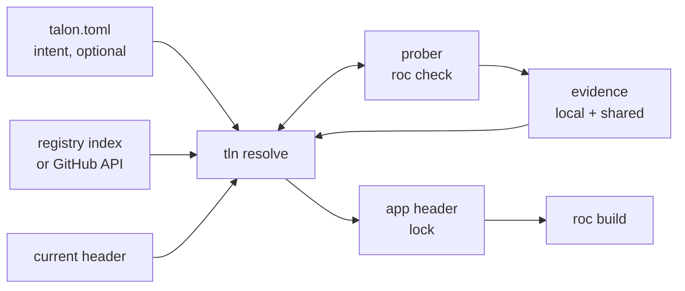
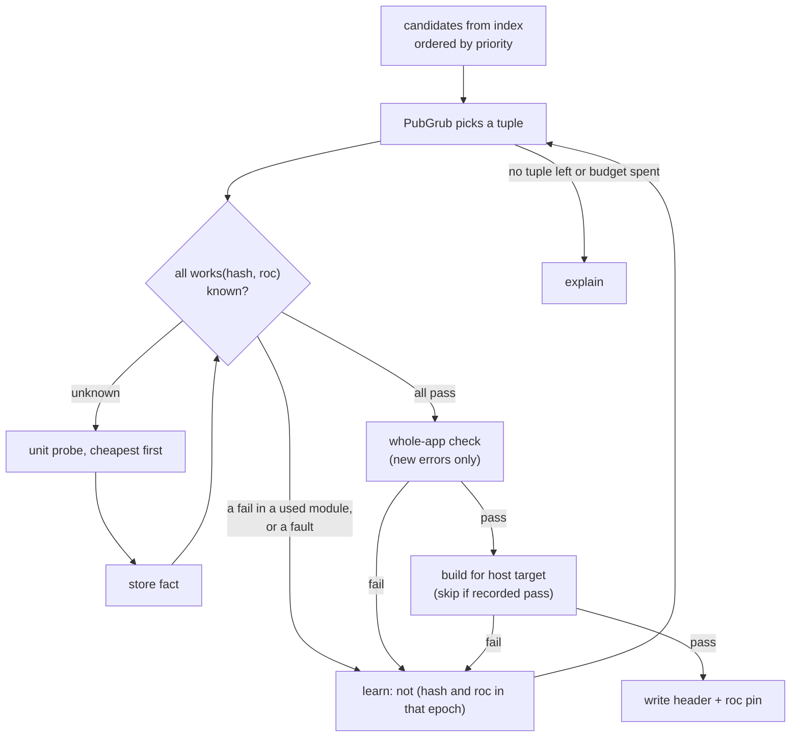
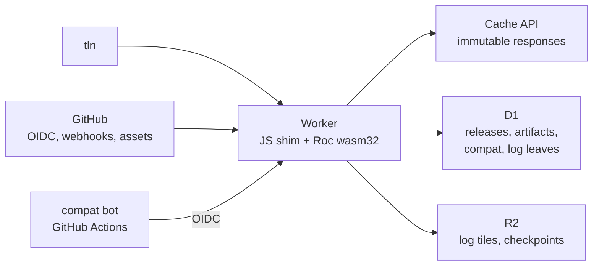
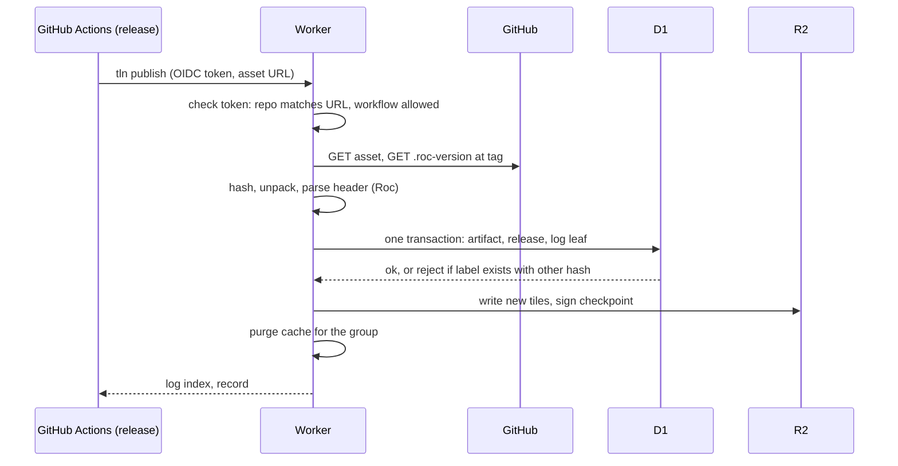
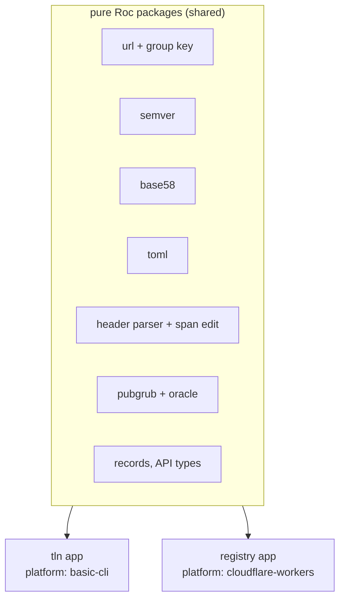

# Talon design

Talon is a package manager and compiler manager for Roc. The CLI is `tln`.

| Item | Value |
| --- | --- |
| Status | Draft 3, 2026-10-14. CLI audit fixes: `docs/cli-audit.md` (rounds 1 and 2). Prompts and non-interactive mode: 8.2. |
| Target compiler | Zig-based Roc, `nightly-2026-10-09-258ab27`. Source facts from roc-lang/roc at `2664a27`. |
| Scope | CLI, resolver, compatibility prober, toolchain manager, registry on Cloudflare |
| Language | Roc for the CLI and the registry Worker (section 10) |

In this document, `roc:src/...` is a path in the roc-lang/roc repository at `2664a27`.

## 1. Goals and non-goals

| # | Goal |
| --- | --- |
| G1 | The app header is the lockfile. Talon adds no second lock. |
| G2 | `talon.toml` holds intent only (ranges, pins, policy). It is optional. A project with no `talon.toml` works. |
| G3 | Resolution is deterministic: same intent + same registry snapshot + same evidence gives the same header. |
| G4 | Talon installs and selects Roc compilers. It uses the cache directory that `roc` uses today. |
| G5 | Bun-class speed and ergonomics: one binary, one round trip to resolve, parallel fetch. |
| G6 | The registry is an index, not a store. Packages stay on GitHub Release assets. |
| G7 | The registry is optional. With no registry, Talon still works against GitHub directly. |
| G8 | Talon finds a working tuple (nightly, platform, packages) even when releases record no compiler version. It probes the compiler when evidence is missing (section 5.4). |
| G9 | Talon and its registry are written in Roc. |

| # | Non-goal (for v1) |
| --- | --- |
| N1 | Host package bytes on Cloudflare (planned as an optional mirror later, see section 11). |
| N2 | Replace `roc` commands (`check`, `build`, `test`). Talon calls `roc`. |
| N3 | Support the old Rust compiler and `.tar.br` bundles. |

## 2. Facts about Roc that shape the design

Each fact was checked in the compiler source or with a test on `nightly-2026-10-09-258ab27`.

| Fact | Source | Consequence for Talon |
| --- | --- | --- |
| A header entry is `alias: "https://.../<version>/<hash>.tar.zst"`. The hash is base58(BLAKE3) of the compressed `.tar.zst` bytes. | `roc:src/bundle/streaming_writer.zig:125-129`, `roc:src/bundle/bundle.zig:231-240` | The header pins exact bytes. It is a lockfile. Talon only chooses which URL to write. |
| Package identity ("group") is the URL minus scheme, minus the one `X.Y.Z` segment, minus the hash, plus the major (or `0.minor` below 1.0). The host is part of it. | `roc:src/base/url.zig:238-281`, `roc:src/compile/package_resolution.zig:1322-1338` | Two URLs on different hosts are two packages. Talon never rewrites a host (rule H5). |
| Per group, the highest version that any edge names wins for the whole graph. Only the winner's deps are followed. | `package_resolution.zig:816-838` | Roc does MVS by itself. Talon uses the same rule, or Talon and `roc` disagree. |
| An app pin that is lower than a dependency needs fails with "Package Version Conflict". An app pin that is higher wins silently. | `package_resolution.zig:1433-1486`. Test: an app alias `http` at `1.9.0` replaced the `http 1.0.0` of basic-cli, and the platform modules failed against it. | A raise can break a dependency at compile time. Talon checks every raise (section 5.6). |
| Same group and version with two hashes fails with "Conflicting Package Contents". | `package_resolution.zig:903-921` | A version label maps to one hash per URL group. |
| One hash can carry many version labels. | `roc-lang/http` 1.0.0 and 2.0.0 are both `6ZUwqYhC...`. roc-parser 1.0.1 and 1.0.2 are both `FrnJ4RGD...`. | The registry keys facts by hash. A version is a label that points to a hash. |
| Platforms are not solved. Every platform declaration in a build must have the same group, version and hash. | `package_resolution.zig:1644-1693` | Hard constraint: a package that names a platform works only with that exact release. |
| An alias that no module imports gives no warning. It is still fetched and still joins version selection. | `package_resolution.zig:1963-1966`. Test: app with an unused `rand` alias passes `roc check`. | Overrides of transitive versions work with no compiler change (section 5.6). |
| `roc:` in any header is a warning only ("Roc Version Mismatch"). `roc fmt` moves a nightly pin forward, never back. | `roc:src/canonicalize/Can.zig:6165-6178`, `roc:src/base/roc_version.zig:101-139` | A `roc:` pin is evidence, not a guarantee. Talon never runs `roc fmt` on a header (rule H2). |
| The compiler does not read `.roc-version`. It is a CI convention only. | No reader in `roc:src` | The registry reads it as weak evidence. Talon reads it but never writes it (6.1). |
| `roc check` works on a package or platform `main.roc` with no app. It takes 0.4 s to 1.9 s on this machine. On an app, it checks only the modules that the app imports. | Tests, section 5.4 | A compatibility probe is cheap. A unit fail is per module. |
| Only 3 of 46 cached packages pin `roc:` in their header. `lukewilliamboswell/roc-parser` (`7CLzCK6q...`) fails on the 10-09 nightly with "redundant expose". | Cache scan and test | Compatibility evidence is sparse. Talon must find it by itself. |
| `--replace-dep OLD NEW` swaps one source for one command. It edits no file. | `roc:src/cli/cli_args.zig:118-176` | Patches need no header edit. |
| Limits: 10 MB per package, 100 MB per closure (512 MB for a platform). | `roc-syntax` reference | Small enough to hash and inspect inside a Worker. |

### 2.1 What the hash fixes

| Item | Fixed by the hash? |
| --- | --- |
| Source of every module in the package | Yes |
| Declared dependency URLs (with their hashes) | Yes. They are in `main.roc` inside the archive. |
| Dependency versions used in a build | No. MVS can raise them (row 4 above). |
| Platform host files for all targets | Yes, when the publisher includes them. One archive holds all targets (`targets: { inputs_dir: ... }`). |
| Compiler version | No. A `roc:` pin inside is only a hint. |
| Version label | No. One hash can have many labels. |

So the identity of a build is the tuple (set of resolved hashes, nightly, target). A compatibility fact "hash H checks on nightly N" is stable, because H fixes all of its source.

### 2.2 Cache layout and cleanup

| Path | Root | Writer | Cleaned by roc? | Size seen |
| --- | --- | --- | --- | --- |
| `packages/<hash>/` | `$XDG_CACHE_HOME/roc`, else `~/.cache/roc` (`roc:src/compile/compile_build.zig:1602-1623`) | roc | No | 1.1 GB |
| `packages/<hash>.deps.json` | same | roc. Rebuilt from `main.roc` if missing (`package_resolution.zig:2160-2183`) | No | small |
| `compat-<id>/` | `$ROC_CACHE_DIR`, else as above (`roc:src/compile/cache_config.zig:337-344`) | roc. `<id>` is the compiler compatibility id (`roc:build.zig:1894-1925`). | Files inside expire after 30 days. The dir stays. | 1.1 GB |
| `nightly-<tag>/`, `debug-<sha>/` | same | Compilers before 2026-10-05 only | Files inside expire. The dir stays forever. | 3.1 GB |

`roc` has no `clean` command. It starts a background cleanup on each run (`roc:src/compile/cache_cleanup.zig:89`). That cleanup deletes old files inside the build caches. It never deletes a cache dir, a package or a sidecar. Talon fills that gap (section 6.4).

Note: the packages root ignores `$ROC_CACHE_DIR`. The build caches honor it. Talon uses the same two rules.

## 3. Prior art

| Tool | Idea | Talon decision |
| --- | --- | --- |
| Bun | One fast binary. `add`, `remove`, `update -i`, `outdated`, `why`, `x`, `patch`. Catalogs. `minimumReleaseAge`. Security scanner API. | Adopt the CLI shape, catalogs, release age, scanner hook. |
| uv | Manages the toolchain. Global cache. `--resolution lowest-direct`. `exclude-newer`. | Adopt toolchain install, lowest resolution for libraries, time-based snapshots. |
| Go modules | MVS needs no lockfile. `GOPROXY` is optional. Checksum database is a transparency log. `toolchain` directive downloads the compiler. | Adopt all four. Roc already uses MVS. |
| Cargo | Sparse HTTP index. MSRV-aware resolver. Yank, not delete. Trusted publishing. | Adopt yank. Make the resolver nightly-aware (the Roc form of MSRV-aware). |
| Rust crater, Stackage, Nix Hydra | Build every package against a compiler or a package set, and publish the pass/fail matrix. | Shared compatibility matrix keyed by (hash, nightly) (section 9.6). |
| Zig | URL + hash in the manifest. `zig fetch --save`. | Closest model to Roc. `tln add` does the same, plus ranges. |
| JSR | Names tied to a scope. Publish with GitHub OIDC. Provenance. | Publish with OIDC. |
| rustup | Proxy binaries, `+toolchain` argument, toolchain file. | Adopt the proxy model for `roc`. |
| PubGrub (uv, Dart pub) | Conflict-driven search that learns incompatibilities and explains failures. | Use PubGrub, fed by a lazy compatibility oracle (section 5.5). |
| C2SP tlog-tiles, Sunlight | An append-only Merkle log served as static tiles from object storage. | Log leaves in D1, tiles in R2 (section 9.3). |

## 4. Core model

| Layer | File | Owner | Contains | Changes when |
| --- | --- | --- | --- | --- |
| Intent | `talon.toml` (optional) | Human | Ranges, anchors, policy, workspace | A human edits it, or `tln add` |
| Lock | App header in `main.roc` | Talon (humans may edit) | Exact URL + hash per direct dep, `roc:` pin | `tln add`, `tln update`, `tln install` |
| Evidence | `talon/compat.db` + registry matrix | Talon | Probe results per (hash, nightly) | Any probe |
| Store | roc cache dirs (2.2) | Talon + roc | Unpacked packages, compilers | Any fetch |



### 4.1 Identity

| Concept | Form | Example |
| --- | --- | --- |
| Group | Roc rule from section 2: URL minus version and hash, plus major | `github.com/roc-lang/unicode/releases/download/{v}/` + major 4 |
| Name | `owner/repo` for GitHub URLs. Display and search only. | `roc-lang/unicode` |
| Label | group + version | `roc-lang/unicode@4.2.0` |
| Content id | Hash in the URL | `4W8SHzvwet9h...` |
| Build id | (resolved hashes, nightly, target) | |

Talon keeps facts per content id, and labels as pointers to it. So Talon can read a header that a human wrote by hand: it asks the registry for the hash, and gets back all labels for it.

### 4.2 The header as lockfile

```roc
app [main!] {
	pf: platform "https://github.com/roc-lang/basic-cli/releases/download/0.25.0/<hash>.tar.zst",
	json: "https://github.com/someone/roc-json/releases/download/2.1.0/<hash>.tar.zst",
	util: "../util/main.roc",
	roc: "nightly-2026-10-09-258ab27",
}
```

| # | Rule |
| --- | --- |
| H1 | Talon edits only string literals and whole entries. It keeps comments, order and formatting. It uses a span-based edit, not a reprint. |
| H2 | Talon never runs `roc fmt` on the header. (`roc fmt` moves the `roc:` pin.) |
| H3 | Every URL that Talon writes is a release URL with a version and a hash. |
| H4 | Talon never changes a path entry or a URL it cannot identify. It lists them as "foreign" in `tln ls`. |
| H5 | Talon never writes a mirror URL. The host is part of the group, so a mirror URL is a different package to Roc. Mirrors feed the cache only. |
| H6 | Talon writes `roc:` whenever it resolves the nightly. The pin records the nightly that the last probe passed with. With `--no-check` (5.4), no whole-app probe ran, so Talon does not move the pin. It keeps the old `roc:` entry as it is, writes none if there was none, and resolves on that nightly only. The header then carries no verified pin claim for the new tuple. |

A package header is also a lock, with one difference: consumers treat its versions as minimums (MVS). So a library records the lowest version it supports (section 5.8).

### 4.3 talon.toml: intent only

Keys are header aliases. The header already gives the URL group, so most entries need only a range.

```toml
[toolchain]
roc = "*"                      # any nightly. Or a range, or "=nightly-2026-10-09-258ab27"

[dependencies]
pf = "0.25.*"                  # the platform
parser = "=2.0.0"              # anchor: hard pin
json = "^2.1"
# util and others are absent: they follow the header with the default policy

[dependencies.http]            # a new dependency, not yet in the header
package = "roc-lang/http"
version = "^1"

[resolution]
priority = ["parser", "pf", "roc"]  # what to keep newest first, see 5.1
strategy = "highest"           # or "lowest" for libraries
min-release-age = "3d"
snapshot = "log:184467"        # registry log size. Or a time: "2026-10-12T00:00:00Z" (see 4.4)
probe = { max = 100, max-toolchains = 10, slots = 12 }
```

| In header | In talon.toml | Constraint |
| --- | --- | --- |
| yes | yes | The range in `talon.toml` |
| yes | no | Implied: same major as the header version, never lower than it |
| no | yes | `tln install` adds it to the header, after the group check below |
| no | no | Transitive. Set by package headers plus MVS. |

A user can rename an alias in the header. Then the key in `talon.toml` is "in talon.toml, not in header". So before `tln install` adds a header entry, it matches by group, not by alias:

| Case | Talon does |
| --- | --- |
| The group of the entry is not in the header | Adds the entry (row "no, yes" above) |
| The group is in the header under another alias | Adds nothing. Reports the stale key, for example `talon.toml: key "json" is "someone/roc-json", which the header names "js"`. Offers to rename the key in `talon.toml`. Prompt NI1 (8.2), default yes. |
| Non-interactive mode (8.2) and no `--yes` | Stops with the same report and exit code 13. Writes nothing. With `--rename-keys` or `--yes`, renames the key. |

Talon never adds a second entry for a group that the header already has. The same check runs in `tln add` (4.6).

### 4.4 Determinism

| Input | Output | Deterministic because |
| --- | --- | --- |
| Header | Build graph | Hashes are fixed. Roc MVS is a pure function of the headers. |
| `talon.toml` + header + snapshot + evidence | New header | The resolver is a pure function. Probes only add evidence. A probe result for (hash, nightly) does not change. |

A snapshot fixes which releases exist. It has two forms:

| Form | Example | Hides | Works with | Strength |
| --- | --- | --- | --- | --- |
| Log | `log:184467` | Every release that the registry log (9.3) added after that size | The registry only. With `TALON_REGISTRY=direct` there is no log, so Talon stops with an error. | Strong. The log is append-only, so the set of releases is fixed. |
| Time | `2026-10-12T00:00:00Z` (UTC, RFC 3339) | Every release published after that time. The time is the GitHub release `published_at`. | The registry and `direct` | Weaker. See below. |

The time form is the same idea as uv `exclude-newer`. It is weaker because GitHub can change a release after the fact: a maintainer can delete and publish a release again, or move a label to other assets. So a time snapshot can give another set of releases on a later day. The hash in the header still protects the build bytes.

`tln update` prints `resolved at log:184467, 4 probes`. With no registry, it prints `resolved at 2026-10-14T09:30:00Z, 4 probes`. A human can repeat the resolve with `--snapshot log:184467` (or the time). The result is the same only if the evidence is the same. Local probe facts (rank 1 in 5.3) are not shared, so a second machine can get a different tuple.

CI must not resolve again. CI runs `tln install --frozen` (7.3). It verifies the header that is in the repository: it fetches the closure, checks each hash, and fails if the header does not satisfy `talon.toml`. It needs no snapshot and no evidence.

### 4.5 Workspaces

```toml
[workspace]
members = ["apps/*/main.roc", "examples/*.roc"]

[catalog]
json = "^2.1"
pf = "0.25.*"
```

One resolution covers all members, and gives one nightly. A member uses `json = "catalog:"`.

| Command | Members that it writes |
| --- | --- |
| `tln install` with no names, `update`, `upgrade` | Each member that has the entry. A shared variable gets one value in all members. |
| `tln add`, `tln remove` | One member. `--member <path>` names it. With no flag, Talon uses the member whose directory holds the current directory, if there is exactly one. Else it stops with exit code 2 and lists the members. |
| `tln roc use` | The `roc:` entry of each member, because the workspace has one nightly |

`talon.toml` writes of `tln add` (4.6) go to the nearest `talon.toml` on the path from the member file up to the workspace root.

### 4.6 References in the CLI

One grammar names packages, platforms, tools and compiler releases:

```text
ref      = name [ "@" selector ] | "@" selector | nightly-tag
name     = alias | owner/repo | host/path | short
selector = version | range | major | "latest" | nightly-tag | git-ref
```

The two short forms are valid only in the `tln roc` scope. There the default name is `roc-lang/roc`:

| Short form | Means |
| --- | --- |
| `@sel` | `roc-lang/roc@sel` |
| `nightly-2026-10-09-258ab27` | A nightly tag with no `@`. `roc-lang/roc@nightly-2026-10-09-258ab27` is the same ref. |

| Selector | Example | Meaning |
| --- | --- | --- |
| Release version | `owner/app@1.4.0` | That release |
| Range or major | `roc-lang/http@^2`, `roc-lang/http@2` | The newest match. For an installed entity, it selects among the installed ones. |
| Latest | `owner/app@latest` | The newest release that is not yanked, found online. In `tln tool install` and `tln x`, it turns off the reuse of an older build (6.5, B2). In `tln add`, it is the same as no selector. In `tln update X@latest`, it is the newest release, also in a new major (5.10). |
| Nightly tag | `@nightly-2026-10-09-258ab27` | That nightly (compiler only) |
| Git ref | `owner/app@dd03c09e`, `--git owner/app@main` | A source build. A branch or tag is fixed to a commit at install time. |

Talon reads a selector with these rules, in order:

| # | Selector | Result |
| --- | --- | --- |
| 1 | Matches a release, a range, a nightly, or the word `latest` | Used. No marker is needed. A branch named `latest` needs `--git` (rule 3). |
| 2 | Looks like a commit sha (hex only, at least 7 characters), and no release matches | Taken as a git ref, with no `--git`. |
| 3 | A branch or tag name | Taken as a git ref only with `--git`. |
| 4 | None of the above, and no `--git` | Error. Talon lists the close release versions and says `use --git for a branch or tag`. |

So a typo such as `owner/app@mian` is an error. It never starts a source build. `--git` skips rules 1 and 2 and takes the selector as a git ref.

No selector means different things in different scopes. In `tln add` and `tln update`, it means the newest release in range. `tln upgrade` ignores package ranges (5.10). In `tln tool install` and `tln x`, it means "this app, at any version": Talon first uses a build that is already on this machine, and builds the newest release only if there is none (6.5, B1 and B2).

The separator is `@`, not `#` as in npm, because the shell reads `#` at the start of a word as a comment. Some shells also read `^` (zsh with `EXTENDED_GLOB`) and `~` as special. Quote a ref that has them: `'roc-lang/http@^2'`. The shell-safe forms `@2`, `@2.x` and `@2.1.x` need no quotes. `@2.x` means the same as `@^2`, and `@2.1.x` means 2.1.0 up to, but not including, 2.2.0.

Each command works in one scope, so names of different kinds never collide:

| Command | Scope |
| --- | --- |
| `tln update`, `upgrade`, `remove`, `why`, `patch` | Project: header entries and the closure. In `tln update X@sel`, Talon finds X in the project and the releases that match `sel` in the registry. |
| `tln install` with names (and `add`) | The registry index. With no registry (`TALON_REGISTRY=direct`), GitHub. Never the project. |
| `tln tool ...` | `tools.json` (6.5). `tln tool install` with a full name: the registry index. |
| `tln x` | Installed tools and `x` cache entries (6.5). With a full name: the registry index. |
| `tln roc ...`, `roc +<id>` | Installed compiler releases (6.7) |

In a scope, Talon tries these forms in order and uses the first match:

| # | Form | Example | Rule |
| --- | --- | --- | --- |
| 1 | Header alias | `pf` | Exact. An alias is unique in a header. |
| 2 | Full name | `roc-lang/basic-webserver` | Exact. Non-GitHub hosts use `host/path` (4.1). |
| 3 | Short name | `basic-webserver`, `parser` | The repo name, or the repo name minus a leading `roc-` (the alias rule below, without `-` to `_`). So `parser` and `roc-parser` both match `lukewilliamboswell/roc-parser`. It must match one entity only. |
| 4 | Unique id prefix | `git-dd03`, `nightly-2026-10-09` | Compiler releases only, as a git short sha. Interactive use only (see the prefix rules below). |

Prefix rules. A prefix that is unique today can become ambiguous after a later install. So Talon stores only full ids:

| Place | Prefix allowed? | Behavior |
| --- | --- | --- |
| `tln roc ...` arguments | Yes | Talon expands it to the full id. An ambiguous prefix is an error that lists the full ids. |
| `roc +<id>` typed by hand | Yes | Same expansion and same error. A script must use the full id. |
| `ROC_TOOLCHAIN`, `roc:` pin, `.roc-version`, `talon.toml` | No | The full id only. A prefix is an error. |
| `tln roc default` | Stores the full id | Talon expands the prefix first, then stores the full id. |

On a tie, Talon stops and lists the full names:

```text
error: "basic-webserver" matches 2 packages:
  roc-lang/basic-webserver      platform (pf)
  someone/basic-webserver       via web-utils
Use the full name.
```

The group includes the major (section 2), so one closure can hold `roc-lang/http` 1.x and 2.x. Then the major is part of the name: `roc-lang/http@2`.

#### Lookup in `tln add`

`tln install X`, `tln i X` and `tln add X` are one command (section 8). This document calls it `tln add`. It names a package that is not yet in the header, so form 1 does not apply. These rules apply:

| Case | Talon does |
| --- | --- |
| Full name (form 2) | Uses it. No search. |
| Short name, registry on, one indexed package matches | Uses it. Prints the full name it chose, for example `matched "parser": lukewilliamboswell/roc-parser`. |
| Short name, registry on, more than one match | Stops. Lists the full names, as in the tie example above. |
| Short name, no match | Stops. Prints the error. Does not search GitHub. |
| Short name, registry off | Stops. GitHub has no index of short names. Asks for the full name. |

`tln tool install` and `tln x` do not search the registry for a short name. A short name must match an installed tool or an `x` cache entry. For a new app, the user types the full name. Reason: `tln x` runs the app at once, with no prompt (X4). A short-name match in the registry could run a different app with a similar name (typosquat). With no local match, Talon stops with exit code 2 and lists the registry matches as full names.

#### Aliases in `tln add`

The default alias comes from the release name. Talon may shorten the name only to its complete unqualified name: the repo name, without the owner. The only exception: Talon drops a leading `roc-`. Talon does not drop other prefixes or suffixes, does not abbreviate and does not guess.

| Full name | Default alias | Why |
| --- | --- | --- |
| `roc-lang/basic-cli` | `basic_cli` | Repo name. `-` becomes `_`. |
| `roc-lang/unicode` | `unicode` | Repo name |
| `lukewilliamboswell/roc-parser` | `parser` | Leading `roc-` dropped |
| `someone/roc-json` | `json` | Leading `roc-` dropped |
| The platform entry | `pf` | A convention, not a name shortening. A header has one platform, and `pf` is the Roc habit. |

An alias is a Roc identifier. Roc names use only ASCII letters, digits and `_`. A package name starts with a lowercase letter. Some words are reserved (for example `app`, `package`, `module`, `import`, `if`, `match`, `for`). So `basic_cli` is valid. Talon applies these checks to the default alias, in order:

| Step | Rule |
| --- | --- |
| 1 | Change each `-` and `.` to `_`. |
| 2 | If the result does not start with a lowercase letter, or has another character that is not a letter, digit or `_`, Talon stops. It asks for `--as <alias>`. |
| 3 | If the result is a reserved word, Talon stops. It asks for `--as <alias>`. |
| 4 | If the alias exists in the header for a different group, Talon stops. It asks for `--as <alias>`. It never adds a suffix. |

`--as <alias>` sets the alias and skips the default rule. Talon still checks that the alias is a valid identifier and is free. If the group is already in the header under another alias, `tln add` adds no entry. It reports that alias (see the group check in 4.3).

#### What `tln add` writes to `talon.toml`

The key is the header alias. The header always gets the entry.

| Command | Header | `talon.toml` |
| --- | --- | --- |
| `tln add X` (no selector) | New entry, newest version that resolves | Nothing. Talon does not create the file (G2). If the file exists, Talon adds no key: the implied range (4.3) applies. |
| `tln add X@1.2.3` (exact version) | New entry at 1.2.3 | Anchor `X = "=1.2.3"`. Talon creates the file if it is missing, because the user stated intent. |
| `tln add X@^1.2`, `tln add X@1` (range or major) | New entry, newest version in range | Range `X = "^1.2"`, and `X = "^1"` for `@1`. Talon creates the file if it is missing. |
| `tln add X@1.2.3 --no-pin` | New entry at 1.2.3 | Nothing, as for `tln add X`. A later `tln update` can raise the version inside the major. |

An exact version is a hard pin by default. This keeps 5.1 consistent: `tln add parser@2.0.0` makes an anchor. `--no-pin` gives an exact start version with no hard pin.

#### `tln add --platform`

`tln add --platform owner/repo[@sel]` sets the platform. A header has one platform (C3).

| Case | Talon does |
| --- | --- |
| No platform in the header | Adds it with the alias `pf`, or the `--as` alias |
| A platform is in the header | Replaces it under the same alias, also when the new platform is another repo. The platform is free inside the selector. Other variables are held (5.9). A package that names a platform must name the new one (C3), so it can need a move (prompt NI3). The `talon.toml` key of the old platform gets the new range (4.6 table). |
| The release is not a platform | Error with exit code 2 (C4) |
| `tln add X` with no `--platform`, and X is a platform | Error with exit code 2 that names `--platform` |

#### `tln remove`

| Case | Talon does |
| --- | --- |
| An entry that no app module imports | Removes the header entry, its `talon.toml` key and its `[overrides]` entry. Moves no other entry. Runs the whole-app check and the build (5.4) on the new header, because the removed entry can have raised a shared version (5.6). `--no-check` skips them. |
| An entry that an app module imports (the lexical scan of 5.4) | Stops with exit code 11 (`app_error`) and lists the `import` lines. `--force` removes it anyway and skips the check, because the app cannot check until the user changes the imports. |
| The platform entry | Error with exit code 2. An app needs a platform. `tln add --platform` changes it. |
| An entry with a `[patch]` entry (5.7) | Also removes the `[patch]` entry. Keeps the files in `.talon/patches/<alias>/` and prints their path. |
| A path entry or a foreign URL (H4) | Removes the entry. It has no `talon.toml` key. |

## 5. Resolution

### 5.1 Variables and anchors

Resolution picks one value for each free variable. The nightly is a variable like any package, but only `tln upgrade` frees it (RP1, 5.9).

| Variable | Domain |
| --- | --- |
| `roc` | Nightly tags (and later, releases) |
| `pf` | Platform releases |
| each direct dep | Releases in range |

Any variable can be an anchor: a hard pin (`=`) in `talon.toml`, or a `tln add parser@2.0.0` (writes, 4.6). The rest are free. Examples:

| Intent | talon.toml |
| --- | --- |
| "I need parser 2.0.0. I do not care which nightly." | `parser = "=2.0.0"`, `roc = "*"` |
| "My team uses nightly 10-09. Find packages that work with it." | `roc = "=nightly-2026-10-09-258ab27"` |
| "Keep the platform. Move the rest." | `pf = "=0.25.0"` |

When many tuples work, `priority` breaks ties: the solver maximizes the version of the first name, then the second, and so on. The default is: direct deps in header order, then `pf`, then `roc`. `priority` orders only the free variables. A command can hold other variables for one run (5.9).

### 5.2 Constraints

| # | Constraint | Kind |
| --- | --- | --- |
| C1 | Range from `talon.toml`, or the implied range (4.3) | Hard |
| C2 | Roc MVS: a direct pin is at least the highest version of that group in the closure | Hard |
| C3 | One platform: every package that names a platform names the app platform, byte for byte | Hard |
| C4 | Alias kind: a `platform` entry resolves to a platform release | Hard |
| C5 | Compatibility: every hash in the closure checks on the chosen nightly (5.3 to 5.5) | Hard |
| C6 | Yanked releases are not chosen for a new resolution | Hard |
| C7 | `min-release-age` and `snapshot` (log or time form, 4.4) hide new releases | Hard |
| C8 | Two majors of one group in the closure | Warning (type identity) |

### 5.3 Compatibility evidence

Evidence is a set of facts `works(hash, nightly) = pass | fail(error digest)`. Sources, from strong to weak:

| Rank | Source | Trust |
| --- | --- | --- |
| 1 | Local probe result (`talon/compat.db`) | Full |
| 2 | Registry matrix, produced by the Talon CI bot (section 9.6) | Full, signed |
| 3 | `roc:` pin in the release header | Hint: author says it passed |
| 4 | `.roc-version` at the release tag | Hint |
| 5 | Release date (nightlies of the 2 weeks before it) | Search order only |
| 6 | Reports from other users (`tln probe --share`) | Search order only |

Hints only order the search. Talon never writes a header on hints alone: the final tuple always gets a local whole-app check (5.5 step 6), unless the user passes `--no-check`. That check costs under 2 s. `--no-probe` does not turn it off. Only `--no-check` does (7.3).

### 5.4 Probes

A probe runs one compiler on one target and classifies the result. Probes form a ladder. Each step runs only when the step before it passed.

| Step | Probe | Command | Blames |
| --- | --- | --- | --- |
| 1 | Unit | `roc check packages/<hash>/main.roc` with nightly N | The modules of the hash that have errors |
| 1 | Platform | same, on the platform `main.roc` | The modules of the platform that have errors |
| 2 | Whole app | `roc check main.roc` with the candidate header in a temp copy | The hash that owns the file of each new error (see "Baseline check"). The app itself if a new error is in app files: then Talon stops and reports, because the user code is not a free variable. Errors that the baseline already has are not blamed. |
| 3 | Build | `roc build main.roc --output=<tmp>` for the host target | Link or target-file errors blame the platform for that target. Other errors as in step 2. Talon can skip this step (see "Build skip"). |

Step 3 catches what `check` cannot see: a missing host file for the target, link errors, and code generation bugs. It runs once, on the final tuple. (Measured: 309 ms for a basic-cli app.)

#### Baseline check

An app can already have compile errors when the user runs `tln add` or `tln update`. So step 2 compares two runs of the same check.

| Run | Header | Compiler |
| --- | --- | --- |
| Baseline | The current header, unchanged | The nightly in the current `roc:` pin, or the selected compiler (6.1) if there is no pin |
| Candidate | The candidate header in a temp copy | The candidate nightly |

Two errors are the same error when all of these are equal:

| Part | Value |
| --- | --- |
| File | The path in the app, or (hash, module path) for a package file. Never the cache path. |
| Kind | The error title in the header line of the error |
| Message | The error text with line numbers, column numbers and source excerpts removed |

Line numbers are not part of the identity, because they move when the user edits a file. Talon compares the two error sets and sorts each error:

| Error | Class | Action |
| --- | --- | --- |
| In the candidate only | New | Blame as in the table above |
| In both | Unchanged | Print as a note. Do not blame. |
| In the baseline only | Removed | Print as a note. This is good. |

Rules P6 to P8 (below) apply to the baseline check.

`--no-check` is a resolve flag (7.3). It skips the baseline check, the whole-app check (step 2) and the build (step 3). Unit probes still run. The header then carries no verified claim from step 2 or 3, and H6 keeps the old `roc:` pin. Talon prints `check: skipped` in the summary.

#### Build skip

Step 3 costs time on each `tln add` and `tln update` (goal G5). Talon skips it when all of these are true:

| # | Condition |
| --- | --- |
| 1 | `compat.db` has a build pass with the key (platform hash, nightly, target). This is the P4 key for the target of the build. |
| 2 | That record also holds the used-closure digest of the build that passed. The digest of the candidate is equal. |
| 3 | Step 2 passed for the candidate with no new errors. |

The used-closure digest is a hash of the sorted list of hashes that the app uses (the packages with a used module, found by the lexical scan below, with their patches and overrides). A package that the app does not import is not in the digest. So `tln add` of a package that the app does not use yet keeps the digest, and Talon skips the build. A change to the platform hash, the nightly, the target or a used package changes the key or the digest, and Talon runs the build. A recorded fail never allows a skip. Talon prints `build: skipped (recorded pass)` in the summary. A skip also does not claim that the current app source builds: step 2 covers the app source.

Result classes, all seen in the measurement below:

| Class | Signal | Meaning |
| --- | --- | --- |
| pass | `No errors found`, or `0 errors and N warnings` | Works |
| fail | `N errors` with N > 0. Each error header names a file. | A code incompatibility, per module |
| hang | No result in 30 s. A normal check takes under 2 s. | Compiler fault |
| crash | Signal exit (139 seen) | Compiler fault |

Rules:

| # | Rule |
| --- | --- |
| P1 | `check` and `build` only. Talon never runs the output, so no host code runs. |
| P2 | Warnings do not fail a probe. |
| P3 | A download error gives no fact. A hang or crash is a fact of its own class (compiler fault). |
| P4 | Results are stored per (hash, nightly, target) and never expire. `check` results use the target `any`. A fail stores the set of failing modules. A `build` pass also stores the used-closure digest (see "Build skip"). |
| P5 | Budget: `probe.max` (default 100) checks, `probe.timeout` (default 30 s), and `probe.max-toolchains` (default 10) new compiler downloads. One nightly is about 70 MB packed and 228 MB unpacked. Installed nightlies are tried first, because they cost nothing to fetch. A new download needs consent (DL1 to DL6, 6.3). The cap limits the downloads after consent. |
| P6 | Talon blames only new errors (see "Baseline check"). A candidate with no new errors passes step 2, also when the app has errors. |
| P7 | If the baseline is a hang or crash, Talon has no error set. It stops and tells the user to fix the compiler fault or to use `--no-check`. |
| P8 | An error that the baseline hid (for example behind an earlier error in the same module) can show as new. This is a conservative result. The user can fix the app or use `--no-check`. |

#### Parallel probes

Talon runs more than one probe at the same time. A probe takes slots from a pool of 12 slots:

| Probe | Slots | Most at the same time |
| --- | --- | --- |
| Check (unit, baseline, whole-app) | 1 | 12 checks |
| Build (ladder step 3) | 4 | 3 builds |

So Talon runs up to 12 checks, or up to 3 builds, or a mix (for example 1 build and 8 checks). `probe.slots` in `talon.toml` (or `config.toml`, 6.2) and `--slots <n>` change the pool size. The weights do not change.

Why these numbers: a check takes 0.4 s to 1.9 s and little memory. The Q11 sweep ran 12 checks at the same time on one shared cache, with no error (`conformance/compat-sweep/run.sh:15`). A build also links the host and uses about 250 MB. 3 builds at the same time on one cache passed 300 of 300 times, with the same bytes as a build that ran alone (Q18, `conformance/build-share/`). 3 builds take 1.03 s, 1 build takes 0.74 s.

| # | Rule |
| --- | --- |
| PP1 | Only a probe whose compiler is installed takes slots. A compiler download takes no slot. It runs at the same time as the probes, and a probe that needs it waits for it. |
| PP2 | These probes run at the same time: the unit checks of all packages of one candidate tuple (5.5 step 4); 3 nightlies of a nightly range in a search, so that one round cuts the range in 4 parts and not in 2; the baseline check and the first unit checks; the build of each workspace member (4.5); the releases that option 2 of `tln tool install` tries (6.5). |
| PP3 | The result does not depend on the order in which probes end (G3). Before a round starts, Talon makes the list of probes of the round. When the round ends, Talon reads the results in the order of that list. |
| PP4 | Each probe that starts counts against `probe.max`, and its result goes in `compat.db`, also when the solver does not use it. So the same inputs give the same header and the same probe count. |
| PP5 | A probe that hangs keeps its slots until `probe.timeout` (30 s). The other probes continue. |

#### A unit fail is per module

`roc check` on an app checks only the modules that the app imports. Measured on nightly 10-09 with roc-parser 2.0.0:

| Probe | Result |
| --- | --- |
| Unit: `roc check` on parser `main.roc` | fail: `redundant expose` in `Yaml.roc` |
| App that imports `parser.Parser` | pass, and `roc build` passes. The binary runs. |
| Same app, also imports `parser.Yaml` | fail |

So a unit fail is a hard incompatibility only when the app uses a failing module. Talon computes the modules that the app uses in each package: the `import` lines of the app, then the `import` lines inside the package, transitively. This is a lexical scan with the header parser package. If the set does not touch a failing module, the unit fail is ignored, and the whole-app check (step 2) decides.

#### Measurement: islands and epochs (Q11)

Setup: 46 cached hashes (32 with a known release label) × 22 nightlies (2026-09-15 to 2026-10-12), Linux x86_64, unit probes, isolated caches. Script and raw data: `conformance/compat-sweep/`.

```text
nightly      09-15 .. 09-19 | 09-22 | 09-23 09-24 | 09-25 | 09-26 .. 09-29 | 09-30 10-01 | 10-02 .. 10-06 | 10-09 .. 10-12
basic-cli 0.22.x  pass      | pass  | HANG  HANG  | pass  | pass           | pass  pass  | fail           | fail
basic-cli 0.23.0  fail      | fail  | fail  fail  | fail  | pass           | pass  pass  | fail           | fail
basic-cli 0.24.0  fail      | fail  | fail  fail  | fail  | pass           | pass  pass  | pass           | fail
basic-cli 0.25.0  fail      | fail  | fail  fail  | fail  | fail           | fail  fail  | fail           | pass
basic-websrv 0.17 fail      | pass  | pass  pass  | pass  | pass           | CRASH CRASH | pass           | fail
roc-parser 2.0.0  fail      | fail  | fail  pass  | pass  | pass           | pass  pass  | fail (Yaml)    | fail (Yaml)
roc-ray 0.10.0    fail      | pass  | pass  pass  | pass  | pass           | pass  pass  | pass           | fail
basic-websrv 0.16 pass      | pass  | pass  pass  | pass  | pass           | CRASH CRASH | fail           | fail
joy 0.33, joy-html 0.16  pass on 09-15 .. 10-01, fail from 10-02
26 other hashes   pass on all 22 nightlies
4 other hashes    fail on all 22 (no main.roc, or written for an older compiler)

(basic-cli 0.22.x is 3 hashes, roc-ray 0.10.0 is 2 hashes. basic-cli 0.28.0 and 0.29.0 match 0.24.0 and 0.25.0.)
```

| Question | Measured |
| --- | --- |
| Transitions where any result changes | 8 of 21 |
| Code epochs (boundaries where a pass/fail result changes) | 6: boundaries at 09-22, 09-24, 09-26, 10-02, 10-09 |
| Fault windows (hang or crash) | 2: 09-23 to 09-24 (hang, basic-cli 0.22.x), 09-30 to 10-01 (segfault, basic-webserver) |
| Transitions where only one hash changes | 0. Each boundary moved 2 to 8 hashes. |
| Results that change inside an epoch | 0 |
| Hashes with more than one island | 4 of 46. All 4 gaps are hangs or crashes. |
| Hashes with more than one island, if faults do not split a range | 0 |

Conclusions for the search:

| Rule | Reason |
| --- | --- |
| Probe one nightly per epoch | No result changed inside an epoch. 22 nightlies are 6 epochs. |
| A fault (hang, crash) marks that nightly as bad for that hash. It does not split the pass range. | Every island in the sample comes from a compiler fault, not from a code change. |
| A boundary is a nightly where at least 2 hashes change | All 8 transitions in the sample had at least 2. A change in only one hash is still binary-searched and reported to the bot. |
| Islands from code changes stay possible | The sample is small (46 hashes, 4 weeks). The model keeps a map from nightly to result, so a real code island costs probes but never gives a wrong answer. |
| Probe timeout 30 s | Normal checks take under 2 s. The hangs ran for 600 s with no result. |

If the solver finds no tuple with inferred facts, it runs a second pass. That pass probes the inferred facts that blocked the best tuples, within the remaining budget. Talon never writes a wrong header because of an inferred fact: the final ladder (steps 2 and 3) always runs on real probes.

With no bot data (registry off), each hash starts with the release date and `roc:` pin as hints, and the epochs come from the local `compat.db` only.

### 5.5 Algorithm

PubGrub with a lazy oracle. A failed probe becomes a learned incompatibility, the same way a failed version constraint does.



| Step | Action |
| --- | --- |
| 1 | Collect variables, ranges and anchors (5.1). For `add` and `update`, run the baseline check on the current header (5.4). |
| 2 | Fetch metadata for the full closure in one request (9.4). It includes the shared matrix for these hashes. |
| 3 | PubGrub picks the best tuple by `priority`, under C1 to C4 and C6 to C7. |
| 4 | For each pair (hash, roc) with no fact, run a unit probe. Order: installed nightly first, then the strongest hint. Up to 12 checks run at the same time (5.4, "Parallel probes"). |
| 5 | A fail in a module that the app uses, or a fault, adds an incompatibility for (hash, that epoch). Go back to step 3. |
| 6 | When all unit facts pass, run the whole-app check, then the build (ladder steps 2 and 3). Step 2 blames only errors that are new against the baseline (5.4). Step 3 is skipped when a recorded pass allows it (5.4). `--no-check` skips both. These catch errors that come from the combination (for example a raised transitive version) and from the target. |
| 7 | Write the header and `roc:`. Print the tuple, the probe count and the evidence for each choice. |

Example failure output, with measured ranges, for an app that imports `parser.Yaml`:

```text
error: no tuple works

  lukewilliamboswell/roc-parser 2.0.0 (module Yaml)   checks on nightly 09-24 .. 10-01
  roc-lang/basic-cli 0.25.0                           checks on nightly 10-09 .. 10-12
  no nightly is in both ranges

  fix: relax pf to "0.24.*" (checks on 09-26 .. 10-06, overlap 09-26 .. 10-01)
       or stop using parser.Yaml (parser.Parser checks on 10-09)
```

### 5.6 Overrides of transitive versions

To raise a transitive dependency (for example, a security fix), the app needs an alias for it in the same major. Roc then uses that version for the whole graph. Section 2 confirms both parts: an unused alias is legal, and it raises the version for every package.

```toml
[overrides]
parser = { package = "lukewilliamboswell/roc-parser", version = "^2.0.3" }
```

The raise can break a package that was not written for the new version (the `http 1.9.0` test in section 2). So the solver treats an override as a free variable, and the whole-app probe (5.5 step 6) covers it.

### 5.7 Patches

`tln patch json` copies the cached package to `.talon/patches/json/` for editing. `talon.toml` records it:

```toml
[patch]
json = "./.talon/patches/json/main.roc"
```

The header does not change. The `roc` proxy (6.3) adds `--replace-dep <header URL> <patch path>` to each command. `tln patch --commit` writes a diff file.

### 5.8 Libraries

| Task | Command |
| --- | --- |
| Record the lowest working versions in the package header | `tln update --strategy lowest` |
| Test with the newest versions without editing the header | `tln verify --strategy highest` (uses `--replace-dep`, section 8) |
| Record the nightly range that the package checks on | `tln probe --range` (publishes evidence with the release) |

### 5.9 Scope of `update`, `upgrade` and `install`

A command can hold a variable: it fixes the variable at its current header value for one run. A hold is a temporary anchor. It is not written to `talon.toml`. The nightly is held at the `roc:` pin, or at the selected compiler (6.1) if there is no pin.

| Command | Free variables | Held variables |
| --- | --- | --- |
| `tln update` | All, inside their ranges | None |
| `tln update X [Y...]` | Only the named ones | All others |
| `tln update -i` | The ones the user picks in the picker (prompt NI2, 8.2) | All others |
| `tln update X@sel` | X, in the releases that match `sel`, also in a new major (5.10) | All others |
| `tln upgrade` | All, with no package range (5.10) | Anchors (`=`) |
| `tln upgrade X [Y...]` | Only the named ones, with no range. A named anchor is free too. | All others |
| `tln upgrade roc` | Only the nightly | All packages |
| `tln upgrade X roc` | X and the nightly | All other packages |

| Case | `priority` (5.1) |
| --- | --- |
| `tln update` | As set. The default is direct deps, then `pf`, then `roc`. |
| `tln update X Y` | Only X and Y are ordered, in the order of `priority`. A held variable has no rank. So `tln update json` cannot move `pf` or `roc`. |
| `tln upgrade roc` | The nightly is the only free variable. It moves to the newest nightly that all held hashes pass on (5.3). |
| `tln upgrade X roc` | The order of `priority` for X and `roc`. By default, X is first. |
| `tln update -i` | The picker lists the free variables in `priority` order. The names that the user picks follow the `tln update X` row. The nightly is not in the list (RP1). |

#### The `roc:` pin

| # | Rule | Why |
| --- | --- | --- |
| RP1 | Only two commands change a `roc:` entry that exists: `tln upgrade` when the nightly is free (no names, or the name `roc`), and `tln roc use` (U1 to U4). | The nightly has no semver ranges, so each move goes to a newer release and can break code. That is the job of `upgrade`. `tln update` stays the small, safe move. |
| RP2 | `install`, `add`, `update` and `remove` always hold the nightly, also with NI3, `--allow-moves` or `--yes`. When no tuple works on the held nightly, Talon writes nothing and stops with exit code 10 (`no_tuple`). The error names the oldest nightly that works, when a probe or the matrix knows it, and the commands `tln upgrade roc` and `tln roc use <id>`. A `roc:` pin outside the `[toolchain] roc` range gives the same error in `install`. | One command moves the nightly, so the user always sees it move. |
| RP3 | A header with no `roc:` entry: the command writes the nightly that it held (the selected compiler, 6.1) after the check passes (H6). | This records the lock. It does not move it. |
| RP4 | In `tln upgrade`, a move of a held variable (NI3) can include the nightly. | `upgrade` is allowed to move it. |

A held variable moves only when no tuple exists without moving it (RP2 excludes the nightly). Then Talon does not move it by itself:

| Case | Talon does |
| --- | --- |
| A tuple exists with all held variables fixed | Uses it. No held variable moves. |
| No such tuple | Names the variables that must move and why, for example `json 2.2.0 needs pf >= 0.26.0`. Asks for consent to move them. Prompt NI3 (8.2), default no. |
| Non-interactive mode (8.2) and no `--yes` | Stops with the same report and exit code 13. Writes nothing. With `--allow-moves` or `--yes`, moves the named variables. |

`tln install` with no names keeps the lock (G1). With names, it is `tln add` (section 8).

| Header entry | Install does |
| --- | --- |
| Satisfies its range in `talon.toml`, or its implied range (4.3) | Keeps it. The entry does not change. Install holds it, as in `tln update X`. |
| Is missing from the header, or is out of range | Resolves it. This entry is the only free variable. |
| `talon.toml` does not exist | Resolves nothing. Install only fetches the closure of the header. |

A hold that cannot stay follows the consent rows above. `tln install --frozen` (7.3) runs the same check and resolves nothing: where plain `install` would resolve an entry, `--frozen` fails.

### 5.10 Upgrade and new majors

`tln update` moves inside the ranges of `talon.toml`. `tln upgrade` moves to the newest releases, also to a new major, and changes the ranges to match. It is the Bun `update --latest` and the Cargo `cargo upgrade --incompatible`.

| Command | Domain of a free package | `talon.toml` | Nightly |
| --- | --- | --- | --- |
| `tln update [X...]` | Its range | Not changed | Held (RP1) |
| `tln update X@sel` | The releases that match `sel`, in any major | As `tln add X@sel` (4.6). `@latest` follows UP5. | Held (RP1) |
| `tln upgrade` | All releases, in any major | UP5 | Free |
| `tln upgrade X [Y...]` | All releases, in any major | UP5 | Free only when `roc` is one of the names |

| # | Rule |
| --- | --- |
| UP1 | The domain is every release that C6 and C7 allow (not yanked, older than `min-release-age`, inside the snapshot). A package range in `talon.toml` and the implied range (4.3) do not apply. An anchor (`=`) holds its variable unless the user names it. A `[toolchain] roc` range still applies: it states which compilers the team can use. |
| UP2 | The goal is the same as for `update`: the newest version of each free variable, in `priority` order (5.1). So a new major of the first variable wins over newer versions of the later ones. Talon prints each variable that did not get its newest release, and why, for example `json 3.0.0 needs pf >= 0.27.0, which checks on no nightly that roc-parser 2.0.0 checks on`. |
| UP3 | A new major is a new group (section 2). Talon replaces the header entry under the same alias. It never adds a second entry. If a package in the closure still needs the old major, both majors stay in the closure, and Talon prints warning C8. |
| UP4 | Moves of held variables follow 5.9 (prompt NI3). |
| UP5 | A range that does not contain the new version gets the same form at the new version: `^2.1` becomes `^3.0`, `0.25.*` becomes `0.26.*`, `2` becomes `3`. A named anchor becomes `=<new version>`. A range that contains the new version does not change. Talon adds no key and does not create the file. |
| UP6 | When the nightly is free, the newest nightly is a download that the command names: prompt NI12 (8.2), default yes. All other compiler downloads are optional probe downloads (NI4). |
| UP7 | Many free variables in all majors give a large search. The budget P5 applies, and probes run in parallel (PP1). When the budget is spent, Talon writes nothing and stops with exit code 12 (`budget`). The error names `probe.max`. |
| UP8 | `--strategy lowest` is an error (exit code 2): `upgrade` only moves up. |

```text
$ tln upgrade
resolved 9 packages in 62ms (log:184467)
probed 14 times on 3 nightlies (1 download, 70 MB), up to 12 at the same time

  main.roc
  ~ pf:     roc-lang/basic-cli  0.25.0 -> 0.27.1
  ~ json:   someone/roc-json    2.1.0  -> 3.0.2   new major
  ~ parser: lukewilliamboswell/roc-parser 2.0.0 (anchor, held)
  ~ roc:    nightly-2026-10-09-258ab27 -> nightly-2026-10-13-91fa0c2
  talon.toml: json = "^3.0" (was "^2.1"), pf = "0.27.*" (was "0.25.*")
```

## 6. Toolchain manager

### 6.1 Selection order

| Priority | Source | Example | Why this rank |
| --- | --- | --- | --- |
| 1 | Command argument | `roc +nightly-2026-10-06-c34079d check` | The user typed it for this one run. |
| 2 | Environment | `ROC_TOOLCHAIN=nightly-2026-10-06-c34079d` | Set for a shell or a CI job. |
| 3 | `roc:` entry of the target file header | `roc: "nightly-2026-10-09-258ab27"` | The header is the lock (G1). It is exact and it travels with the file. |
| 4 | `talon.toml` `[toolchain] roc` | newest installed in range | Intent. It is a range, so it only chooses when the header has no pin. |
| 5 | `.roc-version` in the nearest parent directory | package repos | Other people's convention. Used only when no `talon.toml` is in a parent directory of the file. |
| 6 | Global default | `tln roc default <tag>`, stored in `config.toml` (6.2) | Last resort. |

The proxy finds the target file (rank 3) in the `roc` arguments: the first argument that names a `.roc` file. With no such argument, it uses `main.roc` in the current directory, as roc does. A command with no file (`roc version`, `roc help`) has no target file, so rank 3 does not apply.

| Case | Talon does |
| --- | --- |
| A rank selects a nightly that is not installed | A required download (DL2, prompt NI5) |
| Rank 4 has a range, and no installed nightly is in it | The newest nightly in the range is a required download (NI5) |
| No rank selects a compiler | Error with exit code 2 that names `tln roc install @latest` and `tln roc default`. Talon does not guess. |

The first compiler that Talon installs becomes the global default when none is set, as in rustup. So "no rank selects a compiler" happens only before the first install.

Talon reads `.roc-version` but never writes it (G1: no second lock). `tln init` writes the nightly as the `roc:` entry of the header (section 8).

| Case | Talon does |
| --- | --- |
| The header `roc:` and `talon.toml` `[toolchain] roc` disagree | The proxy uses the header. `tln install` and `tln install --frozen` report that the header does not satisfy `talon.toml`. `--frozen` fails (7.3). |
| `.roc-version` and the header `roc:` disagree | Talon prints one warning in `tln install` and in `tln ls`, for example `.roc-version names nightly-2026-10-06-c34079d, the header names nightly-2026-10-09-258ab27`. The proxy uses the header. Talon does not edit `.roc-version`. |

### 6.2 Directory layout

```text
$XDG_CACHE_HOME/roc/          (else ~/.cache/roc/)
  packages/<hash>/              roc      unpacked package (Talon may pre-fill it, 7.2)
  packages/<hash>.deps.json     roc      sidecar, rebuilt by roc if missing
  compat-<id>/                  roc      build cache per compiler build ($ROC_CACHE_DIR if set)
  nightly-<tag>/, debug-<sha>/  roc      build caches of older compilers (seen up to nightly 10-09)
  toolchains/<id>/roc           talon    installed compilers (<id>: nightly tag, git-<sha8>, link-<name>)
  toolchains/<id>/.talon.json   talon    source URL, sha256 or commit, ref typed, compat id, install time, last use
  toolchains/zig-<version>/     talon    Zig for source builds (6.7)
  talon/index/                  talon    cached registry responses (ETag)
  talon/compat.db               talon    probe results
  talon/projects.json           talon    known projects, for GC
  talon/x/<build digest>/       talon    binary and manifest built by tln x (6.5, B1 to B8)
```

User settings and tools are not in the cache, so a cache cleanup cannot remove them:

```text
$XDG_CONFIG_HOME/talon/config.toml   (else ~/.config/talon/)        user settings, see below
$XDG_DATA_HOME/talon/bin/            (else ~/.local/share/talon/)   tool binaries (6.5, T3)
$XDG_DATA_HOME/talon/tools.json                                     tool manifests (6.5, T4)
```

```toml
# config.toml
default-roc = "nightly-2026-10-09-258ab27"   # tln roc default writes it. A full id only (4.6).
registry = "direct"                          # or a URL (section 8, registry precedence)

[probe]                                      # same keys as [resolution] probe in talon.toml
slots = 12
max-toolchains = 10
```

A value in a project `talon.toml` has priority over `config.toml`. A flag or an environment variable has priority over both.

### 6.3 The `roc` proxy

| Item | Behavior |
| --- | --- |
| Install | `tln setup` puts a `roc` launcher on `PATH` that runs `tln` in proxy mode (6.8). |
| Dispatch | Talon selects the compiler (6.1), runs it, forwards stdio and the exit code. Cost target: under 5 ms. |
| Missing compiler | Follows `TALON_AUTO_INSTALL` and the consent rules DL1 to DL5 (see "Download consent" below). Default `ask`. Modeled on Go `GOTOOLCHAIN`. There is no `--no-auto-install` flag: `roc` flags go to the compiler. Use `TALON_AUTO_INSTALL=no`. |
| Patches | Adds `--replace-dep` for each `[patch]` entry. |
| Cache paths | Sets `XDG_CACHE_HOME` and `ROC_CACHE_DIR` to canonical absolute paths. With `..` in `XDG_CACHE_HOME`, `roc check` prints "No errors found" for any app (Q15). Probes use the same rule. |
| Opt out | `TALON_PROXY=0` runs the selected compiler with no extra work. |

Compiler sources: release assets of `roc-lang/nightlies`. Archives are `.tar.gz` (Linux, macOS) and `.zip` (Windows), about 70 MB each. The registry keeps a sha256 list for them.

#### Download consent

One rule set covers each command that downloads a compiler or Zig: `add`, `update`, `upgrade`, `install`, `probe`, `roc install`, `roc update`, `tool install`, `x`, the `roc` proxy, and the Zig install of 6.7. Other sections refer to these rules and do not repeat them.

| # | Rule |
| --- | --- |
| DL1 | Talon asks once for each command, not once for each download. The prompt shows how many downloads can happen and their total size. A download that is not in the prompt does not start. |
| DL2 | A required download is one without which the command cannot finish. Examples: the `roc:` pin that the proxy must run, the compiler of `tool install`, Zig for a source build. An optional download only widens a probe search (5.4, P5). |
| DL3 | In interactive mode (8.2), Talon prompts. Default answer: yes for a command that names the download (`roc install`, `roc use`, `roc default`, `roc update`, `tool install`, `x`, the Zig of `roc install`, the newest nightly of `upgrade` and `init`). Yes for the `roc` proxy, because it cannot run without the compiler. No for all other commands. Prompts NI4 to NI6 and NI12 (8.2). |
| DL4 | In non-interactive mode (8.2), Talon never prompts. A download that a `tln roc` command names (`roc install`, `roc use`, `roc default`, `roc update`, and the Zig that the build needs) starts: the command is the consent (NI6). The newest nightly of `tln upgrade` and `tln init` also starts (NI12). Any other required download fails with exit code 13 and an error that names `--yes` and `TALON_AUTO_INSTALL=yes` (NI5). An optional download does not start. Talon prints `skipped N compiler downloads (<size>), pass --probe-downloads` and uses the installed compilers only (NI4). |
| DL5 | `--yes` (global, section 8) accepts every prompt of the command, downloads included. `TALON_AUTO_INSTALL=yes` accepts only required compiler and Zig downloads (NI5, and option 1 of NI8), in the proxy and in every other command. It answers no other prompt: not optional probe downloads (NI4), not a key rename (NI1), not a move (NI3), not a build that was not checked online (NI9). `TALON_AUTO_INSTALL=no` refuses each required download with no prompt, with exit code 13, in both modes. |
| DL6 | Consent never goes past the cap `probe.max-toolchains` (5.4, P5) for optional downloads. With `probe.max-toolchains = 0`, Talon does not offer an optional download, and prompt NI4 does not show. |

The proxy runs inside build scripts, and `roc` flags go to the compiler. So the proxy has no Talon flag. `TALON_AUTO_INSTALL` sets its behavior:

| Value | Missing compiler, interactive | Missing compiler, non-interactive (8.2) |
| --- | --- | --- |
| `ask` (default) | Prompt NI5 (DL3), then install and run | Error that names `TALON_AUTO_INSTALL=yes` and `tln roc install <id>`. Exit code 13 before the compiler runs. |
| `yes` | Install and run, no prompt. For CI. | Same |
| `no` | Error, no prompt | Same |

### 6.4 Garbage collection

| Item | roc today | `tln cache gc` |
| --- | --- | --- |
| Files inside build caches | Expires after 30 days, in the background | Leaves to roc |
| `nightly-<tag>/`, `debug-<sha>/` dirs | Never removed | Removes them. No current compiler writes them. (3.1 GB here.) |
| `compat-<id>/` dirs | Never removed | Removes a dir whose id belongs to no installed toolchain |
| `packages/<hash>/` | Never removed | Removes it if no known project used it in N days |
| Toolchains | n/a | Keeps the default and toolchains pinned by a known project in N days |
| `talon/x/<build digest>/` (binaries of `tln x`, 6.5) | n/a | Removes an entry that no `tln x` run used in N days |

The compat id is a build-time hash that `roc` does not print. Talon learns it at install: it runs one `roc check` on an empty file and records which `compat-<id>/` dir the run touched. Upstream request: print the id in `roc version --verbose`.

`tln cache gc --dry-run` prints what it would free.

`tln cache clean` removes cache content on request, with no age rule. `gc` keeps what a known project uses. `clean` does not.

| Command | Removes | Keeps |
| --- | --- | --- |
| `tln cache clean` | `talon/index/` and `talon/x/` | Everything else |
| `tln cache clean --all` | The above, and `packages/`, `compat-<id>/`, `nightly-<tag>/`, `debug-<sha>/` | Toolchains, tools, `talon/compat.db`, `talon/projects.json` |

`tln cache clean` never removes a toolchain or a tool: use `tln roc rm` (6.7) or `tln tool rm` (6.5). It shows the size to free and asks for confirmation (prompt NI7, 8.2, default yes). In non-interactive mode it removes with no prompt: the command names what it removes, and Talon can fetch all of it again. `--dry-run` prints what it would remove and removes nothing.

### 6.5 Global tools

`tln tool install owner/app` builds a Roc app from source and puts the binary on `PATH`, as `cargo install --locked` and `uv tool install` do.

`npm i -g` has a known problem: a global script runs with the `node` that is on `PATH` now, and that can be a different version from the one used at install. A Roc tool does not have this problem, because the nightly is used only at build time:

| | `npm i -g` | `tln tool install` |
| --- | --- | --- |
| What is installed | Scripts | A native binary with the platform host linked in |
| Toolchain needed at run time | Yes, the shared `node` | No |
| Two tools that need different versions | They share one `node` | Each binary is self-contained |

Install flow:

```text
tln tool install owner/app
  |
  v
resolve the release online (yank and advisory check)
  |
  v
a build of this app is already on this machine (B1, B2)? --yes--> take it over (B4), done
  |
  no
  v
fetch the release, read the app header (hashes + roc: pin)
  |
  v
select a compiler release (table below)
  |
  v
print the platform URL and hash, then roc build --opt
  |
  v
copy the binary to the bin dir, write the manifest
```

Compiler release selection:

| Case | Behavior |
| --- | --- |
| The pinned release is installed | Build with it. No prompt. |
| An installed release has a recorded pass for this closure (5.3) | Build with it. Print `built with nightly-2026-10-12-2664a27 (pin: nightly-2026-10-09-258ab27)`. No prompt. |
| Other releases are installed, with no evidence | Prompt NI8 (8.2) with options 1, 2 and 3 |
| No release is installed | Prompt NI8 (8.2) with options 1 and 3 |
| Non-interactive mode (8.2) | No prompt (DL4). `--roc pinned` selects option 1, `--roc installed` selects option 2, and `--yes` or `TALON_AUTO_INSTALL=yes` selects option 1 (the default). With none of them, Talon stops with exit code 13 and an error that names these flags. |

The prompt:

```text
owner/app 1.4.0 was tested with compiler release nightly-2026-10-09-258ab27. It is not installed.

  1) Download nightly-2026-10-09-258ab27 (70 MB, 228 MB unpacked)    [default]
  2) Try the 4 installed compiler releases
  3) Cancel
```

The prompt shows only what the user needs to decide: why it asks, the cost of the download, and how many releases option 2 tries. The download is the default because the user runs the binary, and the author tested only the output of the pinned release.

Option 2, inside Talon:

| Step | Behavior |
| --- | --- |
| Order | Releases in the same epoch as the pin first (5.4: no result changed inside an epoch), then newer before older |
| Each release | `roc check` on the app, with `probe.timeout`. On a fail, go to the next release. |
| First pass | `roc build` with that release. On a fail, go to the next release. |
| All fail | Show the prompt again with options 1 and 3, and a list of each release with the first error line |
| Record | Each pass and fail goes in `compat.db`. The next install of this closure finds the evidence and shows no prompt. |

| # | Rule | Reason |
| --- | --- | --- |
| T1 | Build from the app header as it is (hashes and `roc:` pin). Do not resolve again. `--resolve` allows a new resolution. | The header is the lock (G1). A new resolution can select packages that the author did not test. |
| T2 | Only an app whose platform makes a native executable can be installed. | A `package` has no entry point. A wasm platform, such as `cloudflare-workers`, makes no CLI. |
| T3 | Binaries go in `$XDG_DATA_HOME/talon/bin/` (else `~/.local/share/talon/bin/`), not in the cache. `tln setup` links them into `~/.local/bin/`. | The cache has a 30-day expiry and GC (6.4). A cleanup must not delete a tool. |
| T4 | `$XDG_DATA_HOME/talon/tools.json` records, for each tool: source, build id (hashes, nightly, target), binary sha256, run-time libraries (T8), install time. The sha256 identifies the installed file only. Talon does not compare it with the sha256 of another build. | `tln tool ls`, `update` and `rebuild` read it. A build of the same build id can give other bytes: a build on a warm cache differs from a build on an empty cache (Q18). |
| T5 | A tool does not keep its nightly. GC (6.4) can remove the nightly after the build. | The binary does not need it. A rebuild installs it again. |
| T6 | A download follows the consent rules DL1 to DL6 (6.3). `--roc pinned` also counts as consent for the pinned download. An installed release is used without a prompt only when evidence supports it. | No surprise download of 228 MB, and no silent build with a release that nobody tested. |
| T7 | `tln tool rebuild` builds again from the manifest, with the same build id. | Repair after an OS upgrade breaks a dynamic link (T8). |
| T8 | Talon builds a tool with no `--target`. roc then uses the musl target of the platform, else its glibc target. For a glibc build, `tools.json` records the libraries in the ELF `NEEDED` list, and `tln tool ls` shows them. | A musl build is static and has no run-time dependency. A glibc build needs system libraries: roc-ray needs `libX11.so.6` (Q16). |

Prebuilt binaries: a release can attach a binary for each target, as `cargo-binstall` expects. Then an install needs no compiler release, and the source build is the fallback. P1 builds this path for Talon itself (6.6). In P2 the registry lists prebuilt binaries for other tools too.

Tools from a git ref (4.6):

| Command | Effect |
| --- | --- |
| `tln tool install --git owner/app@main` | Get the commit, read `main.roc`, then build as above. `--path apps/cli` selects an app in a subdirectory. `tools.json` records the commit and the ref that the user typed. |
| `tln tool update app` | Installed from a branch: build the new head. From a commit: no change, and Talon prints `pinned to commit dd03c09e`. From a release: the newest release, as `tln tool install app@latest` (B2). |
| `tln tool update` with no name | Updates each tool with the rule of its source (row above). One prompt covers the downloads of all tools (DL1). |
| `tln tool install foo` when foo is installed | With no selector, or with a selector that the installed version satisfies (B1, B2): no build. Talon prints `foo 1.2.0 is installed`. Else it builds and replaces the tool. |
| `tln tool install owner/app` | One install for each name. It replaces a git install of the same tool. |
| Binary name clash | When a second tool has the same binary name, the install stops. `--as <name>` sets another name. |

Project dependencies from git are out of scope. A header holds only hash URLs (H3), so use `[patch]` (5.7) or a path entry.

#### Run once: `tln x`

`tln x owner/app [-- args]` builds a Roc app and runs it once. It is the same build as `tln tool install`, with a different place for the binary.

| # | Rule | Reason |
| --- | --- | --- |
| X1 | Compiler choice, T1 (no new resolution, `--resolve` allows it), T6 and the DL1 to DL6 consent rules are the same as for `tln tool install`. The compiler release selection table and the prompt above apply. `--roc pinned`, `--roc installed` and `--yes` work the same. | One build path. One set of consent rules. |
| X2 | Talon keeps the built binary and its manifest in `talon/x/<build digest>/` (6.2). The digest is a hash of the build id. A later run reuses an installed tool or this cache entry, with the rules of "Build reuse" below. | A repeat run is fast, as with `bunx`. |
| X3 | Talon puts nothing on `PATH`, writes nothing in the bin dir (T3) and writes nothing in `tools.json` (T4). A run of an installed tool uses the tool binary in place, with no copy (B5). | `x` leaves no install behind. |
| X4 | `tln x` runs the output. Probes do not (P1). Talon prints the platform URL and hash before the build. It does not ask again before the run: the user named the app. The exit code of `tln x` is the exit code of the app. | The run is the purpose of the command. |
| X5 | `tln cache gc` and `tln cache clean` (6.4) can remove the binary. The next run builds it again. | The cache is not a store (T3). |

#### Build reuse between `tln x` and `tln tool install`

A build of an app is expensive: a `roc build --opt`, and maybe a compiler download. So Talon reuses a build that is already on this machine. Each binary has one owner at a time: the `x` cache or the tool list. Talon moves a binary between them. It never keeps two copies.

Each `tln x` cache entry has a manifest, with the same fields as a `tools.json` entry (T4): full name, source kind (release, or the commit and ref of a git build), version, build id, binary sha256, last run.

Talon finds a reusable build by its manifest, not by its build id. A build matches a request when all of these are equal:

| Field | Must be equal | Reason |
| --- | --- | --- |
| Full name (host and owner/repo, 4.1) | Yes | `alice/foo` and `bob/foo` are different programs with the same binary name |
| Source kind | Yes | A git build from `tln x --git owner/app@main` does not satisfy a release request, and the reverse |
| Target | Yes | The binary must run on this machine |
| Version | Only if the selector asks for it (B2) | The user did not ask for a new build when a newer version exists |
| Nightly | No | `tools.json` records the real build id, so `tln tool rebuild` (T7) builds the same thing again |

| # | Rule | Reason |
| --- | --- | --- |
| B1 | With no selector, any matching build is used. When there are more than one, the newest version wins. An installed tool wins over an `x` cache entry of the same version. | No rebuild only because a newer version was released |
| B2 | With a selector, a matching build is used only if its version satisfies the selector. `@latest`: the version is the newest release. `@1.3.0`: the version is 1.3.0. A range or major (`@1`, `@^1.2`): the version is the newest release in that range. | The user asked for a version, so an older build is not enough |
| B3 | Online, Talon always resolves the request first. It checks that the version of the matching build is not yanked and has no advisory. If it is, Talon does not use the build and builds the newest release that is not yanked. There is no override. When the matching build is older than the newest release, Talon prints `installed cached 1.2.0 (1.4.0 is available: tln tool install foo@latest)`. | Reuse skips the build, not the safety checks (C6, `tln audit`) |
| B4 | `tln tool install` takes over a matching `x` cache entry. It moves the binary to the bin dir (T3), checks the sha256, writes the `tools.json` entry from the manifest, and removes the cache entry. If a `rename` is not possible (another filesystem, or a running `.exe` on Windows), it copies, checks the sha256, then deletes the cache entry. | One owner, no second copy. The tool now has the lifetime of a tool, not of a cache entry. |
| B5 | `tln x` with a matching installed tool runs the tool binary in place. It writes no cache entry. | No copy, no build |
| B6 | `tln tool rm` deletes the binary. Nothing goes back to the `x` cache. | The user asked for it to go |
| B7 | With no network, or with `--offline`, Talon cannot resolve the request or check yanks. A matching `x` cache entry is then offered in a prompt: `foo 1.2.0 is in the cache. It was not checked online for yanks and advisories. Install it? [y/N]` (prompt NI9, 8.2). In non-interactive mode, Talon stops with exit code 13 (`consent`, 8.1). `--allow-unchecked` or `--yes` accepts. With no matching build, the command fails with exit code 15 (`network`). | A build that nobody checked online needs a choice from the user |
| B8 | With no network, `tln x` runs a matching installed tool with a note and no prompt. A matching `x` cache entry needs the B7 prompt. | The user installed the tool on purpose. A cache entry is only a leftover. |

Lifecycle of one binary:

```text
tln x foo ───────────── build ──▶ x cache entry (manifest + binary)
                                     │
tln tool install foo ── B1/B2 match ─┴─▶ move to bin dir, write tools.json (B4)
                        no match ──────▶ normal build. The old cache entry waits for GC.

tln x foo ───────────── installed tool matches ──▶ run it in place (B5)
tln tool rm foo ─────── binary deleted, nothing goes back to the cache (B6)
offline install ─────── match? prompt, "not checked online" (B7). Non-interactive: exit 13.
```

### 6.6 Talon as a tool

Talon manages itself as one more entry in `tools.json`. Only a few rules are different, because a broken `tln` cannot repair itself, and it also breaks the `roc` proxy (6.3).

```text
first install:  curl -fsSL <host>/install.sh | sh
                  -> download the prebuilt tln for this target, verify it
                  -> put it in the bin dir (T3), write its tools.json entry (source: install.sh)
                  -> run tln setup
later:          tln tool update talon
repair:         curl -fsSL <host>/install.sh | sh -s -- --version 0.3.1
```

| # | Rule | Reason |
| --- | --- | --- |
| S1 | `install.sh` downloads a prebuilt binary from the GitHub Release assets of Talon. It checks the sha256 from the release, and the attestation when there is one (section 12). | `install.sh` cannot build from source: that needs a compiler release (228 MB) before the user has `tln`. |
| S2 | `tln tool update talon` uses the prebuilt binary. `--from-source` builds it as in 6.5. | Same reason as S1, and a download is faster |
| S3 | An update writes the new binary to a temp file, runs `tln --version` on it, then does a `rename` over the old one. On Windows, it renames the running `.exe` first. | A binary that does not start never replaces the working one. A running `.exe` cannot be overwritten. |
| S4 | No rollback command, and no copy of the old binary. The repair path is `install.sh --version <v>`. | A broken binary cannot run a rollback command. `install.sh` does not need a working `tln`. |
| S5 | `tln tool rm talon` asks what to remove (prompt NI10, 8.2), then removes it. See "Remove Talon" below. | One namespace for all tools. Removing Talon also removes the proxy, so the user must confirm. |

#### Remove Talon

Talon manages more than its own binary. Without Talon, compilers and Talon data are not used, so they are leftovers. Tools still run, because each binary is self-contained (6.5), but nothing can update them.

```text
$ tln tool rm talon
Remove Talon 0.3.1 (tln and the roc proxy)?

Talon also manages:
  tools        3 (foo, bar, baz)                      42 MB   they run without Talon
  compilers    4 nightlies, 1 git build, zig 0.17.0   1.2 GB
  Talon data   index, x cache, compat.db, config     310 MB

The roc command goes with Talon. A kept compiler stays in toolchains/<id>/roc.

  1) Remove Talon, the compilers and the data. Keep the tools.   [default]
  2) Remove Talon and all of the above
  3) Remove Talon only
  4) Cancel
```

| Group | Paths (6.2, 6.5) | Option 1 (default) | Option 2 (`--remove-tools`) | Option 3 (`--keep-all`) |
| --- | --- | --- | --- | --- |
| Talon | The `tln` binary, the `roc` launcher, the `talon` entry of `tools.json` | Removed | Removed | Removed |
| Tools | Each other tool binary, its link in `~/.local/bin/`, `tools.json`, the `PATH` line of `tln setup` (6.8, ST4) | Kept | Removed | Kept |
| Compilers | `toolchains/<id>/`, `toolchains/zig-<version>/`, and the `compat-<id>/` dir of each removed compiler | Removed | Removed | Kept |
| Talon data | `talon/` in the cache (index, `x`, `compat.db`, `projects.json`), and `config.toml` (6.2) | Removed | Removed | Kept |

| # | Rule |
| --- | --- |
| RM1 | Talon never removes what roc owns and uses without Talon: `packages/`, and the build caches of compilers that Talon did not install. `tln cache clean --all` before the removal removes them (6.4). |
| RM2 | `tln roc link` entries (`link-<name>`) are links. Talon removes the link and never the target. |
| RM3 | The default (option 1) keeps the tools, because they still run without Talon. It removes the compilers and the Talon data, because nothing uses them without Talon. In non-interactive mode (8.2), Talon uses option 1 with no prompt. `--remove-tools` and `--keep-all` select options 2 and 3 in both modes. `--yes` selects option 1. |
| RM4 | `--dry-run` prints the table above with sizes and removes nothing. |
| RM5 | Talon removes its own binary last. On Windows, it renames the running `.exe` and deletes it at the next start of the system (S3). |
| RM6 | The `roc` launcher always goes with Talon. Talon prints the path of each compiler that stays (option 3), so the user can put one on `PATH`. If `tln setup` moved an old `roc` to `roc.old` (6.8, ST2), Talon moves it back. |

### 6.7 Compilers from source

| Command | Result id |
| --- | --- |
| `tln roc install nightly-2026-10-09-258ab27` | `nightly-2026-10-09-258ab27` |
| `tln roc install --git @main` (short for `roc-lang/roc@main`, see 4.6) | `git-<sha8>` |
| `tln roc install --git Karakatiza666/roc@my-branch` | `git-<sha8>`. A fork works the same way. |
| `tln roc install @dd03c09e` | `git-dd03c09e`. A sha needs no `--git`. |
| `tln roc link dev ../roc/zig-out/bin/roc` | `link-dev`. No build, no copy, as `rustup toolchain link`. |

| # | Rule | Reason |
| --- | --- | --- |
| R1 | The id is `git-<sha8>`. `.talon.json` records the repo URL, the full sha and the ref that the user typed. | A commit sha is unique across forks. 8 characters match the local form `debug-c6dfe61b` of roc (`roc:src/base/roc_version.zig:21-22`). |
| R2 | If the commit is the commit of a nightly, Talon builds the ref that the user typed and prints a note, for example `dd03c09e is nightly-2026-10-09-258ab27. tln roc install nightly-2026-10-09-258ab27 downloads it.` It does not prompt (NI11 is removed). | Same code, and a download is much faster than a build. A script that typed a git ref can expect the id `git-<sha8>`. |
| R3 | Talon gets the source as a GitHub archive (`/archive/<sha>.tar.gz`), not with git. It builds with `zig build roc -Doptimize=ReleaseFast -Dcompiler-version=git-<sha8>`, as roc CI does (`roc:.github/workflows/ci_zig.yml:268`). | With no `.git`, roc reports the version `no-git` (`roc:build.zig`, `getCompilerVersionGit`). The flag gives the id instead (Q17). |
| R4 | Talon never writes `git-*` or `link-*` into a `roc:` pin. H6 keeps the old pin. Probe results for these ids stay local. | roc does not accept a local build as a pin, by design (`roc_version.zig:21-23`). Other users cannot reproduce such a result. |
| R5 | Selection uses the same rules as a nightly (6.1): `roc +git-dd03c09e check`, `ROC_TOOLCHAIN=git-dd03c09e`, or `tln roc default --git Karakatiza666/roc@my-branch`. The last command picks the newest installed build of that branch, and stores its full id. Prefixes follow the rules in 4.6. | A stored value must not change meaning after a later install |
| R6 | When the user installs a branch again, Talon builds the new head as a new id. The old id stays until GC. | An id never changes meaning |

The commands that select a compiler differ in where they store the choice:

| Command | Writes | Scope |
| --- | --- | --- |
| `tln roc use <ref>` | The `roc:` entry of the app header in the current project (selection priority 3, 6.1). In a workspace, each member (4.5). | This project |
| `tln roc default <ref>` | The global default (priority 6) | This user |
| `tln roc update` | Installs the newest nightly. Moves the global default to it (RU2). | This user |

`tln roc use` follows these rules. It keeps the header as the lock (G1), so it writes no `talon.toml` key and no `.roc-version`:

| # | Rule |
| --- | --- |
| U1 | The ref must be a nightly. `git-*` and `link-*` ids are an error (R4). Talon says to use `tln roc default` or `ROC_TOOLCHAIN`. |
| U2 | A missing nightly follows the consent rules DL1 to DL6 (6.3). It is a required download (DL2). |
| U3 | Talon runs the baseline check and the final ladder (5.4) on the current header with that nightly. It writes `roc:` only if there are no new errors (H6). It uses a span-based edit (H1). |
| U4 | `--no-check` is an error for this command: H6 allows no pin move without the check. |
| U5 | If `talon.toml` has `[toolchain] roc` and the nightly is out of range, Talon stops and names the range. It does not edit `talon.toml`. |
| U6 | A command argument or `ROC_TOOLCHAIN` still has higher priority than the new pin (6.1). Talon prints a note when one of them is set. |

`tln roc update` (alias `tln roc up`) gets the newest nightly, also when a project does not work with it yet:

| # | Rule |
| --- | --- |
| RU1 | Talon finds the newest nightly online and installs it. The command names the download (NI6). If the newest nightly is already installed, Talon prints `nightly-2026-10-13-91fa0c2 is the newest` and does nothing. |
| RU2 | Talon moves the global default (6.1, priority 6) to the new nightly when the default is a nightly or is not set. A `git-*` or `link-*` default does not change. Talon prints a note. |
| RU3 | Talon runs no check and writes no project file. A project with a `roc:` pin keeps it. A project with no pin selects with priority 4 to 6 (6.1), so it uses the new nightly at once. That can break it. To move a project pin with a check, use `tln upgrade roc` or `tln roc use` (RP1). |
| RU4 | Older nightlies stay until GC (6.4). |

Build dependencies. The commit names its Zig version: `minimum_zig_version` in `build.zig.zon` (`roc:build.zig.zon:4`). Zig changes its API between minor versions, so Talon needs the same `major.minor`.

```text
$ tln roc install --git Karakatiza666/roc@my-branch
Build roc from Karakatiza666/roc@my-branch (dd03c09e)

Dependencies:
  [ ] zig 0.17.x            found zig 0.16.0 on PATH
  [ ] LLVM bundle           x86_64-linux-musl, 45 MB, zig gets it during the build

Install zig 0.17.0 (54 MB) for Talon builds? [Y/n]
```

This prompt (NI6, 8.2) follows the consent rules DL1 to DL6 (6.3). The Zig download is required for the build. The command names the build, so in non-interactive mode Talon installs Zig with no prompt (DL4).

| # | Rule |
| --- | --- |
| D1 | Zig search order: `$ZIG`, then `zig` on `PATH` with a matching version, then a Zig that Talon installed. |
| D2 | Talon installs Zig from `ziglang.org/download/index.json` (it gives the sha256) into `toolchains/zig-<version>/`. GC removes it when no source build needs it. |
| D3 | `[x]` is found. `[ ]` with a reason is missing. The LLVM bundle line gives the size of the `roc-lang/roc-bootstrap` asset for the host target. |

### 6.8 Setup

`tln setup` connects Talon to the shell. `install.sh` runs it (6.6). It can run again: it changes only what is missing or out of date.

| # | Rule |
| --- | --- |
| ST1 | Talon writes into the bin dir `~/.local/bin/`: a link to `tln`, the `roc` launcher (6.3) and the links of tools (T3). |
| ST2 | If a `roc` that Talon did not write is in the bin dir, Talon asks to replace it (prompt NI13, default no). Yes: Talon moves it to `~/.local/bin/roc.old` and links it as the compiler `link-system` (6.7), so `roc +link-system` still runs it. No: Talon does not install the launcher, and prints `tln setup --replace-roc`. |
| ST3 | If a `roc` comes before the bin dir on `PATH` (for example `/usr/local/bin/roc`), Talon prints a warning with its path. It changes nothing there. |
| ST4 | If the bin dir is not on `PATH`, Talon asks to add one line to the profile of the current shell (prompt NI14, default yes): `~/.bashrc`, `~/.zshrc`, or `~/.config/fish/conf.d/talon.fish`. The line has a marker comment, so `tln tool rm talon` can find it (6.6). `--no-modify-path` skips it and prints the line. |
| ST5 | Shell completions go in the user completion dir of the shell, with no prompt. |
| ST6 | Talon never deletes or overwrites a file that it did not write, except with the ST2 consent. |

## 7. Store and fetch

### 7.1 Pipeline

| Property | How |
| --- | --- |
| No waterfall | The registry returns the full closure up front. All fetches start at once. |
| Verify | BLAKE3 over the compressed stream, then base58, then compare to the URL hash. Same scheme as `roc:src/unbundle/unbundle.zig:557-680`. |
| Atomic | Same protocol as roc: extract into `packages/<hash>.<16hex>.tmp`, then `rename` to `packages/<hash>/` (`package_resolution.zig:2188-2306`). If the rename loses to roc, Talon drops its copy. No lock file is needed. |
| Sidecar | Talon does not write `<hash>.deps.json`. roc rebuilds it from `main.roc` on first use. |
| Mirrors | On a 404, Talon tries mirrors. The hash proves the bytes. The header URL does not change (H5). |
| Offline | `--offline` uses the cache only. |
| Fallback | If a host feature is missing, Talon runs `roc check` on a stub app with the closure and lets roc fetch. |

### 7.2 Cache contract with the compiler

Option B from draft 1 is now confirmed in the source: when `packages/<hash>/main.roc` exists without a sidecar, roc rescans it and writes the sidecar (`package_resolution.zig:2160-2183`). A conformance test runs this check against each new nightly.

### 7.3 Lock and frozen modes

These are resolve flags (section 8). They apply to commands that resolve.

| Flag | Meaning |
| --- | --- |
| `--frozen` | Do not resolve. Fetch the closure, check each hash, and fail if the header does not satisfy `talon.toml`. Write nothing. For CI. Same idea as Bun `--frozen-lockfile`. It does not imply `--offline` (Cargo `--frozen` does). |
| `--no-probe` | Run no new unit probes (ladder step 1). Use known evidence only. The final ladder (steps 2 and 3 of 5.4) still runs. |
| `--no-check` | Skip the baseline check and the final ladder: the whole-app check and the build (5.4, 5.5 step 6). Talon still writes the header, with no local proof for the tuple. H6 keeps the old `roc:` pin. |
| `--dry-run` | Print the header diff and the `talon.toml` diff. Write no project file. Probe results still go in `compat.db`, because they are facts (5.3). Talon answers No to optional downloads (NI4). A required download follows the consent rules (DL1 to DL6). |

There is no `--locked`. Cargo and uv give that name a different meaning, so Talon does not use it.

Use `--no-check` only when one of these is true:

| Case | Why it is safe |
| --- | --- |
| The same build id (4.1) has a recorded local pass for the whole-app check and the build, and the app source did not change | The skipped steps would give the same result |
| A later CI step runs `roc check` and `roc build` on the header before it is used | The proof moves to that step |
| The app has a compiler fault in the baseline (P7), or an error that the baseline hid (P8) | The user takes the risk and fixes the app first |

## 8. CLI

| Command | Does | Bun equivalent |
| --- | --- | --- |
| `tln init [app\|package] [--platform <name>] [--ci github\|none]` | New app or package, with the nightly as the `roc:` entry of the header (not `.roc-version`, 6.1) and a CI file. Rules: 8.3. | `bun init`, `bun create` |
| `tln install [name[@sel]...] [--platform] [--as <alias>] [--no-pin] [--no-check]` | With no names: keep the header, change only entries that break `talon.toml`, fetch the closure (5.9). With names: add each one, resolve, write the header. Lookup, alias and `talon.toml` rules: 4.6. `add` and `i` are the same command. | `bun install`, `bun add` |
| `tln remove json [--force]` | Remove the entry, its range, its override and its patch entry. Rules: 4.6. | `bun remove` |
| `tln update [pkg[@sel]...] [-i] [--no-check]` | Move within ranges. Names limit the scope. `pkg@sel` moves to the selector, also to a new major (5.10). The nightly does not move (RP1). `-i` is an interactive picker. Scope rules: 5.9. | `bun update -i` |
| `tln upgrade [pkg...] [roc] [--no-check]` | Move to the newest releases, also to new majors, and to the newest nightly. Change the `talon.toml` ranges to match. Names limit the scope. The name `roc` frees the nightly. Rules: 5.10, RP1. | `bun update --latest` |
| `tln outdated` | Table: current, wanted, latest, nightly range | `bun outdated` |
| `tln why parser` | Paths from the app to a package, and why this version (evidence) | `bun why` |
| `tln probe [pkg] [--range] [--share]` | Find the nightly range of a release. Optionally share the result | |
| `tln list [--tree]` | Closure with marks: shared, resolved, foreign, patched | `bun pm ls` |
| `tln patch json` | Edit a copy of a dependency (5.7) | `bun patch` |
| `tln verify [--strategy highest\|lowest]` | Resolve in memory, run the probe ladder (5.4) on the tuple with `--replace-dep`, and print the result. It writes no header and no `talon.toml`. Probes add evidence to `compat.db` as usual. It does not replace `roc check` (N2). Use: 5.8. | |
| `tln x owner/app [-- args]` | Build a Roc app and run it once. The binary stays in the cache. Rules: 6.5, X1 to X5. | `bunx` |
| `tln publish` | Register a release (9.7) | `bun publish` |
| `tln audit` | Yanked, advisories, scanner hook | `bun audit` |
| `tln roc install/link/use/list/remove/default/update` | Compiler management. A nightly, a release, or a git ref built from source (6.7). `use` writes the header `roc:` pin, `default` writes the global default, `update` installs the newest nightly and moves the global default (6.7). | (uv `python`, rustup `toolchain link`) |
| `tln tool install/list/update/rebuild/remove` | Global tools: build a Roc app (a release or a git ref) and put it on `PATH` (6.5). Talon is one of them (6.6). | `bun add -g` (uv `tool`) |
| `tln cache gc/clean/list/dir` | Cache management: `gc` keeps what projects use, `clean [--all]` removes on request (6.4) | `bun pm cache` |
| `tln setup` | Install the `roc` proxy, the `PATH` line and shell completions (6.8) | |

Verb aliases. A long form and its other forms are the same command at every level: top level, `tool`, `roc` and `cache`. Help and error text print the long form.

| Long form | Other forms | Example |
| --- | --- | --- |
| `remove` | `rm` | `tln rm json`, `tln tool rm app`, `tln roc rm <id>` |
| `list` | `ls` | `tln ls`, `tln tool ls`, `tln roc ls`, `tln cache ls` |
| `install` | `i`, `add` | `tln i`, `tln add json`, `tln tool i owner/app`, `tln roc i <ref>` |
| `update` | `up` | `tln up json`, `tln tool up app`, `tln roc up` |

The rest of this document uses either form. The command table above uses the long form.

Global flags work for every command:

| Flag | Meaning |
| --- | --- |
| `--json` | Machine-readable output. Turns on non-interactive mode (8.2). `tln x` rejects it with exit code 2, because the app writes to stdout (J1). The `roc` proxy has no Talon flags (6.3). |
| `--yes` | Answer each prompt of the command with no prompt: "yes" to a yes/no prompt, and the default option of a prompt with options. Downloads too (DL5, 6.3). Each Required prompt also has its own answer flag (8.2). |
| `--offline` | Use the cache only (7.1) |
| `--quiet` | Print only errors and the answer lines of 8.2. An answer line records an action, so `--quiet` keeps it. |
| `--registry <url\|direct>` | Registry base URL. `direct` uses the GitHub API with no registry (9.1). |

Resolve flags work only for commands that resolve: `install` (and `add`), `remove`, `update`, `upgrade`, and `verify` (5.8). Other commands (`roc`, `tool`, `cache`, `x`, `list`, `why`, and the rest) reject them with an error.

| Flag | Meaning |
| --- | --- |
| `--frozen`, `--no-probe`, `--no-check`, `--dry-run` | See 7.3 |
| `--snapshot <log:N\|time>` | Hide releases added after a registry log size (`log:N`, registry only) or published after a UTC time (RFC 3339, registry or `direct`). See 4.4. |
| `--strategy highest\|lowest` | Version choice (5.8). `upgrade` rejects `lowest` (UP8). |
| `--slots <n>` | Size of the probe slot pool (5.4, "Parallel probes"). Default 12: 12 checks or 3 builds at the same time. |

Command flags that the rest of this document defines:

| Flag | Commands | Where |
| --- | --- | --- |
| `--member <path>` | `install` with names (and `add`), `remove`, in a workspace | 4.5 |
| `--force` | `remove` | 4.6 |
| `--rename-keys` | `install`, `add` (answers NI1) | 4.3 |
| `--allow-moves` | `install`, `add`, `update`, `upgrade` (answers NI3) | 5.9 |
| `--probe-downloads` | Commands that resolve, and `probe` (answers NI4) | 6.3 |
| `--roc pinned\|installed`, `--allow-unchecked`, `--resolve` | `tool install`, `x` (answer NI8, NI9) | 6.5 |
| `--remove-tools`, `--keep-all` | `tool rm talon` (answer NI10) | 6.6 |
| `--replace-roc`, `--no-modify-path` | `setup` (answer NI13, NI14) | 6.8 |

`--frozen` works only for `tln install` with no names. The other commands, and `install` with names, exist to change the header, so they reject `--frozen` with exit code 2.

`tln verify` always writes nothing, so it rejects `--dry-run` and `--frozen`. `--git` (4.6) works only where a ref can be a git ref: `tln tool install`, `tln x`, `tln roc install` and `tln roc default`. `tln tool install` and `tln x` have their own flag `--resolve` (T1, X1). `tln cache gc` and `tln cache clean` have their own `--dry-run` (6.4).

Registry precedence, from high to low:

| Priority | Source |
| --- | --- |
| 1 | `--registry <url\|direct>` |
| 2 | `TALON_REGISTRY` (a URL, or `direct`) |
| 3 | `registry` in `config.toml` (6.2) |
| 4 | The default registry URL |

```text
$ tln add parser@2.0.0
resolved 4 packages in 41ms (log:184467)
probed 3 times on 1 nightly (0 downloads)

  main.roc
  + parser: lukewilliamboswell/roc-parser 2.0.0
    matched "parser" to lukewilliamboswell/roc-parser
    talon.toml: parser = "=2.0.0"
    note: module Yaml fails on nightly-2026-10-09-258ab27 (redundant expose). Your app does not import it.
```

### 8.1 Exit codes and JSON output

Exit codes and the `--json` schema are part of the public interface. A change needs a new `schema` version (see below). A new failure kind gets a new code. Talon never reuses a code.

| Code | Kind | Meaning | Source |
| --- | --- | --- | --- |
| 0 | `ok` | The command did its work | |
| 1 | `internal` | A Talon fault, or a compiler fault with no result | P7 (5.4) |
| 2 | `usage` | Bad flag, bad ref, ambiguous name, invalid alias, a resolve flag on a command that does not resolve, a `log:` snapshot with no registry, an interactive-only flag (`update -i`) in non-interactive mode, `--frozen` on a command that changes the header, `--json` with `tln x`, no selected compiler (6.1), no `--member` where one is needed (4.5), or `tln remove` of the platform | 4.4, 4.5, 4.6, 6.1, section 8, 8.2 |
| 10 | `no_tuple` | No tuple works. Talon prints the explanation. | 5.5 |
| 11 | `app_error` | A new error in an app file, or `tln remove` of an alias that the app imports. Talon stops and reports. | 5.4 ladder step 2, 4.6 |
| 12 | `budget` | A probe budget is spent before a tuple was found | 5.4, P5 |
| 13 | `consent` | A required prompt (8.2) has no answer: Talon is in non-interactive mode, and there is no `--yes` and no flag that gives the answer | 8.2 |
| 14 | `frozen` | `--frozen` found a mismatch: the header does not satisfy `talon.toml`, or a resolve is needed | 7.3 |
| 15 | `network` | A registry, GitHub or download error | 7.1 |
| 16 | `integrity` | A hash or checksum does not match | 7.1, 12 |

| Rule | Text |
| --- | --- |
| E1 | A command that runs a child process (`roc` proxy, `tln x`) exits with the exit code of that process. Talon codes apply only to failures that Talon finds before or after the child runs. |
| E2 | A command that fails for two reasons exits with the lower code in the table above, except `ok`. |
| E3 | `--quiet` and `--json` do not change an exit code. |
| E4 | The exit code alone cannot tell a Talon failure in E1 from a child failure with the same code (for example 13). So when Talon fails before or after the child runs, its last line on stderr is `tln: error[<kind>]: <message>`. A script that must tell them apart reads that line. |

The `--json` contract:

| # | Rule |
| --- | --- |
| J1 | stdout holds exactly one JSON document, written when the command ends. There are no JSON lines. |
| J2 | Human text, progress and warnings go to stderr. With `--json`, stderr stays human text. A program reads stdout only. |
| J3 | The document has a fixed envelope: `schema` (integer, the version of the envelope and of all command data), `command`, `ok`, `data`, `error`. |
| J4 | `data` is a command object when `ok` is true, and `null` when `ok` is false. |
| J5 | `error` is `null` when `ok` is true. Otherwise it has `kind` (a name from the table above), `code` (its exit code) and `message`. It may have `details`. |
| J6 | A new field in `data` does not change `schema`. A removed field, a renamed field or a changed meaning gives a new `schema` number. |

Example, for `tln add parser@2.0.0` (data fields are shortened):

```json
{
  "schema": 1,
  "command": "add",
  "ok": true,
  "data": {
    "snapshot": "log:184467",
    "probes": 3,
    "downloads": 0,
    "added": [{ "alias": "parser", "name": "lukewilliamboswell/roc-parser", "version": "2.0.0" }]
  },
  "error": null
}
```

Example of a failure, for `tln add parser --json` (non-interactive) with a required compiler download:

```json
{
  "schema": 1,
  "command": "add",
  "ok": false,
  "data": null,
  "error": { "kind": "consent", "code": 13, "message": "1 compiler download (70 MB) needs consent. Pass --yes or set TALON_AUTO_INSTALL=yes." }
}
```

### 8.2 Prompts and non-interactive mode

Talon is in non-interactive mode when one of these is true. Otherwise it is in interactive mode.

| Source | Value that turns it on |
| --- | --- |
| `CI` | `true` or `1` (any case). GitHub Actions, GitLab CI and most other CI systems set it. |
| `DEBIAN_FRONTEND` | `noninteractive` |
| `NONINTERACTIVE` | `1` or `true` |
| Terminal | stdin or stderr is not a TTY |
| Flag | `--json` |

`TALON_INTERACTIVE` overrides the three variables above. `1` turns on interactive mode, also when `CI` is set. `0` turns on non-interactive mode. It does not override the terminal row or `--json`: with no TTY, or with `--json`, Talon never prompts (NR1).

Non-interactive mode changes one thing: a prompt does not show, and Talon uses a fixed answer instead. All other behavior is the same in both modes: what the command does, what it writes, its output and its exit codes. Color and progress output follow the TTY of stderr and `NO_COLOR`, not this mode.

Each prompt is one of two kinds:

| Kind | When it applies | Non-interactive answer |
| --- | --- | --- |
| Default | The default is safe with no person to read it: it confirms what the command names, or it declines extra work | The interactive default |
| Required | The prompt chooses something that the user did not name: a compiler, a move of a held variable, a file edit that the command does not name, or a build that was not checked online | None. Talon stops with exit code 13 (`consent`, 8.1). The error names `--yes` and each flag that gives an answer. It writes nothing. |

So a non-interactive run does what an interactive run does when the user presses Enter at each "Default" prompt. It never takes an answer that the interactive default does not give.

When Talon answers a prompt without a prompt (non-interactive mode, `--yes` or an answer flag), it prints the answer to stderr, for example `kept 3 tools, removed 5 compilers (1.2 GB)`. The text is the same in both modes.

A picker (`tln update -i`) is not a prompt: it is the whole command. In non-interactive mode it stops with exit code 2 (`usage`).

`--yes` works the same in both modes:

| Prompt | `--yes` gives |
| --- | --- |
| Yes/no | Yes. For a prompt with the default No (NI3, NI4, NI9), this is not the answer of Enter. |
| Options | The default option (NI8 option 1, NI10 option 1) |

So `--yes` answers every prompt of the command at once. Each Required prompt also has its own answer flag, which answers only that prompt. A script should use these flags, not `--yes`. An answer flag has priority over `--yes`.

Each prompt in this document has an id `NIn`. Search for the id to find the place. Each new prompt must get an id and a row in this table.

| Id | Command | Prompt | Interactive default | Kind | Non-interactive result | Answer flags | Where |
| --- | --- | --- | --- | --- | --- | --- | --- |
| NI1 | `install`, `add` | Rename a stale key in `talon.toml` | Yes | Required | Exit 13, writes nothing | `--rename-keys`, `--yes` | 4.3 |
| NI2 | `update -i` | Pick the packages to update | None | Picker | Exit 2 | Name the packages: `tln update X Y` | 5.9 |
| NI3 | `add`, `update`, `upgrade`, `install` | Move a held variable | No | Required | Exit 13, writes nothing | `--allow-moves`, `--yes` | 5.9 |
| NI4 | `add`, `update`, `upgrade`, `install`, `probe`, `verify` | Optional compiler downloads for probes | No | Default | No download. Uses installed compilers only. | `--probe-downloads`, `--yes` (inside the cap, DL6) | 6.3, DL4 |
| NI5 | `add`, `update`, `upgrade`, `install`, `probe`, `verify`, the `roc` proxy | A required compiler download that the command does not name | No (yes for the proxy, DL3) | Required | Exit 13 | `--yes`, `TALON_AUTO_INSTALL=yes` | 6.3, DL4 |
| NI6 | `roc install`, `roc use`, `roc default`, `roc update` | Download the compiler that the command names, and Zig for a source build | Yes | Default | Downloads | None needed | 6.3, 6.7 |
| NI7 | `cache clean` | Confirm the removal and its size | Yes | Default | Removes | `--dry-run` shows it first | 6.4 |
| NI8 | `tool install`, `x` | Select a compiler release: download the pin, try installed releases, or cancel | Download the pin | Required | Exit 13 | `--roc pinned`, `--roc installed`, `TALON_AUTO_INSTALL=yes` (option 1), `--yes` | 6.5 |
| NI9 | `tool install`, `x` | Use a cached build that was not checked online (B7) | No | Required | Exit 13 | `--allow-unchecked`, `--yes` | 6.5 |
| NI10 | `tool rm talon` | What to remove with Talon | Keep the tools, remove the rest | Default | Keeps the tools, removes the rest (RM3) | `--remove-tools`, `--keep-all`, `--dry-run` | 6.6 |
| NI11 | Removed in round 2. R2 prints a note and does not prompt, because `--yes` would change the result id. | | | | | | 6.7, R2 |
| NI12 | `upgrade` with the nightly free, `init` | Download the newest nightly | Yes | Default | Downloads | `--yes` | 5.10, UP6, 8.3 |
| NI13 | `setup` | Replace a `roc` in the bin dir that Talon did not write | No | Default | Keeps the old `roc`. Does not install the launcher. | `--replace-roc`, `--yes` | 6.8, ST2 |
| NI14 | `setup` | Add the bin dir to `PATH` in the shell profile | Yes | Default | Adds the line | `--no-modify-path`, `--yes` | 6.8, ST4 |

Not prompts: an invalid alias, an ambiguous name, a short name in `tln x` or `tln tool install` with no local match, and a binary name clash stop the command in both modes with exit code 2 and name the flag to use (`--as`, a full name).

Rules for a new prompt:

| # | Rule |
| --- | --- |
| NR1 | A prompt writes to stderr and reads from stdin. It never prompts when stdin or stderr is not a TTY, even if no variable is set. |
| NR2 | A prompt shows its default and what the default costs (size, count). |
| NR3 | A destructive prompt (removal, overwrite) is "Default" only if the command names what it removes. Otherwise it is "Required". NI10 counts as "Default": besides Talon, it removes only the compilers and Talon data, which nothing uses without Talon (RM3). |
| NR4 | Each picker has a command form that names the choice. |
| NR5 | A prompt must not change behavior outside its answer. A new mode-specific behavior is a design error. |
| NR6 | Each Required prompt has its own answer flag. `--yes` alone is not enough. |

### 8.3 `tln init`

| Item | Rule |
| --- | --- |
| Template | `app` (default) or `package`. An app uses the newest `roc-lang/basic-cli` release. `--platform <name>` selects another platform. |
| Nightly | Talon resolves the new header as `tln upgrade` does (5.10). An app gets the newest platform release and the newest nightly that pass the ladder (5.4) on the template. A package gets the newest nightly that passes `roc check`. |
| Downloads | The consent rules DL1 to DL6. The newest nightly is a download that the command names (prompt NI12). |
| Pin | The nightly goes in the `roc:` entry of the header. Talon writes no `.roc-version` (6.1). |
| `talon.toml` | Not created (G2) |
| CI file | `.github/workflows/ci.yml` for GitHub Actions. It sets `TALON_AUTO_INSTALL=yes` (required downloads only, DL5), runs `tln install --frozen`, then `roc check` and `roc test`. `--ci none` writes no CI file. |
| Existing files | Talon never overwrites a file. If `main.roc` exists, it stops with exit code 2. |

## 9. Registry

### 9.1 Role

| The registry does | The registry does not |
| --- | --- |
| Index releases: labels, hash, URL, deps, platform, kind | Store package bytes (v1) |
| Map hash to labels | Own package names (GitHub does) |
| Hold the shared compatibility matrix | Run untrusted Roc code inside the Worker |
| Record publish provenance | Act as a single point of failure: `TALON_REGISTRY=direct` or `--registry direct` uses the GitHub API (precedence in section 8) |

### 9.2 Architecture



### 9.3 Storage choice

Draft 1 used one Durable Object per package. Draft 2 drops that. The reasons:

| Need | DO per package | D1 rows + log table |
| --- | --- | --- |
| Closure query across many packages | One DO call per package | One SQL query (recursive CTE) |
| Publish = insert version + append log leaf, atomically | Two objects, no shared transaction | One transaction |
| Unique (group, version) | Per object | `UNIQUE` index |
| Write rate | Scales per package. Not needed: Roc has tens of releases per day. | One writer is enough |
| Global reads | Each DO lives in one region | Read replicas (Sessions API) plus the Cache API |
| Backups | Manual | Time Travel (30 days) |
| Size limit | 10 GB per object | 10 GB per database. About 5 M versions at 2 KB each. |

Merkle log:

| Part | Where | Why |
| --- | --- | --- |
| Leaves `(index, group, version, hash, time)` | D1 table, written in the publish transaction | The log and the index cannot disagree |
| Tiles and signed checkpoint | R2, write-once objects (C2SP tlog-tiles layout) | Tiles are immutable, so object storage plus the edge cache fits. This is how Sunlight serves CT logs. |
| Sequencing | The D1 transaction (`index = max + 1`) | No separate sequencer at this write rate |

KV is not used: eventual consistency (about 60 s) is wrong for the version list. Package bytes on R2 stay a phase 3 option (hash-keyed mirror).

### 9.4 HTTP API

| Method and path | Returns | Caching |
| --- | --- | --- |
| `GET /v1/pkg/{owner}/{repo}` | All labels, one JSON line each | ETag, 60 s, purge on publish |
| `GET /v1/hash/{hash}` | Artifact record and all its labels | Immutable, except new labels |
| `POST /v1/closure` | Body: direct groups + ranges. Returns records for all candidates and their closure, plus matrix rows for those hashes | Not cached. One round trip per resolve. |
| `GET /v1/compat/{hash}` | Matrix rows for one hash | 5 min |
| `GET /v1/toolchains` | Nightly tags, assets, sha256 | 5 min |
| `GET /v1/search?q=` | Ranked packages | 5 min |
| `POST /v1/publish` | Register a release (OIDC) | |
| `POST /v1/ingest` | Ask to index a public release URL | |
| `POST /v1/compat` | Add matrix rows (bot with OIDC, or user hint) | |
| `GET /log/checkpoint`, `/log/tile/...` | Served from R2 | Tiles immutable |

### 9.5 Records

| Table | Key | Fields |
| --- | --- | --- |
| `artifacts` | hash | kind, exposes, deps `[{alias, url, group, version, hash}]`, platform, targets, `roc:` pin, sizes |
| `releases` | (group, version) | hash, name, url, tag, `.roc-version`, published_at, log_index, provenance, yanked |
| `compat` | (hash, nightly, target) | result, error digest, source (bot, author, user), time |
| `log` | index | group, version, hash, time |

Artifact rows never change. Release rows change only in `yanked`.

### 9.6 Compatibility matrix

The matrix makes probes rare. A user who adds a common package gets a known answer.

| Producer | Runs | Trust |
| --- | --- | --- |
| Talon compat bot | A scheduled GitHub Actions workflow. For each new nightly, it runs unit probes on every indexed hash. For each new release, it searches the nightly range (5.4). Posts results with an OIDC token. | Full |
| Release workflow | `tln probe --range` before `tln publish` | Full, tied to the publisher |
| Users | `tln probe --share` | Hint only (rank 6) |

Cost: about 50 packages times 1 new nightly a day, at under 2 s each, is under 2 minutes of CI a day.

### 9.7 Publish flow



| Path | Trigger | Auth |
| --- | --- | --- |
| `tln publish` in the release workflow | Author | GitHub OIDC (trusted publishing) |
| GitHub App webhook | `release.published` | App installation on the repo |
| `POST /v1/ingest` | Anyone, with a public URL | None. The bytes and the tag are public, and the hash checks them. |

## 10. Implementation in Roc

### 10.1 Shape

All logic is pure Roc in shared packages. Two platforms supply the effects.



| Part | Platform | Notes |
| --- | --- | --- |
| CLI | basic-cli | basic-cli already has HTTP, files, `rename`, `Cmd` with captured output, env, args, SQLite. Talon sends the gaps below upstream as PRs. Until they merge, Talon builds on a fork that tracks basic-cli. |
| Worker | `cloudflare-workers`: a new generic platform, wasm32 reactor (`output: Shared`), Zig host, small JS shim | Hosted functions in direct style through JSPI (10.2). It exposes the Workers runtime (fetch handler, outbound fetch, D1, R2, KV, Cache API, Durable Object SQL, env, secrets), not registry logic. Any Roc app can use it. The registry is its first user. Its own repo and releases. |

The compiler supports this: `wasm32` freestanding target, linked with `wasm-ld` (`roc:src/target/mod.zig:468`, `roc:src/cli/linker.zig:691`, `roc:docs/langref/modules.md:536-556`).

### 10.2 Worker host: JSPI

JSPI (JavaScript Promise Integration) lets a synchronous wasm import wait for a JS promise. So Roc code calls `fetch!` as a normal effect, and the Roc compiler needs no async support. The host is in Zig.

Evidence:

| Evidence | Result |
| --- | --- |
| roc-shpadoinkle (`../roc-shpadoinkle`, `12460db`) | A Roc wasm32 app with a Zig host does direct-style waits with JSPI in Chromium. 40 tasks wait at the same time with correct frames (`docs/ROC_SHPADOINKLE_WITH_SIGNALS.md:344-420`, `shpadoinkle/host/host.zig:959-1060`). |
| Local test (`scratchpad/jspi/`, workerd `2026-10-12`, no compatibility flag) | An import wrapped in `WebAssembly.Suspending` waits on a timer and a subrequest. 3 parallel calls through `WebAssembly.promising` return correct values. |
| Community | workers-zig and Almide report JSPI on the Cloudflare edge (see Sources). |

Patterns taken from roc-shpadoinkle:

| Pattern | roc-shpadoinkle | Talon Worker |
| --- | --- | --- |
| One wait primitive | One hosted fn `wait!(kind, num, a, b, c)` and one import `js_wait` (`shpadoinkle/platform/Host.roc:55`). Each effect is a Roc function on it. | Same. Kinds: fetch, D1 query, D1 batch, R2 get, R2 put, cache match, cache put. |
| Arguments | JS reads them before its first `await`, because they can be on the stack (`shpadoinkle/www/runtime.js:800`) | Same |
| Results | JS writes the body with `js_alloc` into a heap record, not the stack (`host.zig:1046-1060`) | Same |
| Capability record | `Await` is a record of functions. `Await.scripted` runs a task in tests with no host (`package/Await.roc:20-33`). | Each handler gets a `Worker` capability record (`fetch!`, `d1!`, `r2!`, `cache!`). Unit tests use a scripted record. |
| Shadow stack | JSPI keeps the wasm stack, not the shadow stack (`__stack_pointer`) in linear memory. roc-shpadoinkle copies the used stack to the heap at a wait and back at resume, so many tasks share one instance (`host.zig:1007-1035`). | Same copy, in a pool of instances. After a trap, the host frees the heap of the dead task (owner tags, see below). |

#### Measurement: stack copy vs instance per request (Q12)

Code, reproduce commands and all tables: `cloudflare-workers/bench/README.md`. Setup: Roc wasm32 app on a Zig host from roc-shpadoinkle, nightly 2026-10-09, local workerd 2026-10-12. Each request builds about 45 KB of JSON, recurses N levels, and waits twice on a service binding (5 ms). 0 wrong bodies in about 445,000 requests.

| Item | B: shared instance, stack copy | A: instance per request |
| --- | --- | --- |
| Copy cost per wait | 0.05 µs (2 KB), 0.2 µs (16 KB), 1.4 to 1.8 µs (64 KB), 5 to 7 µs (256 KB) | none |
| Instantiate per request | none | 28 to 36 µs (49 KB module), 516 to 639 µs (2.1 MB module) |
| CPU per request, full workload | 205 to 283 µs | 306 to 502 µs |
| req/s at concurrency 64, stack 63 KB | 1660 | 1278 |
| p50 at concurrency 64, stack 63 KB | 36.4 ms | 45.6 ms |
| Memory held by copies | concurrency × stack depth (4 MB at 64 × 63 KB) | 1.3 MB per live instance |
| wasm memory | Grows to the peak and never shrinks (50 MB at 64 × 250 KB) | Freed with the instance |
| Trap | Without owner tags: leaks the heap of that request, 61 KB per trap. With owner tags: 0 leak. Other waiting requests stay correct. | Nothing leaks |

The stack copy costs less than the noise up to 64 KB. Instantiation is the real cost, and it grows with module size: the registry app will be larger than 49 KB.

#### Owner tags: free the heap of a task that trapped

A trap stops the task at once, so its refcount decrements never run. The stack is not the problem: a task traps only while it runs, so it has no saved copy, and `task_abort` moves the stack pointer back. The heap blocks of the task stay. Owner tags find them:

| Step | Code (`cloudflare-workers/`) |
| --- | --- |
| Each live span keeps its task id in the free-list word, which a live span does not use | `hostlib/alloc.zig` `hostAlloc`, `OWNER` |
| The host sets `OWNER` at `handle`, clears it at a wait, sets it again at the resume | `host/host.zig` `handle`, `waitBegin`, `waitEnd` |
| Blocks that JS fills (`js_alloc`) are host-owned (0) until the task adopts them. JS can call `js_alloc` after a trap, before the abort. | `hostlib/alloc.zig` `js_alloc`, `adopt` |
| After a trap, walk the spans of each bump region and free the sealed spans with that id | `hostlib/alloc.zig` `freeOwner`, `host/host.zig` `task_abort` |
| `task_abort` has no shadow-stack frame. A frame epilogue would write the old stack pointer back after the reset. | `host/host.zig` `task_abort`, `abortFree` |

Test: `bench/node-test.mjs` (200 requests at once with 4 traps, then 200 more on the same instance). With tags: live bytes 0, 237,632 bytes freed, 0 bad bodies. With `-Downer_tag=false`: live 237,632, the test fails.

Cost (`bench/owner.mjs`, Node, `track_live=false`):

| Item | Tags off | Tags on |
| --- | --- | --- |
| alloc + free pair | 2.6 to 3.2 ns | +0.2 to 0.7 ns |
| Whole request (depth 30, 200 JSON items), median of 7 | 200.6 to 203.5 µs | -0.4 to +4 µs (in the noise) |
| Memory | | 0 (no new header word) |
| Heap walk per trap | none | 1 to 15 ns per live span: 13 µs (10,000 small spans), 1 ms (30 MB of 200 B spans) |

Limits: tasks must share no heap. Roc values are immutable and top-level constants are static data, and the second batch of the test found no shared block. When the walk fails (more than 64 bump regions, or a bad span header), `task_abort` returns -1 and the instance is retired.

Decision: a pool of shared instances with owner tags and a recycle rule. This keeps the speed of B and the clean memory of A.

| Rule | Value (first guess, tune in P2) |
| --- | --- |
| Requests per instance at one time | Up to 16. A new request goes to the instance with the fewest; a new instance starts when all are full. |
| After a trap | Clean trap (Roc `crash`, stack canary, out of memory): free the task's spans, keep the instance. Engine fault (out-of-bounds access, `unreachable` in host code) or a failed walk: retire the instance, its memory may be corrupt. |
| Retire an instance | After an engine fault, or when its wasm memory passes 32 MB (wasm memory never shrinks). A retired instance takes no new requests, and is dropped when its last request ends. |
| Stack depth guard | Log the copy size. A copy over 256 KB is a warning: it means deep recursion in a handler. |

Fallback: if JSPI is ever removed, Talon returns effects as data, as Joy does. The Roc API (the `Worker` record) does not change. Only the platform changes.

### 10.3 Gaps to build

| Gap | Where | Plan |
| --- | --- | --- |
| Streaming download to file | basic-cli has buffered `Http.send!` only | Hosted fn, PR to basic-cli. Packages are at most 10 MB, so buffering is acceptable at first. Nightlies (70 MB) need streaming. |
| zstd + tar + gzip + zip decode | No Roc library. roc-zip and roc-deflate exist in pure Roc. | Hosted fn in both platform hosts, from Zig `std.compress`. The Worker needs only zstd + tar (to read `main.roc`). |
| BLAKE3, SHA-256, JSON | Builtins | None |
| base58 | Missing | Small pure Roc package |
| TOML | roc-toml is for the old compiler | New pure Roc package on roc-parser 2.0.0 |
| Semver | roc-semver is for the old compiler | Port |
| Symlink create | Missing in basic-cli | Hosted fn. Needed only for the `roc` launcher. Windows uses a small launcher file. |
| Header parser | The compiler parser is Zig | Own parser for the header subset in Roc. Fuzz it against `roc fmt` output. |

These packages (toml, semver, base58) are useful to the whole Roc ecosystem. Talon publishes them as separate packages.

### 10.4 Repository layout

```text
talon/
  packages/      pure Roc: url, semver, base58, toml, header, pubgrub, records
  cli/           tln app (Roc)
  worker/        registry app (Roc) + wrangler config
  cloudflare-workers/  submodule: the generic platform (Zig host, JS shim, bench/)
  sql/           D1 schema and migrations
  conformance/   fixtures run against each new nightly: group key, MVS, cache contract, header edits
  docs/
```

The `cloudflare-workers` platform lives in its own repository and is released like any Roc platform. It is a git submodule of Talon at `cloudflare-workers/`, so platform and registry changes can be developed together. Its `bench/` holds the JSPI measurements (Q12).

The conformance suite checks that Talon and `roc` agree on group keys, version selection and the cache layout, for every new nightly. The tests from section 2 are its first fixtures.

## 11. Phases

| Phase | Scope | Exit criteria |
| --- | --- | --- |
| P0 | Pure packages (url, semver, base58, toml, header). basic-cli PRs (or the fork). CLI with no registry: GitHub API as index, header edits, `add/remove/update/ls/why`. | `tln add` on a real app matches a hand edit. Conformance passes. |
| P1 | Toolchain manager, `roc` proxy, `tln cache gc`, local probes and the PubGrub oracle, `tln tool` (6.5), `install.sh` and prebuilt Talon binaries (6.6) | Talon finds a working tuple for parser 2.0.0 + basic-cli without help. GC frees the legacy dirs. |
| P2 | `cloudflare-workers` platform (JSPI, separate repo). Registry v1: D1, API, publish with OIDC, webhook, ingest. Compat bot. | All releases in the roc-awesome list are indexed with a nightly range. `POST /v1/closure` under 50 ms p50. |
| P3 | Log tiles in R2, signed checkpoints, hash-keyed mirror on R2, scanner hook, advisories | Client checks inclusion proofs. Mirror serves a deleted GitHub asset. |
| P4 | Upstream: print the compat id, maybe `roc` reads `talon.toml` | |

## 12. Security

| Threat | Mitigation |
| --- | --- |
| Tampered package bytes | Hash in the URL. Roc and Talon both check it. |
| Registry maps a label to a bad hash for some users | Append-only log with signed checkpoints and inclusion proofs (P3). The header keeps the hash, and later builds do not ask the registry. |
| Compromised maintainer pushes a release | `min-release-age` (default 1 day). Provenance shown in `tln add`. Scanner hook. |
| Probes run untrusted code | Probes run `roc check` and `roc build` only (P1 in 5.4). Talon never runs the output. A build links the platform host files, but does not run them. Compile-time evaluation of constants stays a risk, the same as a normal `roc check`. |
| Poisoned shared matrix | Only bot and publisher rows are trusted. User rows only order the search. The final whole-app probe is always local, unless the user passes `--no-check` (5.4). Then Talon keeps the old `roc:` pin (H6). |
| Release asset deleted | Mirror by hash (P3). The cache keeps old copies. |
| Platform ships native host binaries | `tln add` and `tln update` print a notice when a platform release changes. |
| A global tool links a host that nobody compiled on this machine, and the user runs the result | The install prints the platform URL and hash before the build (6.5). The app header hashes fix all of the source. Provenance is shown as in `tln add`. |
| Malicious tarball (path traversal, size bomb) | Extract with path checks and the Roc size limits. |
| Forged provenance | Some releases already ship `<hash>.tar.zst.intoto.jsonl` (in-toto attestation) and `.spdx.json` (SBOM), for example roc-parser 2.0.0. The registry checks the attestation at publish and stores the result in `releases.provenance`. |
| Compiler download tampered | sha256 list from the registry. Later, compiler hashes go in the log too. |
| Talon download tampered (`install.sh`, `tln tool update talon`) | sha256 and attestation of the GitHub Release (6.6, S1) |

## 13. Questions

Settled:

| # | Question | Answer |
| --- | --- | --- |
| Q1 | What makes two URLs the same package? | The group key in section 2. The host is part of it. Confirmed in source and by test. |
| Q2 | Can Talon pre-fill `packages/<hash>/` without the sidecar? | Yes. roc rebuilds the sidecar (7.2). |
| Q3 | Is an unused alias legal? | Yes, with no warning. It also raises the version for the whole graph (5.6). |
| Q4 | How does `compat-<id>` map to a compiler? | It is the compiler compatibility id from `roc:build.zig:1894-1925`. Talon learns it at install (6.4). |
| Q5 | File name | `talon.toml` for now. |
| Q6 | Own header parser or the compiler's? | Own parser in Roc (10.3). |
| Q7 | Does one nightly range per release hold? | Islands exist (4 of 46 hashes), but in the sample all gaps come from compiler hangs and crashes. The model is per-nightly facts plus epochs (5.4). |
| Q8 | Can Workers use JSPI? | Yes, with no flag. Tested on workerd `2026-10-12` and on the edge (Q13). |
| Q9 | Build after check? | Yes. Ladder step 3, on the final tuple only (5.4). |
| Q10 | A nightly range syntax in headers | Dropped. A header entry holds one value, and that is correct for a lock. The range data belongs in the registry matrix. |
| Q11 | How many epochs, and changes inside an epoch? | 22 nightlies form 6 code epochs and 2 fault windows. 0 changes inside an epoch (5.4). Run the sweep again on the bot data in P2. |
| Q12 | Instance per request or stack copy? | Stack copy in a recycled pool. The copy costs under 2 µs per wait up to 64 KB. A new instance costs 30 to 640 µs, depending on module size (10.2). |
| Q13 | Do the Q12 numbers hold on the Cloudflare edge? | The choice holds, the absolute numbers do not. Short test on 2026-10-14, free plan (10 ms CPU limit), colo TBS (`cloudflare-workers/bench/deploy.sh`, `edge.mjs`). JSPI works on the edge. B (stack copy): 0 errors and 0 bad bodies at concurrency 1, 16 and 64. A (instance per request): about 6 ms CPU per request at concurrency 1 (0.3 ms local), and at concurrency 16 and 64 most requests fail with `exceededCpu` (179 and 199 of 200). A new instance costs about 0.7 ms CPU (0.03 ms local). Not a full load test: that waits for the registry app (Q14). |
| Q15 | Does `roc check` on an app check only the imported modules on every nightly? | Yes on all 20 nightlies that have a working basic-cli (`conformance/check-scope/`). The app that imports `Good` passes, the app that imports `Bad` fails, the package `main.roc` fails. Found on the way: when `XDG_CACHE_HOME` contains `..`, `roc check` prints "No errors found" for any app. Talon passes only canonical cache paths to roc (6.3). |
| Q16 | Do platform hosts link statically? | Yes for musl. 6 platforms, all Linux targets (`conformance/host-link/`): each musl binary has no `NEEDED` and no interpreter. The only dynamic Linux binary is roc-ray, which has only a glibc target: `libc.so.6`, `libm.so.6`, `libX11.so.6`, with no symbol versions. No platform links OpenSSL. macOS binaries link only system libraries. Windows targets list only Windows system libraries. A tool records its libraries (T8). |
| Q17 | Can Talon build roc from a GitHub archive with no `.git`? | Yes. Tested on `2664a27` (nightly 10-12) with Zig 0.17.0: `zig build roc -Doptimize=ReleaseFast -Dcompiler-version=git-2664a278` passes. `roc version` prints `git-2664a278`, and `roc check` works. Without the flag, the code (`getCompilerVersionGit`) gives `release-fast-no-git` (not tested). So git is not a build dependency (6.7, R3). |
| Q18 | Can 3 `roc build` runs share one compiler cache at the same time? | Yes. 100 iterations of 3 different apps, 50 on an empty cache and 50 on a warm cache, 2 runs: 600 of 600 builds pass, with the same output and the same bytes as a build that ran alone (`conformance/build-share/`). The build weight of 4 slots stays (5.4). Found on the way: a warm build gives other bytes than a cold build, with the same output (T4). |

Open:

| # | Question | How to settle |
| --- | --- | --- |
| Q14 | Pool values (16 requests per instance, 32 MB) for the real registry app | Load test the registry app in P2. |

## Sources

- Roc compiler source, roc-lang/roc at `2664a27` (paths in sections 2, 6, 7, 10).
- Roc reference via the `roc-syntax` MCP server: topics `packages`, `app_header`, `compiler`, `version_mismatch`.
- [roc-awesome](https://github.com/lukewilliamboswell/roc-awesome), [basic-cli](https://github.com/roc-lang/basic-cli), [Joy](https://github.com/niclas-ahden/joy), [roc-parser](https://github.com/lukewilliamboswell/roc-parser), [roc-platform-template-zig](https://github.com/lukewilliamboswell/roc-platform-template-zig)
- [Bun package manager docs](https://bun.com/docs/pm)
- [Cloudflare D1 read replication](https://developers.cloudflare.com/d1/best-practices/read-replication/), [D1 limits](https://developers.cloudflare.com/d1/platform/limits/), [Durable Objects limits](https://developers.cloudflare.com/durable-objects/platform/limits/)
- [C2SP tlog-tiles](https://github.com/C2SP/C2SP/blob/main/tlog-tiles.md), [Sunlight CT log](https://sunlight.dev/)
- [Go checksum database design (25530)](https://go.googlesource.com/proposal/+/refs/heads/master/design/25530-sumdb.md)
- [PubGrub](https://nex3.medium.com/pubgrub-2fb6470504f), [Rust crater](https://github.com/rust-lang/crater)
- [npm trusted publishers](https://docs.npmjs.com/trusted-publishers)
- roc-shpadoinkle at `12460db` (local): JSPI tasks in a Roc wasm32 platform with a Zig host
- [V8 JSPI](https://v8.dev/blog/jspi), [workers-zig (JSPI on Workers)](https://github.com/nilslice/workers-zig), [Almide JSPI on workerd and the edge](https://github.com/almide/almide/issues/3353)
