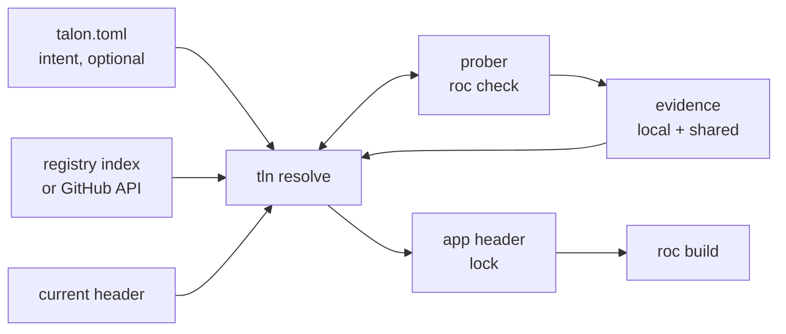
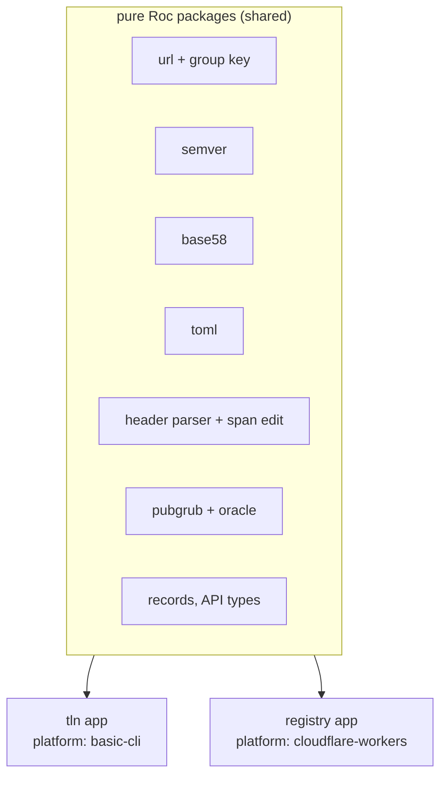

# Talon design

Talon is a package manager and compiler manager for Roc. The CLI is `tln`.

| Item | Value |
| --- | --- |
| Status | Draft 3, 2026-10-14. Split into 4 files on 2026-10-15 (table below). CLI audit fixes: `docs/cli-audit.md` (rounds 1 and 2). Prompts and non-interactive mode: CLI 4. |
| Target compiler | Zig-based Roc, `nightly-2026-10-09-258ab27`. Source facts from roc-lang/roc at `2664a27`. |
| Scope | CLI, resolver, compatibility prober, toolchain manager, registry on Cloudflare |
| Language | Roc for the CLI and the registry Worker (section 6) |

In these files, `roc:src/...` is a path in the roc-lang/roc repository at `2664a27`.

| File | Content | Sections |
| --- | --- | --- |
| `DESIGN.md` | Goals, facts about Roc, prior art, core model, components, implementation, phases, security, questions | 1 to 9 |
| `DESIGN-CLI.md` | Commands, references, exit codes, prompts, `tln init`, toolchain manager, store and fetch | 1 to 7 |
| `DESIGN-RESOLUTION.md` | How Talon selects versions in each context: variables, constraints, evidence, probes, the algorithm, command scopes, determinism, resolve flags, compiler selection | 1 to 13 |
| `DESIGN-REGISTRY.md` | The registry on Cloudflare: role, storage, API, records, compatibility matrix, publish flow, Worker host | 1 to 8 |

A reference to a section of the same file is a number, for example 4.2 or section 4. A reference to another file starts with the name of that file: Design, CLI, Resolution or Registry. For example, CLI 6.2 is section 6.2 of `DESIGN-CLI.md`. Rule ids (H6, P5, NI3) are unique in all files. Section 5 lists where each group of ids is.

## 1. Goals and non-goals

| # | Goal |
| --- | --- |
| G1 | The app header is the lockfile. Talon adds no second lock. |
| G2 | `talon.toml` holds intent only (ranges, pins, policy). It is optional. A project with no `talon.toml` works. |
| G3 | Resolution is deterministic: same intent + same registry snapshot + same evidence gives the same header. |
| G4 | Talon installs and selects Roc compilers. It uses the cache directory that `roc` uses today. |
| G5 | Bun-class speed and ergonomics: one binary, one round trip to resolve, parallel fetch. |
| G6 | The registry is an index, not a store. Packages stay on GitHub Release assets. |
| G7 | The registry is optional. With no registry, Talon still works against GitHub directly. |
| G8 | Talon finds a working tuple (nightly, platform, packages) even when releases record no compiler version. It probes the compiler when evidence is missing (Resolution 4). |
| G9 | Talon and its registry are written in Roc. |

| # | Non-goal (for v1) |
| --- | --- |
| N1 | Host package bytes on Cloudflare (planned as an optional mirror later, see section 7). |
| N2 | Replace `roc` commands (`check`, `build`, `test`). Talon calls `roc`. |
| N3 | Support the old Rust compiler and `.tar.br` bundles. |

## 2. Facts about Roc that shape the design

Each fact was checked in the compiler source or with a test on `nightly-2026-10-09-258ab27`.

| Fact | Source | Consequence for Talon |
| --- | --- | --- |
| A header entry is `alias: "https://.../<version>/<hash>.tar.zst"`. The hash is base58(BLAKE3) of the compressed `.tar.zst` bytes. | `roc:src/bundle/streaming_writer.zig:125-129`, `roc:src/bundle/bundle.zig:231-240` | The header pins exact bytes. It is a lockfile. Talon only chooses which URL to write. |
| Package identity ("group") is the URL minus scheme, minus the one `X.Y.Z` segment, minus the hash, plus the major (or `0.minor` below 1.0). The host is part of it. | `roc:src/base/url.zig:238-281`, `roc:src/compile/package_resolution.zig:1322-1338` | Two URLs on different hosts are two packages. Talon never rewrites a host (rule H5). |
| Per group, the highest version that any edge names wins for the whole graph. Only the winner's deps are followed. | `package_resolution.zig:816-838` | Roc does MVS by itself. Talon uses the same rule, or Talon and `roc` disagree. |
| An app pin that is lower than a dependency needs fails with "Package Version Conflict". An app pin that is higher wins silently. | `package_resolution.zig:1433-1486`. Test: an app alias `http` at `1.9.0` replaced the `http 1.0.0` of basic-cli, and the platform modules failed against it. | A raise can break a dependency at compile time. Talon checks every raise (Resolution 6). |
| Same group and version with two hashes fails with "Conflicting Package Contents". | `package_resolution.zig:903-921` | A version label maps to one hash per URL group. |
| One hash can carry many version labels. | `roc-lang/http` 1.0.0 and 2.0.0 are both `6ZUwqYhC...`. roc-parser 1.0.1 and 1.0.2 are both `FrnJ4RGD...`. | The registry keys facts by hash. A version is a label that points to a hash. |
| Platforms are not solved. Every platform declaration in a build must have the same group, version and hash. | `package_resolution.zig:1644-1693` | Hard constraint: a package that names a platform works only with that exact release. |
| An alias that no module imports gives no warning. It is still fetched and still joins version selection. | `package_resolution.zig:1963-1966`. Test: app with an unused `rand` alias passes `roc check`. | Overrides of transitive versions work with no compiler change (Resolution 6). |
| `roc:` in any header is a warning only ("Roc Version Mismatch"). `roc fmt` moves a nightly pin forward, never back. | `roc:src/canonicalize/Can.zig:6165-6178`, `roc:src/base/roc_version.zig:101-139` | A `roc:` pin is evidence, not a guarantee. Talon never runs `roc fmt` on a header (rule H2). |
| The compiler does not read `.roc-version`. It is a CI convention only. | No reader in `roc:src` | The registry reads it as weak evidence. Talon reads it but never writes it (Resolution 13). |
| `roc check` works on a package or platform `main.roc` with no app. It takes 0.4 s to 1.9 s on this machine. On an app, it checks only the modules that the app imports. | Tests, Resolution 4 | A compatibility probe is cheap. A unit fail is per module. |
| Only 3 of 46 cached packages pin `roc:` in their header. `lukewilliamboswell/roc-parser` (`7CLzCK6q...`) fails on the 10-09 nightly with "redundant expose". | Cache scan and test | Compatibility evidence is sparse. Talon must find it by itself. |
| `--replace-dep OLD NEW` swaps one source for one command. It edits no file. | `roc:src/cli/cli_args.zig:118-176` | Patches need no header edit. |
| Limits: 10 MB per package, 100 MB per closure (512 MB for a platform). | `roc-syntax` reference | Small enough to hash and inspect inside a Worker. |

### 2.1 What the hash fixes

| Item | Fixed by the hash? |
| --- | --- |
| Source of every module in the package | Yes |
| Declared dependency URLs (with their hashes) | Yes. They are in `main.roc` inside the archive. |
| Dependency versions used in a build | No. MVS can raise them (row 4 above). |
| Platform host files for all targets | Yes, when the publisher includes them. One archive holds all targets (`targets: { inputs_dir: ... }`). |
| Compiler version | No. A `roc:` pin inside is only a hint. |
| Version label | No. One hash can have many labels. |

So the identity of a build is the tuple (set of resolved hashes, nightly, target). A compatibility fact "hash H checks on nightly N" is stable, because H fixes all of its source.

### 2.2 Cache layout and cleanup

| Path | Root | Writer | Cleaned by roc? | Size seen |
| --- | --- | --- | --- | --- |
| `packages/<hash>/` | `$XDG_CACHE_HOME/roc`, else `~/.cache/roc` (`roc:src/compile/compile_build.zig:1602-1623`) | roc | No | 1.1 GB |
| `packages/<hash>.deps.json` | same | roc. Rebuilt from `main.roc` if missing (`package_resolution.zig:2160-2183`) | No | small |
| `compat-<id>/` | `$ROC_CACHE_DIR`, else as above (`roc:src/compile/cache_config.zig:337-344`) | roc. `<id>` is the compiler compatibility id (`roc:build.zig:1894-1925`). | Files inside expire after 30 days. The dir stays. | 1.1 GB |
| `nightly-<tag>/`, `debug-<sha>/` | same | Compilers before 2026-10-05 only | Files inside expire. The dir stays forever. | 3.1 GB |

`roc` has no `clean` command. It starts a background cleanup on each run (`roc:src/compile/cache_cleanup.zig:89`). That cleanup deletes old files inside the build caches. It never deletes a cache dir, a package or a sidecar. Talon fills that gap (CLI 6.3).

Note: the packages root ignores `$ROC_CACHE_DIR`. The build caches honor it. Talon uses the same two rules.

## 3. Prior art

| Tool | Idea | Talon decision |
| --- | --- | --- |
| Bun | One fast binary. `add`, `remove`, `update -i`, `outdated`, `why`, `x`, `patch`. Catalogs. `minimumReleaseAge`. Security scanner API. | Adopt the CLI shape, catalogs, release age, scanner hook. |
| uv | Manages the toolchain. Global cache. `--resolution lowest-direct`. `exclude-newer`. | Adopt toolchain install, lowest resolution for libraries, time-based snapshots. |
| Go modules | MVS needs no lockfile. `GOPROXY` is optional. Checksum database is a transparency log. `toolchain` directive downloads the compiler. | Adopt all four. Roc already uses MVS. |
| Cargo | Sparse HTTP index. MSRV-aware resolver. Yank, not delete. Trusted publishing. | Adopt yank. Make the resolver nightly-aware (the Roc form of MSRV-aware). |
| Rust crater, Stackage, Nix Hydra | Build every package against a compiler or a package set, and publish the pass/fail matrix. | Shared compatibility matrix keyed by (hash, nightly) (Registry 6). |
| Zig | URL + hash in the manifest. `zig fetch --save`. | Closest model to Roc. `tln add` does the same, plus ranges. |
| JSR | Names tied to a scope. Publish with GitHub OIDC. Provenance. | Publish with OIDC. |
| rustup | Proxy binaries, `+toolchain` argument, toolchain file. | Adopt the proxy model for `roc`. |
| PubGrub (uv, Dart pub) | Conflict-driven search that learns incompatibilities and explains failures. | Use PubGrub, fed by a lazy compatibility oracle (Resolution 5). |
| C2SP tlog-tiles, Sunlight | An append-only Merkle log served as static tiles from object storage. | Log leaves in D1, tiles in R2 (Registry 3). |

## 4. Core model

| Layer | File | Owner | Contains | Changes when |
| --- | --- | --- | --- | --- |
| Intent | `talon.toml` (optional) | Human | Ranges, anchors, policy, workspace | A human edits it, or `tln add` |
| Lock | App header in `main.roc` | Talon (humans may edit) | Exact URL + hash per direct dep, `roc:` pin | `tln add`, `tln update`, `tln install` |
| Evidence | `talon/compat.db` + registry matrix | Talon | Probe results per (hash, nightly) | Any probe |
| Store | roc cache dirs (2.2) | Talon + roc | Unpacked packages, compilers | Any fetch |



### 4.1 Identity

| Concept | Form | Example |
| --- | --- | --- |
| Group | Roc rule from section 2: URL minus version and hash, plus major | `github.com/roc-lang/unicode/releases/download/{v}/` + major 4 |
| Name | `owner/repo` for GitHub URLs. Display and search only. | `roc-lang/unicode` |
| Label | group + version | `roc-lang/unicode@4.2.0` |
| Content id | Hash in the URL | `4W8SHzvwet9h...` |
| Build id | (resolved hashes, nightly, target) | |

Talon keeps facts per content id, and labels as pointers to it. So Talon can read a header that a human wrote by hand: it asks the registry for the hash, and gets back all labels for it.

### 4.2 The header as lockfile

```roc
app [main!] {
	pf: platform "https://github.com/roc-lang/basic-cli/releases/download/0.25.0/<hash>.tar.zst",
	json: "https://github.com/someone/roc-json/releases/download/2.1.0/<hash>.tar.zst",
	util: "../util/main.roc",
	roc: "nightly-2026-10-09-258ab27",
}
```

| # | Rule |
| --- | --- |
| H1 | Talon edits only string literals and whole entries. It keeps comments, order and formatting. It uses a span-based edit, not a reprint. |
| H2 | Talon never runs `roc fmt` on the header. (`roc fmt` moves the `roc:` pin.) |
| H3 | Every URL that Talon writes is a release URL with a version and a hash. |
| H4 | Talon never changes a path entry or a URL it cannot identify. It lists them as "foreign" in `tln ls`. |
| H5 | Talon never writes a mirror URL. The host is part of the group, so a mirror URL is a different package to Roc. Mirrors feed the cache only. |
| H6 | Talon writes `roc:` whenever it resolves the nightly. The pin records the nightly that the last probe passed with. With `--no-check` (Resolution 4), no whole-app probe ran, so Talon does not move the pin. It keeps the old `roc:` entry as it is, writes none if there was none, and resolves on that nightly only. The header then carries no verified pin claim for the new tuple. |

A package header is also a lock, with one difference: consumers treat its versions as minimums (MVS). So a library records the lowest version it supports (Resolution 8).

### 4.3 talon.toml: intent only

Keys are header aliases. The header already gives the URL group, so most entries need only a range.

```toml
[toolchain]
roc = "*"                      # any nightly. Or a range, or "=nightly-2026-10-09-258ab27"

[dependencies]
pf = "0.25.*"                  # the platform
parser = "=2.0.0"              # anchor: hard pin
json = "^2.1"
# util and others are absent: they follow the header with the default policy

[dependencies.http]            # a new dependency, not yet in the header
package = "roc-lang/http"
version = "^1"

[resolution]
priority = ["parser", "pf", "roc"]  # what to keep newest first, see Resolution 1
strategy = "highest"           # or "lowest" for libraries
min-release-age = "3d"
snapshot = "log:184467"        # registry log size. Or a time: "2026-10-12T00:00:00Z" (see Resolution 11)
probe = { max = 100, max-toolchains = 10, slots = 12 }
```

| In header | In talon.toml | Constraint |
| --- | --- | --- |
| yes | yes | The range in `talon.toml` |
| yes | no | Implied: same major as the header version, never lower than it |
| no | yes | `tln install` adds it to the header, after the group check below |
| no | no | Transitive. Set by package headers plus MVS. |

A user can rename an alias in the header. Then the key in `talon.toml` is "in talon.toml, not in header". So before `tln install` adds a header entry, it matches by group, not by alias:

| Case | Talon does |
| --- | --- |
| The group of the entry is not in the header | Adds the entry (row "no, yes" above) |
| The group is in the header under another alias | Adds nothing. Reports the stale key, for example `talon.toml: key "json" is "someone/roc-json", which the header names "js"`. Offers to rename the key in `talon.toml`. Prompt NI1 (CLI 4), default yes. |
| Non-interactive mode (CLI 4) and no `--yes` | Stops with the same report and exit code 13. Writes nothing. With `--rename-keys` or `--yes`, renames the key. |

Talon never adds a second entry for a group that the header already has. The same check runs in `tln add` (CLI 2).

### 4.4 Workspaces

```toml
[workspace]
members = ["apps/*/main.roc", "examples/*.roc"]

[catalog]
json = "^2.1"
pf = "0.25.*"
```

One resolution covers all members, and gives one nightly. A member uses `json = "catalog:"`.

| Command | Members that it writes |
| --- | --- |
| `tln install` with no names, `update`, `upgrade` | Each member that has the entry. A shared variable gets one value in all members. |
| `tln add`, `tln remove` | One member. `--member <path>` names it. With no flag, Talon uses the member whose directory holds the current directory, if there is exactly one. Else it stops with exit code 2 and lists the members. |
| `tln roc use` | The `roc:` entry of each member, because the workspace has one nightly |

`talon.toml` writes of `tln add` (CLI 2) go to the nearest `talon.toml` on the path from the member file up to the workspace root.

## 5. Components

| Component | Job | Goals | Design |
| --- | --- | --- | --- |
| CLI (`tln`) | Commands, references, header edits, prompts, exit codes, `--json` | G1, G2, G5 | CLI 1 to 5 |
| Resolver | Selects one value for each free variable: packages, platform, nightly | G3, G8 | Resolution 1 to 12 |
| Compatibility prober | Runs `roc check` and `roc build` to find evidence, and keeps it in `compat.db` | G8 | Resolution 3, 4 |
| Toolchain manager | Installs and selects compilers, the `roc` proxy, global tools, cache GC, setup | G4 | CLI 6, Resolution 13 |
| Store and fetch | Fetches and verifies packages into the roc cache | G4, G5 | CLI 7 |
| Registry | Index of releases, shared compatibility matrix, publish log, on Cloudflare | G6, G7 | Registry 1 to 8 |
| Pure Roc packages | Shared logic of the CLI and the registry | G9 | 6.1, 6.2 |

Rule ids, and where each group is:

| Ids | Topic | Where |
| --- | --- | --- |
| G1 to G9, N1 to N3 | Goals, non-goals | 1 |
| H1 to H6 | The header as lockfile | 4.2 |
| C1 to C8 | Constraints | Resolution 2 |
| P1 to P8 | Probe rules | Resolution 4 |
| PP1 to PP5 | Parallel probes | Resolution 4 |
| RP1 to RP4 | The `roc:` pin | Resolution 9 |
| UP1 to UP8 | Upgrade and new majors | Resolution 10 |
| E1 to E4, J1 to J6 | Exit codes, `--json` | CLI 3 |
| NI1 to NI14, NR1 to NR6 | Prompts | CLI 4 |
| DL1 to DL6 | Download consent | CLI 6.2 |
| T1 to T8, X1 to X5, B1 to B8 | Global tools, `tln x`, build reuse | CLI 6.4 |
| S1 to S5, RM1 to RM6 | Talon as a tool, remove Talon | CLI 6.5 |
| R1 to R6, U1 to U6, RU1 to RU4, D1 to D3 | Compilers from source, `tln roc use`, `tln roc update`, Zig | CLI 6.6 |
| ST1 to ST6 | Setup | CLI 6.7 |
| P0 to P4 | Phases | 7 |
| Q1 to Q18 | Questions | 9 |

The phases P0 to P4 and the probe rules P1 to P8 use the same letter. The text near each id tells which one it is.


## 6. Implementation in Roc

### 6.1 Shape

All logic is pure Roc in shared packages. Two platforms supply the effects.



| Part | Platform | Notes |
| --- | --- | --- |
| CLI | basic-cli | basic-cli already has HTTP, files, `rename`, `Cmd` with captured output, env, args, SQLite. Talon sends the gaps below upstream as PRs. Until they merge, Talon builds on a fork that tracks basic-cli. |
| Worker | `cloudflare-workers`: a new generic platform, wasm32 reactor (`output: Shared`), Zig host, small JS shim | Hosted functions in direct style through JSPI (Registry 8). It exposes the Workers runtime (fetch handler, outbound fetch, D1, R2, KV, Cache API, Durable Object SQL, env, secrets), not registry logic. Any Roc app can use it. The registry is its first user. Its own repo and releases. |

The compiler supports this: `wasm32` freestanding target, linked with `wasm-ld` (`roc:src/target/mod.zig:468`, `roc:src/cli/linker.zig:691`, `roc:docs/langref/modules.md:536-556`).

### 6.2 Gaps to build

| Gap | Where | Plan |
| --- | --- | --- |
| Streaming download to file | basic-cli has buffered `Http.send!` only | Hosted fn, PR to basic-cli. Packages are at most 10 MB, so buffering is acceptable at first. Nightlies (70 MB) need streaming. |
| zstd + tar + gzip + zip decode | No Roc library. roc-zip and roc-deflate exist in pure Roc. | Hosted fn in both platform hosts, from Zig `std.compress`. The Worker needs only zstd + tar (to read `main.roc`). |
| BLAKE3, SHA-256, JSON | Builtins | None |
| base58 | Missing | Small pure Roc package |
| TOML | roc-toml is for the old compiler | New pure Roc package on roc-parser 2.0.0 |
| Semver | roc-semver is for the old compiler | Port |
| Symlink create | Missing in basic-cli | Hosted fn. Needed only for the `roc` launcher. Windows uses a small launcher file. |
| Header parser | The compiler parser is Zig | Own parser for the header subset in Roc. Fuzz it against `roc fmt` output. |

These packages (toml, semver, base58) are useful to the whole Roc ecosystem. Talon publishes them as separate packages.

### 6.3 Repository layout

```text
talon/
  packages/      pure Roc: url, semver, base58, toml, header, pubgrub, records
  cli/           tln app (Roc)
  worker/        registry app (Roc) + wrangler config
  cloudflare-workers/  submodule: the generic platform (Zig host, JS shim, bench/)
  sql/           D1 schema and migrations
  conformance/   fixtures run against each new nightly: group key, MVS, cache contract, header edits
  docs/
```

The `cloudflare-workers` platform lives in its own repository and is released like any Roc platform. It is a git submodule of Talon at `cloudflare-workers/`, so platform and registry changes can be developed together. Its `bench/` holds the JSPI measurements (Q12).

The conformance suite checks that Talon and `roc` agree on group keys, version selection and the cache layout, for every new nightly. The tests from section 2 are its first fixtures.

## 7. Phases

| Phase | Scope | Exit criteria |
| --- | --- | --- |
| P0 | Pure packages (url, semver, base58, toml, header). basic-cli PRs (or the fork). CLI with no registry: GitHub API as index, header edits, `add/remove/update/ls/why`. | `tln add` on a real app matches a hand edit. Conformance passes. |
| P1 | Toolchain manager, `roc` proxy, `tln cache gc`, local probes and the PubGrub oracle, `tln tool` (CLI 6.4), `install.sh` and prebuilt Talon binaries (CLI 6.5) | Talon finds a working tuple for parser 2.0.0 + basic-cli without help. GC frees the legacy dirs. |
| P2 | `cloudflare-workers` platform (JSPI, separate repo). Registry v1: D1, API, publish with OIDC, webhook, ingest. Compat bot. | All releases in the roc-awesome list are indexed with a nightly range. `POST /v1/closure` under 50 ms p50. |
| P3 | Log tiles in R2, signed checkpoints, hash-keyed mirror on R2, scanner hook, advisories | Client checks inclusion proofs. Mirror serves a deleted GitHub asset. |
| P4 | Upstream: print the compat id, maybe `roc` reads `talon.toml` | |

## 8. Security

| Threat | Mitigation |
| --- | --- |
| Tampered package bytes | Hash in the URL. Roc and Talon both check it. |
| Registry maps a label to a bad hash for some users | Append-only log with signed checkpoints and inclusion proofs (P3). The header keeps the hash, and later builds do not ask the registry. |
| Compromised maintainer pushes a release | `min-release-age` (default 1 day). Provenance shown in `tln add`. Scanner hook. |
| Probes run untrusted code | Probes run `roc check` and `roc build` only (P1 in Resolution 4). Talon never runs the output. A build links the platform host files, but does not run them. Compile-time evaluation of constants stays a risk, the same as a normal `roc check`. |
| Poisoned shared matrix | Only bot and publisher rows are trusted. User rows only order the search. The final whole-app probe is always local, unless the user passes `--no-check` (Resolution 4). Then Talon keeps the old `roc:` pin (H6). |
| Release asset deleted | Mirror by hash (P3). The cache keeps old copies. |
| Platform ships native host binaries | `tln add` and `tln update` print a notice when a platform release changes. |
| A global tool links a host that nobody compiled on this machine, and the user runs the result | The install prints the platform URL and hash before the build (CLI 6.4). The app header hashes fix all of the source. Provenance is shown as in `tln add`. |
| Malicious tarball (path traversal, size bomb) | Extract with path checks and the Roc size limits. |
| Forged provenance | Some releases already ship `<hash>.tar.zst.intoto.jsonl` (in-toto attestation) and `.spdx.json` (SBOM), for example roc-parser 2.0.0. The registry checks the attestation at publish and stores the result in `releases.provenance`. |
| Compiler download tampered | sha256 list from the registry. Later, compiler hashes go in the log too. |
| Talon download tampered (`install.sh`, `tln tool update talon`) | sha256 and attestation of the GitHub Release (CLI 6.5, S1) |

## 9. Questions

Settled:

| # | Question | Answer |
| --- | --- | --- |
| Q1 | What makes two URLs the same package? | The group key in section 2. The host is part of it. Confirmed in source and by test. |
| Q2 | Can Talon pre-fill `packages/<hash>/` without the sidecar? | Yes. roc rebuilds the sidecar (CLI 7.2). |
| Q3 | Is an unused alias legal? | Yes, with no warning. It also raises the version for the whole graph (Resolution 6). |
| Q4 | How does `compat-<id>` map to a compiler? | It is the compiler compatibility id from `roc:build.zig:1894-1925`. Talon learns it at install (CLI 6.3). |
| Q5 | File name | `talon.toml` for now. |
| Q6 | Own header parser or the compiler's? | Own parser in Roc (6.2). |
| Q7 | Does one nightly range per release hold? | Islands exist (4 of 46 hashes), but in the sample all gaps come from compiler hangs and crashes. The model is per-nightly facts plus epochs (Resolution 4). |
| Q8 | Can Workers use JSPI? | Yes, with no flag. Tested on workerd `2026-10-12` and on the edge (Q13). |
| Q9 | Build after check? | Yes. Ladder step 3, on the final tuple only (Resolution 4). |
| Q10 | A nightly range syntax in headers | Dropped. A header entry holds one value, and that is correct for a lock. The range data belongs in the registry matrix. |
| Q11 | How many epochs, and changes inside an epoch? | 22 nightlies form 6 code epochs and 2 fault windows. 0 changes inside an epoch (Resolution 4). Run the sweep again on the bot data in P2. |
| Q12 | Instance per request or stack copy? | Stack copy in a recycled pool. The copy costs under 2 µs per wait up to 64 KB. A new instance costs 30 to 640 µs, depending on module size (Registry 8). |
| Q13 | Do the Q12 numbers hold on the Cloudflare edge? | The choice holds, the absolute numbers do not. Short test on 2026-10-14, free plan (10 ms CPU limit), colo TBS (`cloudflare-workers/bench/deploy.sh`, `edge.mjs`). JSPI works on the edge. B (stack copy): 0 errors and 0 bad bodies at concurrency 1, 16 and 64. A (instance per request): about 6 ms CPU per request at concurrency 1 (0.3 ms local), and at concurrency 16 and 64 most requests fail with `exceededCpu` (179 and 199 of 200). A new instance costs about 0.7 ms CPU (0.03 ms local). Not a full load test: that waits for the registry app (Q14). |
| Q15 | Does `roc check` on an app check only the imported modules on every nightly? | Yes on all 20 nightlies that have a working basic-cli (`conformance/check-scope/`). The app that imports `Good` passes, the app that imports `Bad` fails, the package `main.roc` fails. Found on the way: when `XDG_CACHE_HOME` contains `..`, `roc check` prints "No errors found" for any app. Talon passes only canonical cache paths to roc (CLI 6.2). |
| Q16 | Do platform hosts link statically? | Yes for musl. 6 platforms, all Linux targets (`conformance/host-link/`): each musl binary has no `NEEDED` and no interpreter. The only dynamic Linux binary is roc-ray, which has only a glibc target: `libc.so.6`, `libm.so.6`, `libX11.so.6`, with no symbol versions. No platform links OpenSSL. macOS binaries link only system libraries. Windows targets list only Windows system libraries. A tool records its libraries (T8). |
| Q17 | Can Talon build roc from a GitHub archive with no `.git`? | Yes. Tested on `2664a27` (nightly 10-12) with Zig 0.17.0: `zig build roc -Doptimize=ReleaseFast -Dcompiler-version=git-2664a278` passes. `roc version` prints `git-2664a278`, and `roc check` works. Without the flag, the code (`getCompilerVersionGit`) gives `release-fast-no-git` (not tested). So git is not a build dependency (CLI 6.6, R3). |
| Q18 | Can 3 `roc build` runs share one compiler cache at the same time? | Yes. 100 iterations of 3 different apps, 50 on an empty cache and 50 on a warm cache, 2 runs: 600 of 600 builds pass, with the same output and the same bytes as a build that ran alone (`conformance/build-share/`). The build weight of 4 slots stays (Resolution 4). Found on the way: a warm build gives other bytes than a cold build, with the same output (T4). |

Open:

| # | Question | How to settle |
| --- | --- | --- |
| Q14 | Pool values (16 requests per instance, 32 MB) for the real registry app | Load test the registry app in P2. |

## Sources

- Roc compiler source, roc-lang/roc at `2664a27` (paths in sections 2 and 6, and in CLI 6 and 7).
- Roc reference via the `roc-syntax` MCP server: topics `packages`, `app_header`, `compiler`, `version_mismatch`.
- [roc-awesome](https://github.com/lukewilliamboswell/roc-awesome), [basic-cli](https://github.com/roc-lang/basic-cli), [Joy](https://github.com/niclas-ahden/joy), [roc-parser](https://github.com/lukewilliamboswell/roc-parser), [roc-platform-template-zig](https://github.com/lukewilliamboswell/roc-platform-template-zig)
- [Bun package manager docs](https://bun.com/docs/pm)
- [Cloudflare D1 read replication](https://developers.cloudflare.com/d1/best-practices/read-replication/), [D1 limits](https://developers.cloudflare.com/d1/platform/limits/), [Durable Objects limits](https://developers.cloudflare.com/durable-objects/platform/limits/)
- [C2SP tlog-tiles](https://github.com/C2SP/C2SP/blob/main/tlog-tiles.md), [Sunlight CT log](https://sunlight.dev/)
- [Go checksum database design (25530)](https://go.googlesource.com/proposal/+/refs/heads/master/design/25530-sumdb.md)
- [PubGrub](https://nex3.medium.com/pubgrub-2fb6470504f), [Rust crater](https://github.com/rust-lang/crater)
- [npm trusted publishers](https://docs.npmjs.com/trusted-publishers)
- [V8 JSPI](https://v8.dev/blog/jspi), [workers-zig (JSPI on Workers)](https://github.com/nilslice/workers-zig), [Almide JSPI on workerd and the edge](https://github.com/almide/almide/issues/3353)
