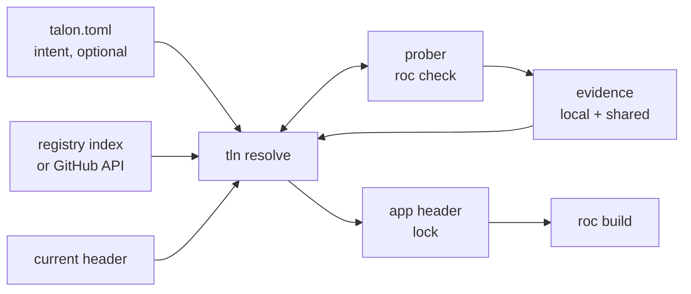
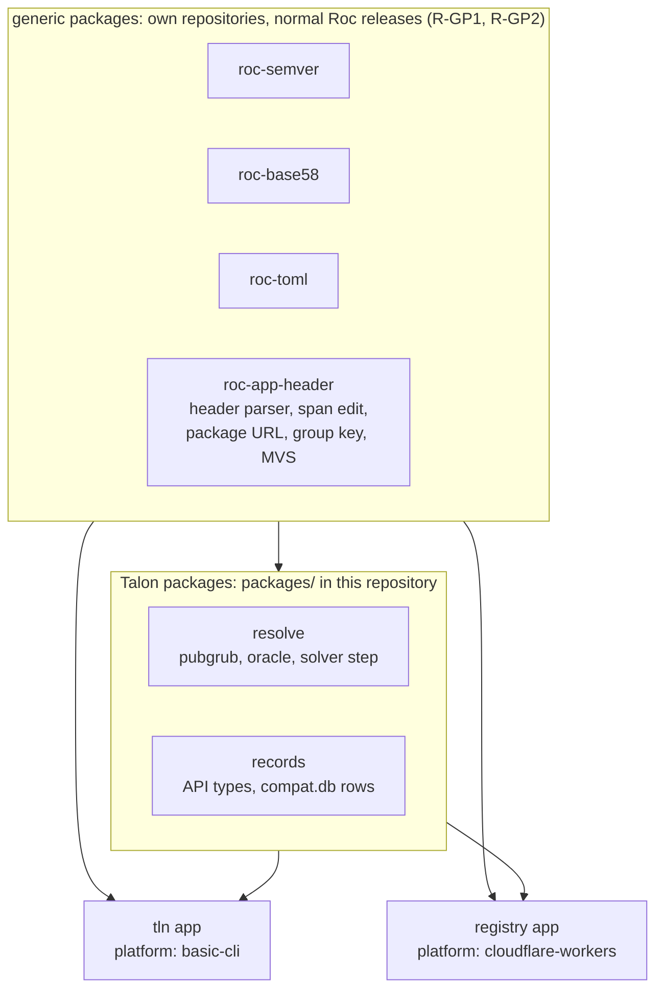

# Talon design

Talon is a package manager and compiler manager for Roc. The CLI is `tln`.

| Item | Value |
| --- | --- |
| Status | Draft 3, 2026-10-14. Split into 4 files on 2026-10-15 (table below). CLI audit fixes: `docs/cli-audit.md` (rounds 1 and 2). Prompts and non-interactive mode: CLI 4. Round 3 (2026-10-15): the `nightly` switch (Resolution 1), install scripts (CLI 6.5), ideas from rocup (section 3), no `deps.toml` (Q19). Round 4 (2026-10-15): readiness audit, 18 gaps fixed (`docs/cli-audit.md`, round 4). Round 5 (2026-10-15): consistency audit, 19 fixes (`docs/cli-audit.md`, round 5). Round 6 (2026-10-15): audit, 22 fixes (`docs/cli-audit.md`, round 6). Round 7 (2026-10-15): audit, 16 fixes (`docs/cli-audit.md`, round 7). Draft change of 2026-10-24: project scripts (`tln run`), `tln path`, project tools (`[tools]`), the build target, no hooks (`research/talon-scripts/` 13, `research/talon-scripts/design-draft/DIFF.md`). |
| Target compiler | Zig-based Roc, `nightly-2026-10-09-258ab27`. Source facts from roc-lang/roc at `2664a27`. |
| Scope | CLI, resolver, compatibility prober, toolchain manager, registry on Cloudflare |
| Language | Roc for the CLI and the registry Worker (section 6) |

In these files, `roc:src/...` is a path in the roc-lang/roc repository at `2664a27`. "The nightly" as a resolve variable is the compiler release that Talon selects. Today that is always a nightly. When the compiler has releases, it can be a release (the `nightly` switch, Resolution 1).

| File | Content | Sections |
| --- | --- | --- |
| `DESIGN.md` | Goals, facts about Roc, prior art, core model, components, implementation, phases, security, questions | 1 to 9 |
| `DESIGN-CLI.md` | Commands, references, exit codes, prompts, `tln init`, toolchain manager, store and fetch | 1 to 7 |
| `DESIGN-RESOLUTION.md` | How Talon selects versions in each context: variables, constraints, evidence, probes, the algorithm, command scopes, determinism, resolve flags, compiler selection | 1 to 13 |
| `DESIGN-REGISTRY.md` | The registry on Cloudflare: role, storage, API, records, compatibility matrix, publish flow, Worker host | 1 to 8 |
| `DESIGN_OVERVIEW.md` | A short map of the components: the job of each, and what is not its job. Not part of the spec. | |
| `TESTING.md` | Test layers, the code shape for tests (pure decisions, `Fx` record), command and CLI tests, roc-fuzz, the agent TDD workflow. Not part of the spec. | 1 to 8 |

A reference to a section of the same file is a number, for example 4.2 or section 4. A reference to another file starts with the name of that file: Design, CLI, Resolution or Registry. For example, CLI 6.2 is section 6.2 of `DESIGN-CLI.md`. A rule id starts with `R-`, then the group and a number (R-H6, R-P5, R-NI3). It is unique in all files, and a test names it (`TESTING.md` TW13). It is the first cell of a table row, or the start of a paragraph (`R-SL14: ...`). An id at the start of a paragraph that ends with a colon also covers the table or the block after it. Text with no id is an explanation, an example or a measurement: no test checks it. An id with no `R-` is not a rule: goals (G), non-goals (N), phases (P0 to P4) and questions (Q). Section 5 lists where each group of ids is.

## 1. Goals and non-goals

| # | Goal |
| --- | --- |
| G1 | The app header is the lockfile. Talon adds no second lock file. The one lock value outside the header is the `url` of each project tool in `[tools]` of `talon.toml` (CLI 6.4, R-PT1): a tool is an app, so it cannot be a header entry (Resolution 2, R-C4). |
| G2 | `talon.toml` holds intent (ranges, pins, policy, scripts, the build target), and the lock (`url`) of each project tool, next to its intent (`ref`). It is optional. A project with no `talon.toml` works. |
| G3 | Resolution is deterministic: same intent + same registry snapshot + same evidence gives the same header. |
| G4 | Talon installs and selects Roc compilers. It uses the cache directory that `roc` uses today. |
| G5 | Bun-class speed and ergonomics: one binary, one round trip to resolve, parallel fetch. |
| G6 | The registry is an index, not a store. Packages stay on GitHub Release assets. |
| G7 | The registry is optional. With no registry, Talon still works against GitHub directly. |
| G8 | Talon finds a working tuple (nightly, platform, packages) even when releases record no compiler version. It probes the compiler when evidence is missing (Resolution 4). |
| G9 | Talon and its registry are written in Roc. |

| # | Non-goal (for v1) |
| --- | --- |
| N1 | Host package bytes on Cloudflare (planned as an optional mirror later, see section 7). |
| N2 | Replace `roc` commands (`check`, `build`, `test`). Talon calls `roc`. |
| N3 | Support the old Rust compiler and `.tar.br` bundles. |
| N4 | Support private packages. A private GitHub release asset answers 404 to its download URL with no token, and roc and Talon send no token with a download (CLI 7.3, R-DI9). So a private package fails in both modes, at the download (exit code 15, CLI 7.1, R-FE6). With a registry, Talon also stops before it sends the name of a private `github.com` repository to the registry (CLI 1, R-RG4). Talon cannot check the visibility of a URL on another host, so the name of such a group goes to the registry in the closure query (Registry 4.1, R-AP16). |

## 2. Facts about Roc that shape the design

Each fact was checked in the compiler source or with a test on `nightly-2026-10-09-258ab27`.

| Fact | Source | Consequence for Talon |
| --- | --- | --- |
| A header entry is `alias: "https://.../<version>/<hash>.tar.zst"`. The hash is base58(BLAKE3) of the compressed `.tar.zst` bytes. | `roc:src/bundle/streaming_writer.zig:125-129`, `roc:src/bundle/bundle.zig:231-240` | The header pins exact bytes. It is a lockfile. Talon only chooses which URL to write. |
| Package identity ("group") is the URL minus scheme, minus the one `X.Y.Z` run (a whole path segment, or part of one, as in the tag `v1.9.0-rc2`), minus the hash, plus the series: the major, or `0.minor` below 1.0 (4.1). The host is part of it. | `roc:src/base/url.zig:238-281`, `roc:src/compile/package_resolution.zig:1322-1338` | Two URLs on different hosts are two packages. Talon never rewrites a host (rule R-H5). |
| Per group, the highest version that any edge names wins for the whole graph. Only the winner's deps are followed. | `package_resolution.zig:816-838` | Roc does MVS by itself. Talon uses the same rule, or Talon and `roc` disagree. |
| An app pin that is lower than a dependency needs fails with "Package Version Conflict". An app pin that is higher wins silently. | `package_resolution.zig:1433-1486`. Test: an app alias `http` at `1.9.0` replaced the `http 1.0.0` of basic-cli, and the platform modules failed against it. | A raise can break a dependency at compile time. Talon checks every raise (Resolution 6). |
| Same group and version with two hashes fails with "Conflicting Package Contents". | `package_resolution.zig:903-921` | A version label maps to one hash per URL group. |
| One hash can carry many version labels. | `roc-lang/http` 1.0.0 and 2.0.0 are both `6ZUwqYhC...`. roc-parser 1.0.1 and 1.0.2 are both `FrnJ4RGD...`. | The registry keys facts by hash. A version is a label that points to a hash. |
| Platforms are not solved. Every platform declaration in a build must have the same group, version and hash. | `package_resolution.zig:1644-1693` | Hard constraint: a package that names a platform works only with that exact release. |
| An alias that no module imports gives no warning. It is still fetched and still joins version selection. | `package_resolution.zig:1963-1966`. Test: app with an unused `rand` alias passes `roc check`. | Overrides of transitive versions work with no compiler change (Resolution 6). |
| `roc:` in any header is a warning only ("Roc Version Mismatch"). `roc fmt` moves a nightly pin forward, never back. | `roc:src/canonicalize/Can.zig:6165-6178`, `roc:src/base/roc_version.zig:101-139` | A `roc:` pin is evidence, not a guarantee. Talon never runs `roc fmt` on a header (rule R-H2). |
| A nightly tag has two forms: `nightly-2026-08-05-24f0b47`, and the month as an English name in older tags: `nightly-2026-July-31-123c5d7`. roc reads both in a `roc:` pin. roc orders nightlies by date only, so two nightlies of one date are equal. | `roc:src/base/roc_version.zig:14-19, 60-70, 142-175`. The releases of `roc-lang/nightlies` on 2026-10-15: 331. The tags before 2026-08-06 have the month name. 2 dates have 2 nightlies (`nightly-2026-09-01-*`, `nightly-2026-July-23-*`). 3 asset names have another sha than their tag. 3 releases have no asset. | Talon reads both forms (CLI 6.2, R-CV1), and finds an asset by its target, not by the sha in the tag (R-CV2). Talon orders two nightlies of one date by itself (Resolution 1, R-NS1). |
| The compiler does not read `.roc-version`. It is a CI convention only. | No reader in `roc:src` | The registry reads it as weak evidence. Talon reads it but never writes it (Resolution 13). |
| `roc check` works on a package or platform `main.roc` with no app. It takes 0.4 s to 1.9 s on this machine. On an app, it checks only the modules that the app imports. | Tests, Resolution 4 | A compatibility probe is cheap. A unit fail is per module. |
| Only 3 of 46 cached packages pin `roc:` in their header. `lukewilliamboswell/roc-parser` (`7CLzCK6q...`) fails on the 10-09 nightly with "redundant expose". | Cache scan and test | Compatibility evidence is sparse. Talon must find it by itself. |
| `--replace-dep OLD NEW` swaps one source for one command. It edits no file. | `roc:src/cli/cli_args.zig:118-176` | Patches need no header edit. |
| roc installs apps by itself. `roc install <name> <bundle URL>` builds an app bundle with `--opt=speed`. `roc run <name>` runs the binary, and `roc run <bundle URL>` builds and runs a bundle. An app release is a `<hash>.tar.zst` bundle, as a package release is. The installs are not in the cache: `$ROC_INSTALL_DIR`, else `$XDG_DATA_HOME/roc`, else `~/.local/share/roc` (`~/Library/Application Support/roc` on macOS, `%APPDATA%\Roc` on Windows), with one folder for each compiler version. | `roc:src/cli/install.zig:155-202`, `roc:src/cli/cli_args.zig:745-790`. In `roc help` of `nightly-2026-10-09-258ab27`. | An install of roc works only with the compiler that made it. After a change of the selected compiler, `roc run <name>` does not find it. This is roc behavior. The proxy passes `roc install` and `roc run` to roc with no change, and Talon never reads or removes these folders (CLI 6.2, 6.3, R-RM1). `tln tool install` keeps its own store (CLI 6.4, R-T3, R-T5). The source of a tool release is its app bundle (CLI 6.4, R-T10). |
| `roc deps <file>` prints the declared dependency tree of an app, package or platform, with full URLs. It downloads missing packages and compiles nothing. `roc bump` compares the public API of a package with an earlier version and reports the semver bump that it needs. | `roc help` of `nightly-2026-10-09-258ab27`. Test: `roc deps conformance/host-link/apps/basic-cli-0.25.0.roc` printed the platform and its `http 1.0.0` entry. | The conformance suite compares the closure that Talon reads with `roc deps` (6.3). `roc bump` is a possible check for `tln publish` (Q31). |
| Limits: 10 MB per package, 100 MB per closure (512 MB for a platform). | `roc-syntax` reference | Small enough to hash and inspect inside a Worker. |

### 2.1 What the hash fixes

| Item | Fixed by the hash? |
| --- | --- |
| Source of every module in the package | Yes |
| Declared dependency URLs (with their hashes) | Yes. They are in `main.roc` inside the archive. |
| Dependency versions used in a build | No. MVS can raise them (row 4 above). |
| Platform host files for all targets | Yes, when the publisher includes them. One archive holds all targets (`targets: { inputs_dir: ... }`). |
| Compiler version | No. A `roc:` pin inside is only a hint. |
| Version label | No. One hash can have many labels. |

So the identity of a build is the tuple (set of resolved hashes, nightly, target). A compatibility fact "hash H checks on nightly N" is stable, because H fixes all of its source.

### 2.2 Cache layout and cleanup

| Path | Root | Writer | Cleaned by roc? | Size seen |
| --- | --- | --- | --- | --- |
| `packages/<hash>/` | `$XDG_CACHE_HOME/roc`, else `~/.cache/roc` (`roc:src/compile/compile_build.zig:1602-1623`) | roc | No | 1.1 GB |
| `packages/<hash>.deps.json` | same | roc. Rebuilt from `main.roc` if missing (`package_resolution.zig:2160-2183`) | No | small |
| `compat-<id>/` | `$ROC_CACHE_DIR`, else as above (`roc:src/compile/cache_config.zig:337-344`) | roc. `<id>` is the compiler compatibility id (`roc:build.zig:1894-1925`). | Files inside expire after 30 days. The dir stays. | 1.1 GB |
| `nightly-<tag>/`, `debug-<sha>/` | same | Compilers before 2026-10-05 only | Files inside expire. The dir stays forever. | 3.1 GB |

`roc` has no `clean` command. It starts a background cleanup on each run (`roc:src/compile/cache_cleanup.zig:89`). That cleanup deletes old files inside the build caches. It never deletes a cache dir, a package or a sidecar. Talon fills that gap (CLI 6.3).

R-CR1: The packages root ignores `$ROC_CACHE_DIR`. The build caches honor it. Talon uses the same two rules.

The app installs of `roc install` (section 2) are outside the cache root, one folder for each compiler version. They are not a cache. roc owns them, and Talon does not clean them (CLI 6.3, R-RM1).

## 3. Prior art

| Tool | Idea | Talon decision |
| --- | --- | --- |
| Bun | One fast binary. `add`, `remove`, `update -i`, `outdated`, `why`, `x`, `patch`. Catalogs. `minimumReleaseAge`. Security scanner API. | Adopt the CLI shape, release age, scanner hook. No catalogs: a workspace has one version of each group (4.4, R-WS7). |
| uv | Manages the toolchain. Global cache. `--resolution lowest-direct`. `exclude-newer`. | Adopt toolchain install, lowest resolution for libraries, time-based snapshots. |
| Go modules | MVS needs no lockfile. `GOPROXY` is optional. Checksum database is a transparency log. `toolchain` directive downloads the compiler. | Adopt all four. Roc already uses MVS. |
| Cargo | Sparse HTTP index. MSRV-aware resolver. Yank, not delete. Trusted publishing. | Adopt yank. Make the resolver nightly-aware (the Roc form of MSRV-aware). |
| Rust crater, Stackage, Nix Hydra | Build every package against a compiler or a package set, and publish the pass/fail matrix. | Shared compatibility matrix keyed by (hash, nightly) (Registry 6). |
| Zig | URL + hash in the manifest. `zig fetch --save`. | Closest model to Roc. `tln add` does the same, plus ranges. |
| JSR | Names tied to a scope. Publish with GitHub OIDC. Provenance. | Publish with OIDC. |
| rustup | Proxy binaries, `+toolchain` argument, toolchain file. | Adopt the proxy model for `roc`. |
| rocup | Version manager for the Roc compiler: `curl \| sh` and `irm \| iex` installers, `+N` and `-N` steps through the nightlies, `prune`, local builds, `freeze` of a local build, `gh` for GitHub API calls | Adopt the installer structure (CLI 6.5), the relative selectors `@+N` and `@-N` (CLI 2), `tln roc link --copy` (CLI 6.6, R-LK1 to R-LK3), the default after a removal (R-RR1), and GitHub tokens (CLI 1). `tln cache gc` replaces `prune` (CLI 6.3). |
| PubGrub (uv, Dart pub) | Conflict-driven search that learns incompatibilities and explains failures. | Use PubGrub, fed by a lazy compatibility oracle (Resolution 5). |
| C2SP tlog-tiles, Sunlight | An append-only Merkle log served as static tiles from object storage. | Log leaves in D1, tiles in R2 (Registry 3). |

## 4. Core model

| Layer | File | Owner | Contains | Changes when |
| --- | --- | --- | --- | --- |
| Intent | `talon.toml` (optional) | Human | Ranges, anchors, policy, workspace, scripts, build target, project tools (a `ref` and its locked `url`, G1) | A human edits it, or `tln add`. Only `add --tool`, `update`, `upgrade` and `install` write the `url` of a project tool (CLI 6.4, R-PT5) |
| Lock | App header in `main.roc`, the project file (CLI 1, R-PD1 to R-PD8) | Talon (humans may edit) | Exact URL + hash per direct dep, `roc:` pin | `tln add`, `tln update`, `tln install` |
| Evidence | `talon/compat.db` + registry matrix | Talon | Probe results per (hash, nightly) | Any probe |
| Store | roc cache dirs (2.2) | Talon + roc | Unpacked packages, compilers | Any fetch |



### 4.1 Identity

| # | Concept | Form | Example |
| --- | --- | --- | --- |
| R-ID1 | Series | The major of a version. Below 1.0, `0.minor`. The design files use this one term for the version part of a group. | `4.2.0` is in series `4`. `0.25.1` is in series `0.25`. |
| R-ID2 | Group | Roc rule from section 2: URL minus version and hash, plus the series | `github.com/roc-lang/unicode/releases/download/{v}/` + series `4` |
| R-ID3 | Name | `owner/repo` for GitHub URLs. Display and search only. | `roc-lang/unicode` |
| R-ID4 | Label | group + version | `roc-lang/unicode@4.2.0` |
| R-ID5 | Content id | Hash in the URL | `4W8SHzvwet9h...` |
| R-ID6 | Build id | (resolved hashes, nightly, target) | |

R-ID7: Talon keeps facts per content id, and labels as pointers to it. So Talon can read a header that a human wrote by hand: it asks the registry for the hash, and gets back all labels for it.

### 4.2 The header as lockfile

```roc
app [main!] {
	pf: platform "https://github.com/roc-lang/basic-cli/releases/download/0.25.0/<hash>.tar.zst",
	json: "https://github.com/someone/roc-json/releases/download/2.1.0/<hash>.tar.zst",
	util: "../util/main.roc",
	roc: "nightly-2026-10-09-258ab27",
}
```

| # | Rule |
| --- | --- |
| R-H1 | Talon edits only string literals and whole entries. It keeps comments, order and formatting. It uses a span-based edit, not a reprint. |
| R-H2 | Talon never runs `roc fmt` on the header. (`roc fmt` moves the `roc:` pin.) |
| R-H3 | Every URL that Talon writes is a release URL with a version and a hash. |
| R-H4 | An unmanaged entry is a path entry, or a foreign URL: a URL that is not a release URL of 4.1 (no version, no hash, 2 versions, `0.0.0`, for example the source archive of a git ref). Talon never writes the value of an unmanaged entry, never writes a new one (R-H3), and never edits the file that a path entry names. It changes an unmanaged entry only as a whole, and only when the user names its alias in a command that removes or replaces that entry (R-H9). A temp copy for a probe is not the project: there Talon rewrites path prefixes (Resolution 4, R-LD4). `tln ls` marks an unmanaged entry "foreign" (CLI 1, R-CM9). |
| R-H5 | Talon never writes a mirror URL. The host is part of the group, so a mirror URL is a different package to Roc. Mirrors feed the cache only. |
| R-H6 | Talon writes `roc:` whenever it resolves the nightly. The pin records the nightly that the last probe passed with. With `--no-check` (Resolution 4), no whole-app probe ran, so Talon does not move the pin. It keeps the old `roc:` entry as it is, writes none if there was none, and resolves on that nightly only. The header then carries no verified pin claim for the new tuple. |
| R-H7 | A path entry is part of the closure, as in roc. Talon reads the header of the file that it names (relative to the project file). Its URL entries join the closure and MVS (section 2), its `import` lines join the lexical scan (Resolution 4), and GC counts its closure (CLI 1, R-PD12). A path entry is not a variable: it has no index and no version, so Talon never moves it (R-H4). A path entry in that header follows the same rule, and no command removes or replaces it: it is not an entry of the project header. |

R-H8: A package header is also a lock, with one difference: consumers treat its versions as minimums (MVS). So a library records the lowest version it supports (Resolution 8).

R-H9: What each command does with an unmanaged entry (R-H4):

| Command | Talon does |
| --- | --- |
| `install`, `update`, `upgrade`, `verify` with no names | Keeps it byte for byte. It is no variable. The URL entries of a path file still join the closure and MVS (R-H7). A `talon.toml` or `[overrides]` key of its alias is no constraint (R-I3: the key is in the header) and adds no entry (R-I5). The key applies again when the entry is a release. |
| `update X`, `upgrade X`, `add X@sel` (form 1), where X is its alias | Exit code 2 (CLI 3, R-EC2). The message says that Talon never changes it, and names `tln add <name> --as X`. |
| `add X` (form 1, no selector) | Changes nothing (CLI 2, R-AD21). Exit code 0. |
| `add <name>`, and the default alias is its alias | Stops (CLI 2, R-AD18). |
| `add <name> --as X`, `add --platform <name>` | Replaces the whole entry with a release URL (CLI 2, R-AD38, R-AD31). |
| `remove X` | Removes the whole entry (CLI 2, R-RV5). Not the platform (R-RV3). |
| `patch X` | Exit code 2 (Resolution 7, R-PA14). |

### 4.3 talon.toml: intent, and the lock of project tools

R-I2: Keys are header aliases. A value is a range (`"^2.1"`), or a name and a range in the CLI ref form (`"roc-lang/http@^1"`, CLI 2, R-SL1). Talon reads `key = "<range>"` as the ref `key@<range>`, and `key = "<name>@<range>"` as `<name>@<range> --as key`. For a key that the header has, the header gives the URL group, so a range is enough. As with npm `package.json`, a user can add a dependency to `talon.toml` by hand, and `tln install` resolves it and writes the header entry (R-I5, R-I8).

```toml
[toolchain]
roc = "*"                      # any compiler. Or a range, ">=nightly-2026-10-09-258ab27", or "=nightly-2026-10-09-258ab27" (R-NS7)
nightly = true                 # nightlies are candidates (the default). See Resolution 1.

[dependencies]
pf = "0.25.*"                  # the platform
parser = "=2.0.0"              # anchor: hard pin
json = "^2.1"
http = "roc-lang/http@^1"      # not in the header yet: tln install adds it (R-I5)
# util and others are absent: they follow the header with the default policy

[resolution]
priority = ["parser", "pf", "roc"]  # what to keep newest first, see Resolution 1
strategy = "highest"           # or "lowest" for libraries
min-release-age = "3d"         # the default is "2d" (Resolution 2, R-C7)
snapshot = "log:184467"        # registry log size. Or a time: "2026-10-12T00:00:00Z" (see Resolution 11)
probe = { max = 100, max-toolchains = 10, slots = 12 }

[audit]
ignore = ["someone/roc-old@1.0.0:yanked"]   # accept one finding of tln audit (CLI 1, R-AU9)

[build]
# target = "x64musl"           # the target of ladder step 3. Usually not set: the platform targets give it (Resolution 4, R-TG1)

[tools]                        # project tools: intent (ref) and lock (url) (CLI 6.4, R-PT1). Phase P1
roc-cfw = { ref = "Karakatiza666/roc-cloudflare-workers-cli@^1", url = "https://github.com/Karakatiza666/roc-cloudflare-workers-cli/releases/download/1.0.3/<hash>.tar.zst" }

[scripts]                      # tln run <name> (CLI 1, R-RUN1). Phase P1
check = ["roc check main.roc", "roc test main.roc"]
notes = "scripts/notes.roc --since v0.3.0"   # a .roc script: an app with its own platform (R-RUN6)
release = ["@check", "roc-cfw sync --check"]  # roc-cfw: the [tools] key above (R-RUN3)
```

| # | In header | In talon.toml | Constraint |
| --- | --- | --- | --- |
| R-I3 | yes | yes | The range in `talon.toml` |
| R-I4 | yes | no | Implied: `^<header version>`. That is the same series as the header version (4.1), never lower than it. For `0.25.0`: `>=0.25.0, <0.26.0`. For `2.1.0`: `>=2.1.0, <3.0.0`. |
| R-I5 | no | yes | `tln install` adds it to the header, as `tln add` adds the same ref (R-I8). Until then the key has no effect. |
| R-I6 | no | no | Transitive. Set by package headers plus MVS. |

R-I7: A caret range `^v` matches v and each newer version in the series of v. So `^2.1` is `>=2.1.0, <3.0.0`, and `^0.25.1` is `>=0.25.1, <0.26.0`. This is the npm and Cargo rule, and it follows the Roc group rule (section 2).

R-I8: `tln install` finds the package of each key that the header does not have, with the lookup of `tln add` (CLI 2, R-AD1 to R-AD6). A full name needs no search. A short name (the key, or the name in the value) is a registry search. Talon looks up all such keys first. If it cannot identify one or more of them (no match, more than one match, or the registry is off), it writes nothing. It lists each of these keys with its matches as full names, and stops with exit code 2. A user can rename an alias in the header, so the key of a package that is in the header can be "in talon.toml, not in header". So before `tln install` adds a header entry, it matches by group, not by alias:

| Case | Talon does |
| --- | --- |
| The group of the entry is not in the header | Adds the entry (row "no, yes" above) |
| The group is in the header under another alias | Adds nothing. Reports the stale key, for example `talon.toml: key "json" is "someone/roc-json", which the header names "js"`. Offers to rename the key in `talon.toml`. Prompt R-NI1 (CLI 4), default yes. |
| Non-interactive mode (CLI 4) and no `--yes` | Stops with the same report and exit code 13. Writes nothing. With `--rename-keys` or `--yes`, renames the key. |

R-I9: Talon never adds a second entry for a group that the header already has. The same check runs in `tln add` (CLI 2).

| # | Rule |
| --- | --- |
| R-I1 | `talon.toml` is the intent of one project. Talon does not read a `talon.toml` that is in a package archive (a URL entry). Such a file has no effect on resolution, on the header or on probes. A package release does not need it, and Talon does not ask for a `deps.toml` (Q19). The compiler range of a package comes from evidence: `tln probe --range` in the release workflow and the compat bot (Registry 6). |

### 4.4 Workspaces

```toml
[workspace]
members = ["apps/*/main.roc", "examples/*.roc"]
```

R-WS9: A member can be an app or a package. One resolution covers all members. Its variables:

| Variable | In a workspace | Example |
| --- | --- | --- |
| `roc` | One for the workspace. Each member gets the same `roc:` value. | |
| Each group (4.1) that is a direct entry of a member | One variable for each group, whatever alias each member uses. Each member that has an entry for the group gets the same version. | `json` in `apps/a` and `js` in `apps/b`, both `someone/roc-json` series `2`: one variable |
| Each platform group | The same as a package group. Members on the same platform group share one variable. Members on other platforms have other variables. A package member has no platform. | `apps/cli` on basic-cli `0.25` and `apps/web` on basic-webserver: two variables |
| Transitive packages | Not variables (4.3). Roc MVS sets them in each member closure. | |

R-WS10: Two series of one package are two groups (section 2), so they are two variables. `apps/a` can use `roc-lang/http` series `1` while `apps/b` uses series `2`.

| # | Rule |
| --- | --- |
| R-WS1 | Talon matches member entries by group, not by alias, as in the group check of 4.3. |
| R-WS2 | A group variable has all constraints of each member entry for that group: the range in `talon.toml` or the implied range of that entry (4.3), and R-C1 to R-C9 (Resolution 2) in the closure of each member. |
| R-WS3 | Two members with different versions of one group do not satisfy R-WS2 together. `tln install` resolves that group as an entry out of range (Resolution 9). The implied ranges are never lower than a header version, so the result is at least the highest member version. `--frozen` fails with exit code 14. |
| R-WS4 | Two members with different `roc:` values have no nightly to hold (R-RP2). `install`, `add`, `update` and `remove` stop with exit code 2. The error lists the members and their pins, and names `tln roc use <id>` and `tln upgrade roc`. A member with no `roc:` entry gets the workspace value (R-RP3). |
| R-WS5 | The root `talon.toml` (the file with `[workspace]`) holds `[workspace]`, `[toolchain]`, `[resolution]`, `[audit]` (CLI 1, R-AU15) and `[tools]` (CLI 6.4, R-PT2). It can also hold `[dependencies]`, `[overrides]`, `[patch]` and `[build]`, for each member whose nearest `talon.toml` is the root (CLI 1, R-PD6, R-WS6, and Resolution 4, R-TG5), and `[scripts]` (CLI 1, R-RUN14). A `talon.toml` under the root is a file of the workspace only when a member file (CLI 1, R-PD3) is in its directory, or below it up to the next directory with a `talon.toml`. Any other `talon.toml` under the root is the file of a standalone project (CLI 1, R-PD5, R-PD6): the rules of this section do not apply to it, and it is not a node of `tln run --each` (CLI 1, R-EA1). Each other `talon.toml` of the workspace holds only `[dependencies]`, `[overrides]`, `[patch]`, `[build]`, `[scripts]` and `[run]` (CLI 1, R-EA3). Talon does not merge two files: a member with a nearer `talon.toml` does not read these tables of the root. A key of a table that is not allowed in that file stops the command with exit code 19 (`input`, CLI 3). So one `strategy` covers the workspace. The minimums in the header of a package member follow the versions of the apps, as in Cargo workspaces (Resolution 8). |
| R-WS6 | A `[dependencies]` key is an alias. It applies to each member under the directory of that `talon.toml` whose header has that alias. For a key that no such header has (row "no, yes" in 4.3), `tln install` adds the entry only when exactly one member is under that directory. Else it stops with exit code 2 and names `tln add --file <member file>` (CLI 1, R-PD5). Only `tln install` runs this check. `update`, `upgrade` and `verify` ignore the key (R-I5). |
| R-WS7 | A range in any `talon.toml` of the workspace constrains the group variable of all members (R-WS2). So one range is enough for a group that many members use. Talon has no catalog (Bun, pnpm): a catalog keeps the members on one version, and R-WS2 already does that. |
| R-WS8 | An alias that names different groups in different members is a tie (CLI 2). A command that takes names stops with exit code 2 and lists the groups as in the tie of CLI 2, R-SC14. |

| # | Command | Members that it writes |
| --- | --- | --- |
| R-WS11 | `tln install` with no names, `update`, `upgrade` | Each member that has an entry for a group that moves (R-WS1). |
| R-WS12 | `tln add`, `tln remove` | One member: the current member (CLI 1, R-PD4, R-PD5). `--file <member file>` names it. With no current member, Talon stops with exit code 2 and lists the members. A group that other members have is held at their version (Resolution 9). The range of the new entry joins the ranges of that group (R-WS2). If that version must move, prompt R-NI3 asks, and the move writes those members too (Resolution 9, R-SP23 to R-SP25). |
| R-WS13 | `tln roc use` | The `roc:` entry of each member, because the workspace has one nightly |

R-WS14: `talon.toml` writes of `tln add` (CLI 2) go to the nearest `talon.toml` on the path from the member file up to the workspace root.

## 5. Components

| Component | Job | Goals | Design |
| --- | --- | --- | --- |
| CLI (`tln`) | Commands, references, header edits, prompts, exit codes, `--json` | G1, G2, G5 | CLI 1 to 5 |
| Resolver | Selects one value for each free variable: packages, platform, nightly | G3, G8 | Resolution 1 to 12 |
| Compatibility prober | Runs `roc check` and `roc build` to find evidence, and keeps it in `compat.db` | G8 | Resolution 3, 4 |
| Toolchain manager | Installs and selects compilers, the `roc` proxy, global tools, cache GC, setup | G4 | CLI 6, Resolution 13 |
| Store and fetch | Fetches and verifies packages into the roc cache | G4, G5 | CLI 7 |
| Registry | Index of releases, shared compatibility matrix, publish log, on Cloudflare | G6, G7 | Registry 1 to 8 |
| Talon packages | Pure Roc logic of the CLI and the registry that has Talon concepts: records, the solver (`packages/` in this repository) | G9 | 6.1 |
| Generic packages | Pure Roc packages with no Talon concept: `roc-semver`, `roc-base58`, `roc-toml`, `roc-app-header`. Each in its own repository, released as a normal Roc package. | G9 | 6.1, R-GP1 to R-GP7 |

Ids, and where each group is:

| Ids | Topic | Where |
| --- | --- | --- |
| G1 to G9, N1 to N3 | Goals, non-goals | 1 |
| R-CR1 | Cache roots | 2.2 |
| R-ID1 to R-ID7 | Identity | 4.1 |
| R-H1 to R-H9 | The header as lockfile, unmanaged entries | 4.2 |
| R-I1 to R-I9 | `talon.toml`: intent, implied ranges, the group check, `talon.toml` of a dependency | 4.3 |
| R-VA1 to R-VA6 | Variables, anchors, `priority` | Resolution 1 |
| R-NS1 to R-NS12 | The `nightly` switch | Resolution 1 |
| R-C1 to R-C10 | Constraints | Resolution 2 |
| R-EF1 to R-EF3 | Compatibility evidence | Resolution 3 |
| R-LD1 to R-LD7, R-BL1 to R-BL6, R-BS1, R-BS2, R-SM1 to R-SM7, R-RC1 to R-RC4, R-UM1 | Probe ladder, baseline check, build skip, smoke build, result classes, used modules | Resolution 4 |
| R-TG1 to R-TG6 | The build target of a project file | Resolution 4 |
| R-P1 to R-P8 | Probe rules | Resolution 4 |
| R-PP1 to R-PP7 | Parallel probes | Resolution 4 |
| R-PB1 to R-PB7 | `tln probe` | Resolution 4 |
| R-AL1 to R-AL9 | Algorithm steps, header facts, the closure rule | Resolution 5 |
| R-OV1, R-OV2 | Overrides | Resolution 6 |
| R-LB1 to R-LB4 | Libraries | Resolution 8 |
| R-SP1 to R-SP26 | Scope of `update`, `upgrade`, `install`, held moves | Resolution 9 |
| R-RP1 to R-RP4 | The `roc:` pin | Resolution 9 |
| R-UP1 to R-UP13 | Upgrade and new series | Resolution 10 |
| R-DT1 to R-DT6 | Determinism, snapshots | Resolution 11 |
| R-LF1 to R-LF5 | Lock and frozen modes | Resolution 12 |
| R-SO1 to R-SO22 | Compiler selection order, the held nightly | Resolution 13 |
| R-CM1 to R-CM25, R-FL1 to R-FL14, R-RG1 to R-RG6 | Commands, flags, registry precedence, privacy guard | CLI 1 |
| R-RUN1 to R-RUN17, R-EA1 to R-EA8, R-HK1 | `tln run`, `[scripts]`, the order of `tln run --each`, no hooks | CLI 1 |
| R-PTH1 to R-PTH5 | `tln path` | CLI 1 |
| R-SH1 to R-SH11 | Sharing probe results, `tln share`, the first-run prompt | CLI 1 |
| R-AU1 to R-AU15 | `tln audit` | CLI 1 |
| R-MV1 to R-MV5 | `tln move` | CLI 1 |
| R-EV1 to R-EV26 | Environment variables, test hooks | CLI 1 |
| R-SL1 to R-SL15, R-SC1 to R-SC16 | Selectors, scopes and name forms | CLI 2 |
| R-AD1 to R-AD38, R-RV1 to R-RV5 | `tln add`, `tln remove` | CLI 2 |
| R-E1 to R-E6, R-EC0 to R-EC2 and R-EC10 to R-EC21 (the number is the exit code), R-J1 to R-J7 | Exit codes, `--json` | CLI 3 |
| R-NM1 to R-NM12, R-NI1 to R-NI16, R-NR1 to R-NR6 | Non-interactive mode, prompts | CLI 4 |
| R-IN1 to R-IN8 | `tln init` | CLI 5 |
| R-LY1 to R-LY9 | Directory layout | CLI 6.1 |
| R-PX1 to R-PX7 | The `roc` proxy | CLI 6.2 |
| R-DL1 to R-DL10 | Download consent | CLI 6.2 |
| R-GC1 to R-GC14 | Garbage collection, `tln cache clean` | CLI 6.3 |
| R-T1 to R-T28, R-X1 to R-X5, R-B1 to R-B10 | Global tools, `tln x`, build reuse | CLI 6.4 |
| R-PT1 to R-PT16 | Project tools, `[tools]` | CLI 6.4 |
| R-S1 to R-S5, R-IS1 to R-IS8, R-RM1 to R-RM10 | Talon as a tool, install scripts, remove Talon | CLI 6.5 |
| R-R1 to R-R13, R-LK1 to R-LK4, R-CS1 to R-CS3, R-U1 to R-U6, R-RU1 to R-RU4, R-RR1 to R-RR3, R-D1 to R-D4 | Compilers from source, links and copies, compiler commands, `tln roc use`, `tln roc update`, `tln roc remove`, Zig | CLI 6.6 |
| R-ST1 to R-ST15 | Setup, bin dir entries and launchers | CLI 6.7 |
| R-FE1 to R-FE10 | Fetch pipeline, cache contract | CLI 7.1, 7.2 |
| R-TF1 to R-TF6 | Talon files: formats and errors | CLI 6.1 |
| R-HF1 to R-HF12 | Effects that basic-cli does not have | 6.2 |
| R-DA1 to R-DA7 | Download adapter (`curl`, `wget`) | CLI 7.5 |
| R-CC1 to R-CC12 | Concurrent Talon processes | CLI 7.4 |
| R-CV1 to R-CV8 | Compiler list and sha256 | CLI 6.2 |
| R-DI1 to R-DI15 | Index with no registry (`direct`) | CLI 7.3 |
| R-WS1 to R-WS14 | Workspaces | 4.4 |
| R-EP1 to R-EP14 | Epochs and inferred facts | Resolution 4 |
| R-PA1 to R-PA14 | Patches | Resolution 7 |
| R-PD1 to R-PD17 | Project discovery, known projects | CLI 1 |
| R-OUT1 to R-OUT5 | Who decides the output | CLI 3 |
| R-GP1 to R-GP7 | Generic packages | 6.1 |
| R-PK1 to R-PK7, R-PL1, R-PL2 | Packages, platforms | 6.1 |
| R-GA1 to R-GA7 | Gaps to build | 6.2 |
| R-CF1 | Conformance suite | 6.3 |
| R-PH1 to R-PH13 | Phase rules, P0 limits | 7 |
| R-SE1 to R-SE17 | Security | 8 |
| R-RL1 to R-RL4 | Registry role | Registry 1 |
| R-SG1 to R-SG7 | Registry storage, Merkle log | Registry 3 |
| R-AP1 to R-AP47 | Registry HTTP API | Registry 4 |
| R-SN1 to R-SN5 | Short-name matches | Registry 4.3 |
| R-RE1 to R-RE25 | Registry records | Registry 5 |
| R-IK1 to R-IK8 | Integer keys in D1 | Registry 5.1 |
| R-MX1 to R-MX14 | Compatibility matrix, smoke builds of the bot, the bot set, transitions, the hint audit | Registry 6 |
| R-CT1 to R-CT15 | Shared probe results: contributors, retention, deletion, login, JWT, daily limit, skipped rows, trim | Registry 6.1 |
| R-PU1 to R-PU39 | Publish flow, webhook, provenance, reconcile, public repositories only, moves | Registry 7 |
| R-TP1 to R-TP15 | Trusted publishing, repository identity and moves | Registry 7.1, 7.3 |
| R-YK1 to R-YK7 | Yank | Registry 7.2 |
| R-WH1 to R-WH11, R-OT1 to R-OT6 | Worker host, owner tags | Registry 8 |
| P0 to P4 | Phases | 7 |
| Q1 to Q53 | Questions | 9 |

The phases P0 to P4 and the probe rules R-P1 to R-P8 are different: a rule id always has the `R-` prefix.


## 6. Implementation in Roc

### 6.1 Shape

R-PK1: All logic is pure Roc in packages. Generic packages have no Talon concept and live in their own repositories. Talon packages live in `packages/` of this repository. Two platforms supply the effects.



| # | Package | Kind | Contains | Spec | Used by |
| --- | --- | --- | --- | --- | --- |
| R-PK2 | `roc-semver` | Generic | Version parse, print and order. The range forms of 4.3 and CLI 2 (`^`, `=`, `*`, `x`, a major). From 0.2.0, for the registry (P2): a 64-bit order key, `Semver.to_key : Semver -> { key : U64, exact : Bool }`, `Semver.from_key : U64 -> Try(Semver, [NotExact])`, and `VersionReq.key_bounds : VersionReq -> { lo : U64, hi : U64 }`. The layout and its properties are in Registry 5.1, R-IK5. | semver 2.0.0 | CLI, Worker |
| R-PK3 | `roc-base58` | Generic | Encode and decode, Bitcoin alphabet | The hash form of roc (section 2) | CLI, Worker |
| R-PK4 | `roc-toml` | Generic | TOML parse and print, and a span edit that keeps comments, order and formatting (as R-H1 for the header) | TOML 1.0.0 | CLI |
| R-PK5 | `roc-app-header` | Generic | Parser for the header of an app, package or platform and for `import` lines (the lexical scan of Resolution 4). Span edit (R-H1). Package URL parse, group key and MVS (section 2). | roc source at the pinned commit, `roc fmt` output | CLI, Worker |
| R-PK6 | `resolve` | Talon | PubGrub, the oracle interface and the solver step (`TESTING.md` 2.2, part B) | Resolution 5 | CLI |
| R-PK7 | `records` | Talon | API types of the registry, `compat.db` rows, records (Registry 4, 5) | Registry | CLI, Worker |

| # | Rule |
| --- | --- |
| R-GP1 | A package is generic when its public API names no Talon concept (no `talon.toml` key, no registry record, no probe, no evidence), and its spec is outside the Talon design. The generic packages are the 4 in the table above. |
| R-GP2 | Each generic package has its own repository, and is released as a normal Roc package: a GitHub Release with a `<hash>.tar.zst` asset and an `X.Y.Z` tag. One repository holds one package. The generic package repositories are on the GitHub account `Karakatiza666` (for example `github.com/Karakatiza666/roc-semver`), not on the organization `roc-talon`. `roc-talon` holds the Talon repository `roc-talon/talon` and the GitHub App `Talon Indexer` (Registry 7, R-PU25). Reasons for one package per repository: the name of a package is `owner/repo` (4.1), and the default alias, the short name (CLI 2) and the `direct` index (CLI 7.3, R-DI6) all take one package for each repository. roc would accept two packages in one repository only with a tag prefix (`semver-1.2.0`, R-DI5, `research/roc-http-fetch/`), and the same tag for both would give one group (section 2). |
| R-GP3 | The Talon headers (`cli/`, `worker/`, `packages/*/`) name each generic package by a release URL with its hash (R-H3). The Talon repository never commits a path entry to a generic package. From P0, Talon manages these entries with `tln` itself. |
| R-GP4 | To change a generic package and Talon together, the developer runs `roc` with `--replace-dep <release URL> <local checkout>/main.roc` (section 2), or uses a `[patch]` entry (Resolution 7) from P1. The Talon change merges only after the package release, with the header moved to that release. |
| R-GP5 | Each generic package repository has its own tests: L0 (`roc test`) and L1 (roc-fuzz) (`TESTING.md` 1, 4), and its own CI on the nightly that Talon pins. Talon does not test a generic package again. Talon tests its own use of it: its decisions (L0 to L3), and the agreement with roc (L5, `conformance/`). |
| R-GP6 | A Talon package moves to its own repository only when R-GP1 holds for it. `resolve` stays: its API is the solver step with the probe oracle of Resolution 5. |
| R-GP7 | Each generic package repository has a `LICENSE` file at its root with the UPL-1.0 license. The first line is the copyright line of that repository (table LIC). The lines after it are the full UPL-1.0 text of the `roc-lang/roc` `LICENSE`, with no change and no cut: GitHub then shows `UPL-1.0`, and a cut text shows `NOASSERTION` (`research/license-survey/` 2, `roc-pdf`). A port keeps the copyright notice of its source as one more line, because UPL-1.0 needs that notice in all copies and substantial portions (R-GA6). That line also starts with `Copyright ©` and names the ported part at its end, `(portions: ...)`. Reason: the GitHub license detector removes only the top lines that start with a copyright word, so a line that starts with `Portions` stops the match (`roc-cloudflare-workers` `LICENSE` uses the same form). Reason: roc, basic-cli, roc-parser (the dependency of `roc-toml`) and most Roc packages and platforms are UPL-1.0 (`research/license-survey/` 1, 4). With the same license, code can move between a generic package, Talon, roc and its packages with no relicense. |

Table LIC: the `LICENSE` of each repository (R-GP7). Below these lines, each file has the UPL-1.0 text of `roc-lang/roc` `LICENSE`. The form of the copyright line is the form of roc and basic-cli (`research/license-survey/` 5).

| Repository | Copyright lines | Code from other projects |
| --- | --- | --- |
| `roc-talon/talon` | `Copyright © 2026 Heorhii Bulakh and subsequent Talon authors <github.com/roc-talon/talon/graphs/contributors>` | None (`research/license-survey/` 6). The submodule `cloudflare-workers/` has its own `LICENSE`. |
| `Karakatiza666/roc-semver` | `Copyright © 2026 Heorhii Bulakh and subsequent roc-semver authors <github.com/Karakatiza666/roc-semver/graphs/contributors>`, then `Copyright © 2024 Sam Mohr and subsequent roc-semver authors <github.com/smores56/roc-semver/graphs/contributors> (portions: the code ported from smores56/roc-semver)` | Port of `smores56/roc-semver` (R-GA6) |
| `Karakatiza666/roc-base58` | `Copyright © 2026 Heorhii Bulakh and subsequent roc-base58 authors <github.com/Karakatiza666/roc-base58/graphs/contributors>` | None: new code (R-GA4) |
| `Karakatiza666/roc-toml` | `Copyright © 2026 Heorhii Bulakh and subsequent roc-toml authors <github.com/Karakatiza666/roc-toml/graphs/contributors>` | None: new code (R-GA5) |
| `Karakatiza666/roc-app-header` | `Copyright © 2026 Heorhii Bulakh and subsequent roc-app-header authors <github.com/Karakatiza666/roc-app-header/graphs/contributors>` | None: a clean-room rewrite (R-GA7). It has no roc copyright line. |

| # | Part | Platform | Notes |
| --- | --- | --- | --- |
| R-PL1 | CLI | basic-cli | basic-cli has blocking HTTP, files, `rename`, hard links, `Cmd` with `spawn!`, `try_wait!`, `kill!`, a working directory, inherited stdio and captured output, env, args, the program name, SQLite, sleep and the clock. Talon uses a basic-cli release as it is. There is no fork. For an effect that basic-cli does not have, Talon runs a child process: `curl` or `wget` for downloads (CLI 7.5), `roc unbundle` and `tar` for archives, `chmod`. The table HF in 6.2 has each effect. The upstream requests are a TTY test (R-HF1) and a process replacement (R-HF6). Talon does not wait for them. Talon ships the targets of basic-cli only: `x64musl`, `arm64musl`, `x64mac`, `arm64mac`, `x64win` (R-HF10, CLI 6.5 R-IS2). |
| R-PL2 | Worker | `cloudflare-workers`: a new generic platform, wasm32 reactor (`output: Shared`), Zig host, small JS shim | Hosted functions in direct style through JSPI (Registry 8). It exposes the whole Workers runtime (all handler kinds, outbound fetch, D1, R2, KV, Cache API, Queues, Durable Objects, WebCrypto, env, secrets and the other bindings), not registry logic. The app API is `cloudflare-workers/API.md`. Any Roc app can use it. The registry is its first user. Its own repo (`Karakatiza666/roc-cloudflare-workers`) and releases. |

The compiler supports this: `wasm32` freestanding target, linked with `wasm-ld` (`roc:src/target/mod.zig:468`, `roc:src/cli/linker.zig:691`, `roc:docs/langref/modules.md:536-556`).

The Worker platform as built (state of 2026-10-17). These are facts of the platform, not Talon rules. The host rules are in Registry 8 (R-WH1 to R-WH11, R-OT1 to R-OT6). The step status and the measurements are in `cloudflare-workers/PLAN.md`.

```
isolate (Cloudflare limit: 128 MB for JS and wasm together)
├─ JS shim (makeHandler): task table, deadlines, memory budget, global check
└─ ONE wasm instance (Zig host + Roc app), all requests
   ├─ task 1: runs. Stack at the bottom of linear memory, heap in its own pages.
   ├─ task 2: waits (JSPI). Stack copied to its pages. Sum of its pages saved.
   └─ up to 254 tasks. Request 255: 503, the instance stays.
resume of a task: other code ran since its wait? yes -> sum again; different -> 503 for that task only
```

| Topic | As built | Source |
| --- | --- | --- |
| Instances | One wasm instance for each isolate. No pool, no instance for each request. The instance is replaced only when the global check fails. Then all tasks get a 503. | `cloudflare-workers/PLAN.md:2990` (problem 12), `:406` (M1) |
| Task table | 254 slots (slot 0 is the host, slot 255 is JS). A request that finds no free slot gets a 503. | `cloudflare-workers/hostlib/alloc.zig:342`, `cloudflare-workers/PLAN.md:243` |
| Waits | JSPI. One wait runs one program of JS operations (`await!`). A sync JS API uses `call!` and does not wait. At a wait the host copies the used stack to the heap pages of the task. | `cloudflare-workers/API.md:287` (6), `cloudflare-workers/host/host.zig:213` |
| Layout | Stack first: the stack is below the data (1 MB, in the platform header). A stack overflow traps and does not write over data. A module that is not stack-first makes the first event throw. There is no fallback. | `cloudflare-workers/platform/main.roc:17`, `cloudflare-workers/PLAN.md:44` (problem 1) |
| Memory | Allocator with 4 KB units and a cap of 128 MiB. Budget for wasm: 128 MB less 48 MB for JS (defaults). Each grow asks JS first. A refused grow is a clean out-of-memory trap: that request gets a 503. | `cloudflare-workers/hostlib/alloc.zig:24`, `cloudflare-workers/js/budget.js:9`, `cloudflare-workers/PLAN.md:386` (problem 4) |
| Checks | Each task sums its pages at a wait, and sums them again at its resume when other code ran. A difference gives a 503 to that task only. A global check of the allocator tables runs after an alarm, when idle, and every 100 requests (`heapCheckEvery`). | `cloudflare-workers/PLAN.md:3022`, `cloudflare-workers/host/host.zig:698` |
| Cancel | A task that passes its deadline, or whose client went away (`request.signal`), is cancelled at its wait. Its pages go back at once and the request gets a 503. | `cloudflare-workers/API.md:655` (10.2), `cloudflare-workers/host/host.zig:610` |
| CPU limit | Near the limit, workerd writes 24 to `__instance_signal`. The host checks it at each allocation and wait, and the task gets a clean trap (503, cause `cpu`). On the edge the signal arrives, the same isolate serves the next request, and the signal is 0 again there. The Free plan has no `cpu_ms` setting. | `cloudflare-workers/hostlib/cpu.zig:30`, `cloudflare-workers/PLAN.md:2709` (E2 to E5) |
| Entry | One function `event!` takes every event. The app gives the handlers it has in a `Worker` record: `Worker.{ fetch!, scheduled!, ... }` and `event! = \|e\| worker.event!(e)`. The app header has the platform release URL and no other entry for the platform modules. | `cloudflare-workers/MODULES.md:73` (2), `:122` (3), `cloudflare-workers/README.md:27` |
| D1 | Typed reads: `D1.all!` gives a list of records, `D1.all_tuples!` a list of tuples (2 times faster for 200 rows). D1 gives an INTEGER of 2^53 or more rounded, so the module binds such an `Int` as text and reads `CAST(x AS TEXT)` into an `I64`. A read with no cast is `BadData` (R-IK2). A BLOB comes as a JS array, so its type is `List(U8)`. | `cloudflare-workers/MODULES.md:401` (5.1), `:403`, `cloudflare-workers/PLAN.md:2709` (E34) |
| Data format | `pf.Cbor` is typed data that crosses to JS. The platform brings the `Http` and `Cbor` packages, so the app has no `http` or `cbor` entry. | `cloudflare-workers/MODULES.md:11`, `cloudflare-workers/README.md:27` |

### 6.2 Gaps to build

| # | Gap | Where | Plan |
| --- | --- | --- | --- |
| R-GA1 | Hosted functions of the CLI platform | basic-cli | Table HF below |
| R-GA2 | zstd + tar decode in the Worker | No Roc library. roc-zip and roc-deflate exist in pure Roc. | Hosted fn in the `cloudflare-workers` host, from Zig `std.compress`, to read `main.roc`. The CLI uses `roc unbundle` (R-HF5). |
| R-GA3 | BLAKE3, SHA-256, JSON | Builtins | None |
| R-GA4 | base58 | Missing | Generic package `roc-base58` (6.1, R-GP2) |
| R-GA5 | TOML | No Roc TOML library. The one `roc-toml` repository found, `HajagosNorbert/roc-toml`, is empty (`gh api repos/HajagosNorbert/roc-toml`, 2026-10-16). | New code: the generic package `roc-toml` on roc-parser 2.0.0 (6.1, R-GP2). There is no source to port, so its `LICENSE` has its own copyright line only (R-GP7, table LIC). |
| R-GA6 | Semver | `smores56/roc-semver` is for the old compiler. It has no `LICENSE` file. Talon takes it as UPL-1.0, the license of roc. | Port `smores56/roc-semver` to the generic package `roc-semver` (6.1, R-GP2). UPL-1.0 needs the copyright notice of the source in all copies and substantial portions, so the `LICENSE` of `roc-semver` keeps the second copyright line `Copyright © 2024 Sam Mohr and subsequent roc-semver authors <github.com/smores56/roc-semver/graphs/contributors> (portions: the code ported from smores56/roc-semver)` (R-GP7, table LIC). Source of the year and the name: `gh api repos/smores56/roc-semver/commits`. The first commit is 2024-06-09 by Sam Mohr (`smores56`). The other author is Ian McLerran (`imclerran`, 2025). |
| R-GA7 | Header parser | The compiler parser is Zig | Generic package `roc-app-header` (6.1, R-GP2): own parser for the header subset in Roc. Fuzz it against `roc fmt` output. It is a clean-room rewrite: the group key and MVS are written from the rules of `roc:src/compile/package_resolution.zig` as Design 2 states them, and no roc code is copied or translated. So its `LICENSE` has its own copyright line only (R-GP7, table LIC). |

The generic packages are useful to the whole Roc ecosystem. Their rules are R-GP1 to R-GP7 (6.1).

R-HF12: Effects that basic-cli does not have, and how Talon gets each one. Checked in the source of a recent basic-cli (`Host.roc`, `Cmd.roc`). Talon does not fork basic-cli. A child process gives each effect, or a function that basic-cli has. When a program that Talon needs is not on `PATH`, the command stops with exit code 18 (`environment`, CLI 3) and names the program.

| # | Need | basic-cli today | Plan | Phase | Used by |
| --- | --- | --- | --- | --- | --- |
| R-HF1 | TTY test | `Tty` has raw mode only. No `isatty`. | Upstream PR: `Tty.is_terminal!(Stdin \| Stdout \| Stderr)`, with `isatty` on Unix and `GetConsoleMode` on Windows. Until a basic-cli release has it: on Unix, Talon runs `sh -c 'test -t 0; i=$?; test -t 2; echo $i $?'` as a child with inherited stdio, once for each command and only when a prompt or color output needs the answer. The output gives stdin and stderr apart: a prompt needs both (R-NR1), color needs stderr only (CLI 4). On Windows, Talon takes stdin and stderr as a TTY, and a prompt that reads the end of input takes the non-interactive answer (CLI 4). Color on Windows stays off until the PR. This is the one exception to R-NR1 (CLI 4). | P0 | R-NR1 and the terminal row of CLI 4, color and progress output |
| R-HF2 | Set the executable bit | No `chmod` | On Unix, a child `chmod 0755 <file>`. On Windows, nothing. `tar` keeps the mode bits of the files in a compiler archive. | P1 | A downloaded `tln` (CLI 6.5, R-S3), prebuilt tool binaries (CLI 6.4), the copy fallback of R-ST7 |
| R-HF3 | Lock between processes | No file lock | The lock interface of CLI 7.4 (R-CC3), implemented as a lock directory with a heartbeat (R-CC12). `Path.create_dir!` makes it, and that is atomic on all systems. | P0 | CLI 7.4 (R-CC4, R-CC6, R-CC10) |
| R-HF4 | Parallel and streaming download | `Http.send!` blocks and keeps the whole body in memory | The download adapter (CLI 7.5): one `curl` or `wget` child for each file, which writes to a temp file. Talon polls the children with `try_wait!` in the same loop as the probes (R-PP1). Small API answers (R-DI2, R-CV1, the registry) use `Http.send!`. | P0 (packages), P1 (compilers, Zig, binaries) | G5, CLI 7.1 "No waterfall", R-CV4, R-D2, R-S1 |
| R-HF5 | Archive extract | No Roc library | Packages (`.tar.zst`): `roc unbundle` (CLI 7.1). It checks the hash, the paths and the size limits (`research/roc-unbundle/`). Compilers (`.tar.gz`, `.zip` on Windows) and Zig (`.tar.xz`, `.zip`): `tar`, after the sha256 check (R-CV4, R-D2). The source archive of a git ref (CLI 6.6, R-R3): `tar`, with no published hash (R-R7). Linux, macOS and Windows 10 (1803 or later) have `tar`, and the Windows `tar` reads `.zip`. `tar` writes nothing outside the target dir: it removes a leading `/` from a member path, and it refuses a member path with `..`. The sha256 check before `tar` is the main guard. A `.tar.xz` also needs `xz` on Linux. | P0 (`roc unbundle`), P1 (`tar`) | CLI 7.1, CLI 6.2, CLI 6.6 R-D2 |
| R-HF6 | Run a program in place of `tln` | `Cmd.exec!` starts a child and waits. No `execve`. | Upstream PR, together with R-HF1: `Cmd.exec_replace!(cmd)`. On Unix, `execve`: roc takes over the process id, so every signal, stdio and the exit code pass through, and no `tln` process stays alive. On Windows, which has no `execve`, the function runs the child with inherited stdio, waits, and exits with its exit code. On success it does not return. Until a basic-cli release has it, Talon uses the Windows form on all systems: a child with inherited stdio, then exit with the exit code of the child, or 128 + the signal number. Ctrl-C reaches the child (same process group or console). A signal that goes only to the `tln` process (`kill <pid>`, a CI timeout) does not reach the child until the PR is in. rustup and Go do the same split: `exec` on Unix, a child on Windows. | P1 | The `roc` proxy (CLI 6.2), `tln x` (R-X4), R-E1 |
| R-HF7 | Symlink create | None | Not needed. A bin dir entry is a hard link or a copy (R-ST7). A `link-<name>` compiler records the target path (R-LK4). `Path.hard_link!` exists. | | |
| R-HF8 | Signal handler | None | Not needed. Talon is safe after a crash, a kill or Ctrl-C: each write is a temp and a `rename`, and later runs remove stale temps (CLI 7.4, R-CC1, R-CC2). Ctrl-C in a terminal also stops the child processes, because they share the process group (Unix) or the console (Windows). The proxy uses R-HF6. | | |
| R-HF9 | Program name | `Env.program_name!` exists | Nothing to build. `tln` reads it to run as the `roc` proxy (R-ST8). | P1 | CLI 6.2 |
| R-HF10 | Target `arm64win` | Targets: `arm64mac`, `arm64musl`, `x64mac`, `x64musl`, `x64win` | Talon ships these 5 targets only. On Windows on ARM64, `install.ps1` installs `tln-x64win.exe`, and Windows 11 runs it by emulation (R-IS2). Talon adds `arm64win` when basic-cli has it. | P1 | CLI 6.5, R-IS2 |
| R-HF11 | Edit the user `Path` on Windows | No registry access | A child `powershell -NoProfile -NonInteractive -Command`. It reads the `Path` value of `HKCU\Environment` with no expansion of `%VAR%` references (`GetValue('Path', '', 'DoNotExpandEnvironmentNames')`), adds or removes the bin dir, writes the value back as `REG_EXPAND_SZ`, and sends `WM_SETTINGCHANGE`, as rustup does. Talon passes the bin dir in an environment variable of the child, so the command needs no quoting. Never `setx`: it cuts the value at 1024 characters. Windows PowerShell 5.1 is part of Windows 10 and 11. | P1 | CLI 6.7 R-ST4, CLI 6.5 (remove Talon) |

### 6.3 Repository layout

```text
talon/
  packages/      Talon packages, pure Roc: resolve, records (6.1). The generic packages are in their own repositories (R-GP2).
  cli/           tln app (Roc)
  worker/        registry app (Roc) + wrangler config
  cloudflare-workers/  submodule: the generic platform (Zig host, JS shim, bench/)
  install/       install.sh, install.ps1 and their test (CLI 6.5)
  sql/           D1 schema and migrations
  conformance/   fixtures run against each new nightly: group key, MVS, cache contract, header edits, the closure against `roc deps`
  tests/         CLI scenario tests, fakes, the runner (TESTING.md 3)
  scripts/       rules.sh (rule coverage), revert-check.sh
  research/      measurements that are not conformance, for example test-fs/
  docs/          docs/slices/: one file per work slice (TESTING.md 7)
  LICENSE        UPL-1.0, the roc text with the Talon copyright line (6.1, R-GP7, table LIC)
```

The `cloudflare-workers` platform lives in its own repository, `github.com/Karakatiza666/roc-cloudflare-workers` (not on `roc-talon`), and is released like any Roc platform. It is a git submodule of Talon at `cloudflare-workers/`, so platform and registry changes can be developed together. Its `bench/` holds the JSPI measurements (Q12).

R-CF1: The conformance suite checks that Talon and `roc` agree on group keys, version selection, the cache layout and the declared closure (`roc deps`, section 2), for every new nightly. The tests from section 2 are its first fixtures.

## 7. Phases

| Phase | Scope | Exit criteria |
| --- | --- | --- |
| P0 | First the generic packages, each in its own repository and released (6.1, R-GP1 to R-GP5, R-GP7): `roc-app-header` (group key and MVS first), `roc-semver`, `roc-base58`, `roc-toml`. Then one upstream PR to basic-cli for the TTY test and the process replacement (6.2, R-HF1, R-HF6). Talon does not wait for it. CLI with no registry: the GitHub API as index (CLI 7.3), header edits, the P0 commands below, with the P0 limits below. | `tln add` on a real app matches a hand edit. Conformance passes. |
| P1 | Toolchain manager, `roc` proxy, `tln cache gc`, local probes and the PubGrub oracle, `tln tool` (CLI 6.4), `install.sh`, `install.ps1` and prebuilt Talon binaries (CLI 6.5). | Talon finds a working tuple for parser 2.0.0 + basic-cli without help. GC frees the legacy dirs. |
| P2 | `cloudflare-workers` platform (JSPI, separate repo). Registry v1: D1, API, publish with OIDC (Registry 7.1), webhook, ingest. Compat bot. | All releases in the roc-awesome list are indexed with a nightly range. `POST /v1/closure` under 50 ms p50. |
| P3 | Log tiles in R2, signed checkpoints, hash-keyed mirror on R2, scanner hook, advisories, yank (Registry 7.2), repository moves (Registry 7.3, R-AP31), prebuilt binaries of other tools (CLI 6.4, R-T22) | Client checks inclusion proofs. Mirror serves a deleted GitHub asset. |
| P4 | Upstream: print the compat id, a roc lock on `packages/` so that GC cannot remove a package while roc runs (CLI 7.4, R-CC10 accepts that risk until then), maybe `roc` reads `talon.toml` | |

R-PH1: Each phase only adds commands and steps. A rule that a phase implements does not change in a later phase. So a test of an earlier phase stays valid. A default that a later phase changes (the registry, CLI 1) does not break this, because each test sets it (`TESTING.md` 3.2). A design example that needs a later phase than its command states that phase (`TESTING.md` TW16).

| # | Phase | Commands |
| --- | --- | --- |
| R-PH2 | P0 | `install` (and `add`, `i`, `install --frozen`), `remove`, `update` (and `update -i`), `list`, `why`, `verify` |
| R-PH3 | P1 | `upgrade`, `init`, `outdated`, `probe`, `patch`, `x`, `tool ...`, `roc ...`, `cache ...`, `setup`, the `roc` proxy, `run` (and `run --each`, CLI 1, R-RUN1 to R-RUN17, R-EA1 to R-EA8), `path` (R-PTH1 to R-PTH5), project tools (`add --tool`, `remove --tool`, and the `[tools]` part of `install`, `update` and `upgrade`, CLI 6.4, R-PT1 to R-PT16). P1 adds the `[tools]` step of the P0 command `install --frozen`, with its exit code 14 (R-PT7), as R-PH1 allows: a phase adds steps |
| R-PH4 | P2 | `publish`, `probe --share`, `share`, and the share queue (CLI 1, R-SH4) |
| R-PH5 | P3 | `audit`, `yank`, `move` |

`init` and `upgrade` free the nightly and download it (R-NI12). `outdated` shows nightly ranges, which need evidence. `patch` needs the proxy (Resolution 7). `audit` needs yanks and advisories from the registry. `yank` needs the yank routes (Registry 7.2). `move` needs the move route (Registry 7.3, R-AP31).

P0 limits. P0 runs the rules of the design as written, with less to work with. P1 adds the parts in the right column:

| # | Item | P0 | P1 adds |
| --- | --- | --- | --- |
| R-PH6 | Compiler | The only installed compiler is the `roc` on `PATH` (Resolution 13, rank 7). Ranks 1 to 4 can select it when they name its id. There is no `toolchains/` and no global default. | Installed compilers, ranks 1 to 6 with downloads |
| R-PH7 | Compiler downloads | None. A held `roc:` pin, or a rank that selects another compiler, is a required download (R-DL2) when a probe needs it (Resolution 13, R-SO22). P0 refuses it as `TALON_AUTO_INSTALL=no` does: exit code 13 (R-DL5). The error names the compiler id, and says that P0 runs only the `roc` on `PATH`. It does not name `--allow-downloads` or `TALON_AUTO_INSTALL`: P0 does not read them. Prompts R-NI4, R-NI5, R-NI6 and R-NI12 never show. | The consent rules R-DL1 to R-DL6 |
| R-PH8 | Nightly | Always held (R-RP2). With no `roc:` entry, Talon writes the id of the `roc` on `PATH` (R-RP3), if it is a nightly or a release. | `upgrade roc`, `roc use` |
| R-PH9 | Probes | The baseline check, the whole-app check and the build (ladder steps 2 and 3, Resolution 4) on one tuple. The build is for the build target (Resolution 4, R-TG1 to R-TG6, which are P0). No unit probes (step 1). No `compat.db`, so the build skip never applies. | Unit probes, `compat.db`, the build skip |
| R-PH10 | Search | One tuple: the best one by `priority` under R-C1 to R-C4, R-C6, R-C7, R-C9 and R-C10 (Resolution 5 step 3). With no tuple, the second search of a held move (Resolution 9, R-SP24) gives the one tuple. If the ladder fails on it, Talon stops with exit code 10 and the blame of the ladder. | The PubGrub oracle loop (Resolution 5 steps 4 and 5), which tries other tuples |
| R-PH11 | Index | `direct` (CLI 7.3). The built-in default is `direct` until P2 (CLI 1). R-DI7 extracts a candidate with `roc unbundle` of the `roc` on `PATH` (CLI 7.1), and reads its `main.roc`. | P2: the registry |
| R-PH12 | Output of `why` | The paths from the app to a package | The evidence for each version |

R-PH13: A P0 test of a failed ladder uses a case where no other tuple exists (for example, one release in range). Then P1 gives the same result, and the test stays valid.

## 8. Security

| # | Threat | Mitigation |
| --- | --- | --- |
| R-SE1 | Tampered package bytes | Hash in the URL. Roc and Talon both check it. |
| R-SE2 | Registry maps a label to a bad hash for some users | Append-only log with signed checkpoints and inclusion proofs (P3). The header keeps the hash, and later builds do not ask the registry. |
| R-SE3 | Compromised maintainer pushes a release | `min-release-age` (default 2 days, R-C7 in Resolution 2). It also applies to the compilers that Talon selects by itself, and to the releases that `tln tool install`, `tln x` and `tln tool update` select, Talon included (CLI 6.4, R-T9). Provenance shown in `tln add`. Scanner hook. The CI file of `tln init` installs a fixed Talon version (CLI 5). |
| R-SE4 | Probes run untrusted code | Probes run `roc check` and `roc build` only (R-P1 in Resolution 4). Talon never runs the output. A build links the platform host files, but does not run them. Compile-time evaluation of constants stays a risk, the same as a normal `roc check`. |
| R-SE5 | Poisoned shared matrix | Only bot and publisher rows are trusted. User rows only order the search, also when `tln` shares by itself (Registry 6.1). A contributor id costs nothing, so many ids can push one result. This costs other users probes, not a wrong header, and it can make the hint audit of the bot check a pair that nobody uses (at most 200 checks a run, Registry 6, R-MX13). The limits are R-CT11 (per IP address) and R-CT13 (per day, for all users), and only a released `talon_version` makes a new row (R-CT12). The final whole-app probe is always local, unless the user passes `--no-check` (Resolution 4). Then Talon keeps the old `roc:` pin (R-H6). |
| R-SE6 | Release asset deleted | Mirror by hash (P3). The cache keeps old copies. |
| R-SE7 | Platform ships native host binaries | `tln add` and `tln update` print a notice when a platform release changes. |
| R-SE8 | A global tool links a host that nobody compiled on this machine, and the user runs the result | The install prints the platform URL and hash before the build (CLI 6.4). The app header hashes fix all of the source. Provenance is shown as in `tln add`. |
| R-SE9 | Malicious tarball (path traversal, size bomb) | Packages: `roc unbundle` checks the paths and the Roc size limits (CLI 7.1). Compilers and Zig: Talon checks the sha256 before `tar` runs (R-CV4, R-D2), and `tar` writes nothing outside the target dir (6.2, R-HF5). |
| R-SE10 | Forged provenance | Some releases already ship `<hash>.tar.zst.intoto.jsonl` (in-toto attestation) and `.spdx.json` (SBOM), for example roc-parser 2.0.0. The registry checks the attestation at publish and stores the result in the `provenance` table (Registry 7, R-PU15). |
| R-SE11 | Compiler download tampered | sha256 check before extract (CLI 6.2, R-CV3, R-CV4). With `direct` (P1 and later), the sha256 is the GitHub asset `digest`. With a registry (P2 and later), it is the sha256 that the registry recorded the first time it saw the nightly, so a later swap of the asset fails. In both modes, `compat.db` keeps the first sha256 seen for each tag and target, and a different later value fails (R-CV6). From P2, each compiler asset is a log leaf (Registry 3), so `--snapshot log:N` fixes the set of compilers. P3 adds inclusion proofs for these leaves. |
| R-SE12 | Source archive of a git ref tampered (`tln roc install --git`, `tln tool install --git`) | GitHub publishes no hash for it. The commit sha in the URL names the source, and the trust is TLS to `github.com`, the same as a `git clone`. A redirect never goes to `http://` (CLI 7.5, R-DA3). Talon records the sha256 that it computed (CLI 6.6, R-R7). |
| R-SE13 | Talon download tampered (`install.sh`, `install.ps1`, `tln tool update talon`) | sha256 and attestation of the GitHub Release (CLI 6.5, R-S1, R-IS3) |
| R-SE14 | The account of a package owner is taken over later, and the attacker uses a rebind (Registry 7.3, R-TP9 rows 2 and 3) or a move (R-AP31) to send users to bad code | Accepted for now. The attacker gets little more than R-SE3 gives: with the account, they can already publish a new release in the repository. A rebind or a move changes no header URL and no label (Registry 7.3, R-PU19). A person must name the alias to follow a move (R-PU28), and Talon shows a transfer or a new repository first (R-PU30). `min-release-age` and the whole-app check apply. `repo_events` (R-TP13) and the log keep a record. A stranger who takes a deleted name gets 403 (R-TP9 row 4). |
| R-SE15 | The contributor id of a user leaks (CLI 1, R-SH5) | Who has the id can send hints in its name, which count for its account after a login (Registry 6.1, R-CT8), and can delete the rows that it sent before a login (R-CT7). Accepted: the totals are for display only, and no rule reads them as evidence. The id is not in `config.toml`, Talon prints only 8 characters of it, and `tln share forget` makes a new one. The id cannot read anything: the tracker of the registry needs the JWT of a GitHub login (R-CT10). |
| R-SE16 | A party that has a GitHub token of a user, from any app (or a registry that the user ran `tln share login` against), gets a JWT of that user (Registry 6.1, R-CT8 row 2) | Accepted: a login proves the account, and any token of the account proves it. With the JWT, the party can read the totals of the account and delete its rows (R-CT7). It cannot write evidence: a hint is rank 6, and the totals are for display only. |
| R-SE17 | `tln run` runs the commands of `[scripts]` of a cloned repository, and project tools that `[tools]` locks | The same trust as `make` or `cargo build` in that repository. Talon runs a script only in `tln run`, only when the user names it, and only from the `talon.toml` files of the current project or workspace (CLI 1, R-HK1). No code runs on `git clone`, `tln install` or `tln add`: there are no hooks, and a package cannot declare a command. A step has no shell, so `-- <args>` cannot inject shell code (R-RUN2). A project tool runs the locked `url` only, with its hash (CLI 6.4, R-PT8). |

## 9. Questions

Settled:

| # | Question | Answer |
| --- | --- | --- |
| Q1 | What makes two URLs the same package? | The group key in section 2. The host is part of it. Confirmed in source and by test. |
| Q2 | Can Talon pre-fill `packages/<hash>/` without the sidecar? | Yes. roc rebuilds the sidecar (CLI 7.2). |
| Q3 | Is an unused alias legal? | Yes, with no warning. It also raises the version for the whole graph (Resolution 6). |
| Q4 | How does `compat-<id>` map to a compiler? | It is the compiler compatibility id from `roc:build.zig:1894-1925`. Talon learns it at install (CLI 6.3). |
| Q5 | File name | `talon.toml` for now. |
| Q6 | Own header parser or the compiler's? | Own parser in Roc (6.2). |
| Q7 | Does one nightly range per release hold? | Islands exist (4 of 46 hashes), but in the sample all gaps come from compiler hangs and crashes. The model is per-nightly facts plus epochs (Resolution 4, R-EP1 to R-EP9). |
| Q8 | Can Workers use JSPI? | Yes, with no flag. Tested on workerd `2026-10-12` and on the edge (Q13). |
| Q9 | Build after check? | Yes. Ladder step 3, on the final tuple only (Resolution 4). |
| Q10 | A nightly range syntax in headers | Dropped. A header entry holds one value, and that is correct for a lock. The range data belongs in the registry matrix. |
| Q11 | How many epochs, and changes inside an epoch? | 22 nightlies form 6 code epochs and 2 fault windows. 0 changes inside an epoch (Resolution 4). Run the sweep again on the bot data in P2. |
| Q12 | Instance per request or stack copy? | Stack copy, with one instance for each isolate (decided 2026-10-14, `cloudflare-workers/PLAN.md:2990`, problem 12). The copy costs under 2 µs per wait up to 64 KB. A new instance costs 30 to 640 µs, depending on module size. With the v7 allocator and the checks at each resume, 64 requests at once cost 221 µs and 7.8 MB for each request (200 items), against 377 µs and 152 MB with an instance for each request. There is no pool, and no value for requests per instance or for a size to retire at: the memory budget replaces them (Registry 8, R-WH6 to R-WH10). Open for the registry app: `heapCheckEvery` (default 100) from the median request time of the registry, and the heap waste (H7, H8). Both wait for the measure with the real app (`cloudflare-workers/PLAN.md:3133`, step 12g). |
| Q13 | Do the Q12 numbers hold on the Cloudflare edge? | The choice holds, the absolute numbers do not. Short test on 2026-10-14, free plan (10 ms CPU limit), colo TBS (`cloudflare-workers/bench/deploy.sh`, `edge.mjs`). JSPI works on the edge. B (stack copy): 0 errors and 0 bad bodies at concurrency 1, 16 and 64. A (instance per request): about 6 ms CPU per request at concurrency 1 (0.3 ms local), and at concurrency 16 and 64 most requests fail with `exceededCpu` (179 and 199 of 200). A new instance costs about 0.7 ms CPU (0.03 ms local). Not a full load test: that waits for the registry app (Q14). |
| Q15 | Does `roc check` on an app check only the imported modules on every nightly? | Yes on all 20 nightlies that have a working basic-cli (`conformance/check-scope/`). The app that imports `Good` passes, the app that imports `Bad` fails, the package `main.roc` fails. Found on the way: when `XDG_CACHE_HOME` contains `..`, `roc check` prints "No errors found" for any app. Talon passes only canonical cache paths to roc (CLI 6.2). |
| Q16 | Do platform hosts link statically? | Yes for musl. 6 platforms, all Linux targets (`conformance/host-link/`): each musl binary has no `NEEDED` and no interpreter. The only dynamic Linux binary is roc-ray, which has only a glibc target: `libc.so.6`, `libm.so.6`, `libX11.so.6`, with no symbol versions. No platform links OpenSSL. macOS binaries link only system libraries. Windows targets list only Windows system libraries. A tool records its libraries (R-T8). |
| Q17 | Can Talon build roc from a GitHub archive with no `.git`? | Yes. Tested on `2664a27` (nightly 10-12) with Zig 0.17.0: `zig build roc -Doptimize=ReleaseFast -Dcompiler-version=git-2664a278` passes. `roc version` prints `git-2664a278`, and `roc check` works. Without the flag, the code (`getCompilerVersionGit`) gives `release-fast-no-git` (not tested). So git is not a build dependency (CLI 6.6, R-R3). |
| Q19 | Split a tool-neutral `deps.toml` out of `talon.toml`, so that package authors who do not use Talon can adopt it? | No. (1) The tool-neutral manifest already exists: the header. roc reads it, and any tool can read it. (2) Talon reads no `talon.toml` of a dependency (R-I1). Its ranges are the intent of one project (4.3), and roc MVS ignores ranges (section 2). So a neutral file gives other projects and other tools nothing to use. (3) A package author already has nothing to adopt: `talon.toml` is optional (G2), and a package with only a header works with Talon. (4) A second file adds a merge rule (which file wins for a key) and one more name to learn. (5) A neutral name with no agreement from the Roc project is a Talon file with another name. If the Roc project defines a manifest later, Talon reads it. The `[dependencies]` and `[toolchain]` tables have no Talon-only syntax, so that move is mechanical. |
| Q18 | Can 3 `roc build` runs share one compiler cache at the same time? | Yes. 100 iterations of 3 different apps, 50 on an empty cache and 50 on a warm cache, 2 runs: 600 of 600 builds pass, with the same output and the same bytes as a build that ran alone (`conformance/build-share/`). The build weight of 4 slots stays (Resolution 4). Found on the way: a warm build gives other bytes than a cold build, with the same output (R-T4). |
| Q20 | Before the registry exists, where does the sha256 of a compiler download come from, and how does Talon read a GitHub release as a package candidate? | The GitHub REST API. Checked on 2026-10-15 with `gh api repos/roc-lang/nightlies/releases`: each asset of the nightlies has a `digest` field (`sha256:<hex>`), and the asset names follow `roc_nightly-<target>-<date>-<sha7>` (CLI 6.2, R-CV1 to R-CV5). Package releases (`roc-lang/basic-cli`, `lukewilliamboswell/roc-parser`) have one `<hash>.tar.zst` asset next to other assets, and basic-cli marks its `0.26.0-rc1` and `0.26.0-rc2` tags as `prerelease`. roc reads the version as the one `X.Y.Z` run anywhere in the URL, and the text around it is part of the group (`roc:src/base/url.zig:152-203`). So R-DI3 to R-DI5 (CLI 7.3) select the asset, skip prereleases, and get the group from the tag. |
| Q22 | How does Talon find the project file, and how does a user name another one? | The walk of CLI 1, "The project" (R-PD1 to R-PD8): the nearest `main.roc` or workspace member, up to the repository root (`.git`), the home directory or `/`. The global flag `--file <path>` names another file. It replaces `--member`. The proxy keeps the target file of roc (R-PD7). `talon/projects.json` records each project that a command or the proxy uses (R-PD9 to R-PD13). |
| Q23 | One repository for all generic packages, or one for each? | One for each (R-GP2). The name `owner/repo` (4.1), the default alias, the short name and the `direct` index take one package for each repository. roc alone would accept a tag prefix (`research/roc-http-fetch/`). |
| Q24 | Does roc fetch a package from an `http://` URL? (`TESTING.md` TQ4) | Only from a loopback host: `127.0.0.1`, `::1`, `localhost`. Any other `http://` URL is the error "insecure package url", with no connection. Tested on `nightly-2026-10-09-258ab27` (`research/roc-http-fetch/`), and in `roc:src/unbundle/download.zig`. So a test with a `github.com` URL pre-fills `packages/<hash>/` (CLI 1, "Packages in tests"). |
| Q32 | Which exit code does `tln publish` give when it has no OIDC token (Registry 4, R-AP27)? | 2 (`usage`, CLI 3, R-EC2). The command runs where it cannot work, as `tln probe --share` with no registry (Resolution 4, R-PB6). The fix is in the workflow file (`permissions: id-token: write`), and the message names it. `tln yank` outside a GitHub Actions job (Registry 7.2, R-YK3), and `tln publish` and `tln yank` with no registry, also give 2. Not 18 (`environment`): it covers a program that is not on `PATH`, and a new meaning would change its kind (R-J6). Not a new code: this is a usage failure, not a new kind (R-E5). |
| Q33 | What does `tln` do with a header hash that the closure answer lists in `unknown` (Registry 4, R-AP17)? | Registry 4.1, R-AP28. When the answer has the label with another hash, Talon warns (the case of R-PU19). Else a `github.com` release URL gets one ingest (R-AP9), and Talon asks again once, as for a full name (Q34, CLI 2, R-AD35). Any other URL, a failed ingest, or `--snapshot log:N` (R-AD36): Talon reads the facts from the archive, as in `direct` mode (CLI 7.3, R-DI7), and the entry is an anchor when the registry has no release of its group (as R-DI11). The header value always stays in its domain (Resolution 2, R-C9). Not stop: a hand edit (Design 4.1, R-ID7) must still work. A URL on a private host is never sent. |
| Q34 | What does `tln add owner/repo` (a full name) do when `GET /v1/packages/{owner}/{repo}/releases` answers 404 (Registry 4, R-AP1), and the repository has releases on GitHub that the registry did not index? | Talon reads the releases from GitHub, sends an ingest (R-AP9) for each candidate, and asks the registry again (CLI 2, R-AD35). `tln tool install` and `tln x` with a full name do the same. A private repository, a name that GitHub does not know, or no candidate gives exit code 2. With `--snapshot log:N`, Talon sends no ingest and stops with exit code 2 (R-AD36). Reason: one command uses one index (CLI 7.3, R-DI14), so the log snapshot, the matrix and the compat bot cover the new releases. Go modules have the same model: the module proxy fetches a module on its first request. Rejected: a GitHub read for that group only, as `direct` (a second index in one resolve, with no log index for `--snapshot log:N`); stop and name an ingest (Talon has no ingest command, and the user would need the asset URLs). |
| Q35 | One release comes in by the webhook and by `tln publish`. What happens when the asset comes after the release is published, and when the webhook indexes first? | GitHub sends no event for an asset upload (the `release` actions only, checked on 2026-10-16). So the webhook reads the release again after 1, 5, 15 and 60 minutes (R-PU13). Each path is idempotent for a label (R-PU14). Provenance moves to an add-only `provenance` table with one row for each path (R-PU15), so a later publish adds its `oidc` row and its author facts with no change to the release row (R-PU16, R-RE6). A release that stops being a candidate on GitHub is withdrawn (R-PU17), so both modes see the same candidates (CLI 7.3, R-DI14). |
| Q36 | Who sets the workflows that can publish, and which OIDC claims does the Worker check? | No per-repository config in P2. A fixed rule: a token of a public repository, for the tag of the asset URL, from a `release`, `push` or `workflow_dispatch` run, with the registry as `aud` (R-TP1, R-TP3). The tag ref stops `pull_request_target` and `workflow_run`, and a fork pull request gets no token (R-TP4). The `repos` table binds a name to the GitHub repository id and owner id against repo-jacking (R-TP5), as PyPI does. |
| Q37 | Which packages does a short name match? | The rule of CLI 2, R-SC8, as an exact set from `GET /v1/packages?short=` (R-SN1): repo name, or repo name minus a leading `roc-`, ASCII case-insensitive, `github.com` only (R-SN3), yanked and withdrawn releases included (R-SN2). The ranked `?q=` results are for messages only (R-SN5, CLI 2, R-AD34). |
| Q38 | Does the registry list prebuilt binaries of other tools in P2? | No. P3 (CLI 6.4, R-T22). The package hash fixes the source, not a binary, and two builds of one build id can give other bytes (Q18). So a prebuilt binary needs a check that ties it to the release: a GitHub artifact attestation. Attestation checks are P3 (`cloudflare-workers/API.md` RN12). |
| Q39 | How does a yank work? | P3. `PUT` and `DELETE /v1/releases/{log_index}/yank` (R-YK1). The log index names a release on any host. Auth: a `workflow_dispatch` OIDC token of the repository, or the operator key, and the operator only for other hosts (R-YK2, R-TP8). `tln yank <tag>` (R-YK3). An add-only `yanks` history, and no log leaf (R-YK4). The current yank state applies also at a snapshot (R-YK5), as in Cargo. |
| Q40 | What happens to the binding of a name when its repository is renamed, transferred, deleted or made again, and how does an owner move a package to another repository? | Registry 7.3. The registry trusts the owner of the recorded repository: a write is accepted when the repository id or the owner id is equal to the binding, and refused (403, with the issues page of the Talon repository `roc-talon/talon`, the Worker setting `ISSUES_URL`) only when both are different (R-TP9, R-TP12). A rename gives a successor link at once (R-TP10). A deleted or private repository makes the name `missing`: no release is a candidate, the binding and the short name stay, so another account cannot take the name (R-TP11). In P3, an owner sets a successor with `PUT /v1/packages/{owner}/{repo}/successor` from a `workflow_dispatch` job of the new repository, or with an offer from the old one (R-AP31, R-TP15). The Worker checks the index, the kind and the module names (`exposes`), and the client checks the rest with the whole-app check (R-PU28). A move changes no URL: a person names the alias to follow it. A later takeover of the owner account is an accepted risk (Design 8, R-SE14). Rejected: the operator for each rebind (it treats the owner as an attacker), a symbol check in the Worker (it needs the compiler), and an automatic follow of a move (a takeover could then change headers). |
| Q30 | How is an ingest (`POST /v1/releases` with no token, Registry 4, R-AP9) kept from abuse? | No login: ordinary commands send an ingest, also in CI. A rate limit for each IP address, a limit of new names for each owner and day, the archive size limit of Q28, and the rules that exist (`github.com` only, public only, one release for each label). Registry 7, R-PU34. User hints have their own rate limit (Registry 6.1, R-CT11). |
| Q41 | Can `tln` share probe results by itself, and what does the registry keep? | Yes, when the user turns sharing on: opt-in at the first interactive run (prompt R-NI16, CLI 1, R-SH11), a Consent prompt that `--yes` does not answer (CLI 4, R-NM12), or with `tln share on`. The installers do not ask. Reads stay open for each user. `tln` shares unit checks (pass, fail, crash) and the builds of public tool apps, through the filters of CLI 1, R-SH3. It never shares the baseline check, the whole-app check, app builds, the project file or bundle files. A CI job and `DO_NOT_TRACK` stop it (R-SH2). The id is stable across off and on (R-SH5). The registry keeps only an HMAC of the id (R-CT3). It keeps one row for each contributor and pair until its compiler is 12 months old or a delete (R-CT6, R-CT15), and computes the totals from the rows and the totals of the trim (R-CT10). The write is one D1 batch with a trigger, tested on local D1 (R-CT4, `research/d1-contrib/`). A GitHub login (device flow, no scope, no revoke) gives a JWT and the tracker of the account, and moves the rows of the machine to the account (R-CT8 to R-CT10). With no login, the tracker is on the machine only (R-SH6). A user can delete their rows, but not the counts, which hold no id (R-CT7). Rate limit per IP address (R-CT11). |
| Q42 | Should `tln` build a fixed smoke-test app for each (platform hash, nightly, target) and share the result? | Yes, from the start of sharing (Resolution 4, R-SM1 to R-SM5). Talon makes the app from the platform header (R-SM2), and builds it once for each key on each machine, only with sharing on, after the command did its work (R-SM3, R-SM4). It holds no code of the user. Measured: the same result as a real app on 34 of 34 targets, under 0.5 s (`research/smoke-app/`). The bot also runs them for each target (Q43). |
| Q43 | Does the compat bot run the smoke build (Resolution 4, R-SM1) of each platform for each target? | Yes, for each target in the `targets` of the platform, on one Linux runner: roc links with the files of the platform only (`research/smoke-app/`). On each new nightly for the platforms of the bot set (Registry 6, R-MX11), and on the nightlies where the unit check of a new platform release passed (R-MX10). A `bot` smoke fail on the target of a build is a real fail of ladder step 3, so the solver needs no build to learn it. A pass does not replace the build of the app (Resolution 4, R-SM6). An error that comes from the build machine (`WindowsSDKNotFound`) gives no row (R-SM7). Smoke rows have no sweep. |
| Q44 | Which hashes does the compat bot check on each new nightly? | The bot set (Registry 6, R-MX11), not each indexed hash: the newest release of each series of each group, for the series with a release in the 18 months before the nightly, and always the newest series of a group. Packages and platforms only. The size follows the groups and their active series, not the releases (30 of 46 in `conformance/compat-sweep/`). A sweep covers the set at its bound (R-MX4, R-RE8), and the guard trigger and the work route `GET /v1/sweeps/{tag}` (R-AP39) use one SQL text. The registry counts the changed hashes of each pair of adjacent swept nightlies (`transitions`, R-MX12). With 1 changed hash as the threshold, the set finds the same 5 boundaries as all 46 hashes (R-EP3). The bot also checks the 200 pairs with the most user hints (R-MX13). A hash outside the set gets inferred facts, user probes and hints (R-MX14): it can cost a probe, never a wrong header (R-EP8). Test: `research/bot-set/` (13 cases on local D1 and SQLite). Rejected: each hash on each nightly (CI time and downloads grow with each release); a set from the closure queries (a write on each read, and a log of what people use). |
| Q45 | Does P2 keep contributor ids, the tracker and GitHub accounts, and for how long? | Yes, with one 64-bit id for each contributor (Registry 6.1, R-CT3): a machine is the HMAC of its random id with the top bit set (negative), and a GitHub account is the GitHub user id (positive), so the two kinds never collide. `contributors` is the index of the accounts, and `links` ties a machine to its account. A login moves the rows of the machine to the account (R-CT8). One `contributions` row for each contributor and pair is kept until its compiler is 12 months old, or the user deletes it (about 45 bytes a row, R-CT6). Then a daily trim adds the classes of the rows to `contributor_totals` and deletes the rows and their hints (R-CT15). The age is the `published_at` of the compiler: it needs no new column, and a report about an old compiler is old. So there is no fold: the tracker computes the totals from the rows when it is read, plus the totals of the trim (R-CT5, R-CT10). The daily limit bounds a flood (R-CT13). Any GitHub token of the account proves the account (Design 8, R-SE16). Test: `research/d1-contrib/` (22 cases, local D1 and SQLite). Rejected: anonymous counts only (no history of who sent what); a 30-day limit on the rows with no totals (the history is lost); the time of the first report of a pair as its age (a new column, and a new report about an old compiler would look new). |
| Q46 | With D1 read replicas, the closure that `tln` sends again after an ingest (R-AP28 case 2) can read a replica that does not have the ingest yet. How does the second read see the ingest? | Each write answer has the header `Talon-Bookmark` with the D1 bookmark, `tln` sends the largest one with its next read, and the Worker reads with `with_session!(After(bookmark))` (decided 2026-10-17, Registry R-AP41 row 5, R-AP28). |
| Q47 | Does one D1 batch of N statements count as 1 query or N toward the limit of queries for each invocation? | The limit counts D1 calls, not statements: one `batch()` or one `exec()` of any size is 1 call, and an invocation can make 1,000 D1 calls. `fetch()` subrequests have a separate limit. R-PU23 bounds the rows of a run by both limits; 500 rows is 501 D1 calls (decided 2026-10-17, measured on the edge, Registry section 8, "D1 call limit and placement"). |
| Q48 | RN16 with D1 rows runs archive work in a cron, but RN17 says that a cron does no archive work (`cloudflare-workers/API.md`). Which variant of the index retries? | The queue variant of RN16: Queues retry with a delay and send to a dead-letter queue by themselves (decided 2026-10-17, Registry R-PU35, R-PU36). |
| Q49 | Smart Placement or the default placement for the registry Worker? | The default placement, with D1 read replication on, and each read route in a read session (R-AP41 row 5). No Smart Placement and no `placement.region`. Reasons: read routes make 1 D1 call (R-AP41), and a remote placement adds one client hop (35 to 246 ms) and removes the replica gain (22 ms against 161 ms from `DFW`). A separate write Worker placed near the primary would save 100 to 190 ms on a far publish: not needed now (decided 2026-10-17, measured on the edge, Registry section 8, "D1 call limit and placement"). |
| Q14 | Values for the real registry app: the memory budget, the deadlines and `heapCheckEvery` | Deferred to the P2 load test (Registry 8). Until then the platform defaults apply: `isolateBytes` 128 MB, `jsReserveBytes` 48 MB (so 80 MB for wasm), `heapCheckEvery` 100, 254 tasks, 120 s for one wait (decided 2026-10-18). The load test runs on Workers Paid with `cpu_ms`, and step 12g sets `heapCheckEvery`. |
| Q25 | How does a publish make the edge caches drop the old version list? | No purge across colos. The Worker drops the entries of the group in its own colo, and other colos follow after `max-age` (60 s). A client that must see the newest state sends the standard request header `Cache-Control: no-cache` (and `Pragma: no-cache`), and the Worker then skips the Cache API. A 404 is not cached. `tln` sends it after an ingest and with each `Talon-Bookmark` (decided 2026-10-18, Registry R-AP43). |
| Q26 | Who writes the tiles and the checkpoint, when two publishes run at once, or an R2 write fails after the D1 commit? | One idempotent step, after each publish and from the catch-up cron: tiles first, then the checkpoint with an R2 conditional `put` on the etag, only to a larger size (decided 2026-10-18, Registry R-SG7). |
| Q27 | How does the publish batch insert the leaf only when it inserts the release, and stop when the label has another hash? | A `BEFORE INSERT` trigger with `RAISE(ABORT, 'label-conflict')`, `INSERT OR IGNORE` for the same label and hash, `log_index = max + 1`, and an `AFTER INSERT` trigger that writes the leaf (`research/d1-sweep/`). Tested on local D1, SQLite and remote D1 (2026-10-18, `research/d1-remote/`): the same results and the same error text, and a failed statement rolls back the whole batch. |
| Q28 | What is the largest archive that the registry indexes, and does it need the paid plan? | The registry runs on Workers Paid, and CPU does not limit the size. Memory does: the Worker reads the asset as a stream (BLAKE3, zstd, tar) and keeps only the header and the paths. Limits against abuse of the ingest: 100 MB packed and a zstd window of 32 MB (first guesses) (decided 2026-10-18, Registry R-PU38). |
| Q29 | Should large reads (`POST /v1/closure`) be JSON that SQLite makes? | No. The closure answer is runs in a window of compilers (Q50): 9 KB for a held nightly and 49 KB for all compilers of 3 years, so typed Roc rows are cheap (decided 2026-10-18, Registry R-AP41 row 6, R-AP42). |
| Q31 | Should `tln publish` or the registry run `roc bump`? | `tln publish` runs `roc bump --old <previous release> --expect <version>` and warns on a mismatch. It does not stop, because the asset is already public and other paths index it. The registry runs no compiler (decided 2026-10-18, Registry R-PU39). |
| Q50 | The closure answer sent every matrix row of each hash on all compilers: 1.8 MB for 3 years of a closure of 26 hashes, on each resolve. What does the client need? | The facts of the window W of compilers that the command can choose (a held nightly: one compiler), made larger to the ends of the registry epochs that W touches, as runs, plus the nearest code result on each side, and the epochs of the registry in place of the `sweeps` and `transitions` rows. The client gets the same facts in W as from all rows: 400 random cases on local D1 and SQLite, and 4 mutations fail (decided 2026-10-18, Registry R-AP16, R-AP17, R-AP42, `research/closure-runs/`). |
| Q51 | How can the registry API change, and how does the registry tell an old `tln` that it is too old? | A change that an older client can ignore stays in `/v1`: a new route, field or problem type, and a new optional request field when an answer that ignores it holds the same facts or more. A removed or renamed field, a changed meaning, a new required field or a new value in a closed set (`result`, `state`) needs `/v2`, and one Worker serves both for at least 12 months. `tln` ignores unknown answer fields and maps an unknown problem type by its status. `tln` sends `User-Agent: tln/<version>`, and 2 Worker settings refuse old versions on the write routes or on all routes with 400 `unsupported-client` (decided 2026-10-18, Registry R-AP44, R-AP45). |
| Q52 | `GET /v1/toolchains` grows by about 365 KB a year and is read again on each new nightly. How does the client keep it? | Incremental: `?after=<log_index>`, pages of at most 1000 rows with `more`. Each row has its own log index and never changes, so `tln` keeps the rows in `talon/index/` and asks only for new ones (decided 2026-10-18, Registry R-AP5, R-AP47). |
| Q53 | What are the size limits of a request? | A body of 256 KB, 300 `groups` and 1000 `hashes` in a closure, 50 `short` values, 500 hint rows (first guesses), so each JSON parameter stays under the 100 KB of one D1 statement. Over a limit: 413 `too-large` with `field` and `limit`, before any D1 read. `tln` gives exit code 1 (decided 2026-10-18, Registry R-AP46). |

Open: none.


## Sources

- Roc compiler source, roc-lang/roc at `2664a27` (paths in sections 2 and 6, and in CLI 6 and 7).
- Roc reference via the `roc-syntax` MCP server: topics `packages`, `app_header`, `compiler`, `version_mismatch`.
- [roc-awesome](https://github.com/lukewilliamboswell/roc-awesome), [basic-cli](https://github.com/roc-lang/basic-cli), [Joy](https://github.com/niclas-ahden/joy), [roc-parser](https://github.com/lukewilliamboswell/roc-parser), [roc-platform-template-zig](https://github.com/lukewilliamboswell/roc-platform-template-zig)
- [rocup](https://github.com/imclerran/rocup) at `132c186`: installers and compiler version manager for Roc
- [Bun package manager docs](https://bun.com/docs/pm)
- [Cloudflare D1 read replication](https://developers.cloudflare.com/d1/best-practices/read-replication/), [D1 limits](https://developers.cloudflare.com/d1/platform/limits/), [Durable Objects limits](https://developers.cloudflare.com/durable-objects/platform/limits/)
- [C2SP tlog-tiles](https://github.com/C2SP/C2SP/blob/main/tlog-tiles.md), [Sunlight CT log](https://sunlight.dev/)
- [Go checksum database design (25530)](https://go.googlesource.com/proposal/+/refs/heads/master/design/25530-sumdb.md)
- [PubGrub](https://nex3.medium.com/pubgrub-2fb6470504f), [Rust crater](https://github.com/rust-lang/crater)
- [npm trusted publishers](https://docs.npmjs.com/trusted-publishers)
- [V8 JSPI](https://v8.dev/blog/jspi), [workers-zig (JSPI on Workers)](https://github.com/nilslice/workers-zig), [Almide JSPI on workerd and the edge](https://github.com/almide/almide/issues/3353)
