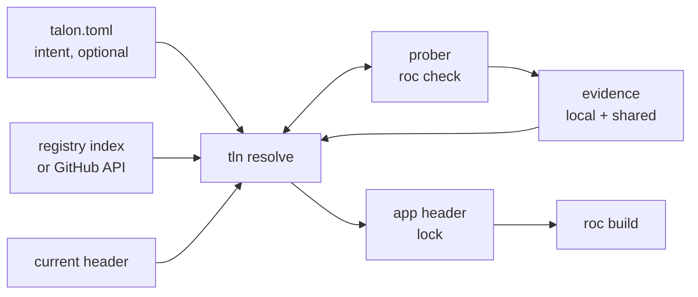
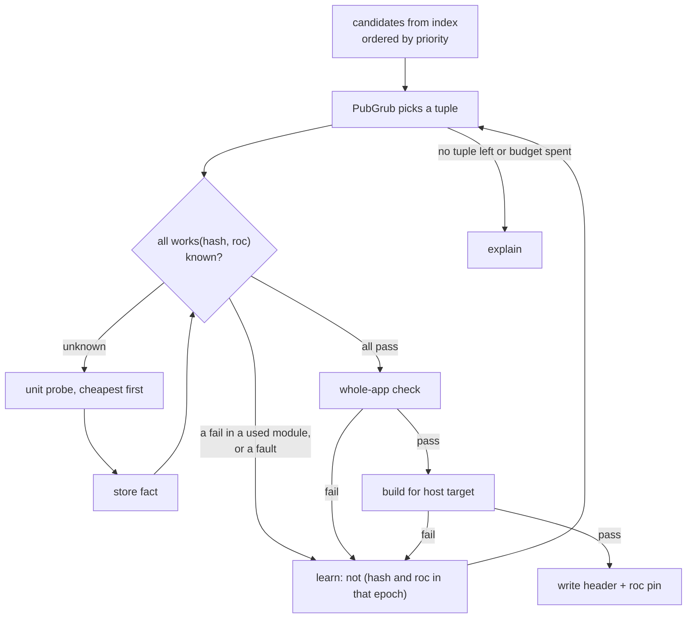
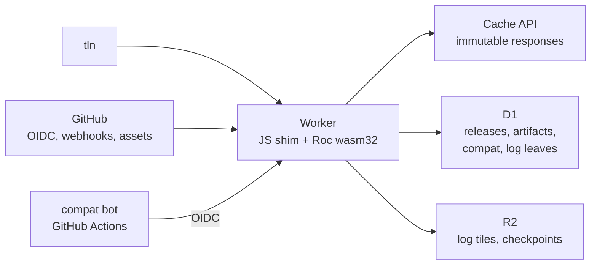
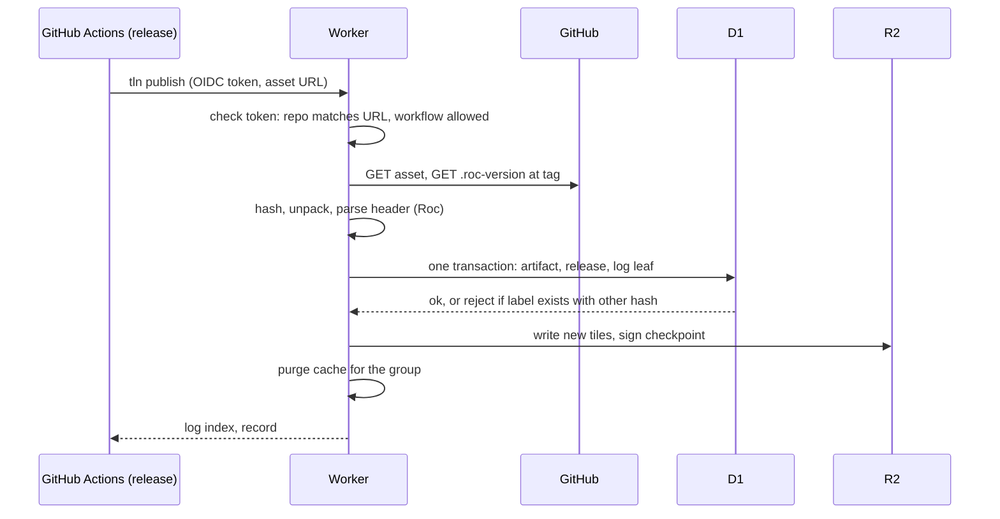
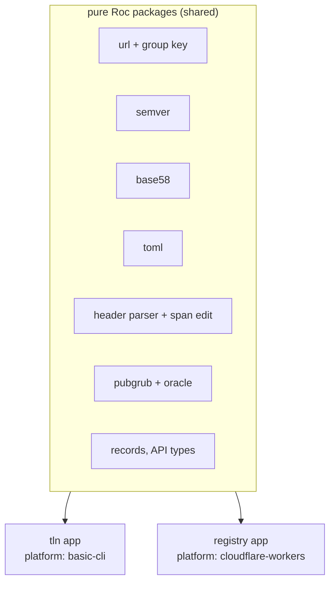

# Talon design

Talon is a package manager and compiler manager for Roc. The CLI is `tln`.

| Item | Value |
| --- | --- |
| Status | Draft 2, 2026-10-13 |
| Target compiler | Zig-based Roc, `nightly-2026-10-09-258ab27`. Source facts from roc-lang/roc at `2664a27`. |
| Scope | CLI, resolver, compatibility prober, toolchain manager, registry on Cloudflare |
| Language | Roc for the CLI and the registry Worker (section 10) |

In this document, `roc:src/...` is a path in the roc-lang/roc repository at `2664a27`.

## 1. Goals and non-goals

| # | Goal |
| --- | --- |
| G1 | The app header is the lockfile. Talon adds no second lock. |
| G2 | `talon.toml` holds intent only (ranges, pins, policy). It is optional. A project with no `talon.toml` works. |
| G3 | Resolution is deterministic: same intent + same registry snapshot + same evidence gives the same header. |
| G4 | Talon installs and selects Roc compilers. It uses the cache directory that `roc` uses today. |
| G5 | Bun-class speed and ergonomics: one binary, one round trip to resolve, parallel fetch. |
| G6 | The registry is an index, not a store. Packages stay on GitHub Release assets. |
| G7 | The registry is optional. With no registry, Talon still works against GitHub directly. |
| G8 | Talon finds a working tuple (nightly, platform, packages) even when releases record no compiler version. It probes the compiler when evidence is missing (section 5.4). |
| G9 | Talon and its registry are written in Roc. |

| # | Non-goal (for v1) |
| --- | --- |
| N1 | Host package bytes on Cloudflare (planned as an optional mirror later, see section 11). |
| N2 | Replace `roc` commands (`check`, `build`, `test`). Talon calls `roc`. |
| N3 | Support the old Rust compiler and `.tar.br` bundles. |

## 2. Facts about Roc that shape the design

Each fact was checked in the compiler source or with a test on `nightly-2026-10-09-258ab27`.

| Fact | Source | Consequence for Talon |
| --- | --- | --- |
| A header entry is `alias: "https://.../<version>/<hash>.tar.zst"`. The hash is base58(BLAKE3) of the compressed `.tar.zst` bytes. | `roc:src/bundle/streaming_writer.zig:125-129`, `roc:src/bundle/bundle.zig:231-240` | The header pins exact bytes. It is a lockfile. Talon only chooses which URL to write. |
| Package identity ("group") is the URL minus scheme, minus the one `X.Y.Z` segment, minus the hash, plus the major (or `0.minor` below 1.0). The host is part of it. | `roc:src/base/url.zig:238-281`, `roc:src/compile/package_resolution.zig:1322-1338` | Two URLs on different hosts are two packages. Talon never rewrites a host (rule H5). |
| Per group, the highest version that any edge names wins for the whole graph. Only the winner's deps are followed. | `package_resolution.zig:816-838` | Roc does MVS by itself. Talon uses the same rule, or Talon and `roc` disagree. |
| An app pin that is lower than a dependency needs fails with "Package Version Conflict". An app pin that is higher wins silently. | `package_resolution.zig:1433-1486`. Test: an app alias `http` at `1.9.0` replaced the `http 1.0.0` of basic-cli, and the platform modules failed against it. | A raise can break a dependency at compile time. Talon checks every raise (section 5.6). |
| Same group and version with two hashes fails with "Conflicting Package Contents". | `package_resolution.zig:903-921` | A version label maps to one hash per URL group. |
| One hash can carry many version labels. | `roc-lang/http` 1.0.0 and 2.0.0 are both `6ZUwqYhC...`. roc-parser 1.0.1 and 1.0.2 are both `FrnJ4RGD...`. | The registry keys facts by hash. A version is a label that points to a hash. |
| Platforms are not solved. Every platform declaration in a build must have the same group, version and hash. | `package_resolution.zig:1644-1693` | Hard constraint: a package that names a platform works only with that exact release. |
| An alias that no module imports gives no warning. It is still fetched and still joins version selection. | `package_resolution.zig:1963-1966`. Test: app with an unused `rand` alias passes `roc check`. | Overrides of transitive versions work with no compiler change (section 5.6). |
| `roc:` in any header is a warning only ("Roc Version Mismatch"). `roc fmt` moves a nightly pin forward, never back. | `roc:src/canonicalize/Can.zig:6165-6178`, `roc:src/base/roc_version.zig:101-139` | A `roc:` pin is evidence, not a guarantee. Talon never runs `roc fmt` on a header (rule H2). |
| The compiler does not read `.roc-version`. It is a CI convention only. | No reader in `roc:src` | The registry reads it as weak evidence. |
| `roc check` works on a package or platform `main.roc` with no app. It takes 0.4 s to 1.9 s on this machine. On an app, it checks only the modules that the app imports. | Tests, section 5.4 | A compatibility probe is cheap. A unit fail is per module. |
| Only 3 of 46 cached packages pin `roc:` in their header. `lukewilliamboswell/roc-parser` (`7CLzCK6q...`) fails on the 10-09 nightly with "redundant expose". | Cache scan and test | Compatibility evidence is sparse. Talon must find it by itself. |
| `--replace-dep OLD NEW` swaps one source for one command. It edits no file. | `roc:src/cli/cli_args.zig:118-176` | Patches need no header edit. |
| Limits: 10 MB per package, 100 MB per closure (512 MB for a platform). | `roc-syntax` reference | Small enough to hash and inspect inside a Worker. |

### 2.1 What the hash fixes

| Item | Fixed by the hash? |
| --- | --- |
| Source of every module in the package | Yes |
| Declared dependency URLs (with their hashes) | Yes. They are in `main.roc` inside the archive. |
| Dependency versions used in a build | No. MVS can raise them (row 4 above). |
| Platform host files for all targets | Yes, when the publisher includes them. One archive holds all targets (`targets: { inputs_dir: ... }`). |
| Compiler version | No. A `roc:` pin inside is only a hint. |
| Version label | No. One hash can have many labels. |

So the identity of a build is the tuple (set of resolved hashes, nightly, target). A compatibility fact "hash H checks on nightly N" is stable, because H fixes all of its source.

### 2.2 Cache layout and cleanup

| Path | Root | Writer | Cleaned by roc? | Size seen |
| --- | --- | --- | --- | --- |
| `packages/<hash>/` | `$XDG_CACHE_HOME/roc`, else `~/.cache/roc` (`roc:src/compile/compile_build.zig:1602-1623`) | roc | No | 1.1 GB |
| `packages/<hash>.deps.json` | same | roc. Rebuilt from `main.roc` if missing (`package_resolution.zig:2160-2183`) | No | small |
| `compat-<id>/` | `$ROC_CACHE_DIR`, else as above (`roc:src/compile/cache_config.zig:337-344`) | roc. `<id>` is the compiler compatibility id (`roc:build.zig:1894-1925`). | Files inside expire after 30 days. The dir stays. | 1.1 GB |
| `nightly-<tag>/`, `debug-<sha>/` | same | Compilers before 2026-10-05 only | Files inside expire. The dir stays forever. | 3.1 GB |

`roc` has no `clean` command. It starts a background cleanup on each run (`roc:src/compile/cache_cleanup.zig:89`). That cleanup deletes old files inside the build caches. It never deletes a cache dir, a package or a sidecar. Talon fills that gap (section 6.4).

Note: the packages root ignores `$ROC_CACHE_DIR`. The build caches honor it. Talon uses the same two rules.

## 3. Prior art

| Tool | Idea | Talon decision |
| --- | --- | --- |
| Bun | One fast binary. `add`, `remove`, `update -i`, `outdated`, `why`, `x`, `patch`. Catalogs. `minimumReleaseAge`. Security scanner API. | Adopt the CLI shape, catalogs, release age, scanner hook. |
| uv | Manages the toolchain. Global cache. `--resolution lowest-direct`. `exclude-newer`. | Adopt toolchain install, lowest resolution for libraries, time-based snapshots. |
| Go modules | MVS needs no lockfile. `GOPROXY` is optional. Checksum database is a transparency log. `toolchain` directive downloads the compiler. | Adopt all four. Roc already uses MVS. |
| Cargo | Sparse HTTP index. MSRV-aware resolver. Yank, not delete. Trusted publishing. | Adopt yank. Make the resolver nightly-aware (the Roc form of MSRV-aware). |
| Rust crater, Stackage, Nix Hydra | Build every package against a compiler or a package set, and publish the pass/fail matrix. | Shared compatibility matrix keyed by (hash, nightly) (section 9.6). |
| Zig | URL + hash in the manifest. `zig fetch --save`. | Closest model to Roc. `tln add` does the same, plus ranges. |
| JSR | Names tied to a scope. Publish with GitHub OIDC. Provenance. | Publish with OIDC. |
| rustup | Proxy binaries, `+toolchain` argument, toolchain file. | Adopt the proxy model for `roc`. |
| PubGrub (uv, Dart pub) | Conflict-driven search that learns incompatibilities and explains failures. | Use PubGrub, fed by a lazy compatibility oracle (section 5.5). |
| C2SP tlog-tiles, Sunlight | An append-only Merkle log served as static tiles from object storage. | Log leaves in D1, tiles in R2 (section 9.3). |

## 4. Core model

| Layer | File | Owner | Contains | Changes when |
| --- | --- | --- | --- | --- |
| Intent | `talon.toml` (optional) | Human | Ranges, anchors, policy, workspace | A human edits it, or `tln add` |
| Lock | App header in `main.roc` | Talon (humans may edit) | Exact URL + hash per direct dep, `roc:` pin | `tln add`, `tln update`, `tln install` |
| Evidence | `talon/compat.db` + registry matrix | Talon | Probe results per (hash, nightly) | Any probe |
| Store | roc cache dirs (2.2) | Talon + roc | Unpacked packages, compilers | Any fetch |



### 4.1 Identity

| Concept | Form | Example |
| --- | --- | --- |
| Group | Roc rule from section 2: URL minus version and hash, plus major | `github.com/roc-lang/unicode/releases/download/{v}/` + major 4 |
| Name | `owner/repo` for GitHub URLs. Display and search only. | `roc-lang/unicode` |
| Label | group + version | `roc-lang/unicode@4.2.0` |
| Content id | Hash in the URL | `4W8SHzvwet9h...` |
| Build id | (resolved hashes, nightly, target) | |

Talon keeps facts per content id, and labels as pointers to it. So Talon can read a header that a human wrote by hand: it asks the registry for the hash, and gets back all labels for it.

### 4.2 The header as lockfile

```roc
app [main!] {
	pf: platform "https://github.com/roc-lang/basic-cli/releases/download/0.25.0/<hash>.tar.zst",
	json: "https://github.com/someone/roc-json/releases/download/2.1.0/<hash>.tar.zst",
	util: "../util/main.roc",
	roc: "nightly-2026-10-09-258ab27",
}
```

| # | Rule |
| --- | --- |
| H1 | Talon edits only string literals and whole entries. It keeps comments, order and formatting. It uses a span-based edit, not a reprint. |
| H2 | Talon never runs `roc fmt` on the header. (`roc fmt` moves the `roc:` pin.) |
| H3 | Every URL that Talon writes is a release URL with a version and a hash. |
| H4 | Talon never changes a path entry or a URL it cannot identify. It lists them as "foreign" in `tln ls`. |
| H5 | Talon never writes a mirror URL. The host is part of the group, so a mirror URL is a different package to Roc. Mirrors feed the cache only. |
| H6 | Talon writes `roc:` whenever it resolves the nightly. The pin records the nightly that the last probe passed with. |

A package header is also a lock, with one difference: consumers treat its versions as minimums (MVS). So a library records the lowest version it supports (section 5.8).

### 4.3 talon.toml: intent only

Keys are header aliases. The header already gives the URL group, so most entries need only a range.

```toml
[toolchain]
roc = "*"                      # any nightly. Or a range, or "=nightly-2026-10-09-258ab27"

[dependencies]
pf = "0.25.*"                  # the platform
parser = "=2.0.0"              # anchor: hard pin
json = "^2.1"
# util and others are absent: they follow the header with the default policy

[dependencies.http]            # a new dependency, not yet in the header
package = "roc-lang/http"
version = "^1"

[resolution]
priority = ["parser", "pf", "roc"]  # what to keep newest first, see 5.1
strategy = "highest"           # or "lowest" for libraries
min-release-age = "3d"
snapshot = "log:184467"        # resolve as of this registry log size
probe = { max = 100, max-toolchains = 6 }
```

| In header | In talon.toml | Constraint |
| --- | --- | --- |
| yes | yes | The range in `talon.toml` |
| yes | no | Implied: same major as the header version, never lower than it |
| no | yes | `tln install` adds it to the header |
| no | no | Transitive. Set by package headers plus MVS. |

### 4.4 Determinism

| Input | Output | Deterministic because |
| --- | --- | --- |
| Header | Build graph | Hashes are fixed. Roc MVS is a pure function of the headers. |
| `talon.toml` + header + snapshot + evidence | New header | The resolver is a pure function. Probes only add evidence. A probe result for (hash, nightly) does not change. |

`tln update` prints `resolved at log:184467, 4 probes`. CI repeats it with `--snapshot log:184467 --no-probe` and the shared matrix.

### 4.5 Workspaces

```toml
[workspace]
members = ["apps/*/main.roc", "examples/*.roc"]

[catalog]
json = "^2.1"
pf = "0.25.*"
```

One resolution covers all members, and gives one nightly. A member uses `json = "catalog:"`.

### 4.6 References in the CLI

One grammar names packages, platforms, tools and compiler releases:

```text
ref      = name [ "@" selector ]
name     = alias | owner/repo | host/path | short
selector = version | range | major | nightly-tag | git-ref
```

| Selector | Example | Meaning |
| --- | --- | --- |
| Release version | `owner/app@1.4.0` | That release |
| Range or major | `roc-lang/http@^2`, `roc-lang/http@2` | The newest match. For an installed entity, it selects among the installed ones. |
| Nightly tag | `@nightly-2026-10-09-258ab27` | That nightly (compiler only) |
| Git ref | `owner/app@main`, `owner/app@dd03c09e` | A source build. A branch or tag is fixed to a commit at install time. |

When a selector can have two meanings, a release wins, then a nightly, then a git ref. `--git` forces a git ref. The separator is `@`, not `#` as in npm, because the shell reads `#` at the start of a word as a comment.

Each command works in one scope, so names of different kinds never collide:

| Command | Scope |
| --- | --- |
| `tln update`, `remove`, `why`, `patch` | Project: header entries and the closure |
| `tln tool ...` | `tools.json` (6.5) |
| `tln roc ...`, `roc +<id>` | Installed compiler releases (6.7) |

In a scope, Talon tries these forms in order and uses the first match:

| # | Form | Example | Rule |
| --- | --- | --- | --- |
| 1 | Header alias | `pf` | Exact. An alias is unique in a header. |
| 2 | Full name | `roc-lang/basic-webserver` | Exact. Non-GitHub hosts use `host/path` (4.1). |
| 3 | Short name | `basic-webserver` | The last segment of the name. It must match one entity only. |
| 4 | Unique id prefix | `git-dd03`, `nightly-2026-10-09` | Compiler releases only, as a git short sha |

On a tie, Talon stops and lists the full names:

```text
error: "basic-webserver" matches 2 packages:
  roc-lang/basic-webserver      platform (pf)
  someone/basic-webserver       via web-utils
Use the full name.
```

The group includes the major (section 2), so one closure can hold `roc-lang/http` 1.x and 2.x. Then the major is part of the name: `roc-lang/http@2`.

## 5. Resolution

### 5.1 Variables and anchors

Resolution picks one value for each free variable. The nightly is a variable like any package.

| Variable | Domain |
| --- | --- |
| `roc` | Nightly tags (and later, releases) |
| `pf` | Platform releases |
| each direct dep | Releases in range |

Any variable can be an anchor: a hard pin (`=`) in `talon.toml`, or a `tln add parser@2.0.0`. The rest are free. Examples:

| Intent | talon.toml |
| --- | --- |
| "I need parser 2.0.0. I do not care which nightly." | `parser = "=2.0.0"`, `roc = "*"` |
| "My team uses nightly 10-09. Find packages that work with it." | `roc = "=nightly-2026-10-09-258ab27"` |
| "Keep the platform. Move the rest." | `pf = "=0.25.0"` |

When many tuples work, `priority` breaks ties: the solver maximizes the version of the first name, then the second, and so on. The default is: direct deps in header order, then `pf`, then `roc`.

### 5.2 Constraints

| # | Constraint | Kind |
| --- | --- | --- |
| C1 | Range from `talon.toml`, or the implied range (4.3) | Hard |
| C2 | Roc MVS: a direct pin is at least the highest version of that group in the closure | Hard |
| C3 | One platform: every package that names a platform names the app platform, byte for byte | Hard |
| C4 | Alias kind: a `platform` entry resolves to a platform release | Hard |
| C5 | Compatibility: every hash in the closure checks on the chosen nightly (5.3 to 5.5) | Hard |
| C6 | Yanked releases are not chosen for a new resolution | Hard |
| C7 | `min-release-age` and `snapshot` hide new releases | Hard |
| C8 | Two majors of one group in the closure | Warning (type identity) |

### 5.3 Compatibility evidence

Evidence is a set of facts `works(hash, nightly) = pass | fail(error digest)`. Sources, from strong to weak:

| Rank | Source | Trust |
| --- | --- | --- |
| 1 | Local probe result (`talon/compat.db`) | Full |
| 2 | Registry matrix, produced by the Talon CI bot (section 9.6) | Full, signed |
| 3 | `roc:` pin in the release header | Hint: author says it passed |
| 4 | `.roc-version` at the release tag | Hint |
| 5 | Release date (nightlies of the 2 weeks before it) | Search order only |
| 6 | Reports from other users (`tln probe --share`) | Search order only |

Hints only order the search. Talon never writes a header on hints alone: the final tuple always gets a local whole-app check (5.5 step 6). That check costs under 2 s.

### 5.4 Probes

A probe runs one compiler on one target and classifies the result. Probes form a ladder. Each step runs only when the step before it passed.

| Step | Probe | Command | Blames |
| --- | --- | --- | --- |
| 1 | Unit | `roc check packages/<hash>/main.roc` with nightly N | The modules of the hash that have errors |
| 1 | Platform | same, on the platform `main.roc` | The modules of the platform that have errors |
| 2 | Whole app | `roc check main.roc` with the candidate header in a temp copy | The hash that owns the file of each error. The app itself if the error is in app files: then Talon stops and reports, because the user code is not a free variable. |
| 3 | Build | `roc build main.roc --output=<tmp>` for the host target | Link or target-file errors blame the platform for that target. Other errors as in step 2. |

Step 3 catches what `check` cannot see: a missing host file for the target, link errors, and code generation bugs. It runs once, on the final tuple. (Measured: 309 ms for a basic-cli app.)

Result classes, all seen in the measurement below:

| Class | Signal | Meaning |
| --- | --- | --- |
| pass | `No errors found`, or `0 errors and N warnings` | Works |
| fail | `N errors` with N > 0. Each error header names a file. | A code incompatibility, per module |
| hang | No result in 30 s. A normal check takes under 2 s. | Compiler fault |
| crash | Signal exit (139 seen) | Compiler fault |

Rules:

| # | Rule |
| --- | --- |
| P1 | `check` and `build` only. Talon never runs the output, so no host code runs. |
| P2 | Warnings do not fail a probe. |
| P3 | A download error gives no fact. A hang or crash is a fact of its own class (compiler fault). |
| P4 | Results are stored per (hash, nightly, target) and never expire. `check` results use the target `any`. A fail stores the set of failing modules. |
| P5 | Budget: `probe.max` (default 100) checks, `probe.timeout` (default 30 s), and `probe.max-toolchains` (default 6) new compiler downloads. One nightly is about 70 MB packed and 228 MB unpacked. Installed nightlies are tried first, because they cost nothing to fetch. |

#### A unit fail is per module

`roc check` on an app checks only the modules that the app imports. Measured on nightly 10-09 with roc-parser 2.0.0:

| Probe | Result |
| --- | --- |
| Unit: `roc check` on parser `main.roc` | fail: `redundant expose` in `Yaml.roc` |
| App that imports `parser.Parser` | pass, and `roc build` passes. The binary runs. |
| Same app, also imports `parser.Yaml` | fail |

So a unit fail is a hard incompatibility only when the app uses a failing module. Talon computes the modules that the app uses in each package: the `import` lines of the app, then the `import` lines inside the package, transitively. This is a lexical scan with the header parser package. If the set does not touch a failing module, the unit fail is ignored, and the whole-app check (step 2) decides.

#### Measurement: islands and epochs (Q11)

Setup: 46 cached hashes (32 with a known release label) × 22 nightlies (2026-09-15 to 2026-10-12), Linux x86_64, unit probes, isolated caches. Script and raw data: `conformance/compat-sweep/`.

```text
nightly      09-15 .. 09-19 | 09-22 | 09-23 09-24 | 09-25 | 09-26 .. 09-29 | 09-30 10-01 | 10-02 .. 10-06 | 10-09 .. 10-12
basic-cli 0.22.x  pass      | pass  | HANG  HANG  | pass  | pass           | pass  pass  | fail           | fail
basic-cli 0.23.0  fail      | fail  | fail  fail  | fail  | pass           | pass  pass  | fail           | fail
basic-cli 0.24.0  fail      | fail  | fail  fail  | fail  | pass           | pass  pass  | pass           | fail
basic-cli 0.25.0  fail      | fail  | fail  fail  | fail  | fail           | fail  fail  | fail           | pass
basic-websrv 0.17 fail      | pass  | pass  pass  | pass  | pass           | CRASH CRASH | pass           | fail
roc-parser 2.0.0  fail      | fail  | fail  pass  | pass  | pass           | pass  pass  | fail (Yaml)    | fail (Yaml)
roc-ray 0.10.0    fail      | pass  | pass  pass  | pass  | pass           | pass  pass  | pass           | fail
basic-websrv 0.16 pass      | pass  | pass  pass  | pass  | pass           | CRASH CRASH | fail           | fail
joy 0.33, joy-html 0.16  pass on 09-15 .. 10-01, fail from 10-02
26 other hashes   pass on all 22 nightlies
4 other hashes    fail on all 22 (no main.roc, or written for an older compiler)

(basic-cli 0.22.x is 3 hashes, roc-ray 0.10.0 is 2 hashes. basic-cli 0.28.0 and 0.29.0 match 0.24.0 and 0.25.0.)
```

| Question | Measured |
| --- | --- |
| Transitions where any result changes | 8 of 21 |
| Code epochs (boundaries where a pass/fail result changes) | 6: boundaries at 09-22, 09-24, 09-26, 10-02, 10-09 |
| Fault windows (hang or crash) | 2: 09-23 to 09-24 (hang, basic-cli 0.22.x), 09-30 to 10-01 (segfault, basic-webserver) |
| Transitions where only one hash changes | 0. Each boundary moved 2 to 8 hashes. |
| Results that change inside an epoch | 0 |
| Hashes with more than one island | 4 of 46. All 4 gaps are hangs or crashes. |
| Hashes with more than one island, if faults do not split a range | 0 |

Conclusions for the search:

| Rule | Reason |
| --- | --- |
| Probe one nightly per epoch | No result changed inside an epoch. 22 nightlies are 6 epochs. |
| A fault (hang, crash) marks that nightly as bad for that hash. It does not split the pass range. | Every island in the sample comes from a compiler fault, not from a code change. |
| A boundary is a nightly where at least 2 hashes change | All 8 transitions in the sample had at least 2. A change in only one hash is still binary-searched and reported to the bot. |
| Islands from code changes stay possible | The sample is small (46 hashes, 4 weeks). The model keeps a map from nightly to result, so a real code island costs probes but never gives a wrong answer. |
| Probe timeout 30 s | Normal checks take under 2 s. The hangs ran for 600 s with no result. |

If the solver finds no tuple with inferred facts, it runs a second pass. That pass probes the inferred facts that blocked the best tuples, within the remaining budget. Talon never writes a wrong header because of an inferred fact: the final ladder (steps 2 and 3) always runs on real probes.

With no bot data (registry off), each hash starts with the release date and `roc:` pin as hints, and the epochs come from the local `compat.db` only.

### 5.5 Algorithm

PubGrub with a lazy oracle. A failed probe becomes a learned incompatibility, the same way a failed version constraint does.



| Step | Action |
| --- | --- |
| 1 | Collect variables, ranges and anchors (5.1). |
| 2 | Fetch metadata for the full closure in one request (9.4). It includes the shared matrix for these hashes. |
| 3 | PubGrub picks the best tuple by `priority`, under C1 to C4 and C6 to C7. |
| 4 | For each pair (hash, roc) with no fact, run a unit probe. Order: installed nightly first, then the strongest hint. |
| 5 | A fail in a module that the app uses, or a fault, adds an incompatibility for (hash, that epoch). Go back to step 3. |
| 6 | When all unit facts pass, run the whole-app check, then the build (ladder steps 2 and 3). These catch errors that come from the combination (for example a raised transitive version) and from the target. |
| 7 | Write the header and `roc:`. Print the tuple, the probe count and the evidence for each choice. |

Example failure output, with measured ranges, for an app that imports `parser.Yaml`:

```text
error: no tuple works

  lukewilliamboswell/roc-parser 2.0.0 (module Yaml)   checks on nightly 09-24 .. 10-01
  roc-lang/basic-cli 0.25.0                           checks on nightly 10-09 .. 10-12
  no nightly is in both ranges

  fix: relax pf to "0.24.*" (checks on 09-26 .. 10-06, overlap 09-26 .. 10-01)
       or stop using parser.Yaml (parser.Parser checks on 10-09)
```

### 5.6 Overrides of transitive versions

To raise a transitive dependency (for example, a security fix), the app needs an alias for it in the same major. Roc then uses that version for the whole graph. Section 2 confirms both parts: an unused alias is legal, and it raises the version for every package.

```toml
[overrides]
parser = { package = "lukewilliamboswell/roc-parser", version = "^2.0.3" }
```

The raise can break a package that was not written for the new version (the `http 1.9.0` test in section 2). So the solver treats an override as a free variable, and the whole-app probe (5.5 step 6) covers it.

### 5.7 Patches

`tln patch json` copies the cached package to `.talon/patches/json/` for editing. `talon.toml` records it:

```toml
[patch]
json = "./.talon/patches/json/main.roc"
```

The header does not change. The `roc` proxy (6.3) adds `--replace-dep <header URL> <patch path>` to each command. `tln patch --commit` writes a diff file.

### 5.8 Libraries

| Task | Command |
| --- | --- |
| Record the lowest working versions in the package header | `tln update --strategy lowest` |
| Test with the newest versions without editing the header | `tln check --strategy highest` (uses `--replace-dep`) |
| Record the nightly range that the package checks on | `tln probe --range` (publishes evidence with the release) |

## 6. Toolchain manager

### 6.1 Selection order

| Priority | Source | Example |
| --- | --- | --- |
| 1 | Command argument | `roc +nightly-2026-10-06-c34079d check` |
| 2 | Environment | `ROC_TOOLCHAIN=nightly-2026-10-06-c34079d` |
| 3 | `roc:` entry of the target file header | `roc: "nightly-2026-10-09-258ab27"` |
| 4 | `.roc-version` in the nearest parent directory | package repos |
| 5 | `talon.toml` `[toolchain] roc` | newest installed in range |
| 6 | Global default | `tln roc default <tag>` |

### 6.2 Directory layout

```text
$XDG_CACHE_HOME/roc/          (else ~/.cache/roc/)
  packages/<hash>/              roc      unpacked package (Talon may pre-fill it, 7.2)
  packages/<hash>.deps.json     roc      sidecar, rebuilt by roc if missing
  compat-<id>/                  roc      build cache per compiler build ($ROC_CACHE_DIR if set)
  nightly-<tag>/, debug-<sha>/  roc      build caches of older compilers (seen up to nightly 10-09)
  toolchains/<id>/roc           talon    installed compilers (<id>: nightly tag, git-<sha8>, link-<name>)
  toolchains/<id>/.talon.json   talon    source URL, sha256 or commit, ref typed, compat id, install time, last use
  toolchains/zig-<version>/     talon    Zig for source builds (6.7)
  talon/index/                  talon    cached registry responses (ETag)
  talon/compat.db               talon    probe results
  talon/projects.json           talon    known projects, for GC
```

### 6.3 The `roc` proxy

| Item | Behavior |
| --- | --- |
| Install | `tln setup` puts a `roc` launcher on `PATH` that runs `tln` in proxy mode. |
| Dispatch | Talon selects the compiler (6.1), runs it, forwards stdio and the exit code. Cost target: under 5 ms. |
| Missing compiler | Install it, then run (as Go `GOTOOLCHAIN=auto`). `--no-auto-install` turns this off. |
| Patches | Adds `--replace-dep` for each `[patch]` entry. |
| Cache paths | Sets `XDG_CACHE_HOME` and `ROC_CACHE_DIR` to canonical absolute paths. With `..` in `XDG_CACHE_HOME`, `roc check` prints "No errors found" for any app (Q15). Probes use the same rule. |
| Opt out | `TALON_PROXY=0` runs the selected compiler with no extra work. |

Compiler sources: release assets of `roc-lang/nightlies`. Archives are `.tar.gz` (Linux, macOS) and `.zip` (Windows), about 70 MB each. The registry keeps a sha256 list for them.

### 6.4 Garbage collection

| Item | roc today | `tln cache gc` |
| --- | --- | --- |
| Files inside build caches | Expires after 30 days, in the background | Leaves to roc |
| `nightly-<tag>/`, `debug-<sha>/` dirs | Never removed | Removes them. No current compiler writes them. (3.1 GB here.) |
| `compat-<id>/` dirs | Never removed | Removes a dir whose id belongs to no installed toolchain |
| `packages/<hash>/` | Never removed | Removes it if no known project used it in N days |
| Toolchains | n/a | Keeps the default and toolchains pinned by a known project in N days |

The compat id is a build-time hash that `roc` does not print. Talon learns it at install: it runs one `roc check` on an empty file and records which `compat-<id>/` dir the run touched. Upstream request: print the id in `roc version --verbose`.

`tln cache gc --dry-run` prints what it would free.

### 6.5 Global tools

`tln tool install owner/app` builds a Roc app from source and puts the binary on `PATH`, as `cargo install --locked` and `uv tool install` do.

`npm i -g` has a known problem: a global script runs with the `node` that is on `PATH` now, and that can be a different version from the one used at install. A Roc tool does not have this problem, because the nightly is used only at build time:

| | `npm i -g` | `tln tool install` |
| --- | --- | --- |
| What is installed | Scripts | A native binary with the platform host linked in |
| Toolchain needed at run time | Yes, the shared `node` | No |
| Two tools that need different versions | They share one `node` | Each binary is self-contained |

Install flow:

```text
tln tool install owner/app
  |
  v
fetch the release, read the app header (hashes + roc: pin)
  |
  v
select a compiler release (table below)
  |
  v
print the platform URL and hash, then roc build --opt
  |
  v
copy the binary to the bin dir, write the manifest
```

Compiler release selection:

| Case | Behavior |
| --- | --- |
| The pinned release is installed | Build with it. No prompt. |
| An installed release has a recorded pass for this closure (5.3) | Build with it. Print `built with nightly-2026-10-12-2664a27 (pin: nightly-2026-10-09-258ab27)`. No prompt. |
| Other releases are installed, with no evidence | Prompt with options 1, 2 and 3 |
| No release is installed | Prompt with options 1 and 3 |
| No TTY | No prompt. `--roc pinned` selects option 1, `--roc installed` selects option 2, and `--yes` selects the default. With none of them, Talon stops with an error that names these flags. |

The prompt:

```text
owner/app 1.4.0 was tested with compiler release nightly-2026-10-09-258ab27. It is not installed.

  1) Download nightly-2026-10-09-258ab27 (70 MB, 228 MB unpacked)    [default]
  2) Try the 4 installed compiler releases
  3) Cancel
```

The prompt shows only what the user needs to decide: why it asks, the cost of the download, and how many releases option 2 tries. The download is the default because the user runs the binary, and the author tested only the output of the pinned release.

Option 2, inside Talon:

| Step | Behavior |
| --- | --- |
| Order | Releases in the same epoch as the pin first (5.4: no result changed inside an epoch), then newer before older |
| Each release | `roc check` on the app, with `probe.timeout`. On a fail, go to the next release. |
| First pass | `roc build` with that release. On a fail, go to the next release. |
| All fail | Show the prompt again with options 1 and 3, and a list of each release with the first error line |
| Record | Each pass and fail goes in `compat.db`. The next install of this closure finds the evidence and shows no prompt. |

| # | Rule | Reason |
| --- | --- | --- |
| T1 | Build from the app header as it is (hashes and `roc:` pin). Do not resolve again. `--resolve` allows a new resolution. | The header is the lock (G1). A new resolution can select packages that the author did not test. |
| T2 | Only an app whose platform makes a native executable can be installed. | A `package` has no entry point. A wasm platform, such as `cloudflare-workers`, makes no CLI. |
| T3 | Binaries go in `$XDG_DATA_HOME/talon/bin/` (else `~/.local/share/talon/bin/`), not in the cache. `tln setup` links them into `~/.local/bin/`. | The cache has a 30-day expiry and GC (6.4). A cleanup must not delete a tool. |
| T4 | `$XDG_DATA_HOME/talon/tools.json` records, for each tool: source, build id (hashes, nightly, target), binary sha256, install time. | `tln tool ls`, `update` and `rebuild` read it. |
| T5 | A tool does not keep its nightly. GC (6.4) can remove the nightly after the build. | The binary does not need it. A rebuild installs it again. |
| T6 | A download needs a confirmation, `--yes` or `--roc pinned`. An installed release is used without a prompt only when evidence supports it. | No surprise download of 228 MB, and no silent build with a release that nobody tested. |
| T7 | `tln tool rebuild` builds again from the manifest, with the same build id. | Repair after an OS upgrade breaks a dynamic link (Q16). |

Prebuilt binaries: a release can attach a binary for each target, as `cargo-binstall` expects. Then an install needs no compiler release, and the source build is the fallback. P1 builds this path for Talon itself (6.6). In P2 the registry lists prebuilt binaries for other tools too.

Tools from a git ref (4.6):

| Command | Effect |
| --- | --- |
| `tln tool install owner/app@main` | Get the commit, read `main.roc`, then build as above. `--path apps/cli` selects an app in a subdirectory. `tools.json` records the commit and the ref that the user typed. |
| `tln tool update app` | Installed from a branch: build the new head. From a commit: no change, and Talon prints `pinned to commit dd03c09e`. From a release: the newest release. |
| `tln tool install owner/app` | One install for each name. It replaces a git install of the same tool. |
| Binary name clash | When a second tool has the same binary name, the install stops. `--as <name>` sets another name. |

Project dependencies from git are out of scope. A header holds only hash URLs (H3), so use `[patch]` (5.7) or a path entry.

### 6.6 Talon as a tool

Talon manages itself as one more entry in `tools.json`. Only a few rules are different, because a broken `tln` cannot repair itself, and it also breaks the `roc` proxy (6.3).

```text
first install:  curl -fsSL <host>/install.sh | sh
                  -> download the prebuilt tln for this target, verify it
                  -> put it in the bin dir (T3), write its tools.json entry (source: install.sh)
                  -> run tln setup
later:          tln tool update talon
repair:         curl -fsSL <host>/install.sh | sh -s -- --version 0.3.1
```

| # | Rule | Reason |
| --- | --- | --- |
| S1 | `install.sh` downloads a prebuilt binary from the GitHub Release assets of Talon. It checks the sha256 from the release, and the attestation when there is one (section 12). | `install.sh` cannot build from source: that needs a compiler release (228 MB) before the user has `tln`. |
| S2 | `tln tool update talon` uses the prebuilt binary. `--from-source` builds it as in 6.5. | Same reason as S1, and a download is faster |
| S3 | An update writes the new binary to a temp file, runs `tln --version` on it, then does a `rename` over the old one. On Windows, it renames the running `.exe` first. | A binary that does not start never replaces the working one. A running `.exe` cannot be overwritten. |
| S4 | No rollback command, and no copy of the old binary. The repair path is `install.sh --version <v>`. | A broken binary cannot run a rollback command. `install.sh` does not need a working `tln`. |
| S5 | `tln tool rm talon` asks for confirmation, then removes the binary, the `roc` launcher and the `tools.json` entry. It keeps the caches (`tln cache` removes them). | One namespace for all tools. Removing Talon also removes the proxy, so the user must confirm. |

### 6.7 Compilers from source

| Command | Result id |
| --- | --- |
| `tln roc install nightly-2026-10-09-258ab27` | `nightly-2026-10-09-258ab27` |
| `tln roc install @main` (short for `roc-lang/roc@main`) | `git-<sha8>` |
| `tln roc install Karakatiza666/roc@my-branch` | `git-<sha8>`. A fork works the same way. |
| `tln roc link dev ../roc/zig-out/bin/roc` | `link-dev`. No build, no copy, as `rustup toolchain link`. |

| # | Rule | Reason |
| --- | --- | --- |
| R1 | The id is `git-<sha8>`. `.talon.json` records the repo URL, the full sha and the ref that the user typed. | A commit sha is unique across forks. 8 characters match the local form `debug-c6dfe61b` of roc (`roc:src/base/roc_version.zig:21-22`). |
| R2 | If the commit is the commit of a nightly, Talon says so and offers the prebuilt nightly. | Same code, and a download is much faster than a build |
| R3 | Talon gets the source as a GitHub archive (`/archive/<sha>.tar.gz`), not with git. It builds with `zig build roc -Doptimize=ReleaseFast -Dcompiler-version=git-<sha8>`, as roc CI does (`roc:.github/workflows/ci_zig.yml:268`). | With no `.git`, roc reports the version `no-git` (`roc:build.zig`, `getCompilerVersionGit`). The flag gives the id instead (Q17). |
| R4 | Talon never writes `git-*` or `link-*` into a `roc:` pin. H6 keeps the old pin. Probe results for these ids stay local. | roc does not accept a local build as a pin, by design (`roc_version.zig:21-23`). Other users cannot reproduce such a result. |
| R5 | Selection uses the same rules as a nightly (6.1): `roc +git-dd03c09e check`, `ROC_TOOLCHAIN=git-dd03`, or `tln roc default Karakatiza666/roc@my-branch` (the newest installed build of that branch). | |
| R6 | When the user installs a branch again, Talon builds the new head as a new id. The old id stays until GC. | An id never changes meaning |

Build dependencies. The commit names its Zig version: `minimum_zig_version` in `build.zig.zon` (`roc:build.zig.zon:4`). Zig changes its API between minor versions, so Talon needs the same `major.minor`.

```text
$ tln roc install Karakatiza666/roc@my-branch
Build roc from Karakatiza666/roc@my-branch (dd03c09e)

Dependencies:
  [ ] zig 0.17.x            found zig 0.16.0 on PATH
  [ ] LLVM bundle           x86_64-linux-musl, 45 MB, zig gets it during the build

Install zig 0.17.0 (54 MB) for Talon builds? [Y/n]
```

| # | Rule |
| --- | --- |
| D1 | Zig search order: `$ZIG`, then `zig` on `PATH` with a matching version, then a Zig that Talon installed. |
| D2 | Talon installs Zig from `ziglang.org/download/index.json` (it gives the sha256) into `toolchains/zig-<version>/`. GC removes it when no source build needs it. |
| D3 | `[x]` is found. `[ ]` with a reason is missing. The LLVM bundle line gives the size of the `roc-lang/roc-bootstrap` asset for the host target. |

## 7. Store and fetch

### 7.1 Pipeline

| Property | How |
| --- | --- |
| No waterfall | The registry returns the full closure up front. All fetches start at once. |
| Verify | BLAKE3 over the compressed stream, then base58, then compare to the URL hash. Same scheme as `roc:src/unbundle/unbundle.zig:557-680`. |
| Atomic | Same protocol as roc: extract into `packages/<hash>.<16hex>.tmp`, then `rename` to `packages/<hash>/` (`package_resolution.zig:2188-2306`). If the rename loses to roc, Talon drops its copy. No lock file is needed. |
| Sidecar | Talon does not write `<hash>.deps.json`. roc rebuilds it from `main.roc` on first use. |
| Mirrors | On a 404, Talon tries mirrors. The hash proves the bytes. The header URL does not change (H5). |
| Offline | `--offline` uses the cache only. |
| Fallback | If a host feature is missing, Talon runs `roc check` on a stub app with the closure and lets roc fetch. |

### 7.2 Cache contract with the compiler

Option B from draft 1 is now confirmed in the source: when `packages/<hash>/main.roc` exists without a sidecar, roc rescans it and writes the sidecar (`package_resolution.zig:2160-2183`). A conformance test runs this check against each new nightly.

### 7.3 Lock and frozen modes

| Flag | Meaning |
| --- | --- |
| `--frozen` | Fail if the header would change. Fetch only. For CI. |
| `--locked` | Fail if the header does not satisfy `talon.toml`. |
| `--no-probe` | Use known evidence only. |
| `--dry-run` | Print the header diff. Write nothing. |

## 8. CLI

| Command | Does | Bun equivalent |
| --- | --- | --- |
| `tln init [template]` | New app or package, with `.roc-version` and CI | `bun init`, `bun create` |
| `tln add json [pf@0.25] [--platform]` | Resolve, write header | `bun add` |
| `tln remove json` | Remove entry and range | `bun remove` |
| `tln install` | Satisfy `talon.toml`, fetch closure | `bun install` |
| `tln update [pkg] [-i] [--roc]` | Move within ranges. `-i` is an interactive picker | `bun update -i` |
| `tln outdated` | Table: current, wanted, latest, nightly range | `bun outdated` |
| `tln why parser` | Paths from the app to a package, and why this version (evidence) | `bun why` |
| `tln probe [pkg] [--range] [--share]` | Find the nightly range of a release. Optionally share the result | |
| `tln ls [--tree]` | Closure with marks: shared, resolved, foreign, patched | `bun pm ls` |
| `tln patch json` | Edit a copy of a dependency (5.7) | `bun patch` |
| `tln x owner/app [-- args]` | Run a bundled Roc app once, from cache | `bunx` |
| `tln publish` | Register a release (9.7) | `bun publish` |
| `tln audit` | Yanked, advisories, scanner hook | `bun audit` |
| `tln roc install/link/use/ls/rm/default` | Compiler management. A nightly, a release, or a git ref built from source (6.7) | (uv `python`, rustup `toolchain link`) |
| `tln tool install/ls/update/rebuild/rm` | Global tools: build a Roc app (a release or a git ref) and put it on `PATH` (6.5). Talon is one of them (6.6). | `bun add -g` (uv `tool`) |
| `tln cache gc/ls/dir` | Cache management | `bun pm cache` |
| `tln setup` | Install the `roc` proxy, shell completions | |

Global flags: `--json`, `--offline`, `--frozen`, `--no-probe`, `--quiet`, `--registry <url>`.

```text
$ tln add parser@2.0.0
resolved 4 packages in 41ms (log:184467)
probed 3 times on 1 nightly (0 downloads)

  main.roc
  + parser: lukewilliamboswell/roc-parser 2.0.0
    note: module Yaml fails on nightly-2026-10-09-258ab27 (redundant expose). Your app does not import it.
```

## 9. Registry

### 9.1 Role

| The registry does | The registry does not |
| --- | --- |
| Index releases: labels, hash, URL, deps, platform, kind | Store package bytes (v1) |
| Map hash to labels | Own package names (GitHub does) |
| Hold the shared compatibility matrix | Run untrusted Roc code inside the Worker |
| Record publish provenance | Act as a single point of failure: `TALON_REGISTRY=direct` uses the GitHub API |

### 9.2 Architecture



### 9.3 Storage choice

Draft 1 used one Durable Object per package. Draft 2 drops that. The reasons:

| Need | DO per package | D1 rows + log table |
| --- | --- | --- |
| Closure query across many packages | One DO call per package | One SQL query (recursive CTE) |
| Publish = insert version + append log leaf, atomically | Two objects, no shared transaction | One transaction |
| Unique (group, version) | Per object | `UNIQUE` index |
| Write rate | Scales per package. Not needed: Roc has tens of releases per day. | One writer is enough |
| Global reads | Each DO lives in one region | Read replicas (Sessions API) plus the Cache API |
| Backups | Manual | Time Travel (30 days) |
| Size limit | 10 GB per object | 10 GB per database. About 5 M versions at 2 KB each. |

Merkle log:

| Part | Where | Why |
| --- | --- | --- |
| Leaves `(index, group, version, hash, time)` | D1 table, written in the publish transaction | The log and the index cannot disagree |
| Tiles and signed checkpoint | R2, write-once objects (C2SP tlog-tiles layout) | Tiles are immutable, so object storage plus the edge cache fits. This is how Sunlight serves CT logs. |
| Sequencing | The D1 transaction (`index = max + 1`) | No separate sequencer at this write rate |

KV is not used: eventual consistency (about 60 s) is wrong for the version list. Package bytes on R2 stay a phase 3 option (hash-keyed mirror).

### 9.4 HTTP API

| Method and path | Returns | Caching |
| --- | --- | --- |
| `GET /v1/pkg/{owner}/{repo}` | All labels, one JSON line each | ETag, 60 s, purge on publish |
| `GET /v1/hash/{hash}` | Artifact record and all its labels | Immutable, except new labels |
| `POST /v1/closure` | Body: direct groups + ranges. Returns records for all candidates and their closure, plus matrix rows for those hashes | Not cached. One round trip per resolve. |
| `GET /v1/compat/{hash}` | Matrix rows for one hash | 5 min |
| `GET /v1/toolchains` | Nightly tags, assets, sha256 | 5 min |
| `GET /v1/search?q=` | Ranked packages | 5 min |
| `POST /v1/publish` | Register a release (OIDC) | |
| `POST /v1/ingest` | Ask to index a public release URL | |
| `POST /v1/compat` | Add matrix rows (bot with OIDC, or user hint) | |
| `GET /log/checkpoint`, `/log/tile/...` | Served from R2 | Tiles immutable |

### 9.5 Records

| Table | Key | Fields |
| --- | --- | --- |
| `artifacts` | hash | kind, exposes, deps `[{alias, url, group, version, hash}]`, platform, targets, `roc:` pin, sizes |
| `releases` | (group, version) | hash, name, url, tag, `.roc-version`, published_at, log_index, provenance, yanked |
| `compat` | (hash, nightly, target) | result, error digest, source (bot, author, user), time |
| `log` | index | group, version, hash, time |

Artifact rows never change. Release rows change only in `yanked`.

### 9.6 Compatibility matrix

The matrix makes probes rare. A user who adds a common package gets a known answer.

| Producer | Runs | Trust |
| --- | --- | --- |
| Talon compat bot | A scheduled GitHub Actions workflow. For each new nightly, it runs unit probes on every indexed hash. For each new release, it searches the nightly range (5.4). Posts results with an OIDC token. | Full |
| Release workflow | `tln probe --range` before `tln publish` | Full, tied to the publisher |
| Users | `tln probe --share` | Hint only (rank 6) |

Cost: about 50 packages times 1 new nightly a day, at under 2 s each, is under 2 minutes of CI a day.

### 9.7 Publish flow



| Path | Trigger | Auth |
| --- | --- | --- |
| `tln publish` in the release workflow | Author | GitHub OIDC (trusted publishing) |
| GitHub App webhook | `release.published` | App installation on the repo |
| `POST /v1/ingest` | Anyone, with a public URL | None. The bytes and the tag are public, and the hash checks them. |

## 10. Implementation in Roc

### 10.1 Shape

All logic is pure Roc in shared packages. Two platforms supply the effects.



| Part | Platform | Notes |
| --- | --- | --- |
| CLI | basic-cli | basic-cli already has HTTP, files, `rename`, `Cmd` with captured output, env, args, SQLite. Talon sends the gaps below upstream as PRs. Until they merge, Talon builds on a fork that tracks basic-cli. |
| Worker | `cloudflare-workers`: a new generic platform, wasm32 reactor (`output: Shared`), Zig host, small JS shim | Hosted functions in direct style through JSPI (10.2). It exposes the Workers runtime (fetch handler, outbound fetch, D1, R2, KV, Cache API, Durable Object SQL, env, secrets), not registry logic. Any Roc app can use it. The registry is its first user. Its own repo and releases. |

The compiler supports this: `wasm32` freestanding target, linked with `wasm-ld` (`roc:src/target/mod.zig:468`, `roc:src/cli/linker.zig:691`, `roc:docs/langref/modules.md:536-556`).

### 10.2 Worker host: JSPI

JSPI (JavaScript Promise Integration) lets a synchronous wasm import wait for a JS promise. So Roc code calls `fetch!` as a normal effect, and the Roc compiler needs no async support. The host is in Zig.

Evidence:

| Evidence | Result |
| --- | --- |
| roc-shpadoinkle (`../roc-shpadoinkle`, `12460db`) | A Roc wasm32 app with a Zig host does direct-style waits with JSPI in Chromium. 40 tasks wait at the same time with correct frames (`docs/ROC_SHPADOINKLE_WITH_SIGNALS.md:344-420`, `shpadoinkle/host/host.zig:959-1060`). |
| Local test (`scratchpad/jspi/`, workerd `2026-10-12`, no compatibility flag) | An import wrapped in `WebAssembly.Suspending` waits on a timer and a subrequest. 3 parallel calls through `WebAssembly.promising` return correct values. |
| Community | workers-zig and Almide report JSPI on the Cloudflare edge (see Sources). |

Patterns taken from roc-shpadoinkle:

| Pattern | roc-shpadoinkle | Talon Worker |
| --- | --- | --- |
| One wait primitive | One hosted fn `wait!(kind, num, a, b, c)` and one import `js_wait` (`shpadoinkle/platform/Host.roc:55`). Each effect is a Roc function on it. | Same. Kinds: fetch, D1 query, D1 batch, R2 get, R2 put, cache match, cache put. |
| Arguments | JS reads them before its first `await`, because they can be on the stack (`shpadoinkle/www/runtime.js:800`) | Same |
| Results | JS writes the body with `js_alloc` into a heap record, not the stack (`host.zig:1046-1060`) | Same |
| Capability record | `Await` is a record of functions. `Await.scripted` runs a task in tests with no host (`package/Await.roc:20-33`). | Each handler gets a `Worker` capability record (`fetch!`, `d1!`, `r2!`, `cache!`). Unit tests use a scripted record. |
| Shadow stack | JSPI keeps the wasm stack, not the shadow stack (`__stack_pointer`) in linear memory. roc-shpadoinkle copies the used stack to the heap at a wait and back at resume, so many tasks share one instance (`host.zig:1007-1035`). | Same copy, in a pool of instances. After a trap, the host frees the heap of the dead task (owner tags, see below). |

#### Measurement: stack copy vs instance per request (Q12)

Code, reproduce commands and all tables: `cloudflare-workers/bench/README.md`. Setup: Roc wasm32 app on a Zig host from roc-shpadoinkle, nightly 2026-10-09, local workerd 2026-10-12. Each request builds about 45 KB of JSON, recurses N levels, and waits twice on a service binding (5 ms). 0 wrong bodies in about 445,000 requests.

| Item | B: shared instance, stack copy | A: instance per request |
| --- | --- | --- |
| Copy cost per wait | 0.05 µs (2 KB), 0.2 µs (16 KB), 1.4 to 1.8 µs (64 KB), 5 to 7 µs (256 KB) | none |
| Instantiate per request | none | 28 to 36 µs (49 KB module), 516 to 639 µs (2.1 MB module) |
| CPU per request, full workload | 205 to 283 µs | 306 to 502 µs |
| req/s at concurrency 64, stack 63 KB | 1660 | 1278 |
| p50 at concurrency 64, stack 63 KB | 36.4 ms | 45.6 ms |
| Memory held by copies | concurrency × stack depth (4 MB at 64 × 63 KB) | 1.3 MB per live instance |
| wasm memory | Grows to the peak and never shrinks (50 MB at 64 × 250 KB) | Freed with the instance |
| Trap | Without owner tags: leaks the heap of that request, 61 KB per trap. With owner tags: 0 leak. Other waiting requests stay correct. | Nothing leaks |

The stack copy costs less than the noise up to 64 KB. Instantiation is the real cost, and it grows with module size: the registry app will be larger than 49 KB.

#### Owner tags: free the heap of a task that trapped

A trap stops the task at once, so its refcount decrements never run. The stack is not the problem: a task traps only while it runs, so it has no saved copy, and `task_abort` moves the stack pointer back. The heap blocks of the task stay. Owner tags find them:

| Step | Code (`cloudflare-workers/`) |
| --- | --- |
| Each live span keeps its task id in the free-list word, which a live span does not use | `hostlib/alloc.zig` `hostAlloc`, `OWNER` |
| The host sets `OWNER` at `handle`, clears it at a wait, sets it again at the resume | `host/host.zig` `handle`, `waitBegin`, `waitEnd` |
| Blocks that JS fills (`js_alloc`) are host-owned (0) until the task adopts them. JS can call `js_alloc` after a trap, before the abort. | `hostlib/alloc.zig` `js_alloc`, `adopt` |
| After a trap, walk the spans of each bump region and free the sealed spans with that id | `hostlib/alloc.zig` `freeOwner`, `host/host.zig` `task_abort` |
| `task_abort` has no shadow-stack frame. A frame epilogue would write the old stack pointer back after the reset. | `host/host.zig` `task_abort`, `abortFree` |

Test: `bench/node-test.mjs` (200 requests at once with 4 traps, then 200 more on the same instance). With tags: live bytes 0, 237,632 bytes freed, 0 bad bodies. With `-Downer_tag=false`: live 237,632, the test fails.

Cost (`bench/owner.mjs`, Node, `track_live=false`):

| Item | Tags off | Tags on |
| --- | --- | --- |
| alloc + free pair | 2.6 to 3.2 ns | +0.2 to 0.7 ns |
| Whole request (depth 30, 200 JSON items), median of 7 | 200.6 to 203.5 µs | -0.4 to +4 µs (in the noise) |
| Memory | | 0 (no new header word) |
| Heap walk per trap | none | 1 to 15 ns per live span: 13 µs (10,000 small spans), 1 ms (30 MB of 200 B spans) |

Limits: tasks must share no heap. Roc values are immutable and top-level constants are static data, and the second batch of the test found no shared block. When the walk fails (more than 64 bump regions, or a bad span header), `task_abort` returns -1 and the instance is retired.

Decision: a pool of shared instances with owner tags and a recycle rule. This keeps the speed of B and the clean memory of A.

| Rule | Value (first guess, tune in P2) |
| --- | --- |
| Requests per instance at one time | Up to 16. A new request goes to the instance with the fewest; a new instance starts when all are full. |
| After a trap | Clean trap (Roc `crash`, stack canary, out of memory): free the task's spans, keep the instance. Engine fault (out-of-bounds access, `unreachable` in host code) or a failed walk: retire the instance, its memory may be corrupt. |
| Retire an instance | After an engine fault, or when its wasm memory passes 32 MB (wasm memory never shrinks). A retired instance takes no new requests, and is dropped when its last request ends. |
| Stack depth guard | Log the copy size. A copy over 256 KB is a warning: it means deep recursion in a handler. |

Fallback: if JSPI is ever removed, Talon returns effects as data, as Joy does. The Roc API (the `Worker` record) does not change. Only the platform changes.

### 10.3 Gaps to build

| Gap | Where | Plan |
| --- | --- | --- |
| Streaming download to file | basic-cli has buffered `Http.send!` only | Hosted fn, PR to basic-cli. Packages are at most 10 MB, so buffering is acceptable at first. Nightlies (70 MB) need streaming. |
| zstd + tar + gzip + zip decode | No Roc library. roc-zip and roc-deflate exist in pure Roc. | Hosted fn in both platform hosts, from Zig `std.compress`. The Worker needs only zstd + tar (to read `main.roc`). |
| BLAKE3, SHA-256, JSON | Builtins | None |
| base58 | Missing | Small pure Roc package |
| TOML | roc-toml is for the old compiler | New pure Roc package on roc-parser 2.0.0 |
| Semver | roc-semver is for the old compiler | Port |
| Symlink create | Missing in basic-cli | Hosted fn. Needed only for the `roc` launcher. Windows uses a small launcher file. |
| Header parser | The compiler parser is Zig | Own parser for the header subset in Roc. Fuzz it against `roc fmt` output. |

These packages (toml, semver, base58) are useful to the whole Roc ecosystem. Talon publishes them as separate packages.

### 10.4 Repository layout

```text
talon/
  packages/      pure Roc: url, semver, base58, toml, header, pubgrub, records
  cli/           tln app (Roc)
  worker/        registry app (Roc) + wrangler config
  cloudflare-workers/  submodule: the generic platform (Zig host, JS shim, bench/)
  sql/           D1 schema and migrations
  conformance/   fixtures run against each new nightly: group key, MVS, cache contract, header edits
  docs/
```

The `cloudflare-workers` platform lives in its own repository and is released like any Roc platform. It is a git submodule of Talon at `cloudflare-workers/`, so platform and registry changes can be developed together. Its `bench/` holds the JSPI measurements (Q12).

The conformance suite checks that Talon and `roc` agree on group keys, version selection and the cache layout, for every new nightly. The tests from section 2 are its first fixtures.

## 11. Phases

| Phase | Scope | Exit criteria |
| --- | --- | --- |
| P0 | Pure packages (url, semver, base58, toml, header). basic-cli PRs (or the fork). CLI with no registry: GitHub API as index, header edits, `add/remove/update/ls/why`. | `tln add` on a real app matches a hand edit. Conformance passes. |
| P1 | Toolchain manager, `roc` proxy, `tln cache gc`, local probes and the PubGrub oracle, `tln tool` (6.5), `install.sh` and prebuilt Talon binaries (6.6) | Talon finds a working tuple for parser 2.0.0 + basic-cli without help. GC frees the legacy dirs. |
| P2 | `cloudflare-workers` platform (JSPI, separate repo). Registry v1: D1, API, publish with OIDC, webhook, ingest. Compat bot. | All releases in the roc-awesome list are indexed with a nightly range. `POST /v1/closure` under 50 ms p50. |
| P3 | Log tiles in R2, signed checkpoints, hash-keyed mirror on R2, scanner hook, advisories | Client checks inclusion proofs. Mirror serves a deleted GitHub asset. |
| P4 | Upstream: print the compat id, maybe `roc` reads `talon.toml` | |

## 12. Security

| Threat | Mitigation |
| --- | --- |
| Tampered package bytes | Hash in the URL. Roc and Talon both check it. |
| Registry maps a label to a bad hash for some users | Append-only log with signed checkpoints and inclusion proofs (P3). The header keeps the hash, and later builds do not ask the registry. |
| Compromised maintainer pushes a release | `min-release-age` (default 1 day). Provenance shown in `tln add`. Scanner hook. |
| Probes run untrusted code | Probes run `roc check` and `roc build` only (P1 in 5.4). Talon never runs the output. A build links the platform host files, but does not run them. Compile-time evaluation of constants stays a risk, the same as a normal `roc check`. |
| Poisoned shared matrix | Only bot and publisher rows are trusted. User rows only order the search. The final whole-app probe is always local. |
| Release asset deleted | Mirror by hash (P3). The cache keeps old copies. |
| Platform ships native host binaries | `tln add` and `tln update` print a notice when a platform release changes. |
| A global tool links a host that nobody compiled on this machine, and the user runs the result | The install prints the platform URL and hash before the build (6.5). The app header hashes fix all of the source. Provenance is shown as in `tln add`. |
| Malicious tarball (path traversal, size bomb) | Extract with path checks and the Roc size limits. |
| Forged provenance | Some releases already ship `<hash>.tar.zst.intoto.jsonl` (in-toto attestation) and `.spdx.json` (SBOM), for example roc-parser 2.0.0. The registry checks the attestation at publish and stores the result in `releases.provenance`. |
| Compiler download tampered | sha256 list from the registry. Later, compiler hashes go in the log too. |
| Talon download tampered (`install.sh`, `tln tool update talon`) | sha256 and attestation of the GitHub Release (6.6, S1) |

## 13. Questions

Settled:

| # | Question | Answer |
| --- | --- | --- |
| Q1 | What makes two URLs the same package? | The group key in section 2. The host is part of it. Confirmed in source and by test. |
| Q2 | Can Talon pre-fill `packages/<hash>/` without the sidecar? | Yes. roc rebuilds the sidecar (7.2). |
| Q3 | Is an unused alias legal? | Yes, with no warning. It also raises the version for the whole graph (5.6). |
| Q4 | How does `compat-<id>` map to a compiler? | It is the compiler compatibility id from `roc:build.zig:1894-1925`. Talon learns it at install (6.4). |
| Q5 | File name | `talon.toml` for now. |
| Q6 | Own header parser or the compiler's? | Own parser in Roc (10.3). |
| Q7 | Does one nightly range per release hold? | Islands exist (4 of 46 hashes), but in the sample all gaps come from compiler hangs and crashes. The model is per-nightly facts plus epochs (5.4). |
| Q8 | Can Workers use JSPI? | Yes, with no flag. Tested on workerd `2026-10-12`. Reported on the edge (10.2). |
| Q9 | Build after check? | Yes. Ladder step 3, on the final tuple only (5.4). |
| Q10 | A nightly range syntax in headers | Dropped. A header entry holds one value, and that is correct for a lock. The range data belongs in the registry matrix. |
| Q11 | How many epochs, and changes inside an epoch? | 22 nightlies form 6 code epochs and 2 fault windows. 0 changes inside an epoch (5.4). Run the sweep again on the bot data in P2. |
| Q12 | Instance per request or stack copy? | Stack copy in a recycled pool. The copy costs under 2 µs per wait up to 64 KB. A new instance costs 30 to 640 µs, depending on module size (10.2). |
| Q15 | Does `roc check` on an app check only the imported modules on every nightly? | Yes on all 20 nightlies that have a working basic-cli (`conformance/check-scope/`). The app that imports `Good` passes, the app that imports `Bad` fails, the package `main.roc` fails. Found on the way: when `XDG_CACHE_HOME` contains `..`, `roc check` prints "No errors found" for any app. Talon passes only canonical cache paths to roc (6.3). |
| Q17 | Can Talon build roc from a GitHub archive with no `.git`? | Yes. Tested on `2664a27` (nightly 10-12) with Zig 0.17.0: `zig build roc -Doptimize=ReleaseFast -Dcompiler-version=git-2664a278` passes. `roc version` prints `git-2664a278`, and `roc check` works. Without the flag, the code (`getCompilerVersionGit`) gives `release-fast-no-git` (not tested). So git is not a build dependency (6.7, R3). |

Open:

| # | Question | How to settle |
| --- | --- | --- |
| Q13 | Do the Q12 numbers hold on the Cloudflare edge (CPU limits, isolate memory, JSPI)? All runs so far were local workerd. | Deploy `cloudflare-workers/bench` to a test account in P2. |
| Q14 | Pool values (16 requests per instance, 32 MB) for the real registry app | Load test the registry app in P2. |
| Q16 | Do platform hosts (basic-cli and others) link statically? A dynamic link to glibc or OpenSSL is the only run-time dependency of a global tool (6.5). | `ldd` on a binary from each native platform, for each target. |

## Sources

- Roc compiler source, roc-lang/roc at `2664a27` (paths in sections 2, 6, 7, 10).
- Roc reference via the `roc-syntax` MCP server: topics `packages`, `app_header`, `compiler`, `version_mismatch`.
- [roc-awesome](https://github.com/lukewilliamboswell/roc-awesome), [basic-cli](https://github.com/roc-lang/basic-cli), [Joy](https://github.com/niclas-ahden/joy), [roc-parser](https://github.com/lukewilliamboswell/roc-parser), [roc-platform-template-zig](https://github.com/lukewilliamboswell/roc-platform-template-zig)
- [Bun package manager docs](https://bun.com/docs/pm)
- [Cloudflare D1 read replication](https://developers.cloudflare.com/d1/best-practices/read-replication/), [D1 limits](https://developers.cloudflare.com/d1/platform/limits/), [Durable Objects limits](https://developers.cloudflare.com/durable-objects/platform/limits/)
- [C2SP tlog-tiles](https://github.com/C2SP/C2SP/blob/main/tlog-tiles.md), [Sunlight CT log](https://sunlight.dev/)
- [Go checksum database design (25530)](https://go.googlesource.com/proposal/+/refs/heads/master/design/25530-sumdb.md)
- [PubGrub](https://nex3.medium.com/pubgrub-2fb6470504f), [Rust crater](https://github.com/rust-lang/crater)
- [npm trusted publishers](https://docs.npmjs.com/trusted-publishers)
- roc-shpadoinkle at `12460db` (local): JSPI tasks in a Roc wasm32 platform with a Zig host
- [V8 JSPI](https://v8.dev/blog/jspi), [workers-zig (JSPI on Workers)](https://github.com/nilslice/workers-zig), [Almide JSPI on workerd and the edge](https://github.com/almide/almide/issues/3353)
