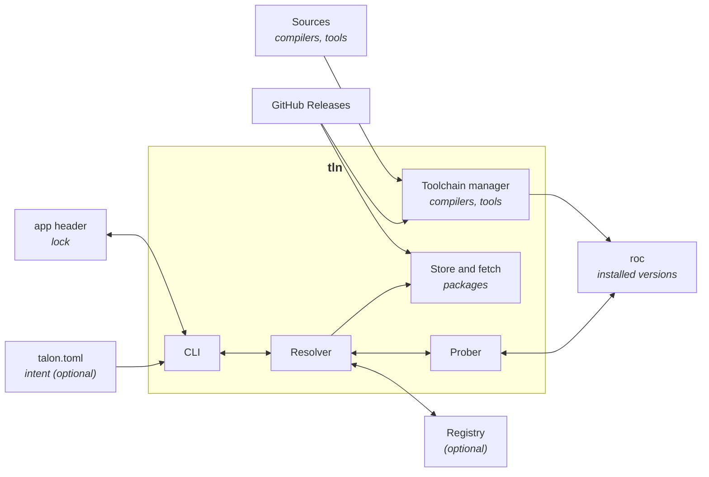

# Talon design overview

A map of the Talon components. It is not part of the spec and it is not complete. The design files contain the rules.

## The Big Picture

Talon is one binary, `tln`. It has five parts.

The CLI reads the commands of the user and edits the project files. You can set desired ranges of project dependency versions and configure Talon behavior in a `talon.toml`. This is useful to automatically update to the latest compatible package versions when they release. The versions lock is the app header in `main.roc`: it has the exact URL and hash of each dependency, and the `roc:` pin.

The resolver selects the versions of the packages, the platform and the Roc nightly that work together. When it does not know if a package works with a nightly, it asks the prober.

The prober runs `roc check` and `roc build` to find out.

Store and fetch downloads the selected packages from GitHub Releases and puts them in the roc cache.

The toolchain manager installs compilers and runs the correct one when the user types `roc`. It also builds compilers and Roc apps (tools) from source.

The registry is optional, and runs on Cloudflare. It gives the resolver the list of releases and the known compatibility results in one request (a second one only when a workspace must move a held version). Without it, Talon reads the GitHub API. Talon never builds a package: `roc` compiles packages as part of the app. 

The diagram below shows how Talon components relate to each other.

## Components

| Component | Runs in | Its job | Not its job | Spec |
| --- | --- | --- | --- | --- |
| CLI | `tln` | Commands, prompts, output. Edits the header and `talon.toml`. Runs the scripts of `talon.toml` when the user names one (`tln run`). | Select versions. Replace `roc build` or `roc check`. Run a script by itself (no hooks). | CLI 1 to 5 |
| Resolver | `tln` | Select the packages, platform and nightly that work together | Set transitive versions (roc MVS does). Run the compiler. | Resolution |
| Prober | `tln` | Run `roc check` and `roc build` to learn if a hash works with a nightly | Decide which versions to try | Resolution 4 |
| Toolchain manager | `tln` | Install and select compilers, the `roc` proxy, cache GC. Build Roc apps from source and install them as tools on `PATH` (`tln tool install`, `tln x`). Build and run the project tools that `[tools]` of `talon.toml` locks. | Change the header `roc:` pin (only `tln upgrade` does) | CLI 6 |
| Store and fetch | `tln` | Download and verify packages into the roc cache | Host package bytes | CLI 7 |
| Registry | Cloudflare Worker | Index of releases and a shared compatibility matrix | Store bytes. Be required: Talon works with GitHub only. | Registry |
| Compat bot | GitHub Actions | Probe packages on each new nightly and fill the matrix | Run inside the registry | Registry 6 |
| `cloudflare-workers` | Cloudflare Worker | A generic Roc platform for Workers. The registry runs on it. | Hold registry logic | Registry 8 |
| Talon packages | Library: `tln` and the Worker | Pure Roc logic with Talon concepts: the solver, records | Do I/O | Design 6.1 |
| Generic packages | Library: `tln` and the Worker | `roc-semver`, `roc-base58`, `roc-toml`, `roc-app-header`, each in its own repo | Know anything about Talon | Design 6.1 |

## Left to others

| Job | Owner |
| --- | --- |
| Compile, check, test, format | `roc` |
| Transitive versions (MVS) | `roc` |
| Package and compiler bytes | GitHub Releases |
| Package names | GitHub (`owner/repo`) |
| Build graphs, file-change detection, caches of task results, parallel task runs | `make`, `just` (a step of `tln run` can call them) |
| Deploy, local dev servers of a platform (for example Wrangler for Workers) | The tools of the platform, as external programs |
