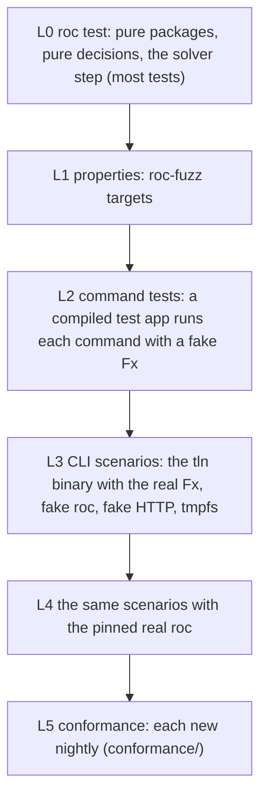
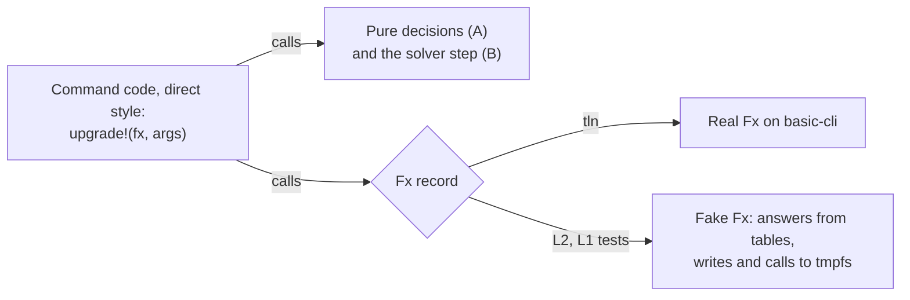
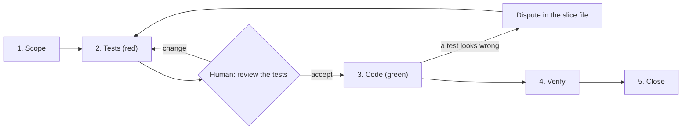

# Talon testing and the TDD workflow

How Talon is tested, and how an agent goes from the design to a tested feature.

| Item | Value |
| --- | --- |
| Status | Draft 2, 2026-10-15. Draft 2 drops "commands as data" (`Program`): commands are direct-style code over an effect record (section 2). No Talon code exists yet. |
| Scope | The `tln` CLI and the Talon packages (Design 6.1). The generic packages (`roc-semver`, `roc-base58`, `roc-toml`, `roc-app-header`) use the layers L0 and L1 and this workflow in their own repositories (R-GP5). Not the `cloudflare-workers` platform: it has its own `PLAN.md`. |
| Spec | The 4 design files. A test checks a design rule. A test never invents behavior that the design does not state. |
| Evidence | `research/test-fs/` (tmpfs against ext4, container start times), `research/core-shape/` (code shapes and fakes), `research/roc-fuzz-check/` (roc-fuzz on the pinned nightly), `research/roc-http-fetch/` (roc fetch from `http://`, TQ4), `scripts/rules.sh` (rule coverage) |

Rule ids in this file start with TW (workflow) and TQ (open questions). They are not used in the design files.

## 1. Test layers

Most tests run in Roc with no real file, process or network. Only a small part of the tests start `tln`, and fewer start a real `roc`.



| Layer | What it tests | Tool | Isolation | Time target | When it runs |
| --- | --- | --- | --- | --- | --- |
| L0 | The Talon packages: `resolve` (pubgrub), `records`. The generic packages run their own L0 in their repositories (R-GP5). The pure decisions and the solver step of each command (section 2). | `roc test` with `expect` | None needed (pure) | Under 10 s for all | Each edit |
| L1 | Round trips, "never crashes", agreement with a simple oracle. Also whole commands with a fake `Fx`, on their result. (Section 4.) | roc-fuzz, a fixed `--runs` count | Its own process | Under 60 s in the fast set | Before each hand-off. Long runs each night. |
| L2 | The flow of each command: which `Fx` calls in which order, what it writes, prompts and answers, budget, errors of each effect | `tests/commands/` (section 2.4): one compiled basic-cli app, fake `Fx` | A new directory on tmpfs per case | Under 30 s for all, with the build | Before each hand-off |
| L3 | `tln` end to end with the real `Fx`: arguments, exit codes (R-E1 to R-E4), `--json` (R-J1 to R-J6), the TTY (R-NR1), the jobs of the real `Fx` (2.3), design examples | `tests/run.sh` (section 3) | A new directory on tmpfs per case, fixed environment, no network | Under 60 s for the fast set | Before each hand-off |
| L4 | The L3 cases tagged `real-roc`: probes, builds, the cache contract (CLI 7.2) | Same runner, real `roc` at the pinned nightly | Same, with a warm read-only package cache | Minutes | Before a merge, and each night |
| L5 | Talon and `roc` agree on group keys, MVS and the cache layout, on each nightly | `conformance/*/run.sh` | Own cache dir per suite | Long | For each new nightly |
| Other | `install.sh`, `install.ps1` | `install/test.sh` (exists) | Fake release on `file://` | Seconds | When `install/` changes |

The runs differ in the build mode and in the cases that they include:

| Run | Command | Test binaries | Cases | When |
| --- | --- | --- | --- | --- |
| Fast | `scripts/test.sh` | `--opt=dev` | No `slow` case | Before each hand-off (TW20) |
| Merge | `OPT=speed SLOW=1 scripts/test.sh` | `--opt=speed` (LLVM) | All `slow` cases | Before a merge, and each night |
| Nightly | `OPT=speed SLOW=1 NET=1 REAL_ROC=1 scripts/test.sh`, and the long L1 runs | `--opt=speed` | The `slow` cases and L4 | Each night |

The dev backend and LLVM can give two results for one program. The merge run finds such a difference. A difference is a roc bug: report it. The case keeps the `speed` result (TW25).

## 2. Code shape for tests

Evidence: `research/core-shape/README.md`.

### 2.1 What Roc allows

| Option | Result on the pinned nightly |
| --- | --- |
| A fake effect record in an `expect` | Not possible. `roc test` rejects an `expect` that calls a `!` function, also when the fake is pure. |
| A fake effect record in a compiled basic-cli test app | Works |
| A fake effect record in a roc-fuzz target | Works (50,000 inputs. A wrong property fails.) |
| A fake that keeps state in memory (a call log, the files it wrote) | Not possible: a lambda cannot change a `var` that it captured (language reference, not tested here). The fake writes its state to files on tmpfs. |
| Commands as data (`Program`, a command plus a continuation), run by a pure interpreter in `roc test` | Works, but the code is hard to read (nested closures, no `?`), and the tests need a second interpreter next to the real one. Dropped on 2026-10-15. |

### 2.2 Three parts



| Part | What it is | Examples | Tested by |
| --- | --- | --- | --- |
| A. Pure decisions | `input -> output` | The range rewrite (R-UP5), the header edit, the error-set compare and blame (Resolution 4), the result class of a probe (R-P2, R-P3), the build skip, the GC selection, the answer of a prompt in each mode (CLI 4), the output text and `--json`, `list`, `why` | L0, L1 |
| B. Solver step | `step : State, Facts -> [Need(List(Probe)), Done(Tuple), Fail(Why)]`. The state is data. The solver stops when it needs probe results, and the command calls it again with them. | PubGrub with the lazy oracle (Resolution 5) | L0, L1 (against brute force) |
| C. Command code | Direct-style Roc with `?`. Gets an `Fx` record. Calls A and B for each decision, and `Fx` for each effect. | `install`, `update`, `upgrade`, `verify`, `probe`, `roc ...`, `tool ...`, `x`, `init`, `outdated`, `setup`, `cache gc`, `cache clean`, `remove` | L2, L1 (result only), L3 |

### 2.3 The `Fx` record

The calls of `upgrade` (Resolution 4, 5, 10) show which effects are needed:

| # | Step of `upgrade` | `Fx` call | Note |
| --- | --- | --- | --- |
| 1 | Read the header, `talon.toml`, `config.toml` | `read_files!(list)` | |
| 2 | Facts from `compat.db` | `db_query!` for the whole closure | One query. Then the facts are a `Dict`. |
| 3 | Baseline check | `probes!([baseline])` | Gives back exit, signal, timeout and output. Part A sorts it into pass, fail, hang, crash and parses the error set. |
| 4 | Metadata of the closure | `fetch!(list)` | One request with the registry. Many with `direct`. |
| 5 | R-NI12, R-NI3, R-NI4 | `ask!(prompt)` | Part A gives the answer with no prompt in non-interactive mode, with `--yes` or `--json` (CLI 4). |
| 6 | Compiler downloads | Part of `probes!`: a probe names the compiler that it needs | R-PP1: the real `Fx` starts the download and holds the probe until it is done |
| 7 | Unit probes, up to 12 | `probes!(round)` | Results in the order of the list (R-PP3). The command never sees the order in which probes end, so G3 holds. |
| 8 | Import scan | `read_files!(level)`, one call per import level | |
| 9 | Whole-app check on a temp copy | `copy_tree!`, then `probes!([app])` | |
| 10 | Build, or skip | `probes!([build])` | The skip is part A |
| 11 | New facts (R-PP4) | `db_write!(facts)` after each round | |
| 12 | Write the header and `talon.toml`, print | `write_atomic!(list)`, `print!` | |
| (any) | A lock (CLI 7.4, R-CC3) | `lock!(item, mode)`, `unlock!`, through `with_lock!` | The fake `Fx` writes each call to `calls.log` and answers `Held` or `Busy` from its table. The real `Fx` contains the implementation (R-CC12) and its heartbeat. |

The loop of steps 7 to 11 calls the solver step until it is done, or the budget (R-P5, R-UP7) is spent.

The real `Fx` keeps the jobs that are about time, processes and the system. L3 tests them:

| Job of the real `Fx` | L3 test |
| --- | --- |
| Slots and parallel runs (R-PP1, R-PP5) | 13 fake probes: at most 12 at the same time |
| Timeouts, kill of a hung probe | A fake `roc` that sleeps |
| Download progress, streaming to a file, the hash check (CLI 7.5) | Fake HTTP: a slow body, a bad hash. Each case runs with `TALON_DOWNLOADER=curl` and with `wget` (R-DA2). No `curl` and no `wget` on `PATH`: exit code 18. |
| Exec with the terminal (`x`, the `roc` proxy, `patch` with an editor) | Exit code passes through |
| Safe stop on Ctrl-C or a kill. No signal handler (Design 6.2, R-HF8). | Kill `tln` with SIGINT and with SIGKILL during an install and during a probe round. Then the store has no partial item, and the next install and `tln cache gc` remove the stale temps (CLI 7.4, R-CC1, R-CC2) |
| Locks between processes (CLI 7.4) | 3 proxy runs at once that need one missing fake nightly: 1 download, 3 builds (R-CC4). 2 `tool install` runs at once: `tools.json` has both entries (R-CC6). An edit of the header during `upgrade`: exit code 17 (R-CC7). GC during a fake build: the compiler stays (R-CC10). A lock dir with an old `beat` (set with `touch -d`): the next process takes it (R-CC12). An `ask!` call while the fake `Fx` holds a lock fails the L2 case (R-CC3, point 5). The lock contract (R-CC3, points 1 to 5) is one L3 suite, so a new implementation runs the same cases. |
| Rename of a running `.exe` (R-S3, R-RM5) | CI on Windows |

### 2.4 Command tests (L2)

`tests/commands/` is one basic-cli app. It runs each case in its own directory on tmpfs.

| Item | How |
| --- | --- |
| Fake answers | Tables keyed by the arguments: path to content, URL to response, probe to result, prompt to answer |
| Fake writes | `write_atomic!` and `copy_tree!` write to the case directory, so the test compares the file tree |
| Call log | Each fake call adds one line to `calls.log` in the case directory. A fake that must answer in another way on a second call reads this log. |
| Checks | The result, the file tree and `calls.log` against the expected values of the case |
| Fake against real | A small contract suite runs the same cases against the fake `Fx` and the real `Fx` on tmpfs (files only), so the fake stays true |

### 2.5 Rules

| Rule | Text |
| --- | --- |
| TW1 | Each decision that a design rule names is a part A function or is in the solver step. Command code only orders the calls, and passes values between them. |
| TW2 | Each value that changes between runs comes from `Fx`: the clock, environment variables, the TTY state (R-NR1), the random part of temp names (CLI 7.1), the order of a directory list. So a test fixes them. |
| TW3 | `Fx` calls are coarse: "fetch this URL to this file and check this hash", "run this probe round". Not "read 4 KB". |
| TW4 | The real `Fx` has no Talon logic. It gets L3 tests: one case for each `Fx` call and each job in 2.3. |

One `roc test` run of a small module with 4 `expect`s takes 15 to 25 ms (`research/test-fs/`). A small basic-cli test app builds in about 0.5 s (`research/core-shape/inject_test.roc`). The full `tests/commands/` app builds in 5 s with `--opt=dev` and in 98 s with `--opt=speed` (2026-10-22). Its 35 cases run in 0.5 s. The `tln` app builds in 2 s and in 87 s.

## 3. CLI scenario tests (L3, L4)

### 3.1 Case layout

```text
tests/scenarios/<area>/<id>-<name>/      for example tests/scenarios/add/h3-pin-exact-url/
  cmd                one command per line, run with sh -e
  given/home/        start state of HOME (config, toolchains, roc cache)
  given/project/     start state of the project (main.roc, talon.toml)
  given/http/        routes for the fake HTTP server (GitHub API JSON, release assets)
  given/env          optional: more environment variables, one NAME=value for each line
  given/roc.tsv      answers of the fake roc: argv pattern, exit code, stdout file, stderr file
  expect/stdout      expected output, with paths written as $HOME and $PROJECT
  expect/stderr
  expect/exit        expected exit code
  expect/tree.diff   expected change to given/ (a diff of the file trees, temp files and talon/compat.db left out)
  expect/facts.tsv   expected rows of talon/compat.db (optional, from P1)
  expect/roc.log     expected roc calls, in order (optional)
  tags               optional: real-roc, slow, net, tty, windows, exdev
```

| Tag | Meaning | In the fast set |
| --- | --- | --- |
| `slow` | The case takes more than 2 s with small limits (TW27) | Skipped. `SLOW=1` runs it. |
| `real-roc` | L4: the pinned roc, not the fake | Skipped. `REAL_ROC=1` runs it. |
| `net` | The case needs the real network (GitHub API, real downloads). The cases of this tag cut no network. | Skipped. `NET=1` runs it (the nightly run only). |
| `tty` | A pseudo terminal (3.2) | Runs |
| `windows` | Windows only | Skipped on Linux |
| `exdev` | Needs two file systems | Skipped |

### 3.2 The runner

| Item | How |
| --- | --- |
| Work dir | `$TMPDIR/talon-test/<case>/`. Copy `given/` there. On Linux, `/tmp` is often tmpfs. In the container it is a `--tmpfs` mount. |
| Environment | `env -i`, then only `HOME`, `PATH`, `XDG_*`, `ROC_CACHE_DIR`, `TALON_*` set to the work dir, `TZ=UTC`, `LANG=C.UTF-8`, `CI=true`, `TALON_REGISTRY=direct`, then the lines of `given/env`. So the change of the default registry in P2 (CLI 1) changes no case of P0 or P1 (Design 7). |
| Paths | Absolute, with no `..`. With `..` in `XDG_CACHE_HOME`, `roc check` reports "No errors found" on an app with a type error, and `roc build` stops with `PathOutsideWorkspace` (`conformance/check-scope/README.md`). |
| Network | Off (`--network none` in the container, or `bwrap --unshare-net`). A case that reaches the real network fails. |
| Fake `roc` | `tests/fakes/roc` is first on `PATH`. It writes its argv to `roc.log` and answers from `given/roc.tsv`. With the tag `real-roc` (L4), the runner puts the pinned `roc` there instead. |
| Fake HTTP | One local server for the run, on `127.0.0.1`. It serves `given/http/` and can answer 404, 403 rate limit, a slow body and a bad hash. Talon reaches its routes through `TALON_GITHUB_API`, `TALON_GITHUB_RAW` and `TALON_ZIG_INDEX` (CLI 1, test hooks). A package with a `github.com` URL is pre-filled in `given/home/` (`packages/<hash>/`). A fetch test uses a loopback package URL. |
| Clock | `TALON_NOW` fixes the clock of Talon (CLI 1, test hooks) |
| TTY | A case with the tag `tty` runs under a pseudo terminal and reads its answers from `given/answers`. The runner sets `TALON_INTERACTIVE=1` for it, because `CI=true` turns on non-interactive mode (CLI 4). Else stdin and stderr are not a TTY (R-NR1). |
| Compare | stdout, stderr, exit code, tree diff and `roc.log`. A difference fails the case and prints a diff. |
| Update | `UPDATE=1 tests/run.sh <case>` writes the actual output to `expect/`. Only for a change that the slice intends (TW11). |
| Parallel | Cases run in parallel, at most `JOBS` at one time (default: the CPU count). Each has its own dirs. The L0 files run in parallel the same way. |
| Build mode | `OPT=dev` (default) or `OPT=speed`. The three scripts that build a test binary (`scripts/test.sh`, `tests/run.sh`, `tests/commands/run.sh`) pass `--opt=<mode>` to `roc build`. Another value: exit 2 (TW25). |
| Slow cases | A case with the tag `slow` is skipped. `SLOW=1` runs it (TW27). |
| Memory | `scripts/test.sh` limits its `roc` jobs to `TEST_MEM_GB` (default: a third of MemAvailable): jobs = min(CPUs, (budget - reserve) / peak of one call). It also removes old files from the roc object cache (`OBJ_KEEP`, default 3 per dir): a large cache made `roc check cli/main.roc` use 14 GB. Numbers: `research/test-memory/RESULTS.md`. |

### 3.3 Changes the design needs for these tests

All settled on 2026-10-15. The design has the test hooks in CLI 1 ("Environment variables", "Test hooks", "Packages in tests").

| # | Need | Why | Settled |
| --- | --- | --- | --- |
| TQ1 | The GitHub API base URL | Talon sends a token only to `api.github.com` (CLI 1). A test must reach the fake server instead, and must never send a real token. | `TALON_GITHUB_API`, a base URL. When it is set, Talon reads no token source and sends no token. |
| TQ2 | Fetch from the fake server, with the header URL unchanged | The host is part of the package identity (Design 2, R-H5). So a fixture URL must keep `github.com`. | No fetch map: it would be a second kind of mirror. A case with a `github.com` URL pre-fills `packages/<hash>/` (Design 9 Q2). A test of the fetch path uses a loopback URL, which Talon and roc both fetch. |
| TQ3 | The clock in L3 | GC uses ages (CLI 6.3), and the compiler cache files expire after 30 days | `TALON_NOW`, a UTC time (RFC 3339). The real `Fx` reads it (TW2). It does not change the clock of roc. |
| TQ4 | Does `roc` fetch from `http://` URLs? | L4 cases with a fake server | Only from `127.0.0.1`, `::1` and `localhost` (Design 9 Q24, `research/roc-http-fetch/`). L4 follows TQ2. |

## 4. Property tests and roc-fuzz

[roc-fuzz](https://github.com/lukewilliamboswell/roc-fuzz) is a platform. A fuzz target is a small app on that platform. It imports the module under test, makes typed values with generators, and checks a property. The search is coverage-guided. A failure is saved, can be replayed, and is made smaller (minimized). It found real bugs in roc builtins on 2026 nightlies (its `trophy-case/`).

It is useful for Talon, with these limits:

| Item | Fact | Effect on Talon |
| --- | --- | --- |
| Target code | The target is effectful (`test!`), but the platform gives no file, process or network effect | It fits the pure packages, parts A and B, and command code with a fake `Fx` (section 2). A fake in a target cannot keep a call log or files, so a command property checks the result only. |
| Systems | Linux x86-64 with musl, and macOS on Apple Silicon | CI runs L1 on Linux. A developer on another system skips L1. |
| Compiler | 0.4.3 (2026-10-05) was tested by its author on `nightly-2026-09-29-7f11a82`. | Tested here on Talon's pinned nightly `2026-10-09` (`research/roc-fuzz-check/`): it builds. A local module (`import Semver`) works. 200,000 inputs of a round trip ran in 0.85 s with no failure. With a planted bug, it failed in 39 ms, saved the input, and `replay` gave the failure again. |
| Speed | One native binary per target. Build: 8 s the first time (with the platform download), then about 0.7 s after a source change. | Keep few targets, one property each. `minimize` runs up to 600 s by default, so give it a time limit. |

Targets, in the order of risk:

| Package | Property | Oracle | Repository |
| --- | --- | --- | --- |
| header parser and span edit | Parse never crashes. An edit changes only its span: all other bytes stay the same. Parse after print gives the same value. | Seeds: the headers of the packages in the roc cache (46 on this machine). A script runs `roc fmt` on them, so the expected values are found outside the target (Design 6.2). | `roc-app-header` (R-GP5) |
| pubgrub | On small random graphs, the result equals a brute-force search of all version tuples. A failure explanation names only real conflicts. | Brute force (only small graphs) | Talon (`packages/resolve`) |
| MVS and group key | Same result as the rule of `package_resolution.zig:816-838`, for random graphs | A second, independent Roc implementation of the rule in the test code, written from the rule text of Design 2 (clean room, no code taken from roc, R-GA7) | `roc-app-header` (R-GP5) |
| semver | Order is total and agrees with a tuple compare. `parse(to_str(v)) == v`. | Round trip | `roc-semver` (R-GP5) |
| toml | `parse(print(doc)) == doc`. Parse never crashes. | Round trip | `roc-toml` (R-GP5) |
| base58 | `decode(encode(b)) == b`. A leading zero byte is kept. | Round trip | `roc-base58` (R-GP5) |
| `upgrade`, `update`, `install` with a fake `Fx` | Random probe results and prompt answers. The command never reports more probes than `probe.max` (R-P5). A refused required prompt gives exit 13 and no header change. A pass is reported only when the fake said pass for each probe of the tuple. | The fake tables | Talon |

| Rule | Text |
| --- | --- |
| TW5 | Each failure that L1 finds becomes a plain `expect` in L0 (or an L2 case for command code), with the minimized input, before the fix. |
| TW6 | The fast set uses `--runs` (a fixed count), not `--time`, so the result does not depend on the machine. |
| TW7 | If roc-fuzz does not build on the pinned nightly, the same properties run in L0 as an `expect` over a list of values from a fixed-seed generator (roc-random). That gives no coverage feedback, but the properties exist. |

## 5. The in-memory file system and the container

Measured on 2026-10-15 (`research/test-fs/README.md`):

| Case | ext4 ms | tmpfs ms |
| --- | --- | --- |
| `roc test`, small module, empty cache | 24 to 25 | 23 to 25 |
| `roc check`, basic-cli app, empty build cache | 145 to 160 | 130 to 168 |
| Copy, tar and untar a 13 MB package | 32 to 38 | 28 to 31 |
| 200 writes with `fsync` and `rename` | 425 to 431 | 23 to 25 |

| Isolation | Start ms |
| --- | --- |
| New directory and environment | about 0 |
| `bwrap`, tmpfs `HOME`, no network | 35 |
| `docker run --rm --network none --tmpfs /work` | 260 to 440 |

Decision:

| Rule | Text |
| --- | --- |
| TW8 | Each L2 and L3 case gets a new directory on tmpfs and its own environment. No container per case: it costs 260 ms or more. |
| TW9 | One container per test run, for agents and CI: `docker run --rm --network none --tmpfs /work:exec,size=4g talon-test tests/run.sh`. The image holds the pinned roc, Zig and the test tools. A read-only layer holds a warm package cache (basic-cli and the fixtures), and the runner copies or overlays it per case. |
| TW10 | tmpfs helps only where Talon calls `fsync`. Speed comes from section 2 (no process in L0 to L2) and from the fake `roc`. Do not add `roc` runs to L3 to get "more real" tests. Put them in L4. |

tmpfs is not the file system of all users. These cases need their own setup:

| Case | Rule | Setup |
| --- | --- | --- |
| `rename` across file systems (`EXDEV`) | R-B4 | Container with two tmpfs mounts, tag `exdev` |
| Case-insensitive names | macOS default | CI job on macOS (`.github/workflows/ci.yml`) |
| `rename` of a running `.exe`, no symlinks | R-S3, R-IS5, R-RM5, CLI 6.2 | CI job on Windows (`.github/workflows/ci.yml`). The Windows job runs `check fmt l0` until a slice adds more. |
| Disk full | Store, GC | tmpfs with a small `size=` |

## 6. Regression depth

| Rule | Text |
| --- | --- |
| TW11 | A bug fix starts with a test that fails on the bug. The test names the bug (issue or rule id). Then the fix. |
| TW12 | Each new test must fail when its change is reverted (org rule). `scripts/revert-check.sh` (to write, section 7) checks it: it restores the code files of the slice to the parent commit, keeps the new tests, and expects them to fail. |
| TW13 | A test names the rule ids that it checks, in a comment (`# R-H3: ...`) or in its case directory (`r-h3-...`). `scripts/rules.sh` counts this. `MISSING=1 scripts/rules.sh R-H R-NI` lists the rules with no test. Rule coverage is a lower limit: text with no id (explanations, examples, measurements) has no test that names it. |
| TW14 | Real-world inputs are fixtures: the headers of the cached packages, the releases in the roc-awesome list, and the `talon.toml` examples of the design. Their expected outputs are files in the repo. |
| TW15 | A flaky test is a bug. There are no retries. A test that depends on time, order or the network gets the value from `Fx` (TW2) or a fake. |
| TW16 | A design example (a command and its output in the design files) is an L3 case of the first phase that can run it: the phase of its command (Design 7), or the later phase that the design states next to the example. If the design changes the example, the case changes in the same commit. |

## 7. Agent workflow

### 7.1 Steps



| Step | Who | Reads | Writes | Must not | Done when |
| --- | --- | --- | --- | --- | --- |
| 1. Scope | Scope agent | Design 7 (phases), `scripts/rules.sh` output, `docs/slices/`, git log | `docs/slices/NNN-<name>.md` (7.2) | Write code or tests. Invent behavior. | The slice lists its rule ids, design refs and test list. Open points are questions (TW17). Output that the design does not give is a proposal (TW24). |
| 2. Tests | Test agent | The slice file, the design sections it names, public signatures | Tests, fixtures, stubs that `crash "todo"` | Read or write the code bodies | The new tests compile and fail for the right reason ("todo" or a wrong value), and all old tests pass |
| Review | Human | The slice file and the tests | Accept, or notes | | The tests say what the design means. This is the cheapest place to find a wrong reading of the design. The human accepts or changes the proposed output (TW24). |
| 3. Code | Code agent | The slice file, the tests, the code | Code | Edit a test or a fixture (TW18) | All tests pass |
| 4. Verify | Verify agent or script | All | Results in the slice file | | L0, L1 fast, L2 and L3 fast pass in fast mode (TW25). `scripts/revert-check.sh` passes. `scripts/rules.sh` shows the slice ids covered. |
| 5. Close | Human | The diff | Commit (only when asked) | | Design changed in the same commit if a question was settled. The output catalog (CLI 3) has the accepted `data` fields (R-OUT3). |

### 7.2 Slice file

```markdown
# NNN <name>

Phase: P0. Status: scope | tests | review | code | verify | done

## Rules
R-H3, R-H5, R-C2 (Design 4.2, Resolution 2)

## Tests
| Layer | Case | Checks |
| L0 | `packages/resolve/Pin.roc`: the pin decision gives the exact release URL | R-H3 |
| L2 | `tests/commands/add/h3-pin-exact-url`: the header write and the probe calls | R-H3 |
| L3 | `tests/scenarios/add/h3-pin-exact-url` | R-H3, R-E1 |

## Output (proposed, R-OUT2: human text and `data` fields)
## Out of scope
## Questions (stop until answered)
## Disputes (from the code agent)
## Verify results
```

### 7.3 Rules

| Rule | Text |
| --- | --- |
| TW17 | If the design does not say what to do, or says two things, the agent does not choose. It writes the question in the slice file and in Design 9 (Open), and stops that part of the slice. |
| TW18 | The test agent and the code agent are two agents. The code agent does not change tests. If it thinks a test is wrong, it writes a dispute and stops. Reason: one agent tends to write tests that fit its own code, not the design. |
| TW19 | A slice is one rule group or one command path, small enough for one review: about 400 lines of code or less. |
| TW20 | Before each hand-off, the fast set (L0, L1 fast, L2, L3 fast) passes, in under 3 minutes. Each step has a share of this time (TW26). |
| TW21 | `UPDATE=1` is allowed only for outputs that the slice changes. The agent reads each changed expected file before the hand-off. |
| TW22 | Prototype and research code goes in the repo (`research/`), never only in a temp dir. |
| TW23 | No commit or push unless the user asks. |
| TW24 | Output that the design does not give (human text, `data` fields) is not a TW17 question. The scope agent proposes it in the slice file, the test agent writes it in the expected files, and the human accepts it at the review (CLI 3, R-OUT1 to R-OUT5). A fact that the design does not give (what the command decides) is still a TW17 question. |
| TW25 | The fast set builds the test binaries (`l2`, `tln`, `fxprobe`, `flowprobe`) with `--opt=dev`. `OPT=speed` gives the LLVM build. The merge run and the nightly run use `OPT=speed`. If a case passes in one mode and fails in the other, it is a roc bug: report it. The case keeps the `speed` result. |
| TW26 | `scripts/test.sh` prints the budget of each step. With `OPT=dev` (the default) it prints a `WARN` line for a step over its budget and for a run over 180 s. With `OPT=speed` it prints no `WARN` line (the LLVM build is slow on purpose). A warning does not fail the run. The budgets (seconds): check 10, fmt 5, l0 10, l1 60, l2 30, l3 60, selftest 20. `BUDGET_<STEP>=<s>` and `BUDGET_TOTAL=<s>` change them for one run. After a warning, the slice removes the cause before the hand-off (a slow case gets the tag `slow`, TW27), or the human changes a budget in this file. |
| TW27 | An L3 case with a real wait sets small limits (for example `probe.timeout = 1` in `config.toml`). A case that still takes more than 2 s has the tag `slow`. The fast set skips it. `SLOW=1` runs it. The merge run and the nightly run set `SLOW=1`. |
| TW28 | CI is in `.github/workflows/`. `ci.yml` runs the fast set (`scripts/test.sh`) on Linux, macOS and Windows for each push and pull request. The Windows job runs `check fmt l0` until a slice adds more. `nightly.yml` runs `OPT=speed SLOW=1 NET=1 REAL_ROC=1 scripts/test.sh` each night and on request (the merge run). The nightly tag of the compiler is `ROC_TAG` of `scripts/env.sh` and nowhere else. A workflow gets the compiler with `scripts/get-roc.sh` and never uses a path of `cloudflare-workers/`. A selftest row reads the workflow files (no runner can run them in the test run). |

### 7.4 First scope, by phase (draft)

The phases are in Design 7. This map is a first draft. The scope agent checks it against the design at step 1.

| Phase | Rule groups | Notes |
| --- | --- | --- |
| P0, generic packages | Their own rules, in their repositories (R-GP5) | First: `roc-app-header` (group key and MVS: Design 2 has the facts and tests), then `roc-semver`, `roc-base58`, `roc-toml`. Each is released before Talon uses it (R-GP3). |
| P0, Talon | R-H, R-I, R-C, R-RP, R-E, R-EC, R-J, R-OUT, R-NR, R-NM, R-PD, R-DI, R-WS, R-TF, R-VA, R-SP, R-LF, R-DT, R-AL, R-OV, R-LD, R-BL, R-BS, R-RC, R-SL, R-SC, R-AD, R-RV, R-RG, R-LY, R-FE, the P0 parts of R-CM, R-FL and R-EV, the P0 prompts of R-NI (R-NI1 to R-NI3), R-SO7 (rank 7 of Resolution 13), R-HF1, R-HF3, R-HF4, R-HF5, R-HF12, R-DA, R-CR, R-ID, R-PK, R-PL1, R-GA (except R-GA2), R-CF, R-PH, R-SE (each row: the phase of the rules that it names), R-CC1 to R-CC3, R-CC5 to R-CC7, R-CC11, R-CC12 | P0 writes project files, `packages/` and `projects.json` (R-PD9), so it needs the atomic writes and the locks. The P0 commands and the P0 limits of Design 7: `install` (and `add`, `--frozen`), `remove`, `update`, `list`, `why`, `verify`, with `direct` as the index. A P0 test needs no compiler download and no unit probe, so P1 does not change its result. |
| P1 | R-NS, R-P, R-PP, R-PB, R-EP, R-UM, R-EF, R-PA, R-LB, R-UP, R-IN, R-PX, R-GC, R-CS, R-SO1 to R-SO6 and R-SO8 to R-SO18, the other parts of R-CM, R-FL and R-EV, R-DL, R-CV, R-T, R-X, R-B, R-S, R-IS, R-RM, R-R, R-LK, R-U, R-RU, R-RR, R-D, R-ST, R-CC4, R-CC8 to R-CC10, R-NI4 to R-NI15, R-HF2, R-HF6, R-HF11 | The P1 commands of Design 7: `upgrade`, `init`, `outdated`, `probe`, `patch`, `x`, `tool`, `roc`, `cache`, `setup`, the proxy. R-IS is tested today by `install/test.sh`. |
| P2 and later | Registry: R-RL, R-SG, R-AP, R-RE, R-IK, R-MX, R-CT, R-PU, R-WH, R-OT, R-PL2, R-GA2. `publish`, `probe --share`, sharing, `tln share` and the smoke build (R-SH, R-SM, R-NM12, R-NI16) (P2), `audit` (P3). | Needs the `cloudflare-workers` platform. Not in this file. The tests of R-WH and R-OT are in `cloudflare-workers/` (`bench/node-test.mjs`). |

## 8. Order of work

| # | Task | Result |
| --- | --- | --- |
| 1 | `scripts/rules.sh` | Done (2026-10-15). 155 rule ids at that time (`scripts/rules.sh` gives the current count), 0 with a test. Revert check: a test file that names R-H3 makes the count 1; without it, 0. |
| 2 | Build one roc-fuzz example on the pinned nightly | Done (2026-10-15, `research/roc-fuzz-check/`). L1 is possible. TW7 stays as the fallback for a later nightly. |
| 3 | `tests/commands/`: the fake `Fx`, the case runner, one example command | The L2 harness, with a test of each check (a wrong result, a wrong file tree, a missing call). Measure its build time. |
| 4 | `tests/run.sh`, `tests/fakes/roc`, the fake HTTP server, one example case | The L3 runner, with a test of each compare (a wrong exit code, a wrong tree diff, an unexpected `roc` call) |
| 5 | `scripts/revert-check.sh` | TW12 runs as a script |
| 6 | The container image (TW9) | `docker run ... tests/run.sh` passes |
| 7 | Settle TQ1 to TQ4 in the design | Done (2026-10-15). CLI 1 has the test hooks (section 3.3). |
| 8 | Subagent definitions in `.claude/agents/` for the scope, test and code agents, and a hook that stops the code agent from editing `tests/` | TW18 is enforced, not only written |
| 9 | First slice: group key and MVS, in the `roc-app-header` repository (Design 6.1, R-GP2) | L0 cases from the facts of Design 2. The L5 check against `roc` stays in Talon `conformance/` (R-GP5). |
