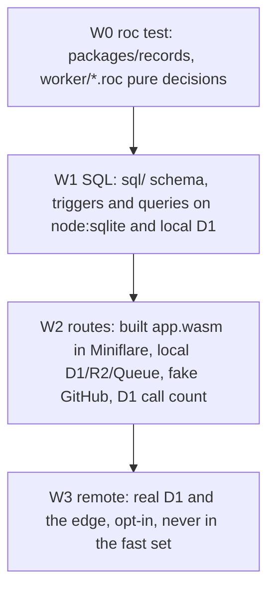
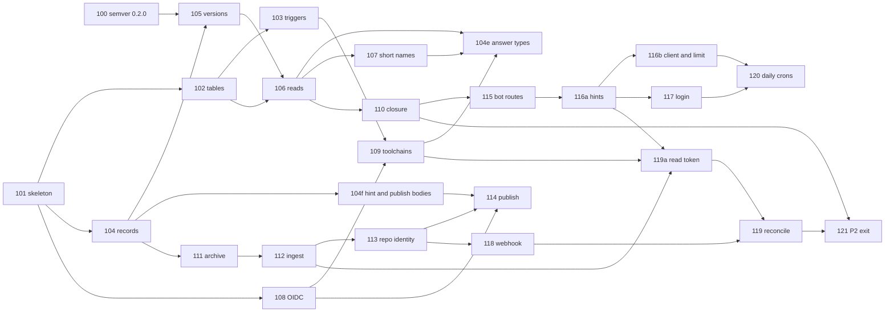

# Registry slice plan (P2)

The plan for the registry Worker (`worker/`), its schema (`sql/`) and the Talon package `packages/records`, in slices (`TESTING.md` 7). The manager keeps this file. It continues `docs/slices/PLAN.md` (P0) and `docs/slices/PLAN-P1.md` (P1). Each slice has its own file `docs/slices/NNN-<name>.md` (`TESTING.md` 7.2).

| Item | Value |
| --- | --- |
| Status | Draft 1, 2026-11-01. Not reviewed by the human. Section B is a proposal. |
| Scope | The registry of Design 7 P2: D1, the API, publish with OIDC (Registry 7.1), the webhook, the ingest, the compat bot routes, the crons. The P3 items are listed last (section C.3). The `tln` client side of P2 (`publish`, `probe --share`, `share`, the registry index) is a separate track (section C.4). |
| Platform | `cloudflare-workers` 0.0.2 by its release URL. Design Q54 is settled as "release URL" (the user, 2026-11-01). The manager applies it to `DESIGN.md` (already in the working tree of `DESIGN.md` and `DESIGN-REGISTRY.md` R-WH12). |
| Probes | `research/registry-plan/` (README there) |
| Open rule ids today | `MISSING=1 scripts/rules.sh` on R-RL, R-SG, R-AP, R-RE, R-IK, R-MX, R-CT, R-PU, R-TP, R-SN, R-WH, R-OT, R-YK: 208 of 209 ids have no test (one R-IK id has one). |

## A. Toolchain (measured 2026-11-01, this machine)

### A.1 Versions and URLs

| Item | Value | Checked by |
| --- | --- | --- |
| Platform 0.0.2 | `https://github.com/Karakatiza666/roc-cloudflare-workers/releases/download/0.0.2/f352LLRKJCZ4JJVEocp3H9e4e6Sxa6Ym5CxZ1GZCpfd.tar.zst` (published 2026-11-01 16:27 UTC, tag on submodule commit `241182c`) | GitHub API releases list. The local `cloudflare-workers/dist/` has another hash (`3aADQ...`): a local build, do not use it. |
| Platform 0.0.1 | `.../0.0.1/GcDNxAwPR5tSzqU8T2Kdj35CK3sQMRQDB8ywwfZKdrm.tar.zst` | Not for the registry: `R2.Range` gives exit 2 on new nightlies |
| Nightly of the 0.0.2 build | `nightly-2026-10-31-f7bef6b` (`cloudflare-workers/compat/last-stack-first-nightly`) | Present at `cloudflare-workers/.cache/nightlies/nightly-2026-10-31-f7bef6b/roc` |
| Nightly of Talon CLI | `nightly-2026-10-14-38a3029` (`scripts/env.sh` `ROC_TAG`) | |
| `roc-cfw` 0.0.1 | `https://github.com/Karakatiza666/roc-cloudflare-workers-cli/releases/download/0.0.1/9fJGynVVjWajYb1sgwTGs7bFLRxB75VHuxMxnGu75UU8.tar.zst` | `tln add --tool` wrote it. Talon builds it with `nightly-2026-10-14-38a3029` and basic-cli 0.26.0. |
| `roc-semver` 0.1.0 | `https://github.com/Karakatiza666/roc-semver/releases/download/0.1.0/KFKmXaroJeaPkQmAaqm83fTP9yhnEkTQwE97a5BtFSX.tar.zst` | |
| `roc-tar` 0.0.1 (Design R-PK8, Q78, Q106) | `https://github.com/Karakatiza666/roc-tar/releases/download/0.0.1/FGAUE1Pds7Fvd48GkrAYd9rRUpztew8bgUZjUrKPGyo7.tar.zst` (released 2026-11-02 by the platform session). It has `Tar.check_portable_path` and `Tar.held_bytes`. The state between pushes is at most 511 + `max_meta_bytes` bytes. | Slice 111 |
| `roc-jwt` 0.0.1 (Design R-PK9) | `https://github.com/Karakatiza666/roc-jwt/releases/download/0.0.1/C35APf1eow8zsCV6yrDpXLr3wxrMQVPdtoTQSGAM9dDh.tar.zst` (released 2026-11-02 by the platform session). It depends on `niclas-ahden/roc-base64` 1.0.2 (`https://github.com/niclas-ahden/roc-base64/releases/download/1.0.2/DQBxATK6BtaCWe56bCmkMgdKJR2Ym8NiZZLhYCAgtLac.tar.zst`). Pinned nightly: `nightly-2026-10-31-f7bef6b`. | Slice 108b |
| Platform 0.0.3 | `https://github.com/Karakatiza666/roc-cloudflare-workers/releases/download/0.0.3/Bup7G6Xgk53Bot1YY9AKQP9e73JVGbWqUyqD24taUYRv.tar.zst` (released 2026-11-02). Built with `nightly-2026-10-31-f7bef6b` (the release nightly). `min_nightly` is `nightly-2026-10-19-601b54c`: in a fresh clone, 10-19 builds all of 0.0.3 and passes the 512 conformance checks (the first CI failure was a bug in the check script). Talon keeps `ROC_TAG_WORKER` at 10-31. It has roc-cbor 0.2.3, the Memo write check, the test helper (`js/test.mjs` startApp, wrapEnv, app.reset), `on_trap`, `ZstdStream.feed!`, `Body.chunk_with!` with 64 KiB chunks, `Request.query_all` and `query_pairs` (4 query edge cases changed: README "Changes in 0.0.3"), and one clock. | Slice 123 |
| `roc-semver` 0.2.0 (`to_key`, `from_key`, `key_bounds`, Design R-PK2) | `https://github.com/Karakatiza666/roc-semver/releases/download/0.2.0/BzgH68Q1yBkg7F1ZpFsiEg73ZwkaBrFdcLpX2pUkay9i.tar.zst` (released 2026-11-01, slice 100). Tests pass on 10-14 and 10-31. | The `worker/` header uses it. The CLI stays on 0.1.0 until a CLI slice needs the key. |
| `roc-base58` 0.1.0 | `https://github.com/Karakatiza666/roc-base58/releases/download/0.1.0/BgUuQGqWY94NikfEx4rBkWkgxYhngMim3ZEnD8wpM4NS.tar.zst` | |
| `roc-app-header` 0.1.0 | `https://github.com/Karakatiza666/roc-app-header/releases/download/0.1.0/HDQnwrX2Bcm8Jsf8RMC9ZdbVGwPiqD2nCLP7Zf1osfgU.tar.zst` | |
| Node | 26.7.0 (JSPI) | |
| Wrangler | 4.151.0 (global, with Miniflare in `lib/node_modules/wrangler/node_modules/miniflare`) | |
| Talon | `.work/bin/tln` 0.0.1 (the dev build of this repo) | |

Note: `docs/slices/PLAN.md` names basic-cli 0.25.0, but `cli/main.roc` uses 0.26.0.

### A.2 What works (probe `research/registry-plan/hello-worker/`)

| Check | Result | Time |
| --- | --- | --- |
| `roc build --target=wasm32 --no-cache` of a Worker with the 0.0.2 URL, the 3 generic packages and a path package, on `nightly-2026-10-31-f7bef6b` | 0 errors, 0 warnings. `app.wasm` 524 KB. First build with downloads: 7.8 s. Later builds: 6.8 to 10.2 s. | 7 to 10 s |
| The same app on `nightly-2026-10-14-38a3029` | 0 errors, 0 warnings. The shim loads it (stack-first) and the harness gives the same answers. | 10.6 s |
| `roc test main.roc` of the app (expects of a pure module in `worker/` and of the path package) | 4 passed | 85 ms |
| `roc test` of one pure module | 3 passed | 50 ms |
| Generic packages on `nightly-2026-10-31-f7bef6b`: `Semver.parse`, `Base58.encode`, `PackageUrl.parse`, `Crypto.BLAKE3` | Build and give correct answers in the Worker | |
| `node .roc-cfw/cli.mjs sync --file main.roc` (manual path) | `worker.js` written, `wrangler.toml` checks ok | 0.03 s |
| `wrangler d1 execute DB --local --file schema.sql` (STRICT `names`, a 64-bit id as text) | ok | 1.9 s |
| `wrangler dev --local` | Ready after about 1.8 s. 6 routes: 200, and the 404 in problem form. `/d1` gives `id: -2687166099708853831` exactly (R-IK2 case K8). | 6 to 28 ms a request |
| `tln add --tool Karakatiza666/roc-cloudflare-workers-cli --as roc-cfw --allow-downloads` (isolated state, `env.sh`) | Pass. It downloads `nightly-2026-10-14-38a3029` (73.9 MB): a `tln roc link` of the same compiler does not count for a pinned id. | 25.8 s, fresh state |
| `tln run build` (`roc build`, then `roc-cfw sync`) in `worker/`, with the path package `../records` | Pass, exit 0. `roc-cfw` copied `js/` to `.roc-cfw/` and wrote `worker.js`. No `PathOutsideWorkspace`. | 10.1 s |
| Miniflare harness `node harness.mjs`: local D1 from `schema.sql`, fake GitHub as `outboundService`, D1 call count | 3 requests pass. The outbound fetch to `https://api.github.com/...` reached the fake (status 299). The count of `/d1` is `["all"]`. | 0.53 s in all (start and schema 280 to 390 ms, 3 requests 32 to 43 ms) |
| D1 call count (R-AP41 test) | `makeHandler` gives a `WorkerEntrypoint` class. A subclass whose constructor wraps `env.DB` in a counting `Proxy` works (`worker-count.js`), also through `withSession`. | |
| Derived `Json.parse` with an unknown key (R-AP44) | The key is ignored, also a nested object (`research/registry-plan/json-extra/`) | 340 ms |
| zstd window of real bundles | basic-cli 0.26.0 and 2 other large bundles in the roc cache: window 2 MiB (`zstd -lv`). The platform `Native.ZstdStream` window limit is 8 MiB (hard). | |

### A.3 Build and run commands for `worker/` (proposal)

```text
talon/
  packages/records/     Talon package: API types, JSON codecs, ids, codes (R-PK7)
  sql/                  0001_init.sql, ... (D1 migrations, Design 6.3)
  sql/tests/            W1 cases (node:sqlite and local D1)
  worker/
    main.roc            header: platform 0.0.2 URL, roc: pin, generic packages, records: "../packages/records/main.roc"
    *.roc               pure modules (W0) and handlers
    talon.toml          [tools] roc-cfw, [scripts] build, check, dev, test
    wrangler.toml       bindings, crons, queues, migrations_dir = "../sql"
    worker.js           written by roc-cfw sync
    tests/              W2 runner (run.mjs), fakes, cases; hooks.js (the hooks module of startApp), wrangler-test.toml (the config of the runner)
```

| Script (`worker/talon.toml`) | Steps |
| --- | --- |
| `build` | `roc build --target=wasm32 --no-cache --output=app.wasm main.roc`, `roc-cfw sync` |
| `check` | `roc build ...`, `roc-cfw sync --check` |
| `dev` | `@build`, `wrangler d1 migrations apply DB --local`, `wrangler dev --local` |

`scripts/test.sh` builds `worker/app.wasm` with the worker nightly and runs W0 to W2 (section B). It does not need `tln` or `roc-cfw`: it copies `js/` of the cached platform bundle to `worker/.roc-cfw/` (the manual path of `cloudflare-workers/README.md`) and runs `node .roc-cfw/cli.mjs sync --check`. Reason: the test run needs no tool build (25 s, 74 MB).

## B. Test layers for the registry (proposal)

`TESTING.md` does not cover P2. This section proposes the layers. The workflow of `TESTING.md` 7 stays: scope, red tests, human review, green code, verify. TW18 stays: the test agent and the code agent are different agents. TW11 to TW13, TW15, TW17, TW19 to TW24 and the revert rule of the user (5 to 10 tricky mutations, filtered) apply as written.



| Layer | What it tests | Tool | Where | Time budget (fast set) |
| --- | --- | --- | --- | --- |
| W0 | Pure decisions: route parse, problem form (R-AP21), body checks and limits (R-AP46), claim checks (R-TP3), ids (`name_id`, nightly id), codes, the tar reader, the version key bounds, `next_check` (R-PU37 row 3), the JWT parts, JSON codecs of `packages/records` | `roc test packages/records/main.roc` and `roc test worker/main.roc` (all `expect`s of the imported modules) | `packages/records/*.roc`, `worker/*.roc` | 10 s |
| W1 | The schema (`STRICT`, `WITHOUT ROWID`, keys), the triggers (`RAISE` texts), and each SQL text of a route as a function of a seeded state | Node test files with no npm package: each case on `node:sqlite` `DatabaseSync(":memory:")` and on local D1 (Miniflare `getD1Database`), as the research prototypes do | `sql/tests/*.mjs`, the SQL texts in `sql/queries/*.sql` that `worker/` embeds with `import "..." as x : Str` | 15 s |
| W2 | Each route and each handler kind: status, problem `type`, body, headers (ETag, `Cache-Control`, `Talon-Bookmark`), the D1 rows after, the count of D1 calls (R-AP41), the GitHub calls, crons (`/cdn-cgi/local/scheduled`), queue retries | `worker/tests/run.mjs`: one Miniflare per case (about 0.3 s), cases in parallel (`JOBS`) | `worker/tests/cases/<area>/<id>-<name>/` | 45 s, of which about 10 s is the `--opt=dev` build of `app.wasm` |
| W3 | Real D1 error texts and `meta`, read replicas and bookmarks, the closure p50 (Design 7 P2 exit), the load test and step 12g (`heapCheckEvery`) | `REMOTE=1 worker/tests/remote.sh`, with a Cloudflare account of the user. As `research/d1-remote/`. | `worker/tests/remote/` | Not in the fast set. Only when the user asks. |

### B.1 The W2 case form

```text
worker/tests/cases/<area>/<id>-<name>/      for example worker/tests/cases/closure/ap16-held-nightly/
  seed.sql          rows to insert after the migrations (or seed.mjs for generated rows)
  github/           fake GitHub routes: one file for each URL, names encoded as TESTING.md 3.1 (TW29)
  requests.jsonl    one request for each line: method, path, headers, body; a line can be {"cron": "...", "time": ...}
  expect/responses.jsonl   status, problem type, the body or a JSON subset, the headers that the case names
  expect/d1-calls   the D1 call count for each request (R-AP41)
  expect/db.tsv     the rows of the tables that the case names, after the last request
  expect/github.log the GitHub URLs in order
  tags              optional: slow, remote
```

| Part | How |
| --- | --- |
| Miniflare | From the global wrangler (`MINIFLARE` overrides the dir). The runner starts it with `startApp` of the platform test helper (`.roc-cfw/test.mjs`, platform 0.0.5; slice 123e): a pool of started apps, one for each job and each set of settings (bindings, rate limits, app = the Worker or `archive-test.wasm`), and `app.reset()` between two cases. The config is `worker/tests/wrangler-test.toml` (no queue consumer); `worker/tests/hooks.js` has what `startApp` does not give. The helper makes the D1, R2 and Queue state under `$TMPDIR`. |
| Fake GitHub | `outboundService`: a function that serves `github/` of the case, keyed by the URL, and writes `github.log`. It also serves the JWKS of `token.actions.githubusercontent.com`. So the Worker needs no setting for the GitHub base URL. |
| OIDC and JWT tokens | The runner makes a test RSA key and signs tokens with Node WebCrypto. The fake JWKS gives its public key. |
| Package assets | `worker/tests/tools/mk-bundle.mjs` makes a `.tar.zst` (Node `zlib.zstdCompress`, Node 22.15 or later) and names it by its BLAKE3 base58 hash, from a dir of the case |
| Clock | The runner sets the shim clock with `app.setNow` before each request (`now` of the case line, else the default time), TW2 |
| D1 count | `count: ['DB', 'INDEX']` of `startApp`: `res.calls.DB.n` and `.ops` of each request (the file `expect/d1-calls`), `res.sessions` (the key `d1_session` of `expect/responses.jsonl`), and the queue sends. The queue send delay, the `timingSafeEqual` count and the `/__test/` paths are in `hooks.js`. |
| Settings and secrets | `bindings` of the Miniflare options, from `worker/tests/settings.json`, with test keys only |

### B.2 One script

| Item | Proposal |
| --- | --- |
| Steps | `scripts/test.sh` gets the steps `w0`, `w1`, `w2`. The default step list adds them. `scripts/test.sh w0 w1 w2` runs the registry set only. |
| Compiler | `ROC_TAG_WORKER` in `scripts/env.sh` (default `nightly-2026-10-31-f7bef6b`), next to `ROC_TAG`. Gap G5 asks the human. |
| Budget (TW26) | `w0` 10 s, `w1` 15 s, `w2` 45 s. The whole fast set stays under 180 s (TW20): today it has no registry steps, so the manager measures the total after slice 101. |
| Merge run | `OPT=speed` builds `app.wasm` with LLVM, as TW25 |
| Node and Wrangler | A missing `node` (26 or later) or Miniflare: the step fails with a message. No npm install. |
| CI | `ci.yml` (Linux) runs `w0 w1 w2`. macOS and Windows run `w0` only until a slice adds more. |

## C. Slices

Rules for all slices: one rule group or one route path, about 400 lines of code or less (TW19). Each slice names its rule ids. Model: "Opus medium" for the hardest parts, "Sonnet high" for routes with write batches or many rules, "Sonnet medium" for the others. The numbers start at 100, so they do not touch the P1 numbers.

### C.1 P2 slices

| # | Slice | Content | Rule ids | Design refs | Depends on | Model |
| --- | --- | --- | --- | --- | --- | --- |
| 100 | `roc-semver` 0.2.0 | In the `roc-semver` repository (R-GP5): `Semver.to_key`, `Semver.from_key`, `VersionReq.key_bounds`, L0 and L1 there, release. Reference: `research/semver-key/key.mjs` (S1 to S5, 2 mutations). Then the Talon headers move to 0.2.0 (R-GP3, with `tln`). | R-PK2, R-IK5 (key part) | Design 6.1, Registry 5.1 R-IK5 | none | Sonnet high |
| 101 | Skeleton and harness | `worker/` on 0.0.2 (release URL, `roc:` pin), `talon.toml` `[tools] roc-cfw` and `[scripts]`, `wrangler.toml` (D1, R2, Queue, rate limit bindings, crons, `migrations_dir`), `Worker.new` with `fetch!` and stubs of the other handlers, the router, the problem form, media types, 415, 404, 500 `internal` for an `Err`, unknown fields ignored. The W0, W1 and W2 runners (section B), `worker-test.js`, the fake GitHub, `mk-bundle.mjs`, the `w0 w1 w2` steps of `scripts/test.sh`, `ROC_TAG_WORKER`. One example case of each check of the runner (a wrong status, a wrong row, a wrong D1 count). | R-WH1, R-WH4, R-WH12, R-PL2, R-AP21, R-AP23, R-AP44 (Worker side) | Registry 4.2, 8 "Release, shim and project setup", `cloudflare-workers/README.md` | none | Sonnet high |
| 102 | Schema: tables and ids | `sql/0001_init.sql`: each table of Registry 5 that P2 uses (R-RE1 to R-RE25, without `yanks`), `STRICT`, `WITHOUT ROWID` as R-IK8, `names` with the `CHECK` of R-IK8, the `targets` rows 0 to 35 (R-IK7), the indexes of the prototypes. W1: the cases K1 to K12 of `research/d1-int-keys/` against the real schema. | R-RE1 to R-RE25 (P2 tables), R-RE6 (the tables part), R-IK1 to R-IK4, R-IK6 to R-IK8, R-SG1, R-SG2, R-SG5, R-SG6 | Registry 3, 5, 5.1 | 101 | Sonnet high |
| 103 | Schema: triggers | `releases_label_conflict` and `releases_leaf` (`research/d1-sweep/`), the sweep guards and the `transitions` trigger (`research/bot-set/`), `contributions_count` with `hint-quota` (`research/d1-contrib/`), all on integer keys. W1 with the prototype cases and their `MUTATE` forms as revert checks. Note: `bot-set` has `crash` = 2; R-IK7 has `hang` 2, `crash` 3. | R-MX8, R-MX12, R-RE13 row 1, R-RE8, R-CT13 (trigger), R-SG5, R-RE23 | Registry 5, 6, Design Q27 | 102 | Sonnet high |
| 104 | `packages/records` | The API types and their JSON codecs (R-RE1, R-RE2 on the wire, the R-AP17 answer, the problem types of R-AP21), the group on the wire (R-AP15), `name_id` (SHA-256), the nightly id (R-IK4), the codes (R-IK7). It builds on both nightlies (G5). The CLI does not use it yet (G16). Slice 104d (Design Q154, before the code of 115a): `records/Compat.roc`, the request of `POST /v1/compat` for the bot path. | R-PK7, R-AP15, R-IK1, R-IK2 (`name_id`), R-IK4, R-IK7 | Design 6.1, Registry 4, 5, 5.1 | 101 | Sonnet medium |
| 104e | Answer types in `records` | Design Q192, Registry R-AP73 (CLI plan G-C5). Step 1: the modules `Index` (R-AP1, R-AP13, R-AP14, R-AP2), `Toolchain` (R-AP5, R-AP6, the row of R-RE4), `Short` (R-AP7 `short` and `q`) and `Account` (R-AP35, R-AP37) with the type, the decoder (R-AP51) and the encoder of each. The encoders write the bytes that `worker/lib/Reads.roc` (`releases_body`, `page_body`, `artifact_body`), `Toolchains.roc` (`page_body`, `put_body`, `row_text`) and `Shorts.roc` (`matches_body`, `search_body`) write now. W0 `packages/records/tests/`: one vector for each answer, taken from the W2 cases of 106, 107 and 109, decode then encode gives the same text; the closed sets and the null members as in 104. Step 2: the Worker calls the encoders and drops its own builders. No test of 106, 107 or 109 changes (TW18): they are the proof of "no change on the wire". `Account` has no Worker code until 117. Out: R-AP4, R-AP39, R-AP40 (types come with the bot script, CLI plan G-C12). About 390 lines of code in `records`, minus about 100 in the Worker. | R-PK7, R-AP51, R-AP53, R-SN6, R-AP73 | Registry 4, 4.3; Design Q192 | 104, 106, 107, 109 | Sonnet high |
| 104f | Hint and publish bodies in `records` | Design Q190, Q191, Registry R-AP71, R-AP72 (CLI plan G-C3, G-C4). `records/Compat.roc` gets `Fact` and `Publish` (`{url, compat}` with `compat` optional, the facts without `hash`, `encode_publish`, `decode_publish`), `HintRow`, `HintPost` (`encode_hint_post`, `decode_hint_post` that refuses `error_digest` in a row, `sweep` and `source`), `HintSkip`, `HintAnswer` (`encode_hint_answer` writes `written`, `first`, `skipped`; `decode_hint_answer`) and `Written`. `Compat.Post` of 104d does not change. The Worker needs no change: `Hints.parse` and `Hints.answer_body` of 116a stay, and 104f adds a W0 vector of `HintAnswer` equal to the `answer_body` text of the W0 case of 116a, so the two cannot drift. Slice 114 reads `decode_publish` for the checks of R-AP71. Sync with 116a: the member order of the answer and `row` from 0 are proposals of 116a section 6 (human review); the encoder follows the review. About 110 lines. | R-PK7, R-AP10, R-AP51, R-AP71, R-AP72, R-CT2, R-CT14 | Registry 4.1, 6.1, 7; Design Q190, Q191 | 104 (104d) | Sonnet high |
| 104j | `Busy` problem kind in `records` | Design Q440, Registry R-AP21, R-AP82. `records/Problem.roc`: `Kind` gets `Busy` (type `/errors/busy`, status 503): `type_uri`, `kind_from_uri`, `status`. `ProblemTest`: the types are 18, one body of the new type, round trip. About 8 lines. Slice 123d needs it for the body texts. | R-AP21, R-AP82, R-AP52 | Registry 4.2 | 104 | Sonnet medium |
| 104k | `Work` and `Audit` in `records` | Design Q575, Registry R-AP73, R-AP39, R-AP40. New modules `records/Work.roc` (the answer of R-AP39: `sweep` (`Compat.Sweep` or `null`), `log_size`, `members`, `missing`) and `records/Audit.roc` (R-AP40: `pairs` of `{hash, nightly, target, pass_count, fail_count, crash_count}`), each with a type, a decoder (R-AP51) and an encoder that gives today's bytes; the Worker calls the encoders (`Reads`, R-AP73). The bot (CLI slice 223) imports them. | R-AP39, R-AP40, R-AP73, R-AP51 | Registry 4 | 104e | Sonnet medium |
| 105 | Version columns | `version` (key XOR 2^63, bound as text, read with `CAST`), `version_text`, the series bounds, the range bounds plus the `VersionReq.matches` filter in Roc. W0 and W1 (case S5). | R-IK5, R-AP41 row 4 | Registry 5.1 | 100, 104 | Sonnet medium |
| 106 | Read routes: releases and artifacts | R-AP1, R-AP2, R-AP13, R-AP14 with 1 D1 call in a read session, ETag and 304, `max-age`, the Cache API and `Cache-Control: no-cache` and `Pragma`, no cache of a 404, `Talon-Bookmark` and `After(bookmark)`, `repos` (R-AP32), `checked` (R-AP29). | R-AP1, R-AP2, R-AP13, R-AP14, R-AP18, R-AP24, R-AP29, R-AP32, R-AP41 (rows 1, 5, read budget), R-AP43, R-RE2 | Registry 4, 4.2, Design Q25, Q46 | 102, 104, 105 | Sonnet high |
| 107 | Short names and search | R-AP7: `short` (exact match set, `roc-` prefix, ASCII case fold, moved names to the end of the chain), `q` (ranked, at most 20), 50 `short` values, 413. | R-AP7, R-SN1 to R-SN5, R-AP33, R-AP46 (`short`) | Registry 4.3 | 106 | Sonnet medium |
| 108 | OIDC token check | JWKS of GitHub through `Memo` (`kid`), RS256 verify (`WebCrypto.verify!`), the claim rows of R-TP3 as pure functions, the bot token (R-TP7), 401 and 403 with the claim in `detail`. W0 for the claims, W2 with signed test tokens. | R-TP1 to R-TP4, R-TP7, R-AP26 (token check part) | Registry 7.1, `cloudflare-workers/API.md` RN6 | 101, 104 | Opus medium |
| 109 | Toolchains | `GET /v1/toolchains?after` (pages of 1000, `more`, `target`), `PUT /v1/toolchains/{tag}` (bot token, GitHub release read, R-CV1 and R-CV2 asset rules, sha256 from `digest`, one batch: rows and compiler leaves, a tag with rows is not written again, a later other `digest` keeps the row), 422 for a tag with the id of another tag. | R-AP5, R-AP6, R-AP47, R-PU7 to R-PU10, R-SG3, R-IK4 (collision), R-RE4 | Registry 4, 7, CLI 6.2 R-CV1, R-CV2 | 103, 108 | Sonnet high |
| 109b | Toolchain size | Design Q340, Registry R-AP80 (CLI plan G-C42). `sql/0001_init.sql`: `toolchains.size INTEGER NOT NULL CHECK (size > 0)`. `worker/lib/Toolchains.roc`: `Asset` reads `size` (missing, `null`, not a whole number or 0: not an asset for its host, R-AP57 step 6), `Picked`, `Write`, `Row` and the insert and select SQL carry it, `row_text` writes `size` after `sha256`. The leaf and `toolchains_leaf_check` do not change. Fixtures: the fake GitHub assets of `worker/tests/cases/toolchains/*/requests.jsonl` get `size`; `db.tsv` and `responses.jsonl` of `toolchains/*` get the column; the seeds that insert `toolchains` rows (`toolchains/get-*`, `hints/ap45-client-version`, `hints/ct12-talon-version`, `hints/ct2-bad-requests`, `account/ct8-login`, `githubtoken/pu25-missing-key`) get a `size`; new W2 case for an asset with a bad `size`. The test agent changes the tests first (TW18). Goes with 104h. About 40 lines of code. | R-AP5, R-AP6, R-AP57, R-AP80, R-PU8, R-PU10, R-RE4 | Registry 4, 5, 7 | 109, 104h | Sonnet high |
| 104h | `size` in `Toolchain.Row` | Design Q340, Registry R-AP80. `records/Toolchain.roc`: `Row` gets `size : U64`; `encode_row` writes it after `sha256`; `decode_row` requires it (R-AP51). The W0 vectors of 104e get the member. About 10 lines. The CLI slice 204 waits for it. | R-AP80, R-AP51, R-PK7 | Registry 4 | 104e | Sonnet medium |
| 110 | Closure query | `POST /v1/closure`: the body and its limits (300 groups, 1000 hashes, 256 KB, 413 before any D1 call), the lists as one `json_each` parameter, the recursive CTE of the closure over `deps`, `epochs`, `runs`, `nearest`, `hints` of `research/closure-runs/` on integer ids and on (nightly, target) toolchain rows, `unknown`, `checked`, `log_size` in the same batch. W1: the 400 random cases of `closure-runs` against the real schema. W2: 60 groups give 200, 1 D1 call. | R-AP3, R-AP16, R-AP17, R-AP18, R-AP20, R-AP42, R-AP46, R-AP41 (rows 1, 2, 4, 6), R-RE13 row 4, R-MX12 (read part) | Registry 4.1, Design Q29, Q50 | 105, 106 | Opus medium |
| 111 | Archive read | Stream the asset (`Body.chunk!`), `Native.Blake3`, `Native.ZstdStream`, the `roc-tar` reader (G4, Design Q78), `Content-Length` and byte count limit (100 MB), the window limit (G3), keep only the header and the paths, the hash of the whole stream before any write. Header parse with `roc-app-header` (kind, exposes, platform, deps, `roc:` pin), the targets of a platform (`targets/` names, R-IK7 row 36 and up). W0 for the tar reader, W2 with assets from `mk-bundle.mjs` (a bad hash, a size bomb, a large window). | R-PU38, R-GA2, R-RE19, R-RE20, R-RE1 (fields), R-IK7 (new targets) | Registry 7, Design 6.2, Q28 | 104 | Opus medium |
| 112 | Ingest | `POST /v1/releases` with no token: `github.com` asset URLs only, the release read (R-PU6 with the rules of `direct`), the visibility read (R-PU31, R-PU32: nothing stored for a private name), the write batch (names, artifact, deps, targets, release, leaf, provenance `ingest`, `repos` and `repo_checks` rows), the same label and hash gives 200, 409 `label-conflict`, 409 `id-collision` with the second read for the `detail`, `Talon-Bookmark`, the rate limits (R-PU34 rows 1 and 2), the cache drop of the group. | R-AP9, R-AP25, R-AP26, R-AP41 (write budget, rows 3, 5), R-PU4, R-PU6, R-PU14, R-PU15, R-PU19, R-PU26, R-PU31, R-PU32, R-PU34, R-IK3, R-TP5 | Registry 4, 7, Design Q30, Q33 | 105, 106, 111 | Opus medium |
| 113 | Repository identity | The 4 rows of R-TP9 on each write and read, renames (R-TP10: the 301 is followed, a new name with a known `repository_id`), the states `active`, `missing`, `moved` (R-TP11), `repo_events`, 403 `repository-changed` with `issues_url`. | R-TP9 to R-TP13, R-PU24 (state part), R-RE11, R-RE15 | Registry 7.3 | 112 | Sonnet high |
| 114 | Publish | `POST /v1/releases` with an OIDC token: R-TP3 rows 4 to 8 against the asset URL, the ids from the claims, provenance `oidc` with the claims of R-TP6, the author facts as `compat` rows `author` with the log index, a label that an ingest indexed first gives 200 and the new rows, a draft gives 422 `draft`, 401 for `compat` with no token, `source` in a body gives 400. | R-AP8, R-AP26, R-AP71, R-PU1 (without the R2 step, G1), R-PU2, R-PU5, R-PU16, R-TP5, R-TP6, R-TP17, R-MX5, R-RE3 | Registry 7, 7.1 | 104f, 108, 112, 113 | Sonnet high |
| 115 | Compat bot routes | `POST /v1/compat` with the bot token: `source` from the auth, rows `INSERT ... ON CONFLICT DO NOTHING` (R-MX8, Design Q86, Q153), the sweep upsert, the `RAISE` texts to 422 `sweep-incomplete` (with up to 100 missing hashes) and 400, the smoke rows for real targets of a platform, 404 for a hash that is not indexed. `GET /v1/sweeps/{tag}` (the bot set), `GET /v1/compat_hints?audit=n`, `GET /v1/artifacts/{hash}/compat`. | R-AP4, R-AP10 (bot path), R-AP39, R-AP40, R-AP66, R-AP67, R-MX1, R-MX4, R-MX5, R-MX7, R-MX9 to R-MX11, R-MX13, R-RE7 | Registry 6 | 103, 104d, 106, 108, 110 | Sonnet high |
| 116a | User hints | `POST /v1/compat` with `Talon-Contributor` (the file `docs/slices/116a-user-hints.md`): the id check, the row checks (all 400 before a write, `error_digest`, `source` and `sweep` refused), `skipped` with its reasons, the batch of R-CT4 (`first`, `skipped`, `written` from `RETURNING`), the HMAC id with `CONTRIBUTOR_KEY`, the link lookup, `talon_version` from the tag list of `roc-talon/talon` (`Memo`, 1 h, no `Authorization` header until 119a), `unknown` key 0, 429 `hint-quota` with `Retry-After` to the next UTC day. Files: `worker/lib/Hints.roc`, `worker/HintRoutes.roc`. | R-AP10 (hint path), R-AP70, R-CT1 to R-CT4, R-CT12 to R-CT14, R-MX5, R-RE12, R-RE16, R-RE24, R-IK5 | Registry 6.1, 4.2 | 103, 105, 115 | Sonnet high |
| 116b | Client version and hint limit | The file `docs/slices/116b-hint-limits.md`: `MIN_TLN` and `MIN_TLN_WRITE` (R-AP45, check before the route, `Client.check`, `Client.is_write`), the rate limit per IPv4 address and IPv6 /64 of hints (R-CT11, binding `RL_HINTS`, step 9 of R-AP70). `Client.rate_key` is the one function of the rate key of R-AP68 (Design Q168, Q185): slice 112b calls it and writes no second one. Whichever of 112b and 116b is coded first writes its body. Files: `worker/lib/Client.roc`, `worker/main.roc`, `worker/wrangler.toml`, the step in `worker/HintRoutes.roc`. | R-AP45, R-AP48 (row 3), R-CT11, R-MX6, R-AP25, R-WH14 (`RL_HINTS`, `MIN_TLN`, `MIN_TLN_WRITE`) | Registry 4.2, 6.1 | 116a | Sonnet medium |
| 117 | Login, JWT, tracker, delete | `POST /v1/tokens` (`GET /user` with the token, upsert `contributors` and `links`, move the machine rows, add the totals), the Ed25519 JWT with `kid`, `tokens_after`, `DELETE /v1/tokens`, `GET /v1/contributors/me` (the totals in one query), `DELETE /v1/contributors/me` (machine and account forms), rate limits. | R-AP35 to R-AP38, R-CT5 (read part), R-CT6, R-CT7 to R-CT10, R-RE17, R-RE18, R-RE25 | Registry 6.1 | 116 | Sonnet high |
| 118 | Webhook and index queue | `POST /v1/webhooks/github`: HMAC-SHA256 of the body, 202 at once, the work after the answer or in the queue (G2), the release read again, the actions of R-PU11, withdraw and clear (R-PU17), the recorded asset check (R-PU20), `installation` events to `app_installed`, `repository` `privatized` and `publicized`. The index queue with delays 1, 5, 15, 60 min and a dead-letter consumer that writes a log line. | R-AP12, R-PU3, R-PU11 to R-PU13, R-PU17, R-PU18, R-PU20, R-PU26 (events), R-PU33, R-PU35 (index retries), R-PU36 (queue row) | Registry 7, Design Q48 | 112, 113 | Sonnet high |
| 119a | GitHub read token | The helper for all GitHub API reads of the Worker (R-PU25, Design Q170): the RS256 JWT of the App (`GITHUB_APP_ID`, `GITHUB_APP_KEY`), the installation token kept in `Memo` until 5 min before its end, one function that adds `user-agent`, `accept` and `authorization` to a request. It replaces the plain requests of `ToolchainRoutes` (109), `IngestRoutes` (112) and `HintRoutes` (116a). The `x-ratelimit-*` reserve of R-PU25 can stay in 119. The source of the installation id is not in R-PU25: the scope agent of 119a asks (TW17). The first deploy of the Worker waits for this slice. | R-PU25 (token part), R-CT12 (token), R-WH14 (`GITHUB_APP_ID`, `GITHUB_APP_KEY`) | Registry 7 "Reconcile", Design Q67, Q170 | 109, 112, 116a | Sonnet high |
| 119 | Reconcile cron | The installation token comes from 119a. The claim statement with `RETURNING`, one batch for each row with the etag (R-PU37 row 5), `If-None-Match`, 304, withdraw `deleted` and `prereleased`, `repo-missing`, backoff, the rate limit reserve, the visibility read by id. Needs the R-PU25 check first (G14). | R-PU21 to R-PU25, R-PU27, R-PU35 (reconcile), R-PU36, R-PU37, R-RE14 | Registry 7 "Reconcile", "Scheduled jobs" | 118, 119a | Opus medium |
| 120 | Daily crons | Hint cleanup (pairs with a `bot` row), `hint_days` older than 2 days, the trim of R-CT15 (one batch for each compiler, a failure writes a log line and the step goes on), each job safe for 2 runs. | R-CT5, R-CT15, R-PU35 (trim, cleanup), R-PU36 | Registry 6.1, 7 | 116a, 116b, 117 | Sonnet medium |
| 121 | P2 exit | First deploy done 2026-11-06 (`research/deploy-121/RESULT.md`): the Worker runs at `https://talon-registry.bellup.workers.dev` with D1, the queues, the settings and the secrets; the R-PU45 edge check passed; platform 0.0.6 needed a local shim patch (the fix is for 0.0.7). Open: the zone `roc-talon.org` on Cloudflare for `registry.roc-talon.org`, the GitHub App webhook URL, and the measures below. W3: the closure p50 under 50 ms on the edge (Design 7 P2), the load test with `cpu_ms`, step 12g (`heapCheckEvery`, heap waste), the index of the roc-awesome list with a nightly range (needs the compat bot, G13). Only with the user and a Cloudflare account. | Design 7 P2 exit, Design Q12 (open part), R-WH6 to R-WH10 (measure) | Registry 8 "Open for the registry app" | 110, 115, 119, the compat bot | Opus medium |
| 122 | Provenance member | R-AP49 `provenance` (Design Q158): a list of the `via` texts, strongest first, added at once to every answer with releases: the reads of 106, the closure of 110, the ingest answer of 112, and the records types of 104. | R-AP49 (`provenance`) | Registry 4, 5 | 106, 110, 112 | Sonnet medium |
| 123 | Move to platform 0.0.3 | The `worker/` header to the 0.0.3 URL (`ROC_TAG_WORKER` stays 10-31). Then do G rows W1, W3 and W4: the case clock as `now` (remove the `Date.now` override in `worker/tests/clock.js` and the JWKS fetch-time workaround), `on_trap` (needs a 503 problem type in R-AP21 first), the test helper with a fast reset, `ZstdStream.feed!` and 64 KiB chunks in the archive read, and `query_all` in place of the hand-written query parse. Check the 4 query edge-case changes against R-SN6, R-SN7 and R-AP56 (Design Q442). Also move `roc-tar` 0.0.1 to 0.0.2 (`https://github.com/Karakatiza666/roc-tar/releases/download/0.0.2/ynGk61syE32Lobjgwd3ZNRURf78xPGxr8Nzi1bSuhUr.tar.zst`, in `worker/main.roc`, `worker/lib/main.roc`, `worker/archive-test.roc`, `worker/tests/unit/w0.roc`): `Tar.Entry` has the new field `type_byte`, so `ArchiveRead` uses `entry.type_byte` or `Tar.roc_accepts` and removes the read of the byte at `entry.offset + 156` and its 511-byte tail (R-PU38 rows 6, 12). A test that makes its own `Entry` record needs `type_byte` (the test agent adds it). The W2 cases of all slices must pass with no change. Start it when no other slice code agent works in `worker/`. | R-WH13, R-AP21, R-AP23 | Registry 8 | 101 to 116 | Sonnet high |
| 104i | `is_platform` in `Artifact.Dep` | Design Q251, Registry R-AP81. `records/Artifact.roc`: `Dep` and `DepWire` get `is_platform : Bool`, required on decode (R-AP51), written on encode. W0: the dep vectors of `WireTest` and the `Index` and `Closure` vectors that hold deps get the member; a vector with `true` and one with `false`; a dep with no member is `BadJson`. About 10 lines. The CLI slice 206 waits for it. | R-AP81, R-AP51, R-PK7 | Registry 4, 5 | 104 | Sonnet medium |
| 125 | Platform mark of a dep | Design Q251, Registry R-AP81. `sql/0001_init.sql`: `deps.platform INTEGER NOT NULL DEFAULT 0 CHECK (platform IN (0, 1))`. `ArchiveRead.Fields.deps` keeps `entry.is_platform` for a package or platform header (row 13). The ingest and publish insert (`INSERT INTO deps`) writes it. `Reads.DepRow`, `dep_of_row`, `ReadRoutes.deps_sql` and `worker/sql/closure/deps.sql` read it and give `is_platform`. Tests (the test agent first, TW18): W0 `ArchiveRead` (a package header with a platform entry has the mark, an app has none), `Reads.dep_of_row`; W2 `ingest/*` `db.tsv` deps dumps get the column, a new ingest case of a package with a platform entry; `reads/ap2-artifact` and the closure cases with deps get `is_platform` in `responses.jsonl`. Seeds that insert `deps` stay valid (default 0). Goes after 104i. About 25 lines. | R-AP81, R-PU38, R-RE19, R-AP49 | Registry 4, 5, 7 | 104i, 111, 112 | Sonnet high |
| 124 | Worker on the records codecs | The Worker builds its answers and reads its bodies with the records types of 104e, 104f and 104g, in place of its own text builders and wire records: `Reads.releases_body`, `page_body`, `artifact_body`, `Toolchains.page_body`, `put_body`, `row_text`, `Shorts.matches_body`, `search_body` (104e), and the hint wire records of `Hints.roc` (104f `Compat.decode_hint_post`, `HintAnswer`). No test changes: the W0 and W2 tests of 106, 107, 109, 115 and 116 must pass as they are. Start it when no other slice code agent works in these files. | R-PK7, R-AP73 | Design 6.1 | 104e, 104f, 116a | Sonnet medium |

Order:



100 runs in the `roc-semver` repository at the same time as 101 to 104. 108 and 111 can run at the same time as 106 and 107.

### C.2 Rule ids that no slice above covers in P2

| Ids | Reason |
| --- | --- |
| R-RL1 to R-RL4 | Role rows. Covered as a side effect (R-RL4 is the `direct` mode of the CLI). No test names them, or one W2 case of 106 names R-RL1, R-RL2. |
| R-OT1 to R-OT6, R-WH2, R-WH3, R-WH5 to R-WH11 | Host rules of the platform. Tested in `cloudflare-workers/` (`bench/node-test.mjs`, `TESTING.md` 7.4). 121 measures R-WH6 to R-WH10 for the registry app. |
| R-SE2, R-SE5, R-SE10, R-SE14 | Security rows. Their mechanisms are the rules of the slices above. R-SE10 (attestation) is P3 by R-RE9. |

### C.3 P3 slices (not now)

| # | Slice | Rule ids | Model |
| --- | --- | --- | --- |
| 130 | Tile writer and log routes (if G1 puts them in P3) | R-SG4, R-SG7, R-AP11, the R2 step of R-PU1 | Opus medium |
| 131 | Yank | R-YK1 to R-YK7, R-TP8, `yanks` table, R-RE10 | Sonnet high |
| 132 | Move | R-AP31, R-TP14, R-TP15, R-PU28 to R-PU30 (client part is CLI) | Sonnet high |
| 133 | Attestation, mirror, scanner hook, advisories | R-SE10, R-SE6, Design 7 P3 | Not planned |

### C.4 Client track (CLI P2, separate plan)

Notes for the client track from the registry slices: R-AP65 (a 409 label-conflict on an ingest counts as R-AP28 case 1); R-AP69 (the cache keys of the registry reads use one percent-encoding rule, and `tln` must build its read URLs with the same rule, else an ingest does not drop its cache); R-PU40 (ingest is `github.com` only, so `tln` sends no ingest for another host, R-AP28 case 3).

The registry index in `tln` (R-AD3 to R-AD5, R-AD34 to R-AD36, R-RG4 to R-RG6, R-AP19, R-AP22, R-AP28, R-AP30, R-AP34, R-E6, R-J7), `tln publish` (R-CM13, R-AP27, R-TP2, R-PU39), `probe --share`, `share` and the share queue (R-SH, R-PB5, R-PB6), the compat bot workflow (R-MX1). These are CLI slices on the CLI nightly, with L0 to L3 and a fake registry. They need the API types of 104 and the routes of 106 and 110. The manager plans them after 110.

## D. Design gaps and inconsistencies

| # | Rule ids | Problem | Proposed fix |
| --- | --- | --- | --- |
| G1 | R-SG4, R-SG7, R-AP11, R-PU1, Design 7 | Design 7 puts "Log tiles in R2, signed checkpoints" in P3. Registry R-SG7 runs the tile writer after each publish, the R-PU1 diagram writes tiles and signs the checkpoint, and `TESTING.md` 7.4 lists all of R-SG as P2. The signing key, its algorithm (C2SP signed note, Ed25519) and its setting name are not in the design. | P2 writes the log leaves in D1 only (R-SG2, R-SG3, R-SG5). R-SG4, R-SG7, R-AP11 and the R2 step of R-PU1 are P3 (slice 130). Mark the step in the R-PU1 diagram "(P3)". Add the key setting when P3 starts. |
| G2 | R-AP41 (row "Work after `Ctx.respond!`"), R-SG7, R-PU11 | The platform has no `Ctx.respond!`. It has `Response.after(res, work!)` (work after the answer, in the same task, with the shim limit `afterRespondMs`, 30 s after the response, `API.md` 10.2) and `Ctx.wait_until!`. The webhook work of R-PU11 (download up to 100 MB, BLAKE3, zstd, the D1 batch) can take more than 30 s of wall time. | Name `Response.after` in Registry 4.2 and 3. For the webhook, R-PU11 sends each release to the index queue of R-PU13 (a queue consumer has 15 min), and answers 202. Then one code path indexes webhook releases and retries. |
| G3 | R-PU38 row 3, Design Q28 | A zstd window up to 32 MB is allowed, but `Native.ZstdStream` has a hard window limit of 8 MiB. Real bundles use 2 MiB (basic-cli 0.26.0 and 2 other large bundles). | Change the limit to 8 MiB (the platform limit). A larger window gives 422 `not-a-candidate`. |
| G4 | R-GA2, R-GP1, R-PU38 | R-GA2 says a host function reads zstd and tar. Platform 0.0.2 has zstd and BLAKE3 in `Native`, but no tar reader. R-GP1 says that the generic packages are exactly 4, so a tar reader cannot be a new generic package without a design change. | A small ustar reader in `worker/` (Talon code), only for the header file and the path list. A later design change can move it to a generic package `roc-tar`. Change R-GA2 to "zstd and BLAKE3 in the host, tar in Roc". | Superseded (user, 2026-11-01, Design Q78): `roc-tar` is a generic package in its own repository; the platform session builds it.
| G5 | `TESTING.md` TW28, Design R-WH12, R-PK7 | TW28: "The nightly tag of the compiler is `ROC_TAG` of `scripts/env.sh` and nowhere else" (`nightly-2026-10-14-38a3029`). Platform 0.0.2 is built and tested with `nightly-2026-10-31-f7bef6b`. The probe also builds and serves with 10-14, but the platform does not test that nightly. `packages/records` is used by both apps. | Question for the human (TW17): (a) a second tag `ROC_TAG_WORKER` (10-31) for `worker/` and its `roc:` pin, and `packages/records` must build on both; or (b) move the whole repository to 10-31; or (c) the Worker on 10-14. Proposal: (a). |
| G6 | R-RE9 against R-PU15. R-RE10 against R-YK4. | The key of `provenance` is "(release, via)" in R-RE9 and "(group, version, via)" in R-PU15. The key of `yanks` is "(release, seq)" in R-RE10 and "(group, version, seq)" in R-YK4. | Use the release log index (R-IK6) in both. Change R-PU15 and R-YK4. |
| G7 | R-IK8 | The `WITHOUT ROWID` list does not have `transitions`, but it has a composite key and small rows, the reason of R-IK8. `research/bot-set/` makes it `WITHOUT ROWID`. | Add `transitions` to the list. |
| G8 | R-AP9 | "202 only if Q30 selects a queue". Q30 is settled with no queue, so no ingest answers 202. | Remove the 202 text from R-AP9. |
| G9 | Registry 4 to 8 | There is no list of the Worker settings, secrets and bindings. Named: `AUDIENCE`, `BOT_REPOSITORY_ID`, `BOT_WORKFLOW_REF`, `ISSUES_URL`, `MIN_TLN`, `MIN_TLN_WRITE`, `CONTRIBUTOR_KEY`, `TOKEN_KEY`, `OPERATOR_KEY`. Not named: the webhook secret (R-AP12), the App id and private key (R-PU25), the D1, R2, queue, dead-letter queue and rate limit bindings, the origin of the JWT `iss` and `aud` (R-CT9: is it `AUDIENCE`?). | One table in Registry 8. Proposal (TW24 form, for review): `GITHUB_WEBHOOK_SECRET`, `GITHUB_APP_ID`, `GITHUB_APP_KEY`, bindings `DB`, `LOG` (R2), `INDEX` and `INDEX_DLQ` (queues), `RL_INGEST`, `RL_HINTS`, `RL_LOGIN`, and `AUDIENCE` also as the JWT origin. |
| G10 | R-WH4, `TESTING.md` TW2 | R-WH4 says how handlers are tested, but not where the clock of the Worker comes from, so a test cannot fix it (`next_check_at`, `exp`, the hint day, `stale`). | The Worker reads the time from the platform clock. A test entry sets the shim option `now` (it exists in `js/options.js`). State it in R-WH4. |
| G11 | R-RE4, R-NS1, prototypes | The prototypes key `toolchains` by the nightly only, R-RE4 by (nightly, target). The order of compilers (R-NS1) and the epoch and run SQL of `research/closure-runs/` assume one row for each nightly. `bot-set` codes `crash` as 2, R-IK7 as 3. | No design change. Slices 103 and 110 port the SQL to (nightly, target) (an order over the distinct nightlies) and to the R-IK7 codes. |
| G12 | R-RE3, R-RE7, R-RE25 | Fields that no prototype has: the `compat` author log index and time, `sweeps.time`, `contributor_totals.first_time`, `releases.version_text`. The types are not given (time as epoch ms or text). | Slice 102 proposes the types (TW24 form): times as INTEGER ms since 1970 UTC. The human accepts at the review. |
| G13 | R-MX1, Design 7 P2 exit | The compat bot is part of P2, and the exit needs it, but the design does not say where its workflow lives (this repository or another), which `tln` commands it runs, or which compilers its runner has. | Question for the human (TW17). Proposal: `.github/workflows/compat-bot.yml` in this repository, on `tln probe` (R-PB) and a small `bot` script. |
| G14 | R-PU25 (P2 check) | The design asks to test, before the reconcile code, whether an installation token reads a public repository that is not in the installation. This needs the real GitHub App `Talon Indexer`. | The user runs the check (a probe in `research/`) before slice 119. Else the fallback of R-PU25 (a fine-grained token of a bot account) and a setting name. Done 2026-11-02: PASS (`research/github-app-check/RESULT.md`). R-PU25 stands. |
| G15 | R-CT12 | The Worker reads the tag list of `roc-talon/talon` once an hour. The design does not say with which token (none, or the installation token of R-PU25). | The installation token, so it does not use the 60 requests an hour of an unauthenticated IP. Decided (Design Q170, 2026-11-02): the token helper is slice 119a. Before it, slices 109, 112 and 116a read GitHub with no `Authorization` header, so the Worker is not deployed before 119a. |
| G16 | R-PK7 | `records` holds "API types of the registry, `compat.db` rows" for CLI and Worker. Today the CLI has its own `compat.db` code (`cli/lib/Db.roc`, `Facts.roc`, `Evidence.roc`). The design does not say if the CLI moves that code. | Slice 104 makes `records` with the API types only. The client track (C.4) decides on the `compat.db` rows. |
| G17 | R-MX5 | "A body that has a `source` field gets 400". The derived `Json.parse` ignores unknown keys (probe `json-extra/`), so this needs its own check. Not a gap: a note for slice 114 and 115. | None |
| G18 | Design 6.1, Registry 8 | State text from 2026-10-27: "0.0.2 is prepared, not released" (6.1 table, Registry 8 "Release, shim and project setup", Registry 8 intro). The manager is editing these files now. | Update to "0.0.2 is released (2026-11-01)" with the URL. |
| G19 | TW20, slice 123e | W2 takes about 69 s against the 45 s budget (187 `new Miniflare` per run). The platform test helper (`startApp`, `reset()`) could cut it, but `startApp` refuses `ratelimit` bindings (the Worker has 3), so the probe could not start the Worker. Platform 0.0.4 (in test, 2026-11-03) gives a local form: the startApp option `ratelimits: { NAME: { limit, period } }` (else the config, else 100 in 60 s), and `app.reset()` clears the counters, so no `hooks` are needed for them. The platform could not repeat the "internal error"; the probe config `wrangler-noconsumer.toml` was not kept, so the fault may be ours. | Slice 123e is dropped for now (Design Q444). When the platform accepts the bindings, run the probe `research/slice-123-revert/probe-helper/probe.mjs`, and do 123e only if the measured gain is large. Until then the overshoot is known and no slice fails for it. Update 2026-11-03: platform 0.0.4 is released, and `worker/` uses it (only the platform URL in `worker/main.roc` and `worker/archive-test.roc` changed; check, W0, W2 189/189 and wtrap pass). The probe `research/slice-123e/` (RESULT.md) shows that `startApp` works with the `ratelimits` option and no hooks: start 821 ms, request 67 ms, reset 327 ms, close 17 ms. Estimate for W2 with `startApp` and a pool of about 16 settings keys: 45 to 55 s, from about 69 s. Blockers: `calls` has no queue `delaySeconds` (14 case files; asked of the platform), a hooks module for the `timingSafeEqual` count, the `/__test/` paths and `TEST_INDEX_FAIL_SENDS`, and 11 case files that read the `x-d1-*` headers. Done in slice 123e (2026-11-03, `docs/slices/123e-startapp-runner.md`): the runner uses `startApp` with a pool by settings key and `app.reset()`, `worker/tests/hooks.js` and `worker/tests/wrangler-test.toml`; the old `worker-test.js`, `clock.js` and the old runner are deleted (copies in `research/slice-123e/before/`). 189 of 189 W2 cases pass, and 8 mutants of `worker/` code fail cases on the new runner as on the old one. W2 time, old to new on the same build and machine state: 104 s to 47 s at load 16, 110 s to 43 s in the other pair, 78 s to 35 s on a quiet machine. The 45 s budget is met on a quiet machine and missed by 2 to 3 s on a loaded one (the floor is 3 cases that wait up to 17 s for a rate limit window). The expected results of the cases are the same; the header `x-d1-session` is now the key `d1_session` (18 case files, 2 self-test cases; the generators in `worker/tests/tools/` make the tree again). Platform 0.0.5 `calls` still drops `delaySeconds` of a `send`, so `hooks.js` records it (slice file section 8). Update 2026-11-04: `worker/` uses platform 0.0.6 (`https://github.com/Karakatiza666/roc-cloudflare-workers/releases/download/0.0.6/HgUugW5V5QQbmrjdjkRhjiZ8B9D9gzpEkSwdojqJcW4p.tar.zst`; no Roc API or ABI change). `res.calls` keeps `delaySeconds`, so the delay recording of `hooks.js` (header `x-queue-delays`, path `/__test/delays`) is gone and `run.mjs` reads the delay from `calls`. The case files did not change. W2 189 of 189 in 37 s and 44 s. |

## E. Platform UX issues (for the platform agent)

| # | Issue | Evidence |
| --- | --- | --- |
| E1 | No supported way to count or wrap a binding in a test. Registry R-AP41 needs the D1 call count of each route. The shim has no op log option. A subclass of the class that `makeHandler` gives works, but it depends on how the shim reads `this.env`, which is not documented. | `research/registry-plan/hello-worker/worker/worker-count.js` (first try `inner.fetch(...)` failed: `makeHandler` gives a `WorkerEntrypoint` class, not an object) |
| E2 | No test helper for an app. `API.md` 11 says that app handlers are tested in Miniflare with Node, but the release has no function that starts an app in Miniflare. The first try with plain Miniflare options failed (`Unrecognized keys`, then `Cannot convert v4 Miniflare option "modulesRules"`). The working form (`convertV4MiniflareOptions` with an explicit module list) is only in `conformance/run.mjs`. Request: a `js/test.mjs` in the bundle, for example `startApp({ wasm, d1, r2, queues, outbound, now, bindings })`, with a D1 call count. | `research/registry-plan/hello-worker/harness.mjs` |
| E3 | The README gives no literal URL of the 0.0.2 release ("The release notes have the URL"), and `dist/` of the submodule holds another hash (`3aADQ...`) than the release (`f352LL...`). A user can take the wrong bundle. | GitHub API releases list, `cloudflare-workers/dist/` |
| E4 | No supported nightly range. The README says to use the nightly of the release notes, and names 10-19, 10-26, 10-27 as working. Nightly 10-14 also builds and serves the probe. An app in a repository with another pinned nightly (Talon CLI: 10-14) cannot know if that nightly is supported. Request: a minimum nightly in the README and in `js/cfw.json`, with the check at load or in `sync`. | Section A.2 rows 1 and 2 |
| E5 | R-GA2 expected zstd and tar in the host. 0.0.2 has zstd and BLAKE3 only. A tar member reader (ustar, streaming) is a common need for a Worker that reads release archives. Request: say in `MODULES.md` (Native) that tar is not in scope, or add `Native.TarStream`. | `Native.roc` of the 0.0.2 bundle |
| E6 | `ZstdStream` has a hard window limit of 8 MiB, written only in a doc comment of `Native.roc`. `MODULES.md` and the README do not name it. The registry design chose 32 MB from the docs it had (G3). | `Native.roc` line 24 of the bundle |
| E7 | `Ctx` has no respond-then-work function. The way is `Response.after` in another module, with a 30 s limit after the response (`afterRespondMs`). An app author looks for it in `Ctx` (the Talon design did: `Ctx.respond!`). Request: a pointer in the `Ctx` doc to `Response.after` (it has one line now), and the 30 s limit in `MODULES.md` 11. | `Ctx.roc` lines 1 to 3, `Response.roc` line 75 |
| E8 | `roc-cfw` is a source app: the first `tln add --tool` in a fresh state downloads a second compiler (73.9 MB, the nightly of the tool) and basic-cli, 25.8 s. A `tln roc link` of the same compiler does not count. CI of a Worker project pays this on each cold cache. Request: a prebuilt `roc-cfw` (CLI R-T22 is P3 in Talon), or document the cost and the cache key for CI. | Section A.2, `tln add --tool` row |
| E9 | `wrangler d1 execute --local` and the harness make `.wrangler/` dirs next to the config. The template `.gitignore` has `.wrangler/`, but a test harness that uses `getPlatformProxy` from another dir leaves them there (seen in `research/` dirs). | `research/registry-plan/hello-worker/.wrangler/` |

## F. What blocks slice 101

| Item | State |
| --- | --- |
| G5 (which nightly for `worker/`) | A human answer is needed before the harness step of `scripts/test.sh` is written. With proposal (a), nothing else waits. |
| Platform 0.0.2 | Released, builds, serves, local D1 works |
| `roc-cfw` 0.0.1 | Works through `tln add --tool` and `tln run build` |
| `roc-semver` 0.2.0 | Released 2026-11-01 (slice 100). |
| E1, E2 | Not blocking: slice 101 uses the subclass form and the `conformance/run.mjs` form. If the platform adds a helper, a later slice moves to it. |

## G. Follow-ups that wait for a release

| # | Waits for | Change | Slices |
| --- | --- | --- | --- |
| W1 | Platform 0.0.3 (cloudflare-workers `a6230bb`: the `now` option drives `Time.now_ms!`, `Memo`, `Js.pin!` max age, deadlines and alarms) | Remove the `Date.now` override in `worker/tests/clock.js` and pass the case clock as `now`. Remove the fetch-time workaround of the JWKS cache, if `Memo` max age then gives the same test result. | 101, 108 |
| W2 | `roc-jwt` 0.0.1 (released 2026-11-02, Design R-PK9, A.1) | Add Design R-PK9 and its LICENSE row. Slice 108b: move the token decode, the claim checks and the JWK select of `worker/lib/Oidc.roc` and `worker/Auth.roc` to `roc-jwt`. | 108 |
| W3 | Platform 0.0.3 with `on_trap` (cloudflare-workers branch `on-trap` `18dd51e`) | Adopt `Worker.OnTrap` in `Worker.new`, written inline (nightly 2026-10-31 refuses a named value with absent optional fields). The Roc field is `crashed` (the manifest name is `crash`). The answers are `Worker.Fixed` problem JSON: `internal` for `default` and `crashed`, `busy` for `oom`, `shed`, `cpu` and `deadline`. The shim adds `Retry-After` on `shed` and `oom`. It covers fetch only, not scheduled or queue. Needs a design change first: a 503 problem type in R-AP21. | 101 |
| W4 | Platform 0.0.3 (all work merged on platform main, 2026-11-02; the release waits for the user) | Move the W2 harness to the platform test helper (fast reset between cases). Use `ZstdStream.feed!` (10 to 20 times faster zstd) and the 64 KiB `Body.chunk!` in `worker/Archive.roc`. Use `Request.query_all` and `query_pairs` where slices 106 and 107 parse the query by hand. Move `ROC_TAG_WORKER` and the `roc:` pin if 0.0.3 has a new `min_nightly`. | 101, 106, 107, 111 |
| W5 | Platform 0.0.3 with roc-cbor 0.2.3 (slice 108b P1: the cause was roc-lang/roc#12782 in `--opt=dev` builds, not the `Memo`) | Nothing is needed. `Oidc.KeySet` keeps the JWKS text. It can keep `List(Jwk.Key)` if the parse on each use costs too much. | 108b |
| W6 | Done: the domain is `roc-talon.org` (the user, 2026-11-03; Design Q208, CLI R-RG7 row 7). The root is for the website. | Set the default registry URL `https://registry.roc-talon.org` in `tln` (CLI R-RG2) and the Worker setting `AUDIENCE` (R-TP3 row 2) to the same text | 121, the `tln` release |
| W7 | A need for a planned change of `TOKEN_KEY` (not a leak): none in P2 (Design Q310, Registry R-CT9) | A secret of old public keys (a JWK Set) and the select of the key by the `kid` of the token, kept until the last token of the old key expires (30 days, plus the leeway). After a leak, the old key must not be kept, so the one-key form of slice 117 is correct for that case. Reason for later: P2 has one operator and no schedule of key changes, a key change today costs each user one new login, and the code and its tests (a second W2 settings set) are not needed for the P2 exit | 117, a later slice |
