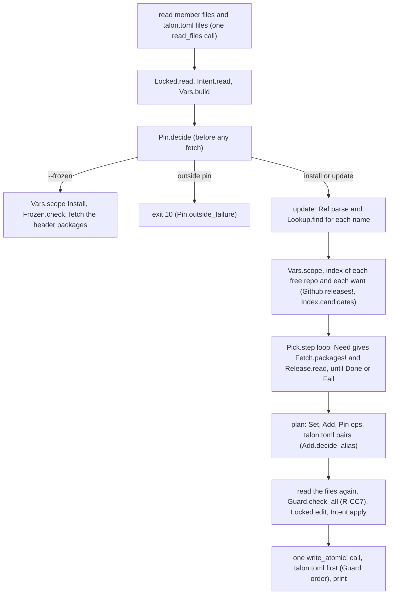

# 005 Intent and header

Phase: P0. Status: verify

Slice 005 makes the decisions that turn `talon.toml` (intent) and the app header (lock) into one choice of release URLs: the range of a header version, the pin of the compiler, the edits of the header and of `talon.toml`, the variables of a workspace, the scope of `install` and `update`, the choice of one tuple, and `install --frozen`. It also gives `Resolve.run!`, the direct-style flow that reads the files, asks `Pick.step`, and writes. Slice 007 builds the commands (`install`, `update`, `add`, `remove`) on it.

## Rules

| Group | Ids | Design | Where tested |
| --- | --- | --- | --- |
| Header as lock | R-H1 to R-H8 | Design 4.2 | `locked.roc`, `rs-install-add-key` |
| Intent | R-I1 to R-I9 | Design 4.3 | `intent.roc`, `ranges.roc`, `vars.roc`, `rs-install-add-key` |
| Workspace | R-WS1 to R-WS11, R-WS14 | Design 4.4 | `vars.roc`, `pin.roc`, `intent.roc`, `rs-workspace-shared-group`, `rs-failures` |
| Variables | R-VA1 to R-VA6 | Resolution 1 | `vars.roc`, `pick.roc`, `rs-*` |
| Nightly switch (as far as P0 holds the nightly) | R-NS4, R-NS5, R-NS7, R-NS8, R-NS9, R-NS11 | Resolution 1 | `pin.roc`, `intent.roc`, `rs-frozen`, `rs-install-add-key` |
| Constraints | R-C1 to R-C4, R-C6, R-C7, R-C9 | Resolution 2 | `pick.roc`, `ranges.roc`, `rs-update-scope`, `rs-failures` |
| Overrides | R-OV1 | Resolution 6 | `intent.roc`, `vars.roc` |
| Scope of a command | R-SP1 to R-SP3, R-SP5, R-SP10, R-SP11, R-SP14, R-SP15, R-SP18 to R-SP22 | Resolution 9 | `vars.roc`, `frozen.roc`, `rs-update-scope` |
| The `roc:` pin | R-RP1 to R-RP3 | Resolution 9 | `pin.roc`, `locked.roc`, `rs-workspace-shared-group` |
| Snapshot | R-DT1 to R-DT4, R-DT6 | Resolution 11 | `intent.roc`, `pick.roc`, `rs-failures` |
| Frozen | R-LF1, R-LF2 | Resolution 12 | `frozen.roc`, `rs-frozen` |
| Algorithm steps | R-AL1, R-AL3, R-AL7 (P0 parts) | Resolution 5 | `rs-*` |
| Phase 0 | R-PH8, R-PH10, R-PH11 | Design 7 | `pin.roc`, `pick.roc`, `rs-*` |
| Gap rows of earlier slices | R-PD3 (`a*c`), R-DI4, R-DI6, R-DI9, R-DI12 | CLI 1, CLI 7.3 | `members.roc`, `index.roc`, `di-list-flow` |

## Files

| Path | Writer | State |
| --- | --- | --- |
| `cli/lib/Ranges.roc`, `Release.roc`, `Pin.roc`, `Locked.roc`, `Intent.roc`, `Vars.roc`, `Pick.roc`, `Frozen.roc`, `Resolve.roc` | Stubs from the test agent (`crash "todo"`). Bodies from the code agent. | Compile. Doc comments hold the contract. |
| `cli/lib/main.roc` | Slice 001 owns it. This slice added the 9 module names to the exposes list. | The generic packages `header`, `toml`, `semver` are used by release URL (R-GP3). No path entry. |
| `tests/unit/ranges.roc`, `pin.roc`, `locked.roc`, `intent.roc`, `vars.roc`, `pick.roc`, `frozen.roc` | Test agent | 15 `expect`s, red ("todo") |
| `tests/unit/members.roc`, `index.roc` | Test agent (gap rows, rows added to existing `expect`s) | Pass today |
| `tests/commands/main.roc` | Test agent | New entry `resolve` (the table in its doc comment) |
| `tests/commands/cases/resolve/rs-*` | Test agent | 5 L2 cases, red |
| `tests/commands/cases/index/di-list-flow` | Test agent | The L2 gap row for R-DI12 (second cached page), passes today |

The generic packages are not tested again (R-GP5). The tests check the Talon use of them.

## Public signatures

The contract is in the doc comment of each function. The table lists the names only.

| Module | Functions |
| --- | --- |
| `Ranges` | `implied`, `check`, `admits` |
| `Release` | `read` (kind, platform, dependency URLs of a fetched `main.roc`) |
| `Pin` | `parse_req`, `is_nightly`, `admits`, `decide`, `outside_failure` |
| `Locked` | `read`, `paths`, `edit` (ops `Set`, `Add`, `Remove`, `Pin`), `spans` |
| `Intent` | `read`, `apply`, `spans`, `direct_snapshot`, `paths` |
| `Vars` | `build`, `scope`, `picker` |
| `Pick` | `step` (`Need`, `Done`, `Fail`) |
| `Frozen` | `check` |
| `Resolve` | `run!` |

## The flow of `Resolve.run!`

| Step | Rule |
| --- | --- |
| The files are read in one call. The first reads are the member files, then the `talon.toml` candidates (`Intent.paths`, nearest first). A missing `talon.toml` is not a failure. | R-PD6 |
| `Pin.decide` runs first. A pin outside `[toolchain] roc` stops `install` and `update` (exit 10) and is a finding of `--frozen`. | R-RP2, R-NS5 |
| `install` frees a variable only when a use is outside its ranges. A key of `talon.toml` that no header has (a want) is added to the header. | R-SP20, R-I5 |
| `update` frees the named variables, or all variables with an indexed host. A selector replaces the ranges of its variable and frees the series. | R-SP2, R-SP3, R-SP5 |
| The index is read only for free variables and for wants. A held variable is checked only for its kind (its package is fetched, as the closure needs it). | R-SP1, R-C4 |
| A new `roc:` entry is written only for a member that has no pin and whose header changes. | R-RP3 |
| Files are read again just before the write. A file that changed but has the same spans gets the edit on the new text. Else exit 17 and no write. | R-CC7 |
| `--frozen` makes no index call and no write. It fetches the packages of the header (the hash check). | R-LF1 |

## Tests

| Layer | File | Case | Rules |
| --- | --- | --- | --- |
| L0 | `ranges.roc` | `implied`, `check`, `admits`: series, below 1.0, bad text, intersection, no pre-release | R-I4, R-I7, R-C1, R-TF4 |
| L0 | `pin.roc` 1 | `parse_req`, `admits`: any, at-least, exactly, semver, release bound | R-NS5, R-NS7 |
| L0 | `pin.roc` 2 | `decide`: held pin, selected compiler, differing pins, write only for a member with no pin and a change, `no_check`, outside, local build | R-WS4, R-RP1 to R-RP3, R-H6, R-PH8, R-SP1, R-SO11 |
| L0 | `locked.roc` 1 | `read`: rows, platform, path row, foreign row, package header, bad header | R-H4, R-H7, R-H8, R-PD8, R-TF5, R-C4 |
| L0 | `locked.roc` 2 | `edit`, `spans`: set, add, remove, pin, byte for byte, failures | R-H1 to R-H4, R-H6, R-H8, R-RP3, R-CC7 |
| L0 | `intent.roc` 1 | `read`: all tables and keys, roles | R-I1 to R-I3, R-VA5, R-VA6, R-C7, R-NS7, R-NS9, R-DT3, R-DT4, R-OV1, R-WS5 |
| L0 | `intent.roc` 2 | `read`: bad TOML, bad types, role errors, warnings | R-TF4, R-WS5, R-EC19 |
| L0 | `intent.roc` 3 | `apply`, `spans`: replace keeps the comment, insert, new table, same value | R-AD25, R-AD26, R-UP11, R-WS14, R-H1 |
| L0 | `vars.roc` 1 | `build`: groups, ranges, wants, stale keys, priority | R-VA2 to R-VA6, R-I3 to R-I9, R-C1, R-C4, R-DI11, R-OV1, R-H4 |
| L0 | `vars.roc` 2 | `build`: workspace, one variable for 3 members, R-WS6 failure | R-WS1, R-WS2, R-WS5 to R-WS7, R-WS9, R-WS10, R-H8 |
| L0 | `vars.roc` 3 | `scope`: install, update, names, selectors, fixed host, alias with 2 groups, `picker` | R-SP1 to R-SP3, R-SP5, R-SP10, R-SP11, R-SP14, R-SP19 to R-SP21, R-WS3, R-WS8, R-DI11 |
| L0 | `pick.roc` 1 | `step`, one slot: range, hidden by age, snapshot, named version, held value, strategy, failure counts | R-PH10, R-C1, R-C6, R-C7, R-C9, R-VA6, R-DI9, R-DT2, R-C4, R-SP1, R-NS4 |
| L0 | `pick.roc` 2 | `step`, 2 slots: best tuple by priority, protocol `Need`, platform and dependency conflicts | R-PH10, R-C2, R-C3, R-VA6, R-SP11, R-DT2 |
| L0 | `pick.roc` 3 | `Release.read` | R-C3, R-C4, R-C2, R-DI7, R-H7 |
| L0 | `frozen.roc` | `check`: each finding and their order | R-LF1, R-SP19 to R-SP22, R-WS3, R-I5, R-I8, R-SO17, R-NS5, R-DT6, R-EC14 |
| L0 | `members.roc` | Gap: `a*c` against `xac` and `xabbc` | R-PD3 |
| L0 | `index.roc` | Gap: a bare hash name, a tie of `published_at`, the same version twice | R-DI4, R-DI6, R-DI9 |
| L2 | `resolve/rs-install-add-key` | Run 1: a key of `talon.toml` that the header lacks is added (npm-like). The header text stays byte for byte (comments, the platform keyword, spacing, a path entry, a foreign URL). The pin is added last. Run 2: nothing to change. | R-I5, R-I6, R-H1 to R-H4, R-H6, R-C6, R-C9, R-RP3, R-VA1, R-SP18, R-NS11 |
| L2 | `resolve/rs-workspace-shared-group` | 2 members, 2 aliases, one group. One variable, ranges of 2 files. Both headers move to 2.1.0 (2.2.0 is too new). The member with no pin gets the pin of the other. | R-WS1, R-WS2, R-WS4, R-WS7, R-WS11, R-RP1, R-RP3, R-VA1 |
| L2 | `resolve/rs-frozen` | `--frozen`: 2 findings in one exit 14 with no index call and no write. A good header: exit 0. A nightly pin with nightly false: exit 14. | R-LF1, R-LF2, R-SP22, R-I5, R-NS8, R-SP18 |
| L2 | `resolve/rs-update-scope` | `update json`, `update`, `update json@2.2.0` (the note for a young release, `talon.toml` gets `=2.2.0`), `update parser@^1.1 lowest`, the same again (nothing to change). Prerelease and draft are not chosen. | R-SP1 to R-SP3, R-SP5, R-SP15, R-C6, R-C7, R-C9, R-VA6, R-DI3, R-AD22, R-AD26 |
| L2 | `resolve/rs-failures` | 9 failing runs, no file changes: unknown name (2), empty domain (10, with counts), selector with no release (10), young exact range (10), short name (2), outside pin (10), `log:` snapshot (2), key in no header with 2 members (2), differing pins (2). | R-C1, R-C7, R-PH10, R-NS5, R-I8, R-WS4, R-WS6, R-DT3, R-AD6 |
| L2 | `resolve/rs-want-platform` | Added by the code agent for Q2. The key `shell = "acme/pf@^0.1"` is in no header and `acme/pf` has platform releases. `install`: exit 2, `'acme/pf' is a platform. Use tln add --platform acme/pf.` No file changes. | R-I5, R-I8, R-AD33, R-C4 |
| L2 | `resolve/rs-no-compiler` | Added by the code agent for Q3. The header has no `roc:` pin and no `roc` is on `PATH`. Run 1: `install` stops with exit 18 and the message names `roc`. Run 2: `install --frozen` resolves nothing and needs no compiler: exit 0. | R-HF12, R-PH8, R-RP3, R-LF1, R-EC18 |
| L2 | `index/di-list-flow` | Gap: offline with 3 cached pages gives the oldest page time | R-DI12 |

Every new L0 `expect` and L2 case was checked against a private reference implementation, then the stubs were restored (TW18). The reference was changed on purpose in 4 places, and each change made the L2 cases fail: no pin write (2 cases), `min-release-age` 0 (3 cases), no wants in `Frozen.check` (1 case), only the first use moved (2 cases). Each gap row was checked against a small change of the code (`Members.matches`, the candidate list, the tie rule), and the code was restored.

## Output (proposed, R-OUT2: human text and `data` fields)

| Output | Text (proposal) | Where |
| --- | --- | --- |
| A changed header | the path of the file, then one line for each change, two spaces in front: `~ <alias>: <name> <old> -> <new>`, `+ <alias>: <name> <version>`, `+ roc: <id>` | stdout |
| A changed `talon.toml` | `<path>: <key> = "<value>"` | stdout |
| Nothing changed | `nothing to change` | stdout |
| Young release that the user named | `note: <id> <version> is <n>d old (min-release-age <m>d)` | stdout |
| Held variable with a fixed host | `Index.fixed_line(host)` | stdout |
| Frozen header is fine | `the header satisfies talon.toml` | stdout |
| Unknown key or table in `talon.toml` | `warning: <text>` | stderr |
| Stale key (R-I8) | `warning: <path>:<line>: the key "<key>" names <name>, which the header has as "<alias>"` | stderr |
| Failures | The texts in the doc comments of `Pick.step`, `Frozen.check`, `Pin.decide`, `Pin.outside_failure`, `Vars.build`, `Vars.scope`, `Locked`, `Intent`, `Release.read` | stderr |
| `--json` `data` | Not given. Slice 007 builds `--json`. | |

## Decisions that the design does not fix (the test agent chose, for review)

| # | Decision | Options rejected |
| --- | --- | --- |
| D1 | One module for each decision (`Ranges`, `Release`, `Pin`, `Locked`, `Intent`, `Vars`, `Pick`, `Frozen`). `Resolve` has the effects only. | One big `Resolve` with the decisions inside |
| D2 | The module for a range is named `Ranges`, because `Range` is a builtin. | `Range` |
| D3 | A variable is a group (URL form and series), for all members. The alias is not the key. A key of `talon.toml` limits the variable of all members (R-WS7). One alias for 2 groups is a failure of `Vars.scope` when named (R-WS8). | One variable for each alias |
| D4 | `Pick.step` is a pure step function: it takes the facts that it has, takes unknown facts as fit, and returns `Need(urls)`. The command loops. Reason: no effect inside the decision (TESTING.md 2.2). | A solver that calls the network. A full PubGrub loop (P1). |
| D5 | A held variable has one value (`current`), but its kind is still checked from its package. So `install` fetches the packages of the header. | Skip held variables. Then R-C4 is not checked for them. |
| D6 | The domain of a free slot has `current` even when the index lacks it, and `current` is never hidden by age (R-C9). | Drop a header value that the index does not list |
| D7 | `min-release-age` and the snapshot do not hide a version that the user named as exact (`json@2.2.0`). A range such as `=2.2.0` is a range, so it hides (R-C7: only a bare version is exempt). | Treat `=2.2.0` as named |
| D8 | R-C2 is checked one level deep: the dependency URLs of a chosen release against the other slots. | The full closure (slice 007) |
| D9 | `install` fails with exit 10 for a pin outside `[toolchain] roc` (R-RP2 text), and `--frozen` reports it as a finding (exit 14). | Exit 2 for `install` |
| D10 | The write of a key to `talon.toml` goes to the nearest `talon.toml` of the first use of the alias. `Latest` writes nothing (slice 004 Q9). | The root file. One write for each member. |
| D11 | A `Pin` write happens for a member with no pin when its header changes. A member that has a pin never gets a write, also when the pin is old (P0 holds the nightly). | Move the pin to the newer compiler (`upgrade`, P1) |
| D12 | The text of a file is read again before the write (R-CC7). The edit is applied to the new text. | Apply the edit to the first text |
| D13 | `[resolution] min-release-age` is a whole number of days, `"<n>d"`. Default `2d`. | Hours, minutes, ISO durations (question Q10) |
| D14 | A talon.toml value is `<range>` or `<name>@<range>`, split at the first `@`. A short name (no `/`) in a value is a failure: `direct` has no index of short names (R-AD6). | A search in the index |
| D15 | A key whose group is in the header under another alias is stale (R-I8, R-I9): a warning, and the key is not a want. | A failure |
| D16 | `Resolve.Request` carries the facts that the command gets from the arguments and the environment (strategy, nightly switch, compiler id, now, offline). `Resolve` reads no argument. | Read `fx.args!` in `Resolve` |

## Out of scope

| Ids | Reason |
| --- | --- |
| R-AL2, R-AL4, R-AL5, R-AL6, R-C5, R-PH9, R-LF3 (the ladder part) | Probes, baseline check, whole-app check, build: slice 006. `--no-check` is tested only as far as it stops a pin write (R-H6, `pin.roc`). |
| R-DT5 | The line `resolved at ..., N probes` needs the probe count (slice 006) and the output of the commands (slice 007). |
| R-LF4, R-WS12, R-SP4, R-SP16, R-SP17 | `--dry-run`, `add`, `remove`, `update -i`, the consent prompts: slice 007 (commands, prompts). `Vars.picker` has an L0 row for R-SP14. |
| R-C8 | The warning for 2 series in the closure needs the closure walk (slice 007). |
| R-OV2 | An override as a free variable needs the whole-app probe (slice 006). R-OV1 is tested. |
| R-SP6 to R-SP9, R-SP12, R-SP13, R-RP4, R-WS13, R-NS2, R-NS3, R-NS6, R-NS10, R-NS12 | `upgrade`, `roc use`, compiler releases, `config.toml` switch, `git-*` builds: P1 (`upgrade`, `roc`) or the config slice. |
| R-LF5 | There is no `--locked`. The check is in the argument tests (slice 001). |
| R-PH1 to R-PH7, R-PH12 | Phase tables, not behavior of this slice. |
| PubGrub oracle, evidence, `compat.db` | P1. |

## Questions (stop until answered)

Each question has a default that the stubs and the tests use. The code agent does not decide these.

| # | Question | Default | Depends |
| --- | --- | --- | --- |
| Q1 | `update X@sel` for an alias that has no key in any `talon.toml`, and the project has no `talon.toml`: create one next to the member file, or write nothing? | Create `talon.toml` next to the member file (the text of `Intent.apply` with an empty text). | Not tested |
| Q2 | A key of a want names a platform (`pf = "roc-lang/basic-cli@^0.25"`): is it added as a platform entry? | No. It is a package, and R-C4 then fails with exit 10. | Not tested |
| Q3 | No compiler on `PATH` (`compiler` is `Err(NoCompiler)`) and no pin: write no pin and go on, or stop? | Write no pin and go on. | `pin.roc` expect 2 (row `no compiler`) |
| Q4 | The design says R-WS6 for a want with 2 or more members (exit 2). Does a stale key (R-I8) with 2 members also stop? | No. It is a warning. | Not tested |
| Q5 | When the header and `talon.toml` both name the same group under 2 aliases (R-I9), which alias does `update X` use? | The alias that the user typed. | Not tested |
| Q6 | A `talon.toml` of a member (not the root) with `[toolchain]` or `[resolution]`: warning (R-TF4) or failure (R-WS5)? | Failure of kind `input` (R-WS5 lists the allowed tables). | `intent.roc` expect 2 |
| Q7 | R-C2 for the closure of a package: one level (the header of the chosen release) or the full walk? | One level in `Pick`. The full walk is slice 007. | `pick.roc` expect 2 |
| Q8 | R-C3: a package release names a platform that is not the chosen platform slot. With 2 or more platform slots, which one is meant? | The rule holds only for exactly one platform slot. | `pick.roc` expect 2 |
| Q9 | A lower bound `>=<release id>` on a compiler needs a release date. P0 has none. | A nightly bound admits no release, and a release bound admits no nightly. | `pin.roc` expect 1 |
| Q10 | The unit of `min-release-age`: only whole days? | Whole days, `"<n>d"`. `"0d"` turns it off. | `intent.roc` expect 1 |

## Review (manager, 2026-10-18)

The manager accepted the tests, the decisions D1 to D16 and the output proposals. The answers below are the manager's proposals. The user did not confirm them yet. The code agent follows them.

| # | Answer |
| --- | --- |
| Q1, Q4 to Q10 | The defaults of the slice. Q7: one level here, the full closure walk in slice 007. |
| Q2 | A `talon.toml` key that the header does not have uses the lookup of `tln add` (R-I8). So a key whose release is a platform gives the R-AD33 failure: exit 2, and the message names `tln add --platform`. Add one row or run for it, and record it. |
| Q3 | No `roc` on `PATH` and no `roc:` pin, in a command that resolves the nightly: exit 18 (R-HF12), and the message names `roc`. `--frozen` does not resolve, so it does not need `roc` for this. Add one row or run for it, and record it. |

## Disputes (from the code agent)

None. No test, fixture or expected file of the test agent was changed. The tree is not under git, so this is checked by the change times: no unit test file changed after 19:54, and no expected file of the 5 old L2 cases after 20:06, on 2026-10-18. The 2 new L2 cases (Q2, Q3) are rows that the manager asked for in the review. They are not a change of an accepted test.

## Verify results

Review answers (2026-10-20, code agent):

| Answer | Check |
| --- | --- |
| Q2 | Code: `Resolve.platform_wants` (after each `Need`) calls `Add.decide` with `kind: Platform` for a key whose release is a platform: the R-AD33 failure. Test: L2 `resolve/rs-want-platform`. The revert check catches `platform_wants([], all)` there. |
| Q3 | Code: `Resolve.check_pin`, `Fail.new(Environment, ...)` (exit 18) when `Pin.decide` has no pin and no compiler. `--frozen` does not call it. Test: L2 `resolve/rs-no-compiler` (run 1 exit 18, run 2 `--frozen` exit 0). The revert check catches 3 mutations there (no failure, kind, text without `roc`). |
| Q1, Q4 to Q10 | The defaults. Q1 (a new `talon.toml`, `pairs_of`) is not tested: see the table of mutations that no test caught. |

Cleanup of the code: `check_pin` lost the unused argument `request` and `finish!` lost the unused argument `built` (`Resolve.roc`). There is no debug output, no dead code and no old comment in the 9 modules.

`scripts/test.sh` (2026-10-20): exit 0.

| Step | Result | Seconds (before the speed change, after) |
| --- | --- | --- |
| check | pass | 1.6, 3.3 |
| fmt | pass | 0.1, 0.1 |
| l0 | pass: 32 files, all green (the 7 files of this slice too) | 5.5, 5.9 |
| l2 | pass: 15 cases (7 `resolve/`, 2 of them new) | 36.2, 27.3 |
| l3 | pass: 16 scenarios | 24.7, 9.1 |
| selftest | pass | 37.7, 5.8 |
| Total | under the 3 minutes of TW20 | 106, 51 |

Speed change (TW20): about 90 s of the fast set was `roc build` of the test apps: the L2 app (30 s), built once for `l2` and once again for `selftest`, and `tln`, `fxprobe`, `flowprobe` (25 s, one after the other). `scripts/test.sh` now starts the 4 builds together at the start (`build_start`, `wait_build`), builds the L2 app once, and gives it to `tests/commands/run.sh` (`L2BIN`), to `tests/run.sh` (`TLN`) and to `tests/selftest.sh` (new variable `SELFTEST_L2BIN`; without it the self-test builds its own app, as before). The builds do not disturb each other: one run with an empty roc cache (77 s for the L2 step, the download of the platform) passed. No check was dropped and no test was changed. The cases run the same binaries as before.

Revert check (TW12): `research/slice-005-revert/revert.py` (116 mutations of the code, each in one small way, for each rule group of the slice; it runs the unit file of the module first, then the L2 cases `resolve/`). The table of the first run is `research/slice-005-revert/results-first-run.md` (3 mutations of `Resolve.roc` were invalid in it, and were run again after: `R-LF2`, `R-CC7 nothing to change`, `R-PD6` candidates, all 3 caught). A mutation that does not compile is not a catch (3 were first invalid, then written again). After the run `diff -r cli .work/cli-final` shows no difference (the copy was made before the first mutation).

Caught 100 of 116. Groups:

| Module | Mutations | Caught | Layers that caught |
| --- | --- | --- | --- |
| `Ranges.roc` | 4 | 4 | L0 `ranges` |
| `Release.roc` | 4 | 3 | L0 `pick` |
| `Pin.roc` | 14 | 12 | L0 `pin` |
| `Locked.roc` | 10 | 10 | L0 `locked` |
| `Intent.roc` | 15 | 14 | L0 `intent` |
| `Vars.roc` | 18 | 17 | L0 `vars` |
| `Pick.roc` | 17 | 14 | L0 `pick` |
| `Frozen.roc` | 6 | 5 | L0 `frozen` |
| `Resolve.roc` | 28 | 21 | L2 `resolve/` (all 7 cases catch at least one) |
| Total | 116 | 100 | |

Mutations that no test caught:

| Mutation | Why not caught |
| --- | --- |
| R-C3 `Release.read`: `pf` also for a platform header (`Ok(e) if kind != Platform`) | Probably equal behavior: a platform header has no entry with the keyword `platform` (not proved). Not counted as a test gap. |
| R-NS7 `Pin.admits`: a semver range admits a nightly (the `!Pin.is_nightly` part removed) | Equal behavior: `Ranges.admits` refuses an id that is not a version (a nightly id does not parse). Not a test gap. |
| R-SP20 `Frozen.outside_uses`: all variables, not only the free ones | Equal behavior for `Install`: a held variable has no use outside its ranges. Not a test gap. |
| R-SP5 `Resolve.slots_of`: `named` also when `any_series` is false | Probably equal behavior: a selector makes the named variable free and `any_series` (not proved). Not counted as a test gap. |
| Q9 `Pin.at_least`: `is_release(bound) and is_release(id)` removed | Test gap: no row with a pre-release bound, for example `>=0.1.0-rc1`. |
| R-I2 `Intent.read_deps`: split at the last `@` in place of the first | Test gap: no row with 2 `@` in one value. |
| R-OV1 `Vars.range_of`: the range of a key of `[overrides]` | Test gap: `vars.roc` has no use whose alias is only in `[overrides]` (`intent.roc` tests the table). |
| R-C7 `Pick.too_young`: `>` to `>=` (a release that is exactly `min-release-age` old) | Test gap: no row with an age equal to the limit. |
| R-DT4 `Pick.after_snapshot`: `>` to `>=` (a release at the snapshot time) | Test gap: no row with a time equal to the snapshot. |
| R-DT2 `Pick.domain_of`: no sort of the candidates by URL | Test gap: no row with 2 candidates of one version in a different URL form and a reversed order. |
| R-SP18 `Resolve.asked!`: `install` reads the operands | Test gap: no L2 run of `install` with a name. |
| R-I8 `Resolve.live_wants!`: the text of the warning for a stale key | Test gap: no L2 case with a stale key. `Frozen` has the finding text in L0. |
| R-AD26, Q1 `Resolve.pairs_of`: the name of the new `talon.toml` next to the member | Test gap: Q1 (no `talon.toml` at all) is not tested, as the slice says. |
| R-AD22 `Resolve.range_of_selector`: `Exact` gives `<v>` in place of `=<v>` | Test gap: no L2 row separates a bare `2.2.0` (read as a caret range) from `=2.2.0`. |
| R-C9 `Resolve.highest_use`: the lowest use is the current value | Test gap: no L2 case where the members of one variable have 2 versions and the outcome depends on `current`. |
| R-WS5 `Resolve.load!`: every `talon.toml` of a workspace has the role `Root` | Test gap: no L2 case with a member `talon.toml` that has a table that only the root may have (L0 `intent` tests the role). |

## Questions (TW17) and limits found by the code agent

| # | Text |
| --- | --- |
| K1 | The 12 test gaps in the table above need rows from the test agent. The code agent did not add them (TW18). |
| K2 | The 2 mutations marked "probably equal behavior" are not proved equal. If the manager wants them proved, a row must show a difference. |
| K3 | No compiler bug and no new limit was met. No repro was written. |
| K4 | `Resolve.pairs_of` and `Vars` hold the decisions D10 and Q1 as in the slice. Q1 (a new `talon.toml`) has no test, so its code is not checked. |

## Review of the code (manager, 2026-10-20)

`scripts/test.sh` passes (51 s after the build change). Accepted. The 12 test gaps of K1 go to the slice 006 test agent.

Status: done (2026-10-20).
