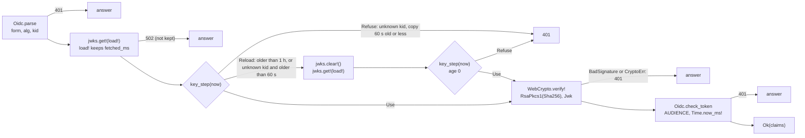

# 108 OIDC token check

Phase: P2. Status: review (tests red, 2026-11-01; updated with the answers Q108-1 to Q108-5). Model for the code: Opus medium. Plan row: `docs/registry/PLAN.md` C.1, row 108.

## 1. Scope

The Worker checks a GitHub Actions OIDC token: the JWKS of GitHub through `Memo` (by `kid`), the RS256 signature with `WebCrypto.verify!`, the time claims with the Worker clock, the claim rows of R-TP3 and the bot claims of R-TP7. A failed check gives 401 or 403 with the failing claim in `detail`.

| Part | Who | State |
| --- | --- | --- |
| `worker/lib/Oidc.roc`: the pure decisions (W0), types and signatures | Test agent (signatures, the constant problems), code agent (bodies) | Stubs `crash "todo"` |
| `worker/Auth.roc`: the effects (settings, clock, JWKS, verify) | Test agent (signatures, the order in the doc comments), code agent (bodies) | Stubs `crash "todo"`. No module imports it yet, so no W2 case of slice 101 runs it. |
| The route `PUT /v1/toolchains/{tag}` with the bot check (section 3.2) | Code agent | To do. The W2 cases of this slice use it. |
| W0 `worker/tests/unit/OidcTest.roc` | Test agent | Red |
| W2 `worker/tests/cases/oidc/` (7 cases), the runner support `worker/tests/oidc.mjs`, the fixtures `worker/tests/oidc/` | Test agent | Red (the cases), done (the runner) |

### 1.1 How W2 reaches the check (decision of this slice)

| Option | Result |
| --- | --- |
| A test-only path in the W2 harness | Not possible in the frame of slice 101. `worker-test.js` answers `/__test/...` in JS and never calls the Roc app. A Roc route only for tests needs a switch setting, and R-WH14 says that the Worker reads no other setting. |
| W0 only, and a W2 case in slice 109 | The effects (the JWKS read, the `Memo`, the read again, `verify!`, 502) get no test before slice 109. Rejected: the effects are the hard part of this slice. |
| Chosen: the route `PUT /v1/toolchains/{tag}` (R-AP6) with only its auth step. After a good token the handler gives `Err(NotBuilt)`, so 500 `internal`, until slice 109 writes the route. | The same form as the stub `POST /v1/closure` of slice 101 (Q101-5). R-AP6 takes no body, so the token check is the whole route input. R-TP7 is the auth of this route, so slice 109 keeps the check and changes only the answer after it (the 500 rows of the cases become the 109 answers). Slice 114 uses `Auth.verify!`, `Oidc.check_publish` and `Oidc.binding_ok` and the same runner support. Question Q108-4 asks the human to accept it. |

## 2. Rules

| Rule | Text (short) | Checked by |
| --- | --- | --- |
| R-TP1 | A fixed rule, no per-repository config | W0 `check_publish` pass rows |
| R-TP3 row 1 | RS256 with a key of the GitHub JWKS (`kid`), `iss` | W0 `base64url`, `parse`, `parse_jwks`, `find_key`, `jwk_text`, `check_token`. W2 `tp3-token-form`, `tp3-signature-and-kid`, `tp3-key-rotation`, `tp3-jwks-upstream` |
| R-TP16 (Q108-1, Q108-2) | The kept JWKS has its fetch time. Older than 1 h: read again. An unknown `kid`: read again only when the copy is older than 60 s, else 401 at once. | W0 `key_step`. W2 `tp3-signature-and-kid`, `tp3-key-rotation`, `tp3-jwks-max-age` (case clock) |
| R-TP3 row 2 | `aud` equal to `AUDIENCE`, no trailing `/` | W0 `check_token`, W2 `tp3-tp7-claims` |
| R-TP3 row 3 | `exp`, `nbf` with 60 s of leeway | W0 `check_token` (both bounds), W2 `tp3-tp7-claims` (both bounds) |
| R-TP3 rows 4, 6, 7, 8 | `repository` and the host, `repository_visibility`, `ref_type` and `ref`, `event_name` | W0 `check_publish` (W2: slice 114) |
| R-TP3 row 5 | One of the two ids equal to the `repos` row | W0 `binding_ok` (the problem: Q108-3) |
| R-TP4 | Rows 7 and 8 refuse `pull_request_target`, `workflow_run`, `schedule` | W0 `check_publish` |
| R-TP6 | The claims to record | W0 `parse` (the claims are read). The record: slice 114. |
| R-TP7 | The bot token: rows 1 to 3, `repository_id`, `workflow_ref`, `event_name` | W0 `check_bot`, W2 `tp7-bot-token-pass`, `tp3-tp7-claims` |
| R-MX5, R-MX15 | Any other valid token on a bot route gets 403. The bot settings. | W0 `check_bot`, W2 `tp3-tp7-claims` (a publish token gets 403) |
| R-AP26 (token check part) | The `Authorization` header selects the path. A token that fails gets 401 or 403, never an ingest. | W0 `bearer` (a header that is not `Bearer <token>` is 401, not `NoToken`), W2 `tp3-token-form` |
| R-AP21 | 401, 403, 502 problems | All |
| R-AP6, R-AP48 (route part) | `PUT /v1/toolchains/{tag}`: 405 with `Allow: PUT` for another method, 401 with no token | W2 `tp7-bot-token-pass` |
| R-AP41 | No D1 call in the check | W2: `expect/d1-calls` is 0 for each request |

Design refs: Registry 7.1, 4 (R-AP6), 4.2 (R-AP21, R-AP26, R-AP48), 6 (R-MX5, R-MX15), 8 (R-WH4 clock, R-WH14 settings). `cloudflare-workers/API.md` RN6, `MODULES.md` 9 (`Memo`), 10 (`WebCrypto`, `Env`), 4 (`Http`).

## 3. What the code agent writes

### 3.1 Public signatures (in the stubs, fixed)

| Module | Item | Type or rule |
| --- | --- | --- |
| `Oidc` | `Claims` | 18 claims, each `Try(_, [Missing])`. `exp`, `nbf` are `U64` seconds. The others are `Str`. |
| `Oidc` | `Jwt` | `{ kid : Str, claims : Claims, signed : List(U8), signature : List(U8) }` |
| `Oidc` | `Key` | `{ kid : Str, n : Str, e : Str }` |
| `Oidc` | `Cached` | `{ fetched_ms : U64, keys : List(Key) }`: the value of the `Memo` |
| `Oidc` | `max_age_ms` (3,600,000), `reread_after_ms` (60,000) | Constants (given) |
| `Oidc` | `key_step : Cached, Str, U64 -> [Use(Key), Reload, Refuse(Problem)]` | R-TP16: the age rules (the doc comment) |
| `Oidc` | `issuer`, `jwks_url`, `leeway_s` | Constants (given) |
| `Oidc` | `bearer : Try(Str, [NotFound]) -> [Token(Str), NoToken, Refuse(Problem)]` | R-AP26 |
| `Oidc` | `missing_token`, `unknown_kid`, `bad_signature`, `jwks_status`, `jwks_no_answer`, `jwks_bad` | Constant problems (given) |
| `Oidc` | `base64url : Str -> Try(List(U8), [BadBase64])` | No padding |
| `Oidc` | `parse : Str -> Try(Jwt, Problem)` | Form, `alg`, `kid`, claims |
| `Oidc` | `parse_jwks : Str -> Try(List(Key), [BadJwks])`, `find_key : List(Key), Str -> Try(Key, [UnknownKid])`, `jwk_text : Key -> Str` | |
| `Oidc` | `check_token : Claims, { audience : Str, now_ms : U64 } -> Try({}, Problem)` | R-TP3 rows 1 to 3 (401) |
| `Oidc` | `check_bot : Claims, { repository_id : Str, workflow_ref : Str } -> Try({}, Problem)` | R-TP7 (403) |
| `Oidc` | `check_publish : Claims, { host : Str, owner_repo : Str, tag : Str } -> Try({}, Problem)` | R-TP3 rows 4, 6, 7, 8 (403) |
| `Oidc` | `binding_ok : Claims, Try({ repository_id : Str, repository_owner_id : Str }, [NoRow]) -> Bool` | R-TP3 row 5 |
| `Auth` | `jwks : Memo(Oidc.Cached)` | `Memo.new("github-jwks", { max_age_ms: 3_600_000 })`. The `Memo` expiry is only a bound (shim clock); `key_step` decides with the case clock. |
| `Auth` | `verify! : Str => Try(Oidc.Claims, Problem)` | R-TP3 rows 1 to 3 with the effects |
| `Auth` | `bot! : Request => Try(Oidc.Claims, Problem)` | R-TP7 for a bot route |

The doc comments of the stubs give each rule, the order of the checks and each `detail` text.

### 3.2 Changes outside the new files (code agent)

| File | Change |
| --- | --- |
| `worker/lib/Route.roc` | `Id : [PostClosure, PutToolchain(Str)]`. In `decide`: the segments `["v1", "toolchains", tag]` with `PUT` give `Handle(PutToolchain(tag))`. Another method gives `NotAllowed(Problem.new(MethodNotAllowed, "<METHOD> is not allowed on <path>"), ["PUT"])`, as the closure route. No media check: R-AP6 has no body. |
| `worker/main.roc` | `import Auth`. In `run!`: `PutToolchain(_tag)` calls `Auth.bot!(req)`. `Err(problem)` is the answer `problem_response(problem)` (not `Internal`). `Ok(_)` gives `Err(NotBuilt)` until slice 109. |

`worker/lib/Route.roc` and `worker/main.roc` are files of slice 101. Slice 106 can add routes to `Route.roc` at the same time: the manager merges.

### 3.3 The order of `Auth.verify!` (from the R-TP3 table order, section 7)

`Auth.bot!`: `Oidc.bearer` of `authorization` (`NoToken` is `Oidc.missing_token`), then `verify!`, then `Oidc.check_bot` with `BOT_REPOSITORY_ID` and `BOT_WORKFLOW_REF`. A missing setting is 500 `internal` with the fixed `detail` of slice 101.

Size: the private reference has about 170 lines of body in `Oidc.roc` and 45 in `Auth.roc`, plus 3 lines in `Route.roc` and 7 in `main.roc`. It fits TW19.

## 4. Tests

### 4.1 Table

| Layer | Case | Checks | Rules |
| --- | --- | --- | --- |
| W0 | `OidcTest.roc`, 21 `expect`s | `bearer` (11 headers: `Bearer`, `bearer`, `BEARER`, `bEaReR` pass); 2 constant problems; `base64url` (9 good vectors of RFC 4648 10, 7 bad texts); `parse` (a full GitHub claim set with 13 claims the Worker does not read, a token with 2 claims, 12 bad forms, `alg` HS256, none, missing, no `kid`); `parse_jwks` (EC key and a key with no `kid` left out, 5 bad texts), `find_key`, `jwk_text`; `check_token` (5 good times, 7 `iss` and `aud` faults, the row order, both bounds of `exp` and `nbf`, missing `exp` and `nbf`, `nbf` 0 with no U64 underflow); `check_bot` (2 pass, 10 faults); `check_publish` (5 pass, 19 faults); `binding_ok` (9 rows); `key_step` (13 rows: both bounds of 1 h and 60 s, a clock before the fetch, a fresh copy) | R-TP16, R-TP1, R-TP3, R-TP4, R-TP6, R-TP7, R-MX5, R-AP21, R-AP26 |
| W2 | `oidc/tp7-bot-token-pass` | Good bot token (`schedule`, `workflow_dispatch`): 500 from the stub. No `Authorization`: 401. `GET`: 405 `Allow: PUT`. One JWKS read for 5 requests (the `Memo`). D1 count 0. | R-TP3, R-TP7, R-AP6, R-AP21, R-AP26, R-AP48, R-AP41, R-MX15 |
| W2 | `oidc/tp3-token-form` | `Basic`, empty `Bearer`, 2 parts, a header that is not an object, `alg` HS256, none, missing, no `kid`: 401 each. No outbound request (the form is checked before the JWKS read). | R-TP3, R-AP26, R-AP21 |
| W2 | `oidc/tp3-signature-and-kid` | A changed signature, a changed payload, a token signed by another key with `kid-1`: 401. An unknown `kid` at the read time and at +60 s: 401 with no read. At +60.001 s: one read, then 401. At +60.002 s: 401 with no read. A good token: no read. 2 JWKS reads. | R-TP3, R-TP16, R-AP21 |
| W2 | `oidc/tp3-key-rotation` | The second JWKS answer adds `kid-2`. A `kid-2` token at +30 s: 401 with no read. At +60.001 s: one read, and it passes. Later tokens use the kept JWKS. 2 reads. | R-TP3, R-TP16 |
| W2 | `oidc/tp3-jwks-max-age` | Case clock 1 h later. A known `kid-1` at +1 h: no read. At +1 h + 1 ms: one read (the new JWKS has only `kid-2`), so 401 with no second read. A `kid-2` token then passes with no read. 2 reads. | R-TP3, R-TP16 |
| W2 | `oidc/tp3-tp7-claims` | `iss` with `/`, `aud` with `/`, another `aud`, no `aud`: 401. `exp` and `nbf` at both bounds of the leeway with the case clock (`now` of a request). Another `repository_id`, a `workflow_ref` of another branch, `event_name` `push`, a publish token: 403. | R-TP3, R-TP7, R-MX5, R-AP21 |
| W2 | `oidc/tp3-jwks-upstream` | JWKS status 500, a body that is not JSON, `{"keys":1}`: 502 each, and nothing is kept (4 reads). Then a good JWKS: pass, and the next request uses it. | R-TP3, R-AP21 |

### 4.2 Runner support (`worker/tests/oidc.mjs`, hooks in `run.mjs`)

| Item | Form |
| --- | --- |
| Test keys | RSA 2048, made with Node WebCrypto once for each run, by name (`k1`, `k2`). No private key is in the repository. |
| Fake JWKS | A JSON file of the fake GitHub with `{"$key": "k1", "kid": ..., ...}` gets the public JWK of that key. `worker/tests/oidc/jwks.json` is the common JWKS (`kid-1` = `k1`). |
| Answer sequence | `github/<path>.<n>` (n = 2, 3, ...) answers the n-th request of that URL in the case, with its own `.meta.json`. Else the first file answers. |
| Tokens | `tokens.json` of a case: name to spec (`base`, `claims`, `kid`, `alg`, `key`, `tamper`, `raw`, see the head of `oidc.mjs`). A request `{"token": "<name>"}` gets `authorization: Bearer <token>`. `worker/tests/oidc/claims-bot.json` and `claims-publish.json` are full GitHub claim sets at the default case time (`nbf` -300 s, `exp` +300 s). |
| Settings | Each case has `settings.json` (a copy of `worker/tests/oidc/settings.json`): `AUDIENCE` `https://registry.example`, `BOT_REPOSITORY_ID` `900001`, `BOT_WORKFLOW_REF` `roc-talon/talon/.github/workflows/compat-bot.yml@refs/heads/main`. `worker/tests/settings.json` stays empty. |

The W2 cases were written by `research/slice-108-revert/mk_cases.py`. The case files are the source now.

### 4.3 Red results (2026-11-01)

| Step | Result |
| --- | --- |
| `scripts/test.sh w0` | 68 expects: 49 passed, 19 failed (all `OidcTest`, each with `todo`). The 2 `OidcTest` rows of the constant problems pass (the text is given). `frame.sh`, `fmt`, the driver check pass. `VersionTest` (slice 105) passes. |
| `scripts/test.sh w2` | 26 passed, 7 failed: the 7 `oidc/*` cases, each with `status: expected 401 (or 403, 405, 500, 502), got 404`, `no route for PUT /v1/toolchains/...`, and `github.log differs` (the route is not built). The 9 `router/*`, 3 `runner/*` and 14 self-test cases pass. |
| `scripts/test.sh check fmt selftest` | Pass |
| `scripts/test.sh w1` | 11 failures in `sql/tests` trigger cases (slice 103, another agent), not this slice |
| `roc check` of `Auth.roc` | 0 errors, with a probe copy of `main.roc` that imports and calls `Auth` (then deleted) |

### 4.4 Revert check (private reference)

`research/slice-108-revert/reference/` fills the stubs and makes the changes of section 3.2. `research/slice-108-revert/ref.sh all` copies `worker/` to `refbuild/`, puts the reference over it, and runs W0 and the `oidc` W2 cases: all 68 W0 expects and all 33 W2 cases pass (also `router`, `runner`, self-tests). `MUTATE=mutations/<m>.py ref.sh all` runs one mutation. Keep the reference until the review is applied.

| Mutation | Caught by |
| --- | --- |
| m1 no guard for `nbf` < 60 (U64 underflow) | W0 (a crash) |
| m2 `exp` refused only after `exp + 60` | W0, W2 `tp3-tp7-claims` |
| m3 an unknown `kid` always reads again (no 60 s rule) | W0, W2 `tp3-jwks-max-age`, `tp3-key-rotation`, `tp3-signature-and-kid` |
| m4 the read again without `jwks.clear!()` | W2 `tp3-jwks-max-age`, `tp3-key-rotation`, `tp3-signature-and-kid` |
| m12 the 1 h max age not checked | W0, W2 `tp3-jwks-max-age` |
| m13 `Bearer` compared with case | W0 |
| m5 a JWKS status other than 200 read as a JWKS | W2 `tp3-jwks-upstream` |
| m6 `aud` with a trailing `/` accepted | W0, W2 `tp3-tp7-claims` |
| m7 `repository` compared with case | W0 |
| m8 any `alg` accepted | W0, W2 `tp3-token-form` |
| m9 the JWKS read before the parse | W2 `tp3-token-form` |
| m10 row 5 needs both ids | W0 |
| m11 the bot accepts `push` | W0, W2 `tp3-tp7-claims` |

## 5. Output (proposed, TW24)

The design gives the types and the statuses (R-AP21) and "the `detail` names the claim" (R-TP3). The texts are proposals.

| Case | Status, `type` | `detail` |
| --- | --- | --- |
| No `Authorization` on a route that needs a token | 401 `unauthenticated` | `the request has no Authorization header: this route needs a GitHub OIDC token` |
| `Authorization` that is not `Bearer <token>` | 401 | `the Authorization header must be "Bearer <token>"` |
| Not a JWT (form, base64url, JSON, a claim type) | 401 | `the token is not a valid JWT` |
| `alg` | 401 | `the token alg is "<alg>", expected "RS256"`, or `the token alg is missing` |
| No `kid` | 401 | `the token kid is missing` |
| Unknown `kid` | 401 | `the token kid "<kid>" is not in the GitHub JWKS` |
| Signature | 401 | `the token signature is not valid` |
| A claim with a wrong value (rows 1, 2, 4 to 7, R-TP7) | 401 (rows 1, 2), 403 | `token claim <name> is "<value>", expected "<want>"` |
| `event_name` | 403 | `token claim event_name is "<value>", expected "schedule" or "workflow_dispatch"` (bot), `..., expected "release", "push" or "workflow_dispatch"` (publish) |
| A missing claim | 401 or 403 by its row | `token claim <name> is missing` |
| Row 3 | 401 | `token claim exp is <exp>: the token expired (now is <now>, leeway 60 s)` and `token claim nbf is <nbf>: the token is not valid yet (now is <now>, leeway 60 s)`. `now` in whole seconds. |
| Row 4, host | 403 | `token claim repository: the asset URL host is "<host>", expected "github.com"` |
| JWKS read | 502 `upstream` | `the GitHub JWKS read failed with status <n>`, `the GitHub JWKS read failed: no answer`, `the GitHub JWKS is not a valid JWKS` |

A `detail` shows claim values of the token. They are not secret (the sender has the token), and `to_json` escapes them.

## 6. Out of scope

| Item | Reason |
| --- | --- |
| R-TP2 | The client (`tln publish`), the client track (PLAN C.4) |
| R-TP3 rows 4 to 8 in W2, R-AP26 in W2 (publish against ingest), R-TP6 (the record) | They need `POST /v1/releases` and the asset URL: slices 112 and 114. W0 covers the rows. |
| The problem of a failed row 5, R-TP5, R-TP9 | Q108-3, slice 113 |
| R-TP8 (yank) | P3 |
| R-AP10 bot path | Slice 115 uses `Auth.bot!` |
| The `Memo` expiry itself | The pin table uses the shim clock (`now` option), not `Date.now` (section 9, P1). The max age of R-TP16 is tested with the fetch time and the case clock instead (Q108-2). |
| A JWKS read with no answer (`Network`) | The fake GitHub always answers. The text is given in `Oidc.jwks_no_answer`; no test. |
| Body of `PUT /v1/toolchains/{tag}` after the check | Slice 109 |

## 7. Decisions of this slice (reading of the design, for the review)

| Item | Choice | Rejected |
| --- | --- | --- |
| The order of the checks | R-TP3 table order: the form, then the signature (row 1), then `iss`, `aud`, `exp`, `nbf`. So a bad form costs no JWKS read, and an expired token with a good form costs one (the first in an isolate). | Claims before the signature: it saves a read, but it reads claims of a token that is not proved |
| The bounds of row 3 | RFC 7519 4.1.4 and 4.1.5 with 60 s: refused at `now >= exp + 60` and at `now < nbf - 60` | Other bounds (the design says "between") |
| A missing claim | Fails its own row (401 for rows 1 to 3, 403 for the others) | 401 for each missing claim |
| A claim of the wrong JSON type, `aud` as a list | 401 `the token is not a valid JWT`. GitHub sends `aud` as a text; R-TP3 row 2 says "equal". | Accept a list that has `AUDIENCE` (RFC 7519 allows a list) |
| The JWKS URL | `https://token.actions.githubusercontent.com/.well-known/jwks`, fixed (GitHub docs) | A read of `/.well-known/openid-configuration` first: one more read |
| A JWKS key | Only `kty` `RSA` with `kid`, `n`, `e`. The JWK for WebCrypto has `kty`, `n`, `e` only. | Pass the whole key object (its `alg` and `use` change what `importKey` accepts) |
| `CryptoErr` of `verify!` | 401 `the token signature is not valid` (a bad key of the JWKS is a token that cannot be proved) | 500 |
| The settings | Read with `Env.var!` for each check. A missing one is 500 `internal`. | |

## 8. Questions (stop until answered)

| Id | Question | Options | Effect now |
| --- | --- | --- | --- |
| Q108-1 | When the `kid` of a token is not in the kept JWKS, does the Worker read the JWKS again? How often? The design says only "a cache of the JWKS across requests" (API.md RN6). The manager brief says "one JWKS refetch, then 401". | (a) One read again for each such request (as tested). A client can make the Worker read GitHub once for each request with a made-up `kid`. (b) At most one read again for each N s in an isolate, then 401 at once. (c) No read again: a new key is seen after the max age. | `tp3-signature-and-kid` (request 6 reads again) and `tp3-key-rotation` test (a). With (b), request 6 of `tp3-signature-and-kid` changes. |
| Q108-2 | The max age of the kept JWKS | Proposal: 1 h, as the example of `MODULES.md` 9 | `Auth.jwks` has 3,600,000 ms. No test (section 6). |
| Q108-3 | R-TP3 row 5 fails (both ids differ). R-TP3 says 403 `forbidden` with the claim in `detail`. R-TP9 row 4 says 403 `repository-changed` with `issues_url`. Which one? | Proposal: `repository-changed` (the specific rule, and R-AP21 lists it) | `binding_ok` gives a `Bool` only. Slices 113 and 114 map it. |
| Q108-4 | Accept the stub route `PUT /v1/toolchains/{tag}` (auth only, then 500 `internal`) until slice 109, as Q101-5 did for the closure? It needs the changes of section 3.2 in files of slice 101. | Else: W0 only for this slice, and the W2 cases move to slice 109 | The 7 W2 cases use it |
| Q108-5 | Is the scheme of `Authorization` compared with no case (`bearer x`, RFC 9110 11.1)? R-AP8 writes `Bearer`. | (a) Exactly `Bearer`; (b) any case | No test row. The code agent may do either until the answer. |

Answers (manager, 2026-11-01; the design rule R-TP16 follows):

| # | Answer |
| --- | --- |
| Q108-1 | An unknown `kid` reads the JWKS again only when the cached copy is older than 60 s (first guess). Else the answer is 401 at once. So a made-up `kid` costs at most one GitHub read a minute for each isolate. The cached value keeps its fetch time (`Time.now_ms!`), so the case clock (`x-test-now`) can test it. A read that fails gives 502 `upstream`, as now. |
| Q108-2 | 1 h. The cached value keeps its fetch time, and the Worker reads again when it is older than 1 h. Test it with the case clock, not with the `Memo` expiry (platform issue P1). |
| Q108-3 | Correct: `binding_ok` gives a Bool. Slices 113 and 114 map a failure to 403 `repository-changed` (R-TP9), which comes before the row 5 `forbidden` of R-TP3. |
| Q108-4 | Yes, until slice 109. |
| Q108-5 | Yes, case-insensitive: the auth scheme is case-insensitive (RFC 9110, 11.1). Add a W0 row: `bearer`, `BEARER` and `Bearer` are accepted. |

Test changes for the test agent: Q108-1 (a W2 case where a second unknown `kid` within 60 s gives 401 with no second JWKS read, and after 60 s one read), Q108-2 (a W2 case with the clock 1 h later: one new JWKS read), Q108-5 (the W0 row). Review: the other tests are accepted by the manager (2026-11-01). The human review is pending.

Done by the test agent (2026-11-01): `Oidc.Cached`, `max_age_ms`, `reread_after_ms`, `key_step` (stub and W0 rows), `Auth.jwks : Memo(Oidc.Cached)`, the `bearer` rows of any case, the new W2 case `tp3-jwks-max-age`, and the changed cases `tp3-signature-and-kid` and `tp3-key-rotation` (section 4). The reference and the mutations m3, m4, m12, m13 follow the answers.

## 9. Platform issues

| # | Issue | Evidence |
| --- | --- | --- |
| P1 | Two clocks. `Memo` expiry (the pin table) uses the shim option `now`, and `Time.now_ms!` uses `Date.now()`. A test that fixes `Date.now` (R-WH4) cannot move the `Memo` max age, and a test that sets the option `now` also moves the task deadlines. So the JWKS max age has no W2 test. Request: one clock for app time, or a documented test hook for the pin table. | `js/helpers.js:249` (`until: now() + maxAgeMs`), slice 101 section 8 P1 |
| P2 | No base64url decode in the platform or the builtins. API.md RN6 says "base64url and JSON decode in Roc", so each app that reads a JWT writes its own (this slice: `Oidc.base64url`). A small `Base64` module (or a pure function in `WebCrypto`) would help. | `search_symbols` "base64": no match; `WebCrypto.roc` |

## 10. Files

| File | Kind | Lines |
| --- | --- | --- |
| `worker/lib/Oidc.roc` | New, stubs | 170 |
| `worker/Auth.roc` | New, stubs | 38 |
| `worker/tests/unit/OidcTest.roc` | New, W0 | 285 |
| `worker/tests/oidc.mjs` | New, runner support | 82 |
| `worker/tests/oidc/` | New: 2 claim sets, the JWKS, the settings | 4 files |
| `worker/tests/cases/oidc/` | New: 7 W2 cases | |
| `worker/lib/main.roc` | Changed: `Oidc` in the exposes (one word; slice 105 changes this file too) | |
| `worker/tests/unit/w0.roc` | Changed: `import OidcTest` | |
| `worker/tests/run.mjs` | Changed: the hooks of section 4.2 (14 lines in, 4 out). PLAN B.1 and slice 101 section 6 give the token part of the runner to this slice. | |
| `research/slice-108-revert/` | `before/` (the 3 copies, `NEW.txt`), `reference/`, `mutations/`, `ref.sh`, `mk_cases.py`, `vectors/jwt_vectors.py` | |

## 11. Disputes (from the code agent)

None. No test, case, fixture or runner file was changed.

## 12. Verify results

Code agent, 2026-11-01. Compiler: ROC_TAG_WORKER (`nightly-2026-10-31-f7bef6b`).

| Step | Result |
| --- | --- |
| `scripts/test.sh w0 w1 w2 check fmt` | w0 pass (68 expects in `w0.roc`, `records` 35 + 35), w2 pass (33 of 33, with the 7 `oidc/*` cases), check pass, fmt pass. w1: 30 passed, 11 failed: only `triggers/*` of slice 103 (another agent), as before this slice. |
| `roc check worker/main.roc` | 0 errors, 0 warnings |
| `crash` at run time (R-AP48) | None in `Oidc.roc`, `Auth.roc`, the new route. All U64 steps of row 3 and of `key_step` use `_saturated`. |

Files: `worker/lib/Oidc.roc` (334 lines), `worker/Auth.roc` (92), `worker/lib/Route.roc` (112, +12), `worker/main.roc` (76, +7).

Decisions that the slice does not fix (each one has no test that depends on it):

| Item | Choice | Rejected |
| --- | --- | --- |
| The order in `parse` | The form of all 3 parts (base64url, UTF-8, a signature that is not empty), the header JSON, `alg`, `kid`, then the claims JSON. A token with a bad `alg` and bad claims gives the `alg` problem. | The claims before `alg` |
| `Reload` from the second `key_step` (only when the clock moves in one request) | 401 `Oidc.unknown_kid` | A third read; a `crash` |
| `Http.get!` fails (`Network`, `HttpErr`, `TooLarge`) | 502 `Oidc.jwks_no_answer` | `jwks_bad` for `TooLarge` |
| `Response.text!` fails | 502 `Oidc.jwks_bad` | `jwks_no_answer` |
| A bad setting and a bad signature | The signature first, then `AUDIENCE`. In `bot!`, the bot settings after `verify!`. | Read the settings first |

Revert check (TW12, 9 mutations, script `research/slice-108/mutate.py`, the code is the same as before after the run: `cmp` with `research/slice-108/keep/`):

| Mutation | Caught by |
| --- | --- |
| m1 `Bearer` compared with case | W0 |
| m2 an unknown `kid` reads again at an age of exactly 60 s (`>=`) | W0 |
| m3 `nbf - 60` with no saturation | W0 (a crash) |
| m4 no check of length % 4 == 1 in `base64url` | W0 |
| m5 an empty signature accepted | W0 |
| m6 `repository` compared with case | W0 |
| m9 the 1 h max age not checked | W0 |
| m7 no `jwks.clear!()` before the read again | W2 `tp3-jwks-max-age`, `tp3-key-rotation`, `tp3-signature-and-kid` |
| m8 a JWKS status other than 200 read as a JWKS | W2 `tp3-jwks-upstream` |

Caught 9 of 9.
