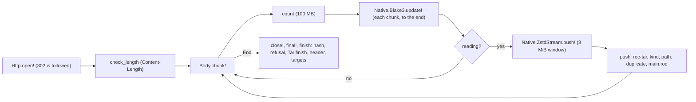

# 111 Archive read

Phase: P2. Status: green (code agent, 2026-11-02, sections 10.1 and 11; question Q111-11 open). Tests: red 2026-11-02, updated for the answers Q111-1 to Q111-10 (section 7.1). Model for the code: Opus medium. Plan row: `docs/registry/PLAN.md` C.1, row 111. Depends on slice 101 (the harness), 104 (`records.Artifact`, `records.Code`). Slice 112 (ingest) calls it.

## 1. Scope

A module that takes an asset URL and its hash, reads the asset as a stream, applies all limits and checks of R-PU38, and gives the artifact record (R-RE1, R-RE19, R-RE20, R-AP49). No route of its own: slice 112 calls `Archive.read!`.

| Part | Who | State |
| --- | --- | --- |
| `worker/lib/ArchiveRead.roc`: the state, the types, the constants, `tar_limits` (given); the functions are `crash "todo"` | Test agent (signatures), code agent (bodies) | Stubs |
| `worker/Archive.roc`: `Archive.Error` (given), `read!` (`crash "todo"`). The flow is in the doc comment. | Test agent (signature), code agent (body) | Stub |
| `worker/archive-test.roc`: the W2 test app (`GET /archive?url=`) | Test agent | Done. A fixture: the code agent does not change it (TW18). |
| Headers: `tar` (roc-tar 0.0.1) and `header` (roc-app-header 0.1.0) by release URL in `worker/main.roc`, `worker/lib/main.roc`, `worker/archive-test.roc`, `worker/tests/unit/w0.roc`; `ArchiveRead` in the lib exposes; `import ArchiveReadTest` in `w0.roc` | Test agent | Done (R-GP3: no path entry) |
| Harness: `worker/tests/run.mjs` (a case file `app`, a fake body `<file>.gen.json`), `scripts/test.sh` (`archive_build`, `W2_ARCHIVE_WASM`) | Test agent | Done |
| Test assets: `worker/tests/tools/mk-bundle.mjs`, `worker/tests/tools/blake3.mjs` | Test agent | Done |
| Tests: `worker/tests/unit/ArchiveReadTest.roc` (W0), `worker/tests/cases/archive/` (6 W2 cases) | Test agent | Red (section 4.2) |

### 1.1 Why a test app for W2 (and not a route)

| Option | Rejected or chosen | Reason |
| --- | --- | --- |
| A route only for tests in `main.roc`, behind a setting | Rejected | Test code in the production Worker. A wrong setting in a deploy opens a route that makes the Worker download any URL. |
| A named entry point (`Rpc.entrypoint`) that only a service binding reaches | Rejected | A change of the production manifest and of `worker.js` for a test. |
| W0 only, and the W2 cases in slice 112 | Rejected | The window limit, the Content-Length, the redirect and the real zstd and BLAKE3 of the platform are effects: W0 cannot see them. The code agent of 111 could not go green. |
| The test app `worker/archive-test.roc` | Chosen | It is in `worker/`, so it imports `Archive.roc` as it is: W2 tests the real effect code with the real `Native` ops, and the production Worker has no test code. Cost: a second LLVM build (55 s, at the same time as the Worker build of 2 min, so the wall time does not change). The stamp of the Worker build covers it. |

`scripts/test.sh` builds it in its own stamp dir `$WORK/worker-archive/<stamp>/archive-test.wasm` (`worker_publish`, safe for runs at the same time). A failed build fails only the cases with the file `app`, with a message. The other W2 cases run (manager rule, 2026-11-02).

## 2. Rules

| Rule | Text (short) | Checked by |
| --- | --- | --- |
| R-PU38 row 1 | Stream, BLAKE3 and zstd and roc-tar on each chunk; keep only the header file, the paths and the size | W0 (each chunk size gives one record), W2 `pu38-real-bundles`, `pu38-made-kinds` |
| R-PU38 row 2 | 100 MB packed: `Content-Length` before the read, the byte count while it reads. 422 with the size. | W0 `check_length`, `count` (the boundary 100,000,000), W2 `pu38-size` |
| R-PU38 row 3 | Window over 8 MiB: 422 | W2 `pu38-window` (8 MiB passes, 9 and 16 MiB fail), W0 `unzip_failed` |
| R-PU38 row 4 | The hash of the whole stream equals the URL hash before any write; the header read can end early, the hash reads to the end | W0, W2 `pu38-hash-and-end` (wrong hash, cut stream, 300 KB after the tar end, a refusal under a wrong hash) |
| R-PU38 row 5 | roc-tar limits: 256 MiB, 10,000 members, 255 bytes, header 1 MiB | W0 (each limit at the boundary), W2 `pu38-paths-and-header` (255 and 256 bytes, 1 MiB and 1 MiB + 1) |
| R-PU38 row 6 | The paths of `roc unbundle`, links, devices, duplicates, strict errors; any end form | W0 (11 path rules, 5 kinds, case, ends), W2 `pu38-paths-and-header`, `pu38-hash-and-end` |
| R-PU38 row 7 | The header file is `main.roc` at the root | W0, W2 `pu38-paths-and-header` |
| R-PU38 row 8 | A wrong hash: 422 `not-a-candidate`, the 2 hashes in the `detail` | W0 `problem`, W2 `pu38-hash-and-end` |
| R-PU38 row 9 | The order of the refusals; `TooLarge` stops at once | W0, W2 `pu38-hash-and-end` request 8, `pu38-size` |
| R-PU38 row 10 | Each zstd error is 422; the default limits | W0 `unzip_failed`, W2 request `1.0.3` |
| R-PU38 row 11 | A `targets/` name that does not match, and a file in `targets/`, are skipped | W0 `target_names`, W2 `pu38-made-kinds` |
| R-PU38 row 12 | Only type `0`, NUL and `5`; `6`, `7` and the others are refused | W0 (type 7 as `Other('7')`, type NUL passes) |
| R-PU38 row 13 | The platform entry of an app and `roc` are no `deps` row; a platform entry of a package or platform is | W0 `header_fields` |
| R-PU38 row 14 | A dep: `https://`, `PackageUrl.parse` (or `NoVersion`), a base58 hash of 32 bytes | W0 (8 bad URLs) |
| R-PU38 row 15 | 100 MB = 10^8 bytes | W0, W2 `pu38-size` |
| R-PU38 row 16 | Not UTF-8 and no header: 422; an app with no platform passes, `platform_hash` null | W0 `header_fields` |
| R-PU38 row 17 | The path key; a duplicate key; a member below a file; the header key keeps the case | W0 `path_key`, duplicates, `UnderFile`, `MAIN.ROC`; W2 request `MAIN.ROC` |
| R-RE1, R-AP49 | kind, exposed (empty for an app, header order), platform_hash, roc_pin, size | W0 `header_fields`, W2 `pu38-made-kinds`, `pu38-real-bundles` |
| R-RE19, R-AP49 (Dep) | alias, hash, group (`url_form`, or the URL with no scheme and no last segment), series, version, url | W0, W2 `pu38-made-kinds` |
| R-RE20, R-IK7 | The target names of a platform (`targets/<name>/`, `[a-z0-9]{1,32}`), sorted; none for an app and a package | W0 `target_names`, W2 (real platform 0.0.2: `wasm32`; made platform: a new name) |
| R-GA2, R-PK5, R-PK8 | zstd and BLAKE3 in the host, tar in roc-tar, the header with roc-app-header | W2 (the real bundles), W0 |
| R-PU6 | A release that roc cannot unbundle is not a candidate (422) | W0 `problem`, each W2 refusal |
| R-AP21 | Problem form | W2 (the test app gives `ArchiveRead.problem`) |

Design refs: Registry 7 (R-PU38, R-PU6), 4.2 (R-AP21, R-AP49), 5 (R-RE1, R-RE19, R-RE20), 5.1 (R-IK7); Design 2 (the roc hash), 6.1 (R-PK5, R-PK8), 6.2 (R-GA2), Q28, Q57, Q78, Q106.

## 3. What the code agent writes

### 3.1 Public signatures (fixed, in the stubs)

| Module | Item | Type or rule |
| --- | --- | --- |
| `ArchiveRead` | constants `max_packed_bytes` 100000000, `max_window_bytes` 8388608, `max_unpacked_bytes` 268435456, `max_members` 10000, `max_path_bytes` 255, `max_header_bytes` 1048576, `header_path`, `tar_limits` | Given |
| `ArchiveRead` | `Refusal`, `Fields` | Given (the tags of section 5) |
| `ArchiveRead` | `empty : () -> ArchiveRead` | The state before the first chunk (a function: a constant with `crash` fails at compile time) |
| `ArchiveRead` | `choose : Tar.Entry -> Tar.Action` | `Collect(max_header_bytes)` for the file `main.roc` |
| `ArchiveRead` | `url_hash : Str -> Try(Str, [NoHash])` | The last segment with no `.tar.zst` |
| `ArchiveRead` | `check_length`, `count`, `reading`, `push`, `unzip_failed`, `finish` | The steps of the module comment |
| `ArchiveRead` | `header_fields : List(U8) -> Try(ArchiveRead.Fields, ArchiveRead.Refusal)` | `Header.parse`, `PackageUrl.parse` |
| `ArchiveRead` | `target_names : Code.Kind, List(Str) -> List(Str)` | R-RE20, R-IK7 |
| `ArchiveRead` | `problem : Refusal -> Problem`, `upstream_problem : [Status(U16), NoAnswer, BodyRead] -> Problem` | Section 5 |
| `Archive` | `Error : [Refused(ArchiveRead.Refusal), Upstream([Status(U16), NoAnswer, BodyRead]), Fault(Str)]`, `read! : Str, Str => Try(Artifact.Row, Archive.Error)` | The flow of the doc comment (6 steps) |

The backing fields of the opaque `ArchiveRead` are private: the code agent can change them.

### 3.2 Order of the refusals in `finish` (proposal, Q111-2)

1. `HashMismatch` (the bytes are not the asset of the URL).
2. The first refusal of the read (zstd, tar, kind, path, duplicate), in stream order.
3. An error of `Tar.finish` (a cut in a header, data or padding).
4. `NoHeader`.
5. The errors of `header_fields`.

`TooLarge` stops the read at once (the stream can be endless), so it never reaches `finish`.

### 3.3 Size

The private reference has about 205 lines in `ArchiveRead.roc` and 57 in `Archive.roc` (with no doc comments). It fits TW19.

## 4. Tests

### 4.1 Table

| Layer | Case | Checks | Rules |
| --- | --- | --- | --- |
| W0 | `ArchiveReadTest.roc`, 33 `expect`s (after the answers: no-platform app, 8 bad dep URLs, a platform dep of a package, type 7 and NUL, `path_key`, 6 duplicate keys, 2 `UnderFile`, only `MAIN.ROC`) | Constants. `url_hash` (5). `check_length` (6, also exactly 100,000,000). `count` (the total over chunks, 100,000,000 passes, +1 fails; one chunk over). `size` is the packed count. The tar of the real roc-semver 0.2.0 bundle in 7 chunk sizes (1 to 31744). `header_fields`: an app (no exposed, platform hash, `roc:`, deps in header order, a `v` tag, a URL with no version, `01.2.3`), a package, a platform, 4 errors, a cut header. `target_names` (12 paths, 3 kinds). 9 path rules. 5 kinds (link, hard link, device, FIFO, duplicate); a dir and a case-only difference pass. 255 and 256 bytes (ustar prefix). Header 1 MiB + 1, 256 MiB + 1, 256 MiB, 10,001 members. Ends: one and no zero block, 300 KB of zeros after the end; lone zero block, data after the end, a cut. No `main.roc`. Hash mismatch, also with a refusal. The first refusal is kept, `reading`. 5 zstd errors. 22 problem texts, 4 upstream texts. | R-PU38 rows 1 to 7, R-RE1, R-RE19, R-RE20, R-IK7, R-AP49, R-PK5, R-PK8, R-PU6, R-AP21 |
| W2 | `archive/pu38-real-bundles` | The real roc-semver 0.2.0 asset (with Content-Length) and the real platform 0.0.2 asset through a 302 to `release-assets.githubusercontent.com`: the whole records (38 exposed names, 2 deps, `wasm32`, the sizes), the GitHub log with the redirect | R-PU38, R-RE1, R-RE19, R-RE20, R-IK7, R-AP49, R-GA2 |
| W2 | `archive/pu38-made-kinds` | A package (node zstd -19), an app (raw zstd frame), a platform (zstd -3) with `targets/` (a dir entry, a new name, `macos-sysroot`, a file) | R-PU38, R-RE1, R-RE19, R-RE20, R-IK7, R-AP49 |
| W2 | `archive/pu38-hash-and-end` | 9 requests: wrong hash; a cut stream under the whole hash; the cut under its own hash (zstd `Truncated`); 300 KB of zeros after the tar end (raw blocks, so many chunks after the end); one and no zero block; data after the end; a symbolic link under a wrong hash; GitHub 404 | R-PU38, R-PU6, R-AP21 |
| W2 | `archive/pu38-size` | Content-Length 100,000,001 (refused, the body is never read); a chunked answer with no Content-Length: a valid package bundle of 100,002,295 bytes (raw zstd blocks, the package tar and zero bytes) under its own hash, refused by the count; Content-Length of exactly 100,000,000 bytes of zeros (passes the check, then the hash) | R-PU38, R-AP21 |
| W2 | `archive/pu38-window` | Raw frames with the window descriptor 8 MiB (passes), 9 MiB and 16 MiB (refused) | R-PU38, R-AP21 |
| W2 | `archive/pu38-paths-and-header` | 13 requests (`main.roc` and `MAIN.ROC`: 422 duplicate, R-PU38 row 17): 255 bytes (ustar), `..`, symbolic link, hard link, device, duplicate, reserved name, 256 bytes; `main.roc` only in `src/`; a `module` header; header 1 MiB + 1 and 1 MiB | R-PU38, R-PK5, R-PK8, R-AP21 |

A "lying" Content-Length cannot carry more bytes than it names (finding of the probe `research/slice-111/probe/`): workerd frames the body by the header, so a smaller value cuts the body and a larger value makes the read wait. So the byte count is tested with a chunked answer (no Content-Length), as an HTTP server that lies would send it.

The test assets: `node worker/tests/tools/mk-bundle.mjs` writes all 6 cases and the W0 fixture (the hashes are in the names and in the expected answers, so the files are tracked). `node worker/tests/tools/mk-bundle.mjs check` checks the JS BLAKE3 against 3 real bundle names. The 100 MB bodies are made while the Worker reads (`<file>.gen.json`), and are not tracked.

### 4.2 Red results (2026-11-02)

| Step | Result |
| --- | --- |
| W0, `ArchiveReadTest` alone (stubs) | 33 expects: 2 passed (the constants), 31 failed with `todo`. 0 compiler errors. |
| W2 `archive/*` (stubs) | 6 of 6 fail: `status: expected 200 (or 422), got 500`, `body is not JSON: trap RuntimeError: unreachable` (the `todo` crash). |
| `scripts/test.sh w2` (all cases) | 84 cases ran: 73 pass, 11 fail (the 6 `archive/*` cases, and `closure/*` and `router/r-ap23-no-body` of other slices). |
| `roc check` of `worker/main.roc`, `worker/archive-test.roc`, `worker/tests/unit/w0.roc`; `roc fmt --check` of the new and changed files | 0 errors |

### 4.3 Revert check (private reference)

`research/slice-111-revert/reference/` fills `ArchiveRead.roc` and `Archive.roc`. `research/slice-111-revert/ref.sh all` copies `worker/`, `packages/records` and `sql/` to `refbuild/`, puts the reference over it, runs `ArchiveReadTest` (its own driver) and the 6 W2 cases: all 27 expects and all 6 cases pass. `MUTATE=mutations/<m>.py ref.sh all` runs one mutation (its own dir `refbuild-<m>`). Keep the reference until the review is applied.

| Mutation (run again after the answers, 2026-11-02) | Caught by |
| --- | --- |
| m1 the hash is not compared with the hash of the URL | W0, W2 `pu38-hash-and-end`, `pu38-size` |
| m2 the zstd stream opens with a 2 MiB window | W2 `pu38-window` (8 MiB frame) |
| m3 no byte count, only Content-Length | W0 (2), W2 `pu38-size` request 2 |
| m5 `Tar.check_path` in place of `Tar.check_portable_path` | W0, W2 `pu38-paths-and-header` |
| m6 the body read stops at the first refusal (the hash does not read to the end) | W2 `pu38-size` request 3 |
| m8 duplicates compare the exact text, not the key of row 17 | W0, W2 `pu38-paths-and-header` (`MAIN.ROC`) |
| m9 Content-Length is not checked before the read | W2 `pu38-size` request 1 |
| m11 the dep hash is not checked as base58 of 32 bytes (row 14) | W0 |
| m12 type 7 is read as a file (row 12) | W0 |
| m13 the header is the file whose folded key is `main.roc` | W0 (only `MAIN.ROC`) |

Caught 10 of 10. m4, m7 and m10 of the first run (2026-11-02) were caught then, and are not run again. `roc build` exits non-zero for a warning, so `ref.sh` accepts a log with `0 errors and` (as `roc_build_ok`).

## 5. Output (proposed, TW24)

All refusals are 422 `not-a-candidate` (R-PU6; `HashMismatch`: Q111-1). The `detail` texts are proposals:

| Refusal | `detail` |
| --- | --- |
| `TooLarge`, Content-Length | `the asset has <n> bytes (Content-Length), more than the limit of 100000000 bytes` |
| `TooLarge`, count | `the asset has more than the limit of 100000000 bytes (the read stopped at <n> bytes)`. `<n>` depends on the chunks, so W2 does not check this `detail`. |
| `WindowTooLarge` | `the zstd window of the asset is larger than 8388608 bytes` |
| `BadZstd` | `the asset is not a valid zstd stream: ` and `a damaged frame`, `the stream ends inside a frame`, `a frame needs a dictionary`, `a block gives too many bytes` |
| `BadTar(e)` | `Tar.err_to_str(e)` (it has the limit and the offset: row 5) |
| `BadPath` | `the archive has a path that roc unbundle refuses (<why>): <path>`. `<why>`: `empty`, `more than 255 bytes`, `absolute`, `a drive letter`, `a .. part`, `a . part`, `a Windows reserved name`, `a part ends with a space`, `a part ends with a period`, `the character <c>`, `a backslash` |
| `NotAFile` | `the archive has <a symbolic link / a hard link / a member of type <c>>, not a file: <path>` |
| `Duplicate` | `the archive has the path <path> two times` (`<path>`: the later member, as in the archive) |
| `UnderFile` | `the archive has <path> below the file <file>` |
| `NoHeader` | `the archive has no main.roc at its root` |
| `BadHeader` | `main.roc has no valid header: ` and `it is not UTF-8`, `it starts with no app, package or platform header`, `the header stops to be valid at byte <n>` |
| `BadDep` | `main.roc has a header entry <alias> that is not a package URL with a hash: <url>` |
| `HashMismatch` | `the BLAKE3 hash of the asset is <actual>, not the hash <expected> of the URL` |
| `upstream_problem` | 502 `upstream`: `the asset read failed with status <n>`, `the asset read failed: no answer`, `the asset read failed: the body stopped` |

| Item | Proposal |
| --- | --- |
| GitHub request | `GET <asset URL>` with `user-agent: talon-registry` (the value of slice 109), `Http.open!`, the redirect is followed |
| Test app answer | 200 `application/json` with `Artifact.encode(row)` (R-AP49). Test only. |

## 6. Out of scope

| Item | Reason |
| --- | --- |
| The route, the URL rules (github.com only), the 422 or other mapping of a GitHub 404, the D1 writes | Slice 112 |
| The 16 MiB `push_limit` of `Native.ZstdStream` on a real archive | Q111-3. W0 has the mapping only. A real case needs more than 16 MiB from one push (RLE blocks), which is a bomb test that the platform owns. |
| A body that stops with a network error (`BodyErr`) | The fake GitHub cannot make one in Miniflare. `Upstream(BodyRead)` has a W0 text only. |
| The exact count at the stop in the `detail` (W2) | It depends on the chunk sizes of workerd (about 4 KB) |
| R-GP5 | roc-tar, roc-app-header and roc-base58 are not tested again: the tests check the limits and the uses of Talon |

## 7. Questions (TW17, stop until answered)

| Id | Question | Proposal | Effect now |
| --- | --- | --- | --- |
| Q111-1 | Which problem for a hash that is not the hash of the URL? R-PU38 row 4 gives none. | 422 `not-a-candidate` (the bytes at the URL are not the release) | W0 `problem` row, 3 W2 rows |
| Q111-2 | When the hash is wrong and the read also has a refusal, which one does the answer give? | The hash first (3.2). `TooLarge` stops at once. | 1 W0 row, W2 `pu38-hash-and-end` request 8, `pu38-size` request 3 |
| Q111-3 | The zstd errors other than the window (`BadFrame`, `Truncated`, `Unsupported`, `OutputLimit` of the 16 MiB push limit): 422? | 422 `not-a-candidate` for all (roc cannot read it, R-PU6); keep the default push limit | W0 rows, W2 `pu38-hash-and-end` request 3 |
| Q111-4 | A dir in `targets/` whose name does not match `[a-z0-9]{1,32}` (basic-cli has `targets/macos-sysroot/`), and a file directly in `targets/`: skip, or refuse the archive? | Skip: not a target, the archive is a candidate (else no basic-cli release is a candidate) | W0 `target_names`, W2 `pu38-made-kinds` request 3 |
| Q111-5 | A dir member: accepted? A FIFO or other type (not a device): refused? Row 6 names links and devices only. | Dir accepted (GNU tar writes them); each other type refused | W0 rows |
| Q111-6 | Is the platform entry of an app also a row of `deps`? Is `roc:` a dep? | No and no: the platform is `platform_hash` only | W0 app row, W2 app |
| Q111-7 | A dep that `PackageUrl.parse` refuses (a path, no hash, two versions, `0.0.0`), and a dep hash that is not base58 of 32 bytes | Refuse (`BadDep`, 422) for the parse errors except `NoVersion`; the hash text is not checked (slice 112 makes its id) | 1 W0 row |
| Q111-8 | 100 MB is 100,000,000 bytes? The design writes MiB for the other limits. | Yes, 10^8 | The constant, W0, W2 |
| Q111-9 | A `main.roc` that is not UTF-8, has no header, or an app with no platform: 422? | 422 `not-a-candidate` | W0, W2 request `1.1.1` |
| Q111-10 | Duplicate paths: exact text, or also `a//b` against `a/b` and a case-only difference? | Exact text only (`roc unbundle` refuses neither) | 1 W0 row |

### 7.1 Answers (design agent, 2026-11-02)

roc facts are from roc `338f10a` and Zig 0.17 `lib/std/tar.zig`. The rule rows are in Registry R-PU38.

| Id | Answer | Rule | Design |
| --- | --- | --- | --- |
| Q111-1 | Proposal taken: 422 `not-a-candidate` (roc also refuses: `unbundle.zig:676`) | R-PU38 row 8 | Q123 |
| Q111-2 | Proposal taken: the order of 3.2; `TooLarge` stops at once | R-PU38 row 9 | Q124 |
| Q111-3 | Proposal taken: 422 for all; the default limits of `Native.ZstdStream` (the output limit is a first guess, P2) | R-PU38 row 10 | Q125 |
| Q111-4 | Proposal taken: skip (roc looks only in the dirs of the declared targets, `targets_config.zig:316`; `macos-sysroot` is for the linker, `linker.zig:372-374`) | R-PU38 row 11 | Q126 |
| Q111-5 | Proposal taken: a file (`0` or NUL) and a dir (`5`) pass; each other type is refused, also `6` and `7` (`tar.zig:403-474`, `unbundle.zig:724-745`) | R-PU38 row 12 | Q127 |
| Q111-6 | Proposal taken for an app: no and no. Added: a platform entry in a package or platform header is a `deps` row | R-PU38 row 13 | Q128 |
| Q111-7 | Changed: also refuse `http://` (`download.zig:102-108`) and a hash that is not base58 of 32 bytes (`unbundle.zig:813-839`). `NoVersion` passes. Each refusal is `BadDep` | R-PU38 row 14 | Q129 |
| Q111-8 | Proposal taken: exactly 100,000,000 bytes (10^8) | R-PU38 row 15 | Q130 |
| Q111-9 | Changed in part: not UTF-8 and no header give 422; an app with no platform is accepted with `platform_hash` `null` (roc gives it the Echo platform, `Parser.zig:1772-1775`) | R-PU38 row 16, R-AP49 | Q131 |
| Q111-10 | Changed: compare a key (the parts between `/`, no empty part, ASCII case folded); a member below a file member is refused; the header is the file with the key `main.roc` (case kept) | R-PU38 row 17 | Q132 |

### 7.2 Test changes (for the test agent)

| # | Where | Change |
| --- | --- | --- |
| 1 | `ArchiveRead.roc` stub | `BadHeader`: remove `NoPlatform`. Add a refusal for a member below a file, for example `UnderFile({ path : Str, file : Str })`. Doc comments of `choose`, `push`, `header_fields`: the key of row 17, the dep checks of row 14 |
| 2 | W0 `header_fields` | The app with no platform: `Ok`, `platform_hash` `None`, `deps` without the platform (was `BadHeader(NoPlatform)`) |
| 3 | W0 `header_fields` | New rows: a dep `http://...` is `BadDep`; a dep hash that is not base58 of 32 bytes (bad character, 31 bytes) is `BadDep`; a package header with `pf: platform "<url>"` gives a `deps` row for `pf` |
| 4 | W0 duplicates | A case-only difference is now `Duplicate` (was a pass). New rows: `a//b` after `a/b`, `a/b/` after `a/b`, the dir `src/` 2 times, `main.roc` and `MAIN.ROC` |
| 5 | W0 below a file | New rows: the file `a`, then `a/b`; the member `a/b`, then the file `a`. Both are the new refusal |
| 6 | W0 header | `MAIN.ROC` only: `NoHeader`. `main.roc` only (no other change) still passes |
| 7 | W0 kinds | New rows: type `7` (contiguous) is `NotAFile`; type NUL is a file |
| 8 | W0 `problem` | Remove the text `the app header names no platform`. New text (proposal): `the archive has <path> below the file <file>`. `BadDep` keeps its text for the new cases |
| 9 | W2 | A request that expects 422 for an app with no platform now expects 200 with `platform_hash: null`. Optional: a request with `main.roc` and `MAIN.ROC` in `pu38-paths-and-header` (422) |
| 10 | Rule ids | The tests name R-PU38 rows 8 to 17. Section 2 of this file gets those rows |
| 11 | Revert check | Optional mutations: compare the exact text (row 17), do not check the dep hash (row 14) |

### 7.3 Q111-11 and 2 code choices (design agent, 2026-11-02)

| Item | Answer |
| --- | --- |
| Q111-11 (R-PU38 row 18, Design Q136) | The app platform URL gets all checks of row 14: `https://`, `PackageUrl.parse` `Ok` or `NoVersion`, a hash of base58 of 32 bytes. Else `BadDep({ alias, url })`, 422. The code applies only the hash-segment check: it must also apply `https://` and the 32 bytes. Test change: W0 rows for an app with `pf: platform "../pf/main.roc"`, with a URL with no `<hash>.tar.zst`, with `http://`, and with a hash of 31 bytes, each `BadDep` |
| `Content-Length` digits over the U64 range gives `TooLarge` | Right: the value is over the limit of row 2, so 422 before the read. But the `detail` must not show `U64.highest` as the size: it is not the size. Proposal: `the asset has more than 100000000 bytes (Content-Length <text>)`, with the header text as sent |
| The `Fault` texts of `read!` | Right: a `Fault` is 500 `internal` (R-AP21), and the design gives no text, so these are TW24 proposals for the human review. They name the failed step and no URL, which is good |

### 7.4 Test changes for 7.3 (test agent, 2026-11-02)

| # | W0 row | Rule | State against the code of section 11 |
| --- | --- | --- | --- |
| 1 | An app platform URL: a path, no `<hash>.tar.zst`, `http://`, a hash of 31 bytes: each `BadDep({ alias: "pf", url })` | R-PU38 row 18 | Red |
| 2 | A symbolic link, then a block that is not a tar header, in one chunk (and in chunks of 4096): `NotAFile` (stream order) | R-PU38 row 9 | Green; it catches the code agent's mutation m2 (no replay) |
| 3 | `check_length(Ok("99999999999999999999"))`: `the asset has more than 100000000 bytes (Content-Length 99999999999999999999)` (TW24 proposal) | R-PU38 row 2 | Red. The `Refusal` needs a form that holds the header text (the reference adds `TooLargeHeader(Str)`) |

W0 has 36 expects. The private reference passes all 36 and the 6 W2 cases.

## 8. Platform issues

| # | Issue | Evidence |
| --- | --- | --- |
| P1 | `Body.chunk!` of an outbound `fetch` body gives chunks of about 4 KB in Miniflare: 28,766 chunks for 110 MB. Each chunk is 3 host crossings (BLAKE3, zstd, the read). A read with a size hint (`chunk_with!({ min_bytes })`) would cut the crossings. | `research/slice-111/probe/run.mjs`, mode `rawbig` (1.8 s for 110 MB) |
| P2 | The window limit and the push limit of `ZstdStream` are only in `Native.roc` and `API.md` 8. With 4 KB chunks, RLE blocks can make more than 16 MiB from one push, so a legit archive with a long run of zero bytes can get `OutputLimit`. Request: document the ratio, or give the output in parts. | `API.md` 8 limits table, P1 |
| P3 | A Miniflare `outboundService` answer `new Response(Buffer)` reaches the Worker with no `Content-Length`. The fake must set it. A smaller value cuts the body, a larger one makes the read wait (no error). | Probe modes `plain`, `clEq`, `clSmall`, `clBig` |
| P4 | `Worker.new({ fetch! })` (record shorthand) gives a type error that shows the whole option record; `{ fetch!: fetch! }` works. The roc-tar bench writes `{ fetch!, }`. | First `roc check` of the probe |
| P5 | A stub constant `x = crash "todo"` fails `roc check` (compile-time evaluation), so a stub of a value must be a function (`empty : () -> ArchiveRead`). | First `roc check` of `lib/main.roc` |
| P6 | The LLVM build of `worker/main.roc` now takes about 2 min (load 7), and the test app 55 s. The W2 step is over its budget of 45 s on each cold build. | `scripts/test.sh w2`: 167 s |

## 9. Files

| File | Kind | Lines |
| --- | --- | --- |
| `worker/lib/ArchiveRead.roc` | New, stubs | 156 |
| `worker/Archive.roc` | New, stub | 32 |
| `worker/archive-test.roc` | New, W2 test app | 58 |
| `worker/tests/unit/ArchiveReadTest.roc` | New, W0 | 456 |
| `worker/tests/unit/fixtures/roc-semver-0.2.0.tar` | New, W0 fixture (31,744 bytes) | |
| `worker/tests/tools/mk-bundle.mjs`, `blake3.mjs` | New, test assets | 385, 78 |
| `worker/tests/cases/archive/` | New: 6 W2 cases (1.2 MB, with the real 228 KB platform) | |
| `worker/main.roc`, `worker/lib/main.roc`, `worker/tests/unit/w0.roc` | Changed: header entries `tar`, `header`; `ArchiveRead`; `import ArchiveReadTest` | |
| `worker/tests/run.mjs` | Changed: the case file `app`, `<file>.gen.json` | |
| `scripts/test.sh` | Changed: `archive_build`, `W2_ARCHIVE_WASM` | |
| `research/slice-111/probe/` | Probe: Content-Length, chunks, 110 MB time | |
| `research/slice-111-revert/` | `before/` (copies, `NEW.txt`), `reference/`, `mutations/`, `ref.sh` | |

## 10. Disputes (from the code agent)

None. No test was changed.

### 10.1 Code (code agent, 2026-11-02)

| File | Lines (all) | Lines (no comment, no blank) |
| --- | --- | --- |
| `worker/lib/ArchiveRead.roc` | 469 | 343 (the given types, constants and doc comments are in it) |
| `worker/Archive.roc` | 92 | 69 |

| Decision the slice does not fix | Choice | Rejected |
| --- | --- | --- |
| The type byte of type 7 (row 12) | The state keeps the last 511 decoded bytes (`tail`) and the decoded count. The byte at `entry.offset + 156` is in `tail` or in the chunk of the `Entry`. One `if` in `check_member`, with a comment that names the roc-tar issue. | A concat of `tail` and each chunk (a copy of each chunk) |
| A tar error in the same chunk as a refusal of an earlier member (row 9, stream order) | roc-tar gives no events before an error. On an error of a chunk over 512 bytes, `push` reads the chunk again from the old reader in pieces of 512 bytes, so the first refusal in stream order is kept for each chunk size. Only the error path pays. | Keep `BadTar` (the answer then depends on the chunk size) |
| A `Content-Length` of digits that does not fit in a U64 | Follow-up (7.3, 7.4 row 3): the new refusal `TooLargeHeader(Str)` keeps the header text as sent; `detail` `the asset has more than 100000000 bytes (Content-Length <text>)` | `TooLarge` with `U64.highest` (first code: the detail showed a size that is not the size) |
| The state keeps only the paths below `targets/` | `target_names` reads only those | All paths (more memory, no use) |
| The `Fault` texts of `read!` | `no BLAKE3 state`, `no zstd stream`, `BLAKE3 update`, `zstd push`, `zstd close`, `BLAKE3 final` (proposal, TW24) | |

| Question (TW17) | Now |
| --- | --- |
| Q111-11: the platform URL of an app with no `<hash>.tar.zst` segment (a path platform such as `"../pf/main.roc"`). Rows 13 and 14 give no rule: row 14 is for `deps`, and the platform of an app is no `deps` row. | Answered (7.3, R-PU38 row 18, Q136). Follow-up code: the app platform URL goes through `dep_of` (all checks of row 14), and `platform_hash` is its hash. |

## 11. Verify results

| Step (code agent, 2026-11-02) | Result |
| --- | --- |
| `scripts/test.sh w0` | `ArchiveReadTest`: all expects pass. All 20 fails of the run are slice 115 (`CompatTest`, `CompatReadsTest`, its stubs). Worker fmt check: valid. |
| `scripts/test.sh w2` | 85 cases: 84 pass. The 6 `archive/*` cases pass. 1 fail: `oidc/tp3-jwt-strict` (its case files were changed at 02:29 by another agent while this run went; not slice 111). 125 s (the 2 LLVM builds, P6). |
| `scripts/test.sh check fmt w1` | check pass, fmt pass. w1: 47 pass, 6 fail, all `compat/*` (slice 115). |

Revert check (W0, `research/slice-111-code/mutate.py <m>`, the green copy is `research/slice-111-code/ArchiveRead.green.roc`; the code is the same as the copy after the run):

| Mutation | Caught by |
| --- | --- |
| m1 the type byte at `offset + 155` | W0 (type 7) |
| m2 no read again in 512-byte pieces after a tar error | Not caught (no test has a refusal and a later tar error in one chunk). Proposal for the test agent: a symbolic link, then data after the end, in one `push` |
| m3 no check of a file above a member seen before | W0 (`UnderFile`, second order) |
| m4 no case fold in `path_key` | W0 (`path_key`, duplicates) |
| m5 no check of 32 bytes for a dep hash | W0 (bad deps) |
| m6 the read refusal before the hash | W0 (hash and refusal) |
| m7 `>=` in `count` | W0 (exactly 100,000,000) |
| m8 a dir `targets/<name>/` gives no name | W0 (`target_names`, `wasm32`) |

Caught 7 of 8.

Follow-up (code agent, 2026-11-02, after 7.3 and 7.4):

| Step | Result |
| --- | --- |
| `scripts/test.sh w0` | `ArchiveReadTest`: all 36 expects pass (the 2 red rows of 7.4 now pass, row 2 stays green; it also catches m2). Worker fmt: valid. The other fails are `CompatTest`, `CompatReadsTest` (slice 115) and `OidcTest` (slice 108b). |
| `scripts/test.sh w2` | The 6 `archive/*` cases pass. The 11 fails are `compat/*` (slice 115) and `oidc/tp3-jwt-strict` (slice 108b). |
