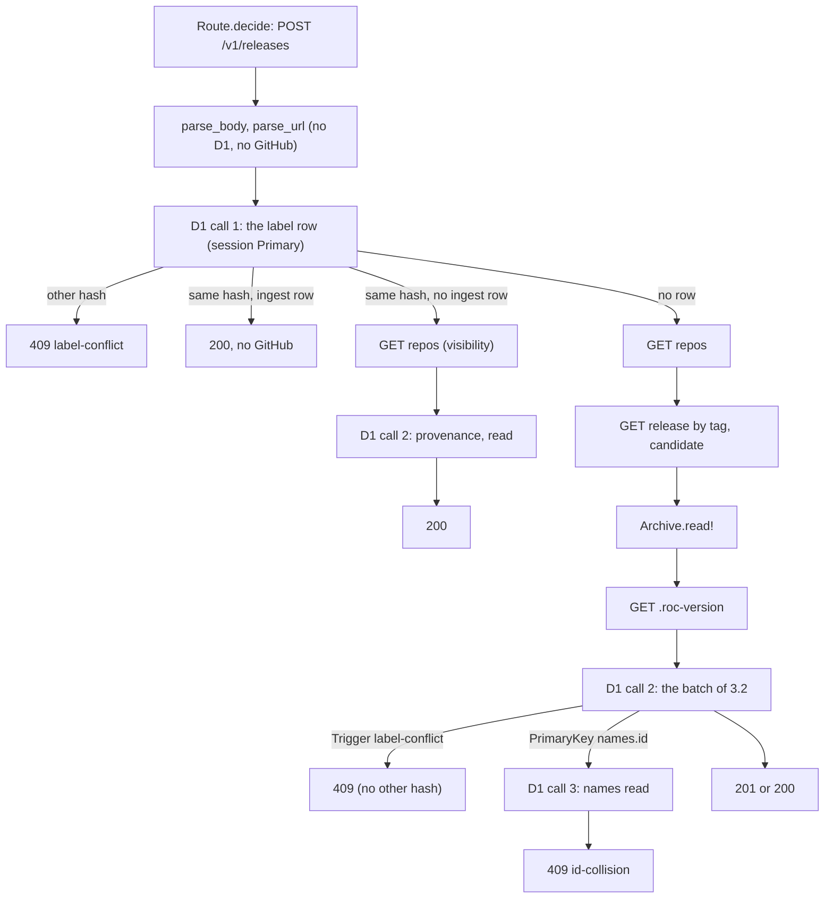

# 112 Ingest

Phase: P2. Status: green (code 2026-11-02, section 9; scope and red tests 2026-11-02; tests changed for the answers of 7.1, T1 to T6 done, section 7.2). Model for the code: Opus medium. Plan row: `docs/registry/PLAN.md` C.1, row 112. Depends on slices 101 (the harness), 103 (the triggers, R-SG8), 104 (`records`), 105 (`Version`), 106 (`Reads`, the read routes), 109 (the pattern of a GitHub read and one write batch), 111 (`Archive.read!`).

## 1. Scope and split

`POST /v1/releases` with no `Authorization` header (R-AP9, R-AP26): the body, the URL rules, the pre-read, the GitHub reads, the archive read, one write batch, the answers 200, 201, 409 and 422, and `Talon-Bookmark`.

| Slice | Content | State |
| --- | --- | --- |
| 112a (this file) | Route line, body, URL rules (R-PU34 row 4), pre-read, visibility (R-PU31, R-PU32), release rules (R-PU6), archive read (R-PU34 row 3), write batch, label rules (R-PU14, R-PU19), provenance (R-PU15), `repos` and `repo_checks` (R-TP5, R-PU26), id collision (R-IK3), bookmark (R-AP41 row 5) | Red tests |
| 112b (`docs/slices/112b-ingest-limits.md`) | R-AP68 rows 3, 5, 12: the rate limits (R-PU34 rows 1 and 2, R-AP25, binding `RL_INGEST`) and the cache drop (R-AP69, R-AP43) | Scope only (Design Q166 to Q168 settled) |

Reason for the split (TW19, TW17): 112a is about 390 lines of code in the private reference (Ingest.roc about 175 lines more than the stub, IngestRoutes.roc about 215). The 112b parts add a binding, a harness change and 3 open facts. The PLAN row stays one row; the manager can renumber.

| Part | Who | State |
| --- | --- | --- |
| `worker/lib/Ingest.roc`: types, constants, problem texts (given); 11 functions `crash "todo"` | Test agent (signatures), code agent (bodies) | Stubs |
| `worker/IngestRoutes.roc`: `post!` `crash "todo"`, the flow in the doc comment | Test agent (signature), code agent (body) | Stub |
| `worker/lib/Route.roc`: the tag `PostRelease` in `Route.Id`, the doc | Test agent | Done. The line of `decide` for `["v1", "releases"]` is for the code agent (GET `GetReleases`, POST `PostRelease` with the media check of `decide_closure`, else 405 `Allow: GET, POST`). |
| `worker/main.roc`: `import IngestRoutes`, the arm `PostRelease` (no `Authorization`: `IngestRoutes.post!`; with it: `Fault`, slice 114) | Test agent | Done |
| `worker/lib/main.roc` (`Ingest` in the exposes), `worker/tests/unit/w0.roc` (`import IngestTest`) | Test agent | Done |
| Tests: `worker/tests/unit/IngestTest.roc` (W0), `worker/tests/cases/ingest/` (5 W2 cases), made by `worker/tests/tools/mk-ingest.mjs` | Test agent | Red (4.2) |
| Changed tests of slice 106: `ReadsTest.roc` (the route rows of `/v1/releases`), `worker/tests/cases/reads/ap48-method-not-allowed` (requests 1 and 4) | Test agent | Changed (4.3) |
| Runner `worker/tests/run.mjs`: `github/<dir>/%2F`, `github/<file>.sql`, `headers_set`; self-test `selftest/wrong-header-set` | Test agent | Done, the old cases pass |

## 2. Rules

| Rule | Text (short) | Checked by |
| --- | --- | --- |
| R-AP68 (rows 1, 2, 4, 6 to 11), R-PU40 | The ingest path; another host is 422 with no D1 and no GitHub call (Design Q155 to Q165) | W0, W2 all `ingest/*` |
| R-AP9, R-AP26 | No `Authorization`: an ingest. `{url}`. A body with `compat` and no token: 401. | W0 `parse_body`, `Route.decide`. W2 `ap26-body-and-route` |
| R-AP8 (as R-AP9) | 201 with `Location: /v1/artifacts/{hash}` for a new release, 200 for the label with the same hash, the release record | W0 `status_of`, `answer_body`. W2 `pu4-index-kinds`, `pu14-pu19-labels` |
| R-AP41 (write budget, rows 3, 5) | At most 2 D1 calls (a pre-read, a write batch whose last statement reads the answer), 1 more for the R-IK3 detail. A label written between the 2 calls gives 409 and no second leaf. `Talon-Bookmark` on each write answer. | W2 `expect/d1-calls` of each case, `pu14-pu19-labels` request 6 (the race), `headers_set` |
| R-PU4 | Anyone with a public URL; the hash checks the bytes | W2 `pu4-index-kinds` |
| R-PU6 (CLI R-DI3 to R-DI5) | No draft, no prerelease, exactly one `<hash>.tar.zst` asset; the version and group from the URL | W0 `candidate`, `parse_url`. W2 `pu6-not-candidates`, `pu4-index-kinds` (other assets), `pu14-pu19-labels` (`v1.0.0`) |
| R-PU14 | The same label and hash: no artifact, release or log row, the existing record (200), only the own provenance row | W0 `after_read`. W2 `pu14-pu19-labels` requests 1, 2; `pu4-index-kinds` request 4 |
| R-PU15 | One provenance row `ingest` (code 3) for each release, only added | W0 `plan`. W2 db rows of `provenance` |
| R-PU19 | The label with another hash: 409 `label-conflict`, the `detail` says to release a new version, nothing new | W0 `after_read`, `label_conflict`. W2 `pu14-pu19-labels` requests 3, 4, 6 |
| R-PU26, R-PU22 | The `repo_checks` row with the first release of a name, `next_check_at` = now + 1 h | W0 `plan`. W2 db `repo_checks` |
| R-PU31, R-PU32 | The visibility from `GET /repos/{owner}/{repo}` before any write; `private`, `internal` and a 404 give 422 `repository not found or not public`, and nothing is stored | W0 `parse_repo`. W2 `pu6-not-candidates` (db.tsv: every table empty) |
| R-PU34 rows 3, 4 | The size limit of R-PU38 (slice 111 through `Archive.read!`); `github.com` release asset URLs only, public only, one release for each label, the candidate rules | W0 `parse_url`. W2 `pu6-not-candidates` (the URL rules, the hash mismatch) |
| R-IK3 | `INSERT INTO names ... ON CONFLICT (kind, value) DO NOTHING`; a collision is `PrimaryKey` `UNIQUE constraint failed: names.id`: 409 `id-collision`, then the names read for the `detail` | W0 `batch_failure`, `collision`. W2 `ik3-id-collision` (hash, repository) |
| R-TP5 | The first write of a name adds the `repos` row with `id` and `owner.id` of the GitHub read; a later write does not change it (R-TP9 is slice 113) | W0 `plan`. W2 db `repos` |
| R-SG8 | Names, then the leaf (`MAX` in a subquery, `WHERE NOT EXISTS`), then the release (no `OR IGNORE`); the leaf time is the clock | W0 `plan`. W2 db `log` |
| R-IK2, R-IK5, R-IK7 | The ids, the version columns (`01.0.0` is `1.0.0`), a new target code 36 | W0 `plan`, `parse_url`. W2 `pu4-index-kinds`, `pu14-pu19-labels` request 4 |
| R-RE1, R-RE2, R-RE9, R-RE11, R-RE14, R-RE19, R-RE20, R-AP49 | The rows and the record | W2 `pu4-index-kinds` (db.tsv and the R-AP2 read after it) |
| R-AP21, R-AP48, R-AP51 | The problem form; the order of the checks; `compat: null` is no value | W2 `ap26-body-and-route`, `reads/ap48-method-not-allowed` |

Design refs: Registry 3 (R-SG8), 4 (R-AP8, R-AP9), 4.2 (R-AP21, R-AP26, R-AP41, R-AP46, R-AP48, R-AP49, R-AP51), 5 and 5.1 (R-RE, R-IK2, R-IK3, R-IK5, R-IK7), 7 (R-PU4, R-PU6, R-PU14, R-PU15, R-PU19, R-PU26, R-PU31, R-PU32, R-PU34, R-PU38), 7.1 (R-TP5); CLI 7.3 (R-DI3 to R-DI5, R-DI8); Design Q27, Q30, Q62, Q86.

## 3. What the code agent writes

### 3.1 Public signatures (fixed, in the stubs)

| Module | Item | Rule |
| --- | --- | --- |
| `Ingest` | `parse_body : List(U8) -> Try(Str, Problem)` | R-AP26, R-AP51. A `compat` member is a top-level member of the body object. |
| `Ingest` | `parse_url : Str -> Try(Ingest.Target, Problem)` | R-PU34 row 4, R-DI5 (`PackageUrl.parse` of roc-app-header, `Base58.decode`) |
| `Ingest` | `after_read : Ingest.Target, List(Ingest.LabelRow) -> Try([Conflict(Problem), Answer(Release.Row), AddProvenance(U64), Index], [BadRow(Str)])` | R-PU14, R-PU19 (`Reads.release_of_row`) |
| `Ingest` | `parse_repo`, `parse_release`, `candidate` | R-PU31, R-PU32, R-PU6. `parse_release` can use `Toolchains.parse_time`. |
| `Ingest` | `plan : {...} -> Ingest.Plan` | The fields are in the doc comment of `Plan` (R-IK2, R-SG8, R-RE1 to R-RE20) |
| `Ingest` | `batch_failure`, `collision`, `status_of`, `answer_body` | R-IK3, R-SG8 row 4, R-AP8 |
| `Ingest` | `repo_url`, `release_url`, `roc_version_url`, `roc_version_of`, `location`, `cache_control`, the problems | Given |
| `IngestRoutes` | `post! : Request => Try(Response, IngestRoutes.Error)` | The flow of the doc comment (7 steps) |
| `Route.Id` | `PostRelease` | The line in `decide` is for the code agent |

### 3.2 The write batch (D1 call 2, one `batch!` on the `Primary` session, in this order)

| # | Statement (no `OR IGNORE`, Q86) | One for each |
| --- | --- | --- |
| 1 | `INSERT INTO names (id, kind, value) VALUES (?, ?, ?) ON CONFLICT (kind, value) DO NOTHING` (kind 1: `Sql.Blob`, kinds 2, 3: text) | `plan.names` |
| 2 | `INSERT INTO targets (target, name) SELECT (SELECT MAX(target) + 1 FROM targets), ?1 WHERE NOT EXISTS (SELECT 1 FROM targets WHERE name = ?1)` | `plan.new_targets` |
| 3 | `artifacts`: `INSERT ... SELECT ... WHERE NOT EXISTS (SELECT 1 FROM artifacts WHERE artifact = ?)` | 1 |
| 4 | `deps`: the same form, key (artifact, alias). `form`, `version`, `version_text` NULL for a dep with no version. | `plan.deps` |
| 5 | `artifact_targets`: the code from `targets` by name, `WHERE NOT EXISTS` on the key | `plan.target_names` |
| 6 | The leaf of R-SG8 row 3: `INSERT INTO log (idx, grp, version, hash, time) SELECT (SELECT COALESCE(MAX(idx), 0) + 1 FROM log), ?, ?, ?, ? WHERE NOT EXISTS (SELECT 1 FROM releases WHERE form = ? AND version = ? AND version_text = ?)` | 1 |
| 7 | The release of R-SG8 row 4: `INSERT INTO releases (log_index, ...) SELECT (SELECT MAX(idx) FROM log), ... WHERE NOT EXISTS (SELECT 1 FROM releases WHERE form = ? AND version = ? AND version_text = ? AND artifact = ?)`. `yanked` 0, `withdrawn` and `withdrawn_at` NULL. Its `changes` give `status_of`. | 1 |
| 8 | `provenance`: the `log_index` of the label, `via` 3, `claims` NULL, `time` the clock, `WHERE NOT EXISTS` on (release, via) | 1 |
| 9 | `repos` (state 0, successor NULL, `state_at` = `time` = the clock), `WHERE NOT EXISTS` on `repo` | 1 |
| 10 | `repo_checks` (`etag`, `checked_at` NULL, `fail_count` 0, `app_installed` 0), `WHERE NOT EXISTS` on `repo` | 1 |
| 11 | The read of the label row (the pre-read SQL) | 1 |

The 64-bit ids and the version column are bound as text by the platform (R-IK2); a read of an id has `CAST(id AS TEXT)`. The `AddProvenance` path sends only statements 8 and 11.

## 4. Tests

### 4.1 Table

| Layer | Case | Checks | Rules |
| --- | --- | --- | --- |
| W0 | `IngestTest.roc`, 22 `expect`s (with `roc_version_of`, T4; 18 refused URLs with the 2 other hosts of T2) | `Route.decide` (7 rows). `parse_body` (6 good and 401 forms, 7 400 forms, compat with no url). `parse_url` (the parts, the lower-case name, the group `v{v}`, the version column; `01.2.3`; 16 refused URLs). `parse_repo` (public, private, internal, `Public`, 3 bad). `parse_release` (ms, null, an offset, 3 bad). `candidate` (8: draft first, prerelease, no package asset with 4 other names, 2 and 3 assets, another asset, no `published_at`, the good one). `after_read` (4 outcomes, a bad hash). `plan` (names sorted and once, the artifact and deps, the leaf, release, provenance, `repos`, `repo_checks`; a platform with a new target). `batch_failure` (7). `collision` (hash, repository, a cross kind, itself, none). `status_of`, `answer_body`, `location`, the 2 label texts. | R-AP9, R-AP26, R-AP48, R-AP51, R-PU6, R-PU14, R-PU15, R-PU19, R-PU26, R-PU31, R-PU32, R-PU34, R-DI3 to R-DI5, R-IK2, R-IK3, R-IK5, R-IK7, R-SG8, R-TP5, R-AP8 |
| W2 | `ingest/pu4-index-kinds` | A package (2 deps, one with no version, a `.roc-version` with white space), a platform (tag `v0.3.0`, other assets, no `.roc-version`, a new target `zz9new` code 36), an app (its platform is the indexed platform: the name is written once). 201 each with the exact record, `Location`, `cache-control: no-store`, session `first-primary`, a bookmark, 2 D1 calls, 4 GitHub reads in order. The package again: 200, 1 D1 call, no GitHub read. Then `GET /v1/artifacts/{hash}` (slice 106) of the app and the package. db.tsv: all rows of 10 tables. | R-AP9, R-AP8, R-AP41, R-PU4, R-PU6, R-PU14, R-PU15, R-PU26, R-PU31, R-TP5, R-SG8, R-IK2, R-IK3, R-IK5, R-IK7, R-RE1, R-RE2, R-RE9, R-RE11, R-RE14, R-RE19, R-RE20, R-AP49, R-DI4, R-DI5 |
| W2 | `ingest/pu6-not-candidates` | 26 requests, all refused: 11 URL rules (with `gitlab.com` and `www.github.com`, R-PU40) (0 D1 calls, no GitHub); repository 404, private, internal (422 with the design text), 500 (502); release 404, draft, prerelease, no package asset, 2 assets, another asset, `published_at` null, 503; a hash mismatch of the asset (slice 111 text); the asset 404 after the release listed it (502, Q162); `.roc-version` 500 (502). The private 422 has no `talon-bookmark` (Q165). db.tsv: every table of the ingest is empty (R-PU32). | R-PU6, R-PU31, R-PU32, R-PU34, R-DI3 to R-DI5, R-AP21, R-AP41, R-PU38 |
| W2 | `ingest/pu14-pu19-labels` | A seeded label (webhook provenance). The same hash: visibility read only, provenance `ingest` added, 200 (2 calls); again: 200 (1 call, no GitHub). Another hash: 409 with hash A (1 call, no GitHub); `01.0.0`: 409. `v1.0.0`: another group, 201. A race: the fake GitHub writes the label `2.0.0` before its 3rd answer (`%2F.3.sql`): 409 with "another hash", no leaf, nothing of the request written. The `repos` and `repo_checks` rows of the known name do not change. The 409 has no `talon-bookmark` (Q165). Last, a label 3.0.0 with webhook provenance only (an `sql` line) and the repository now private: 422, no provenance row (R-AP68 row 7, Q157). | R-PU14, R-PU15, R-PU19, R-AP41 row 3, R-IK5, R-DI5, R-SG8, R-RE9 |
| W2 | `ingest/ik3-id-collision` | A seeded name with the id of the asset hash, and one with the id of the GitHub name: 409 `id-collision` with both names (3 D1 calls each), nothing written | R-IK3, R-AP41 |
| W2 | `ingest/ap26-body-and-route` | 12 requests, 0 D1 calls: `compat` (a list, an empty list) with no token 401, `compat: null` is an ingest, no body, `{}`, url null, url 5, an array, not JSON (400), `text/plain` (415), PATCH (405 `Allow: GET, POST`), unknown members ignored | R-AP26, R-AP48, R-AP51, R-AP23, R-AP44 |
| W2 | `selftest/wrong-header-set` | The new check `headers_set` fails for a missing header | R-WH4 |

`node worker/tests/tools/mk-ingest.mjs` writes the 5 cases (the bundles, the GitHub answers, the expected files). The ids, the version columns and the hashes come from node (SHA-256, BigInt, `blake3.mjs`), not from the Roc code. `notes.txt` in each case names each request.

### 4.2 Red results (2026-11-02)

| Step | Result |
| --- | --- |
| W0, `IngestTest` and `ReadsTest` alone (stubs) | 43 expects: 22 passed, 21 failed (19 with `todo`; the 2 route rows of `IngestTest` and `ReadsTest`: the `decide` line is missing). 0 compiler errors. |
| W2 `ingest/*`, `reads/ap48-method-not-allowed` (stubs) | 6 of 6 fail: `status: expected 201 (or 400, 401, 409, 422), got 405` (the route line is missing; with the line, the `todo` trap) |
| W2 `selftest/*`, `runner/*` with the runner changes | All pass |
| `roc check worker/main.roc`, `worker/lib/main.roc`; `roc fmt --check` of the new and changed files | 0 errors |

### 4.3 Changed tests of slice 106

| File | Change | Reason |
| --- | --- | --- |
| `worker/tests/unit/ReadsTest.roc` (route expect) | `POST /v1/releases` is `Handle(PostRelease)`; `PATCH` is 405 with `["GET", "POST"]` | R-AP26: `POST /v1/releases` is the ingest route |
| `worker/tests/cases/reads/ap48-method-not-allowed` | Request 1 (`POST` with `{}`): 400 `bad-request` (no `url`), 0 D1 calls. Request 4 (`PATCH`): `Allow: GET, POST`. | The same |

The copies before are in `research/slice-112-revert/before/`.

### 4.4 Revert check (private reference)

`research/slice-112-revert/reference/` fills `Ingest.roc`, `IngestRoutes.roc` and the `Route.decide` line. `research/slice-112-revert/ref.sh all` copies `worker/`, `packages/records` and `sql/` to `refbuild/`, puts the reference over it, runs W0 (`IngestTest`, `ReadsTest`) and W2 (`ingest/` by default): 43 of 43 expects, 5 of 5 cases. All other W2 cases pass with the reference too, except `archive/*` (the test app is not built by `ref.sh`) and `compat/*` (slice 115, not done). `MUTATE=mutations/<m>.py ref.sh all` runs one mutation. Keep the reference until the review is applied.

| Mutation (2026-11-02) | Caught by |
| --- | --- |
| m1 the pre-read does not compare the hash (another hash is the same label) | W0 `after_read`, W2 `pu14-pu19-labels` |
| m2 the leaf statement in the aggregate form (R-SG8) | W2 `pu14-pu19-labels` (the race: a leaf for an existing label, 500 in place of 409) |
| m3 the provenance `via` is `webhook` (1), not `ingest` (3) | W2 `pu4-index-kinds`, `pu14-pu19-labels` |
| m4 the `names` insert has no conflict target (R-IK3) | W2 `ik3-id-collision` |
| m5 no dedup of the names of the plan | W0 `plan` |
| m7 `internal` is public (only `private` is refused, R-PU32) | W0 `parse_repo`, W2 `pu6-not-candidates` |
| m8 `next_check_at` is the clock, with no interval (R-PU26) | W0 `plan`, W2 `pu4-index-kinds` |
| m9 an existing `ingest` row is ignored (each same-hash ingest reads GitHub again) | W0 `after_read`, W2 `pu4-index-kinds`, `pu14-pu19-labels` |

Caught 8 of 8. The logs are `research/slice-112-revert/mut-<m>.log`. After the changes of 7.2, m1, m2, m7 and m9 were run again (`mut2-<m>.log`): caught 4 of 4, by the same cases.

## 5. Output (proposed, TW24)

| Item | Proposal |
| --- | --- |
| 200 and 201 body | `{"release":<the R-AP49 release>}` (R-AP8 "the release record and its log index": `log_index` is a member of the record). `content-type: application/json`, `cache-control: no-store`, `talon-bookmark`. 201 also has `location: /v1/artifacts/<hash>`; 200 has none. |
| GitHub calls | `GET https://api.github.com/repos/{owner}/{repo}`, `GET .../releases/tags/{tag}` (headers `user-agent: talon-registry`, `accept: application/vnd.github+json`), the asset (`Archive.read!`), `GET https://raw.githubusercontent.com/{owner}/{repo}/{tag}/.roc-version`. The parts as in the URL. |
| `artifacts.exposes` | The JSON array text of `Json.to_str` (`["Zeta","Alpha"]`, `[]`), as slice 106 reads it (Q106-7) |

| Case | Status, `type` | `detail` |
| --- | --- | --- |
| Empty body | 400 `bad-request` | `the body must be a JSON object with the member url (text): the body is empty` |
| Other bad body | 400 `bad-request` | `the body must be a JSON object with the member url (text): the body is not a JSON object with a text member url` |
| `compat` with no token | 401 `unauthenticated` | `a body with compat needs a GitHub OIDC token (tln publish)` |
| URL rules | 422 `not-a-candidate` | `the url is not a GitHub release asset URL with a version and a hash (https://github.com/<owner>/<repo>/releases/download/<tag>/<hash>.tar.zst): <url>` |
| Not public, missing | 422 `not-a-candidate` | `repository not found or not public` (design text, R-PU32) |
| Release 404 | 422 `not-a-candidate` | `the repository has no published release with the tag <tag>` (Q112-6) |
| Draft, prerelease | 422 `not-a-candidate` | `the release <tag> is a draft`, `the release <tag> is a prerelease` |
| Assets | 422 `not-a-candidate` | `the release <tag> has no package asset <hash>.tar.zst`; `the release <tag> has <n> package assets <hash>.tar.zst, not 1`; `the package asset of the release <tag> is <name>, not the asset of the url` |
| Archive | 422 or 502 | The texts of slice 111 (`ArchiveRead.problem`, `upstream_problem`) |
| Label | 409 `label-conflict` | `the label <group> <version> has the hash <other> in the index, not <hash>: release a new version` (after a race: `has another hash`) |
| Collision | 409 `id-collision` | `the <hash/group/repository> <new> has the id <id> of the <hash/group/repository> <other> in the index` |
| GitHub faults | 502 `upstream` | `the GitHub <repository/release/.roc-version> read failed with status <n>`, `... read failed: no answer`, `the GitHub <what> answer is not valid` |

## 6. Out of scope

| Item | Reason |
| --- | --- |
| R-AP68 rows 3, 5, 12: R-PU34 rows 1 and 2, R-AP25, the cache drop of R-AP69 | Slice 112b |
| A request with `Authorization` (a publish) | Slice 114. `main.roc` gives 500 until then (no test). |
| R-TP9 (the ids of a known name), `repo_events` (`bind`) | Slice 113 (R-TP9 to R-TP13, R-RE15). Q112-9. |
| The 413 of a body over 256 KB (R-AP46) | The same code as slices 110 and 115; no new rule |
| R-AP45 (`MIN_TLN_WRITE`) | No slice has the setting yet |
| The Workers log line of a refusal (R-PU32 "the problem `type`, not the name") | The runner does not check log lines |
| Another host (R-DI11, R-PU27) | Not indexed in P2 (R-PU40, Q112-1). The refusal is in scope: T2 of 7.1. |

## 7. Questions (all settled, 2026-11-02: see 7.1)

| Id | Question | Proposal | Effect now |
| --- | --- | --- | --- |
| Q112-1 | R-PU34 row 4 and the PLAN row say `github.com` asset URLs only. R-PU6, R-PU27, R-DI11 and R-AP49 (`tag` null "on another host") say that an ingest indexes a URL of another host. Which one? | `github.com` only in P2 (no visibility read is possible on another host) | No test row. The stub doc and the reference give 422 `not_release_url`. |
| Q112-2 | The order of the reads: D1 first (a known label answers 200 or 409 with no GitHub read), then the repository, the release, the asset, `.roc-version` | As written (R-AP41 "a read batch that can stop the request before a GitHub read", R-PU1 diagram order) | All W2 `github.log` and `d1-calls` files |
| Q112-3 | The label with the same hash and no `ingest` provenance row: which reads? R-PU31 needs the visibility before a write. | The visibility read only, then a batch with the provenance row and the read (2 D1 calls). No release read, no download. | `pu14-pu19-labels` request 1 |
| Q112-4 | R-PU15: "The release record in an answer carries all its provenance rows". R-AP49 has no provenance member, and `records.Release` has none. | No provenance member in 112; the design adds it to R-AP49 (a new answer member is allowed in `/v1`, R-AP44) | None (the W2 `json` checks are subsets) |
| Q112-5 | Which `url` is stored, and is the case of `owner/repo` kept? R-AP49 says "the asset URL ... as the release gives it". The group is the exact URL text (R-AP56), so `Acme/Lib` and `acme/lib` are 2 groups of one repository. | The request URL as sent; only the `repo` name is lower case (R-IK2) | W0 `parse_url` keeps the case. No W2 row with another case. |
| Q112-6 | A release read 404 (a draft is a 404 to a reader with no token, or no such tag): R-AP9 lists no 404. | 422 `not-a-candidate` | W2 request `release 404` |
| Q112-7 | `.roc-version`: a status other than 200 and 404, and an empty file | 502 `upstream`; an empty file is the text `""` | W2 request `.roc-version 500`. No row for an empty file. |
| Q112-8 | The asset read gives 404 after the release read listed the asset | 502 `upstream` (`ArchiveRead.upstream_problem`) | No row |
| Q112-9 | Does the first write of a name add a `repo_events` row `bind` (R-TP13, R-RE15)? | Yes, in slice 113 with R-TP9 | 112 writes none; `repo_events` is not in db.tsv |
| Q112-10 | The `label-conflict` of the trigger (a race): the `detail` cannot name the other hash without a read, and R-AP41 gives the 1 more call only to R-IK3 and R-MX9 | `has another hash in the index`, no read | `pu14-pu19-labels` request 6 |
| Q112-11 | The session of a write route: R-AP41 row 5 says writes go to the primary, and the answer has the bookmark of the batch. A 200 with no batch? | One `with_session!(Primary)` session for all calls; the bookmark of that session after the last call, also for a 200 from the pre-read | `x-d1-session: first-primary` and `headers_set` in each 200 and 201 |
| Q112-12 (112b) | The cache drop of the group (R-AP43): which keys? The key is the whole URL with its query (R-AP55), so `?series=`, `after=` and the case of `owner/repo` give unbounded keys. | Open | 112b |
| Q112-13 (112b) | R-PU34 row 2: "the `repos` rows of the owner": by `repository_owner_id` or by the owner text of the name? And where in the order (before the GitHub read the owner id is not known)? | Open | 112b |
| Q112-14 (112b) | R-PU34 row 1: where in the order of R-AP48 (before the body parse?), and the key (`cf-connecting-ip`, IPv6 /64)? Does a refused request count? | Open | 112b |

### 7.1 Answers (design agent, 2026-11-02)

| Id | Answer | Rule, Design Q |
| --- | --- | --- |
| Q112-1 | `github.com` only. No P2 path indexes another host (no visibility read, no release rules, no reconcile, no ids, no abuse bound). The client sends no ingest for it (R-AP28 case 3). The `null` read shapes stay for a later path (an operator ingest, no phase yet). R-PU6, R-PU27, R-PU34 row 4 and CLI R-DI11 are changed. | R-PU40, Q155 |
| Q112-2 | The proposal | R-AP68, Q156 |
| Q112-3 | The proposal. A known name that is not public now: 422 of row 6, nothing written | R-AP68 row 7, Q157 |
| Q112-4 | The proposal, with the shape: R-AP49 gets `provenance`, a list of the `via` texts, strongest first (`oidc`, `webhook`, `poll`, `ingest`). Not in 112: one later slice adds it to every answer with releases (106 reads, 110 closure, 112 answers) at once. The manager adds a PLAN row. | R-AP49, R-PU15, Q158 |
| Q112-5 | The proposal. R-AP49 `url` now says "for an ingest, the request URL as sent" | R-AP49, R-AP68, Q159 |
| Q112-6 | The proposal | R-AP68 row 8, Q160 |
| Q112-7 | The proposal | R-AP68 row 10, Q161 |
| Q112-8 | The proposal | R-AP68 row 9, Q162 |
| Q112-9 | The proposal (slice 113) | Q163 |
| Q112-10 | The proposal | R-AP68, Q164 |
| Q112-11 | The proposal. Added: a problem answer has no `talon-bookmark` | R-AP68, Q165 |
| Q112-12 (112b) | A fixed list of 4 keys from the origin of the request: `/v1/releases?group=<g>`, `/v1/releases?group=<g>&series=<s>`, `/v1/packages/<owner>/<repo>/releases` (lower case, `github.com` only), `/v1/artifacts/<hash>`. `<g>` and `<s>` percent-encoded: each byte outside `A-Z a-z 0-9 - . _ ~` as `%XX`, upper-case hex; `tln` builds its read URLs with the same function. `after` pages and other spellings are not dropped (60 s). An ingest drops after a 200 or 201 that wrote (rows 7, 11), in `Response.after`; a failed drop is a log line. R-AP43 now names the ingest; R-AP1, R-AP13 "No purge" now means across colos. | R-AP69, R-AP43, Q166 |
| Q112-13 (112b) | The lower-case owner text of the URL (not `repository_owner_id`: it is not known before the GitHub read). A second statement in D1 call 1: the count of `repos` rows whose `names` value is in `[<owner>/, <owner>0)` with `time` at or after 00:00 UTC today, and whether the name has a `repos` row. Checked after the label outcomes, only for a new label of a new name. 20 or more: 429, `Retry-After` the seconds to the next 00:00 UTC, rounded up. Soft: the write batch does not check again (R-AP41 row 3 has the exception). | R-AP68 row 5, R-PU34 row 2, Q167 |
| Q112-14 (112b) | After the body and URL checks (rows 1, 2), before D1 call 1. Key from `cf-connecting-ip`: IPv4 text (also an IPv4-mapped IPv6), else the IPv6 /64 as `a:b:c:d::/64` (lower-case hex, no leading zero), else `unknown`. Each request that gets to row 3 counts. 429 with `Retry-After: 60`. | R-AP68 row 3, R-PU34 row 1, Q168 |

Facts for 112b (checked 2026-11-02):

| Item | Fact | Effect |
| --- | --- | --- |
| Rate Limiting binding (Cloudflare docs) | `[[ratelimits]]` with `name`, `namespace_id` (a positive integer as text) and `simple = { limit, period }`; `period` is 10 or 60 s only; the count is for each Cloudflare location and approximate; `limit()` gives only `success`, no reset time. The docs advise against IP keys (shared addresses). | Row 1 fits (60 a minute). Row 2 (a day) cannot use the binding: a D1 count. `Retry-After` is the period. The IP key stays (R-CT11, R-PU34 chose it; a JWT key is the later option of R-PU34). |
| Platform 0.0.2 | `RateLimit.binding`, `limit!` (`Err(RateLimited)`), `declare` kind `ratelimit` (`platform/RateLimit.roc`, MODULES.md 10). `Cache.default.delete!(url)` (MODULES.md 5.4). `Response.after` (API.md 10.2). The client address is the request header `cf-connecting-ip`. | No platform request. |
| Harness | No `ratelimits` binding in the W2 runner yet. Miniflare has a `ratelimits` option; the 112b test agent checks that it counts locally, and else asks the platform session for a fake. W2 cases send `cf-connecting-ip` themselves. | A runner change in 112b |

Test changes for the test agent (the proposals are the test behavior; only these rows change):

| # | Test | Change |
| --- | --- | --- |
| T1 | All W0, W2 of 112 | Name the new ids: R-AP68 (with its row number), R-PU40, and Design Q155 to Q165 in the comments, the `rules` files and the stub doc comments. Remove any "pending" mark of Q112-1 to Q112-11. |
| T2 | W0 `parse_url`, W2 `pu6-not-candidates` | Add another-host URLs, refused 422 `not-a-candidate` (the URL rule text) with 0 D1 calls and no GitHub call: `https://gitlab.com/acme/lib/-/releases/1.0.0/downloads/<hash>.tar.zst` and `https://www.github.com/acme/lib/releases/download/1.0.0/<hash>.tar.zst`. If `parse_url` already refuses an equal case, name R-PU40 on it and add only the missing one. |
| T3 | W2 `pu6-not-candidates` | Add one request: the release lists the asset, the asset read answers 404: 502 `upstream` (the `ArchiveRead.upstream_problem` text), nothing written (Q162). |
| T4 | W0 `roc_version_of` | Add rows: `""` gives `""`, `" \n"` gives `""` (Q161). No W2 row. |
| T5 | W2 `pu14-pu19-labels`, `pu6-not-candidates` | On one 409 and one 422: `talon-bookmark` is absent (Q165). If the runner has no "header absent" check, add it with a self-test, as `headers_set`. |
| T6 | W2 `pu14-pu19-labels` | Optional: request 1 again with the repository read answering `private`: 422, no provenance row (R-AP68 row 7, Q157). |

Everything else stays. The mutations of 4.4 stay valid. 112b gets its own tests: W0 for the rate key (IPv4, IPv6 full and short, mapped, no header, bad text), the owner range bounds and `Retry-After` at 00:00 UTC, the 4 keys of R-AP69 with the encoding; W2 for 61 requests from one key (the 61st is 429, 0 D1 calls), the owner limit (20 seeded rows today, a 21st new name is 429 with 1 D1 call and no GitHub call; a known name passes; rows of yesterday do not count), and a cached R-AP13 answer that a 201 drops (the next read is a miss).

### 7.2 Changes for the answers (test agent, 2026-11-02)

| # | Done |
| --- | --- |
| T1 | `rules` files of the 5 cases name R-AP68 (and R-PU40 in `pu6-not-candidates`); the comments of `mk-ingest.mjs`, `IngestTest.roc`, `Ingest.roc` and `IngestRoutes.roc` name the R-AP68 rows and Design Q155 to Q165. No `Q112-` mark is left in the code and tests. |
| T2 | W0 `parse_url`: `https://gitlab.com/acme/lib/-/releases/1.0.0/downloads/<h>.tar.zst` and `https://www.github.com/...` (with `api.github.com`, which was there). W2 `pu6-not-candidates`: the same 2 URLs, 422 with 0 D1 calls and no GitHub call. |
| T3 | W2 `pu6-not-candidates`: request `asset 404`: 502 `the asset read failed with status 404`, 1 D1 call, 3 GitHub reads, nothing written |
| T4 | W0: `roc_version_of` of `""`, `" \n"` and a text with white space |
| T5 | `headers: {"talon-bookmark": null}` (the runner check "absent" exists: `null` means no header) on the private 422 of `pu6-not-candidates` and on the 409 of `pu14-pu19-labels` request 3, and on the T6 422 |
| T6 | W2 `pu14-pu19-labels` request 7 (above). The case uses the runner `sql` line to add the label after the other requests, so the log indexes of requests 5 and 6 do not change. |

| Step (2026-11-02) | Result |
| --- | --- |
| Reference, W0 (`IngestTest`, `ReadsTest`) | 44 of 44 |
| Reference, W2 `ingest/`, `reads/ap48`, `selftest/`, `runner/` | 35 of 35 |
| Stubs | W0: the new `roc_version_of` expect passes (given), the others as 4.2. W2: the 5 `ingest/*` cases fail as 4.2. |
| Mutations run again (the changed cases) | Section 4.4 (m1, m2, m7, m9) |

## 8. Disputes (from the code agent)

None. No test was changed.

## 9. Verify results

### 9.1 Code (code agent, 2026-11-02)

| File | Lines added | Content |
| --- | --- | --- |
| `worker/lib/Ingest.roc` | 246 (223 to 458) | The 11 bodies; `top_values` (a scan of the top-level members for `compat`), `hash_bytes`, `is_package_asset`, `name_text` |
| `worker/IngestRoutes.roc` | 256 (39 to 294) | `post!`, `index!`, `read_repo!`, `github!`, `answer!`, the label read, `writes_of` (section 3.2) |
| `worker/lib/Route.roc` | 8 | `decide_releases`: GET, POST with `decide_post`, else 405 `GET, POST` |

About 510 lines, more than the TW19 limit of about 400 (the reference is about 390). `roc fmt` puts each SQL statement and record on many lines; the JSON scan is about 60 lines.

| Decision (not fixed by the slice) | Choice | Rejected |
| --- | --- | --- |
| How to see a `compat` member of any JSON type | The derived read of `{ url : Str }` first (it gives the 400), then a byte scan of the top-level members (`top_values`); a member name is read with `Json.parse`, so an escape counts | A derived reader of any value (the builtins have no JSON value type) |
| `published_at: null` | Replaced by another member name before the derived read, as `Toolchains.null_digests_out` | `Nullable` (private to `records`) |
| The 413 detail | `the body of the ingest request is larger than its limit of 262144`, `field` `body` (no test, TW24 proposal) | The closure text |
| The provenance statement of the batch | `SELECT r.log_index ... FROM releases r WHERE <label> AND NOT EXISTS (...)`: no row when the label has no row | A `log_index` subquery that can be NULL |
| The ids of the R-IK3 read | One `?` for each id of `plan.names` | `json_each` (text against INTEGER compare) |
| `status_of` input | The `changes` of the result at the index of the `releases` statement | |
| No `talon-bookmark` from `bookmark!` (`NotFound`) | The answer has no header | A fault |

### 9.2 Results

| Step | Result |
| --- | --- |
| W0 (`scripts/test.sh w0`) | 323 expects: 304 pass. The 19 failures are `ClientTest` (4) and `HintsTest` (15), the red tests of slice 116. All `IngestTest`, `ReadsTest`, `RouteTest` expects pass. |
| `wbuild`, W2 | 108 cases: 101 pass. The 7 failures are `hints/*` (slice 116, `crash "todo"`). `ingest/*` 5 of 5, `reads/*` all pass. `wbuild` 98 to 110 s (over the TW20 budget of 90 s, a cold build). |
| `check`, `fmt`, `w1` | Pass |

### 9.3 Revert check

`research/slice-112-code/mutate.sh <file> <old> <new> <w0 or W2 filter>` makes one change, runs the test, and puts the file back. The code after the run is the same as `research/slice-112-code/*.roc` (compared with `cmp`).

| Mutation | Caught by |
| --- | --- |
| m1 `compat: null` counts as a value | W0 `parse_body` (IngestTest:61) |
| m2 `collision` takes a row with the same (kind, value) as the other name | W0 `collision` (IngestTest:393) |
| m3 a draft that is also a prerelease gives `a prerelease` | W0 `candidate` (IngestTest:201) |
| m4 no dedup of the plan names | W0 `plan` (IngestTest:308) |
| m5 the provenance `via` of the batch is 1 | W2 `pu4-index-kinds`, `pu14-pu19-labels` |
| m6 the leaf has no `WHERE NOT EXISTS` (a leaf for each batch) | Not caught |
| m7 the repository 404 is 502 `upstream` | W2 `pu6-not-candidates` |

Caught 6 of 7. m6: the leaf guard matters only in a race where another request writes the same label with the same hash between the 2 D1 calls (the batch then writes a leaf with no release). Request 6 of `pu14-pu19-labels` races with another hash, and there the trigger aborts the whole batch, with or without the guard. A test for the same-hash race (`%2F.3.sql` that writes the same hash, then `db.tsv` of `log`) would catch it. This is for the test agent.

### 9.4 Gap test for m6 (test agent, 2026-11-02)

`ingest/pu14-pu19-labels` request 8: the 5th repository answer (`%2F.5`, `%2F.5.sql`) is the same-hash race. Another request writes the label 5.0.0 with the same hash F (its names row, leaf 5 and release 5) between D1 call 1 and the batch. The request answers 200 with the record of log index 5, and adds only the `ingest` provenance row. `db.tsv` of `log` has no leaf 6 (R-SG8 rows 3, 4, R-AP41 row 3, Q86). Made by `mk-ingest.mjs`; the other cases are made again with the same bytes.

| Check | Result |
| --- | --- |
| The code of 112a (`scripts/test.sh wbuild`, `ingest/`) | 5 of 5 pass |
| m6 (the leaf with no `WHERE NOT EXISTS`, with `research/slice-112-code/mutate.sh`, and once by hand for the reason) | Caught: `db: @ SELECT idx, ... FROM log`: a leaf 6 of 5.0.0 with no release. The file is the same as `research/slice-112-code/IngestRoutes.roc` after the run (`cmp`). |
