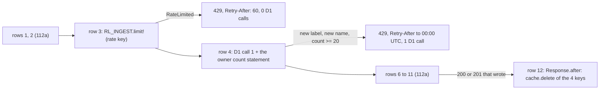

# 112b Ingest limits and cache drop

Phase: P2. Status: review (2026-11-02). Tests red, waiting for the human review. Model for the code: Sonnet high. Plan row: `docs/registry/PLAN.md` C.1, row 112 (the part split off in `docs/slices/112-ingest.md` section 1). Depends on slice 112a (the ingest route, `worker/lib/Ingest.roc`, `worker/IngestRoutes.roc`) and 106 (the Cache API of the read routes).

## 1. Scope

The rows of R-AP68 that 112a does not do: row 3 (the IP limit), row 5 (the owner limit) and row 12 (the cache drop of R-AP69).

| Part | What |
| --- | --- |
| Rate key (R-AP68 "Rate key", Design Q168, Q185) | One function with the user hints: `Client.rate_key` of `worker/lib/Client.roc` (slice 116b, tests in `ClientTest.roc`). 112b calls it and writes no second function and no W0 key case. Whichever of 112b and 116b is coded first writes the body. A pure function of `cf-connecting-ip`: IPv4 text (also an IPv4-mapped IPv6, the text after the last `:`), IPv6 /64 as `a:b:c:d::/64` (the full form, lower-case hex, no leading zero), else `unknown` |
| IP limit (R-AP68 row 3, R-PU34 row 1) | `RateLimit.binding("RL_INGEST")`, `limit!(key)` after rows 1 and 2, before D1 call 1. `Err(RateLimited)`: 429 `rate-limited`, `Retry-After: 60`, `too many ingests from this address: at most 60 a minute`. `Infra`: a fault (500). Each request that gets to row 3 counts. |
| Owner limit (R-AP68 row 5, R-PU34 row 2, Design Q167) | A second statement in D1 call 1: the count of `repos` rows whose `names` value (kind 3) is in `[<owner>/, <owner>0)` and `time` at or after 00:00 UTC of the clock day, and whether the name of the URL has a `repos` row. Only for a new label (`Index`) of a new name. 20 or more: 429, `Retry-After` = the seconds to the next 00:00 UTC, rounded up, `too many new repositories of the owner <owner> today: at most 20 a day from ingests`. The write batch does not check again. |
| Cache drop (R-AP69, R-AP43, Design Q166) | After a 200 or 201 of R-AP68 rows 7 and 11 (not a 200 of row 4), in `Response.after`: `Cache.default.delete!` of `<origin>/v1/releases?group=<g>`, `<origin>/v1/releases?group=<g>&series=<s>`, `<origin>/v1/packages/<owner>/<repo>/releases` (lower case), `<origin>/v1/artifacts/<hash>`. `<g>`, `<s>` percent-encoded: each byte outside `A-Z a-z 0-9 - . _ ~` as `%XX` with upper-case hex. A failed drop is a log line, not an error. |
| Bindings (R-WH14) | `RL_INGEST` in `worker.new` bindings (`RateLimit.declare`), `wrangler.toml` `[[ratelimits]]` (`name = "RL_INGEST"`, `namespace_id`, `simple = { limit = 60, period = 60 }`) |

## 2. Rules

R-AP68 rows 3, 5, 12 and the items "Rate key", "What the IP limit counts", "Owner count", "429 texts"; R-AP69; R-AP43; R-AP25; R-PU34 rows 1, 2; R-WH14 (`RL_INGEST`). Design Q166, Q167, Q168.

## 3. Public signatures (worker/lib/IngestLimits.roc, stubs `crash "todo"`)

| Name | Type | What |
| --- | --- | --- |
| `ip_binding` | `Str` | `"RL_INGEST"` (given) |
| `ip_retry_after` | `U64` | 60 (given) |
| `owner_limit` | `U64` | 20 (given) |
| `ip_limited` | `Problem` | the 429 problem of the IP limit (given) |
| `owner_limited` | `Str -> Problem` | the 429 problem of the owner limit (given) |
| `owner_of` | `Str -> Str` | the text before the first `/` (given) |
| `owner_range` | `Str -> { lo : Str, hi : Str }` | `<owner>/` and `<owner>0` (given) |
| `day_start` | `U64 -> U64` | stub: 00:00 UTC of the day of a time in ms |
| `owner_check` | `{ owner, has_repo, count, now_ms } -> Try({}, (Problem, U64))` | stub: R-AP68 row 5, the `Retry-After` rounded up |
| `query_value` | `Str -> Str` | stub: the percent encoding of R-AP69 |
| `drop_keys` | `{ origin, group, series, name, hash } -> List(Str)` | stub: the 4 keys in the order of R-AP69 |

The rate key is `Client.rate_key` (worker/lib/Client.roc, slice 116b, Design Q185). IngestLimits has no rate key function.

## 3.1 Tasks of the code agent

| File | Task |
| --- | --- |
| `worker/lib/IngestLimits.roc` | The 4 stubs. |
| `worker/lib/Client.roc` | The body of `rate_key`, if slice 116b has not written it (tests in `ClientTest.roc`; the W2 case `pu34-ip` also uses it). |
| `worker/IngestRoutes.roc` | Row 3: `RateLimit.binding(IngestLimits.ip_binding).limit!(Client.rate_key(req.header("cf-connecting-ip")))` after rows 1 and 2, before D1 call 1. `RateLimited`: 429 `application/problem+json` with `retry-after: 60`, no `talon-bookmark`. Row 4: one D1 call (a batch) with the label statement and the owner statement (the count and the `repos` row of the name). Row 5: `owner_check` only for `Index`. Row 12: after a 200 of `AddProvenance` and after a 201 of `Index`, `Response.after` deletes the 4 keys of `drop_keys` with `Cache.default.delete!`. `<origin>` is the scheme and host of the request URL. A 200 of `Answer` drops nothing. |
| `worker/main.roc` | `RateLimit.binding("RL_INGEST").declare()` in the `bindings` of `Worker.new` (beside `RL_HINTS` of slice 116b). |
| `worker/wrangler.toml` | `[[ratelimits]]` with `name = "RL_INGEST"`, a `namespace_id`, `simple = { limit = 60, period = 60 }` (R-WH14). |

## 3.2 Tests

| Layer | Case | Rules | Checks |
| --- | --- | --- | --- |
| W0 | `IngestLimitsTest.roc`, 5 expects | R-AP68 row 5, "Owner count", R-AP69, R-PU34 row 2 | `owner_of`, `owner_range`, `day_start` (00:00:30, 00:00:00.000, 1 ms before); `owner_check` (Retry-After 86370, 86400, 1, 1; Ok for 19 rows or a known name); the constants; `query_value` (`{`, `}`, `/`, a space, UTF-8, `?&=+%`, empty); `drop_keys` (order, encoding of the group with upper case kept) |
| W0 | rate key | R-AP68 "Rate key" | In `ClientTest.roc` (slice 116b). Not in this slice. |
| W2 | `ingest-limits/pu34-ip` (126 requests) | R-AP68 row 3, "What the IP limit counts", R-PU34 row 1, R-AP25, R-WH14 | 60 x 200 from 203.0.113.7 (a known label, 1 D1 call each) with one 422 of row 2 between them that does not count; the 61st: 429, `retry-after: 60`, 0 D1 calls; `::ffff:203.0.113.7`: 429; 198.51.100.9: 200; 60 requests from 2 forms of `2001:db8::/64`, then `2001:db8:0:0:1:2:3:4`: 429; `2001:db8:0:1::1`: 200 |
| W2 | `ingest-limits/pu34-owner` (6 requests) | R-AP68 row 5, R-PU34 row 2, R-AP25, R-AP41 | Seed: 18 `acme` rows at NOW - 10 s, 1 at 00:00:00.000 (counts), `acme/old` 1 ms before the day, `acme-x/y`, `acme2/x` (do not count). A new name: 201 (the 20th). The next new name: 429, `retry-after: 86370`, 1 D1 call, no GitHub read; `Acme/New2`: 429; at 23:59:59.999: `retry-after: 1`; a known name `acme/r01`: 201; the next day: 201. db.tsv: the `repos` times. |
| W2 | `ingest-limits/ap69-cache-drop` (19 requests) | R-AP69, R-AP43, R-AP68 rows 4, 11, 12, R-AP55 | The 4 keys (R-AP13 with and without `series`, R-AP2, R-AP1) are a miss and then a hit; a key with another series is a miss. An ingest of 1.1.0 (same hash): 201. After `wait_ms`: the 4 keys are a miss with 2 releases; the other key is still a hit. The same ingest again (200 of row 4, `Answer`): after `wait_ms` a read is a hit. |

Runner changes (`worker/tests/run.mjs`): each case gets the binding `RL_INGEST` (60 a minute) beside the `RL_HINTS` of slice 116b, unless the case `ratelimits.json` gives it; a line `{"wait_ms": N}` waits N ms; a line `{"window_s": 60, "need_ms": 25000}` waits until the wall-clock window of 60 s has 25 s or more left (Miniflare counts in windows aligned to the wall clock, `Date.now() / period`; without the line, `pu34-ip` failed once when the window ended in the case). These lines are not requests. The runner self-tests pass (24 of 24). The generator is `worker/tests/tools/mk-ingest.mjs` (it writes `ingest/` and `ingest-limits/`).

## 4. Harness need

| Item | Fact | Change |
| --- | --- | --- |
| `ratelimits` binding in the W2 runner | Probe `research/slice-112b/ratelimit.mjs` (2026-11-02, the global wrangler Miniflare, `convertV4MiniflareOptions`): `ratelimits: { RL_INGEST: { namespace_id: "1001", simple: { limit: 60, period: 60 } } }` counts locally. 60 calls give `success: true`, the 61st `false`; another key is `true`; a new Miniflare starts a new count. The period is real time (60 s), not the `x-test-now` clock: a case of 61 requests runs in a few seconds, so it fits. | `worker/tests/run.mjs`: add the `ratelimits` option to the Miniflare of each case (a case file can change the limit, for example `ratelimits.json`). No platform fake is needed. |
| Client address | The runner sends the headers of `requests.jsonl` | Each case sends `cf-connecting-ip` itself |
| Cache API in W2 | Slice 106 cases already use it (`reads/*-etag-*`) | None |

## 4.1 Red results (2026-11-02, NOREF=1, the stubs)

| Layer | Result |
| --- | --- |
| W0 | the 5 IngestLimitsTest expects fail with `todo`; the 22 IngestTest expects pass |
| W2 `ingest/` (112a) | 5 of 5 pass (112a stays green) |
| W2 `ingest-limits/` | 3 of 3 fail: no 429 in `pu34-ip` (requests 62, 63, 125) and `pu34-owner` (a GitHub read in place of the 429), no drop in `ap69-cache-drop` |

The private reference (TW18, not for the code agent) passes W0 (27 of 27) and W2 (8 of 8).

## 4.2 Mutations (research/slice-112b-revert/mutations/, `run.sh`)

| Id | Change | Caught by |
| --- | --- | --- |
| m1 | the owner range is a prefix (`<owner>~`, as a LIKE): `acme2/x` counts | W0 `owner_range`, `pu34-owner` |
| m2 | `time > day_start` (a row at 00:00:00.000 does not count) | `pu34-owner` |
| m3 | the owner check also for a known name | W0 `owner_check`, `pu34-owner` |
| m4 | the owner `Retry-After` is not rounded up | W0 `owner_check`, `pu34-owner` |
| m5 | the IPv6 key is the full address | `pu34-ip` |
| m6 | an IPv4-mapped IPv6 is not its IPv4 address | `pu34-ip` |
| m7 | `query_value` keeps `/` | W0 `query_value`, `drop_keys`, `ap69-cache-drop` |
| m8 | no drop of the series key | W0 `drop_keys`, `ap69-cache-drop` |
| m9 | a drop also on the `Answer` path | `ap69-cache-drop` |
| m10 | the IP limit runs after D1 call 1 | `pu34-ip` (d1-calls) |

10 of 10 caught.

## 4.3 Output text

No proposal: the 429 `detail` texts and `Retry-After` values are given by R-AP68 "429 texts" (Design Q167, Q168). The problem type is `rate-limited` (R-AP25).

## 5. Questions

None open: Q112-12 to Q112-14 are settled (Design Q166 to Q168, `docs/slices/112-ingest.md` section 7.1).

## 6. Code (code agent, 2026-11-02)

| File | What | Lines |
| --- | --- | --- |
| `worker/lib/Client.roc` | `rate_key` (written with slice 116b, section 13 of `116b-hint-limits.md`) | see 116b |
| `worker/lib/IngestLimits.roc` | `day_start`, `owner_check` (with `seconds_to_next_day`, rounded up), `query_value` (with `unreserved`, `hex_digit`), `drop_keys` | 88 (file), about 32 new |
| `worker/IngestRoutes.roc` | Row 3: `limiter` (`RL_INGEST`), `limit!(Client.rate_key(..))` after the body and URL checks and before D1 call 1; `limited_response` (429, `retry-after`, no `talon-bookmark`). D1 call 1 is one batch: the label statement and `owner_stmt`. Row 5: `owner_check` only on the `Index` branch, before any GitHub read. Row 12: `dropping` wraps the answer with `Response.after` (4 keys, `Cache.default.delete!`, a failure is `Log.warn!`), only for a 200 of `AddProvenance` and a 201 of `Index`. | 367 (file), about 75 new |
| `worker/main.roc`, `worker/wrangler.toml` | `IngestRoutes.limiter.declare()` in the bindings, `RL_INGEST` in `[[ratelimits]]` (60 a minute) | see 116b |

Decisions that the slice does not fix: `Time.now_ms!()` is read once before D1 call 1 for the day start (the plan still reads it later, as before); the group of the drop keys is `target.form`, the series `Version.series_of(target.version)`.

## 7. Green results (code agent, 2026-11-02)

| Step | Result |
| --- | --- |
| `scripts/test.sh w0` | `IngestLimitsTest` 5 of 5, `IngestTest` 22 of 22 pass. `IngestLimitsTest.roc` passes `roc fmt --check` now. |
| `scripts/test.sh wbuild w2` | `ingest-limits/` 3 of 3 (`pu34-ip`, `pu34-owner`, `ap69-cache-drop`), `ingest/` 5 of 5 (112a stays green). Rerun alone: all pass. No case failed at a minute boundary. |
| `scripts/test.sh check fmt w1` | pass, pass, pass |
