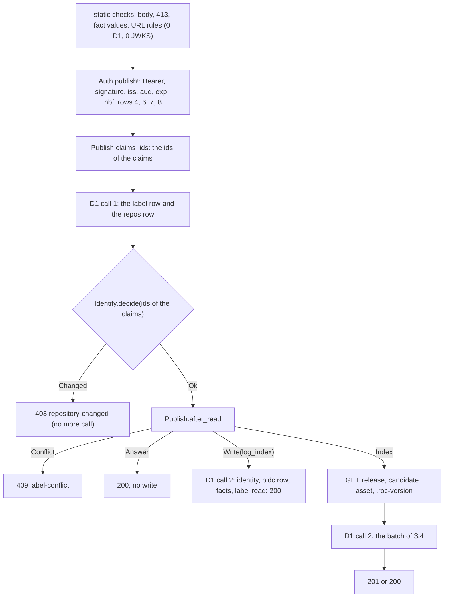

# 114 Publish

Phase: P2. Status: review (scope and red tests 2026-11-02). Model for the code: Sonnet high. Plan row: `docs/registry/PLAN.md` C.1, row 114. Depends on slices 104f (`records.Compat.Publish`), 108 and 108b (`Auth.verify!`, `Oidc`), 112 and 112b (the ingest: the flow, the limits, the cache drop), 113 (`Identity`, the identity statements of `IngestRoutes`).

## 1. Scope and split

`POST /v1/releases` with `Authorization: Bearer <GitHub OIDC token>` (R-AP8, R-AP26): the body with the author facts, the token check against the asset URL, the ids from the claims, the same index flow as an ingest, the provenance `oidc` with the claims of the token, the author facts as `compat` rows `author` with the log index of the release, the label that an ingest indexed first (200 and the new rows), the draft (422), and the checks that come before the token.

| Part | Who | State |
| --- | --- | --- |
| `worker/lib/Publish.roc`: types, constants, problem texts (given); 8 functions `crash "todo"` | Test agent (signatures, doc), code agent (bodies) | Stubs |
| `worker/PublishRoutes.roc`: `post!` `crash "todo"`, the flow in the doc comment | Test agent (signature), code agent (body) | Stub |
| `worker/Auth.roc`: `publish!` `crash "todo"` | Test agent (signature), code agent (body) | Stub |
| `worker/main.roc` (`import PublishRoutes`, the arm `PostRelease` with `Authorization` calls `PublishRoutes.post!`), `worker/lib/main.roc` (`Publish` in the exposes), `worker/tests/unit/w0.roc` (`import PublishTest`) | Test agent | Done |
| `worker/IngestRoutes.roc`: the shared pieces become parameters (section 3.3) | Code agent | To do. The test agent changed nothing in it. |
| Tests: `worker/tests/unit/PublishTest.roc` (W0, 11 `expect`s), `worker/tests/cases/publish/` (4 W2 cases), made by `worker/tests/tools/mk-publish.mjs` | Test agent | Red (4.2) |

Split decision: no split. The private reference adds about 215 lines of code: `Publish.roc` 82, `PublishRoutes.roc` 73, `Auth.roc` 10 and 46 net changed lines of `IngestRoutes.roc` (TW19: about 400).

## 2. Rules

| Rule | Text (short) | Checked by |
| --- | --- | --- |
| R-AP8, R-PU2 | `POST /v1/releases` with a token is a publish: 201 with `Location` for a new release, 200 for a label with the same hash, the release record | W0 `after_read`. W2 `pu1-publish-package`, `pu16-after-ingest` |
| R-AP26 | The `Authorization` header selects the path. A header that is not `Bearer <token>`, and a token that fails, are 401 or 403, never an ingest. A body with `compat` and no token is 401 (the ingest, slice 112) | W2 `tp3-claims-vs-url` (Basic). `ingest/ap26-body-and-route` requests 1, 2 (slice 112, not changed) |
| R-AP71, R-MX5 | `compat` optional (missing or `null` is no facts). A fact has `nightly`, `target` `any`, `result`, `error_digest`. A member `hash` or `source` is 400 and the `detail` names the members. At most 500 facts (413, `field` `compat`). The values are static checks that come before the token | W0 `parse_body` (4 `expect`s). W2 `tp3-claims-vs-url` |
| R-PU5, R-RE3, R-RE13 row 1 | The facts are `compat` rows with `source` 1 (`author`), the hash of the asset and the log index of the release. The first write of a key wins; a repeated key changes nothing | W0 `fact_rows`. W2 `pu1-publish-package` (db `compat`), `pu16-after-ingest` |
| R-PU1 (without the R2 step, G1) | The flow: the token, the ids against the row, the release, the asset, `.roc-version`, one D1 batch, the cache drop. No R2 write and no signed checkpoint | W2 `pu1-publish-package` (github.log, d1-calls) |
| R-PU14, R-PU16 | A label that an ingest or the webhook indexed, with the same hash: no artifact, release or log row; the `oidc` provenance row and the facts are added; 200. A draft is 422 `not-a-candidate` | W0 `after_read`, `candidate`. W2 `pu16-after-ingest` |
| R-PU15, R-RE9, R-TP6 | One provenance row `oidc` (code 0) for each release, only added, with the 8 claims of R-TP6 | W0 `claims_json`. W2 `pu1-publish-package`, `pu16-after-ingest`, `tp9-claim-ids` |
| R-PU19, R-AP8 | The label with another hash: 409 `label-conflict`; a race: 409 "another hash", nothing written | W2 `pu16-after-ingest` |
| R-TP3 rows 1 to 3, R-TP17 | The token form, the signature, `iss`, `aud` equal to `AUDIENCE` (no `/` at the end), `exp`, `nbf` | W2 `tp3-claims-vs-url` (the form, the signature, `aud` with `/`). Rows 1 to 3 are tested in depth by slice 108 |
| R-TP3 rows 4, 6, 7, 8 | `repository` against the URL (no case), `repository_visibility` `public`, `ref_type` `tag`, `ref` `refs/tags/<tag>`, `event_name` | W2 `tp3-claims-vs-url` (8 refusals), `pu1-publish-package` (a repository with other case), `pu16-after-ingest` (`release`). W0 rows of slice 108 (`check_publish`) |
| R-TP3 row 5, R-TP9, R-TP12, Design Q267 | The ids from the claims against the `repos` row: both different is 403 `repository-changed` with `issues_url`; before the 409 of the label | W0 `claims_ids`. W2 `tp9-claim-ids`, `pu16-after-ingest` |
| R-TP5, R-TP10, R-TP13, R-TP18, R-PU26 | The first release binds the name to the ids of the claims (`bind`); a transfer, a recreate, a rename; the events carry the claims of the token; the `repo_checks` row | W2 `tp9-claim-ids`, `pu1-publish-package`, `pu16-after-ingest` |
| R-AP41 | At most 2 D1 calls (a pre-read, a write batch whose last statement reads the answer), 1 more for R-IK3. No D1 call before the token | W2 `expect/d1-calls` of each case |
| R-AP69, R-AP43 | A publish that wrote drops the 4 cache keys (`Response.after`) | W2 `pu1-publish-package` (the group read before and after) |
| R-AP21, R-AP46, R-AP48 | The problem form; the checks before the route; 413 of `compat` | W2 `tp3-claims-vs-url`; W0 `parse_body` |

Design refs: Registry 4 (R-AP8, R-AP26, R-AP41, R-AP46, R-AP48, R-AP51, R-AP69), 4.1 (R-AP71), 5 (R-RE3, R-RE9, R-RE13, R-RE15), 6 (R-MX5), 7 (R-PU1, R-PU2, R-PU5, R-PU14 to R-PU16, R-PU19, R-PU26, R-PU31, R-PU32), 7.1 (R-TP3, R-TP5, R-TP6, R-TP16, R-TP17), 7.3 (R-TP9 to R-TP13, R-TP18, R-TP19); Design Q190, Q193, Q260 to Q267 (the last id is Q267 today).

## 3. What the code agent writes

### 3.1 The order of the checks (decided 2026-11-02: Registry R-AP75, Design Q295; the human reviews it)

The first check that fails gives the answer. This is R-AP48 for the publish path, in the form of R-AP66 and R-AP68.

| # | Check | Answer | D1 calls | Test |
| --- | --- | --- | --- | --- |
| 1 | The path, the method, then the client version, then the media type (R-AP70 rows 1 to 3; `Route.decide`, `main.roc`: as the ingest) | 404, 405, 400 `unsupported-client`, 415 | 0 | Slices 101, 106 |
| 2 | The body is larger than 256 KB (R-AP46) | 413 `too-large`, `field` `body` | 0 | None (as the ingest) |
| 3 | The body does not decode (R-AP51, R-AP71): not UTF-8, not JSON, `url` missing, `compat` of a wrong type, a fact with a member missing, a member `hash` or `source` in a fact | 400 `bad-request` | 0 | W0 `parse_body`. W2 `tp3` requests 1, 3, 4 |
| 4 | More than 500 facts | 413 `too-large`, `field` `compat`, `limit` 500 | 0 | W0. W2 `tp3` request 2 |
| 5 | The values, fact by fact: `nightly`, `target`, `result` | 400 `bad-request` | 0 | W0. W2 `tp3` requests 5, 6 |
| 6 | The URL rules (R-PU34 row 4, `Ingest.parse_url`) | 422 `not-a-candidate` | 0 | W2 `tp3` request 7, 21 (Q290, R-AP75 row 6) |
| 7 | `Auth.publish!`: the `Authorization` form, the token (R-TP3 rows 1 to 3; the JWKS read), then rows 4, 6, 7, 8 against the URL | 401, 403, 502, 500 | 0 | W2 `tp3` |
| 8 | The ids of the claims are numbers (`Publish.claims_ids`), after rows 4, 6, 7, 8 of step 7 (a bad `ref` with a bad id gives the `ref` fault) | 403 `forbidden` | 0 | W0. W2 `tp3` requests 19, 20, 22 (Q293, R-AP75 row 8) |
| 9 | D1 call 1, one batch on the primary: the label row and the `repos` row | | 1 | |
| 10 | `Identity.decide` with the ids of the claims (R-TP3 row 5, R-TP9) | 403 `repository-changed`, `issues_url`, no `talon-bookmark` | 1 | W2 `tp9`, `pu16` request 4 (Q294, R-AP75 rows 10, 11) |
| 11 | `Publish.after_read` | 409 `label-conflict`; `Answer`: 200 and stop; `Write`: step 15; `Index`: step 12 | 1 | W0. W2 `pu16` |
| 12 | `GET /repos/{owner}/{repo}/releases/tags/{tag}`: 404 and the candidate rules (R-PU6, R-PU16). There is no `GET /repos/{owner}/{repo}`: the visibility is the claim (R-PU31). | 422 `not-a-candidate`, 502 `upstream` | 1 | W2 `pu16` |
| 13 | The archive read (R-PU38) | 422, 502 | 1 | Slice 111 and 112 |
| 14 | `GET .../.roc-version` | 502 | 1 | Slice 112 |
| 15 | D1 call 2, the write batch (3.4) | 201 or 200; `Trigger` `label-conflict`: 409; `names.id` collision: D1 call 3, 409 `id-collision` | 2, or 3 | W2 `pu1`, `pu16` (the race) |
| 16 | After the answer (`Response.after`): the cache drop of R-AP69 for a 201 and for a 200 of `Write` | None | not counted | W2 `pu1` |

A publish has no IP limit and no owner limit (R-PU34 row 5, Design Q296).

### 3.2 Public signatures (fixed, in the stubs)

| Module | Item | Rule |
| --- | --- | --- |
| `Publish` | `Fact`, `Post`, `fact_limit` (500, given) | R-AP71 |
| `Publish` | `parse_body : List(U8) -> Try(Publish.Post, ClosureQuery.Reject)` | Steps 3 to 5. `Wire.decode_publish` of `records.Compat` does the decode; the order and the texts are in the doc comment. |
| `Publish` | `claims_ids : Oidc.Claims -> Try(Identity.Ids, Problem)` | Step 8 |
| `Publish` | `claims_json : Oidc.Claims -> Str` | R-TP6: the text of `provenance.claims` and of `repo_events.claims` |
| `Publish` | `after_read : Ingest.Target, List(Ingest.LabelRow), { facts : Bool, events : Bool } -> Try([Conflict(Problem), Answer(Release.Row), Write(U64), Index], [BadRow(Str)])` | Step 11. In a `LabelRow`, `has_ingest` means the `oidc` row. |
| `Publish` | `candidate : Ingest.Target, Ingest.GithubRelease -> Try(U64, Problem)` | R-PU16: the draft text; else `Ingest.candidate` |
| `Publish` | `draft`, `no_release` | Given (texts) |
| `Publish` | `fact_rows : List(Publish.Fact), I64 -> List(Compat.PlanRow)` | R-PU5: for `Compat.rows_json` |
| `Publish` | `facts_sql : () -> Str`, `provenance_sql : () -> Str` | The statements of 3.4 (parameters in the doc comments) |
| `Auth` | `publish! : Request, { owner_repo : Str, tag : Str } => Try(Oidc.Claims, Problem)` | Step 7 |
| `PublishRoutes` | `post! : Request => Try(Response, IngestRoutes.Error)` | The flow of the doc comment |

### 3.3 Changes of `worker/IngestRoutes.roc` (code agent; the tests of `ingest/*`, `ingest-limits/*`, `identity/*` stay green)

The shared pieces of the ingest become parameters. The reference does it with 46 net changed lines (`research/slice-114-revert/patch.py` is the private form; the code agent writes its own). Slice 119a also changes `github!` of this file, so the edit is narrow and the merge is by hand.

| # | Change | Why |
| --- | --- | --- |
| 1 | `label_sql` takes the `via` of the provenance row (`label_sql_of(via)`; `label_sql` is `label_sql_of(3)`) | The `has_ingest` flag of a publish is the `oidc` row (code 0) |
| 2 | `old_row` takes the index of the `repos` result in the batch (2 for the ingest, 1 for the publish) | The publish batch has no owner statement |
| 3 | `index!` takes a context: the repository of the GitHub read (or of the claims), the `via` and the claims text of the provenance row, a function from the clock to extra statements (the facts), the `candidate` function and the `no_release` problem. The ingest reads the repository in its caller, before `index!`, so the order of its reads does not change. | The release read, the asset, `.roc-version`, `Ingest.plan` and the batch are the same code |
| 4 | `identity!` and the statements of the identity (`event_stmt`, `marked_events_stmt`, the `named` event of `new_name_stmts`, `rename_back_stmts`) take the claims text and put it in `repo_events.claims` (NULL for an ingest). `identity!` also says if the change has an event. | R-TP13: the events of a publish carry the claims |
| 5 | `writes_of` takes the `via` and the claims text of the provenance row | The row of a publish is `oidc` with the claims |

### 3.4 The write batches (D1 call 2, one `batch!` on the `Primary` session)

`Index`: the statements of slice 112 section 3.2 with the provenance row `via` 0 and the claims text, then the identity statements of slice 113 (with the claims text in the events), then the facts, and last the read of the label.

`Write(log_index)`: in this order: the provenance row (`Publish.provenance_sql`), the identity statements, the facts, the read of the label. No names, artifact, leaf or release statement. 200.

| Statement | Form |
| --- | --- |
| Facts | One statement for all facts: `Publish.facts_sql` with `Compat.rows_json(Publish.fact_rows(facts, <artifact id of the hash>))`, the clock, and the label (form id, version column, `version_text`). It joins `releases` by the label, so the `log_index` is the release of the label, also when an ingest wrote it. `ON CONFLICT DO NOTHING`. Only when the body has a fact. |
| Provenance | `INSERT INTO provenance (release, via, claims, time) SELECT r.log_index, 0, <claims>, <time> FROM releases r WHERE <label> AND NOT EXISTS (via 0)` |

## 4. Tests

### 4.1 Table

| Layer | Case | Checks | Rules |
| --- | --- | --- | --- |
| W0 | `worker/tests/unit/PublishTest.roc`, 11 `expect`s | `parse_body`: the good bodies (no `compat`, `null`, `[]`, an unknown member, 4 facts with the 4 results, 500 facts); 17 bad bodies; `hash` and `source` in a fact (6 forms, escaped key; the word in a digest is no member); 501 facts before the values; the values (11 rows: nightly, `Any`, `Pass`, the first fact, nightly before target before result). `claims_ids` (9 rows). `claims_json` (3 rows). `after_read` (8 rows, a bad hash). `candidate` (a draft in 3 forms; the other releases equal `Ingest.candidate`). `draft`, `no_release`. `fact_rows`. | R-AP26, R-AP51, R-AP71, R-MX5, R-AP46, R-TP3 row 5, R-TP6, R-TP13, R-PU5, R-PU14, R-PU16, R-PU19, R-PU6, R-RE3, R-RE13 |
| W2 | `publish/pu1-publish-package` (6 requests, 7 D1 blocks) | The group read (empty). A publish with 3 facts (2 distinct keys) and the repository claim `Acme/Roc-Json`: 201, `Location`, the record, 2 D1 calls, the reads JWKS, release, asset, `.roc-version` and no read of the repository. The wait, and the group read: 1 release (the drop). The same publish: 200, 2 D1 calls. No facts: 200, 1 D1 call. A new key and an old key with another result: 200. db: `releases`, `log`, `provenance` (via 0 with the 8 claims), `compat` (source 1, log index 1, first result of a key wins), `repos` (the ids of the claims), `repo_events` (`bind` with the claims), `repo_checks`. | R-AP8, R-AP41, R-AP43, R-AP69, R-AP71, R-PU1, R-PU2, R-PU5, R-PU15, R-PU26, R-TP3, R-TP5, R-TP6, R-TP13, R-TP17, R-MX5, R-RE3, R-RE9, R-RE15, R-IK5, R-SG8 |
| W2 | `publish/pu16-after-ingest` (8 requests) | A label that an ingest indexed. Same hash and a fact: 200, 2 D1 calls, only the JWKS read. No `compat`: 200, 1 D1 call. Another hash: 409 (1 call, no bookmark). Another hash and both ids different: 403 (the order, Q294). One id equal (a transfer): 200, 2 D1 calls, the event `transfer` with the claims. A draft: 422 (1 read). A 404 of the release: 422. A race (the label 3.0.0 written between the 2 calls): 409 "another hash", 2 D1 calls, no name of the request is written. db: both provenance rows, one `compat` row, the owner id 777, the events, the names by kind. | R-AP8, R-AP41, R-AP71, R-PU1, R-PU14, R-PU15, R-PU16, R-PU19, R-TP3, R-TP5, R-TP9, R-TP12, R-TP13, R-TP6, R-RE3, R-RE9, R-RE15, R-SG8, R-AP21 |
| W2 | `publish/tp3-claims-vs-url` (22 requests, 0 D1 calls, 1 JWKS read) | Before the token (with a token that is no token): no `url` (400), 501 facts (413), a fact with `hash` (400), an escaped `source` (400), a bad result (400), `target` not `any` (400), another host (422), a bad result with another host and junk for a token (400, request 21). Then: `Basic` (401), not a JWT (401, no read), a changed signature (401), `aud` with `/` (401), another repository (403), the token of the compat bot (403), private (403), a branch (403), another tag (403), `pull_request_target` (403), `schedule` (403), `repository_id` not a number (403), `repository_owner_id` missing (403), a branch `ref` with `repository_id` not a number (403 of `ref`, request 22). | R-AP26, R-AP46, R-AP48, R-AP51, R-AP71, R-AP75, R-AP21, R-MX5, R-PU34, R-TP3 rows 1 to 8, R-TP4, R-TP16, R-TP17, R-AP41 |
| W2 | `publish/tp9-claim-ids` (5 requests) | The ids come from the claims: a transfer (201, event `transfer`), a recreate (201, `recreate`), both different (403, 1 D1 call, no GitHub read), no row (201, `bind`, `repo_checks`), a rename (the claim `repository` is the new name: 201, the old row `moved` with the successor, 2 `rename` events). Each event and each provenance row has the claims of its own token (the `run_id` of each token differs). | R-TP3 row 5, R-TP5, R-TP6, R-TP9, R-TP10, R-TP12, R-TP13, R-TP18, R-RE11, R-RE15, R-PU26, R-AP8, R-AP41, R-AP21 |

`node worker/tests/tools/mk-publish.mjs` writes the 4 cases (the bundles, the tokens, the GitHub answers, the expected files). The ids, the version columns, the nightly ids, the hashes and the recorded claims come from node (SHA-256, BigInt, `blake3.mjs`), not from the Roc code. `notes.txt` in each case names each request.

### 4.2 Red results (2026-11-02)

| Step | Result |
| --- | --- |
| W0, `PublishTest` alone (stubs) | 11 expects: 1 passes (`draft` and `no_release` are given texts), 10 fail with `todo`. 0 compiler errors. |
| W2 `publish/*` (stubs, `scripts/test.sh wbuild w2`) | 4 of 4 fail. Each first request gives 500 (the trap `unreachable` of `todo`) where the case expects 201, 200, 400 or 403 (`request 2: status: expected 201, got 500`). The run had 134 passed and 21 failed: the other 17 failures are `account/*` (slice 117) and `webhook/*` (slice 118), red by design and not in this slice. `ingest/*`, `ingest-limits/*`, `identity/*`, `oidc/*`, `reads/*` pass. The log is `research/slice-114-revert/red-w2.log`. |
| `roc check worker/main.roc`, `worker/lib/main.roc`; `roc fmt --check` of the new and changed files; `scripts/test.sh check fmt selftest` | 0 errors, pass |

### 4.3 Shared files changed

The copies before are in `research/slice-114-revert/before/`. `NEW.txt` lists the new files.

| File | Change |
| --- | --- |
| `worker/main.roc` | `import PublishRoutes`; the arm `PostRelease` with `Authorization` calls `PublishRoutes.post!` (was a `Fault`) |
| `worker/Auth.roc` | The stub `publish!` |
| `worker/lib/main.roc` | `Publish` in the exposes |
| `worker/tests/unit/w0.roc` | `import PublishTest` |

### 4.4 Revert check (private reference)

`research/slice-114-revert/reference/` fills `lib/Publish.roc` and `PublishRoutes.roc`. `research/slice-114-revert/patch.py` makes the changes of section 3.3 in `IngestRoutes.roc` and fills `Auth.publish!` in a copy (anchored replacements, so a change of the live file shows as an error). `ref.sh [w0|w2|all] [filter]` copies `worker/`, `packages/records` and `sql/` to `refbuild/`, puts the reference over it, and runs W0 (`PublishTest`) and W2 (`publish/` by default). `NOREF=1` runs the stubs. `MUTATE=mutations/<m>.py ref.sh ...` runs one mutation, and `run-mutations.sh m1 m3 ...` runs several (3 at a time). The build is `--opt=speed`.

| Step (2026-11-02) | Result |
| --- | --- |
| Reference, W0 `PublishTest` | 11 of 11 |
| Reference, W2 `publish/` | 4 of 4 |
| Reference, W2 `ingest/`, `identity/`, `ingest-limits/`, `oidc/`, `reads/` | 35 of 35 (the refactor of `IngestRoutes.roc` keeps them green) |

| Mutation | Caught by |
| --- | --- |
| m1 the identity check runs only when the label has no other hash (a 409 hides a 403) | W2 `pu16-after-ingest` (request 4) |
| m2 the claim ids are swapped (`repository_id` is the owner id) | W0 `claims_ids` |
| m3 the author facts have `source` 0 (bot) | W2 `pu1-publish-package`, `pu16-after-ingest` |
| m4 the provenance row of a new release is `via` 3 | W2 `pu1-publish-package`, `tp9-claim-ids` |
| m5 the events of the identity have no claims (NULL) | W2 `pu1-publish-package`, `pu16-after-ingest`, `tp9-claim-ids` |
| m6 the limit is `>=` 500 (500 facts are refused) | W0 `parse_body` |
| m7 `after_read` gives `Answer` when the body has facts (the facts are not written for a label with an `oidc` row) | W0 `after_read` |
| m8 the `Write` batch has no identity statements (a transfer on an indexed label is lost) | W2 `pu16-after-ingest` |
| m9 a 201 of a publish drops no cache key | W2 `pu1-publish-package` |
| m10 the facts have `log_index` NULL | W2 `pu1-publish-package`, `pu16-after-ingest` |
| m11 the pre-read asks for the `ingest` row (`via` 3) as the `has_oidc` flag | W2 `pu1-publish-package` (request 5: 2 D1 calls in place of 1) |

Caught 11 of 11 (W0 for m2, m6, m7: not run in W2). The logs are `research/slice-114-revert/mut-<m>.log`. Keep the reference until the review is applied.

## 5. Output (proposed, TW24)

| Item | Proposal |
| --- | --- |
| 200 and 201 body | As the ingest: `{"release":<the R-AP49 release>}`, `content-type: application/json`, `cache-control: no-store`, `talon-bookmark`; 201 also has `location: /v1/artifacts/<hash>` |
| `provenance.claims` and `repo_events.claims` | One JSON object, no white space, the 8 members of R-TP6 in this order: `workflow_ref`, `workflow_sha`, `job_workflow_ref`, `event_name`, `run_id`, `run_attempt`, `actor_id`, `runner_environment`. Each value is a JSON text. A claim that is missing is `null`. Both columns have the same text for one request. |
| Body fault | 400 `bad-request`, `the publish request body is not valid: <why>`; for a fact with `hash` or `source`: `... member hash or source is not allowed in a fact` |
| 413 of `compat` | `the compat member of the publish request has more than 500 facts`, `field` `compat`, `limit` 500 |
| 413 of the body | `the body of the publish request is larger than its limit of 262144`, `field` `body` (no test) |
| Fact values | 400: `the nightly <x> of a fact is not a nightly tag`, `the target <x> of a fact is not any`, `the result <x> of a fact is not pass, fail, hang or crash` |
| Ids of the claims | 403 `forbidden`: `token claim <name> is missing`, `token claim <name> is "<value>", expected a number` |
| Draft | 422 `not-a-candidate`: `the release <tag> is a draft: publish the GitHub release before tln publish` |
| Release 404 | 422 `not-a-candidate`: `the repository has no published release with the tag <tag>: a draft is not published, so publish the GitHub release before tln publish` |
| Other texts | The texts of slices 108, 111, 112 and 113 (token faults, the candidate rules, 409, 403 `repository-changed`, `id-collision`, `upstream`) |

## 6. Out of scope

| Item | Reason |
| --- | --- |
| R-TP2, R-AP27, R-AP34, R-PU39 (`tln publish`, the token request, the retries, `roc bump`) | The client track (PLAN C.4) |
| The R2 step of R-PU1, R-SG7 (tiles, the signed checkpoint) | G1: P3 |
| The 413 of a body over 256 KB (R-AP46) | The same code as the ingest and slices 110, 115: no test |
| A URL with a host other than `github.com` as a token fault (R-TP3 row 4, host) | Refused earlier as an URL rule (R-PU40, Q292); the W0 rows of slice 108 (`check_publish`) test the guard |
| The R-TP3 rows 1 to 3 in depth (key rotation, `exp`, `nbf`, the JWKS faults) | Slice 108 |
| R-TP8 (yank), R-AP31 (move) | P3 |
| R-PU17, R-PU20, R-PU24 (withdrawn) | Slices 118, 119 |
| A repeated publish with facts skips the second D1 call | A pre-read of the fact keys would cost a statement. A repeat costs 2 D1 calls and no GitHub read (budget of R-AP41). |

## 7. Questions (answered 2026-11-02: section 7.1)

| Id | Question | Proposal | Effect now |
| --- | --- | --- | --- |
| Q114-1 | The place of the URL rules (R-PU34 row 4) against the token. R-AP71 puts the decode, the limit and the values before the token; it does not name the URL rules | Before the token (static, 0 D1 calls, 0 JWKS reads), after the fact values | W2 `tp3-claims-vs-url` request 7 |
| Q114-2 | The order of two faults in one fact | `nightly`, then `target`, then `result` (the order of the record in R-AP71) | W0 `parse_body` (the last two rows of the values `expect`) |
| Q114-3 | R-TP3 row 4 says "the host of the URL is `github.com`" (403), and R-PU40 says that no path indexes another host (422) | A URL of another host is 422 at the URL rules; the host test of `check_publish` stays as a guard | No W2 row. W0 of slice 108 |
| Q114-4 | R-TP3 row 5 needs the ids of the claims; the design does not say what a claim that is missing or not a number gives | 403 `forbidden` (the status of the other claim rows 4 to 8), `detail` names the claim | W0 `claims_ids`; W2 `tp3` requests 19, 20 |
| Q114-5 | The order of 403 `repository-changed` (R-TP3 row 5) and 409 `label-conflict` (R-PU19) | 403 first: R-AP8 lists the 403 as the token check of R-PU1, and R-TP3 is the token check | W2 `pu16-after-ingest` request 4 |
| Q114-6 | The order of the whole path (3.1) | As the table: the static checks, the token, the claim rows, the ids, D1 | The rows named in the Test column |
| Q114-7 | Does a publish have an IP limit or an owner limit (R-PU34 says "Ingest limits")? | No limit in P2: a token needs a GitHub repository, a workflow run and a tag | No test |
| Q114-8 | R-PU16: "the `detail` says `draft`". A draft is a 404 for a read with no token (and for the App token of a repository without the App), so the Worker sees a draft only as a 404 | The two texts of section 5 (the 404 text names the draft) | W2 `pu16` requests 6, 7 |
| Q114-9 | Does R-TP13 "the recorded claims for a token" mean the same text as the provenance row for each event of a publish? | Yes, one text (section 5) | W2 `tp9-claim-ids`, `pu1`, `pu16` db events |

### 7.1 Answers (design agent, 2026-11-02)

All 9 proposals are taken. Design: Registry R-AP75 (new), and the edits of R-AP8, R-AP26, R-AP71, R-PU16, R-PU34, R-PU40, R-TP3, R-TP6, R-TP13; Design Q290 to Q298. One correction of section 3.1 row 1 (the client version before the media type, as R-AP70). Open: none.

| Id | Answer | Design | Reason | Test change |
| --- | --- | --- | --- | --- |
| Q114-1 | Taken. The URL rules are after the fact values and before the token. | Q290, R-AP75 row 6 | Row 8 needs `owner/repo` and the tag of the URL. The rules cost no D1 call, no GitHub call, no JWKS read. R-AP68 row 2 puts them right after the body. | None |
| Q114-2 | Taken. `nightly`, `target`, `result`. | Q291, R-AP71 "Order of the values" | The order of the record in R-AP71 and the order of R-AP66 check 6, R-AP70 row 8. | None |
| Q114-3 | Taken. Another host is 422 at the URL rules. The host test of `check_publish` is a guard. | Q292, R-TP3 row 4, R-PU40 | One answer for one URL on every path. R-PU40 says no path indexes it. | None. The W0 rows of slice 108 stay. |
| Q114-4 | Taken. 403 `forbidden`, the `detail` names the claim. Both ids must be numbers, also when the other one is equal to the row. The form check is with step 7 rows 4, 6, 7, 8. | Q293, R-TP3 row 5, R-AP75 row 8 | 403 is the status of the claim rows 4 to 8, 401 is for a token that is not valid. The `repos` row keeps both ids (R-TP5). | None |
| Q114-5 | Taken. 403 `repository-changed` before 409 `label-conflict`. | Q294, R-AP75 rows 10, 11 | R-TP3 row 5 is a check of the token. A publish has its ids at call 1. The ingest has 409 first only because it has no ids before its GitHub read. | None |
| Q114-6 | Taken, with one correction of row 1 (see above). | Q295, R-AP75 | The order agrees with R-AP70 rows 1 to 4, R-AP66 rows 4 to 6 and R-AP68 rows 8 to 12. | None to existing tests (see below for 2 optional requests) |
| Q114-7 | Taken. No limit in P2. | Q296, R-PU34 row 5 | One token gives one tag of its own public repository, a repeat is bounded, and an ingest gives the same reach with the limits. An IP limit hurts a CI job on a shared address. The gap: names without the owner count. Later option: a limit keyed by the claim `repository_id`. | None |
| Q114-8 | Taken. Both texts of section 5. | Q297, R-PU16, R-AP75 row 12 | With the App on the repository the Worker sees a draft. Else it sees a 404. The caller is the author, so the text can name the cause. | None |
| Q114-9 | Taken. One text. | Q298, R-TP6, R-TP13 | A repeated publish adds no provenance row, and its events carry its own claims (tested by `tp9-claim-ids`). | None |

Check of the TW24 proposals of section 5 (not a question):

| Item | Result |
| --- | --- |
| `provenance.claims`, `repo_events.claims` | 8 members in the order of R-TP6 (`workflow_ref`, `workflow_sha`, `job_workflow_ref`, `event_name`, `run_id`, `run_attempt`, `actor_id`, `runner_environment`): agrees. `null` for a missing claim: agrees with R-AP51 (the writer writes each member, `null` where the value can be absent). R-TP19 and R-TP13 keep `NULL` for an ingest event, so a column value `NULL` means no token. Stays a proposal for the human review. |
| 400 | R-AP51 and R-AP71: the `detail` names the member. The text `... member hash or source is not allowed in a fact` names it. Agrees. |
| 413 | R-AP46 and R-AP71: `field` `compat`, `limit` 500; `field` `body` for the body (the limit 262144 is in the `detail` only, as R-AP70 row 4 has no `limit`; no test). Agrees. |
| 403 | R-TP3: the `detail` names the claim. The id texts name the claim. Agrees. |
| 422 | R-PU16 and Q297: draft and 404 texts. The URL rules texts are those of slice 112. Agrees. |

Test additions (done by the test agent, 2026-11-02; they check the order of R-AP75):

| Where | Request | Checks |
| --- | --- | --- |
| `tp3-claims-vs-url` request 21 | A fact with a bad result and a URL of another host, and a token that is no token | 400, not 422: the values come before the URL rules (R-AP75 rows 5, 6) |
| `tp3-claims-vs-url` request 22 | A valid token with the claim `ref` of a branch and `repository_id` that is not a number | 403 with the `detail` of `ref`: the claim rows come before the id form (R-AP75 row 8) |

## 8. Disputes (from the code agent)

None yet.

## 9. Verify results

None yet.

## 10. Code (code agent, 2026-11-02)

| File | Change | Lines |
| --- | --- | --- |
| `worker/lib/Publish.roc` | The 8 bodies (`parse_body` with `fact_of`, `claims_ids`, `claims_json`, `after_read`, `candidate`, `fact_rows`, `facts_sql`, `provenance_sql`). The doc comments name Q291 in place of Q114-2. | 169 in all, about 55 of code |
| `worker/Auth.roc` | `publish!`: `Oidc.bearer`, `verify!`, `Oidc.check_publish` with the host `github.com` | 109 in all, 9 new |
| `worker/PublishRoutes.roc` | `post!` (steps 1 to 8 of the flow) and `too_large` | 107 in all |
| `worker/IngestRoutes.roc` | The refactor of 3.3, 130 changed lines (diff `<` and `>`), 593 in all | see below |

Refactor of `IngestRoutes.roc` (3.3):

| # | Form in the code |
| --- | --- |
| 1 | `label_sql_of(via)`; `label_sql = label_sql_of(3)` |
| 2 | `old_row(results, at, repo)`: `at` is 2 for the ingest, 1 for the publish |
| 3 | `IngestRoutes.Flow` (`repo`, `identity`, `now`, `via`, `claims`, `extra`, `candidate`, `no_release`); `index!(session, target, flow)`. The repository read and `identity!` move to the caller. The ingest does them in the `Index` arm in the same order as before (owner check, repository read, identity, release read), so its reads do not change. `extra` is a list of statements, not a function of the clock: the caller has the clock before `index!`. |
| 4 | `identity!` takes the claims text and returns `Go({ stmts, has_events })`. `event_stmt`, `marked_events_stmt` and the `named` event bind the claims (`NULL` for an ingest). `has_events` is true also when the rename-back statements apply (R-TP18 row 3), so a repeated publish for a `moved` row is a `Write`. |
| 5 | `writes_of(plan, via, claims)`: the provenance statement binds `via` and the claims |

Decisions that the slice does not fix:

| Decision | Rejected option |
| --- | --- |
| `same` (R-TP10) of a publish is true: the full name is the claim `repository`, which `check_publish` made equal to the URL name | A GitHub read of the repository (R-PU31 forbids it) |
| `extra` is a list | A function from the clock, as 3.3 row 3 says: no gain, the clock is known before |
| `has_events` includes the rename-back statements | Events of `Identity.decide` only: a `moved` row would give `Answer` and skip R-TP18 row 3 |

Results (2026-11-02):

| Step | Result |
| --- | --- |
| `scripts/test.sh w0` | `PublishTest` 11 of 11 pass. 22 `LoginTest` and `WebhookTest` expects fail (slices 117 and 118, red by design) |
| `scripts/test.sh wbuild w2` | `publish/` 4 of 4, `ingest/`, `ingest-limits/`, `identity/`, `oidc/`, `reads/` pass. 17 fail: `account/*` (8) and `webhook/*` (9), not this slice |
| `scripts/test.sh check fmt w1` | pass |
