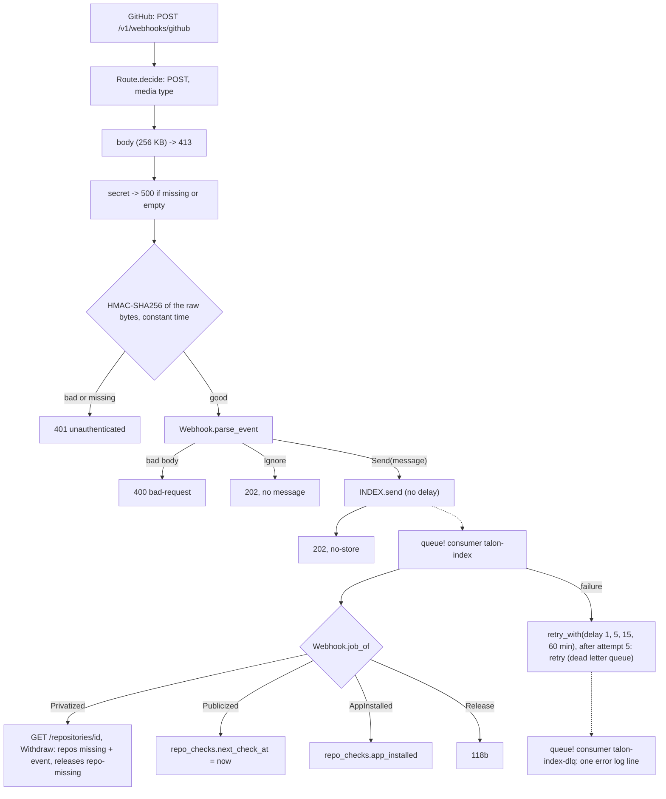

# 118 Webhook and index queue (118a)

Phase: P2. Status: green for 118a, code 2026-11-02; 118b: tests red 2026-11-02, section 13; design answers 2026-11-02, section 14 (was: review; scope and red tests 2026-11-02; questions answered 2026-11-02, section 12; the tests have the changes of section 12.2, applied 2026-11-02). Model for the code: Sonnet high. Plan row: `docs/registry/PLAN.md` C.1, row 118. Depends on slices 112 (the ingest and its GitHub reads), 113 (`Identity`, the states `active`, `missing`, `moved`, the events of R-TP13). Slice 119a (the GitHub read token) is not a dependency: the consumer reads GitHub with the helper that the other routes use (`Http.send!` with the two headers of `IngestRoutes` today, `GithubRead.send!` when 119a is coded).

## 1. Scope and split

The row 118 of the plan holds four parts: the webhook route, the queue and its consumer, the release jobs (the release read again, the ingest with the provenance `webhook`, withdraw and clear, the asset check), and the jobs of the events `repository` and `installation`. The private reference of all four is about 650 lines of code (TW19: about 400). So the slice splits.

| Slice | Content | Rule ids | State |
| --- | --- | --- | --- |
| 118a (this file) | `POST /v1/webhooks/github` (HMAC, the event and action mapping, the message, 202), the queue binding and its `wrangler.toml` config, the consumer (the dispatch, the retry schedule, the dead letter log line), and the small jobs: `repository` `privatized` and `publicized` (R-PU33), `installation` and `installation_repositories` (R-PU26) | R-AP12, R-AP46, R-AP48 (rows 4 to 7 for the webhook), R-PU3, R-PU11, R-PU13 (schedule), R-PU24 (state and withdraw part), R-PU26 (events), R-PU31 (webhook row), R-PU32, R-PU33, R-PU35 (index retries), R-PU36 (queue row), R-WH14 (`GITHUB_WEBHOOK_SECRET`, `INDEX`, `INDEX_DLQ`) | Red tests |
| 118b (section 13: tests red 2026-11-02) | The job `Release`: `GET /repositories/{id}`, the release read again, R-PU6 candidate, the ingest with the provenance `webhook`, R-PU14, R-PU17 (withdraw and clear), R-PU19, R-PU20 (the recorded asset check), the reads again after 1, 5, 15 and 60 min for a release with no asset | R-PU12, R-PU13, R-PU14, R-PU17, R-PU19, R-PU20, R-PU15 (`webhook`) | After 118a. Slice 119a is green, so 118b uses `GithubRead.send!` and does not wait for it |

Reason for the order (TW19): 118a has no change of `IngestRoutes.roc`, so it can run now, at the same time as slice 114 (that slice changes `IngestRoutes.roc`). 118b must share the index flow of `IngestRoutes.roc` (the visibility read, the archive read, the write batch), so it starts when slice 114 has finished its change of that file. 118a is about 330 lines of code in the private reference (`lib/Webhook.roc` about 150, `WebhookRoutes.roc` about 45, `IndexQueue.roc` about 130).

## 2. Runner probe (done before the tests)

`research/slice-118/probe-queue.mjs` (Miniflare of the global wrangler, as `run.mjs`):

| Question | Result |
| --- | --- |
| A queue producer with no consumer | A `send` is accepted. The message stays in the queue. |
| A `send` with `delaySeconds` | The wrapper of the test entry sees `(body, {contentType: "json", delaySeconds})`. A delay of 60 s is not waited for. |
| The consumer with no broker | `(await mf.getWorker()).queue(name, messages)` calls the `queue` handler and returns `explicitAcks`, `retryMessages: [{msgId, delaySeconds}]` and `retryBatch`. No wait, so the delays 1, 5, 15, 60 min are checked as numbers. |
| A patch of `crypto.subtle.timingSafeEqual` | An assignment in the isolate works: a count of calls. The Roc `WebCrypto.timing_safe_equal!` calls this function, so the test can see that a compare is constant time. |
| What a local run cannot show | The move of a message to the dead letter queue (the broker does it, after real delays of 1 to 60 min). The config is checked as text (section 4.4). |

## 3. Rules

| Rule | Text (short) | Checked by |
| --- | --- | --- |
| R-AP12, R-AP79 rows 5, 10 | `POST /v1/webhooks/github`: 202 with no body and `cache-control: no-store`; 401 `unauthenticated` for a signature that is missing or bad (one `detail`). The HMAC-SHA256 key is the secret `GITHUB_WEBHOOK_SECRET`. The message is the RAW bytes of the body. | W0 `parse_signature`, `bad_signature`. W2 `ap12-signature` requests 1 to 10 |
| R-AP12, R-AP79 row 5 (constant time) | The compare is `WebCrypto.timing_safe_equal!`: one call for each header of the good form | W2 `ap12-signature` (`timing_safe`) |
| R-WH14, R-AP79 row 4, Q327 | A missing secret, or an empty one, is 500 `internal`, never the empty key. It comes after the size and media checks and before the signature header. | W2 `ap12-no-secret`, `ap12-empty-secret` (5 requests each) |
| R-AP79 rows 1 to 3, R-AP48 rows 1, 2, 4, 5 | 404 for a path below the route, 405 `Allow: POST`, 413 over 1 MiB (before the media type and the signature), 415 for another media type (before the secret and the signature) | W0 `Route.decide`. W2 `ap12-signature` requests 15 to 18, `ap12-no-secret` requests 3, 4 |
| R-AP46, R-AP79 row 2, Q326 | The body of this route is at most 1 MiB (1048576 bytes pass, 1048577 do not; 262145 bytes pass) | W2 `ap12-signature` requests 13 to 15 (`body_pad`) |
| R-AP79 rows 6 to 9, Q320, Q321 | The signature comes before the event and the body parse: a body that is not JSON with a bad signature is 401. A good signature and a missing or empty `X-GitHub-Event` is 400. An event that is not used is 202 with its body unread. | W0 `parse_event` (empty event). W2 `ap12-signature` requests 19 to 23 |
| R-PU11, R-PU3, R-AP79 rows 7 to 9 | The events and actions that the Worker uses become one message each; `release` `created`, `installation` `new_permissions_accepted` and every other event or action are ignored (202, no message); the message has ids, no name | W0 `parse_event`. W2 `pu11-events` |
| R-PU11 (message) | The message holds the event, the action and the GitHub ids of the repository, the installation and the release | W0 `parse_event`. W2 `pu11-events` (`queue_sent`) |
| R-PU13, R-PU35, R-PU45, Q323 | The retries come after 1, 5, 15 and 60 min, each from the failed attempt (reads at 0, 1, 6, 21 and 81 min); after the last attempt (5) the consumer retries with no delay and the platform moves the message to the dead letter queue | W0 `retry_delay_ms`. W2 `pu35-retry-schedule`. Frame row (`max_retries = 4`, `dead_letter_queue`) |
| R-PU35, R-PU45 (dead letter) | The consumer of the dead letter queue writes one log line for each message and acks it | W2 `pu35-dead-letter` (`logs.jsonl`) |
| R-PU36 | A job that comes twice does the same as once: a second `privatized` changes nothing | W2 `pu33-privatized` request 2 |
| R-PU33, R-PU24, R-TP11, R-TP19 | `privatized`: the row of the current name becomes `missing` (event `Missing`), every release of every name of the repository gets `withdrawn` = `repo-missing` (not one that is withdrawn already), a `moved` row keeps its state | W2 `pu33-privatized` |
| R-PU31 (webhook row), R-PU12 | The event body is not used for the visibility: the consumer reads `GET /repositories/{id}`. 404 and `private` and `internal` withdraw. `public` is a stale event: nothing changes. A GitHub fault is a failed job (retry). | W0 `repository_outcome`. W2 `pu33-privatized`, `pu35-retry-schedule` |
| R-PU32 | A repository with no `repos` row: nothing is written (no row, no queue job holds a name) | W2 `pu33-privatized` (id 999), `pu26-app-installed` (id 999), `pu33-publicized` (id 999) |
| R-PU33 (`publicized`), Q324 | `next_check_at` of the rows that are not `moved` becomes now; the state and `withdrawn` do not change; a `moved` row of the same repository id keeps its value | W2 `pu33-publicized` |
| R-PU26, Q322, Q324 | `installation` `created` and `unsuspend` and `installation_repositories` `added` set `repo_checks.app_installed` to 1; `deleted`, `suspend` and `removed` to 0; for EVERY row (also `moved`) of the repositories of the event; no row is added. `new_permissions_accepted` is ignored. | W0 `job_of`, `parse_event`. W2 `pu26-app-installed` |
| R-WH14, R-PU45, Q329 | `INDEX` is a queue producer; `INDEX_DLQ` has a consumer and no producer in the code (no binding in `main.roc`); `GITHUB_WEBHOOK_SECRET` is a secret | Frame rows (`worker/tests/frame.sh`). W2 (the runner gives `INDEX` and `INDEX_DLQ`) |
| R-AP41 | The webhook costs no D1 call (the work is in the queue, not counted) | W2 `expect/d1-calls` (0 for every webhook request) |

Design refs: Registry 4 (R-AP12, R-AP46, R-AP48, R-AP79), 7 (R-PU3, R-PU11 to R-PU13, R-PU24, R-PU26, R-PU31 to R-PU33, R-PU35, R-PU36, R-PU45), 7.3 (R-TP11, R-TP13, R-TP19), 8 (R-WH14); `cloudflare-workers/API.md` RN16, `MODULES.md` 6 (Queue); Design Q48, Q56, Q320 to Q331.

## 4. What the code agent writes

### 4.1 Public signatures (fixed, in the stubs)

| Module | Item | Rule |
| --- | --- | --- |
| `lib/Webhook.roc` (pure) | `queue_name`, `dlq_name`, `max_attempts`, `Message`, `Decision`, `bad_signature` (given) | R-PU35, R-PU11, R-AP12 |
| `lib/Webhook.roc` | `parse_signature : Str -> Try(List(U8), [Malformed])` | R-AP12 |
| `lib/Webhook.roc` | `parse_event : { event : Str, body : List(U8) } -> Try(Webhook.Decision, Problem)` (rules 1 to 5 in the doc comment) | R-PU11, R-AP48 row 6 |
| `lib/Webhook.roc` | `Job`, `job_of : Webhook.Message -> Try(Webhook.Job, [Unknown])` | R-PU11 |
| `lib/Webhook.roc` | `retry_delay_ms : U32 -> Try(U64, [GiveUp])` | R-PU13, R-PU35 |
| `lib/Webhook.roc` | `repository_outcome : { status : U16, body : Str } -> Try([Withdraw, Stale], [Upstream(Str)])` | R-PU31, R-PU33 |
| `WebhookRoutes.roc` | `post! : Request => Try(Response, ReadRoutes.Error)` (the flow in the doc comment) | R-AP12 |
| `IndexQueue.roc` | `index : Queue(Webhook.Message)` (given: `Queue.json("INDEX")`), `consume! : Queue.Batch => Try({}, [Fault(Str)])` (the flow in the doc comment) | R-PU11, R-PU35 |
| `lib/Route.roc` | The tag `PostWebhook` (done). The line of `decide` is for the code agent. | R-AP12 |

### 4.2 What the code agent changes

| File | Change | State |
| --- | --- | --- |
| `worker/lib/Route.roc` | In `decide`: `["v1", "webhooks", "github"] => decide_post(input, path, PostWebhook)`. `decide_post` gives 405 `Allow: POST` and the media check. | For the code agent |
| `worker/lib/Webhook.roc`, `IndexQueue.roc`, `WebhookRoutes.roc` | The bodies. `Client.is_write` stays as it is (the webhook is not a write route of R-AP45). | For the code agent |
| `worker/main.roc` | `import WebhookRoutes`, `import IndexQueue`, the arm `PostWebhook`, `queue! = |b| IndexQueue.consume!(b)`, `IndexQueue.index.declare()` in the bindings | Done (test agent) |
| `worker/lib/main.roc`, `worker/tests/unit/w0.roc` | `Webhook` in the exposes, `import WebhookTest` | Done |
| `worker/wrangler.toml` | `[[queues.producers]]` `INDEX`, the consumers of `talon-index` (`max_retries = 4`, `dead_letter_queue`) and of `talon-index-dlq` | Done (the build needs it) |
| `GITHUB_WEBHOOK_SECRET` | A secret: `wrangler secret put` at the deploy. The tests set it as a test value. | Deploy step |

The doc comments of the three stubs are the flow. Two points that the code agent must keep:

| Point | Reason |
| --- | --- |
| The consumer does not use `Queue.each!` | It acks after an `Ok` and retries with no delay after an `Err`. The consumer reads `Cbor.parse(m.body())`, calls `m.ack!()`, `m.retry_with!({ delay_ms })` or `m.retry!()`. |
| The HMAC is over the raw bytes `req.bytes_with!` gave, not over a text that was parsed | The W2 case `ap12-signature` request 2 signs the compact form of the same JSON and expects 401. |

## 5. Tests

### 5.1 Table

| Layer | Case | Checks | Rules |
| --- | --- | --- | --- |
| W0 | `worker/tests/unit/WebhookTest.roc`, 13 `expect`s | `parse_signature` (12 forms), `bad_signature` is 401, `Route.decide` for the webhook path (POST json, form 415, GET and PUT 405, a longer path 404), `parse_event`: 6 `release` actions with a realistic payload (null values, nested objects), `created` and an unknown action ignored, no `installation` is id 0; `repository` (2 sent, 3 ignored); `installation` (`created`, `deleted`, `suspend`, `unsuspend` sent with the ids, `new_permissions_accepted` ignored, an empty list) and `installation_repositories`; events that are not used (`ping` with a body that is not JSON is ignored); an empty event is 400 (3 bodies); the 400 forms (16); `job_of` (16 rows, `suspend` False, `unsuspend` True); `retry_delay_ms` (the 4 delays, 5 and after, the constants); `repository_outcome` (13 rows) | R-AP12, R-AP79, R-PU11, R-PU13, R-PU26, R-PU33, R-PU35, R-PU31 |
| W2 | `webhook/ap12-signature` (23 requests) | A good signature of the raw bytes with white space and a non-ASCII escape (202, no body, `no-store`, one message, 1 compare, 0 D1 calls). 401 for: the signature of the compact form, another key, the last hex digit changed, a body one byte longer, no header, `sha1=`, 63 digits, no prefix, a non-hex digit. 400 for a body that is not JSON and for no body (with a good signature). Bodies made by the runner (`body_pad`): 1048576 bytes pass (a `ping`), 262145 bytes pass, 1048577 bytes: 413 with `limit` 1048576 and no compare. A form body with a bad signature: 415 with no compare. GET: 405 `Allow: POST`. A longer path: 404. Requests 19 to 23 (Q320, Q321): a good signature and no event header, and an empty one: 400 (one compare); no event header and no signature: 401; a body that is not JSON with a bad signature and the event `release`: 401 (one compare); a body that is not JSON with a good signature and the event `ping`: 202, no message. | R-AP12, R-AP79, R-AP48, R-AP46, R-AP23, R-AP21 |
| W2 | `webhook/ap12-no-secret`, `webhook/ap12-empty-secret` (5 requests each) | The secret is not set, or is empty: a signature with a made-up key and one with the empty key both give 500 `internal`; nothing is sent. No signature header: 500 (the secret comes before the header, Q327). A body of 1048577 bytes: 413, and a form body: 415 (the static checks come before the secret). | R-AP12, R-AP79 rows 2 to 4, R-WH14 |
| W2 | `webhook/pu11-events` (22 requests) | The exact message of each of the 6 `release` actions, `created` (no message), a release with no installation (id 0), `repository` `privatized` and `publicized`, `archived` and `deleted` ignored, `installation` `created`, `deleted`, `suspend` and `unsuspend` (a message each), `new_permissions_accepted` ignored, `installation_repositories` `added` and `removed`, `ping` and `star` ignored, a release with no repository id (400). The `queue_sent` list is exact. | R-PU11, R-PU3, R-PU32, R-AP79 |
| W2 | `webhook/pu33-privatized` (6 queue lines) | 7 repositories (one with a `moved` second name, one already `missing`, one with a withdrawn release). `privatized` 100: `missing` with the event `Missing` (seq 2), the releases of both names `repo-missing`, the earlier `deleted` kept, the `moved` row unchanged. The same job later, and 600: no change at all (the old `state_at` and `withdrawn_at`). 300: GitHub says public: nothing. 400: 404: withdrawn. 999: no row: nothing is added. 500: GitHub 500: retried after 60 s, not acked. db.tsv of 5 tables and the counts. github.log lists 7 reads. | R-PU33, R-PU24, R-PU31, R-PU32, R-PU36, R-TP11, R-TP13, R-TP19 |
| W2 | `webhook/pu33-publicized` (3 lines) | `next_check_at` becomes the clock for 100 (state `missing` and `repo-missing` stay, no event, no GitHub read); 999 writes nothing; 700 has `acme/new` active and `acme/old` moved: only `acme/new` changes (Q324) | R-PU33, R-PU32, R-TP19 |
| W2 | `webhook/pu26-app-installed` (9 lines) | `created` [100, 101, 999], `removed` [101], `added` [200], `deleted` [100, 300], an empty list, `suspend` [200] (1 to 0), `unsuspend` [300] (0 to 1), `created` [700] (two rows, one `moved`: both 1), `removed` [701] (two rows, both 1 to 0); `app_installed` and unchanged `next_check_at`; no row for 999 | R-PU26, R-PU32, R-TP19 |
| W2 | `webhook/pu35-retry-schedule` (9 lines) | A job that fails (GitHub 500) at attempts 1 to 5: retried after 60, 300, 900, 3600 s, then with no delay; attempt 6 the same; a body that is not a message and a message of an unknown action are failures with the delay of their attempt; a batch of 3 messages has 3 delays | R-PU35, R-PU13 |
| W2 | `webhook/pu35-dead-letter` (1 line) | The queue `talon-index-dlq`: a message and a body that is not a message are acked; 2 error log lines (`index job dead`), no D1 row | R-PU35, R-PU32 |
| Frame | `worker/tests/frame.sh` (5 rows) | `wrangler.toml` has the producer `INDEX` for `talon-index`, the consumer of `talon-index` with `max_retries = 4` and `dead_letter_queue = "talon-index-dlq"`, and a consumer of `talon-index-dlq` | R-PU35, R-WH14 |
| Runner | `cases/runner/r-wh4-queue-and-logs`, `selftest/wrong-queue-sent`, `wrong-queue-sent-none`, `wrong-timing-safe`, `wrong-queue-retry`, `wrong-queue-acked`, `wrong-log`, `wrong-body-pad` (the `body_pad` line and `/__test/len`) | The new checks of the runner (section 5.3): each fails for a wrong value | R-WH4 |

`node worker/tests/tools/mk-webhook.mjs` writes the 9 cases (a body of 1 MiB is a `body_pad` of the runner, not a file). The signatures (`crypto.createHmac`), the ids (SHA-256) and the version columns come from node, not from the Roc code. `notes.txt` in each case names each request. The tests use the secret `test-webhook-secret`; the real secret of the App is never read.

### 5.2 Red results (2026-11-02, after the answers of section 12)

| Step | Result |
| --- | --- |
| W0 `WebhookTest` with the stubs (`NOREF=1 research/slice-118-revert/ref.sh w0`) | 13 expects: 1 passes (`bad_signature`), 12 fail (11 with `todo`, the route row with the wrong value: the `decide` line is missing). 0 compiler errors. |
| W2 `webhook/*` with the stubs (`scripts/test.sh wbuild w2`) | 9 of 9 fail. The `queue` handler gives `trap: todo`; the HTTP cases give the wrong status (404 with no route line, the trap of `todo` with it). |
| `roc check worker/main.roc`, `roc fmt --check` of the new files | 0 errors |
| `worker/tests/frame.sh` | Green (the `wrangler.toml` lines are done) |
| Runner and selftest cases | `runner/*` 7 of 7 and `selftest/*` 34 of 34 pass (with `wrong-body-pad`) |
| Full W2 (`scripts/test.sh wbuild w2`) | 158 cases: 84 pass, 74 fail. `webhook/*` 9 (this slice, red by design), `account/*` 8 (slice 117), `publish/*` 4 (slice 114). The other 53 failures are `runner fault: D1_ERROR: table toolchains has no column named size`: the slice 109 agent changes `sql/` at the same time (`compat`, `hints`, `reads`, `ingest*`, `oidc`, `githubtoken`, `toolchains`, `closure`). They are not from this slice: the runner changes of 118 do not touch the schema, and the same cases passed in the first run of this slice. |

### 5.3 Shared files changed (copies before in `research/slice-118-revert/before/`)

| File | Change |
| --- | --- |
| `worker/tests/run.mjs` | `body_pad` (a body of N bytes made by the runner). Each case gets the queue producers `INDEX` and `INDEX_DLQ` (no consumer). A request line `{"queue", "now", "messages"}` calls the `queue` handler (`worker.queue()`). New expected keys: `queue_sent`, `timing_safe` (responses), `acked` and `retried` (queue lines), `expect/logs.jsonl` (log lines). The header of the file documents them. |
| `worker/tests/worker-test.js` | `/__test/len` (the length of the body). The wrapper of `env.INDEX` (header `x-queue-sent`), the count of `crypto.subtle.timingSafeEqual` (header `x-timing-safe-calls`), the queue `__test...` answered in JS, the paths `/__test/send`, `/__test/timing`, `/__test/log` |
| `worker/tests/frame.sh` | The 5 queue rows |
| `worker/lib/Route.roc` | `PostWebhook` in `Route.Id` |
| `worker/main.roc` | See 4.2 |
| `worker/lib/main.roc`, `worker/tests/unit/w0.roc` | `Webhook`, `import WebhookTest` |
| `worker/wrangler.toml` | See 4.2 |

New files are in `research/slice-118-revert/before/NEW.txt`.

### 5.4 Revert check (private reference)

`research/slice-118-revert/reference/worker/` fills `lib/Webhook.roc`, `IndexQueue.roc` and `WebhookRoutes.roc`. `ref.sh all` copies `worker/`, `packages/records` and `sql/` to `refbuild/`, puts the reference over it, adds the `Route.decide` line, runs W0 (`WebhookTest`) and W2 (`webhook/ runner/ selftest/`): 13 of 13 expects, 50 of 50 cases (9 `webhook/`). The build is `--opt=speed`. `MUTATE=mutations/<m>.py ref.sh all webhook/` runs one mutation; `run-mutations.sh m1 m2 ...` runs several. Keep the reference until the review is applied.

| Mutation (2026-11-02) | Caught by |
| --- | --- |
| m1 the HMAC is over the body with the white space cut (not the raw bytes) | W2 `ap12-signature` (the good request gives 401, the compact-form request gives 202), `pu11-events` |
| m2 the compare is `==` (not constant time) | W2 `ap12-signature`, `pu11-events` (`timing_safe` 0 in place of 1) |
| m3 a missing secret is the empty key, and an empty secret is accepted | W2 `ap12-no-secret`, `ap12-empty-secret` |
| m4 the third delay is 10 min in place of 15 | W0 `retry_delay_ms`, W2 `pu35-retry-schedule` |
| m5 attempt 4 gives up (off by one) | W0 `retry_delay_ms`, W2 `pu35-retry-schedule` |
| m6 `release` `created` (a draft) is a used action | W0 `parse_event` (2 expects), W2 `pu11-events` |
| m7 `privatized` withdraws only the releases of the row that is not `moved` | W2 `pu33-privatized` (the release of `acme/old`) |
| m8 `privatized` does not look at the visibility (a public answer withdraws) | W0 `repository_outcome`, W2 `pu33-privatized` (id 300) |
| m9 the last attempt acks the message (no dead letter queue) | W2 `pu35-retry-schedule` |
| m10 `installation` `deleted` sets `app_installed` to 1 | W0 `job_of`, W2 `pu26-app-installed` |

| m11 the body is parsed before the signature (Q320) | W2 `ap12-signature` (request 19 no compare, request 21 gives 400 in place of 401) |
| m12 the body limit is 262144 (Q326) | W2 `ap12-signature` (the 1 MiB and 262145 byte requests give 413) |
| m13 `installation` `suspend` is ignored (Q322) | W0 `parse_event`, `job_of`; W2 `pu11-events` (request 17) |
| m14 `installation` changes the first row of a repository id only (Q324) | W2 `pu26-app-installed` (repositories 700 and 701) |
| m15 `publicized` also changes a `moved` row (Q324) | W2 `pu33-publicized` (repository 700, `acme/old`) |

Caught 15 of 15 (round 1: m1 to m10; this round: m11 to m15, and m6 and m10 run again with the new cases: both still caught, `pu11-events` and `pu26-app-installed`). The logs are `research/slice-118-revert/mut-<m>.log`.

## 6. Output (proposed, TW24)

| Item | Proposal |
| --- | --- |
| Queue names | `talon-index` (binding `INDEX`), `talon-index-dlq` (binding `INDEX_DLQ`). R-WH14 gives the binding names only. The names stay a proposal (Q331). `main.roc` has no `INDEX_DLQ` binding (Q329). |
| Message (`Queue.json`, a JSON object with these 6 members) | `{"event":"release","action":"published","installation_id":55,"repository_id":100,"release_id":9001,"repository_ids":[]}`. A number that does not apply is 0, a list that does not apply is `[]`. No name (R-PU32). |
| 202 | No body, `cache-control: no-store`, no `content-type` |
| 401 | `unauthenticated`, `detail` `the signature of the webhook is missing or not valid` (one text for all causes) |
| 400 | `bad-request`. `detail` (proposal, the tests check the type only): `the webhook body is not a JSON object with a text member action`; `the webhook body has no valid repository id and release id`; `the webhook body has no valid repository id`; `the webhook body has a repository without an id`; `the webhook body is not UTF-8`; for a good signature and no event header: `the webhook has no X-GitHub-Event header` |
| 413 | As the other routes: `too-large`, `field` `body`, `limit` 1048576 (R-AP79, Q326) |
| 500 | `internal` with the fixed `detail` of R-AP48, for a missing or empty secret (after the size and media checks, before the signature header, Q327) and a failed send |
| Dead letter log line | `Log.error!("index job dead", { event, action, repository_id, release_id })`; for a body that is not a message `{ readable: false }` |
| Failed job log line | `Log.warn!("index job failed", { attempts, error })`. No test checks it. |
| GitHub call of `privatized` | `GET https://api.github.com/repositories/<id>` with the headers `user-agent: talon-registry`, `accept: application/vnd.github+json` |

## 7. Out of scope

| Item | Reason |
| --- | --- |
| The job `Release` and its rules: R-PU12 (the release read), R-PU13 (the ingest and the reads again), R-PU14, R-PU15 (`webhook`), R-PU17, R-PU19, R-PU20 | Slice 118b (section 8). In 118a the arm `Release` is a failure with the error `not done`; no test checks it. |
| The move of a message to the dead letter queue after 5 failed attempts | The broker does it after real delays (1 to 60 min). A local run cannot show it. The config is a frame row, and the consumer retries with no delay at attempt 5. First deploy: R-PU45 (W3 check, below). If the check fails, the fallback of Q330 applies: at attempt 5 the consumer sends the message to `INDEX_DLQ` itself and acks it. |
| Constant time of the compare as a time measure | The test counts the calls of `timingSafeEqual`. The platform function is constant time. |
| The signature of a real GitHub delivery | The real secret is never read. The tests use `test-webhook-secret`. The user sets the real secret with `wrangler secret put GITHUB_WEBHOOK_SECRET` and turns the webhook of the App on with the real URL (`research/github-app-check/README.md`). |
| Redelivery by GitHub, `X-GitHub-Delivery` | The design has no rule. Every path is idempotent for a label (R-PU14, R-PU36). |
| The W3 first-deploy check of R-PU45 | A test Worker with a throwaway queue pair (`max_retries = 1`, a dead letter queue) and a consumer that always retries with no delay. Expected: the message comes to the dead letter queue after the second delivery. Run it once at the first deploy and write the result in section 11. A test agent of W3 does it, not this slice. |
| R-PU22 (the interval of the reconcile for `app_installed`), R-PU23 | Slice 119 |
| R-AP45 for the webhook | `MIN_TLN_WRITE` does not apply (Design Q182). No row, because `Client.is_write` does not list `PostWebhook`. |
| The upload of an asset to a published release (no event, R-PU13) | The reads again of 118b |

## 8. Scope of 118b (for the next test agent)

| Item | Content |
| --- | --- |
| Job | `Release({ action, repository_id, release_id })` of `Webhook.job_of`. Start with `GET /repositories/{repository_id}` (R-PU31 webhook row): `Webhook.repository_outcome`; not public: write nothing for a new name, apply R-PU33 for a known name (the repository is `missing` already or becomes so), and ignore the release event ("While a repository is not public, the Worker ignores its release events", R-PU33). |
| Release read | R-PU12: not the event body. The endpoint is `GET /repos/{full_name}/releases/{release_id}` with the `full_name` of the repository answer (Q328). The read uses `GithubRead.send!`. |
| `published`, `released`, `edited` | R-PU13: when the release passes `Ingest.candidate`, the ingest of the asset URL with the provenance `webhook` (via 1, R-PU15) through the flow of `IngestRoutes.index!` (the archive read, the write batch, R-TP9 to R-TP19, the label rules R-PU14, R-PU19). No asset: the retry with `Webhook.retry_delay_ms` (the failure path of `IndexQueue.consume!`). 2 or more package assets: not a candidate, no retry. A release that is deleted meanwhile (404): stop. |
| `unpublished`, `deleted`, `prereleased`, `edited` (now a prerelease) | R-PU17: `releases.withdrawn` = the action and the time, for the indexed label of that release (for `edited` the value is `edited`, Q332). `published`, `released`, `edited` with the same asset hash clear it. |
| R-PU20 | The recorded asset of each indexed label of the release is still there, else `withdrawn` = `asset-replaced`; there again: clear |
| Tests | W0 for the decisions (the action to the effect, the asset check), W2 with the fake GitHub: a release with no asset, then the asset on the 3rd read (the message comes back with `attempts` 2 and 3 through queue lines), a conflict that is logged and written nowhere (R-PU14 "The webhook path writes nothing and logs the conflict"; the call is `Log.warn!("index label conflict", { repository_id, release_id, group, version })`, Q333), the fifth read with no asset is acked with the info line `index job no asset` and not sent to the dead letter queue (Q334), a `Release` job with `installation_id >= 1` sets `app_installed` 1 on the rows of the repository and on a row it adds (Q335), a private repository |
| Start | After slice 114 finishes its change to `IngestRoutes.roc`. Slice 119a is green, so 118b does not wait for it. No 118b test is written yet. |
| Settled for 118b | None open. Q118-9 is Q328, the log line of a conflict is Q333, the `withdrawn` value of `edited` is Q332, the end of a release with no asset is Q334, `app_installed` from a release job is Q335 (section 12.3). |

## 9. Questions

All 11 questions of the first round, and the 118b points, are settled. The answers are Design 9 Q320 to Q335 and the rules R-AP79 and R-PU45 (section 12). No question is open.

| Old id | Settled as | Effect on the tests |
| --- | --- | --- |
| Q118-1 | Q320 | `ap12-signature` request (d) |
| Q118-2 | Q321 | `ap12-signature` requests 19 to 21, W0 `parse_event` |
| Q118-3 | Q322 | `pu11-events`, `pu26-app-installed`, W0 `job_of` |
| Q118-4 | Q323 | `retry_delay_ms`, `pu35-retry-schedule` |
| Q118-5 | Q324 | `pu33-publicized` (repository 700), `pu26-app-installed` (700, 701) |
| Q118-6 | Q325 | `pu33-privatized` |
| Q118-7 | Q326 | `ap12-signature` (262145, 1 MiB, 1048577 bytes) |
| Q118-8 | Q327 | `ap12-no-secret`, `ap12-empty-secret` |
| Q118-9 | Q328 | 118b |
| Q118-10 | Q329 | No test |
| Q118-11 | Q330 (R-PU45) | W3 check at the first deploy |
| (new) | Q331 | The queue names stay a proposal |
| (new) | Q332 to Q335 | 118b |

## 10. Disputes (from the code agent)

None.

## 11. Verify results

Status of the test agent (2026-11-02, round 2): the tests follow the answers of section 12. The red results are in 5.2, the reference and the mutations in 5.4. The code agent turns the red cases green (`scripts/test.sh wbuild w0 w2`); the W3 check of R-PU45 is open for the first deploy.

### 11.1 Code agent result (2026-11-02)

| Item | Result |
| --- | --- |
| Files written | `worker/lib/Webhook.roc` (the bodies of 5 stubs and the helpers), `worker/WebhookRoutes.roc`, `worker/IndexQueue.roc`, and the `decide` line for `PostWebhook` in `worker/lib/Route.roc` (1 line) |
| Lines (all of the file, doc comments too) | See the table below |
| W0 `WebhookTest` | 13 of 13 `expect`s pass (`scripts/test.sh w0`; the 23 other failures of W0 are in the tests of other slices: Closure, Ingest, Login, Publish, Reads) |
| W2 `webhook/*` | 9 of 9 pass (`OPT=speed scripts/test.sh wbuild w2`). Full W2: 131 pass, 27 fail. The 27 are `account/*` (slice 117), `publish/*` (114) and the cases that read `provenance` (`reads/*`, `closure/ap17-answer`, `ingest*`; slice 122 and 109b). None is a `webhook/*` case. |
| Runner and selftest | `runner/*` and `selftest/*` pass |
| `roc check worker/main.roc`, `roc fmt` of the 4 files | 0 errors |
| W1 | 49 pass, 4 fail (`closure/c2-closure-cte`, `schema/s1-tables`: schema of slice 109b, not this slice) |

| File | Lines |
| --- | --- |
| `worker/lib/Webhook.roc` | 223 |
| `worker/WebhookRoutes.roc` | 68 |
| `worker/IndexQueue.roc` | 153 |

Decisions that the slice does not fix:

| Decision | Rejected option |
| --- | --- |
| `privatized` writes the `Missing` event with `INSERT .. SELECT` before the `UPDATE repos` (guarded by `state = 0`), so the event does not depend on `changes()` | The order of the doc comment (update, then the event with `WHERE changes() > 0`) |
| The HMAC is `WebCrypto.hmac_sha256` (pure, in the platform 0.0.2), the compare is `WebCrypto.timing_safe_equal!` | `WebCrypto.sign!` with `Hmac(Sha256)` (one wait, no gain) |
| A queue name that is neither `talon-index` nor `talon-index-dlq` is `Err(Fault)` | Ack of the batch |
| `Release` job is `Err("not done")` (118b) | none |
| The failed-job log line has `{ attempts, error }` (section 6) | The ids of the message in the line |
| The GitHub read of `privatized` uses `GithubRead.send!` (119a is green) | `Http.send!` |

Revert check: not done by this agent (the manager rule asks 5 to 10 mutations; the test agent's 15 mutations of 5.4 ran on the private reference).

## 12. Answers (design agent, 2026-11-02)

### 12.1 Decisions

9 of 11 proposals hold. 2 change (Q118-3 and Q118-7). Q118-8 and Q118-11 get an addition (the order of the 500; a fallback). The rules are in `DESIGN-REGISTRY.md` and the settled questions in `DESIGN.md` 9.

| Slice id | Q id | Answer | Proposal | Rule |
| --- | --- | --- | --- | --- |
| Q118-1 | Q320 | The signature first (401), then the parse (400). The reason of R-AP48 for the parse before the token does not hold: an HMAC is local, cheaper than the JSON parse, and GitHub says to verify before use. | Taken | R-AP79 rows 4, 5, 8; R-AP48 note |
| Q118-2 | Q321 | A good signature and no `X-GitHub-Event` (or an empty one): 400. After the signature, before the body. | Taken | R-AP79 row 6 |
| Q118-3 | Q322 | `suspend` sets `app_installed` 0, `unsuspend` sets 1, `new_permissions_accepted` is ignored. The GitHub docs are silent on events of a suspended installation; a wrong 0 costs a read an hour, a wrong 1 leaves the index old for a day. The payload of all five actions has `repositories`. | Changed (`suspend`, `unsuspend` were ignored) | R-PU11, R-PU26 |
| Q118-4 | Q323 | One after another from the failed attempt: reads at 0, 1, 6, 21, 81 min. | Taken | R-PU45, R-PU13 |
| Q118-5 | Q324 | `publicized`: rows that are not `moved`. `installation`: every row of the repository id. | Taken | R-TP19, R-PU26, R-PU33 |
| Q118-6 | Q325 | Yes, the job reads; `privatized` is a hint. | Taken | R-PU33 |
| Q118-7 | Q326 | The limit of this route is 1 MiB (1,048,576), not 256 KB. Measured: a normal payload is 30 to 70 KB (release objects of 4 projects: 20 to 56 KB, repository 6 to 7 KB, an asset 1.4 to 1.7 KB). `edited` holds the old body too: 2 bodies of 125,000 characters are about 260 KB (ASCII) or 760 KB (3-byte characters). 256 KB is just under the real worst case. The D1 reason of R-AP46 does not apply to this route. GitHub drops payloads over 25 MB itself. | Changed (was 256 KB) | R-AP46, R-AP79 row 2 |
| Q118-8 | Q327 | 500, never the empty key. After rows 1 to 3 (path, method, size, media type), before the signature header. | Taken, order added | R-AP79 row 4 |
| Q118-9 | Q328 | `GET /repos/{full_name}/releases/{release_id}`, `full_name` from `GET /repositories/{id}` of the same job. | Taken | R-PU12 |
| Q118-10 | Q329 | Yes. No producer for `INDEX_DLQ`, no binding in `main.roc`. The operator makes both queues with `wrangler queues create`. | Taken | R-PU45 |
| Q118-11 | Q330 | Yes. The Cloudflare docs say a message goes to the dead letter queue when it reaches the retry limit. Edge check once (R-PU45 "Edge check"). Fallback fixed now: the consumer at attempt 5 sends to `INDEX_DLQ` itself. | Taken, with a fallback | R-PU45 |
| TW24 | Q331 | `talon-index`, `talon-index-dlq` stay a proposal. R-WH14 lists them. | Taken | R-WH14 |

### 12.2 Test changes (for the test agent; the code agent does not edit tests)

| Layer | File or case | Change | Q |
| --- | --- | --- | --- |
| W0 | `WebhookTest.roc`, `parse_event` | `installation` `suspend` and `unsuspend` give `Send` with the `repository_ids` (as `created`). `installation` `new_permissions_accepted` is `Ok(Ignore)`. An empty `event` with a valid release body is `Err` 400. An empty `event` with a body that is not JSON is `Err` 400 (the event check is first). `ping` with a body that is not JSON stays `Ok(Ignore)`. | Q321, Q322 |
| W0 | `WebhookTest.roc`, `job_of` | `installation` `suspend` is `AppInstalled({ repository_ids, installed: False })`, `unsuspend` is `installed: True`. `installation` `new_permissions_accepted` is `Err(Unknown)`. | Q322 |
| W0 | stub `lib/Webhook.roc` doc comments | `parse_event` rule 0: an empty `event` is 400. Rule 3: `installation` uses `created`, `deleted`, `suspend`, `unsuspend` (the example of an ignored action is `new_permissions_accepted`). `Job.installed` is False for `deleted`, `removed`, `suspend`. | Q321, Q322 |
| W2 | `webhook/ap12-signature` requests 13, 14 | The edge is 1048576 (a `ping`, 202) and 1048577 (413, `limit` 1048576, no compare). Add a request of 262145 bytes with a good signature: 202 (the old limit is gone). The test agent may add a generated body form to `run.mjs` (for example `body_pad`) so the case does not hold two files of 1 MiB. | Q326 |
| W2 | `webhook/ap12-signature`, new requests | (a) A good signature, event header missing: 400, `queue_sent` `[]`, `timing_safe` 1. (b) The same with an empty header value: 400. (c) No event header and no signature: 401. (d) A body that is not JSON with a bad signature and event `release`: 401 (Q320), `timing_safe` 1. (e) A body that is not JSON with a good signature, event `ping`: 202, no message (requests 15 and 16 use `release` and stay 400). | Q320, Q321 |
| W2 | `webhook/ap12-no-secret` | Add: no signature header and no secret: 500 (the secret comes before the header). Add: a body of 1048577 bytes and no secret: 413 (the static checks come first). | Q327 |
| W2 | `webhook/pu11-events` | Add `installation` `suspend` [100] and `unsuspend` [100]: one message each. Add `installation` `new_permissions_accepted`: 202, no message. | Q322 |
| W2 | `webhook/pu26-app-installed` | Add a repository 700 with 2 rows (`acme/new` active, `acme/old` moved, both `repo_checks` `app_installed` 0). `created` [700]: both rows 1. `removed` [700]: both 0. Add `suspend` [101] (row 1 becomes 0) and `unsuspend` [101] (becomes 1). `next_check_at` stays. | Q322, Q324 |
| W2 | `webhook/pu33-publicized` | Add repository 700 as above. `publicized` 700: `next_check_at` of `acme/new` is the clock, `acme/old` keeps its value; no event, no GitHub read. | Q324 |
| W2 | `pu33-privatized`, `pu35-retry-schedule`, `pu35-dead-letter` | No change (they pin Q325, Q323, Q330). | |
| Frame | `worker/tests/frame.sh` | No change. | Q329 |
| W3 (first deploy, by hand) | Dead letter hand-off | The check of R-PU45 "Edge check": a test Worker, a throwaway queue pair, `max_retries = 1`. Record the result in this file. | Q330 |
| Output (section 6) | 400 detail | Add the proposal `the webhook has no X-GitHub-Event header`. The 413 `limit` is 1048576. | Q321, Q326 |

The revert check (section 5.4): the mutations m6, m10 stay. New mutations to add for these changes: m11 the parse before the signature (request (d) gives 400), m12 the limit 262144 (request of 262145 gives 413), m13 `suspend` ignored, m14 `installation` changes only the first row of a repository id, m15 `publicized` changes a `moved` row.

### 12.3 Changes for 118b (no tests yet)

| Item | Answer | Q |
| --- | --- | --- |
| The release read | `GET /repos/{full_name}/releases/{release_id}` after `GET /repositories/{repository_id}`; a 404 stops the job. | Q328 |
| The `withdrawn` value of `edited` | `edited` | Q332 |
| The conflict | No write. `Log.warn!("index label conflict", { repository_id, release_id, group, version })` (proposal, TW24). | Q333 |
| The fifth read with no asset | Ack and an info log line (`index job no asset`). Not a fault, so not the dead letter queue. The consumer must tell this end from a fault, because the fault at attempt 5 is `retry` with no delay. | Q334 |
| `app_installed` | A `Release` job of a message with `installation_id` of 1 or more sets `app_installed` 1 on the rows of the repository and on a row that it adds. A test: a release event with installation 55 for a name with no row gives a `repo_checks` row with 1 and the interval of 24 h. | Q335 |
| Dependency | Slice 119a is green, so 118b uses `GithubRead.send!` and does not wait. | |

### 12.4 Sources

GitHub docs "Webhook events and payloads": headers `X-GitHub-Event`, `X-GitHub-Delivery`, `X-Hub-Signature-256`; "Payloads are capped at 25 MB"; the actions of `installation` (created, deleted, new_permissions_accepted, suspend, unsuspend), `installation_repositories` (added, removed), `repository` (GitHub Apps do not receive `deleted`; `transferred` only goes to the new owner); `release` `edited` has `changes`. Cloudflare Queues docs: `retry({ delaySeconds })`, `max_retries` (default 3), delay up to 24 h, a message at the retry limit goes to the dead letter queue (deleted when there is none), a dead letter queue with no consumer keeps messages 4 days. Sizes: `GET /repos/{owner}/{repo}/releases` of `roc-lang/basic-cli`, `roc-lang/roc`, `BurntSushi/ripgrep`, `cli/cli`, 2026-11-02.

## 13. Slice 118b: the job Release (test agent, 2026-11-02)

Split decision: 118b stays one slice. The code is one effect function (`IndexQueue.release!`, about 120 lines) and 4 pure functions (about 40 lines). The shared flow (`IngestRoutes.index!`, slice 114) does the heavy part. 118b starts now: slice 114 changed `IngestRoutes.roc` (the `Flow` record) and slice 119a is green (`GithubRead.send!`). Slice 122 (the `provenance` member of the answers) does not touch the job.

### 13.1 The job, in order

| Step | What | Rule |
| --- | --- | --- |
| 1 | `GET /repositories/{repository_id}`. 404, `private` or `internal`: the work of the job `Privatized` (R-PU33: a known name gets `missing`, a new name gets no row), then ack. Public: `full_name`, the ids | R-PU31, R-PU32, R-PU33 |
| 2 | `GET /repos/{full_name}/releases/{release_id}`. 404: ack, the job stops. Another status: a failure (retry). `Webhook.parse_release`, `Webhook.release_step` | R-PU12, R-PU13, Design Q328 |
| 3 | The rows of the release: the `releases` rows of every `repos` row of the repository id with the `tag` of the read. `Webhook.row_changes` gives the writes of withdraw, clear and `asset-replaced` | R-PU17, R-PU20, Design Q332 |
| 4 | `Index(url)`: the pre-read of the label with `via` 1 and `Ingest.after_read`. `Conflict`: no index write, `Log.warn!("index label conflict", { repository_id, release_id, group, version })`, ack. `Answer`: nothing to write. `AddProvenance`: the row `via` 1 only. `Index`: `IngestRoutes.index!(session, target, flow)` with `via` 1 and `identity!` of the ingest | R-PU13 to R-PU15, R-PU19, Design Q333 |
| 5 | `NoAsset`: a failure (the consumer retries with the delay of the attempt). At attempt 5 (`Webhook.after_no_asset`): ack and `Log.info!("index job no asset", { repository_id, release_id })`, no dead letter | R-PU13, R-PU45, Design Q334 |
| 6 | `installation_id` of 1 or more: `repo_checks.app_installed` = 1 on every row of the repository (a moved row too), and the interval of 24 h on a row that the job adds | R-PU26, Design Q335 |

The GitHub reads of a new package, in order: the repository by id, the release by id, then the three reads of `index!` (the release by tag, the asset, `.roc-version`). `github.log` of `pu13-index-new` pins the five.

### 13.2 What the stubs change

| File | Change |
| --- | --- |
| `worker/lib/Webhook.roc` | `Job.Release` has `installation_id` (`job_of` copies it; one token of change in 118a code). New: `ReleaseRead`, `parse_release`, `Step`, `release_step`, `Indexed`, `State`, `Change`, `row_changes`, `after_no_asset` (all `crash "todo"`) |
| `worker/IndexQueue.roc` | `run!` passes `m.attempts()` to `job!`; `job!` calls the new `release!` (`crash "todo"`) in place of `Err("not done")` |
| `worker/tests/unit/WebhookTest.roc` | The two `Release` rows of `job_of` have `installation_id: 55`; 4 new expects |
| `worker/tests/tools/mk-webhook.mjs` | `Case.file` takes a suffix (`.2`, `.3`: the n-th answer), `indexed` takes `via` and returns the hash, 8 new cases |

### 13.3 Tests

| Layer | Test | What it pins | Rules |
| --- | --- | --- | --- |
| W0 | `WebhookTest` `parse_release` | A realistic answer (nested objects, `null`s); a draft with `published_at` null; 7 bad forms | R-PU12 |
| W0 | `release_step` | The URL from the `full_name` of GitHub (not lower case); non-package assets are not counted; none, many; `Withdraw` for `unpublished`, `prereleased`, `edited` (value `edited`); the state governs: `Skip` for `published` of a draft, `Index` for `unpublished` of a final release | R-PU13, R-PU17, Q332, Q338 |
| W0 | `row_changes` | `State` is `Final({ assets, candidate })` or `Withdrawn(value)`. Withdraw on rows with no value, a row with a value keeps it; clear when the asset is there and the release is a candidate; `TooMany` (not a candidate) clears nothing and still gives `asset-replaced`; `repo-missing` is never cleared; the whole name is compared (`.intoto.jsonl` is not the asset) | R-PU17, R-PU20, Q339, Q360 |
| W0 | `after_no_asset` | Attempts 1 to 4: the delays; 5 and 6: `Done` | R-PU13, Q323, Q334 |
| W2 | `webhook/pu13-index-new` | A new package: 5 GitHub reads, the URL with `Acme/Lib`, every table, `via` 1, installation 55: `app_installed` 1 and 24 h | R-PU12, R-PU13, R-PU15, R-PU26, Q328, Q335 |
| W2 | `webhook/pu13-retry-no-asset` | Attempts 1 and 2: no asset, retried after 60 s and 300 s, no write; attempt 3: the asset is there, indexed with the clock of that attempt | R-PU13, R-PU45, Q323 |
| W2 | `webhook/pu13-no-asset-end` | Attempt 4: 3600 s. Attempt 5, no asset: acked, the info line. Attempt 5, GitHub 500: a retry with no delay | R-PU13, R-PU45, Q334 |
| W2 | `webhook/pu13-not-candidate` | 2 package assets: acked, no write. 404 for the release: acked | R-PU13, R-DI4 |
| W2 | `webhook/pu14-labels` | Same hash from an ingest: only the `via` 1 row. The same event again: no write. Another hash: no index write, the warn line, `asset-replaced` | R-PU14, R-PU15, R-PU19, R-PU20, Q333 |
| W2 | `webhook/pu17-withdraw-clear` | `unpublished`, `prereleased`, `edited` (value `edited`) withdraw with the clock; a republish and a returned asset clear; no write for a good row; no asset: `asset-replaced` and a retry. `deleted` (requests 8 and 9, Q336): one GitHub read, `next_check_at` = the clock on the row that is not `moved`, the moved row and `withdrawn` unchanged; a repository with no row writes nothing | R-PU17, R-PU20, R-PU23, Q332, Q336 |
| W2 | `webhook/pu13-refused` | The asset bytes do not match the hash (422): acked, the warn line `index job refused` with the ids and the type, no write. The asset read gives 500 (502): retried after 60 s | R-PU13, R-PU45, Q361 |
| W2 | `webhook/pu26-release-installed` | `app_installed` 1 on both rows of a rename; installation 0 changes nothing; `next_check_at` stays | R-PU26, Q335 |
| W2 | `webhook/pu33-release-private` | Private, no row: no write. Private and 404, known name: `missing`, event, `repo-missing`. No release read | R-PU31, R-PU32, R-PU33 |

### 13.4 Results (2026-11-02)

| Step | Result |
| --- | --- |
| Stubs: W0 `WebhookTest` (`NOREF=1 research/slice-118b-revert/ref.sh w0`) | 17 expects: 13 pass, 4 fail with `todo` (the 4 new). 0 compiler errors |
| Stubs: W2 `webhook/` | 18 cases: the 9 of 118a pass; the 9 new fail (`queue: trap: todo`) |
| `roc check worker/main.roc`, `roc fmt --check` | 0 errors |
| Private reference (`research/slice-118b-revert/reference/`: `IndexQueue.roc` with `release!`, `lib/Webhook.roc`; built `--opt=speed`; updated to Q336 to Q363) | W0 17 of 17, W2 `webhook/` 18 of 18 |
| Full W2 (`scripts/test.sh wbuild w2`, after the answers of section 14) | 171 cases: 162 pass, 9 fail. The 9 are the `webhook/` cases of 118b that need `release!` (`pu13-index-new`, `-retry-no-asset`, `-no-asset-end`, `-not-candidate`, `-refused`, `pu14-labels`, `pu17-withdraw-clear`, `pu26-release-installed`, `pu33-release-private`): all `queue: trap: todo`. No other case fails (`account/`, `publish/` and the rest pass) |
| Mutations (`mutations/n1.py` to `n8.py`) | see 13.5 |

### 13.5 Revert check

`research/slice-118b-revert/ref2.sh all webhook/` copies the sources from `snapshot/` (other agents change `worker/` at the same time) and the tests from the live tree. `MUTATE=mutations/<n>.py` changes the copy. The build is `--opt=speed`. Logs: `mut-<n>.log`.

| Mutation | Caught by |
| --- | --- |
| n1 the URL of the asset is in lower case (not the `full_name` of GitHub) | W0 `release_step`; W2 `pu13-index-new`, `pu13-retry-no-asset`, `pu14-labels`, `pu26-release-installed` (the fake GitHub answers 599) |
| n2 the recorded asset is found by prefix (`<hash>` is a prefix of `<hash>.tar.zst.intoto.jsonl`) | W0 `row_changes` |
| n3 attempt 5 with no asset is still a retry | W0 `after_no_asset`; W2 `pu13-no-asset-end` |
| n4 the value of `edited` is `prereleased` (Design Q332) | W0 `release_step`; W2 `pu17-withdraw-clear` |
| n5 the conflict writes no log line (Design Q333) | W2 `pu14-labels` (`expect/logs.jsonl`) |
| n6 `app_installed` skips the moved rows (Design Q324, Q335) | W2 `pu26-release-installed` |
| n7 a clear leaves `withdrawn_at` | W2 `pu17-withdraw-clear` |
| n8 the row that the job adds has the interval of 1 h (not 24 h) | W2 `pu13-index-new` |

Caught 8 of 8. After the answers of section 14: p1 `TooMany` clears a row (W0 `row_changes`), p2 `repo-missing` is cleared (W0), p3 `deleted` also changes the moved row (W2 `pu17-withdraw-clear`), p4 `deleted` does a release read in place of the early stop (W2 `pu17-withdraw-clear`), p5 a 4xx refusal is retried (W2 `pu13-refused`), p6 a withdraw overwrites the first value (W0). Caught 6 of 6.

### 13.6 Questions (the code agent waits for the answer of these parts)

All answered in section 14 (Design Q336 to Q339, Q360 to Q363). The tests follow the answers; the table keeps the questions as asked.

| Id | Question | Proposal | Effect now |
| --- | --- | --- | --- |
| Q118b-1 | The action `deleted`: R-PU17 withdraws, but the release read gives 404 (R-PU12, R-PU13 stop). The `releases` table has no GitHub release id and the message has no tag, so the job cannot find the label | Add `tag` to the message (the `tag_name` of the event body, only to find the rows; the state still comes from the read by id). Or the reconcile does it (R-PU23) | No test for `deleted`. The job stops at the 404 |
| Q118b-2 | `IngestRoutes.index!` reads the release by tag (`Ingest.release_url`), and the job read it by id before. The same release is read twice | Keep (no change of slice 114 code). Or `Flow` gets a field for the release text | `pu13-index-new` and `pu13-retry-no-asset` pin 5 reads. They change if the answer is the second option |
| Q118b-3 | The state on GitHub governs (R-PU12). A `published` or `released` event for a release that is a draft or a prerelease now: the proposal is `Skip` (no write). An `unpublished` or `prereleased` event for a release that is final now: the proposal is the same as `published` (index, clear) | As written | Not tested |
| Q118b-4 | A row that already has a value of `withdrawn`: a new withdraw keeps the first value and its time. `repo-missing` is never cleared by the webhook (R-PU24 clears it). A release with 2 package assets (`TooMany`) whose recorded asset is there: R-PU20 clears, R-PU17 says "candidate again" | Keep the first value. Do not clear `repo-missing`. Clear for `TooMany` (R-PU20, the asset is there) | Not tested |
| Q118b-5 | Design Q335 gives the 24 h for "a row that it adds". An existing row keeps `next_check_at` (as the installation event). The job sets `app_installed` also when the label is not new (`Answer`, `AddProvenance`). A `Conflict`, `NoAsset`, `TooMany` or a stop at 404 does not set it | As tested in `pu26-release-installed` and `pu13-index-new`; the others write nothing | The first two are tested; the others are not |
| Q118b-6 | A release with no package asset and a recorded asset that is gone (`edited` after the asset is deleted): the job writes `asset-replaced` (R-PU20) and also reads again (R-PU13) | Both, in this order (tested in `pu17-withdraw-clear`, 7.0.0). The next read finds the row withdrawn and does not write again | Tested (the reading of two rules) |
| Q118b-7 | The ids of the repository answer differ from the `repos` row of the name (`Identity.Changed`; the ingest answers 403), and a refusal of `index!` (`Refuse`: a 5xx from the archive read or a 4xx) | `Changed`: a warn line with the ids only, ack, no write. `Refuse` 5xx: a failure (retry). `Refuse` 4xx: a warn line, ack | Not tested |

## 14. Design answers (design agent, 2026-11-02)

The answers of section 13.6. The rules are in `DESIGN-REGISTRY.md` (R-PU12, R-PU17, R-PU20, R-PU26, R-PU45 row "Refusals", R-TP9 row 4), the questions in `DESIGN.md` 9.

| Point | Q id | Answer | Test change |
| --- | --- | --- | --- |
| Q118b-1 `deleted` | Q336 | No tag in the message. After a public repository read, `deleted` does no release read: it sets `next_check_at` to now on the rows of the repository id that are not `moved` (as `publicized`) and acks; the next reconcile sets `deleted` (R-PU23). | W2: add `deleted` requests (for example in `pu17-withdraw-clear`): a known name gives 1 GitHub read (the repository), `next_check_at` = the clock on the rows that are not `moved`, `withdrawn` unchanged, acked; a repository with no row writes nothing. Stub doc of `Webhook.roc` step 2 and of `release!`: `deleted` has no release read. |
| Q118b-2 two reads | Q337 | Accepted. 3 of the 5 reads count against the REST limit (R-PU25, R-PU42); `Flow` does not change. | No test change. `pu13-index-new` and `pu13-retry-no-asset` keep 5 reads. |
| Q118b-3 stale events | Q338 | R-PU12 gives it: the state of the read governs. `published` or `released` for a release that is not final: no write. `unpublished` or `prereleased` for a final release: as `published`. Proposal taken. | No test change. Optional: W0 `release_step` rows for `Skip` and for `unpublished` of a final release (`Index`). |
| Q118b-4a value exists | Q339 | The row keeps its first value and time (as R-PU24). Proposal taken. | No test change. Optional: a W0 `row_changes` row. |
| Q118b-4b `repo-missing`, `TooMany` | Q360 | `repo-missing`: only the reconcile clears it. `TooMany`: no clear (not a candidate, R-PU6, R-PU17); `asset-replaced` of R-PU20 still applies. Change to the proposal. | W0 `row_changes`: `State` needs a form for a final release that is not a candidate (for example `Final({ assets, candidate : Bool })`). New rows: `TooMany` with a withdrawn row whose asset is there: no write; `TooMany` with a clean row whose asset is gone: `asset-replaced`; `Final` with a `repo-missing` row whose asset is there: no write. Stub doc of `State` and `row_changes`. |
| Q118b-7 `Changed`, `Refuse` | Q361 | `Changed`: nothing for the name (R-TP9 row 4); the writes by repository id stay. A 4xx refusal: `Log.warn!("index job refused", { repository_id, release_id, type })` and ack. A 5xx refusal or `Fault`: a failure (retry). Proposal taken. | No test change needed. Optional: a W2 request with an archive that the read refuses (422): acked, the warn line, no write. |
| Q118b-5 `next_check_at` | Q362 | Confirmed: a row that exists keeps `next_check_at`. `app_installed` is set for every `Release` job whose repository read shows public, whatever the release read gives (also a conflict, no asset, a 404). Change to the proposal for the outcomes that are not tested. | No test change (those cases have installation 0). Stub doc of `Webhook.roc` step 6. |
| Q118b-6 no asset, asset gone | Q363 | Confirmed: `asset-replaced` in its own batch, then the failure and the retry. | No test change (`pu17-withdraw-clear` request 7 stays). |

The code agent can start after the test changes of Q336 and Q360. The other parts need no test change.

### 14.1 Test changes applied (test agent, 2026-11-02)

| Q | Change |
| --- | --- |
| Q336 | `pu17-withdraw-clear` requests 8 (known name, 1 read, `next_check_at` on the non-moved row only) and 9 (no row, nothing written). The stub docs of `Webhook.roc` (step 1) and `release_step` say that `deleted` does no release read |
| Q338 | W0 `release_step`: `Skip` rows and `unpublished` of a final release |
| Q339 | W0 `row_changes`: a row with a value keeps it (`Withdrawn`, and a gone asset) |
| Q360 | `Webhook.State` is `[Final({ assets, candidate }), Withdrawn(Str)]`. W0 `row_changes`: `TooMany` clears nothing and gives `asset-replaced`, `repo-missing` is not cleared |
| Q361 | New W2 case `pu13-refused`: 422 acked with `index job refused`, 502 retried |
| Q362 | Stub docs (`Webhook.roc` steps 1 and 6, `IndexQueue.release!`): every `Release` job with a public repository sets `app_installed`. No test (the untested outcomes have installation 0) |
| Q337, Q363 | No change |

## 15. Slice 118b: code (code agent, 2026-11-02)

### 15.1 Green results

| Step | Result |
| --- | --- |
| `scripts/test.sh w0` | `WebhookTest` and the other W0 expects: 424 of 424 pass. The step exits FAIL only for the `roc fmt --check` of `worker/lib/Toolchains.roc` (the file of another slice, not touched) |
| `node sql/tests/run.mjs` | w1: 53 passed, 0 failed |
| `scripts/test.sh wbuild w2` (`--opt=speed`) | w2: 171 passed, 0 failed (all 18 `webhook/` cases, the rest unchanged). wbuild 120 s, w2 54 s: both over the budget (the machine was busy) |
| `scripts/test.sh check fmt w1` | pass |
| `roc check worker/main.roc` (10-31) | 0 errors, 0 warnings |

### 15.2 Lines of code (with doc comments)

| Part | File | Lines |
| --- | --- | --- |
| `parse_release`, `release_step` | `worker/lib/Webhook.roc` | 9 + 14 |
| `row_changes`, `change_of` (private) | `worker/lib/Webhook.roc` | 4 + 17 |
| `after_no_asset` | `worker/lib/Webhook.roc` | 4 |
| `release!` and its 8 private helpers (`read_repository!`, `public_repo`, `release_work!`, `write_changes!`, `index_label!`, `refused!`, `failed`, `mark_installed!`) | `worker/IndexQueue.roc` | about 185 |
| `type_of`, `detail_of` | `worker/lib/Problem.roc` | 6 |

### 15.3 Choices that the slice does not fix

| Point | Choice | Rejected |
| --- | --- | --- |
| Access to the type and the detail of a `Problem` (opaque outside its module) | Two accessors in `lib/Problem.roc`: `type_of`, `detail_of`. No existing function changes | Parse `Problem.to_json` in `IndexQueue` |
| The rows of the release (step 3) | `releases` joined with `log` (`log.hash` is the base58 text of the artifact), by `tag` and `repo IN (repos of the repository id)` | Decode the `names` blob and encode it again |
| `AddProvenance` | The provenance row `via` 1 only, with no identity statements (as step 4 of section 13.1 says) | The identity statements of the ingest |
| The 24 h interval of a row that the job adds (Q335) | `release_work!` gives `Added({ repo, now })` when `old` is `Err(None)` and `index!` is `Ok`. `mark_installed!` then sets `next_check_at` = `now` + 24 h in the same batch as `app_installed` | A flag in `Flow.extra` (the job cannot know there if the row is new) |
| `app_installed` (Q362) | One wrapper step after the work, also when the work fails (the flag is set again at the retry). It is not set when the repository is not public | Set it before the work (the row of a new name does not exist then) |
| `Identity.Changed` (`Stop`) | The warn line `index job repository changed` with the two ids, then ack | A new problem type |
| `Ingest.parse_url` refuses the asset URL (for example a tag that is not a version) | Counted as a refusal of 4xx: `index job refused` with `/errors/not-a-candidate`, ack | A failure with a retry |
| State of `row_changes` for `Skip` | No read of the rows, no write | A read that gives no change |
| The shape of `release!` | The first read is the same as `privatized!` (`read_repository!`); `privatized!` itself is not changed | One shared helper for both |

### 15.4 Not done

The revert check (TW12) is for the test agent (section 13.5). No test was changed. No question (TW17).

## 16. Slice 118b: revert check on the real code (test agent, 2026-11-02)

`research/slice-118b-revert/ref3.sh all webhook/` copies `snapshot3/` (a copy of `worker/` after the code was green) to `refbuild-<mutant>/`, applies `mutations/<r>.py`, builds with `--opt=speed` and runs W0 `WebhookTest` and W2 `webhook/`. `worker/` and the tests are not changed. Logs: `mut3-<r>.log`.

| Mutant (real code) | Result | Caught by |
| --- | --- | --- |
| r1 Q336: `deleted` does a release read in place of the early stop | caught | W2 `pu17-withdraw-clear` |
| r2 Q339: a withdraw overwrites the first value (`change_of`) | caught | W0 `row_changes` |
| r3 Q360: a row `repo-missing` is cleared | caught | W0 `row_changes` |
| r4 Q360: `TooMany` clears a row (the `candidate` flag is ignored) | caught | W0 `row_changes` |
| r5 Q361: a 5xx refusal is acked (`< 600`) | caught | W2 `pu13-refused` |
| r6 Q363: `asset-replaced` is not written when the job fails (it is rolled back or lost) | caught | W2 `pu17-withdraw-clear` (request 7) |
| r7 Q335: the added row has no 24 h `next_check_at` | caught | W2 `pu13-index-new` |
| r8 Q362: `app_installed` is not set again when the work fails | SURVIVED, then caught after the test of 16.1 | W2 `pu26-release-installed` (request 4) |

Caught 7 of 8 at first; r8 survived and is caught after the test of 16.1. Caught 8 of 8.

Checks of the code agent's choices (section 15.3):

| Choice | Pinned by a test? |
| --- | --- |
| `Problem.type_of`, `detail_of` | `type_of`: yes (`pu13-refused` logs `/errors/not-a-candidate`). `detail_of`: no (the text of a failure is not checked) |
| The rows of the release: `releases` joined with `log`, by `tag` and the repository id | The tag filter and the join: yes (`pu17-withdraw-clear`, 7 tags). A release under a `moved` row of the repository: no |
| `AddProvenance` writes the `via` 1 row only, no identity statements | No. Every test of that path (`pu14-labels`, `pu26-release-installed`) has the same ids, so the identity statements would write nothing |
| The 24 h row: `Added` when `old` is `Err(None)` and `index!` is `Ok`, in the same batch as `app_installed` | Yes (r7, `pu13-index-new`). A row that exists keeps its value: yes (`pu26-release-installed`) |
| `app_installed` after the work, also when it fails, not when the repository is not public | After a good work: yes. Not public: yes (`pu33-release-private`, installation 55). After a failure: no (r8) |
| `Identity.Changed` gives the warn line `index job repository changed` and an ack | No test |
| `Ingest.parse_url` refuses the asset URL: a 4xx refusal (`index job refused`, ack) | No test |
| `Skip`: no read of the rows, no write | W0 pins `Skip` (`release_step`). The "no read" part cannot be seen from outside |
| The shape of `release!` (`read_repository!` as in `privatized!`) | Not observable |

### 16.1 Two tests added (test agent, 2026-11-02)

| Test | What it pins | Rules |
| --- | --- | --- |
| W2 `webhook/pu26-release-installed`, request 4 (`acme/slow`, repository 702) | A `Release` job with installation 55 whose work fails (the release has no package asset at attempt 1): the message is retried after 60 s, and `repo_checks.app_installed` is 1. Mutant r8 (no flag after a failure) is red | R-PU26, R-PU13, R-PU45, Design Q362 |
| W2 `webhook/pu13-identity-changed` (new) | `Identity.Changed`: the row of `acme/chg` has the ids 900 and 90, GitHub shows 901 and 91. The shared flow stops before the tag read (2 GitHub reads). Nothing is written (`repos`, `repo_events`, `repo_checks` and the other tables stay as seeded), one warn line `index job repository changed` with `repository_id` and `release_id`, acked | R-TP9 row 4, R-TP13, R-PU13, R-PU32, R-PU45, Design Q361 |

The warn text `index job repository changed` is a proposal of the code agent (TW24, section 15.3). The case needs the setting `ISSUES_URL` (the shared `identity!` builds the 403 body of the ingest before the job drops it): the case sets it. Both cases pass on the real code (`ref3.sh all webhook/`: W0 17 of 17, W2 19 of 19 on the copy).

