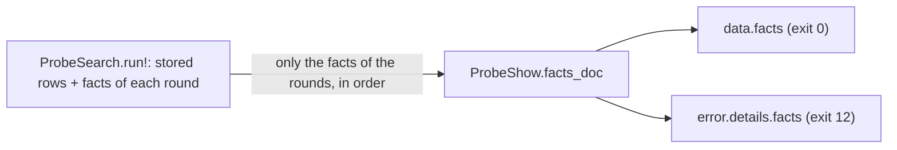

# 217b Range facts

Phase: P2 (CLI). Status: done (closed by the manager, 2026-11-03).

Plan row 217b of `PLAN-P2-CLI.md`. `tln probe --range --json` gets the new member `data.facts` (Design Q580 and Q581, R-PB9): the real facts that this run probed, as `{nightly, target, result}`, in the probe order. Not the inferred facts, and not the facts that `compat.db` had before. The schema does not change (R-J6). The bot range search (Q574, slice 223) uses it later.

## Rules

R-PB9, R-J6 (CLI 3). Named also: R-PB3, R-PB7, R-PP3 (the order of the results in a round), R-J4, R-J5, R-OUT2. Registry R-MX18 item 9.
Design: Resolution 4 (R-PB9), Design Q580, Q581, CLI 3 (R-J6).

## Public signatures (stubs, `crash "todo: slice 217b"`)

| Name | Signature | Rule |
| --- | --- | --- |
| `ProbeShow.facts_doc` | `List(Db.Fact) -> JsonDoc` | R-PB9 |

The shape is still right after Q581: the function gives the list value only. The caller decides the place (`data` or `error.details`), so the path change needs no change of the signature.

Edits to existing files (copies in `research/slice-217b-revert/before/`): `cli/lib/ProbeShow.roc` (the stub, at the end of the block), `tests/unit/ProbecmdTest.roc` (1 import, 1 `expect`).
New: `tests/commands/cases/probe/pc4-range-facts/`. Changed expected files: `probe/pd1-downloads` runs 3 and 8, `probe/pc2-range` run E (stdout and the `rules` text of each).

What the code agent must do (no test reaches it before the code):

| Step | Note |
| --- | --- |
| `ProbeSearch.Found` carries the facts of this run | `ProbeSearch.run!` starts with the stored rows (`state.facts`) and adds the facts of each round. The member must have only the new ones, in the order of the probes. The inferred cells (`ProbeRange`) are not facts. A probe with no fact (`NoFact`, a failed download) is not in the list. |
| `ProbeCmd.Shown.Range` gets the facts. `ProbeCmd.data` writes `facts` as the last key of `data`. The failure of exit 12 writes it as the last key of `error.details` | Always present, `[]` for no fact. `range` stays as it is (`null` for no pass). |
| `ProbeShow.facts_doc` | Maps each `Db.Fact` to `{ "nightly", "target", "result" }` with `Db.outcome_word`. |

## The flow

No new `Fx` call and no new line in `calls.log`: the member is a change of the output only.

## Tests

| Layer | Where | Checks | Rules |
| --- | --- | --- | --- |
| L0 | `tests/unit/ProbecmdTest.roc`, the last `expect`: `ProbeShow.facts_doc` for 4 facts (pass, fail with modules, hang, crash with another target) | the 4 result words, the order of the list, the target as it is, no `modules` or `closure` key | R-PB9 |
| L2 | `probe/pd1-downloads` run 3 (changed): exit 0, one probe on n4 that fails | `data.facts` is the one probe, not the 6 known facts of n5 to n10 | R-PB9, R-J6 |
| L2 | `pd1-downloads` run 8 (changed): exit 12, 8 probes of phase 1 | `error.details.facts` has the 8 probes in order (n10 n9 n8 n7 n6 n5 n1 n3), last key; the failed download of n4 is no fact | R-PB9, R-J4 |
| L2 | `probe/pc2-range` run E (changed): exit 12, all facts known | `error.details.facts` is `[]` | R-PB9 |
| L2 | `probe/pc4-range-facts` run 1: parser, `probe.max` 4, no `--json` (setup) | the db gets 4 facts; exit 12 | R-PB9 (setup) |
| L2 | `pc4-range-facts` run 2: `--json`, the db has the 4 facts of run 1, the run probes n5 n6 n7 | `data.facts` has these 3 (fail, pass, pass) and not the 4 stored facts | R-PB9 "not the facts known before", R-PB3 |
| L2 | `pc4-range-facts` run 3: a bundle file, `--json`, 3 rounds, 7 probes, n2, n4, n7 inferred | `data.facts` has the 7 probes in the probe order (n10 n9 n8, n3 n5 n6, n1) and not the 3 inferred releases | R-PB9 "not the inferred facts", R-PP3 |
| L2 | `pc4-range-facts` run 4: run 3 again, exit 0, no probe | `data.facts` is `[]` (the member is there) | R-PB9, Q581 item 1 |
| L2 | `pc4-range-facts` run 5: the bundle AJn26 (fails everywhere, n2 and n4 stored as fails in the given db), 8 probes | exit 0, `range` null, `data.facts` has the 8 probed fails and not the 2 stored ones | R-PB9, Q581 item 3 |

No test of the schema: no `schema` number changes (R-J6) and the cases keep `"schema":1`.

How the expected files were made: for `pc4-range-facts`, `UPDATE=1` with a private build of the code before this slice gave `calls.log`, `tree.diff`, stderr, exit and the part of stdout of runs 4 and 5 without `facts`. The `facts` arrays of all runs were written by hand from the `probe` lines of `calls.log`, the rows of `tree.diff` and the fake `units` table. The changed pd1 and pc2 lines were written by hand. The private build is deleted.

## Proposals (R-OUT2, TW24)

| Item | Proposal |
| --- | --- |
| Position | `facts` is the last key of `data` (exit 0) and of `error.details` (exit 12), as Q581 says. |
| Fact keys | `nightly` (the id of the release), `target`, `result`, in this order. `result` is `pass`, `fail`, `hang` or `crash`. No `modules`, no `error_digest`. |
| `target` value | `any` (Q581 item 4). |
| Human text | No change. The text of `tln probe --range` does not list the facts. |

## Out of scope

| Item | Why |
| --- | --- |
| The bot range search (Q574) | Slice 223 and later |
| `facts` for a run with no `--range` | R-PB9 names `--range --json` only |
| `facts` for `--share` | R-PB6 sends the stored facts of `compat.db`; unchanged |
| A `crash` or `hang` fact in L2 | The 4 words are in the L0 `expect` only |

## Questions (stop until answered)

All answered (Design Q581, 2026-11-03). Round 1 questions and the change:

| # | Question | Answer | Test change |
| --- | --- | --- | --- |
| Q1 | Empty list or no member when nothing is probed | Always present, `[]` | `pc4` run 4, `pc2` run E |
| Q2 | Facts of an exit-12 run (`data` is null) | `error.details.facts`, last key | `pc2` run E, `pd1` run 8 |
| Q3 | Facts when `range` is null | `data.facts`, next to `range` | `pc4` run 5 |
| Q4 | Value of `target` | `any` | none |
| (path) | `data.range.facts` of Q580 | moves to `data.facts` | all expected files above |

Open (round 3, from the manager's check):

| # | Question | Why it is open | What is not tested | Answer and test change |
| --- | --- | --- | --- | --- |
| Q5 | `--range` with `--share` is allowed: R-PB6 says "with `--range` when given" and `ps14-share-after-12` runs it. With `--json` the share step adds its keys to `data` after the probe keys (`ProbeFlow.shared!`, Q493). Q581 says `facts` is the last key of `data`. So with `--share` is `facts` the last key, or do the share keys come after `facts`? The same for `error.details` (exit 12, share runs after 12, Q506) | Q581 and R-PB6 give no order between `facts` and the share keys | No test: no case runs `--range --share --json` with a probe | Answered (G-C214, TW24 proposal; the TalonRegistry reviewer decided, the human review is open): keep the code. `facts` is the last of the probe keys. With `--share`, the share keys of `ProbeFlow.shared!` come after `facts`, in `data` and in `error.details` of an exit-12 run. "Last key" in Q581 means the last of the probe keys. No test |

## Disputes (from the code agent)

| # | Test | Problem |
| --- | --- | --- |
| D1 | `tests/unit/ProbecmdTest.roc` lines 202 and 239 to 242 (also 166 to 179 use `Range` tags of `ProbeRange.Found`, those are fine) | The old tests build `ProbeCmd.Shown.Range({ node, found, probes, downloads })` with no `facts`. The slice (code notes, Q581) adds `facts` to `Shown.Range`, always present. So the L0 file `l0-5.roc` does not compile (2 compiler errors, so the new `facts_doc` expect cannot run there either). The 3 `ProbeCmd.data` expectations (lines 239, 241, 242) also need `,\"facts\":[]` as the last key. The test agent must add `facts: []` to these 4 records and the `facts` text to the 3 expected strings. The `facts_doc` expect itself gives the right output (the `[dbg]` line in `.work/logs/l0.log`). |

D1 result (test agent): accepted, the 4 records and the 3 expected strings of `ProbecmdTest.roc` now have `facts: []` and `,\"facts\":[]`. `l0-5` compiles and all 110 tests pass, with the `facts_doc` expect.

## Verify results

| Check | Result |
| --- | --- |
| check, fmt, selftest | pass |
| L2 `probe/pc2-range`, `probe/pc4-range-facts`, `probe/pd1-downloads` | pass |
| L2 full | only `bot/*` (slice 223) and `probe/sm*` (slice 218b) fail, as expected |
| L0 | `l0-5` fails to compile: dispute D1 (old `Range` records in ProbecmdTest have no `facts`). `l0-2` fails: `ProbesmokeTest.roc` not found (slice 218b). `l0-9`: slice 223. The other L0 files pass |
| L3 | pass |

Code: `ProbeShow.facts_doc`; `ProbeSearch.Found.facts` (`last.facts.drop_first(rows.len())`: the stored rows come first, rounds only append); `ProbeCmd.Shown.Range.facts` and `data` (last key); `ProbeFlow` passes it. Exit 12 reuses `data` as `error.details`, so `facts` is last there too. Note: with `--share`, `ProbeFlow.shared!` appends the share keys after `facts` (not in a test).

## Red state (test agent, round 2)

| Check | Result |
| --- | --- |
| L0 `l0-5.roc` | the new `expect` fails with `todo: slice 217b` |
| L2 `probe/pc2-range`, `probe/pc4-range-facts`, `probe/pd1-downloads` | fail: the actual output has no `facts` (the only difference) |
| Expected exits | `pc4-range-facts`: run 1 exit 12 (R-PB4, budget), runs 2 to 5 exit 0 (R-PB8: both ends real, or no pass with no unseen release, `ProbeCmd.stop` rows 4 and 6); `pd1` run 3 exit 0, run 8 exit 12 (R-PB4: 1 unknown end); `pc2` run E exit 12 |
| Expected stderr | `pc4-range-facts`: run 1 the budget text; runs 2 to 5 the human text (R-J4, R-OUT4), run 5 `no release of the compiler list has a real pass` |

## Close (manager, 2026-11-03)

| Check | Result |
| --- | --- |
| `sha256sum -c research/slice-217b-revert/code-final.sha256` | 4 files OK |
| `todo: slice 217b` in cli/ and tests/ | none |
| Expected exits read | pc4 runs: 12, 0, 0, 0, 0; pd1 run 3: 0, run 8: 12; pc2 run E: 12. Each is a rule of its run |
| Dispute D1 | Accepted: the test agent added `facts: []` to the old `Shown.Range` records of ProbecmdTest |
| Q5 (G-C214) | Answered as a TW24 proposal by the TalonRegistry reviewer. The user accepted it (2026-11-06) |
| Mutation: `facts: last.facts` (no `drop_first`) in `ProbeSearch` | Caught: pc4-range-facts and pd1-downloads fail |
| `check`, `fmt`, `selftest` | pass |
| L0 | pass, except the red stubs of slices 223 (BotTest) and 218b (ProbesmokeTest) |
| L2 | 480 pass. The 26 failures are bot/* (223) and probe/sm* (218b), all on their `todo` stubs |
| L3 (`JOBS=1`) | pass (87.7 s, over the 60 s budget: warning) |

## Human review (the user, 2026-11-06)

The user accepted all the proposed output texts and `--json` fields of this slice (TW24, R-OUT2). They are final.
