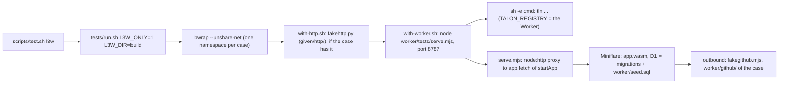

# 224 The contract run (tag `worker`, step `l3w`)

Phase: P2. Status: harness done, for human review (harness agent of the registry session, 2026-11-06). Plan row: `docs/slices/PLAN-P2-CLI.md` 224. User-approved.

## 1. Scope

| Item | Value |
| --- | --- |
| Goal | L3 cases with the tag `worker` run the real `tln` against the built Worker (`app.wasm` of the step `wbuild`) in Miniflare, with a local D1 (the migrations of `sql/` and a seed) and the W2 fake GitHub, in place of `tests/tools/fakehttp.py` for the registry. They check that the fake registry routes of the L2 and L3 cases agree with the real routes |
| Owner | Harness agent (registry session): `scripts/test.sh`, `tests/selftest.sh`, `worker/tests/` tooling. The CLI session (talon-eb) writes the other `worker` cases |
| Not in scope | `worker/` code, `cli/` code, the design files, the W2 cases |
| Build mode | The Worker: `--opt=speed` only (TW32). `tln`: `OPT` as for `l3` |

## 2. For the CLI session

| Item | Value |
| --- | --- |
| Hook name | The step `l3w` of `scripts/test.sh` (`scripts/test.sh wbuild l3w`, or `scripts/test.sh l3w`: it puts `wbuild` before it) |
| Tag | `worker` in the file `tags` of the case (the L3 tag form, TESTING.md 3.1) |
| Runner | `tests/run.sh`. With `L3W_DIR=<Worker build dir>` a `worker` case runs; without it the case is skipped (so the fast `l3` never starts a Worker). `L3W_ONLY=1` selects only the `worker` cases |
| What the cmd sees | `TALON_REGISTRY` and `TALON_WORKER`: `http://127.0.0.1:8787`, the Worker. `TALON_HTTP`, `TALON_GITHUB_API`, `TALON_GITHUB_RAW`: the fake HTTP server, as before, when the case has `given/http/` (GitHub for `tln`: the guard R-RG4, the release lists) |
| Example | `tests/scenarios/registry/cw1-add-releases/` (`tln add acme/lib --no-check --dry-run`: R-AP1 200, then the closure query R-AP3/R-AP16, on a seed of 2 releases) |

## 3. How it runs



| Part | File | What it does |
| --- | --- | --- |
| Step | `scripts/test.sh` `step_l3w` | Needs the Worker build of this run (`$LOGS/worker-dir.<pid>`, it never builds the Worker) and the `tln` build. Runs `tests/run.sh` with `L3W_ONLY=1`. Without a network namespace (no `bwrap`, or `BWRAP=0`) it runs one case at a time, because the port is fixed |
| Runner | `tests/run.sh` | The tag `worker`: skip without `L3W_DIR`; else the cmd runs under `tests/tools/with-worker.sh` (inside `with-http.sh` when the case has `given/http/`). Compares `expect/worker.log` and `expect/worker-github.log` when the case has them. `UPDATE=1` writes them (optional files) |
| Wrapper | `tests/tools/with-worker.sh` | Starts `serve.mjs`, waits for `worker.url` (30 s), sets `TALON_REGISTRY` and `TALON_WORKER`, runs the cmd, stops the server. A line in `worker.errs` is printed to stderr as `worker: <text>` and the exit code is 98, so the case fails |
| Server | `worker/tests/serve.mjs` | `startApp` with `wrangler-test.toml` and `hooks.js` of W2, the settings and rate limits of W2, the clock `TALON_NOW`, the migrations as one `db.batch`, then `worker/seed.sql`. A `node:http` server on 127.0.0.1:8787 sends each request to `app.fetch` |
| Fake GitHub | `worker/tests/fakegithub.mjs` | The W2 fake GitHub, moved out of `run.mjs` with no change, so W2 and `serve.mjs` share it |
| Seed tool | `worker/tests/tools/mk-l3w-seed.mjs` | `seed.json` to `seed.sql`: the D1 rows of indexed GitHub releases, with the ids of R-IK2 and R-IK5 computed in JS |

`startApp` gives a real listening URL (`url`, the `ready` of Miniflare), but on a random port. The registry origin is part of the cache path of `tln` (`talon/index/registry/http_127.0.0.1_<port>/get/<md5 of the URL>.json`, R-IX1), so a random port would change `expect/tree.diff` on each run. So `serve.mjs` serves a fixed port and proxies to `app.fetch`. The proxy also gives the request log.

## 4. Case layout

```text
tests/scenarios/<area>/<id>-<name>/
  tags                    worker (and other tags)
  cmd, given/, expect/    as any L3 case (TESTING.md 3.1)
  given/http/             optional: the fake HTTP server, GitHub for tln (for example api/repos/<owner>/<repo> for the guard R-RG4)
  worker/seed.sql         optional: D1 statements after the migrations (the form of W2 seed.sql)
  worker/seed.json        optional: the input of worker/tests/tools/mk-l3w-seed.mjs that made seed.sql
  worker/github/          optional: the fake GitHub of the Worker, the W2 form (run.mjs doc comment). Names stay encoded (%3F): the runner does not decode worker/
  worker/settings.json    optional: more Worker settings (W2 form)
  worker/ratelimits.json  optional: the rate limits (W2 form)
  expect/worker.log       optional: the requests to the Worker, one line each: METHOD <path and query> <status>
  expect/worker-github.log optional: the requests of the Worker to its fake GitHub, one line each: METHOD <url>. An empty file: the Worker makes no GitHub request
```

| Rule | Value |
| --- | --- |
| `worker/` is not in `given/` | So the runner does not copy it into the work dir and `decode_names` does not decode the W2 names of `worker/github/` |
| Clock of the Worker | `TALON_NOW` of `given/env` (one fixed clock for all requests), else 2026-01-01T00:00:00Z (the W2 default) |
| A GitHub request of the Worker with no route | The case fails (`worker: github: no fake route ...`, exit 98), as in W2 |
| One Worker per case | About 1 s for the start. The cases run in parallel, each in its own network namespace |
| tty | A case with the tags `worker` and `tty` is not supported (the tty path does not start the Worker) |

## 5. How to add a case

| Step | Do |
| --- | --- |
| 1 | Find the L2 or L3 case whose fake registry route you want to check (for example a `given/http/v1/...` route). Copy the cmd and the project into a new case dir, and add `tags` with `worker` |
| 2 | Write `worker/seed.json` with the releases the route must see, then `node worker/tests/tools/mk-l3w-seed.mjs worker/seed.json > worker/seed.sql`. For other tables (toolchains, compat, sweeps), write the SQL by hand (the W2 seeds of `worker/tests/cases/` are examples) |
| 3 | Keep in `given/http/` only the GitHub routes that `tln` reads. Delete the `v1/...` routes: the Worker answers them now |
| 4 | When the route makes the Worker read GitHub (an ingest, R-AP9), add `worker/github/` files (W2 form). Add an empty `expect/worker-github.log` when it must not read GitHub |
| 5 | `UPDATE=1 L3W_DIR=<build dir> L3W_ONLY=1 TLN=.work/bin/tln tests/run.sh <case>`, then read each expected file: a baked failure is a bug (exit code, stderr) |
| 6 | Compare the stdout and stderr with the fake-route case of step 1. A difference is the finding of the contract run: the fake route or the Worker is wrong (an issue for the owner, not an edit of the other case) |
| 7 | `scripts/test.sh wbuild l3w` |

## 6. Routes to cover first

R-AP1 is in the example. The others are for the CLI session, in this order.

| Order | Rule | Route | A tln command that sends it | Seed and fake GitHub |
| --- | --- | --- | --- | --- |
| 1 | R-AP1 | `GET /v1/packages/{owner}/{repo}/releases` | `tln add <owner>/<repo>` (done: `cw1-add-releases`) | Seed of the releases |
| 2 | R-AP2 | `GET /v1/artifacts/{hash}` | A command that reads an artifact by hash | Seed |
| 3 | R-AP3 (R-AP16, R-AP17) | `POST /v1/closure` | `tln update`, `tln add` (the example sends one) | Seed with deps |
| 4 | R-AP7 | `GET /v1/packages?short=<name>`, `?q=<text>` | `tln add <short name>` (R-AD34) | Seed of the names |
| 5 | R-AP5 (and R-AP56) | `GET /v1/toolchains?after=...` | A compiler pick with a registry | Seed of `toolchains`. See Q4 |
| 6 | R-AP9 | `POST /v1/releases` (ingest) | `tln add` of a repository that the registry does not know (R-AD35) | Empty seed; `worker/github/` with the repo, the release and the asset (the W2 `ingest` cases have the form) |
| 7 | R-AP10 | `POST /v1/compat` (user hint) | `tln probe --share` | Seed of the artifact |
| 8 | R-AP39 | `GET /v1/sweeps/{tag}` | The command that reads a sweep | Seed of `sweeps` |
| 9 | R-AP40 | `GET /v1/compat_hints?audit=<n>` | The command that reads the audit | Seed of `compat_hints` |

## 7. Results

`scripts/test.sh wbuild l3w selftest`, 2026-11-06, the Worker stamp up to date:

| Step | Result | Seconds | Budget |
| --- | --- | --- | --- |
| wbuild | pass | 0.5 | 90 |
| l3w | pass, 1 case | 14.7 | 15 (proposal) |
| selftest | pass, 88 rows (6 new) | 6.8 | 20 |

The 14.7 s of `l3w` is mostly the wait for the `tln` build (about 12 s, `OPT=dev`), because in this run `l3w` is the first step that needs it. The case alone is 1.5 s (`tests/run.sh` with a built `tln`). In a full run, `l3` builds `tln` before.

Other checks after the change:

| Check | Result |
| --- | --- |
| `scripts/test.sh w2 l3` (the fake GitHub moved to `fakegithub.mjs`) | w2: 189 passed, 0 failed (40.2 s). l3: 100 passed, 0 failed, 10 skipped (the `worker` case is skipped) |

Self-test rows (`tests/selftest.sh` `s_l3w`; skipped when the run has no Worker build):

| Row | Checks |
| --- | --- |
| 1 | The seed of the case is in D1 (200), a name with no row is 404, `expect/worker.log` matches: pass |
| 2 | A wrong `expect/worker.log` fails with `worker requests differs` |
| 3 | No seed: the seeded name is 404, so the case fails |
| 4 | An ingest makes the Worker read GitHub with no fake route: `worker: github: no fake route ...`, exit 98 |
| 5 | Without `L3W_DIR` a `worker` case is skipped; with `L3W_ONLY=1` only the `worker` case runs, and it sees `TALON_REGISTRY` |
| 6 | `scripts/test.sh` has the budget `l3w` 15, puts `wbuild` before `l3w`, and `step_l3w` does not build the Worker |

Mutants of the harness (each made one row fail, then restored): no compare of `worker.log` (row 2), no exit 98 on `worker.errs` (row 4), no seed in `serve.mjs` (row 1), `L3W_ONLY` ignored (row 5).

## 8. Changed files

| File | Change |
| --- | --- |
| `scripts/test.sh` | Step `l3w`, budget 15, `wbuild` before `l3w`, the `tln` build for `l3w`, `SELFTEST_W_DIR` for the self-test |
| `tests/run.sh` | The tag `worker`, `L3W_ONLY`, `expect/worker.log`, `expect/worker-github.log` |
| `tests/tools/with-worker.sh` | New |
| `tests/selftest.sh` | Rows `s_l3w`; `L3W_DIR` and `L3W_ONLY` of the caller are unset |
| `worker/tests/serve.mjs` | New |
| `worker/tests/fakegithub.mjs` | New: `fakeGithub` of `run.mjs`, the same code (the case dir is an argument) |
| `worker/tests/run.mjs` | Imports `fakeGithub`; the imports that only it used are gone |
| `worker/tests/tools/mk-l3w-seed.mjs` | New |
| `tests/scenarios/registry/cw1-add-releases/` | New, the example |

`tests/run.sh` is the L3 runner, which the CLI session also uses: the change adds only the `worker` branch (a case without the tag runs as before; l3 gives the same counts).

## 9. Questions (TW17)

| Id | Question | Proposal |
| --- | --- | --- |
| Q1 | Is `l3w` in the default steps of `scripts/test.sh`? TW26 and TW32 (TESTING.md) list the default steps and budgets, and the self-test row of the default list reads them. Now `l3w` runs only when it is named | Yes, after `wbuild` (`... wbuild w2 wtrap l3w selftest l1`), budget 15 s. The cost in a full run is the cases (about 1.5 s each, in parallel): `tln` and the Worker are built already. The human edits TW26 and TW32, then the harness changes the list and the row |
| Q2 | TESTING.md 3.1 (case layout, the tag table) has no tag `worker`, no `worker/` dir and no `expect/worker.log` | Add the rows of section 4 of this file to TESTING.md 3.1 (tag `worker`: "The real Worker in place of the fake registry routes. Skipped in `l3`; the step `l3w` runs it") |
| Q3 | The plan row says the cases "check that the fake routes of 200 to 222 agree with the real routes". The design does not say how a fake route and a Worker case are paired | A `worker` case is the twin of one fake-route case (same cmd, same project, the seed in place of the `v1/` files), and must give the same stdout and stderr. No tool compares the fake route files with the Worker answers: the seed that makes the same answer is the work of the case author |
| Q4 | The brief named "R-AP56 toolchains". In DESIGN-REGISTRY.md, R-AP56 is the case fold of `{owner}/{repo}` in R-AP1, and the toolchains route is R-AP5 | Section 6 lists R-AP5 for the toolchains and R-AP56 with it. A case for R-AP56 is `tln add Acme/Lib` on the seed of `cw1` |
| Q5 | The request bodies to the Worker (the closure query body) are not in a log | Not now. When a case needs it, add `expect/worker-bodies/` with the form of `expect/http-bodies/` |

## Cases (test agent)

Test agent of slice 224, 2026-11-06. Only tests: no product code, no `worker/`, no `scripts/*`, no `tests/run.sh`. Run: `scripts/test.sh wbuild`, then `L3W_ONLY=1 scripts/test.sh l3w`: 9 cases pass, 10.5 s (budget 15). All cases are in `tests/scenarios/registry/`. One new fixture file: `tests/fixtures/registry/repo-acme-roc-thing.json` (the guard answer for a dir route: the L3 fake server has no `@` file form, the `body @` line reads `tests/fixtures/`).

| Case | Rule ids | Twin case (fake routes) | Result |
| --- | --- | --- | --- |
| `cw1-add-releases` (the example, not changed) | R-AP1 R-AP3 | None with the same project. Nearest: `tests/commands/cases/registry/ad35-add-closure` (the same command shape). The exact twin of the R-AP1 read is in `cw2` | Pass. Not byte-compared |
| `cw2-add-closure` | R-AP1 R-AP3 R-AP16 R-AP17 R-DT5 R-RG4 | `tests/commands/cases/registry/ad35-add-closure` (L2, `commands`) | Pass. stdout, stderr and exit are the same as the twin |
| `cw3-install-short` | R-AP7 R-AD34 R-SN1 R-AP1 R-AP3 | `tests/commands/cases/registry/sn6-install-short-one` (L2, `commands`) | Pass. Same stdout, stderr, exit |
| `cw4-update-toolchains` | R-AP5 R-CV1 R-AP47 R-AP19 R-AP16 R-DT3 R-SO13 | `tests/commands/cases/registry/dt3-update-range-log` (L2, `commands`, 2 runs) | Pass. Same stdout, stderr, exit. The requests differ in one number: see finding F4 |
| `cw5-ingest-ok` | R-AP9 R-AP1 R-AP3 R-AP41 R-AD35 R-DA8 R-RG4 R-PU4 | None. No L2 `commands` case has an ingest that the Worker accepts (201). Nearest: `registry/ad35-ingest` (module level, same request order) and `registry/ad35-add-ingest-429` (same command shape) | Pass. Sequence: R-AP1 404, ingest 201, R-AP1 200, closure 200; the Worker reads 4 GitHub URLs. The twin is not byte-compared. See F5 and Q2 |
| `cw6-probe-share` | R-AP10 R-CT1 R-CT2 R-CT4 R-AP72 R-PB6 R-CM8 R-RG4 | `tests/commands/cases/probe/ps8-share-command` (L2, `commands`) | Pass. Same stdout, stderr, exit |
| `cw7-artifact` | R-AP2 R-AP53 R-AP56 R-AP32 | None for `tln`: no `tln` command sends R-AP2 (see Q1). Fake routes: `bot/b1-sweep` (200), `bot/b25-artifact-404` (404). The case copies them to `given/fake/` and prints a diff | Pass. The diff is baked in `expect/stdout`. Findings F1, F2 |
| `cw8-sweep` | R-AP39 R-AP67 R-MX1 R-MX4 R-MX11 | None for `tln` (Q1). Fake routes: `bot/b1-sweep` (no sweep row), `bot/b15-done` (a sweep row) | Pass. The bodies have the same members. Only the values differ (log size, tag, time) |
| `cw9-audit` | R-AP40 R-AP67 R-MX13 | None for `tln` (Q1). Fake route: `bot/b3-audit` | Pass. The body is the same as the fake body. The headers differ: finding F3 |

Order of the brief: R-AP1 (cw1 and cw2), R-AP2 (cw7), R-AP3 (cw2), R-AP7 (cw3), R-AP5 (cw4), R-AP9 (cw5), R-AP10 (cw6), R-AP39 (cw8), R-AP40 (cw9). The case names follow the order in which they were made.

### Requests of each case (expect/worker.log)

| Case | Requests to the Worker |
| --- | --- |
| cw2 | `GET /v1/packages/acme/known/releases 200`, `POST /v1/closure 200` |
| cw3 | `GET /v1/packages?short=known 200`, then the 2 requests of cw2 |
| cw4 | `GET /v1/toolchains?after=0`, `POST /v1/closure`, `GET /v1/toolchains?after=41`, `POST /v1/closure` (all 200) |
| cw5 | `GET .../releases 404`, `POST /v1/releases 201`, `GET .../releases 200`, `POST /v1/closure 200` |
| cw6 | `POST /v1/closure 200`, `POST /v1/compat 201` (the Worker reads `GET /repos/roc-talon/talon/tags?per_page=100`, R-CT12) |
| cw7 | `GET /v1/artifacts/<hash> 200` and 404 |
| cw8 | `GET /v1/sweeps/<tag>` 200, 200, 404 |
| cw9 | `GET /v1/compat_hints?audit=200 200`, no `audit` 400, `audit=0` 200 |

### Contract findings (a side differs from the other)

I did not change the twins, the Worker or `tln`. Owner of the fix: the slice 223 author for the `bot/` fake routes (F1 to F3), the slice 212 and 206 authors for F4 and F5.

| Id | Route | Fake side (L2 twin) | Real Worker (exact) | Effect |
| --- | --- | --- | --- | --- |
| F1 | R-AP2, `bot/b1-sweep`, `b3-audit`, `b25-artifact-404` | `"group":"github.com/acme/json/releases/download/{v}"` (no trailing `/`). `"repos":[]` | `"group":"github.com/acme/json/releases/download/{v}/"`. `"repos":[{"name":"acme/json","state":"active","state_at":...,"successor":null}]` | The group form of a fake release is not a real group. The bot reads only the `url`, so no L2 case fails now |
| F2 | R-AP2 | Header `Cache-Control: no-store`. A 404 has `Content-Type: application/json` and a body `{"type":"/errors/not-found","title":"T","status":404,"detail":"D"}` | Header `Cache-Control: max-age=60` and an `ETag`. A 404 has `Content-Type: application/problem+json` and the `detail` `no artifact <hash>`, the `title` `Not found` | The fake route has a cache rule and a 404 type that the Worker does not have |
| F3 | R-AP40 | `.meta`: `Cache-Control: no-store` | `Cache-Control: max-age=300` and an `ETag` (R-AP40 says `max-age=300`, ETag). The body is the same, key by key | Same kind as F2. R-AP39 matches (`no-store`, no ETag) |
| F4 | R-AP5, R-AP47 | In `dt3-update-range-log` the toolchain rows have `log_index` 10, 20 and 40, and the closure answer has releases at log index 20 and 40 too. The second read is `GET /v1/toolchains?after=40` | One log has one leaf for each index (`toolchains_leaf_check`, `sql/0002_triggers.sql`). The case has the rows at 10, 19 and 41, so the second read is `after=41` | The fake world cannot exist in one log. The stdout is the same, so the output does not depend on it. Not an error of `tln`. Other L2 fakes may share an index between a toolchain and a release in the same way (not checked) |
| F5 | R-AP9 | The fake ingest answer is `201` with the body `{"status":"indexed"}` and the header `Talon-Bookmark` (`registry/ad35-ingest`, `ad35-add-ingest-429`, `ap28-update-unknown`) | The Worker answers 201 with `{"release":{...}}`, the headers `Location: /v1/artifacts/<hash>` and `Talon-Bookmark` (W2 `cases/ingest/pu4-index-kinds`, seen by reading, and the `cw5` run: `tln` accepts it) | The fake body is not the R-AP8 body. `tln` does not read the body, so no case fails. Found by reading: no case compares it |

Other facts from the runs:

| Id | Fact |
| --- | --- |
| N1 | `cw2` needs 47 more releases in the seed (log size 50) so that the line `resolved at log:50` is the same as the twin. The pad releases are in `worker/seed.json` |
| N2 | `cw4` needs `worker/extra.sql` (3 toolchain leaves, the withdrawn release at log 37). The twin has a `roc` that is not on PATH: `given/roc.tsv` makes `roc version` exit 1 |
| N3 | `cw6`: the Worker needs `CONTRIBUTOR_KEY` (`worker/settings.json`) for the hint path: without it the answer is 500 `internal`. It also reads the tags of `roc-talon/talon` (R-CT12): `worker/github/` has the tag `v0.0.1`. The pin of the compiler must be in the real `compat.db`: `given/home/.cache/roc/talon/compat.db` is a real SQLite file (made with `node:sqlite` and the schema of `cli/RealDb.roc`). The L2 twin has the line form `compat.tsv` |
| N4 | `cw5` has a project with the pin `nightly-2026-10-31-f7bef6b` (the `.roc-version` of the W2 archive): with an older pin the answer is exit 10 `too new` |

### Mutants (the tests catch a bad seed or a bad route)

| Mutant (undone after the run) | Case | Result |
| --- | --- | --- |
| No `UPDATE releases SET withdrawn` in `seed.sql` | cw4 | Fails: `parser 1.2.0 -> 1.3.0` in stdout |
| No toolchain row in `seed.sql` | cw6 | Fails: `POST /v1/compat 200` in place of 201 |
| One log row less in `seed.sql` | cw2 | Fails: `resolved at log:49` in place of 50 |

### Questions (TW17)

| Id | Question | Proposal |
| --- | --- | --- |
| Q1 | R-AP2, R-AP39 and R-AP40 are read only by the bot app (`bot/main.roc`), not by a `tln` command. The hook runs `tln` only, and the bot needs a signed OIDC token before its first request (R-TP2: the token host is the fake server, and the Worker checks the signature). So cw7, cw8 and cw9 use `curl` and compare the bodies with the fake routes by a diff in `expect/stdout`. This is not a twin run of the same command | Accept the diff form for these 3 routes. A real bot run needs: a build of `bot/main.roc` in `scripts/test.sh`, a token endpoint with a Worker test key in `serve.mjs`. This is harness work (the harness agent), after the review |
| Q2 | The twin `ad35-add-ingest-429` (2 ingests, 201 then 429 with `Retry-After: 30`) has no Worker case. `serve.mjs` refuses `RL_INGEST` with a limit of 0 (`limit must be a number above 0`). With a limit of 1 the first ingest of the 2 (parallel, order not fixed) must be a full 201 with a valid archive for the hash that `tln` names, and the Retry-After of the Worker is its window (10 or 60 s), not 30 | No case now. When wanted: one candidate in the GitHub list of `tln` gives the 201 (the `cw5` form), and a second `tln add` run in the same case gets the 429. The text `Try again in <n> s.` then has the window of the Worker, so it is not the same text as the twin |
| Q3 (answered in round 2: accepted) | `cw6` has a binary file `given/home/.cache/roc/talon/compat.db` (a real SQLite file, 12 KB). The other cases use the stub text `sqlite` or the L2 line form | Accept. Else the harness could load `compat.tsv` into `compat.db` before a case (a change of `tests/run.sh`, the harness agent) |
| Q4 | F1 to F5 need an owner decision: change the fake routes of the L2 cases (slice 223 and 212), or accept the difference | Change the fake routes: F1 (group and repos), F2 and F3 (headers), F5 (body). F4 needs a new log index for the toolchain rows in each fake that shares an index |

### Round 2 (test agent): the fake routes agree with the Worker

TalonRegistry answer: the Worker is right in F1 to F5, and the live Worker gives the same. The fake routes were changed. No `tln` output (stdout, stderr, exit) of an L2 or L3 case changed because of a fake fix.

| Id | Change of the fake routes | Files |
| --- | --- | --- |
| F1 | `group` has the trailing `{v}/` (538 bodies: bot artifacts, and the publish ingest answers `publish/pu*`). `repos` of an artifact answer has the repo item `{name, state:"active", state_at, successor:null}` (513 bodies) | `tests/commands/cases/bot/*/fx/http/*/v1/artifacts/*`, `tests/commands/cases/publish/*/fx/http/*/v1/releases.POST*` |
| F2 | A 200 artifact `.meta`: `Cache-Control: max-age=60` and `ETag`. A 404: `Content-Type: application/problem+json`, no `Cache-Control` (the Worker sends none), title `Not found`, detail `no artifact <hash>` | the `.meta` and bodies of the same dirs |
| F3 | `compat_hints?audit=` 200 `.meta`: `Cache-Control: max-age=300` and `ETag` (17 files) | `tests/commands/cases/bot/*` |
| F5 | An ingest 201 or 200 body is `{"release":{...}}` (21 files). A 201 has `Location: /v1/artifacts/<hash>` (17 `.meta`). The release is a fixed one: `tln` does not read it | `tests/commands/cases/registry/*/fx/http/*/v1/releases.POST*`, `ap23-http-writes` |
| F4 | `dt3-update-range-log`: the toolchain rows have `log_index` 10, 19 and 41, the same as `cw4-update-toolchains`. The second read is `after=41`. Changed expect: `calls.log` (the URL), `tree.diff` (the kept `toolchains.json`). stdout, stderr and exit are the same | `tests/commands/cases/registry/dt3-update-range-log` |

No change was needed in `tests/tools/fakehttp.py`. One expect changed in its text: `registry/ap23-http-writes/expect/stdout`, because that case prints the fake answer itself (a test of the fake transport, not of `tln`).

The files of `cw7`, `cw8` and `cw9` in `given/fake/` were copied again, and `expect/stdout` was made again. Now the diffs show only the values of the seed: the provenance (`ingest` in the seed, `oidc` in the fake) and the hash in the 404 `detail`. The body of `cw9` and its headers are the same as the fake.

Runs (2026-11-06):

| Step | Result |
| --- | --- |
| `JOBS=3 TEST_TIMEOUT=400 scripts/test.sh l2` | 524 passed, 1 failed: `share/sh27-login-no-answer`. The stderr has the new text `the registry http://127.0.0.1:9 (TALON_REGISTRY) gave no answer ... Use --registry direct ...`. It comes from the edits of `cli/lib/Registry.roc`, `Net.roc` and others by the other agent (slice 225), not from a fake route. Run alone: the same failure. An earlier full run (before more edits of that agent) had one more failure, `registry/rg9-toolchains-down`, a slice 225 case (run alone: it failed on a `config.toml` line). I did not touch it |
| `JOBS=1 scripts/test.sh l3` | pass, 83.7 s (over the budget of 60 s with `JOBS=1`) |
| `L3W_ONLY=1 scripts/test.sh l3w` | pass, 9 cases, 11.6 s |
| Twins compared again (`cw2`, `cw3`, `cw4`, `cw6`) | stdout, stderr and exit are the same |

### Q2 (answered): why `ad35-add-ingest-429` stays fake-only

| Reason | Detail |
| --- | --- |
| The limit | `worker/tests/serve.mjs` (through `startApp`) refuses `RL_INGEST` with a limit of 0: `limit must be a number above 0`. So the Worker cannot refuse the first ingest |
| The first ingest | With a limit of 1 the first of the 2 parallel ingests must be a full 201 with an archive whose hash is in the GitHub list of `tln`, and which of the 2 gets the 429 is not fixed |
| The text | The 429 of the Worker has a `Retry-After` of its rate limit window (10 or 60 s), not the 30 of the fake. `tln` prints `Try again in <n> s.` with it, so the stdout is not the same as the twin |

The 429 route is covered by the W2 case `ingest-limits`, and the 201 route by `cw5-ingest-ok`.

### Q3 (answered)

A binary `compat.db` is accepted. The file of `cw6-probe-share` is 12 KB. The head of its `cmd` has the SQL and the node call that make it again.

## Close (manager, 2026-11-06)

| Item | State |
| --- | --- |
| Cases | cw1 to cw9, tag `worker`. `L3W_ONLY=1 scripts/test.sh l3w`: 9 pass, 5.9 s (budget 15 s) |
| Twins | cw2, cw3, cw4, cw6: same stdout, stderr and exit as their fake-route twins |
| Mutations | 3 seed mutations (cw2, cw4, cw6), all caught |
| Findings F1 to F5 | The Worker is right in all 5 (TalonRegistry). The fake routes were changed to agree. No tln output changed |
| Q1 | A real bot run in l3w is a later harness slice of TalonRegistry |
| Open, for the user | `l3w` in the default steps of `scripts/test.sh`, and the TESTING.md 3.1 text for the `worker` tag |
| Final suite | Runs at the close of slice 225 (same tree) |

Status: done.
