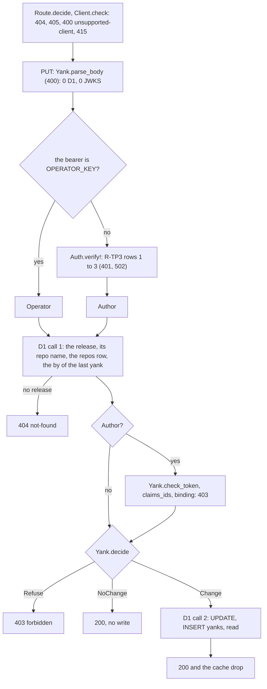

# 246 Yank

Phase: P2 (see Q246-9). Status: review (scope and red tests 2026-11-13). Model for the code: Sonnet high. Plan row: `docs/registry/PLAN.md` C.3, row 131. Shared slice 246: the parallel slice 247 (move) writes its own files.
Depends on slices 104 and 124 (`records`), 108 and 108b (`Auth.verify!`, `Oidc`), 112 and 114 (`IngestRoutes`, `Publish`: the ids, the claims text, the cache drop), 113 (`Identity`), 106 (the read routes), 102 and 103 (the schema).

## 1. Scope and split

`PUT /v1/releases/{log_index}/yank` with the body `{reason}` and `DELETE /v1/releases/{log_index}/yank` (R-YK1). The caller is a GitHub OIDC token of the repository of the release (R-TP8), or the operator key (R-YK2). A yank sets `releases.yanked` and adds a row to the new table `yanks` (R-RE10, R-YK4). The reads show `yank_reason` (R-AP49). A change drops the 4 cache keys of the release (R-YK7).

| Part | Who | State |
| --- | --- | --- |
| `sql/0003_yanks.sql`: the table `yanks` (R-RE10) | Test agent | Done (the tests need the table, and its form is fixed by R-IK7, R-IK8) |
| `packages/records/Yank.roc`: the request and answer bodies, `check_reason` (R-YK6). 5 functions `crash "todo"` | Test agent (signatures, doc), code agent (bodies) | Stubs |
| `worker/lib/Yank.roc`: `decide`, `parse_body`, `check_token`, `binding`, `action_code`, `by_code` (5 stubs), `no_release` (given text) | Test agent (signatures, doc), code agent (bodies) | Stubs |
| `worker/YankRoutes.roc`: `put!` and `delete!` `crash "todo"`, the flow in the doc comment | Test agent (signature), code agent (body) | Stub |
| `worker/lib/Route.roc`: the tags `PutYank(Str)` and `DeleteYank(Str)` in `Id`. The line in `decide` and `decide_yank` | Test agent (the tags), code agent (the line) | Tags done |
| `worker/lib/Client.roc`: `is_write` gives True for the 2 tags | Code agent | To do |
| `worker/ReadRoutes.roc`, `worker/sql/closure/releases.sql`, `worker/lib/Reads.roc`, `worker/IngestRoutes.roc`: `yank_reason` in each release record (3.5) | Code agent | To do. Rule for the code: no existing test changes (3.5). |
| `worker/wrangler.toml`, `wrangler.bench.toml`: the secret `OPERATOR_KEY` is named in the comment of the settings (R-WH14). No `[vars]` entry: it is a secret | Code agent | To do (no test) |
| Tests: `packages/records/tests/YankTest.roc` (7 `expect`s), `worker/tests/unit/YankTest.roc` (18), `worker/tests/cases/yank/` (7 W2 cases), `sql/tests/cases/schema/s6-yanks` (W1) | Test agent | Red (5.2) |

Split decision: no split. The private reference adds about 260 lines (section 8), the limit is about 400 (TW19).

## 2. Rules

| Rule | Text (short) | Checked by |
| --- | --- | --- |
| R-YK1 | The routes, the body `{reason}`, idempotent, the answer is the release record (200), the errors 400, 401, 403, 404, `no-store` | W0 `Yank.decide`, `Route.decide`. W2 `yk1-yank-unyank`, `yk1-route-checks`, `yk2-operator`, `tp8-token`. Records `YankTest` |
| R-YK2 | An author token (R-TP8) or the operator key. A release on another host: only the operator. An author cannot remove a yank of the operator | W0 `decide`, `check_token`. W2 `yk2-operator`, `yk3-roles` |
| R-YK4 | `releases.yanked` and one `yanks` row for each change: `seq`, `action`, `by`, the claims for `author`, the reason, the time. Only added. No log leaf | W2 `yk1-yank-unyank`, `yk2-operator`, `yk3-roles` (db `yanks`, counts of `log` and `releases`) |
| R-YK5 | The current state applies to each resolve (also at a snapshot) | W2 `yk7-reads` (the closure answer has the state). The closure filter by `yanked` is slice 110 (not changed) |
| R-YK6 | The reason: at most 500 bytes of UTF-8, no control character; none is valid; 400 else | Records `check_reason`. W0 `parse_body`. W2 `yk6-body` |
| R-YK7 | The answers of R-AP1, R-AP2, R-AP13, R-AP14, R-AP17 change; the 4 keys of R-AP69 are dropped by a PUT and by a DELETE that changed something | W2 `yk1-yank-unyank` (4 reads before and after each change), `yk7-reads` |
| R-TP8 | A yank token: R-TP3 rows 1 to 6 for the repository of the release; rows 7 and 8 do not apply; `event_name` is `workflow_dispatch` | W0 `check_token`, `binding`. W2 `tp8-token`, `yk3-roles` |
| R-TP3 rows 1 to 3 | The token form, signature, `iss`, `aud`, `exp`, `nbf` | W2 `tp8-token` (401 rows). In depth: slice 108 |
| R-TP3 row 5, R-TP9, R-TP12 | The ids against the `repos` row: both different is 403 `repository-changed` with `issues_url`. A yank only compares (Q246-4) | W0 `binding`. W2 `tp8-token` (3 rows) |
| R-RE10, R-IK7, R-IK8, R-RE26 | The table `yanks`, the codes, `STRICT`, the time in ms | W1 `s1-tables`, `s6-yanks`. W0 `action_code`, `by_code` |
| R-RE6 | A `yanks` row is only added; `releases` changes only in `yanked` | W2 `yk1-yank-unyank` (the other tables), `tp8-token` (`repos`) |
| R-AP41 | At most 2 D1 calls: the read, then one write batch | W2 `expect/d1-calls` of each case |
| R-AP45 | `MIN_TLN_WRITE` covers the 2 routes | W0 `Client.is_write`. W2 `yk1-route-checks` |
| R-AP48 | The order: path, method, client, size, media type, body, then the route (token) | W0 `Route.decide`. W2 `yk1-route-checks`, `yk6-body` |
| R-AP49, R-AP51 | The record has `yanked` and `yank_reason`. `reason` is optional: missing and `null` are no reason | Records `YankTest`. W0 `parse_body`. W2 `yk7-reads` |
| R-AP69, R-AP43 | The keys of the cache drop | W2 `yk1-yank-unyank` |

Design refs: Registry 7.2 (R-YK1 to R-YK7), 7.1 (R-TP3, R-TP8, R-TP9, R-TP12), 4 (R-AP1, R-AP2, R-AP13, R-AP14, R-AP17, R-AP41, R-AP43, R-AP45, R-AP48, R-AP49, R-AP51, R-AP69), 5 (R-RE6, R-RE10, R-RE26), 5.1 (R-IK7, R-IK8), 8 (settings: R-WH14).

## 3. What the code agent writes

### 3.1 The order of the checks (my reading for the review: Q246-1)

The first check that fails gives the answer. This is R-AP48 for the yank routes. Rows 1 to 6 are fixed by R-AP48. Rows 7 to 11 are my proposal.

| # | Check | Answer | D1 calls | Test |
| --- | --- | --- | --- | --- |
| 1 | The path, then the method (`Route.decide`). `/v1/releases/{x}/yank` serves `PUT` and `DELETE`. | 404, 405 with `Allow: DELETE, PUT` | 0 | W0 `Route.decide`. W2 `yk1-route-checks` |
| 2 | The client version (R-AP45): the 2 routes are writes | 400 `unsupported-client` | 0 | W0 `is_write`. W2 `yk1-route-checks` |
| 3 | The body is larger than 256 KB (R-AP46) | 413 `too-large` | 0 | None (as the publish) |
| 4 | `PUT` with a body that is not `application/json` (R-AP23). `DELETE`: no check. | 415 | 0 | W0. W2 `yk6-body` |
| 5 | `PUT`: `Yank.parse_body` (R-YK6, R-AP51). Before any token check (R-AP48 row 7). | 400 | 0 | W0. W2 `yk6-body` (a junk token) |
| 6 | The `Authorization` header: `Oidc.bearer` (no header or not `Bearer <token>`) | 401 | 0 | W2 `yk2-operator`, `tp8-token` |
| 7 | The bearer equal to `OPERATOR_KEY`: `Operator`. Else `Auth.verify!` (R-TP3 rows 1 to 3): `Author` | 401, 502, 500 | 0 | W2 `yk2-operator`, `tp8-token` |
| 8 | D1 call 1, one batch on the primary: the release by log index and the `repos` row of its repository and the `by` of its last `yank` row. No release | 404 `not-found` | 1 | W2 `yk2-operator`, `tp8-token` |
| 9 | `Author` only: `Yank.check_token` (the repository, the visibility, `event_name`), then the form of the 2 ids (`Publish.claims_ids`), then `Yank.binding` | 403 `forbidden`; 403 `repository-changed` with `issues_url` | 1 | W0. W2 `tp8-token`, `yk3-roles` |
| 10 | `Yank.decide(action, caller, state)` | 403 `forbidden` (an author on a yank of the operator); `NoChange`: 200, no write | 1 | W0. W2 `yk3-roles`, `yk1-yank-unyank` |
| 11 | D1 call 2, one write batch (3.3), then the answer 200 and the cache drop after it | 200 | 2 | W2 `yk1-yank-unyank` |

Facts behind the order:

| Item | Reason |
| --- | --- |
| The token check (rows 6, 7) is before the D1 read (row 8) | A request with a bad token costs no D1 call (as R-AP75 rows 7 and 10). The test `tp8-token` request 3 sends a bad signature for a log index that does not exist: 401, not 404. |
| The claims check (row 9) is after the read | R-TP8 compares the claim `repository` with the repository of the release, so the read comes first. A token of another repository for a log index that does not exist is 404 (`tp8-token` request 7). |
| The operator path also reads first (row 8) | One uniform shape: 1 read, then at most 1 write. The budget of R-AP41 allows it. The operator path needs the read for the 404 and for `decide`. |
| A no-op is 1 D1 call and a change is 2 | The read can stop the request (R-AP41, the "Write" row). |

### 3.2 Public signatures (fixed, in the stubs)

| Module | Item | Rule |
| --- | --- | --- |
| `records.Yank` | `reason_limit`, `Request`, `check_reason`, `encode_request`, `decode_request`, `encode_answer`, `decode_answer` | R-YK1, R-YK6, R-AP51 |
| `lib.Yank` | `Put`, `Action`, `Caller`, `State`, `Verdict` | The types of the decision |
| `lib.Yank` | `decide : Action, Caller, State -> Verdict` | R-YK1, R-YK2 (the table in the doc comment) |
| `lib.Yank` | `parse_body : List(U8) -> Try(Put, Problem)` | R-YK6, R-AP48 row 6 |
| `lib.Yank` | `check_token : Oidc.Claims, Try(Str, [NoRepo]) -> Try({}, Problem)` | R-TP8 |
| `lib.Yank` | `binding : Identity.Ids, Try(Identity.Ids, [NoRow]) -> Try({}, [Changed])` | R-TP3 row 5 |
| `lib.Yank` | `no_release : Str -> Problem` (given) | R-YK1 |
| `lib.Yank` | `action_code`, `by_code` | R-RE10, R-IK7 |
| `lib.Route` | `Id` has `PutYank(Str)` and `DeleteYank(Str)` (the path segment as sent) | R-YK1 |
| `YankRoutes` | `put! : Request, Str => Try(Response, IngestRoutes.Error)`, `delete!` | The flow of the doc comment |

### 3.3 The write batch (D1 call 2, one `batch!` on the `Primary` session)

| Statement | Form |
| --- | --- |
| 1 | `UPDATE releases SET yanked = ?` for the release. The condition is the state that the read saw (R-AP41 row 3): `yanked` is still the old value. |
| 2 | `INSERT INTO yanks (release, seq, action, by, claims, reason, time)`: `seq` is the largest `seq` of the release plus 1, in the statement (R-IK3 style: no read). The condition is the same as in statement 1. `claims`: `Publish.claims_json` for `Author`, NULL for `Operator`. `reason`: for a yank, the reason or NULL. For an unyank, NULL. |
| 3 | The read of the release as the answer (the last statement): the record of R-AP49 with `yank_reason` |

A request that lost a race (another request changed the state between the 2 calls) changes nothing and answers with the state that it finds. No W2 case tests the race: the runner can run SQL between two D1 calls only at a GitHub read (`github/<file>.sql`), and a yank has none. The W1 key `(release, seq)` stops two rows with one `seq`.

### 3.4 `yank_reason` of a record (R-AP49, R-YK1)

`yank_reason` is the reason of the last `yank` row of the release when `releases.yanked` is 1, else null. An unyank gives null. So a release that is yanked again gets the new reason (`yk7-reads`: release 2).

### 3.5 Rule for the existing records (TW18)

The tests `ReadsTest`, `IngestTest` and `PublishTest` build `Reads.ReleaseRow` records. A new field in `ReleaseRow` would break their compile, and the code agent cannot change them. So: do not add a field to `Reads.ReleaseRow` or to `IngestRoutes.LabelSqlRow`. Add the reasons as a separate list: one more statement in the batch of each read route (no more D1 call) and a new pure function in `Reads` that sets `yank_reason` in a list of `Release.Row` (a new function has no test: `yk7-reads` and the 6 other W2 cases check it). The answers of the publish and the ingest (R-AP49 says each answer has the member) use the same function when the release is yanked. If the code agent finds that it cannot do this without a change to a test, it writes a dispute (TW18).

## 4. Tests

### 4.1 Table

| Layer | Case | Checks | Rules |
| --- | --- | --- | --- |
| W0 records | `packages/records/tests/YankTest.roc`, 7 `expect`s | The answer fixture (decode, encode, same bytes); `BadJson` rows; the request (reason, empty, `null`, missing, unknown member, escapes, wrong types); `encode_request` (`{}` for none, round trip); `check_reason` (the 500-byte limit with 1, 2, 3 and 4 byte characters; the control characters) | R-YK1, R-YK6, R-AP44, R-AP49, R-AP51 |
| W0 worker | `worker/tests/unit/YankTest.roc`, 18 `expect`s | `Route.decide` (2 expects: the routes, 405, 404, 415); `Client.is_write`; `decide` (the 12 combinations, the text of the refusal); the codes; `parse_body` (good, bad, names the member, bytes that are not UTF-8); `check_token` (good, the case, the claims that rows 7 and 8 would refuse, repository, visibility, event, the order, another host); `binding` | R-YK1, R-YK2, R-YK6, R-TP8, R-TP3 rows 4, 5, 6, R-AP45, R-AP48, R-AP51, R-RE10, R-IK7 |
| W1 | `sql/tests/cases/schema/s6-yanks` (new), `s1-tables` (the shape, 9 lines added) | The table: the key, the codes, `NOT NULL`, `STRICT`, `time` as an integer | R-RE10, R-IK7, R-IK8, R-RE26, R-RE6 |
| W2 | `yank/yk1-yank-unyank` (17 requests) | 4 reads (group, group and series, repository, artifact) before and after the yank, and after the unyank: the cache keys are dropped. A PUT with a reason: 200, 2 D1 calls. A PUT on a yanked release with another reason: 200, nothing changes, 1 call. A DELETE, a DELETE again (1 call), a PUT `{}`. db: `yanks` rows (3, with the claims of the token of each request), `releases`, the counts of `provenance`, `log`, `repo_events`, `releases` | R-YK1, R-YK4, R-YK6, R-YK7, R-TP8, R-RE10, R-RE6, R-AP41, R-AP69, R-AP43 |
| W2 | `yank/yk2-operator` (12 requests, 0 JWKS reads) | The operator key: a release of another host (repo NULL), a GitHub release, DELETE, DELETE again, 404 (an index that has no release, a compiler leaf). A bearer that is not the key (the key plus a byte, minus a byte, in upper case): 401, 0 D1 calls. No header, `Basic`: 401. db: `by` 1, claims NULL | R-YK1, R-YK2, R-YK4, R-AP26, R-AP41 |
| W2 | `yank/yk3-roles` (10 requests) | The operator yanks; an author PUT changes nothing; an author DELETE of the yank of the operator is 403; the operator DELETE; an author yank; the operator PUT changes nothing; the operator DELETE of a yank of an author. A token of acme/lib on a release of acme/other: 403. The author of acme/other yanks and unyanks its own release | R-YK1, R-YK2, R-YK4, R-TP8 |
| W2 | `yank/tp8-token` (17 requests) | 401 for no header, `Basic`, a bad signature (for an index that does not exist: 401 before 404), `aud` with `/`. 404 for a good token and an index without release, a compiler leaf. 403 for another repository, a private repository, `event_name` `push` and `release`, a bad `repository_id`, a missing `repository_owner_id`. 403 `repository-changed` with `issues_url` for 2 other ids. 200 for a token with a tag ref and `tag` type (rows 7 and 8 do not apply), for a transfer token and a recreate token. db: `repos` and the `repo_events` count do not change | R-YK1, R-YK2, R-TP8, R-TP3 rows 1 to 6, R-TP9, R-TP12, R-AP48, R-AP75 |
| W2 | `yank/yk6-body` (13 requests) | A junk token with a bad body: 400 and 415 with 0 D1 calls and 0 JWKS reads. 501 bytes, 251 two-byte characters, a new line, a tab, a NUL, a number, text that is not JSON, a list. 200 for 500 bytes of ASCII, 250 two-byte characters, `null`, an unknown member. db: the byte length of each `reason` | R-YK6, R-AP48, R-AP51, R-AP44, R-AP23 |
| W2 | `yank/yk1-route-checks` (10 requests) | `MIN_TLN_WRITE` 0.5.0: PUT and DELETE from tln 0.4.1 are 400 with `minimum`, before the body check. A read from tln 0.4.1 passes. tln 0.5.0 and curl pass. 405 with `Allow: DELETE, PUT` for GET and POST. 404 for a longer path and for `/v1/releases/1` | R-YK1, R-AP45, R-AP48, R-AP21 |
| W2 | `yank/yk7-reads` (7 requests) | The yank state is seeded (release 1 yanked, release 2 yanked, unyanked and yanked again, release 4 yanked and unyanked). `yank_reason` in R-AP13 (2 series), R-AP2 (2 hashes), R-AP14 (the page), R-AP17 (the closure). R-AP1: 2 releases | R-YK7, R-YK4, R-AP49, R-AP1, R-AP2, R-AP13, R-AP14, R-AP17, R-RE10 |

`node worker/tests/tools/mk-yank.mjs` writes the 7 cases (the tokens, the seed, the expected files). The ids, the version columns and the recorded claims come from node (SHA-256, BigInt), not from the Roc code. `notes.txt` in each case names each request. Both tools to run the cases: `scripts/test.sh wbuild w2` for all, and `node worker/tests/run.mjs yank/` on a build of `wbuild`.

### 4.2 Red results (2026-11-13)

| Step | Result |
| --- | --- |
| W0 records (`packages/records/tests/w0.roc`, stubs) | 124 expects: 117 pass, 7 fail (`YankTest`, `todo`). 0 compiler errors |
| W0 worker (`worker/tests/unit/w0.roc`, stubs) | 467 expects: 449 pass, 18 fail (all `YankTest`: 15 with `todo`, 3 with a wrong value: `Route.decide` gives 404 and `is_write` is False, until the code agent writes the lines). 0 compiler errors |
| W1 (`node sql/tests/run.mjs schema/`) | 12 of 12 pass (the table is given) |
| `scripts/test.sh wbuild` | pass, 70 s (the stubs compile into `app.wasm`) |
| W2 `yank/` | 7 of 7 fail. 6 cases: each first request gives 404 `no route for PUT /v1/releases/{i}/yank` where the case expects 200, 400, 401, 403, 404 or 405. `yk7-reads`: all requests give 200 and the right shape, and only `yank_reason` is `null` where the case expects the reason (6 of 7 requests). The log is `research/slice-246-revert/red-w2.log` |

### 4.3 Shared files changed

| File | Change |
| --- | --- |
| `packages/records/main.roc` | `Yank` in the exposes |
| `packages/records/tests/w0.roc` | `import YankTest` |
| `worker/lib/main.roc` | `Yank` in the exposes |
| `worker/lib/Route.roc` | `PutYank(Str), DeleteYank(Str)` at the end of `Id` |
| `worker/main.roc` | `import YankRoutes`; the 2 arms in `run!` |
| `worker/tests/unit/w0.roc` | `import YankTest` |
| `sql/0003_yanks.sql` | New file |
| `sql/tests/cases/schema/s1-tables/expect.tsv`, `rules` | The lines of `yanks` (9 lines) and a note. Slice 247 adds the line of `repos.offer` in the same file: the 2 edits are separate lines. |

The other new files: `packages/records/Yank.roc`, `packages/records/tests/YankTest.roc`, `worker/lib/Yank.roc`, `worker/YankRoutes.roc`, `worker/tests/unit/YankTest.roc`, `worker/tests/tools/mk-yank.mjs`, `worker/tests/cases/yank/`, `sql/tests/cases/schema/s6-yanks/`, this file.

## 5. Output (proposed, TW24)

| Item | Proposal |
| --- | --- |
| The request | `PUT`: `{"reason":"<text>"}`; for no reason `{}` (R-AP51: an optional member with no value is left out). `DELETE`: no body. |
| The answer 200 | `{"release":<the R-AP49 record>}` (as the answer of a publish, so a client has one decoder), `content-type: application/json`, `cache-control: no-store`, the header `talon-bookmark` (R-AP41 row 5), also for a 200 that changed nothing. No `location`. |
| The recorded claims (`yanks.claims`) | The text of `Publish.claims_json` (8 members, R-TP6, Design Q298), the same text as `provenance.claims`. NULL for the operator. |
| 404 | `no release has the log index <index>` (`Yank.no_release`) |
| 403 repository | `token claim repository is "<value>", expected "<owner/repo of the release>"`; a missing claim: `token claim repository is missing`. The texts of `Oidc.check_publish`. |
| 403 visibility | `token claim repository_visibility is "<value>", expected "public"` |
| 403 event | `token claim event_name is "<value>", expected "workflow_dispatch"`; missing: `token claim event_name is missing` |
| 403 other host | `the release has no GitHub repository: only the operator can yank it` |
| 403 operator's yank | `the release is yanked by the operator: only the operator can remove this yank` |
| 403 ids | `token claim <name> is "<value>", expected a number`; `token claim <name> is missing` (as the publish) |
| 403 repository-changed | The text and the member of R-TP12, as the publish: `the name <name> is bound to another GitHub account (repository id <id>)`, `issues_url` |
| 400 reason | `the reason of the yank request is more than 500 bytes`; `the reason of the yank request has a control character` |
| 400 body | `the yank request body is not valid: <why>`; bytes that are not UTF-8: `... : it is not UTF-8` |
| `yanks` codes | `action` `yank` 0, `unyank` 1. `by` `author` 0, `operator` 1 (R-IK7: the position in the list of R-RE10). |
| `seq` | 1, 2, ... for each release, in the order of the changes |
| What is not a row | A `PUT` on a yanked release and a `DELETE` on a release that is not yanked: no row, no change of the reason, no cache drop |

## 6. Out of scope

| Item | Reason |
| --- | --- |
| `tln yank` (R-YK3, R-CM21), the retries (R-AP34), the token request (R-TP2) | The client track. The wire bodies are in `records.Yank` for it. |
| The closure filter by `yanked` (R-YK5), the resolver rules | Slice 110 and the CLI. `yk7-reads` only checks the record. |
| The race between the 2 D1 calls | Not testable with the W2 runner (3.3). W1 has the key. |
| `tln audit` with the reason (R-YK5) | Slice 244 (done) and later |
| R-AP31 (move), R-PU28 to R-PU30 | Slice 247 |
| A timing test of the key compare | Not a rule of the design (Q246-5) |
| A yank on a withdrawn release | Q246-8 |

## 7. Questions (stop until answered)

Answered 2026-11-14: the user accepted all recommendations and the texts of section 5 (Design Q625 (G-C255)).

The tests follow my recommendation for Q246-1 and Q246-4. The other questions have no test: that part of the code is open.

| Id | Question | Recommendation and reason | Effect now |
| --- | --- | --- | --- |
| Q246-1 | The design gives no order for the checks of the yank (it has no R-AP75 for it). Is 3.1 right: the body (R-AP48), the token, then the D1 read, then the claims? The read before the claims is forced by R-TP8. Only the place of the token before the read is a choice. | Yes, as 3.1. Reason: a bad token costs no D1 call, as in R-AP75. A 404 for an index that does not exist is shown only to a caller with a good token or the key. | The W2 cases `tp8-token` (requests 3, 5, 7), `yk2-operator`, `yk6-body` |
| Q246-2 | `PUT` with no body at all, and a `DELETE` with a body. R-YK1 says the body is `{reason}`, R-YK6 says no reason is valid, R-AP48 row 5 checks the media type only "when the request has a body". | A `PUT` with no body is a yank with no reason. The body of a `DELETE` is ignored (as `DELETE /v1/tokens`). Reason: the client would otherwise need to send `{}`, and a client that sends nothing is not wrong. | No test. `Yank.parse_body` is not called with no bytes. |
| Q246-3 | "No control characters" (R-YK6): which ones? | The Unicode category Cc: U+0000 to U+001F, U+007F, and U+0080 to U+009F. Reason: the standard meaning. A tab and a new line are control characters, so a reason is one line. | The tests refuse U+0000 to U+001F and U+007F. The C1 range has no test. |
| Q246-4 | R-TP8 says "rows 1 to 6 of R-TP3", and row 5 gives R-TP9 for the ids. R-TP9 rows 2 and 3 (a transfer, a recreate) also write the `repos` row and an event. Does a yank write them? | No. A yank only compares the ids (`Yank.binding`): one id equal passes, nothing is recorded, both different is 403 `repository-changed`. Reason: the write batch of a yank is only `releases` and `yanks` (R-AP41, R-RE6), and the next publish or the webhook records the transfer. | The W2 case `tp8-token` (requests 16, 17 and db) and W0 `binding` |
| Q246-5 | How does the Worker tell the operator key from a token, and must the compare be constant time? R-YK2 says only "the operator key (the Worker secret `OPERATOR_KEY`, as `Authorization: Bearer`)". | The bearer is compared with `OPERATOR_KEY` first, in constant time (hash both with `WebCrypto.hmac_sha256`, then `timing_safe_equal!`, so the lengths are equal). Equal: the operator. Not equal: a token (R-TP3). Reason: a key that is compared with `==` leaks its length and prefix by time. | The W2 cases have a key plus 1 byte, minus 1 byte and in upper case: 401. No timing test. |
| Q246-6 | A missing `OPERATOR_KEY` (the secret is not set). | 500 `internal` with the fixed `detail` of slice 101, as every other missing setting (R-WH14, `Auth.setting!`). An empty `OPERATOR_KEY` is the same as missing: it never matches. Reason: one rule for all settings, and a deploy without the secret shows at once. The other option: the operator path is off and the token path works. | No test (each W2 case sets the key) |
| Q246-7 | `{log_index}` is not a log index: `abc`, `01`, `-1`, `1.5`, an empty text, more than 2^63 - 1. | 404 `not-found` with `Yank.no_release` text, no D1 call, after the client check. Reason: R-AP56 gives 404 for a hash that is not a hash ("the path names no resource"). R-AP56 gives 400 for `after`, a query value. | No test of a bad index. W2 uses `999` (a valid index with no release). |
| Q246-8 | A yank of a withdrawn release (R-PU17). | Allowed. R-YK1 names only 404 for no release, and a withdrawn release is a release. The state of a yank and the state of a withdrawal are independent. | No test |
| Q246-9 | The design marks the yank as P3: the title of 7.2, R-RE10 ("R-YK4, P3"), R-AP49 (`yanked` "Always `false` before P3", `yank_reason`), R-TP8 and the comment of `Reads.release_of_row` (`yanks` is P3). The plan row 131 is P2 work, by the order of the user on 2026-11-13. | Treat the yank as P2. The design agent changes the P3 marks at the review. | None |
| Q246-10 | The `yanks` table with `by` as a column name. `BY` is a SQLite keyword that SQLite accepts as a name in this place (W1 `s6-yanks` runs on node:sqlite and on local D1). The Worker writes `by` in an `INSERT` column list and in a `SELECT`. | Keep `by` (R-RE10 names it). Quote it ("by") if a statement fails. | W1 passes |

## 8. Revert check (private reference)

Run 2026-11-14 (one at a time, capped): m1 to m8, m10, m11, m14, m15: 12 of 12 caught (each run exit 1). Logs: `research/slice-246-revert/mut-m*.log`.

See 8.1 when it is present. The reference is in `research/slice-246-revert/`, not in `worker/`.

## 9. Disputes (from the code agent)

| Id | Test | Fault | Effect |
| --- | --- | --- | --- |
| D246-1 | `packages/records/tests/YankTest.roc` | `roc fmt --check` of the compiler `ROC_TAG` fails on this file (step `w0`, last line of the records check). The code agent cannot change a test (TW18). | The step `w0` shows FAIL for this reason only. All `expect`s pass. The test agent runs `roc fmt` on the file. |

## 10. Verify results

Run 2026-11-14, each job under `flock` and the 16 GB cap.

| Step | Result |
| --- | --- |
| w0 | Worker 566 expects pass, records 138 pass (both nightlies). The step shows FAIL only for D246-1 (the format of `packages/records/tests/YankTest.roc`). |
| wbuild | pass, 101 s (over the budget of 90 s) |
| w2 | pass, 47 s, all cases including the 7 `yank/` cases |
| w1 | pass, 14.9 s |
| wtrap | pass |
| fmt | `roc fmt --check` of `worker/**/*.roc` (not tests of others) and `packages/records/Yank.roc`: valid |

## 11. Code notes (code agent)

| Item | Note |
| --- | --- |
| Shared operator check | `Auth.operator_match! : Str => [Match, NoMatch, NoKey]` (new, `worker/Auth.roc`). It hashes the bearer and the key with HMAC-SHA256 under the key, then calls `WebCrypto.timing_safe_equal!` on the 2 digests (Q246-5). `NoKey`: the secret is missing or empty. `Auth.yank!` maps `NoKey` to 500 `internal` (Q246-6). The move agent wrote `Auth.is_operator!` (compare of the raw texts, a missing key is no match): it can call `operator_match!` and map `NoKey` to `NoMatch`. I did not change that function. |
| Reasons (3.5) | `Reads.ReasonRow`, `Reads.with_reasons` (pure), `Reads.reasons_select(source)`. Each read route has one more statement at the end of its batch (`ReadRoutes.reasons_sql`). `ReleaseRow`, `LabelSqlRow` and `ClosureQuery.Rows` have no new field. |
| Closure | `worker/sql/closure/releases.sql` is not changed: a new column would change the output that W1 `c2-closure-cte` compares (an existing test). The 13th statement of the batch is `Reads.reasons_select("rel")` (no new file, W1 lists only the 12 files). `ClosureQuery.answer_with` takes the reasons, `answer` is `answer_with(.., [], ..)`. |
| Ingest and publish answers | `IngestRoutes.with_reason!` reads the reason with one more D1 call, only when the release of the answer is yanked (see Q246-11). |
| Order of the checks | 3.1 rows 1 to 11. Row 7 is `Auth.yank!`. The test of the index (Q246-7) is after it and before the D1 call: a bad index is 404 with no D1 call, for a caller with a good token or the key. |
| Q246-2 | A `PUT` with no body bytes is a yank with no reason. A `DELETE` does not read its body. |
| Q246-3 | `check_reason` also refuses U+0080 to U+009F (the bytes `C2 80` to `C2 9F`). |
| Q246-8 | No check of `withdrawn`. |
| A yanked release with no `yanks` row | 500 `internal` (`Fault`). Not a case of the design. |
| Write batch | 4 statements: `UPDATE` (condition: the old `yanked`), `INSERT INTO yanks ... WHERE changes() > 0` (only when the `UPDATE` changed a row), the read of the release, the read of its reason. |
| Wrangler | `OPERATOR_KEY` is named in the comment of `wrangler.toml` and `wrangler.bench.toml`. |

## 12. Questions (from the code agent)

| Id | Question | Reason |
| --- | --- | --- |
| Q246-11 | R-AP49 says each answer of a publish or an ingest has `yank_reason`. The label read has no column for it (3.5). I read the reason with one more D1 call when the release of the answer is yanked. A publish of a yanked release that needs a write then has 3 D1 calls, and R-AP41 gives 2. Is this good, or must the reason come in the first batch (a change of the 2 handlers)? | No test covers it. The common case (not yanked) is not changed. |

## 13. Slice 246b: the reason in the first batch, and a yanked release with no row

Status: tests (red) 2026-11-14. Model for the code: Sonnet high. Design: Q627 (DESIGN.md), R-AP49 and R-RE10 of the registry design (user decision of 2026-11-14).

### 13.1 Scope

| # | Decision (user) | Effect on the code |
| --- | --- | --- |
| 1 | Q246-11: the publish and the ingest read `yank_reason` in their FIRST D1 batch. An answer that has a yanked release uses no extra D1 call. The limit of R-AP41 (2 calls) holds. | `IngestRoutes.with_reason!` (one more call) goes away. The pre-read of `IngestRoutes.post!` and `PublishRoutes.post!` has one more statement (the reasons of the release of the label). The last statement of the write batch (the label read) gives the reason too, or the handler uses the reason of the pre-read. |
| 2 | A release with `yanked` = 1 and no `yanks` row answers 500 `internal`. Keep it. This holds in the reads (R-AP1, R-AP2, R-AP13, R-AP14, R-AP17), in the answers of the publish and the ingest, and in the yank routes (done in slice 246). | Today the reads and the answers show `yank_reason` null and give 200. `Reads.with_reasons` (or its caller) must give an error for such a release. |

### 13.2 Rules

| Rule | Text (short) | Checked by |
| --- | --- | --- |
| R-AP49 | Each answer that has a release has `yanked` and `yank_reason`. A yanked release has a reason row. | W2 `yk8-answers`, `yk9-no-yank-row` |
| R-AP41 | At most 2 D1 calls for a write: the pre-read, then one write batch | W2 `expect/d1-calls` of `yk8-answers`, `yk9-no-yank-row` |
| R-AP8, R-AP9, R-PU14 | A publish or an ingest of a label that exists gives 200 with the record | W2 `yk8-answers` |
| R-YK4, R-RE10 | `yanks` has the yank state of each yanked release. A yanked release with no row is a fault of the registry (500). | W2 `yk9-no-yank-row` |
| R-AP48 | A fault of the Worker is 500 `internal`, never a `crash` | W2 `yk9-no-yank-row` |

### 13.3 Tests

| Layer | Case | Checks | Red result on the code of slice 246 |
| --- | --- | --- | --- |
| W2 | `yank/yk8-answers` (5 requests, 1 JWKS read) | The state is seeded: release 1 (yanked, reason "broken build", ingest row only), release 2 (yanked, yanked again, reason "second", oidc and ingest rows). (1) an ingest of label 1: 200 with `yank_reason`, 1 D1 call. (2) an ingest of label 2: 1 call. (3) a publish with no facts for label 2: 1 call. (4) a publish with a fact for label 1 (a write batch): 2 calls. (5) the same again: 2 calls. | Fails on the D1 call counts only: 2, 2, 2, 3, 3 where the case expects 1, 1, 1, 2, 2 (`IngestRoutes.with_reason!` is the extra call). Status, headers and the records are right. |
| W2 | `yank/yk9-no-yank-row` (11 requests, 1 JWKS read) | Release 1 is yanked and has no `yanks` row. A control read of release 2 is 200. 500 `internal` for: R-AP13, R-AP1, R-AP2, R-AP14, R-AP17, an ingest of label 1 (1 D1 call), a publish of label 1 with no facts (1 call), a `DELETE` and a `PUT` of the yank route by the operator (1 call, nothing written: db `yanks` has 0 rows, `releases.yanked` stays 1). Request 11 (Q246b-1): a publish with one fact for label 1 (the write path): 500, 1 D1 call, no `compat` row and no new `provenance` row. | Fails: requests 2 to 8 give 200 (with `yank_reason` null) where the case expects 500, and the D1 calls of requests 7 and 8 are 2 where the case expects 1. Requests 9 and 10 (the yank route) and the control read already pass. Request 11 gives 200 after 3 D1 calls (the write batch and the extra reason read) and writes a `compat` row, where the case expects 500, 1 call, no write. |

The cases are made by `node worker/tests/tools/mk-yank.mjs` (the same tool as the 7 cases of slice 246: it writes now 9 cases). The log of the red run is `research/slice-246-revert/red-w2-246b.log`. The state is seeded with SQL, so the cases test the answers alone.

Check of the other cases (W2 on the build of the current code, 2026-11-14): 198 of 207 cases pass. The 9 failures are the 2 new cases and the 7 `archive/pu38-*` cases that did not run in this run (they have no `archive-test.wasm`: I ran `run.mjs` by hand, not `scripts/test.sh w2`). The 7 other `yank/` cases and all other cases pass.

### 13.4 Notes for the code agent

| Item | Note |
| --- | --- |
| The write batch (a publish with facts) | The last statement is the label read. It can read the reason too. The pre-read of the same request already has the reason, so the handler can use it (the state does not change in the batch). Either way the count is 2. |
| 500 with a write | The case tests no request where the write batch runs for a yanked release with no row: a 500 after a commit is not in the design. The ingest and the publish tested here answer from the pre-read (no write). |
| The reads | One more statement in the batch is already there (slice 246). The check of the missing row is in Roc after the read: `Reads.with_reasons` cannot see a row that is not there. Give a `Fault` for a yanked release with no reason row. |
| Tests that exist | `ReadsTest` and the other W0 tests must not change (TW18). If `Reads.with_reasons` needs a new type for the error, add a new function and leave the old one. |

### 13.5 Questions

| Id | Question | Recommendation |
| --- | --- | --- |
| Q246b-1 (answered 2026-11-14, Design Q627 item 3: yes) | A publish with a fact for a yanked release with no `yanks` row: the write batch runs, then the answer is 500. The facts and the provenance row are then written, and the client sees an error. Should the Worker check the row before the write (500 at the pre-read, no write)? | Yes: the pre-read has the reason, so the handler can refuse before the write. Answered yes: the test is request 11 of `yk9-no-yank-row`. |

### 13.6 Code notes and verify results (code agent, 2026-11-14)

| Item | Note |
| --- | --- |
| Extra call removed | `IngestRoutes.with_reason!` is gone. The first batch of the ingest and of the publish has one more last statement, `IngestRoutes.reason_stmt` (the reason of the release of the label). |
| Check before the write | `IngestRoutes.checked_reasons` gives `Fault` (500) when a release of the label is yanked and has no reason row. It runs right after the first batch, so no write follows (Q246b-1). `IngestRoutes.with_reason` sets the reason in the answer, also for the answer of the write batch (the pre-read state is used). |
| Reads and closure | `Reads.reasons_select` gives a row only for a yanked release that has a `yanks` row. `Reads.with_reasons_checked` gives `BadRow` (500) for a yanked release with no row. `ReadRoutes.releases_of` and `ClosureQuery.answer_with` use it. `ClosureQuery.answer` (no reasons, used by existing tests) is not strict. The yank routes use `releases_of`, so they also give 500. |

| Step | Result |
| --- | --- |
| w1 | pass, 17 s |
| wbuild | pass, 74 s |
| wtrap | pass |
| w2 | 209 of 212 pass. `yank/yk8-answers` and `yank/yk9-no-yank-row` pass. The 3 failures are the red cases of slice 247b: `move/pu30-move-answer`, `move/pu30-reads`, `move/pu30-real-events`. |
| w0 | The step shows FAIL for the red tests of slice 247b only (`owner_changed_of`, the `Closure.Repo` member: 6 in the Worker, 7 in `OwnerChangedTest`). No yank test fails. |
| fmt | `roc fmt --check` of my files: valid |
