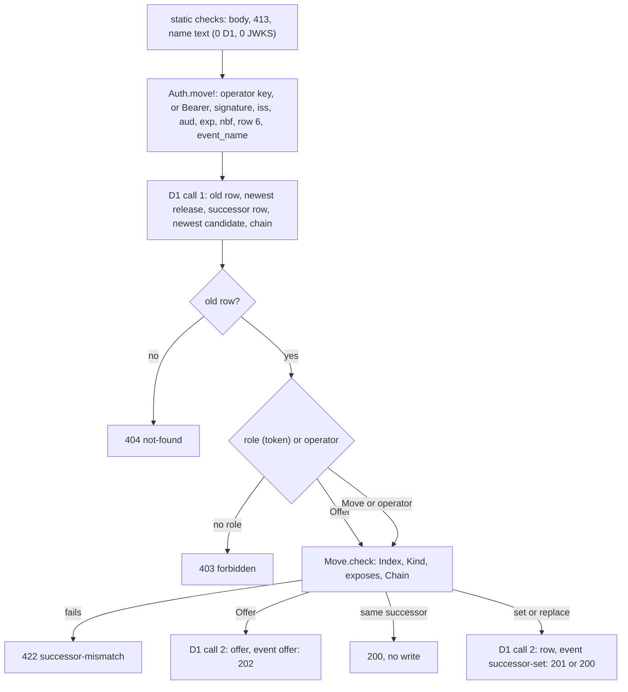

# 247 Move

Phase: P3 (registry). Status: review (scope and red tests, test agent, 2026-11-13). Model for the code: Sonnet high (PLAN C.3 row 132). Plan row: `docs/registry/PLAN.md` C.3, row 132. Shared slice number: 247 (yank is slice 246, in parallel).

This file is the only link between the test agent and the code agent (TW18). The code agent does not read `research/slice-247-revert/` (the private reference and the mutants). The code agent does not change a test or a fixture. A test that looks wrong is a dispute (section 8).

## 1. Scope and split

The move routes of the registry Worker: `PUT` and `DELETE /v1/packages/{owner}/{repo}/successor` (R-AP31), the token check and the role table (R-TP15), the successor link (R-TP14), the new column `repos.offer` (R-RE11), the events `successor-set`, `successor-removed` and `offer` (R-RE15, R-TP13), and the wire bodies and the problem detail in `packages/records` (for the later CLI, R-CM22, R-MV1 to R-MV5).

| Part | Who | State |
| --- | --- | --- |
| `packages/records/Move.roc`: types, request codec, problem detail (4 functions `crash "todo"`) | Test agent (signatures, doc), code agent (bodies) | Stubs |
| `worker/lib/Move.roc`: pure decisions (12 functions `crash "todo"`) | Test agent (signatures, doc), code agent (bodies) | Stubs |
| `worker/MoveRoutes.roc`: `put!` and `delete!` (`crash "todo"`), the flow is in the doc comment | Test agent (signatures), code agent (bodies) | Stubs |
| `worker/Auth.roc`: `move!` (`crash "todo"`) | Test agent (signature), code agent (body) | Stub |
| `worker/lib/Route.roc`: the 2 ids `PutSuccessor`, `DeleteSuccessor` (given). The line in `decide` and the line in `Client.is_write` | Test agent (ids), code agent (lines) | Ids given. Lines to do. |
| `worker/main.roc` (2 arms in `run!`, 1 import), `worker/lib/main.roc` and `packages/records/main.roc` (the exposes), the W0 drivers | Test agent | Done |
| `sql/0004_repo_offer.sql` (the column `repos.offer`) | Test agent (the schema is a fixture of the tests) | Done |
| Tests (section 4) | Test agent | Red (section 4.2) |

Split decision: no split. The private reference adds about 330 lines of Roc: `lib/Move.roc` 150, `MoveRoutes.roc` 190 (with the SQL), `records/Move.roc` 45, 25 lines in `Auth.roc`, `Route.roc` and `Client.roc` (TW19: about 400).

## 2. Rules

| Rule | Text (short) | Checked by |
| --- | --- | --- |
| R-AP31 | `PUT` sets the successor with `{name}`: 201 for a new successor, 200 for a changed one and 200 with no write for the same one. `DELETE` removes it: 200, and 200 with no write when there is none. The answer is the `repos` item. 404, 422 `successor-mismatch` | W0 `put_effect`, `put_status`, `delete_effect`. W2 `ap31-put-delete`, `ap31-errors`, `ap31-case-fold` |
| R-AP31 table | The checks of the successor: Index, Kind, `exposes`, Chain, in this order | W0 `check`. W2 `ap31-checks`, `tp15-operator` |
| R-AP21 | The problem `/errors/successor-mismatch` (422): the `detail` names the check and lists the missing modules | W0 `Move.detail`, `Move.check_of` (records), `Move.check`. W2 `ap31-checks` |
| R-TP15 | The token: R-TP3 rows 1 to 3 and 6, and `event_name` is `workflow_dispatch`, or the operator key | W0 `check_token`. W2 `tp15-refusals`, `tp15-operator` |
| R-TP15 table | The 4 roles: the successor repository of the same owner (done), the old repository when active (offer), the successor repository with an offer (done, offer cleared), any other (403). `DELETE`: the old repository, the successor, or the operator | W0 `put_role`, `delete_role`. W2 `tp15-refusals`, `tp15-offer`, `ap31-put-delete` |
| R-TP14 | A successor is a link from an old name to another name. It changes no release and no URL. The chain is walked up to 4 links | W0 `check` (the chain). W2 `ap31-put-delete` (reads and short name), `tp15-operator` |
| R-TP11 | A move sets the state `moved` | W0 `set_change`. W2 `ap31-put-delete`, `ap31-checks` |
| R-TP13, R-RE15 | Each change adds a `repo_events` row with the claims of the token (NULL for the operator): `successor-set` (6), `successor-removed` (7), `offer` (8) | W0 `set_change`. W2 `ap31-put-delete`, `tp15-offer`, `tp15-operator` |
| R-RE11 | The column `repos.offer` | W1 `s7-repo-offer`, `s1-tables`. W2 `tp15-offer` |
| R-AP32 | The answer of a move and of an offer is one item `{name, state, successor, state_at}` | records `Closure.encode_repo`. W2 `ap31-put-delete` (the reads after the move) |
| R-AP33, R-SN8 | A name in the state `moved` is replaced by the end of its chain in a short-name match | W2 `ap31-put-delete` request 4 |
| R-PU28, R-PU29 | The registry part: the reads show `moved` and the successor, a short name gives the successor. The client part is CLI (not in this slice) | W2 `ap31-put-delete` requests 3, 4, 6 |
| R-PU30 | The registry part: not testable. The wire has no member for a `transfer` or `recreate` event | Question Q247-12 |
| R-AP41 | At most 2 D1 calls. A refusal before the read has 0 | W2 `expect/d1-calls` of each case |
| R-AP45 | `MIN_TLN_WRITE` covers both methods of the route | W0 `ClientTest`. W2 `ap45-min-write` |
| R-AP46, R-AP51, R-AP48 | 256 KB, the body form, 404, 405, 415 | W2 `ap31-errors`. W0 `parse_body`, `RouteTest` |
| R-IK2 | The key of a name is the lower-case `owner/repo` | W0 `parse_name`. W2 `ap31-case-fold` |
| R-RE1, R-IK5 | `exposes` is a JSON list of module names. The newest release is the largest version | W0 `exposes_of`. W2 `ap31-checks` |

Design refs: Registry 4 (R-AP21, R-AP31, R-AP32, R-AP33, R-AP41, R-AP45, R-AP46, R-AP48, R-AP51), 5 (R-RE1, R-RE11, R-RE15), 7.1 (R-TP3, R-TP6), 7.3 (R-TP9 to R-TP15, R-TP18, R-TP19), 7.4 (R-PU28 to R-PU30), 8 (the security row "Move"), 4.3 (R-SN8). CLI: R-CM22, R-MV1 to R-MV5 (not in this slice). Design Q109, Q298.

## 3. What the code agent writes

### 3.1 The order of the checks (my reading, for the review; Q247-1)

The first check that fails gives the answer. The model is R-AP75 (the publish path).

| # | Check | Answer | D1 calls | Test |
| --- | --- | --- | --- | --- |
| 1 | The path and the method (R-AP48 rows 1, 2), the client version (R-AP45), the media type of a `PUT` body (R-AP23). `Route.decide`, `Client.check` | 404, 405 with `Allow: DELETE, PUT`, 400 `unsupported-client`, 415 | 0 | W0 `RouteTest`, `ClientTest`. W2 `ap31-errors`, `ap45-min-write` |
| 2 | `PUT`: the body is larger than 256 KB (R-AP46) | 413 `too-large`, `field` `body`, `limit` 262144 | 0 | W2 `ap31-errors` |
| 3 | `PUT`: the body does not decode (`Move.parse_body`) | 400 `bad-request` | 0 | W0 `parse_body`. W2 `ap31-errors` |
| 4 | `Auth.move!`: the `Authorization` header, the operator key, or the token (rows 1 to 3 of R-TP3), then `Move.check_token` | 401, 403, 502, 500 | 0 | W2 `tp15-refusals`, `tp15-operator` |
| 5 | D1 call 1, one read batch (3.3). No row for the old name | 404 `not-found` | 1 | W2 `ap31-errors` |
| 6 | The role (`Move.put_role` or `Move.delete_role`). The operator has no role table | 403 `forbidden` | 1 | W0. W2 `tp15-refusals`, `tp15-offer` |
| 7 | `PUT`: `Move.check` of the successor (also for an offer: Q247-7) | 422 `successor-mismatch` | 1 | W0 `check`. W2 `ap31-checks`, `tp15-operator` |
| 8 | The effect: `Same`: 200, no write. `Set`, `Replace`, `Remove`, `Offer`: D1 call 2 (3.4) | 200, 201, 202 | 1 or 2 | W2 |

All D1 calls of one request go to one session `with_session!(Primary)` (as R-AP75). No GitHub read. No D1 call before the token. A request with 2 faults is not in a test: the pairs are open (Q247-1). The W2 cases are made so that each request has one fault, and the JWKS is read before a body fault in the same case (`ap31-errors` request 1).

### 3.2 Public signatures (fixed, in the stubs)

| Module | Item | Rule |
| --- | --- | --- |
| `records.Move` | `Request : { name : Str }`, `Check : [Index, Kind, Exposes(List(Str)), Chain]` | R-AP31 |
| `records.Move` | `encode_request`, `decode_request` (`BadJson`) | R-AP31, R-AP51, R-AP44 |
| `records.Move` | `detail : Str, Check -> Str`, `check_of : Str -> Try({ name, check }, [NotACheck])` | R-AP21, R-AP31 |
| `Move` (worker) | `Name`, `Newest { kind, modules }`, `Old`, `Successor`, `Facts` | R-AP31 |
| `Move` | `parse_name : Str -> Try(Name, [BadName])` | R-IK2, R-AP31 check Index |
| `Move` | `parse_body : List(U8) -> Try(Str, Problem)` | R-AP31, R-AP51 |
| `Move` | `exposes_of : Str -> Try(List(Str), [BadExposes])` | R-RE1 |
| `Move` | `check_token : Oidc.Claims -> Try({}, Problem)` | R-TP15 |
| `Move` | `put_role`, `delete_role` | R-TP15 |
| `Move` | `put_effect`, `put_status`, `delete_effect` | R-AP31 |
| `Move` | `set_change : { row, successor, now } -> Identity.Change` | R-AP31, R-TP11, R-TP13 |
| `Move` | `check : Facts -> Try({}, Problem)` | R-AP31 |
| `Move` | `no_repo : Str -> Problem` | R-AP31 (404) |
| `Auth` | `move! : Request => Try([Operator, Token(Oidc.Claims)], Problem)` | R-TP15, R-YK2 |
| `MoveRoutes` | `put!`, `delete! : Request, Str, Str => Try(Response, IngestRoutes.Error)` | R-AP31 |
| `Route` | `Id` has `PutSuccessor(Str, Str)` and `DeleteSuccessor(Str, Str)` | R-AP31 |

`exposes` is a reserved word of Roc, so the field of `Move.Newest` is `modules`. A one-field record is a block: the private reference had to give each row type 2 fields.

The code agent also does these (no test can reach them before the code):

| Item | What |
| --- | --- |
| `Route.decide` | The line `["v1", "packages", owner, repo, "successor"]`: `PUT` is a route with a JSON body (the media check of `decide_post`), `DELETE` has no body check, another method is 405 with `Allow: DELETE, PUT` (the W0 and W2 tests fix it) |
| `Client.is_write` | `PutSuccessor` and `DeleteSuccessor` are writes (the W0 test and `ap45-min-write` fix it) |
| `wrangler.toml` | The secret `OPERATOR_KEY` is named in Registry 8 (R-WH14). Slice 246 gives the shared check. If it adds `Auth.operator`, `Auth.move!` calls it. The W2 cases give `OPERATOR_KEY` as a setting |

### 3.3 The read batch (D1 call 1)

One `batch!` on the primary. The statements (the private reference has this form; the code agent may write another form if the tests pass):

| # | Reads |
| --- | --- |
| 1 | The old row: the ids, the state, `state_at`, the name of the successor, the name of the offer (`names` joins) |
| 2 | The newest release of the old name: `artifacts.kind` and `artifacts.exposes` of the release with the largest `version` (R-IK5), the largest `log_index` for a tie. Yanked and withdrawn releases count |
| 3 | The successor row: state and `state_at` |
| 4 | The newest candidate of the successor: as 2, but `yanked = 0` and `withdrawn IS NULL` |
| 5 | The chain: a recursive CTE from the successor (R-AP41 rule 1). The start is on the walk, then each successor while the row is `moved`, fewer than 4 links (R-SN8) |

### 3.4 The write batch (D1 call 2)

| Effect | Statements, in this order |
| --- | --- |
| `Set`, `Replace` | `UPDATE repos`: the state `moved`, the successor, `state_at` = now, the offer cleared. Then the event `successor-set` with the claims text of `Publish.claims_json` (NULL for the operator): `seq` is the largest `seq` of the name plus 1, the ids before and after are the ids of the row, `successor` is the new successor. Last, the read of the answer item |
| `Offer` | `UPDATE repos SET offer`. The event `offer`. The read of the answer item. The state and `state_at` do not change |
| `Remove` | `UPDATE repos`: the successor cleared, `state_at` = now, the state (Q247-2). The event `successor-removed`. The read of the answer item |

The write batch makes the checks again (R-AP41 rule 3). What it answers when it finds a change is open (Q247-11).

## 4. Tests

### 4.1 Table

| Layer | Case | Checks | Rules |
| --- | --- | --- | --- |
| W0 records | `packages/records/tests/MoveTest.roc`, 14 `expect`s | `encode_request`, `decode_request` (good, case, unknown member, 9 bad bodies), the 4 `detail` texts, the `exposes` list, the round trip `check_of`, the texts that are not a check | R-AP31, R-AP21, R-AP51, R-AP44 |
| W0 | `worker/tests/unit/MoveTest.roc`, 82 `expect`s | `parse_name` (3 good, 19 bad), `parse_body` (the bad bodies, `it is not UTF-8`), `exposes_of`, `check_token` (public, private, internal, 4 event names, missing claims, the order), `put_role` (every row of the table, the case of the name, a state that is not active, an offer for another name, a missing claim), `delete_role`, `put_effect`, `put_status`, `delete_effect`, `set_change`, `check` (Index 4 ways, Kind 3 ways, `exposes` 5 ways, Chain 3 ways, the order, the 422), `no_repo` | R-AP31, R-TP15, R-TP14, R-TP11, R-TP13, R-AP51, R-IK2, R-RE1 |
| W0 | `RouteTest.roc` (16 `expect`s added), `ClientTest.roc` (1) | The ids, `PUT` with a JSON body, `DELETE` with no body check, 405 with `Allow: DELETE, PUT`, 404 for a wrong path, 415. `is_write` | R-AP31, R-AP48, R-AP23, R-AP45 |
| W1 | `sql/tests/cases/schema/s7-repo-offer` | The column `offer`: NULL, a 64-bit id, a text is an error, the event action 8. `s1-tables` has the column | R-RE11, R-RE15, R-IK2, R-IK8 |
| W2 | `move/ap31-put-delete` (8 requests, 4 db blocks) | `PUT` new 201 (2 D1 calls), the same again 200 (1 call, no event), the R-AP1 read shows `moved` and the successor, the short name gives the successor, `PUT` another successor 200, the read again with `no-cache`, `DELETE` by the successor 200 (2 calls), `DELETE` again by the old repository 200 (1 call). db: the rows, the events with the claims of the token that caused each one, the names unchanged | R-AP31, R-TP14, R-TP15, R-TP13, R-RE11, R-RE15, R-AP32, R-AP33, R-SN8, R-AP41, R-PU28, R-PU29 |
| W2 | `move/ap31-checks` (9 requests) | The 4 checks: Index (no row, missing, moved, only a yanked release, only a withdrawn release), Kind, `exposes` (the old name has a newest release by version that is not the last in the log), Kind before `exposes`, and the good successor at the end (the newest candidate is not the newest release, not the last in the log). db: only the last request writes | R-AP31, R-AP21, R-AP41, R-RE1, R-IK5, R-PU17, R-YK4 |
| W2 | `move/tp15-refusals` (13 requests) | Role: another owner id, another account, a repository of the same account, an old repository that is `moved`, `DELETE` by a stranger (2 forms). Claims: private, `push`. Token: none, Basic, no JWT, a changed signature, `DELETE` with none. db: no change | R-TP15, R-TP3, R-AP31, R-AP26, R-AP21, R-AP41 |
| W2 | `move/tp15-offer` (5 requests) | 403 for the other account; the offer by the old repository (202, 2 calls, the row is not changed); 2 refusals; the acceptance by the successor of another account (201, offer cleared). db: events 8 and 6 with their claims | R-TP15, R-AP31, R-RE11, R-RE15, R-TP13 |
| W2 | `move/tp15-operator` (7 requests) | The operator key: a move to the old name itself is Chain (422), a name that is not a name is Index (422), a move to another account is 201 (no JWKS read), the same 200, `Bearer` of another text is a token (401), `DELETE` 200 and 200. db: events with claims NULL | R-TP15, R-YK2, R-AP31, R-TP13, R-RE15, R-AP41 |
| W2 | `move/ap31-errors` (13 requests) | 404 for `PUT` and `DELETE`; 400 for 6 bodies and no body; 413; 415; 405 for `POST` and `GET`; 404 for a path with an extra part | R-AP31, R-AP21, R-AP46, R-AP51, R-AP48, R-AP41 |
| W2 | `move/ap45-min-write` (5 requests) | `MIN_TLN_WRITE`: `PUT` and `DELETE` with `tln/0.4.1` are 400 with `minimum`; `tln/0.5.0` and `curl/8` pass the check; the read is not a write | R-AP45, R-AP41 |
| W2 | `move/ap31-case-fold` (1 request) | The path, the body and the claim with other case: 201, the lower-case names, no new `names` row | R-AP31, R-IK2, R-AP56, R-TP15 |

`node worker/tests/tools/mk-move.mjs` writes the 8 cases. The ids, the version columns, the hashes and the recorded claims come from node (SHA-256, BigInt), not from the Roc code. `notes.txt` in each case names each request. The texts of the `detail` are in one table of `mk-move.mjs` (`T`).

Not tested (open or not reachable):

| Item | Why |
| --- | --- |
| The order of 2 faults (for example a bad body and a bad token) | Q247-1 |
| The state and the event columns after a `DELETE` and after an offer | Q247-2, Q247-8: the db blocks of those cases leave the columns out |
| An old name with no release, a `missing` old row | Q247-6, Q247-3 |
| Offer: a bad successor, the same offer twice | Q247-7, Q247-5 |
| The old repository of another account (an id that differs) | Q247-9 |
| A repeat of an accepted offer | Q247-10 |
| The race between the 2 D1 calls | Q247-11 |
| The cache drop | Q247-15 |
| R-PU30 | Q247-12 |
| Chain with more than one link | See finding F1: the check `Index` comes first, so the chain is a single name in each state that a row can have. W0 `check` has the 3-name chain |

### 4.2 Red results (2026-11-13)

| Step | Result |
| --- | --- |
| W0 records (`packages/records/tests/w0.roc`, worker compiler), `MoveTest` alone | 14 of 14 fail (`todo`). 0 compiler errors. The other modules are as before (the 21 failures of `YankTest` are slice 246) |
| W0 worker (`worker/tests/unit/w0.roc`), `MoveTest` | 82 of 82 fail with `todo`. 0 compiler errors |
| W0 worker, `RouteTest` | 12 of 16 new `expect`s fail (the route is not in `decide`: the other 4 expect a 404 and pass) |
| W0 worker, `ClientTest` | 1 of 1 fails |
| W1 `s7-repo-offer`, `s1-tables` (`node sql/tests/run.mjs`) | pass on node:sqlite and on D1 |
| W2 `move/*` (the build of the stubs) | 8 of 8 fail. Each request gives 404 `no route for PUT /v1/packages/...` where the case expects 201, 200, 202, 4xx. The route line of `decide` is for the code agent (3.2), so no stub is reached: the first `todo` trap shows after the line is there |

### 4.3 Shared files changed

| File | Change |
| --- | --- |
| `worker/main.roc` | `import MoveRoutes`; 2 arms in `run!` (`PutSuccessor`, `DeleteSuccessor`) |
| `worker/lib/main.roc` | `Move` in the exposes |
| `worker/lib/Route.roc` | the 2 ids at the end of `Id`, and one doc line |
| `worker/Auth.roc` | the stub `move!` at the end |
| `worker/tests/unit/w0.roc` | `import MoveTest` |
| `worker/tests/unit/RouteTest.roc`, `ClientTest.roc` | `expect`s added at the end |
| `packages/records/main.roc` | `Move` in the exposes |
| `packages/records/tests/w0.roc` | `import MoveTest` |
| `sql/0004_repo_offer.sql` | new: `ALTER TABLE repos ADD COLUMN offer INTEGER` (0003 is the yank table of slice 246) |
| `sql/tests/cases/schema/s1-tables/expect.tsv`, `rules` | 2 lines for `repos.offer` (the count 7 to 8, the column) and one line of notes |
| `sql/tests/cases/schema/s7-repo-offer/` | new W1 case |

New files: `packages/records/Move.roc`, `packages/records/tests/MoveTest.roc`, `worker/lib/Move.roc`, `worker/MoveRoutes.roc`, `worker/tests/unit/MoveTest.roc`, `worker/tests/tools/mk-move.mjs`, `worker/tests/cases/move/*`, `research/slice-247-revert/`.

### 4.4 Revert check (private reference)

`research/slice-247-revert/reference/` fills `records/Move.roc`, `worker/lib/Move.roc` and `worker/MoveRoutes.roc`. `research/slice-247-revert/patch.py` makes the changes of `Auth.roc`, `Route.roc` and `Client.roc` in a copy. `ref.sh [rec|w0|w2|all] [filter]` copies `worker/`, `packages/records` and `sql/` to `refbuild/`, puts the reference over it (`NOREF=1`: the stubs), and runs the tests. `MUTATE=mutations/<m>.py` changes the copy. `run-mutations.sh m1 m2 ...` runs each mutation filtered to the cases it affects, one at a time. The build is `--opt=speed`.

| Step (2026-11-13) | Result |
| --- | --- |
| Reference, records `MoveTest` (worker compiler) | 14 of 14 |
| Reference, W0 `MoveTest`, `RouteTest`, `ClientTest` (123 `expect`s of the 3 modules) | 123 of 123 |
| Reference, W2 `move/` | 8 of 8 |

| Mutation | What it changes | Caught by |
| --- | --- | --- |
| m1 | `exposes` is checked before Kind | W0 `check` (the order). W2 `ap31-checks` also has the case `chk/both` (the run of m1 was W0 only) |
| m2 | The newest release is the largest `log_index`, not the largest version | W2 `ap31-checks` |
| m3 | The newest candidate of the successor counts a yanked or a withdrawn release | W2 `ap31-checks` |
| m4 | The role row 1 does not compare the owner id (any successor token moves) | W2 `tp15-refusals`, `tp15-offer` |
| m5 | A move does not clear the offer | W2 `tp15-offer` |
| m6 | A `PUT` with the same successor is `Replace` (it writes an event and answers 200 with a write) | W2 `ap31-put-delete` (the 2 D1 calls and the event count) |
| m7 | `DELETE` is refused for the token of the successor | W2 `ap31-put-delete` |
| m8 | The events have the claims text `{}` in place of the claims of the token | W2 `ap31-put-delete`, `tp15-offer` |
| m9 | The check Chain is not done | W2 `tp15-operator` |
| m10 | `check_token` does not check `event_name` | W2 `tp15-refusals` |
| m11 | A move leaves the state `active` | W2 `ap31-put-delete` |

Caught 11 of 11. The first run of m8 did not compile (a type that was not resolved) and was run again after the fix. `run-mutations.sh` prints `SURVIVED` for m1: its run has no `pipefail` for the W0 pipe (fixed in `ref.sh` after it), and the log shows `1 failed`. The logs are `research/slice-247-revert/mut-<m>.log`. Keep the reference until the review is applied.

## 5. Output (proposed, TW24)

| Item | Proposal |
| --- | --- |
| Answer 200, 201, 202 | The `repos` item itself (R-AP32, `Closure.encode_repo`): `{"name","state","state_at","successor"}`, `content-type: application/json`, `cache-control: no-store`, `talon-bookmark`. Not `{"repos":[...]}`. `name` is lower case. The 202 answer of an offer is the item of the old name: it is not changed (the state, `successor` null) |
| 404 | `no package named <name> has a repos row` (`name` is the lower-case old name) |
| 400 (body) | `the move request body is not valid: <why>` (`it is not UTF-8`, or the `BadJson` text) |
| 413 | `the body of the move request is larger than its limit of 262144`, `field` `body`, `limit` 262144 |
| 403 (token) | `token claim repository_visibility is "<v>", expected "public"`, `token claim event_name is "<e>", expected "workflow_dispatch"` (`Oidc.claim_is`) |
| 403 (role, `PUT`) | the other repository: `token claim repository is "<r>": it is not <old> and it is not <name>`. The successor with another owner: `token claim repository_owner_id is "<id>": it is not the owner of <old>, and <old> has no offer for <name>`. The old repository that is not active: `token claim repository is "<r>": the old repository <old> is in the state <state>, an offer needs the state active`. A missing claim: `token claim repository is missing`, `token claim repository_owner_id is missing` |
| 403 (role, `DELETE`) | `token claim repository is "<r>": it is not <old> and it is not the successor of <old>`. With no successor: `token claim repository is "<r>": it is not <old>` |
| 422 | The 4 texts of `Move.detail` (`packages/records/Move.roc`): `the successor <name> fails the <Index\|Kind\|exposes\|Chain> check: <why>`. The `exposes` text lists the modules: `... does not expose the modules Encode, Decode` |
| Events | `successor-set`: the ids before and after are the ids of the row, `successor` is the new name. The claims are the 8 members of R-TP6 (the text of `Publish.claims_json`, Q298). NULL for the operator |
| Headers | `talon-bookmark` on each 200, 201 and 202. A problem answer has none (as Q165) |
| `data` of `tln move` | Not in this slice (CLI) |

## 6. Readings (the design is clear enough; the human can change them)

| # | Reading | Why |
| --- | --- | --- |
| R1 | A name of the body that is not `owner/repo` (no `/`, a space, an empty part) is not 400. It is the check `Index` (422) | The `Index` row: "is not a `github.com` name". 400 is for a body that does not decode (R-AP51) |
| R2 | 201 only when the old row had no successor. A `PUT` that names another successor is 200 | R-AP31: "sets a new successor 201, changes it 200" |
| R3 | The newest release of the old name is the release with the largest version, also a yanked or a withdrawn one. The newest candidate of the successor is the live release (not yanked, not withdrawn) with the largest version | The design says "newest release" for the old name and "newest candidate" for the successor. R-MX16 row 2 gives the order by version |
| R4 | The role is found by the claim `repository` (no case), against the name of the body (the successor) and the name of the path (the old name) | R-TP15 names "the successor repository" and "the old repository" |
| R5 | The operator has no role table. The checks of R-AP31 apply to it. Its events have the action of the change (6, 7) and no claims | R-TP12 gives the action `operator` for a binding by hand, not for a move |
| R6 | `state_at` is the time of the last change of `state` or `successor` (the doc of `Identity.Row`, slice 113), so a removal sets it | R-AP32 |
| R7 | The offer event has the ids of the old row before and after, as each event of R-TP13 | R-TP13 |
| R8 | A token of the old repository cannot set or change the successor when the old row is not `active` (it is `moved`). Only the successor repository, or the operator, can | The table says "(state `active`)" for the offer row. The test `tp15-refusals` request 4 has it |
| R9 | The old name is a name with a `repos` row. The row of a name that has no release is possible (a rename gives it). The tests have none | R-TP10 |

## 7. Questions (stop until answered)

Answered 2026-11-14: the user accepted all recommendations and readings and the texts of section 5 (Design Q626 (G-C256)). Q247-12 is in: the code adds `owner_changed` to the `repos` item (records `Closure.Repo`, R-AP32, R-PU30).

| # | Question | Why it is open | Recommendation and reason | Not tested until |
| --- | --- | --- | --- | --- |
| Q247-1 | The order of the checks for a request with 2 faults: the body (400, 413) against the token (401, 403), and the 404 against the role (403) | R-AP31 lists the errors, not their order | The order of 3.1: the static checks of the body first (as R-AP75, no D1 call and no JWKS read), then the token, then D1 call 1 (404), then the role, then the checks. Reason: the same as R-AP75 and R-AP48. The 404 comes before the role because the role needs the old row | A case with 2 faults |
| Q247-2 | What is the state of the old row after a `DELETE`, and what does the event `successor-removed` hold? | R-TP11 gives the states `active`, `missing`, `moved`. No rule gives the way back from `moved` | State `active` and `state_at` = now. The event has the ids of the row and the removed successor name in `successor`. Reason: the repository still exists. If the row was `moved` by a rename (R-TP10), the next reconcile reads by id (R-PU23) and marks it `moved` again by the rename rules. Else two rows of one repository are `active` for a short time | The `state` and the event `successor` after a `DELETE` |
| Q247-3 | A `PUT` for an old row in the state `missing` (the repository is deleted, and a successor repository of the same owner moves it): does the row become `moved`? | R-TP11 says "A rename or a move" gives `moved`. R-TP19 says a `missing` event for a `moved` row changes nothing | Yes: the row becomes `moved`, `state_at` = now, the releases keep their state. Reason: R-PU29 stops for the name that has no candidate and names the successor, so a `missing` name with a successor is the case that the design wants | A `missing` old row |
| Q247-4 | (Settled as reading R5. Listed so that the human sees it.) The action of the event of an operator move | R-RE15 has the action `operator` | See R5 | |
| Q247-5 | Is the offer cleared by every successful `PUT`, also one of row 1 (the successor of the same owner), and by a `DELETE`? Is a second offer for the same name idempotent (202, no new event)? | R-TP15 clears the offer only in row 3 | Clear it in each successful `PUT` and `DELETE`. A repeated offer is 202 with no write and no event. Reason: a stale offer would let the named repository take the name later | W0 `put_role` has `clear_offer` for row 3 only |
| Q247-6 | The old name has no release: do the checks Kind and `exposes` pass? | The table compares with "the newest release of the old name" | They pass (nothing to compare). The check Index still applies | W2 |
| Q247-7 | Do the checks of the successor run for an offer? | R-TP15 says "An offer: the row gets the offer. Nothing else changes." | Yes, all 4. Reason: the owner learns of a bad name at once, and the successor must pass them again when it accepts (the batch checks again). A name with no release then cannot get an offer | An offer for a bad successor |
| Q247-8 | Which `successor` does the event `offer` hold (the offered name), and the event `successor-removed` (the removed name, or NULL as the row after the event)? | R-TP13: "the successor" | `offer`: the offered name. `successor-removed`: the removed name. Reason: the log shows what was offered and what was removed | The `successor` column of both events |
| Q247-9 | The token of the old repository (the offer, `DELETE`) is found by the name of the claim `repository` only. R-TP15 takes the rows 1 to 3 and 6 of R-TP3, not row 5 (the ids). Must the ids of the token match the old row (R-TP9)? | A stranger can make the old name again on GitHub before the reconcile marks the row `missing` (R-PU23). Then it offers the old name to its own second repository, and accepts the offer | Yes: the claim `repository_id` or `repository_owner_id` must be the id of the old row, else 403 `repository-changed` with `issues_url` (R-TP12, as a publish). Reason: the same rule as the binding (R-TP9). The security row "Move" does not name it | The old repository of another account |
| Q247-10 | R-AP34 sends a `PUT` again after a lost answer. The first request of a successor of another account (an offer) clears the offer. The second request has no role: 403. | R-AP31: "Both are idempotent" | Before the role table: a `PUT` with a token of the successor name, when the row has this successor now, is 200 with no write. Reason: R-AP34 | A repeat of an accepted offer |
| Q247-11 | The write batch checks again (R-AP41 rule 3). What does a request answer when the successor is no longer active, or the old row changed, between the 2 calls? | No problem type is named | 422 `successor-mismatch` check `Index`, from the one extra D1 call that R-AP41 allows for an error detail | The race |
| Q247-12 | R-PU30 (a note after a `transfer` or `recreate`): which member of the registry answer tells the client? | The `repos` item of R-AP32 has `name`, `state`, `successor`, `state_at`. No wire member shows a `transfer` or a `recreate` event | A new optional member of the `repos` item, for example `owner_changed`: `null`, or `{ "action": "transfer" \| "recreate", "at": <ms> }` of the last such event. A design change of R-AP32 and `records` (`Closure.Repo`). Reason: the client needs the date only | R-PU30 (the whole registry part) |
| Q247-13 | Does a move drop cache entries (R-AP69 lists a publish, an ingest and a yank)? | The `repos` item of the old name is in the cached R-AP1 and R-AP13 answers | Drop the R-AP1 key of the old name (`<origin>/v1/packages/<old>/releases`) in `Response.after`. Reason: a user sees `moved` at once. The other keys keep their 60 s (R-AP69 "Not dropped") | The cache |

Findings (not questions):

| # | Finding |
| --- | --- |
| F1 | The check Chain can fire only for a successor equal to the old name (the old row is `active`, so the walk is one name). The check Index needs an `active` successor, and an `active` row has no successor (R-TP9 row 3 clears it, R-TP18 row 3). A chain from the successor that comes back is then not possible. The walk of 4 links is needed only for the read of R-SN8. The human can keep the check as a guard, or simplify it |
| F2 | The table of R-TP15 gives the old repository only an offer. A move by the owner of the old repository to a second repository of the same account needs the token of the successor repository (row 1), not of the old one |
| F3 | The test agent of slice 246 and this one both need the operator key (R-YK2). The W2 cases of this slice give the setting `OPERATOR_KEY` and a header `authorization: Bearer <key>` with no token. If slice 246 fixes another form, the cases `tp15-operator` change |

## 8. Out of scope, and disputes

| Item | Why |
| --- | --- |
| `tln move` (R-CM22, R-MV1 to R-MV5), `tln outdated`, `tln update`, `tln add` (R-PU28, R-PU29 client part) | CLI. The request, the problem detail and the answer item are in `records` for it |
| R-PU30 | Q247-12 |
| The cache drop, the race, the operator key secret in `wrangler.toml` | Q247-13, Q247-11, slice 246 |

Disputes (from the code agent): none.

Not done (by the order of the caller): Q247-12, the member `owner_changed` of the `repos` item (R-PU30, R-AP32). It is slice 247b.

## 9. Verify results

Code agent, 2026-11-14. Each job ran under `flock` and `systemd-run` with `MemoryMax=16G`.

| Step | Result |
| --- | --- |
| `w0` | The 566 worker tests and the 138 records tests pass (the 14 records `MoveTest`, the 82 worker `MoveTest`, `RouteTest`, `ClientTest` are in them). The step shows FAIL for 2 faults of other files: `roc fmt --check` of `packages/records/tests/YankTest.roc` (slice 246, a test file) and a parse fault in `worker/IngestRoutes.roc` line 310 (the yank agent was editing it; it was fixed later and the build passed) |
| `wbuild` | pass (98 s to 111 s, over the budget of 90 s) |
| `w2` | 205 of 205 pass, 8 of them are `move/*` |
| `wtrap` | pass |
| `w1` | pass (17 s, over the budget of 15 s) |
| fmt (worker compiler) of my files | valid: `worker/MoveRoutes.roc`, `worker/lib/Move.roc`, `worker/Auth.roc`, `worker/lib/Route.roc`, `worker/lib/Client.roc`, `packages/records/Move.roc` |

### Code notes

| Item | Note |
| --- | --- |
| Files | `packages/records/Move.roc`, `worker/lib/Move.roc`, `worker/MoveRoutes.roc`, `Auth.move!`, `Route.decide_successor` and its line in `decide`, the line of `Client.is_write` |
| Operator key | `Auth.move!` uses `Auth.operator_match!` of slice 246 (`Match` is the operator, `NoMatch` and `NoKey` are a token). No second helper |
| Q247-1 | The order of 3.1 is the order of the code |
| Q247-5 | Every successful `PUT` and `DELETE` clears the offer. A second offer for the same name is 202 with no write and no event |
| Q247-7 | `Move.check` runs for an offer before the offer is written |
| Q247-9 | A token of the old repository (an offer, a `DELETE`) must have `repository_id` or `repository_owner_id` of the old row, else 403 `repository-changed` with `issues_url` (`MoveRoutes.old_ids!`). A W2 case has no such token, so this is not tested |
| Q247-10 | A `PUT` with the token of the successor, when the row has this successor now, skips the role table: 200, no write |
| Q247-11 | The first statement of the write batch is guarded by `state_at`, the old successor and the state of the successor. No changed row gives 422 `successor-mismatch` Index (no extra D1 call). Not tested |
| Q247-2, Q247-8 | `DELETE`: state `active`, `state_at` = now. The event `successor-removed` and the event `offer` have the removed and the offered name in `successor` |
| Q247-13 | After a write, `Response.after` drops the key `<origin>/v1/packages/<old>/releases`. Not tested |
| Q247-3, Q247-6 | A `missing` old row becomes `moved` (`Move.set_change`). An old name with no release passes Kind and `exposes` |
| Chain | The walk is a recursive CTE with `UNION` and a depth below 3, so it has at most 4 names. No dedupe in Roc (F1: only the old name can come back) |

## 247b. The member `owner_changed` and the tests of accepted behaviors

Test agent, 2026-11-14. Design Q626: the user accepted all readings and recommendations of slice 247. TW18: stubs and red tests only, no code.

### 247b.1 Scope

| Part | What |
| --- | --- |
| 1 | The member `owner_changed` of the `repos` item (R-AP32, R-PU30): `null`, or `{"action":"transfer"\|"recreate","at":<ms>}`. It is in `Closure.Repo` and in every answer that has `repos`: R-AP1, R-AP2, R-AP13, R-AP14, R-AP17 and the answer of a move |
| 2 | Tests of accepted behaviors that are green now: Q247-9, Q247-11, Q247-13 |

Rules: R-AP32, R-PU30, R-AP41 (no D1 call more), R-TP9 and R-TP13 (the events), R-AP51 (the writer writes `null`), R-AP44 (the reader ignores an unknown member), R-TP15, R-AP31, R-AP69 (the cache).

### 247b.2 Readings (decided here, for the human review)

| No. | Reading | Reason |
| --- | --- | --- |
| 1 | The writer always writes the member (`null` for none). The reader takes a missing member as none | R-AP51 (null, not missing). An answer of an older Worker still reads (R-AP44) |
| 2 | The value is the LAST event (the largest `seq`) of the repo whose action is 1 (transfer) or 3 (recreate). The events of other actions do not hide it (a later `found`, a move event) | R-PU30 says "transfer or made again". A note is only useful when it stays after a later event |
| 3 | `at` is `repo_events.time` of that event, in milliseconds (R-AP50) | The only time that the event has |
| 4 | The value comes from a sub-select in the statement that already reads the `repos` row. No D1 call more | R-AP41: the 2 reads of a move, the 1 read of the routes |
| 5 | The answer of a move shows the value that the row had BEFORE the move (the move event has the action 6, 7 or 8 and does not change it) | Same as reading 2 |
| 6 | The fields of the existing exact-body W2 cases and of the records and worker fixtures change: `"owner_changed":null` is in each `repos` item | Reading 1 |

### 247b.3 The stubs

| File | Stub |
| --- | --- |
| `packages/records/Closure.roc` | `Repo` has `owner_changed : Try(OwnerChanged, [None])`. New types `OwnerChanged`, `OwnerChangedWire`. Stubs `owner_changed_to_wire` and `owner_changed_from_wire` (`crash "todo"`). The plumbing for the `null` case is done: the answer encodes and decodes the member `null` and a missing member |
| `worker/lib/Reads.roc` | `RepoRow` has `owner_action` and `owner_at`. Stub `owner_changed_of`. `repo_item_of_row` has the placeholder `Err(None)` |
| `worker/ReadRoutes.roc` | `RepoCheckRow` has `owner_action`, `owner_at` and passes them to `repo_item_of_row` (the SQL has no such column yet: the code agent adds the sub-selects) |
| `worker/MoveRoutes.roc` | Placeholders `owner_changed: Err(None)` in `item_of` and in the item of `written!` |

The code agent must: add the sub-selects to `ReadRoutes.repos_sql`, `worker/sql/closure/repos.sql`, `MoveRoutes.old_sql` and `MoveRoutes.item_sql`; fill the 3 stubs; use `owner_changed_of` in the 3 places.

### 247b.4 The tests

| Layer | Test | Rules | Checks |
| --- | --- | --- | --- |
| W0 records | `packages/records/tests/OwnerChangedTest.roc` (10 expects) | R-AP32, R-PU30, R-AP51, R-AP44 | encode of none, transfer, recreate; round trip; decode of an older answer with no member, of `null`, of an unknown inner member; a bad action is `BadJson`; the closure answer and the Index answer round trip |
| W0 records | `WireTest`, `AnswerTest` (fixtures) | R-AP32 | the fixtures carry `"owner_changed":null` |
| W0 worker | `ReadsTest`: `owner_changed_of` (none, transfer, recreate, bad rows), `repo_item_of_row` with an action | R-PU30 | the pure part |
| W0 worker | `ClosureQueryTest`: rows with `owner_action: 3` give `Recreate` | R-AP17, R-PU30 | the closure maps the row |
| W2 | `move/pu30-reads` (7 requests, 1 D1 call each) | R-PU30, R-AP32, R-AP1, R-AP2, R-AP13, R-AP14, R-AP17, R-AP41 | acme/lib has transfer, recreate, found: the recreate; acme/two has recreate then transfer: the transfer; acme/none: `null` (present, not missing) |
| W2 | `move/pu30-move-answer` (4 requests) | R-PU30, R-AP31 | the 201, 200, DELETE and 202 answers carry the value of before the move (reading 5) |
| W2 | `move/pu30-real-events` (copy of `identity/tp9-four-rows` and 3 reads) | R-TP9, R-TP13, R-PU30 | a real transfer, a real recreate and the same ids: `transfer`, `recreate`, `null`, with the clock of the publish |
| W2 | 8 `reads/*` cases and `closure/ap17-answer` (exact bodies) | R-AP32, R-AP24 | `"owner_changed":null` in each `repos` item; the etags changed with the bodies |
| W2 | `move/tp15-old-ids` (4 requests) | Q247-9, R-TP15, R-TP9 | a token of the old name with no id equal to the row ids: 403 `repository-changed`, the title, the detail with the bound repository id, `issues_url`, 1 D1 call, for an offer and for a `DELETE` of a moved name. A token with one id equal (the owner id, or the repository id) is accepted: 202 |
| W2 | `move/ap31-cache-drop` | Q247-13, R-AP69, R-AP1 | read (cached), the same read (no D1 call), the move, `wait_ms`, the read again: `moved` with the successor |
| W1 | `triggers/t4-move-guard` | Q247-11, R-AP41, R-RE15 | the guarded UPDATE and the event of one batch: a late writer changes 0 rows and writes no event (`state_at` or successor changed; the successor not active); a writer with the values that it read changes 1 row |

The W2 runner has a hook only on the fetches of GitHub. It cannot write between the 2 D1 calls of one request. So Q247-11 is tested in W1 with a COPY of the guarded statements (the case file says so). The W0 mapping of 0 changed rows to 422 Index is in the 247 tests.

### 247b.5 Results

| Run | Result |
| --- | --- |
| Records W0 (real tree, stubs) | 148 tests, 141 pass, 7 fail with `todo` (all in `OwnerChangedTest`), 0 compiler errors |
| Worker W0 (real tree, stubs) | 571 tests, 565 pass, 6 fail (1 `ClosureQueryTest`, 5 `ReadsTest`), 0 compiler errors |
| W2, stubs (`move/`, `reads/`, `closure/ap17`, `identity/tp9`) | 27 cases: 24 pass, 3 red: `move/pu30-reads`, `move/pu30-move-answer`, `move/pu30-real-events`. The exact-body cases pass with the placeholder (`null`): they guard the format, not the value |
| W1 `t4-move-guard` | pass on sqlite and on D1 |
| Q247-9 `tp15-old-ids`, Q247-13 `ap31-cache-drop` | green on the code of slice 247 (no finding) |
| Private reference (`research/slice-247-revert/mutations/ref247b.py`, a patch of the copy, not in the tree) | records W0 64 of 64, worker W0 163 of 163 (`MoveTest`, `RouteTest`, `ClientTest`, `ReadsTest`, `ClosureQueryTest`), W2 27 of 27 (after 3 etags of 304 answers were corrected) |
| Revert check (filtered) | m12 (the FIRST event, not the last): `pu30-reads` fails. m13 (a move event hides the transfer): `pu30-move-answer` fails. m14 (an unknown action reads as recreate): records W0 fails. m15 (no cache drop): `ap31-cache-drop` fails. m16 (the old-ids check always passes): `tp15-old-ids` fails |

### 247b.6 Findings and questions

| No. | Text |
| --- | --- |
| F1 | No red result for Q247-9, Q247-11, Q247-13: the code of slice 247 does these |
| F2 | Before 247b, no test checked the cache drop of Q247-13 (the code agent noted "Not tested"). `ap31-cache-drop` is the first |
| Q1 | None. Readings 1 to 6 are for the review (TW24: the wire form of the output is a proposal) |

### 247b.7 Code agent: notes, disputes and verify results (2026-11-14)

Code notes:

| Item | Note |
| --- | --- |
| Sub-selects | The 2 columns `owner_action` and `owner_at` are 2 sub-selects of `repo_events` (`action IN (1, 3)`, `ORDER BY seq DESC LIMIT 1`). They are in `ReadRoutes.repos_sql`, `worker/sql/closure/repos.sql`, `MoveRoutes.old_sql` and `MoveRoutes.item_sql`. No D1 call more |
| Records | `Closure.owner_changed_to_wire` and `owner_changed_from_wire` are filled. The types are not changed. `owner_to_wire` and `owner_from_wire` were not stubs |
| Worker | `Reads.owner_changed_of` is filled (none, transfer 1, recreate 3; one column only, or another action, is `BadRow`). `Reads.repo_item_of_row` and `MoveRoutes` use it. `MoveRoutes.read_old` reads the value, so a 200 or 202 answer with no write shows the value of the old row |

Dispute (W1, a test that I may not change): `sql/tests/cases/closure/c2-closure-cte` (`test.mjs`, `requests.json`) compares the rows of `worker/sql/closure/repos.sql` with the exact columns `name, state, successor, state_at`. The 247b task needs the 2 columns `owner_action` and `owner_at` in that file (R-PU30 for R-AP17, tested by W2 `move/pu30-reads`). So `c2-closure-cte` fails on sqlite and D1 with the 2 extra members (value `null` in each row). The expected rows of `requests.json` (statement `repos`) need `"owner_action":null,"owner_at":null` in each row. Test agent: please change the fixture.

Verify results (each job under `flock` and the 16G cap):

| Step | Result |
| --- | --- |
| `w0` | pass (6.7 s) |
| `w1` | 57 pass, 2 fail: only `closure/c2-closure-cte` (sqlite and D1), the dispute above. `t4-move-guard` passes |
| `wbuild`, `w2`, `wtrap` | pass (w2 includes `pu30-reads`, `pu30-move-answer`, `pu30-real-events`, `tp15-old-ids`, `ap31-cache-drop`) |
| fmt check, `packages/records/Closure.roc` | valid with both compilers ($ROC and the worker compiler) |
| fmt check, `worker/lib/Reads.roc`, `worker/MoveRoutes.roc`, `worker/ReadRoutes.roc` | valid with the worker compiler |

Dispute resolved (test agent, 2026-11-14): agreed. R-PU30 needs the 2 columns in `worker/sql/closure/repos.sql`, so `closure/c2-closure-cte` must expect them. The fixture `requests.json` (statement `repos`) has `"owner_action":null,"owner_at":null` in each of its 2 rows (the case has no event of action 1 or 3). No other file changed.
