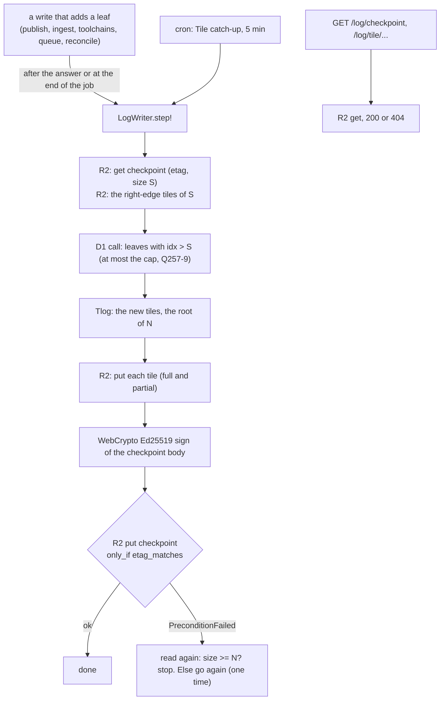

# 257 Log tiles and log routes

Phase: P3 (started in P2 on the user's order, 2026-11-19). Status: 257a tests red, human review (2026-11-19); 257b tests red, human review (2026-11-19, section 3.4, open Q257-17, Q257-18); 257c tests red, human review (2026-11-19, section 3.6, open Q257-23, Q257-24); 257e done (key tool, deploy notes, bench notes; no deploy); 257d tests red, human review (2026-11-19, section 3.5, Q257-19 to Q257-22 answered). Design question id: Q636. Plan id: G-C266 (reserved). Plan row: `docs/registry/PLAN.md` C.3, row 130, and gap G1 (section D). Model for the code: Opus medium (plan row 130).
Depends on slices 102 and 103 (the table `log`, the leaf triggers), 112 and 114 (the leaf statement of a publish and an ingest, R-SG8), 109 (the compiler leaves), 118 and 119b (the queue consumer, the reconcile cron), 120 (the cron dispatch with `Worker.cron`), 106 (the read routes, the Cache API, R-AP43).

Section 7 is answered by the user 2026-11-19: all recommendations accepted (Design Q636).

## 1. Scope and split

P2 writes the log leaves in D1 only (R-SG2, R-SG3, R-SG5, R-SG8). This slice adds the P3 part of the log (Design Q55):

| Part | Rule | Today |
| --- | --- | --- |
| The tiles in R2, in the C2SP tlog-tiles layout | R-SG4 | Nothing. No R2 binding. |
| The signed checkpoint (C2SP tlog-checkpoint, signed note) | R-SG4, R-SE2 | Nothing. The key, its algorithm and its setting name are not in the design (R-SG4, R-WH14 row "The log signing key": "Not named"). |
| The tile writer: one idempotent step, after a write and from the cron "Tile catch-up" | R-SG7, R-PU35, R-PU36, Design Q26 | Nothing. `scheduled!` is `crash "todo"` (`worker/main.roc:166-167`). |
| The R2 step of the publish diagram | R-PU1 | Not done (slice 114: "R-PU1 without the R2 step, G1") |
| The read routes `GET /log/checkpoint`, `GET /log/tile/...` | R-AP11, R-AP23 | No route. `Route.decide` knows only `/v1/...` paths (`worker/lib/Route.roc:37` and on). |

Split proposal (TW19: about 400 lines of code or less for each part; one test agent and one code agent for each):

| Sub-slice | Contents | Layers | Code (estimate) | Blocked by |
| --- | --- | --- | --- | --- |
| 257a Log math | Pure functions in `packages/records/Tlog.roc` (Q257-14, Design Q636 (14)): the entry bytes of a leaf, the leaf hash and the node hash (RFC 6962), the tile path text (`x001/234`, `.p/<W>`), the tiles that a growth from size S to size N writes, the hashes of each tile, the root hash of size N from the tiles, the entry bundle bytes, the checkpoint body text, the signed note text (the key id and the signature line, with the signature as an input), the parse of a checkpoint (size, root) and of a key text. No effect. | W0 only, with fixed vectors from an independent tool (`node` with `crypto`, or Go `golang.org/x/mod/sumdb/tlog` and `note`) | 250 to 350 | Q257-1 to Q257-6 |
| 257b The tile writer | `worker/LogWriter.roc`: `step! : ... => Try(...)`: R-SG7 rows 1 to 5: read the checkpoint (etag) and the right-edge tiles from R2, read the leaves above S from D1 (one call), write the tiles, sign, write the checkpoint with `only_if: { etag_matches }` (or `R2.absent` for the first one). The binding `LOG` in `main.roc` and `wrangler.toml`, the secret `LOG_KEY` (Q257-2). The W2 runner gets an R2 seed and an R2 expect (keys and bytes) and an R2 fault hook in `hooks.js`. | W0 (the plan of a step), W2 (cron lines, `copies` for R-PU36) | 250 to 350, plus the runner | 257a, Q257-7 to Q257-11 |
| 257c The triggers of the step | The step after each write that adds a leaf (Q257-8): publish and ingest (`Response.after`), `PUT /v1/toolchains/{tag}` (`Response.after`), the index queue consumer and the reconcile run (in the job), and the cron "Tile catch-up" (Q257-9). The R-PU1 diagram step. | W2 (a publish then the R2 state; a fault after the tiles then a cron line repairs it) | 80 to 150 | 257b |
| 257d The read routes | `GET /log/checkpoint`, `GET /log/tile/<L>/<N>[.p/<W>]`, `GET /log/tile/entries/<N>[.p/<W>]` (R-AP11): the path grammar (pure, W0), `R2.respond!` or `R2.get!` with the media type of R-AP23, the cache headers of R-AP11, 404 `not-found`, 405, the Cache API (Q257-12). | W0 (`Route.decide` of the paths), W2 (seeded R2 objects) | 120 to 200 | 257a (the path grammar), Q257-12, Q257-13 |
| 257e Key setup and deploy note (no code test) | `research/log-key/`: a node script that makes the key text and the verifier key text (Q257-2). The R-WH14 rows. The bench bucket. The deploy is the lead's work, not this slice's. | None (a script result in `RESULT.md`) | 40 | Q257-2, Q257-10 |

Order: 257a, then 257b and 257d in parallel (they share only `Tlog.roc`), then 257c, then 257e before the first deploy. The backfill of the leaves that prod D1 has today is the first run of the step (Q257-11): no own sub-slice.



## 2. Rules

### 2.1 The rules of this slice (text today, short)

| Rule | Where | Text today (short) | Phase | Sub-slice |
| --- | --- | --- | --- | --- |
| R-SG2 | Registry 3 (`DESIGN-REGISTRY.md:46`) | Leaves `(index, group, version, hash, time)`: a D1 table, written in the publish transaction | P2 (done). This slice reads it. | 257a (the entry bytes), 257b |
| R-SG3 | Registry 3 (`:47`) | Compiler leaves: the same table and form, group `roc-lang/nightlies:<target>`, version the tag, hash `sha256:<hex>` | P2 (done). Read. | 257a |
| R-SG4 | Registry 3 (`:48`) | "Tiles and signed checkpoint (P3, Design Q55): R2, write-once objects (C2SP tlog-tiles layout). [...] The signing key, its algorithm and its setting name are given when P3 starts." | **P3** | 257a, 257b, 257e |
| R-SG5 | Registry 3 (`:49`) | Sequencing: the D1 transaction (`index = max + 1`) | P2 (done). Read: the tlog index (Q257-4). | 257a |
| R-SG6 | Registry 3 (`:51`) | KV is not used. Package bytes on R2 stay a phase 3 option. | Not this slice (the mirror is plan row 133) | |
| R-SG7 | Registry 3 (`:53-63`) | The tile writer: one idempotent step "build the tiles and sign up to the largest leaf index in D1", after each publish (`Response.after`, R-PU1) and from the cron "Tile catch-up" (R-PU35). Rows 1 to 5: read S and the etag, and the leaves above S "in one D1 call"; tiles first, then the checkpoint; a tile is a function of the leaves, each partial width has its own path; the checkpoint `put` with `onlyIf: { etagMatches }`, only to a larger size, read again on a changed etag; a failed step leaves the work due. Tests: 2 publishes at the same time give one checkpoint with both leaves; a stop after the tiles is repaired by the next catch-up; a `put` with an old etag does not write. Revert: a plain `put` lets the smaller size win. | **P3** | 257b, 257c |
| R-SG8 | Registry 3 (`:65-79`) | The Worker computes the leaf text. "[...] the tile writer (R-SG7) hashes the text columns as they are, with no read of an id." | P2 (done). The sentence on the tile writer is P3. | 257a (Q257-3) |
| R-AP11 | Registry 4 (`:103`) | `GET /log/checkpoint`, `GET /log/tile/...` (hash tiles, entry tiles and partial tiles, C2SP tlog-tiles layout). P3. From R2. 200. 404 `not-found`. Checkpoint `max-age=5` ("first guess, tune in P2"). Tiles, also partial: `max-age=31536000, immutable`. | **P3** | 257d |
| R-AP23 | Registry 4 (`:244`) | The checkpoint is `text/plain; charset=utf-8`, the tiles are `application/octet-stream`, as C2SP tlog-tiles gives | P2 text, used in P3 | 257d |
| R-PU1 | Registry 7 (`:1328-1345`) | The publish diagram: "W->>R: write new tiles, sign checkpoint (P3, R-SG7)", drawn after the D1 transaction and before the cache drop and the answer | **P3** (the R2 step only) | 257c (G-L1) |
| R-PU35 | Registry 7 (`:1520`) | Job "Tile catch-up", P3: cron 5 min; due when the largest leaf index in D1 is larger than the checkpoint size; unit: the tiles and the checkpoint; on a failure the next run tries again | **P3** (the row) | 257c |
| R-PU36 | Registry 7 (`:1532`) | Tile catch-up (P3): safe for 2 runs at once by the R2 compare and swap on the etag, only to a larger size | **P3** (the row) | 257b |
| R-WH14 | Registry 8 (`:1876`, `:1878`) | "The log signing key: Secret, P3, R-SG4, R-SG7, Not named (Design Q55)". "`LOG`: R2, the tiles and the checkpoint (P3). P2 does not use it. Proposal." Cron triggers: "Every 5 min (R-PU23) and once a day" | **P3** (2 rows) | 257b, 257e |
| R-SE2 | Design 8 (`DESIGN.md:572`) | "Registry maps a label to a bad hash for some users: Append-only log with signed checkpoints and inclusion proofs (P3). The header keeps the hash [...]" | **P3**. The registry part only (tiles and checkpoint). The proof check is the client's. | 257a, 257b |
| R-IK1 | Registry 5.1 (`:873`) | The log and the tiles keep the text forms (base58, URL form, `X.Y.Z`, the tag) | P2 text, used | 257a |
| R-IK6 | Registry 5.1 (`:975`) | A release is named by its `log_index`; it never changes | P2. Read: the tlog index is `log_index - 1` (Q257-4) | 257a |
| R-RE5, R-RE6 | Registry 5 (`:829`) | The table `log`: index, group, version, hash as text, time. Rows are only added | P2. The step relies on it (R-SG7 row 3). | 257b |
| R-AP41 | Registry 4 (`:717`) | "Work after the answer (`Response.after`, R-SG7) and in a queue consumer: not counted. One batch for each step where it can." | P2 text, used | 257b, 257c |
| R-AP43 | Registry 4 (`:248`) | The Worker keeps the answers of the `GET` routes in the Cache API of its colo for their `max-age` | P2. Does it cover `/log/`? (Q257-12) | 257d |
| R-AP48 | Registry 4 | The order of the checks: path, method, client, ... | P2. The `/log/` paths get rows 1 and 2 only (Q257-13) | 257d |
| Design 7 P3 | `DESIGN.md:539` | "Log tiles in R2, signed checkpoints [...]". Exit: "Client checks inclusion proofs." | **P3** | All |
| Design 2 table | `DESIGN.md:112` | "C2SP tlog-tiles, Sunlight: an append-only Merkle log served as static tiles from object storage. Log leaves in D1, tiles in R2 (Registry 3)." | Background | |
| Design Q26, Q55, Q63 | `DESIGN.md:653`, `:663`, `:671` | Q26: the step, tiles first, the conditional `put`. Q55: P3, "The signing key, its algorithm and its setting name are given when P3 starts." Q63: the binding `LOG` (R2, P3) is a proposal. | Decided, used | |
| R-MX7 | Registry 6 (`:1014`) | "The log entry tiles (R-AP11) give the same leaves, so the bot can also read them." | P2 text. Informative: the entry bundles must hold the leaf text (Q257-3) | 257a |
| Resolution R-DT5, CLI R-FL9 | `DESIGN-RESOLUTION.md:671`, `DESIGN-CLI.md:62` | `log:N`, `log_size` | P2. `log_size` must be the tree size of the checkpoint (Q257-4) | 257a |

### 2.2 The platform (cloudflare-workers 0.0.10, `worker/main.roc:6`)

| Need | Platform API | Source |
| --- | --- | --- |
| R2 read with the etag | `R2.get!`, `R2.head!` give `R2.Meta` with `etag`, `http_etag` | `cloudflare-workers/MODULES.md` 5.3 (`:992-1019`) |
| R2 compare and swap | `R2.put_with!(bucket, key, body, { only_if: { etag_matches: old } })`; a failed condition is `Err(PreconditionFailed)`. `R2.absent` writes only a new key (`etagDoesNotMatch: "*"`, from the workerd source) | `MODULES.md:998`, `:1025`, `:1032` |
| R2 answer of a route | `R2.to_response(obj)` (200, HTTP metadata, etag) and `R2.respond!(bucket, key, req)` (the conditional headers) | `MODULES.md:995`, `:1036` |
| Many tile writes at once | `Io.all!` (one crossing, "R2 tiles, cache reads") | `cloudflare-workers/API.md:422` |
| Ed25519 sign | `WebCrypto.sign!({ alg: Ed25519, key, data })`; keys as data: `Jwk(text)`, `Pkcs8(bytes)`; `import_key!` once for many signs; `export_key!` of an imported key | `MODULES.md:1481-1530`, `:1552` |
| SHA-256 | Builtin `Crypto.SHA256.hash` (pure, in wasm). `WebCrypto.sha256!` uses it below 4,096 bytes | `MODULES.md:1491`, Roc builtins |
| Cron | `Worker.cron(expr, run!)`: one handler for each expression. A run of another expression goes to `scheduled!` | `MODULES.md:302`, `:404` |
| Work after the answer | `Response.after(work!)`: 30 s after the body is complete. A cron or a queue task: 15 min. `after` in a cron or a queue handler is a type error | `API.md` 10.2 (`:688-735`) |
| The platform audit | RN4: "Log tiles and the signed checkpoint: R2 `get`, `put` with `onlyIf`. WebCrypto Ed25519 `sign`. The key is a secret." RN11: tile catch-up by a cron. RF2, RF3: the race and the failure after the D1 commit | `API.md:25`, `:32`, `:50-51` |

### 2.3 The code today

| Item | State | Source |
| --- | --- | --- |
| Table `log` | `idx INTEGER PRIMARY KEY, grp TEXT, version TEXT, hash TEXT, time INTEGER`, `STRICT`. No column for the tiles. | `sql/0001_init.sql:84-91` |
| Leaf checks | The triggers `releases_leaf_check`, `toolchains_leaf_check` (`AFTER INSERT`, `leaf-missing`) | `sql/0002_triggers.sql:17-31` |
| Leaf of a release | `Ingest` plan: `leaf: { grp: t.form, version: t.version.to_str(), hash: t.hash, time: input.now_ms }`. Publish uses the same code. | `worker/lib/Ingest.roc:258-323`, `worker/lib/Publish.roc:4`, the batch in `worker/IngestRoutes.roc:568` and on |
| Leaf of a compiler asset | `Toolchains.leaf_of`: `grp: "roc-lang/nightlies:<target>"`, `version: tag`, `hash: "sha256:<hex>"` | `worker/lib/Toolchains.roc:192-199`, the statement `worker/ToolchainRoutes.roc:116` |
| Paths that write a leaf | Publish (`PublishRoutes`), ingest (`IngestRoutes`), the index queue consumer (`IndexQueue`, the webhook path), the reconcile (`ReconcileCron`, through the queue or at once), `PUT /v1/toolchains/{tag}` (`ToolchainRoutes`). Each in one D1 batch. | `worker/*.roc` |
| `Response.after` today | The cache drop of ingest, publish, yank, move | `worker/IngestRoutes.roc:148-163`, `worker/YankRoutes.roc:194-210`, `worker/MoveRoutes.roc:372` |
| R2 | No binding in `main.roc` (`bindings: [db, 3 limiters, INDEX]`, `worker/main.roc` last lines) and none in `wrangler.toml` (the comment "R2 `LOG` (the log tiles, P3, slice 130)" is a plan) | `worker/wrangler.toml` |
| Crons | `crons = ["0 3 * * *", "*/5 * * * *"]`; `Worker.cron(Daily.cron, ...)`, `Worker.cron(Reconcile.cron, ...)`. `scheduled!` (other crons) is `crash "todo"`. The bench config has no crons. | `worker/wrangler.toml` (end), `worker/main.roc:166-167`, `worker/wrangler.bench.toml:2` |
| Routes | No `/log/` path in `Route.decide` | `worker/lib/Route.roc:37` and on |
| W2 runner | Cron lines (`{"cron", "time", "now"}`), `copies` for runs at the same time (R-PU36), `hooks.js` `wrapEnv` for a fault of a binding (today `INDEX`). No R2 seed and no R2 expect. | `worker/tests/run.mjs:11`, `:55`, `:71`, `:285-307`; `worker/tests/hooks.js` |
| Tests that name R-SG | R-SG3, R-SG8 only (W0 `ToolchainsTest`, `IngestTest`; W2 toolchains, publish, ingest, webhook cases). No test names R-SG4, R-SG7, R-AP11. | `worker/tests/` |

## 3. What the code agent writes (proposal, after the answers)

### 3.1 The formats (from the C2SP specs, as I know them; check against the spec text)

The scope agent wrote this section from memory. The test agent of 257a read the spec text on 2026-11-19 and corrected it (section 3.1.1). The column "Check" gives the result.

| Item | Form | Check |
| --- | --- | --- |
| Leaf hash | `SHA-256(0x00 ‖ entry bytes)` (RFC 6962) | |
| Node hash | `SHA-256(0x01 ‖ left ‖ right)` (RFC 6962) | |
| Tree hash of a size that is not a power of 2 | RFC 6962 MTH: split at the largest power of 2 that is smaller than the size | |
| Tile height | 8: a tile has at most 256 hashes. A tile at level L holds the hashes of subtrees of 256^L leaves | Fixed by tlog-tiles, not a choice |
| Hash tile path | `tile/<L>/<N>`; N in groups of 3 decimal digits, each group but the last with the prefix `x`: 1234067 is `x001/x234/067`. A partial tile: `tile/<L>/<N>.p/<W>`, W from 1 to 255 | |
| Entry bundle path | `tile/entries/<N>[.p/<W>]` | |
| Entry bundle bytes | Each entry as a big-endian uint16 length, then the entry bytes (so an entry has at most 65,535 bytes) | Correct (tlog-tiles: "sequences of big-endian uint16 length-prefixed log entries") |
| Checkpoint body | `<origin>\n<size>\n<base64 root hash>\n`, optional extension lines after it | |
| Signed note | The body, an empty line, then one signature line for each signer: `— <key name> <base64(4-byte key id ‖ signature)>\n` (U+2014 and a space) | |
| Ed25519 signature type | Key id = the first 4 bytes of `SHA-256(<key name> ‖ 0x0A ‖ 0x01 ‖ <32-byte public key>)`. The signature is Ed25519 (RFC 8032) over the body bytes | |
| Verifier key text | `<name>+<hex key id>+<base64(0x01 ‖ public key)>` (Go `note`) | |
| Signer key text | `PRIVATE+KEY+<name>+<hex key id>+<base64(0x01 ‖ 32-byte seed)>` (Go `note.GenerateKey`) | Correct, but C2SP signed-note does not define it: only Go `note` does. The seed form is proved by the Go example key (S5). The base64 can hold `+` (S6). |
| Origin | A schema-less URL that names the log and only that log; the key name of the log signature is the origin | |
| Partial tiles after a full tile | A log can keep them or delete them; a client must not need them after the full tile is there | Correct (tlog-tiles: "MAY delete any partial tile once the corresponding full tile is available"; "MUST serve partial tiles corresponding to tree sizes for which a checkpoint was produced"). Design Q636 keeps them. |

#### 3.1.1 Spec check (257a test agent)

Sources read on 2026-11-19: c2sp.org/tlog-tiles, c2sp.org/tlog-checkpoint, c2sp.org/signed-note, c2sp.org/tlog-cosignature (the origin), pkg.go.dev golang.org/x/mod/sumdb/note. Go is not installed on this machine (`go: command not found`), so there is no cross-check with Go `tlog`; the cross-checks are in `research/slice-257a-vectors/vectors.mjs` (S5, S9).

| # | Item | Section 3.1 said | The spec says | Result |
| --- | --- | --- | --- | --- |
| S1 | Entry bundle length | big-endian uint16 | the same | No change |
| S2 | Partial tile delete | keep or delete | MAY delete after the full tile; MUST serve the partial tiles of each size that has a checkpoint | No change. A step from S to N writes the partial tiles of N only: N is the only new checkpoint size. |
| S3 | Empty tiles | (not said) | "Empty tiles MUST NOT be served" | Added: a level with 0 hashes and a bundle with 0 entries have no tile (`Tlog.growth`, `Tlog.edge`). |
| S4 | Path elements | `tile/<L>/<N>[.p/<W>]` | L: decimal 0 to 63, no leading zero; N: 3-digit groups, `x` before each but the last; W: 1 to 255, only for a partial tile; the checkpoint is `<prefix>/checkpoint` | No change. 257d checks L at most 63. |
| S5 | Signer key text | `PRIVATE+KEY+<name>+<id>+<base64(0x01 ‖ seed)>`, "check" | C2SP signed-note defines no signer key text. Go `note` gives the form, not the key data. | Proved by the published Go example key `PRIVATE+KEY+PeterNeumann+c74f20a3+...`: its key data is 33 bytes, 0x01 then a 32-byte seed; node:crypto makes from that seed the published verifier key, key id `c74f20a3` and the published signature line. |
| S6 | Parse of a key text | (not said) | The key data is standard base64, so it can hold `+` (the Go example has one) | New: split only at the first 4 `+`. A test has the Go key for this. |
| S7 | Checkpoint lines | `<origin>\n<size>\n<base64 root>\n` | size: ASCII decimal, no extra leading zero; root: base64 with `=` padding, encoders MUST write canonical base64 (RFC 4648 3.5) and decoders MUST reject non-canonical; extension lines are "NOT RECOMMENDED" and must be non-empty; the note text ends with a newline, then an empty line, then the signature lines | No change. Added: the parse rejects non-canonical base64 and a leading zero. |
| S8 | Origin | "a schema-less URL that names the log; the key name of the log signature is the origin" | tlog-checkpoint points to tlog-cosignature: a non-empty UTF-8 text of at most 255 bytes, no Unicode space, no `+`, no control character; it SHOULD be a schema-less URL. No spec text says that the key name equals the origin ("the same string MAY be both"). | No conflict: R-WH14 (`LOG_KEY` has `<origin>` as the key name) makes them equal; `registry.roc-talon.org/log` obeys the rules. |
| S9 | Key id | first 4 bytes of SHA-256(name ‖ 0x0A ‖ 0x01 ‖ public key) | the same (signed-note); the 4 bytes are the uint32 key id in big-endian order, first in the signature | No change. Proved by the Go example (S5). |
| S10 | Signed note | body, empty line, `— <name> <base64(id ‖ sig)>\n` | the same; the text must be UTF-8 with no control character but newline (Go `note`) | No change. A CR line end is a bad checkpoint (test). |
| S11 | Test location | `worker/tests/unit/TlogTest.roc` (section 4) | (Q257-14) | `packages/records/tests/TlogTest.roc`, run with both compilers by `step_records`. |

### 3.2 The step (257b): my reading of R-SG7 for the review

| # | Action | R-SG7 row |
| --- | --- | --- |
| 1 | `R2.get!(LOG, "checkpoint")`: none gives S = 0 and the condition `R2.absent`. Else parse the size S and the root, keep the etag. A checkpoint that does not parse: `Fault`, no write. | 1 |
| 2 | One D1 call (one batch): `SELECT MAX(idx)` and the leaves `WHERE idx > S ORDER BY idx LIMIT <cap>` (Q257-9). N = S + the count. N = S: stop, no write. | 1 |
| 3 | `R2.get!` of the right-edge tiles of size S (at most one partial tile for each level, and the entry bundle partial tile). A missing tile that S needs: `Fault` (the log is broken, a log line). | (G-L3: the design does not say where the old hashes come from) |
| 4 | `Tlog`: the tiles of the growth from S to N (each full tile and each partial tile at N), the root of N. The root from the tiles of S must give the root of the checkpoint of S, else `Fault`. | 3 |
| 5 | `R2.put!` of each new tile (`Io.all!`), with `content-type` of R-AP23 (Q257-12) | 2, 3 |
| 6 | Sign the body of N. `R2.put_with!(LOG, "checkpoint", note, { only_if })`. | 2, 4 |
| 7 | `PreconditionFailed`: read the checkpoint again; its size at least N: stop. Else go to 1 one more time, then stop (the cron does the rest). | 4, 5 |

### 3.3 Public signatures (the test agent fixes them in the stubs)

257a (fixed by the test agent, 2026-11-19; the stub is `packages/records/Tlog.roc`, each body `crash "todo"`, with the full doc comment of each function):

```roc
Tlog :: [].{
	Tile : { level : [Hashes(U8), Entries], index : U64, width : U64 }   # width 1 to 256; 256 is a full tile
	Leaf : { grp : Str, version : Str, hash : Str, time : I64 }
	TileBytes : { tile : Tlog.Tile, bytes : List(U8) }
	Grown : { old_root : List(U8), root : List(U8), tiles : List(Tlog.TileBytes) }
	Checkpoint : { size : U64, root : List(U8) }
	SignerKey : { name : Str, key_id : List(U8), seed : List(U8) }

	entry : Tlog.Leaf -> List(U8)                                   # R-SG2 `<grp> <version> <hash> <time>\n`
	tlog_index : I64 -> Try(U64, [NotALeaf])                         # idx - 1; idx < 1 is NotALeaf
	leaf_hash : List(U8) -> List(U8)                                 # SHA-256(0x00 ‖ entry)
	node_hash : List(U8), List(U8) -> List(U8)                       # SHA-256(0x01 ‖ l ‖ r)
	root_of : List(List(U8)) -> List(U8)                             # RFC 6962 MTH of leaf hashes
	path : Tlog.Tile -> Str                                          # `tile/0/x001/234.p/7`, `tile/entries/000`
	growth : U64, U64 -> List(Tlog.Tile)                             # new tiles from size S to N: bundles, then level 0, 1, ...
	edge : U64 -> List(Tlog.Tile)                                    # the partial tiles of size S (the step reads them)
	grow : U64, List(Tlog.TileBytes), List(List(U8)) -> Try(Tlog.Grown, [BadEdge, EntryTooLong])
	bundle : List(List(U8)) -> Try(List(U8), [EntryTooLong])
	checkpoint_body : Str, U64, List(U8) -> Str                      # origin, size, root
	key_id : Str, List(U8) -> List(U8)                               # name, 32-byte public key -> 4 bytes
	signed_note : Str, Str, List(U8), List(U8) -> Str                # text, name, key id, 64-byte signature
	parse_checkpoint : Str, Str -> Try(Tlog.Checkpoint, [BadCheckpoint])   # origin, note
	parse_signer_key : Str -> Try(Tlog.SignerKey, [BadKey])
	pkcs8 : List(U8) -> List(U8)                                     # the PKCS#8 DER of a seed, for WebCrypto.import_key!
}
```

How 257b uses it: `edge(S)` names the R2 objects to read; `grow(S, those tiles, entries of idx S+1 to N)` gives the tiles to `put` and the roots; `old_root` must equal the root of the checkpoint of S (`parse_checkpoint`); `checkpoint_body`, then WebCrypto signs it (key from `parse_signer_key` and `pkcs8`, key id checked with `key_id` of the exported `x`), then `signed_note`.

Proposals in the 257a tests that the design does not give (for the human review):

| # | Proposal | Test |
| --- | --- | --- |
| P1 | `parse_checkpoint` rejects an extension line (R-SG4: the log writes none), and does not check the signature lines (the Worker reads its own bucket). | `TlogTest` "not a checkpoint of this log" |
| P2 | `parse_signer_key`: the name is non-empty with no byte at or below 0x20 (signed-note: no space); the key id is 8 hex digits and is returned as written; it is not checked against the key here (R-WH14: the Worker checks it with the exported public key). Upper-case hex is not fixed by a test. | `TlogTest` R-WH14 rows |
| P3 | `grow` takes the edge tiles in any order and ignores other tiles; a missing or wrong edge tile is `BadEdge` (257b maps it to a `Fault`, section 3.2 row 3). | `TlogTest` R-SG7 row 3 |
| P4 | The order of `growth` and `edge`: entry bundles, then hash level 0, 1, ...; index order in each. | `vec_growth`, `vec_edges` |
| P5 | `tlog_index` of an idx below 1 is `Err(NotALeaf)`. | R-SG2, R-IK6 rows |

Other sub-slices: to be fixed by their test agents. The shape: `Tlog` is pure (W0); `LogWriter.step! : { db, log, key, now_ms } => Try(Outcome, Error)`; `LogRoutes.get! : Request, List(Str) => Try(Response, ReadRoutes.Error)`; `Route.Id` gets `GetCheckpoint` and `GetTile(Str)` (or the parsed tile).

### 3.4 257b: the tile writer (fixed by the test agent, 2026-11-19)

Status: tests red, human review. The stubs are `crash "todo"` bodies with the full doc comment of each function. A constant that the design gives (`cron`, `cap`, `checkpoint_key`, the binding) has its value, so the Worker starts.

| File | Item | Signature | Rule |
| --- | --- | --- | --- |
| `worker/lib/LogStep.roc` (new, pure, W0) | `cron` | `Str` = `"2-59/5 * * * *"` | R-PU35, R-WH14 (Cron triggers), Q636 |
| | `cap` | `U64` = 65536 | R-SG7, Q636 |
| | `checkpoint_key` | `Str` = `"checkpoint"` | R-SG7 row 4, R-WH14 `LOG` |
| | `Row` | `{ idx : I64, grp : Str, version : Str, hash : Str, time : I64 }` | R-SG7 row 1 |
| | `Outcome` | `[Same(U64), Wrote({ from : U64, size : U64, tiles : U64 }), Lost({ size : U64, theirs : U64 })]` | R-SG7 |
| | `entries` | `U64, List(LogStep.Row) -> Try(List(List(U8)), [Gap(I64), TooMany])` | R-SG7 row 1, R-SG2, R-SG5 |
| | `again` | `LogStep.Outcome -> Bool` (one more step after a step of exactly `cap` leaves) | R-SG7 (Q636: the cron goes on) |
| | `stop_after_race` | `U64, U64 -> Bool` (theirs, wanted) | R-SG7 row 4 |
| | `public_key` | `Str -> Try(List(U8), [BadJwk])` (the `x` of the exported JWK) | R-WH14 `LOG_KEY` |
| | `check_key` | `Tlog.SignerKey, List(U8) -> Try({}, [WrongKeyId])` | R-WH14 `LOG_KEY`, 257a P2 |
| | `content_type` | `Str -> Str` | R-AP23 (P-b1) |
| `worker/LogWriter.roc` (new, effects) | `log` | `R2` = `R2.binding("LOG")` | R-WH14 `LOG` |
| | `step!` | `() => Try(LogStep.Outcome, [Fault(Str)])` | R-SG7 rows 1 to 4 |
| | `run!` | `Worker.Scheduled => Try({}, [Fault(Str)])` | R-PU35, R-SG7 |
| `worker/main.roc` | crons, bindings | `Worker.cron(LogStep.cron, LogWriter.run!)`, `LogWriter.log.declare()` | R-PU35, R-WH14 |
| `worker/lib/main.roc` | package list | `LogStep` | |
| `worker/wrangler.toml` | `[[r2_buckets]] LOG talon-log`, `crons` + `"2-59/5 * * * *"` | `roc-cfw sync --check` (step `wbuild`) compares them with the manifest, so they are part of the stub set | R-WH14 |
| `worker/tests/wrangler-test.toml` | `[[r2_buckets]] LOG` | startApp makes the bucket from the manifest; the entry documents it | |

The flow of `step!` is the header of `worker/LogWriter.roc` (section 3.2 with the answers of Q636): key check, checkpoint read, edge tiles, ONE D1 call, `Tlog.grow`, the tile puts, the signed checkpoint with `only_if`, the read again after `PreconditionFailed`.

#### 3.4.1 The test entry of the step (proposal, for the review)

The other jobs have a W2 entry: a cron line (`{"cron": ..}`, the daily job, the reconcile) or a queue line. No test-only path fits: a test path in the Worker would be code in prod, and `hooks.js` cannot call Roc code. So the entry of 257b is the cron job "Tile catch-up" itself: `main.roc` registers `Worker.cron(LogStep.cron, LogWriter.run!)` now, and `run!` has the loop of Q636 (`again`). A W2 case runs the step with the line `{"cron":"2-59/5 * * * *","time":..,"now":..}`.

Change to the split (section 1): the cron registration, the cron loop and the `wrangler.toml` lines move from 257c to 257b. 257c keeps: the step after the answer of publish, ingest and `PUT /v1/toolchains/{tag}` (`Response.after`), the step at the end of the index queue job and of the reconcile, and the R-PU1 diagram step. Effect on a deploy: after 257b the deploy needs the bucket `talon-log` and the secret `LOG_KEY` (257e); without the secret each cron run fails with one log line (Q257-17). Miniflare passes any cron text to the handler, so W2 does not prove that the edge accepts `2-59/5`; that check stays with 257e (Q636: "if Miniflare or the edge refuses it").

#### 3.4.2 The W2 runner for R2 (slice 256 design kept: one request for each seed batch)

| Case file or member | Meaning | Where |
| --- | --- | --- |
| `r2.jsonl` | The objects of LOG before the first request: `{"key", "text" or "base64", "content_type"?, "bucket"?}`. One request (`POST /__test/r2seed`), no wrapper | `run.mjs` `r2Seed`, `hooks.js` |
| `expect/r2.jsonl` | The objects of LOG after the last request: exactly these keys; `sha256`, `size`, `text`, `content_type` compared when the line has them | `run.mjs`, `hooks.js` `/__test/r2dump` |
| `"r2": {"<key>": null or {..}}` in `expect/responses.jsonl` | After this line (after `idle()`, so also the work after the answer): the key is absent, or has these members | `run.mjs` `r2Line` |
| `"r2_puts": [[..], [..]]` | The puts of the Worker on LOG in the line, also the failed ones: the groups in order, any order in a group. `key?etag` (onlyIf.etagMatches) and `key?absent` (R2.absent) also check the condition | `hooks.js` (a wrapper of LOG records each call), `/__test/r2ops` |
| Setting `TEST_LOG_FAIL_PUTS` | A JSON array of keys: the first put of each key in the case fails (an R2 error); nothing is written | `hooks.js` |
| Setting `TEST_LOG_RACE` | A key of `r2.jsonl`: just before the first put of `checkpoint`, that object is copied to `checkpoint` (another run wrote first, R-SG7 row 4) | `hooks.js` |
| `/__test/arm` | Also arms the two settings again (a module global; `reset()` does not clear it) | `run.mjs` `prepare` |

`reset()` of startApp empties LOG (it clears each declared R2 bucket). The self-tests of the new checks: `worker/tests/selftest/wrong-r2-*` (6 cases, each must fail) and `worker/tests/cases/runner/r-sg7-r2-hooks` (seed, fault, race, the 3 checks; passes now). Probe: `research/slice-257b-r2/probe-cond.mjs`: the local R2 of Miniflare obeys `etagMatches` and `etagDoesNotMatch: "*"` as the edge rules say.

#### 3.4.3 Tests (257b)

Expected bytes: `research/slice-257b-vectors/cases.mjs` (node:crypto only; the same leaves and the same throwaway test key as `research/slice-257a-vectors/vectors.mjs`; its checkpoint of size 257 equals the 257a vector note byte for byte). It writes the case dirs; do not edit them by hand. The key `LOG_KEY` of the cases is the 257a test key (a seed from a fixed text). A second test key gives the wrong key id.

| Layer | Case | Checks | Rules |
| --- | --- | --- | --- |
| W0 | `worker/tests/unit/LogStepTest.roc` (40 expects; 2 added at the verify step for Q257-18) | `cap`, `cron`, `checkpoint_key`; `entries`: empty, first leaves, above S, a compiler leaf, a row at idx S (`Gap`), gaps, order, exactly `cap` rows and `cap` + 1 (`TooMany`); `again` at `cap` and below; `stop_after_race`; `public_key` (good, not JSON, no `x`, 31 and 33 bytes); `check_key` (good, other key, other id, other name); `content_type` | R-SG7, R-SG2, R-SG3, R-SG5, R-PU35, R-WH14, R-AP23 |
| W2 | `log/sg7-first-step` | No checkpoint, 3 leaves: 2 tiles, then the checkpoint with `?absent`; 1 D1 call; R2 state | R-SG4, R-SG7, R-PU35, R-SG2 |
| W2 | `log/sg7-empty-log` | No leaf: no put, no checkpoint (Q636 (16)) | R-SG7 |
| W2 | `log/sg7-growth-in-tile` | 3 to 7: the partial tiles of 7, `?etag`; the tiles of 3 stay | R-SG7, R-SG4 |
| W2 | `log/sg7-growth-256` | 255 to 257: full tiles, `.p/1`, level 1 | R-SG7, R-SG4 |
| W2 | `log/sg7-big-jump` | 7 to 600 in one step | R-SG7 |
| W2 | `log/sg7-edge-from-r2` | D1 has other texts below S than the tiles of S: the bytes prove that the old hashes come from R2 and the leaves from idx S + 1 | R-SG7 row 1 |
| W2 | `log/sg7-idempotent` | A second run: no put, 1 D1 call | R-SG7, R-PU36 |
| W2 | `log/pu36-two-runs` | `copies: 2`: one checkpoint, no lost tile, both runs ok. Note: in Miniflare the two runs of one isolate did not overlap (the second saw the checkpoint); the race itself is in the next 2 cases | R-PU36, R-SG7 |
| W2 | `log/sg7-race-etag` | `TEST_LOG_RACE` writes a checkpoint of 9 before the put of 7: no overwrite, read again, stop, log line | R-SG7 row 4 and its revert |
| W2 | `log/sg7-race-absent` | The same with no checkpoint at the read (`R2.absent`) | R-SG7 row 4 |
| W2 | `log/sg7-put-fault-tile` | A tile put fails: no checkpoint (row 2); the next run repairs | R-SG7 rows 2, 5 |
| W2 | `log/sg7-put-fault-checkpoint` | The checkpoint put fails after the tiles; the next run repairs (the R-SG7 test "a stop after the tiles") | R-SG7 row 5, R-PU35 |
| W2 | `log/wh14-log-key-missing`, `-bad-text`, `-wrong-id` | No write (`r2_puts: []`), one error log line; the run fails (Q257-17) | R-WH14 |
| W2 | `log/sg7-bad-edge`, `log/sg7-root-mismatch`, `log/sg7-bad-checkpoint` | A missing edge tile, a checkpoint root that is not the root of the tiles, a checkpoint that does not parse: no write (section 3.2 rows 1, 3, 4) | R-SG7 |

| W2 | `log/sg7-race-smaller-retry` (verify step) | Q257-18: another run writes a checkpoint of 5 (with its tiles) before the put of 7: the step goes once more from 5 and writes 7 (`r2_puts`: tiles, `?etag`, tiles, `?etag`; 2 D1 calls) | R-SG7 row 4, Q257-18 |
| W2 | `log/sg7-race-smaller-stop` (verify step) | Q257-18: the one more step also loses (to 6; `TEST_LOG_RACE` as a JSON array of 2 keys): `Lost`, the checkpoint of 6 stays, the run is ok | R-SG7 row 4, Q257-18 |

Not in W2: the cap with 65,537 leaves (W0 `entries`, `again`).

#### 3.4.4 Proposals of 257b (for the review, TW24 and facts that the scope reading gives)

| # | Proposal | Test |
| --- | --- | --- |
| P-b1 | The step stores `content_type` as R2 HTTP metadata: `text/plain; charset=utf-8` for the checkpoint, `application/octet-stream` for a tile (R-AP23), so `R2.respond!` of 257d sends it. No `cache_control` is stored (257d sets it). | `content_type` in W0 and in each `expect/r2.jsonl` |
| P-b2 | The log lines (TW24, section 5): `{"level":"info","msg":"log wrote","from":S,"size":N,"tiles":T}`, `{"level":"warn","msg":"log checkpoint changed","size":N,"theirs":M}`, `{"level":"error","msg":"log step failed","error":<text>}` (the text is not fixed). `Same`: no line. | `expect/logs.jsonl` |
| P-b3 | The order inside a step: the key check first (a bad key reads nothing and writes nothing). Only "no write" is tested (`r2_puts: []`), not the reads. | `wh14-*` |
| P-b4 | The rows of the D1 read must be idx S + 1, S + 2, ... (a gap is a fault, no write), as section 3.2 rows 1 to 4 say for a broken log. | W0 `entries` |

### 3.5 257d: the log read routes (fixed by the test agent, 2026-11-19)

Status: tests red, human review. The stubs compile with no warning. Only the new tests fail: a `/log/` path reaches `crash "todo"` in `Route.decide_log` or `LogRoutes.get!`.

| File | Item | Signature | Rule |
| --- | --- | --- | --- |
| `worker/lib/LogPath.roc` (new, pure, W0) | `Target` | `[Checkpoint, Tile(Tlog.Tile)]` | R-AP11 |
| | `parse` | `List(Str) -> Try(LogPath.Target, [BadPath])`; the segments after `log` (no empty item, no `/` inside); the grammar is the doc comment, the inverse of `Tlog.path` | R-AP11, R-AP48 row 1 |
| | `key` | `LogPath.Target -> Str`; the R2 key (`checkpoint`, `Tlog.path(tile)`) | Q257-7 |
| | `cache_control` | `LogPath.Target -> Str`; `max-age=5` or `max-age=31536000, immutable` | R-AP11 |
| | `in_cache_api` | `LogPath.Target -> Bool`; a tile True, the checkpoint False | R-AP11, Q257-12 |
| `worker/lib/Route.roc` | `Id` | two new tags: `GetLogCheckpoint`, `GetLogTile(Str)` (the R2 key) | R-AP11 |
| | `decide_log` | `Route.Input, Str, List(Str) -> Route.Decision` (stub `crash "todo"`; `decide` calls it for `["log", .. as rest]`) | R-AP11, R-AP48 rows 1, 2 |
| `worker/lib/Client.roc` | `is_checked` | `Route.Id -> Bool`; stub body `Bool.True` (the old behavior, so the old tests pass); the code agent makes it False for the 2 log ids | R-AP45, Q636 |
| `worker/LogRoutes.roc` (new, effects) | `get!` | `Request, Str => Try(Response, ReadRoutes.Error)`; the Str is the R2 key; the flow is the header of the file | R-AP11, R-AP23, R-AP24, R-AP43 |
| `worker/main.roc` | wiring | `run!` has `GetLogCheckpoint => LogRoutes.get!(req, "checkpoint")`, `GetLogTile(key) => LogRoutes.get!(req, key)`; `client_refusal!` checks `Handle(id) if Client.is_checked(id)` | |
| `worker/lib/main.roc` | package list | `LogPath` | |

Facts for the code agent (from `cloudflare-workers/MODULES.md` 5.3): `R2.respond!` gives 200, 206, 304, 404 `Not found` as text, 412, 416 and sets no `cache-control`. The tests need a 404 `not-found` problem, `cache-control` on 200 and on 304, and no 206 (Q257-22). So the route reads with `R2.get_with!` and the conditional headers (`R2.from_headers`) and builds the answer with `R2.to_response`, or tests `R2.head!` first. The R2 key is the path after `/log/` (Q257-7). The 404 is a `Refuse(Problem.new(NotFound, ..))` (the detail text is not fixed by a test, TW24). `HEAD`: Workers drops the body; the runner checks `body` empty.

#### 3.5.1 Tests (257d)

Runner features added for this slice (`worker/tests/run.mjs`, `worker/tests/hooks.js`; nothing else changed): `expect/responses.jsonl` members `body_size`, `body_sha256` (the body as bytes: a tile is not text), `r2_reads` (the `get` and `head` calls of the Worker on LOG in the line, in order; `[]`: none), and a line `{"r2_seed":[{key, text|base64, content_type}]}` in `requests.jsonl` (an object is written between two requests; no expect line). Self-tests: `selftest/wrong-r2-reads`, `selftest/wrong-body-bytes`; the passing runner case `runner/r-ap11-read-hooks` (hooks.js path `/__test/r2read`).

Expected bytes: `research/slice-257d-vectors/cases.mjs` (node:crypto only; pseudo bytes for tiles, the signed checkpoints of size 3 and 7 from the 257b cases; the ETag is the quoted MD5 of the bytes, proved by `research/slice-257d-vectors/probe-etag.mjs` against Miniflare R2). It writes the case dirs; do not edit them by hand.

| Layer | Case | Checks | Rules |
| --- | --- | --- | --- |
| W0 | `worker/tests/unit/LogPathTest.roc` | The good paths (checkpoint; levels 0, 1, 2, 7, 8, 63; 1 to 7 index groups; `.p/1`, `.p/255`; entry bundles; the largest `U64` index); the round trip with `Tlog.path` over 7 levels x 21 indexes x 11 widths; about 130 bad paths (404, no R2 read): level 64 and leading zeros, bad groups (`x1000`, 2 or 4 digits, `x` on the last group or not on a middle one, `x000` first group, 8 groups, above `U64`), bad widths (0, 256, leading zero, sign, twice, more segments), upper case, `..`, empty or slash-holding segments, non-ASCII digits; `key`, `cache_control`, `in_cache_api`; `Route.decide` rows: `GET` and `HEAD` handled, 405 with `Allow: GET, HEAD` for 10 methods (also with a body of a bad media type), 404 before 405, a segment with a slash; `Client.is_checked` | R-AP11, R-AP48, R-AP45, R-AP23, R-AP43 |
| W2 | `logread/ap11-checkpoint` | 200, `text/plain; charset=utf-8`, `max-age=5`, ETag of R2, exact text, 1 R2 read, 0 D1 calls | R-AP11, R-AP23, R-AP24 |
| W2 | `logread/ap11-checkpoint-absent` | 404 `not-found` before the first leaf; then seeded: 200 at once | R-AP11, Q257-16 |
| W2 | `logread/ap11-tile-full`, `-tile-partial`, `-entry-bundle` | 200, `application/octet-stream`, `max-age=31536000, immutable`, ETag, size and SHA-256 of the bytes; the partial path reads the partial key and not the full tile | R-AP11, R-AP23 |
| W2 | `logread/ap11-tile-missing` | 404 `not-found`, not kept: a tile written later is 200 | R-AP11, R-AP43 |
| W2 | `logread/ap11-bad-path` | 12 bad paths with an object seeded at the bad key, a POST on a bad path, `/log`, `/log/`, `/log/checkpoint/x`, `/Log/checkpoint`: 404, `r2_reads: []`, 0 D1 calls | R-AP48 row 1 |
| W2 | `logread/ap11-path-slashes` | `/log//checkpoint`, `/log/checkpoint/`, `/log/tile//0/000/` are served (Q257-19 recommendation) | R-AP48 |
| W2 | `logread/ap11-etag-checkpoint`, `-etag-tile` | `If-None-Match`: 304 with no body, `etag` and `cache-control`; a wrong or other ETag: 200; weak ETag: 304 | R-AP24, R-AP54 |
| W2 | `logread/ap11-head` | `HEAD`: the status and headers of `GET`, empty body, cold and cached tile, 304, 404 | R-AP11 |
| W2 | `logread/ap11-method-405` | 5 methods and a POST with a text body, on the checkpoint and on a tile: 405 `method-not-allowed`, `Allow: GET, HEAD`, no read, no put, R2 unchanged | R-AP11, R-AP21 |
| W2 | `logread/ap45-no-client-check` | `MIN_TLN` and `MIN_TLN_WRITE` 0.5.0 and `User-Agent: tln/0.0.1`: 200 on `/log/...`, 405 (not 400) for a POST, 400 `unsupported-client` on `/v1/toolchains` | R-AP45, Q636 |
| W2 | `logread/ap43-tile-cache` | A tile (full, partial, bundle): the 2nd and 3rd GET make no R2 read; the object is replaced in R2 and the old bytes are served (the cache); HEAD after GET | R-AP11, R-AP43 |
| W2 | `logread/ap43-checkpoint-fresh` | The checkpoint is read from R2 every time; a changed R2 checkpoint is seen at once; the 304 follows the new ETag | R-AP11, R-AP43 |
| W2 | `logread/ap11-range-ignored`, `ap43-query-ignored`, `ap43-tile-no-cache-ignored` | The proposals Q257-22, Q257-20, Q257-21 (recommendations) | R-AP11, R-AP43 |

Runner hook added on the user's order (2026-11-19): the setting `TEST_LOG_FAIL_GETS` (a JSON array of keys as text): the first `get` or `head` of each key by the Worker on LOG is refused (a rejected promise, as an R2 error); re-armed per case by `/__test/arm` as the other settings. The call is in `r2_reads`. The runner case `runner/r-ap11-read-hooks` tests it. W2 `logread/ap11-read-fault`: a tile, an entry bundle and the checkpoint with a failed read give 500 `internal` (problem JSON, R-AP48), and the next GET of the key gives 200 with a read (no cache entry from the fault); a fault is not a 404. The `Cache API` of Miniflare in the W2 runner works as the edge for these cases (the same as `reads/ap43-cache-refresh`); that the edge also keeps a tile response that has `etag` and `cache-control: immutable` stays with 257e.

#### 3.5.2 Proposals of 257d (for the review, TW24 and facts that the scope reading gives)

| # | Proposal | Test |
| --- | --- | --- |
| P-d1 | A bad path of `/log/` is 404 `not-found` with the detail `no route for <method> <path>` (the text of every other route). Reason: R-AP48 row 1 and R-AP56 (a hash that is not a hash is 404); C2SP names the paths as opaque. Not a question. | `LogPathTest` `no_route`; `ap11-bad-path` checks the type only |
| P-d2 | The grammar is strict: the shortest N (no `x000` first group), no leading zero in L and W, L 0 to 63 (S4: no level limit of 7, although no log of a `U64` size has a tile above level 7: the 404 comes from R2), ASCII only. | `LogPathTest` |
| P-d3 | The 405 text is `<method> is not allowed on <path>` (the text of the other routes), `Allow: GET, HEAD`. | `LogPathTest`, `ap11-method-405` |
| P-d4 | The 404 and 405 problem answers have no `cache-control` check (TW24: the problem form of R-AP21 is the one of every route). | none |
| P-d5 | `Content-Type` of a 200 is the one that the step stored (P-b1); `LogRoutes` adds no other header than `cache-control` (and what `R2.to_response` gives). `accept-ranges` is not tested. | `ap11-*` check the 3 headers only |
| P-d6 | `Client.is_checked` is a new pure function so that the rule "no client check for the log" is a W0 decision. | `LogPathTest` |

### 3.6 257c: the step after a write (fixed by the test agent, 2026-11-19)

Status: tests red, human review. Design Q636 (R-SG7 text of 2026-11-19). The stubs compile; nothing calls the two new `LogWriter` entries yet, so every old test passes and the new step cases fail (no R2 put after a write).

The paths that write a leaf (grep of `INSERT INTO log` in `worker/`, 2026-11-19):

| Path | Leaf statement | Calls | "Wrote a new leaf" | Where the step goes |
| --- | --- | --- | --- | --- |
| Ingest `POST /v1/releases` (no `Authorization`) | `IngestRoutes.writes_of` (in `index!`) | `IngestRoutes.post!` | the answer is 201 (`Ingest.status_of`) | after the answer (`Response.after`) |
| Publish `POST /v1/releases` (`Authorization`) | the same (`IngestRoutes.index!`) | `PublishRoutes.post!` | 201 | after the answer |
| `PUT /v1/toolchains/{tag}` | `ToolchainRoutes.statements_of` | `ToolchainRoutes.publish!` | 201 (`Toolchains.put_status`) | after the answer |
| Index queue job (webhook `Release` and reconcile `Poll`) | the same (`IngestRoutes.index!` in `IndexQueue.index_label!`) | `IndexQueue.consume!` | the `index!` answer is 201 | at the end of the job |
| Reconcile cron | none: a candidate is a `Poll` message to the queue (`ReconcileCron.roc:13`, `:337`) | | never | none (Q257-24) |
| Webhook route `POST /v1/webhooks/github` | none: it sends a queue message (202) | | never | none |
| Yank, move, compat, login, the daily job | none (R-YK4) | | never | none |

| File | Item | Signature | Rule |
| --- | --- | --- | --- |
| `worker/lib/LogTrigger.roc` (new, pure, W0) | `wrote_leaf` | `U16 -> Bool`: True only for 201 (stub `crash "todo"`) | R-SG7, Design Q636 (8) |
| `worker/LogWriter.roc` (2 stub entries added; nothing else changed) | `once!` | `() => {}`: ONE step (no loop), the log line of the outcome (the lines of `run!`), never fails (stub `crash "todo"`) | R-SG7, Q257-23 |
| | `with_step` | `Try(Response, e) -> Try(Response, e)`: when `LogTrigger.wrote_leaf(res.status())`, `res.after(|| { once!(); Ok({}) })`; else the result as it is (stub `crash "todo"`) | R-SG7, R-PU1, R-AP41 |
| `worker/lib/main.roc` | package list | `LogTrigger` | |

The plan for the code agent (not done by the test agent; TW18):

| # | Change | Note |
| --- | --- | --- |
| 1 | `main.roc`: `PostRelease => LogWriter.with_step(match req.header("authorization") { .. })`; `PutToolchain`: `Ok(_) => LogWriter.with_step(ToolchainRoutes.put!(req, tag))` | One place for the 3 routes. The cache drop of R-AP69 stays a work after the answer too: two `after` calls run both, in order (`cloudflare-workers/MODULES.md` 4). |
| 2 | `IndexQueue.index_label!`: after `IngestRoutes.index!` gives `Ok(res)` with `LogTrigger.wrote_leaf(res.status())`, `LogWriter.once!()` (at the end of the job; the ack does not change) | R-SG7 "at the end of the job"; one message is one job (`IndexQueue.work!`). |
| 3 | `once!`: `step!()`, then `Log.info!("log wrote", ..)`, `Log.warn!("log checkpoint changed", ..)`, nothing for `Same`, `Log.error!("log step failed", { error })` for `Err` | The work of `with_step` gives `Ok({})`, so the platform writes no line `after respond: failed` (R-SG7: "only the log line"). |
| 4 | No change of the reconcile (Q257-24 recommendation) and of the webhook route. | |

#### 3.6.1 Tests (257c)

Expected bytes and lines: `research/slice-257c-vectors/cases.mjs` (node:crypto only; the key, the tile and checkpoint forms of `research/slice-257b-vectors/cases.mjs`). Each W2 case is an OLD case of the slice that owns the route (its requests, fake GitHub, tokens, seed, expected answers, D1 rows and GitHub log, unchanged) plus `LOG_KEY` and the 257c checks; the leaves come from the log block of the old `expect/db.tsv`. So each case also proves that the answer, its D1 call count (R-AP41) and its D1 rows do not change. `r2_reads: []` and `r2_puts: []` on a line: no step (no R2 call at all). It writes the case dirs; do not edit them by hand.

Runner feature added (`worker/tests/run.mjs`, marked "Slice 257c"): `expect/logs-not`, one text in each line: no Worker log line may have it (checked after the wait of `expect/logs.jsonl`). Self-test: `worker/tests/selftest/wrong-logs-not`.

| Layer | Case | Checks | Rules |
| --- | --- | --- | --- |
| W0 | `worker/tests/unit/LogTriggerTest.roc` (6 expects) | `wrote_leaf`: 201 True; 200, 202, 204, 304, each 4xx, 5xx, 199, 206, 226 False | R-SG7, R-AP48 |
| W2 | `logafter/pu1-publish-step` (base `publish/pu1-publish-package`) | the publish 201: after the answer the tiles of size 1, then the checkpoint (`?absent`); the repeats (200, compat facts) and the reads: no R2 call; D1 calls as before; no `after respond` line | R-SG7, R-PU1, R-AP41, R-SG4 |
| W2 | `logafter/pu1-ingest-steps` (base `ingest/pu4-index-kinds`) | 3 ingests (201): steps 0 to 1 (`?absent`), 1 to 2, 2 to 3 (`?etag`); the repeat (200): none | R-SG7, R-PU1, R-AP41 |
| W2 | `logafter/pu1-ingest-then-publish` (base `publish/pu15-ingest-then-publish`) | the ingest 201 steps; the publishes that add a provenance row (200, a write with no leaf): no step | R-SG7 |
| W2 | `logafter/pu1-refusals-no-step` (base `publish/pu16-after-ingest`) | 200, 409, 403, 422: no R2 call; a 409 after "another request" wrote a leaf: no step (the cron does it) | R-SG7, R-AP48 |
| W2 | `logafter/pu1-ingest-refused-no-step` (base `ingest/ap26-body-and-route`) | 400, 401, 405, 415, 422: no R2 call | R-SG7, R-AP48 |
| W2 | `logafter/pu1-toolchains-step` (base `toolchains/pu-new-tag`) | the PUT 201 (5 compiler leaves): step 0 to 5; the PUT again (200): none | R-SG7, R-SG3, R-AP41 |
| W2 | `logafter/pu13-queue-step` (base `webhook/pu13-index-new`) | the queue job that adds a leaf: step 0 to 1; acks as before | R-SG7, R-PU13 |
| W2 | `logafter/pu21-poll-step` (base `reconcile/pu21-poll-job`) | poll jobs with no new leaf: none; the one that adds idx 2: step 0 to 2 (the P2 leaf idx 1 too, Design Q636 (11)) | R-SG7, R-PU21 |
| W2 | `logafter/pu14-queue-no-leaf` (base `webhook/pu14-labels`) | queue jobs that write but add no leaf: no R2 call | R-SG7, R-PU14 |
| W2 | `logafter/pu23-reconcile-no-step` (base `reconcile/pu23-list`) | the reconcile cron (14 leaves in D1, no checkpoint): no R2 call (Q257-24 recommendation) | R-SG7, R-PU23 |
| W2 | `logafter/ap12-webhook-no-step` (base `webhook/pu11-events`) | the webhook route (202): no R2 call | R-SG7, R-AP12 |
| W2 | `logafter/sg7-after-fault-repair` (base `publish/pu1-publish-package`) | the checkpoint put after the publish fails: the 201 is unchanged, the tiles are there, no checkpoint, one `log step failed`, no `after respond` line; a catch-up cron line then writes the checkpoint | R-SG7 row 5, R-PU1, R-PU35, Q636 (17) |
| W2 | `logafter/sg7-after-fault-key` (base `ingest/pu4-index-kinds`) | a `LOG_KEY` with a wrong key id: the 3 answers 201 unchanged (not 500), no R2 call, 3 `log step failed` lines, no `after respond` line | R-SG7, R-WH14 |
| W2 | `logafter/sg7-after-fault-read` (base `ingest/pu4-index-kinds`) | the checkpoint read of the first step fails: 201, one error line, no put; the next ingest's step writes 0 to 2 | R-SG7 row 5 |
| W2 | `logafter/sg7-queue-fault` (base `webhook/pu13-index-new`) | a tile put of the step at the end of the queue job fails: the message is acked (not retried), outcome ok, one `log step failed`, no `index job failed`, no checkpoint; the catch-up cron then writes it (Q257-23 recommendation) | R-SG7, R-PU13, R-PU35 |

Not tested (and why):

| Behavior | Reason |
| --- | --- |
| A step after an answer is ONE step (no loop) | It differs only with more than 65,536 new leaves: a W2 case would read 65,536 D1 rows and put about 515 R2 objects in the 5 s `idle` limit of the runner. Revert M7 survives (section 11). The human can accept the gap or ask for a `slow` W2 case (the runner has no `slow` tag today). |
| One step for each queue message, not one for each batch | No old fixture has 2 new releases in one batch. R-SG7 says "at the end of the job", and one message is one job. |
| The order of the two works after the answer (cache drop, step) | No rule. |

#### 3.6.2 Readings and proposals of 257c (for the review)

| # | Reading or proposal | Test |
| --- | --- | --- |
| P-c1 | (TW24) The log lines of a step after an answer or a queue job are the lines of the cron (P-b2): `log wrote` (info), `log checkpoint changed` (warn), `log step failed` (error); no line for `Same`; no route name in the line. | `expect/logs.jsonl` of each case |
| P-c2 | (reading) "Wrote a leaf" is the status 201 of the answer (or of the shared flow `index!` in a queue job). A 200 that writes (a provenance row, compat facts) adds no leaf: no step. A 5xx after a D1 commit (no 201 seen): no step; the catch-up cron covers it. | `LogTriggerTest`, `pu1-ingest-then-publish`, `pu1-refusals-no-step` |
| P-c3 | (reading) R-AP41: the D1 call of the step after an answer is not a D1 call of the request. The runner gives this by construction: the D1 call record of a request closes when the handler gives the answer (`.roc-cfw/test-entry.js`), so each `expect/d1-calls` stays the one of the old case. A step before the answer adds 1 (revert M1). | every `logafter/` case with `d1-calls` |
| P-c4 | (reading) R-SG7 "only the log line": the work after the answer gives `Ok({})` after a failed step, so the platform writes no line `fetch: after respond: failed: ..`. | `expect/logs-not` |

## 4. Tests (plan only)

| Layer | Sub-slice | Case | Checks | Rules |
| --- | --- | --- | --- | --- |
| W0 | 257a | `packages/records/tests/TlogTest.roc` (was `worker/tests/unit/`, Q257-14) | Leaf hash and node hash vectors (RFC 6962 vectors: the empty tree, size 1 to 8); tile paths (0, 999, 1000, 1234067, partial widths 1 and 255); the tiles of a growth (0 to 1, 255 to 256, 256 to 257, 65535 to 65536, 1000 to 70000); the root from the tiles equals the MTH of the leaves; the entry bundle bytes; the checkpoint body and the signed note against vectors from Go `note` or a node script; the parse of a checkpoint (good, bad size, bad base64, wrong origin) | R-SG4, R-SG7 row 3, R-SG8, R-SE2 |
| W0 | 257a | `TlogTest` | The entry bytes of a release leaf and of a compiler leaf (Q257-3); the tlog index of `idx` (Q257-4) | R-SG2, R-SG3, R-IK1, R-IK6 |
| W0 | 257d | `RouteTest` | `/log/checkpoint`, the tile paths, bad paths (`x1000`, `.p/0`, `.p/256`, level 64, `tile/entries/x001` with no last group) give 404 with no R2 read; `POST` gives 405 | R-AP11, R-AP48 |
| W2 | 257b | `log/sg7-first-step` | Seed: 3 leaves in D1, no R2 object. A cron line. Expect: the R2 keys and bytes (`tile/0/000.p/3`, `tile/entries/000.p/3`, `checkpoint`), 1 D1 call | R-SG4, R-SG7 rows 1 to 3, R-PU35 |
| W2 | 257b | `log/sg7-growth-256` | Seed: 255 leaves and their R2 state; add 2 leaves; a cron line. Expect: the full tile `tile/0/000`, the partial `tile/0/001.p/1`, the level 1 partial, the old partial is still there | R-SG7 row 3 |
| W2 | 257b | `log/pu36-two-runs` | A cron line with `copies: 2`. Expect: one checkpoint with all leaves, no lost tile, both outcomes `ok` | R-SG7 row 4, R-PU36 |
| W2 | 257b | `log/sg7-old-etag` | A hook changes the checkpoint between the read and the `put` (or seeds a larger checkpoint): the `put` does not write, the larger size stays | R-SG7 row 4 (the revert of R-SG7: a plain `put`) |
| W2 | 257c | `log/sg7-repair` | A publish with the R2 fault hook on the checkpoint `put` (`TEST_LOG_FAIL_PUTS`): the answer is 201 as before, the tiles are there, no checkpoint. Then a cron line: the checkpoint is there | R-SG7 row 5, R-PU1, R-PU35 |
| W2 | 257c | `log/pu1-after-write` | A publish, an ingest, a toolchains `PUT`: each one, after its answer, gives a checkpoint of the new size (Q257-8) | R-PU1, R-SG7 |
| W2 | 257d | `log/ap11-reads` | Seeded R2: the checkpoint (200, `text/plain; charset=utf-8`, `max-age=5`), a full tile and a partial tile (`application/octet-stream`, `max-age=31536000, immutable`), a missing tile (404 `not-found`, problem JSON), HEAD (Q257-13), `If-None-Match` (Q257-12) | R-AP11, R-AP23 |
| Script | 257e | `research/log-key/` | The key text and the verifier key text from one seed; a checkpoint signed by the Worker verifies with Go `note.Open` or the node verifier | R-SG4 |

Revert check (TESTING.md TW12, only the tricky ones): a plain `put` of the checkpoint; the checkpoint written before the tiles; a partial tile written at the path of the full tile; `idx` used as the tlog index with no `- 1`; the leaf hash with no `0x00` prefix; a step that reads the leaves `>= S`.

## 5. Output (proposed, TW24)

| Item | Proposal |
| --- | --- |
| The checkpoint answer | The R2 object as stored: the signed note, `content-type: text/plain; charset=utf-8`, `cache-control: public, max-age=5` (R-AP11) |
| A tile answer | The R2 bytes, `content-type: application/octet-stream`, `cache-control: public, max-age=31536000, immutable` |
| 404 | `application/problem+json`, `cache-control: no-store`, type `not-found`. `detail`: `the log has no checkpoint yet` and `the log has no tile <path>` (the path after `/log/`) |
| 405 | `Allow: GET, HEAD` (Q257-13) |
| Log lines of the step | 257b (P-b2, in the W2 tests): `{"level":"info","msg":"log wrote","from":S,"size":N,"tiles":T}`, `{"level":"warn","msg":"log checkpoint changed","size":N,"theirs":M}`, `{"level":"error","msg":"log step failed","error":<text>}`; no line for a step with nothing to do. (The scope proposal was `log: wrote size <N> ...` as plain text; the other jobs write JSON lines with `msg`.) `--json`: none (no client output) |

## 6. Out of scope

| Item | Reason |
| --- | --- |
| The client check of inclusion proofs (Design 7 P3 exit, R-SE2 client part), the verifier key in `tln`, the `tln` commands that read the log, `--snapshot log:N` against a checkpoint | The CLI session (client track). This slice only serves the tiles and the checkpoint. Q257-15 asks where the client gets the verifier key, so that the CLI session can start. |
| Witnesses and cosignatures (C2SP tlog-cosignature), a monitor | Not in the design |
| A rotation of the log key | Not in the design. One key for the life of the log (Q257-2) |
| The hash-keyed mirror on R2 (R-SG6), the attestation, the scanner hook (plan row 133) | Other P3 work |
| The deploy, the prod R2 bucket, `wrangler secret put LOG_KEY` | The lead and the user (257e gives the commands only) |
| Yank and move | They add no leaf (R-YK4) |

## 7. Questions (TW17, stop until answered)

Answered by the user 2026-11-19: all recommendations accepted (Design Q636).

"Blocks" names the sub-slice that cannot start before the answer.

| # | Question | Why it is open | Options | Recommendation and reason | Blocks |
| --- | --- | --- | --- | --- | --- |
| Q257-1 | The signature algorithm of the checkpoint | R-SG4, Design Q55: "given when P3 starts" | (a) Ed25519, C2SP signed-note type 0x01 (b) ECDSA P-256 (c) Ed25519 with a timestamp (type 0x04, the cosignature type) | (a). Reason: the C2SP signed-note standard for a log, Go `note` and the witnesses read it, WebCrypto has Ed25519 (`MODULES.md:1498`), and `TOKEN_KEY` is Ed25519 already (Q300). Type 0x04 is for cosigners, not for the log. | All |
| Q257-2 | The secret: its name and its text form | R-WH14: "Not named" | (a) `LOG_KEY` as the Go note signer key text `PRIVATE+KEY+<name>+<key id>+<base64(0x01 ‖ seed)>`: the name (the origin) and the key id are in the text; the Worker makes the PKCS#8 (a fixed 16-byte prefix and the seed) for `import_key!` (b) `LOG_KEY` as a private JWK (as `TOKEN_KEY`, Q300) and a setting `LOG_ORIGIN` (c) PKCS#8 base64 and `LOG_ORIGIN` | (a). Reason: one secret holds the key and the name, so the origin and the key cannot disagree; the standard tools (`note.GenerateKey`) make it and print the verifier key; the Worker needs no public key math (the key id is in the text). The Worker checks the key id: `export_key!` of the imported key gives the JWK `x`, and the key id of `x` must equal the one in the text, else 500 `internal` and no write (as Q300 for a bad key). Rejected (b): the name and the key in 2 places. | 257a, 257b, 257e |
| Q257-3 | The entry bytes of a leaf (what the leaf hash covers) | R-SG2 lists `(index, group, version, hash, time)`; R-SG8 says "hashes the text columns as they are". `time` is an integer column, `index` is the position. No byte form is given. | (a) `<grp> <version> <hash>\n` (the 3 text columns, as Go sumdb lines) (b) `<grp> <version> <hash> <time>\n` (c) JSON of the 4 or 5 fields | (b). Reason: R-SG2 has `time` in the leaf, and R-SG8 row 2 says that the leaf says when the log took the label; one line with single spaces is one exact text (no space in a URL form, a version, a base58 or `sha256:<hex>`, a decimal ms time); the index is the position, so it is not in the bytes. The entry bundle (R-MX7) then gives the bot the same 4 fields as D1. R-SG8's "text columns" changes to "the columns" (G-L4). | 257a |
| Q257-4 | The tlog index of a D1 leaf, and the meaning of "size" | D1 `idx` starts at 1 (`COALESCE(MAX(idx), 0) + 1`, R-SG8 row 3). A tlog index starts at 0. R-SG7 compares "the largest leaf index" with "the size of the checkpoint". | (a) tlog index = `idx - 1`, tree size = `MAX(idx)` (b) a leaf at tlog index 0 that is a fixed text, then tlog index = `idx` | (a). Reason: then the checkpoint size equals `MAX(idx)`, so `log_size` (R-AP17, R-AP39), `--snapshot log:N` and the size of the checkpoint are one number, and R-SG7 rows 1 and 5 hold as written. A release with `log_index` i is the leaf at tlog index i - 1. Write it in R-SG2 and R-IK6. | 257a |
| Q257-5 | The origin line | Not in the design | (a) `registry.roc-talon.org/log` (b) `roc-talon.org/registry` (c) from `AUDIENCE` at run time | (a), as the key name in `LOG_KEY` (Q257-2). The bench log has its own key and origin (`talon-registry-bench.<account>.workers.dev/log`). Reason: tlog-checkpoint wants a schema-less URL that names one log; the path of the routes is `/log/`. Rejected (c): a change of a setting would change the log identity. | 257a, 257e |
| Q257-6 | Extension lines in the checkpoint (for example a time) | Not in the design | (a) none (b) a time line | (a). Reason: tlog-checkpoint makes them optional, and no rule needs a time; a client that wants freshness uses the size. | 257a |
| Q257-7 | The R2 bucket names and the key layout | R-WH14: `LOG` is a proposal; no bucket name | (a) Binding `LOG`, bucket `talon-log` (prod), `talon-log-bench` (bench); the R2 key is the path after `/log/` (`checkpoint`, `tile/0/x001/234.p/7`) (b) one bucket, a prefix for each deploy | (a). Reason: a log key in the bench must never sign into the prod bucket; the key equals the path, so the route is `R2.get!(LOG, rest)` after the grammar check, with no map. | 257b, 257d, 257e |
| Q257-8 | Which writes run the step after them | R-SG7 and R-PU1 say "after each publish". Most leaves come from an ingest (`research/deploy-121/awesome/RESULT.md`), the queue consumer, the reconcile and `PUT /v1/toolchains`. | (a) After each path that wrote a leaf (publish, ingest, toolchains `PUT` with `Response.after`; the queue consumer and the reconcile at the end of the job), and the cron (b) Publish and the cron only (c) The cron only | (a). Reason: the step is idempotent and safe at the same time (R-SG7 row 4), so more runs cost only R2 reads; a client of an ingested release gets a proof in seconds, not in 5 min. The step runs only when the batch wrote a leaf (201), not for a 200. | 257c |
| Q257-9 | The cron of "Tile catch-up" and the limit of one step | R-PU35: 5 min. The reconcile has the cron `*/5 * * * *` already, and `Worker.cron` takes one handler for each expression (`MODULES.md:404`). A step after an answer has 30 s (`API.md` 10.2). | Cron: (a) one handler for `*/5 * * * *` runs the tile step first, then the reconcile (b) a new expression (`2-59/5 * * * *`) and its own handler. Limit: (c) at most 65,536 leaves for each step after an answer, no limit in the cron (15 min) (d) one limit for both | Cron (b) if Cloudflare accepts the range with a step (check in Miniflare and on the edge), else (a). Reason: two jobs with their own outcome and log line. Limit (c), and the cron loops step by step until done. Reason: the backfill (Q257-11) and a long stop of the writer must not need 30 s; 65,536 leaves are 256 entry tiles and about 260 R2 `put`s. The number is a first guess for the measure in 257b. | 257b, 257c |
| Q257-10 | The bench deploy | `wrangler.bench.toml` has no crons (`:2`) | (a) The bench gets the binding and its own bucket and key, no cron (the step after each write still runs) (b) no log on the bench | (a). Reason: the bench measures the cost of the step after a publish. Note (memory): the bench deploys belong to the platform session; the lead asks first. | 257e |
| Q257-11 | The leaves that prod D1 has today (backfill) | P2 wrote leaves with no tile | (a) The first catch-up run builds the whole log from S = 0, in steps of Q257-9 (b) a one-time script outside the Worker | (a). Reason: one code path (R-SG7: "need no other path"); the leaves never change (R-RE6), so the tiles of the old leaves are the same as if the step had run at each write. The first checkpoint is the prod size at that time. | 257c (the test of a large backfill) |
| Q257-12 | The caching of `/log/` | R-AP11 gives `max-age`; R-AP43 and R-AP24 speak of `/v1` and of the `GET` routes. "tune in P2" for a P3 route. | (a) Tiles in the Cache API of the colo (immutable), the checkpoint not (5 s; each read is one R2 `get`), `ETag` and 304 from R2 (`R2.respond!`) for both (b) both in the Cache API (c) none | (a). Reason: a tile never changes, so the Cache API saves R2 reads; a checkpoint in the Cache API of one colo could be older than 5 s after a write in another colo; `R2.respond!` gives the conditional headers for free. Change "tune in P2" to "tune in P3". | 257d |
| Q257-13 | The checks of R-AP48 for `/log/` | R-AP48 rows: path, method, client version (R-AP45), size, media type | (a) Path and method only: no `MIN_TLN` check, `GET` and `HEAD`, 405 else (b) all rows as `/v1` reads | (a). Reason: a witness, a monitor or `curl` is not `tln`; a log must be readable by any client (tlog-tiles). R-AP45 then says "each `/v1` route". | 257d |
| Q257-14 | Where the log math lives | R-GP1: the generic packages are a fixed list (`roc-semver`, `roc-base58`, `roc-toml`, `roc-app-header`, `roc-tar`); the CLI needs the same math for the proofs | (a) `worker/lib/Tlog.roc` now; the CLI session copies or moves it later (b) `packages/records` (shared by CLI and Worker) (c) a new generic package `roc-tlog` (a design change of R-GP1) | (b). Reason: `records` builds on both nightlies (R-WH13) and the CLI needs the same leaf bytes and hashes to check a proof; one code gives one answer. If the user wants it generic later, (c) is a design change. | 257a |
| Q257-15 | Where `tln` gets the verifier key | No rule. It decides if an attacker that holds the registry can change the key. | (a) A constant in `tln` (and in CLI 7.3) (b) a route of the registry (c) a setting of `tln` with the constant as default | (c). Reason: a key from the registry it checks proves nothing; a setting allows a private registry. This is a CLI question: I list it so that the human answers it with the others. | Nothing in this slice (the CLI session) |
| Q257-16 | A checkpoint for the empty log | No rule | (a) No checkpoint before the first leaf: `GET /log/checkpoint` is 404 (b) a checkpoint of size 0 at the first step | (a). Reason: prod has leaves already, the bench and the tests start empty; nothing needs a size 0. | 257b |

Asked by the 257b test agent, 2026-11-19; answered by the user 2026-11-19: both recommendations (Design Q636, R-SG7). Each blocked only the part of 257b named in "Blocks"; the tests of that part follow the recommendation and are marked.

| # | Question | Why it is open | Options | Recommendation and reason | Blocks |
| --- | --- | --- | --- | --- | --- |
| Q257-17 (answered 2026-11-19: (a)) | What is "500 `internal`" for a step that fails (R-WH14 `LOG_KEY`: "500 internal and no write"), and what does a failed step do to the cron run? | The step runs in a cron run or after an answer (257c), never as the answer of a request. R-PU35 says only "the next run tries again". The other jobs give `Ok` with a log line for a failed part (Q344, R-PU37 row 2). | (a) One log line `log step failed` (level error) and no write; the cron run gives the `Err`, so its outcome is a failure (Miniflare status 500, the Cron Events of the dashboard show it). After an answer: the log line only. (b) The log line and no write; the cron run gives `Ok` (as Q344). | (a). Reason: a bad `LOG_KEY` or a broken log is a fault of the deploy, not of one row; a failed run is visible without a log search. The next run tries again in both options. | The expected status of the failing cron lines (8 cases: `wh14-*`, `sg7-put-fault-*` line 1, `sg7-bad-*`, `sg7-root-mismatch`): they say `{"status":500}`. With (b) the generator changes `FAILED` to `{"status":200,"json":{"outcome":"ok"}}`. |
| Q257-18 (answered 2026-11-19: (a)) | After a lost compare and swap, the checkpoint in R2 has a SMALLER size than the step wanted (another run read fewer leaves). What does the step do? | R-SG7 row 4: "stops if its size is at least the size that the step wanted to write". It does not say the other case. Section 3.2 row 7 (the scope reading) says "go to 1 one more time, then stop". | (a) Go to row 1 one more time (with the new etag), then stop. (b) Stop (`Lost`); the next run does it. (c) A fault. | (a). Reason: the tiles of N are written; one more step writes the checkpoint of N at once, and the cron loop or the next trigger covers a second loss. | `LogStep.stop_after_race` below `wanted` and the step after it: no test. |

257d questions (test agent, 2026-11-19). Answered by the user 2026-11-19: all recommendations accepted (Design Q636, R-AP11). Each case follows the answer.

| # | Question | Why it is open | Options | Recommendation and reason | Blocks |
| --- | --- | --- | --- | --- | --- |
| Q257-19 | An extra slash or a trailing slash in a log path (`/log//checkpoint`, `/log/checkpoint/`, `/log/tile//0/000/`) | `Request.segments` drops the empty items, so `Route.decide` cannot see them; every other route has the same behavior. R-AP11 says nothing. | (a) served as the plain path (b) 404: the code would need the raw path | (a). Reason: no code, as the other routes; a client that sends the other path gets the same bytes. The Cache API key is the whole URL, so each form is its own entry (a bounded cost: the route has few forms). | `logread/ap11-path-slashes` |
| Q257-20 | A query string on a log path (`/log/tile/0/000?a=1`) | R-AP55 says the Cache API key of a `/v1` read is the whole URL. A tile never changes, so a client could make any number of R2 reads with `?a=1`, `?a=2`. | (a) the query is ignored for the answer, and the Cache API key of a tile has no query (b) the whole URL is the key, as R-AP55 | (a). Reason: the tile is immutable, one entry is enough, and an R2 read costs money. | `logread/ap43-query-ignored` |
| Q257-21 | `Cache-Control: no-cache` or `Pragma: no-cache` on a tile (R-AP43: `tln` sends it on its `/v1` reads) | R-AP43 says the Worker then skips the Cache API. For an immutable tile the bypass has no use. | (a) ignored: a tile comes from the Cache API (b) bypass as for `/v1` | (a). Reason: a tile cannot be stale; `tln` need not send `no-cache` to a log. | `logread/ap43-tile-no-cache-ignored` |
| Q257-22 | A `Range` header on a log route | `R2.respond!` gives 206 for `Range`; R-AP11 lists 200 and 304 and 404; the Cache API cannot keep a 206. tlog-tiles has no range read. | (a) ignored: 200 with the whole object (b) 206 for the checkpoint and tiles, not cached | (a). Reason: the objects are at most 8 KiB (a bundle, 256 x 64 KiB at most, is larger but is one read); the Cache API entry must be the whole tile. | `logread/ap11-range-ignored` |

257c questions (test agent, 2026-11-19). Open. Each blocks only the case named in "Blocks"; that case follows the recommendation and its notes say so.

| # | Question | Why it is open | Options | Recommendation and reason | Blocks |
| --- | --- | --- | --- | --- | --- |
| Q257-23 | A step at the end of an index queue job: what does a failed step do to the job, and does it loop? | R-SG7 says what a failed step does in the cron run (`Err`) and after an answer (the log line only), and that "a step after an answer takes at most 65,536 leaves; the cron goes on". A queue job is neither: it has 15 min and an ack or a retry (R-PU13, R-PU35). | (a) One step, no loop; a failed step is the one log line `log step failed`; the ack or retry of the message does not change (b) a failed step fails the job: the message is retried (c) the job loops as the cron | (a). Reason: the leaf is in D1 already; a retry indexes nothing new (no 201), so it runs no step and repairs nothing; the catch-up cron does (R-SG7 row 5). A loop would hold a queue batch for the backfill. | `logafter/sg7-queue-fault` |
| Q257-24 | The reconcile writes no leaf. R-SG7 says the step runs "at the end of the job" of "the reconcile". | `ReconcileCron` sends each candidate as a `Poll` message to the index queue (R-PU37 row 5); the `Poll` job writes the leaf (`IndexQueue.poll!`, the shared `index!`). The run itself never adds a leaf. | (a) No step in the reconcile run; the `Poll` job runs it (it is an index queue job) (b) one step at the end of each reconcile run (every 5 min, 3 min before the catch-up cron) (c) a step at the end of a run that sent a candidate | (a). Reason: R-SG7 runs the step "after each request or job that wrote a leaf"; the reconcile writes none, and when it runs, the leaf of its candidate is not in D1 yet (the queue job comes later), so (b) and (c) find no new leaf. Design text: "the index queue consumer (also the `Poll` jobs of the reconcile) at the end of the job" (G-L10). | `logafter/pu23-reconcile-no-step` |

Not questions (the design decides them; I note my reading):

| # | Reading |
| --- | --- |
| R1 | A failed R2 write does not change the answer of the publish: the step runs after the answer (R-SG7, `Response.after`), and R-SG7 row 5 leaves the work to the cron. The publish answer and its D1 call count (R-AP41) do not change. The R-PU1 diagram is wrong in its order (G-L1). |
| R2 | Partial tiles are kept: R-SG4 says "write-once objects", and R-SG7 row 3 relies on a path that never changes. No delete. |
| R3 | The tile height is 8 (fixed by tlog-tiles, not a choice). |
| R4 | The step writes the entry bundles too: R-AP11 lists "entry tiles", and R-MX7 reads them. |

## 8. Design inconsistencies found (G-style)

| # | Rule ids | Problem | Proposed fix |
| --- | --- | --- | --- |
| G-L1 | R-PU1, R-SG7 | The R-PU1 diagram draws "write new tiles, sign checkpoint (P3)" before the cache drop and before the answer. R-SG7 says the step runs after the answer (`Response.after`). | Move the R2 line after the answer, with the text "after the answer (`Response.after`): the tile step (P3, R-SG7)". |
| G-L2 | R-SG7, R-PU1, R-SG8 | R-SG7 runs the step "after each publish". An ingest, the webhook queue, the reconcile and `PUT /v1/toolchains` also write leaves (R-SG8 rows 3, 6). | Q257-8. |
| G-L3 | R-SG7 row 1 | "reads the size S of the checkpoint in R2 (with its etag) and the leaves above S from D1, in one D1 call": the checkpoint is in R2, not D1. And the step also needs the hashes of the right edge of S (the partial tiles of S in R2, or all leaves from D1); the row does not say which. | "reads the checkpoint in R2 (its size S and its etag) and the partial tiles of S, then the leaves above S from D1 in one D1 call". |
| G-L4 | R-SG2, R-SG8 | R-SG2 puts `time` in the leaf; R-SG8 says the writer hashes "the text columns". | Q257-3. |
| G-L5 | R-SG7, R-SG5, R-IK6 | "the largest leaf index in D1 is larger than the size of the checkpoint" is true only when the tlog index is `idx - 1` (Q257-4). Not written. | Q257-4. |
| G-L6 | R-AP11 | "`max-age=5` (first guess, tune in P2)" on a P3 route | "tune in P3". |
| G-L7 | R-PU35, R-WH14 (Cron triggers) | The tile catch-up is a 5-minute cron, the reconcile is a 5-minute cron, and `Worker.cron` has one handler for each expression. The R-WH14 row names only "every 5 min (R-PU23) and once a day". | Q257-9. |
| G-L8 | R-AP45, R-AP48 | `MIN_TLN` "covers all routes": a log route would refuse a witness or a monitor. | Q257-13. |
| G-L9 | Design 7 P3, `TESTING.md` 7.4 | Design 7 lists "Log tiles in R2, signed checkpoints" as P3 with no note that they are built now on the user's order (the yank and move rows have that note, Q625, Q626). | Add "(built in P2 on the user's order, Design Q636)" when this slice closes. |
| G-L10 | R-SG7 | R-SG7 lists "the reconcile at the end of the job" among the jobs that wrote a leaf. The reconcile writes no leaf: it sends `Poll` messages, and the index queue job writes the leaf. | Q257-24. |

## 9. Design text changes (old → new, after the answers; the lead writes them)

With the recommended answers. A different answer changes the row.

| File, rule | Old | New |
| --- | --- | --- |
| Registry R-SG2 | "Leaves `(index, group, version, hash, time)`" | "Leaves `(index, group, version, hash, time)`. The leaf at D1 `idx` i is the tlog leaf at index i - 1, and the tree size is `MAX(idx)` (Design Q636). The entry bytes are `<grp> <version> <hash> <time>\n` (UTF-8, single spaces, `time` in decimal ms); the leaf hash is `SHA-256(0x00 ‖ entry)` (RFC 6962)." |
| Registry R-SG4 | "The signing key, its algorithm and its setting name are given when P3 starts." | "The checkpoint is a C2SP tlog-checkpoint with the origin `registry.roc-talon.org/log` and no extension line, signed as a C2SP signed note with Ed25519 (type 0x01) by the secret `LOG_KEY` (R-WH14). Tile height 8. Partial tiles are kept (Design Q636)." |
| Registry R-SG7 intro | "It runs after each publish (in the work after the answer, [...] R-PU1)" | "It runs after each request or job that wrote a leaf (publish, ingest, `PUT /v1/toolchains/{tag}` in the work after the answer; the index queue consumer and the reconcile at the end of the job) and from the cron job "Tile catch-up" (R-PU35). A step after an answer takes at most 65,536 leaves; the cron goes on until the checkpoint size is the largest `idx` (Design Q636)." |
| Registry R-SG7 row 1 | "The step reads the size S of the checkpoint in R2 (with its etag) and the leaves above S from D1, in one D1 call" | "The step reads the checkpoint in R2 (its size S and its etag) and the partial tiles of size S, then the leaves above S from D1, in one D1 call. No checkpoint: S is 0, and the write condition is `R2.absent`." |
| Registry R-SG8 (last sentence of the intro) | "the tile writer (R-SG7) hashes the text columns as they are" | "the tile writer (R-SG7) hashes the columns as they are (the entry bytes of R-SG2)" |
| Registry R-AP11 | "Checkpoint: `max-age=5` (first guess, tune in P2)." | "Checkpoint: `max-age=5` (first guess, tune in P3), not in the Cache API. Tiles: [...] in the Cache API of the colo. Both answer `ETag` and 304 from R2. `GET` and `HEAD`, else 405. No check of R-AP45 (Design Q636)." |
| Registry R-AP45 | "covers all routes" (the `MIN_TLN` row) | "covers all `/v1` routes; the log routes (R-AP11) have no client check" |
| Registry R-PU1 diagram | `W->>R: write new tiles, sign checkpoint (P3, R-SG7)` before the cache drop and the answer | After `W-->>CI: ...`: `W->>R: after the answer: the tile step (R-SG7)` |
| Registry R-PU35 table, Tile catch-up | "5 min", "P3 (Design Q55)" | "5 min, its own cron expression `2-59/5 * * * *` (Design Q636)" (or "in the 5-minute handler, before the reconcile", by Q257-9) |
| Registry R-WH14 | "The log signing key \| Secret \| P3 \| R-SG4, R-SG7 \| Not named (Design Q55)" | "`LOG_KEY` \| Secret \| The Go note signer key text `PRIVATE+KEY+<origin>+<key id>+<base64(0x01 ‖ seed)>`. A text that is not such a key, or a key id that is not the key id of the key, is 500 `internal` and no write. Deploy note: make it with `note.GenerateKey` or `research/log-key/`. \| R-SG4, R-SG7 \| Named (Design Q636)" |
| Registry R-WH14 | "`LOG` \| R2 \| The tiles and the checkpoint (P3). P2 does not use it. \| R-SG4, R-SG7 \| Proposal" | "`LOG` \| R2 \| The bucket `talon-log` (bench: `talon-log-bench`). The R2 key is the path after `/log/`. \| R-SG4, R-SG7, R-AP11 \| Named (Design Q636)" |
| Registry R-WH14, Cron triggers | "Every 5 min (R-PU23) and once a day (R-PU35)" | "Every 5 min (R-PU23), every 5 min at minute 2 (tile catch-up, R-PU35) and once a day" |
| Design 7 P3 row | "Log tiles in R2, signed checkpoints, [...]" | "Log tiles in R2, signed checkpoints (built in P2 on the user's order, Design Q636), [...]" |
| Design 9 | (none) | "Q636 \| G-C266: the log tiles, the checkpoint, the key, the log routes (Registry R-SG2, R-SG4, R-SG7, R-AP11, R-PU1, R-PU35, R-WH14; slice 257)? \| <the answers>" |
| CLI (the CLI session) | (none) | The verifier key text and its setting (Q257-15) |

## 10. Disputes (from the code agent)

None yet.

## 11. Verify results

### 257a red check (test agent, 2026-11-19)

| Run | Result |
| --- | --- |
| `node research/slice-257a-vectors/vectors.mjs --write` | Go example key: key data 0x01 ‖ seed, key id `c74f20a3`, verifier key text, signer key text, signature line: all ok. MTH against an incremental build (RFC 9162 2.1.4) for sizes 0 to 600: ok. tlog-tiles example (size 256 = `tile/0/000` and `tile/1/000.p/1`): ok. |
| `roc check packages/records/tests/w0.roc`, both nightlies | No errors |
| `roc test packages/records/tests/w0.roc`, `ROC_TAG` and `ROC_TAG_WORKER` | 181 tests: 148 passed, 33 failed (each new `TlogTest` expect, `crash "todo"`). No compile error. |
| `scripts/test.sh fmt w0` | fmt pass. w0 FAIL: the 33 `TlogTest` expects (red, as planned), and 6 failures in `worker/tests/unit/LoginKeysTest.roc`, which is the red test of slice 258 (another session's work in this checkout, not 257a). The records `fmt --check` passes with both compilers. |
| `scripts/test.sh check l0` | check pass (5.2 s), l0 pass (11.5 s; WARN over the 10 s budget, l0 does not run packages/records). The CLI builds with the stub. |
| Private reference (`research/slice-257a-revert/reference/Tlog.roc`, about 280 lines of code) in place of the stub | 181 of 181 pass with both nightlies (1.8 s and 1.3 s). |

### 257a revert list (TW12, the tricky behaviors only)

`research/slice-257a-revert/mutate.py` (each `roc test` run has a 120 s limit; the stub is put back at the end). Result: `research/slice-257a-revert/run.log`.

| # | Mutant of the reference | CLI nightly | Worker nightly |
| --- | --- | --- | --- |
| M1 | The tlog index is `idx` (no `- 1`) | caught (1) | caught (1) |
| M2 | A full tile gets the suffix `.p/256` | caught (4) | caught (4) |
| M3 | An `x` before the last path group too | caught (7) | caught (7) |
| M4 | The key id without the 0x0A byte | caught (1) | caught (1) |
| M5 | The signed note without the empty line | caught (2) | caught (2) |
| M6 | The node hash with the prefix 0x00 | caught (5) | caught (5) |
| M7 | `growth` writes the partial tile of a level that did not change | caught (1) | caught (1) |
| M8 | The MTH splits at the largest power of 2 at or below n | caught (5) | caught (5) |
| M9 | The bundle length is little-endian | caught (4) | caught (4) |
| M10 | The base64 decode accepts non-zero padding bits | caught (1) | caught (1) |

### Verify results (257a)

Verify agent, 2026-11-19. Each mutant is one change of the real `packages/records/Tlog.roc`, with the same behavior change as the test agent's M1 to M10. One mutant at a time, `roc test packages/records/tests/w0.roc --no-cache` (120 s limit, capped scope), both compilers. The file was put back after each mutant (sha256 `15da7eb0...ed673` before and after).

| # | Mutant of the real code | CLI nightly | Worker nightly | Failing `TlogTest.roc` lines |
| --- | --- | --- | --- | --- |
| M1 | `tlog_index`: `idx` (no `- 1`) | caught (1) | caught (1) | 79 |
| M2 | `path`: a full tile gets `.p/256` (`<=`) | caught (4) | caught (4) | 103, 108, 114, 127 |
| M3 | `index_text`: an `x` before the last group too | caught (7) | caught (7) | 103, 108, 114, 122, 127, 135, 138 |
| M4 | `key_id`: no 0x0A byte | caught (1) | caught (1) | 183 |
| M5 | `signed_note`: no empty line | caught (2) | caught (2) | 186, 188 |
| M6 | `node_hash`: prefix 0x00 | caught (5) | caught (5) | 86, 95, 127, 138, 150 |
| M7 | `growth`: also writes the partial tile of a level that did not change | caught (2) | caught (2) | 108, 127 |
| M8 | `split_point`: largest power of 2 at or below n (`<=`) | caught (5) | caught (5) | 95, 127, 135, 138, 150 |
| M9 | `bundle`: little-endian length | caught (4) | caught (4) | 127, 135, 138, 169 |
| M10 | `b64_decode`: non-zero padding bits accepted (`canonical = Bool.True`) | caught (1) | caught (1) | 197 |

No survivor. No compile error in any mutant.

| Check | Result |
| --- | --- |
| No effects | Pass. `Tlog.roc` has no `!` function, no `Fx`, no host call. Only `Crypto.SHA256.hash` (pure). |
| Public signatures | Pass. Same as the stub. The code adds only private helpers (`sha`, `split_point`, `index_text`, `pad3`, `tiles_between`, `edge_entries`, `parse_bundle`, `edge_tails`, `peaks_root`, `tile_peaks`, `parse_size`, `hex_val`, `hex_bytes`, `b64_*`, `in_range`). |
| Tests not edited | Pass by read. `git diff` of `packages/records/tests` is one line in `w0.roc` (`import TlogTest`, the test agent's). `TlogTest.roc` and `research/slice-257a-vectors/` are older (06:07 to 06:10) than `Tlog.roc` (code agent). `main.roc` adds `Tlog,` to the exposes. |
| `scripts/test.sh fmt w0 check` | fmt pass. check pass. w0 FAIL only for slice 258: 3 compiler errors in `worker/lib/Login.roc:180` (its code agent is not finished). The records driver passes 181 of 181 with both compilers. |

### 257a code notes (code agent, 2026-11-19)

| Item | Note |
| --- | --- |
| File | `packages/records/Tlog.roc` only. No test, vector or other file changed. The module is pure. |
| SHA-256 | `Crypto.SHA256.hash(bytes).to_bytes()`, as `Id.name_id` does. |
| Tree | A hash at level L index j is the RFC 6962 root of the 256 hashes of level L - 1 (`root_of` on hashes). The old root and the new root come from the partial tile of each level: the peaks of the tree are the bits of the width of each partial tile, joined from the smallest peak. So `grow` needs only the edge tiles of `edge(old)`, as the signature says. |
| `growth`, `edge`, `grow` | `growth` and `edge` give the tiles from the counts at each level (`size // 256^L`). `grow` builds the hashes of each level from the edge tiles and the new leaves, then takes the bytes of each tile of `growth(old, new)`. A bundle is parsed to check its width. |
| Base64 | Own encoder and decoder (the decoder is canonical: RFC 4648 3.5, `=` only at the end, unused bits 0). |
| Format-stable code | The two nightlies format single-line `if` and `and` in `if` differently. The code uses block `if` and a helper `in_range`, so `fmt --check` passes with both. |
| Deviation | None. No dispute. P1 to P5 as in the tests. Upper-case hex in a key id is accepted (P2: not fixed by a test). |

| Run | Result |
| --- | --- |
| `roc test packages/records/tests/w0.roc`, `ROC_TAG` and `ROC_TAG_WORKER` | All 181 tests passed (1.7 s each) |
| `scripts/test.sh fmt w0` | fmt pass. w0: the records driver passes with both compilers; w0 FAIL only for the 6 red expects of `worker/tests/unit/LoginKeysTest.roc` (slice 258). |
| `scripts/test.sh check l0` | check pass (4.9 s), l0 pass (15.7 s, WARN over the 10 s budget: machine load, l0 does not run `packages/records`) |

### 257b red check (test agent, 2026-11-19)

| Run | Result |
| --- | --- |
| `node research/slice-257b-vectors/cases.mjs --write` | 18 case dirs under `worker/tests/cases/log/`, the vector block of `LogStepTest.roc`. Cross-check: its checkpoint of size 257 equals the note of `research/slice-257a-vectors/vectors.json` byte for byte; the key id `ef85463f` equals the 257a key id. |
| `node research/slice-257b-r2/probe-cond.mjs` | The local R2 of Miniflare 5.20261012.0-beta obeys `etagMatches` and `etagDoesNotMatch: "*"` (log: `probe-cond.log`) |
| `scripts/test.sh fmt w0 wbuild w2 wtrap` with the stubs (`research/slice-257b-r2/logs/red-run.log`) | fmt pass. w0 FAIL: 616 tests, 581 passed, 35 failed, 0 compiler errors: the 35 are the `LogStepTest` expects with a `crash "todo"` body (the 3 constant expects pass). `packages/records` passes with both nightlies (181). wbuild pass (70.8 s; `sync --check` passes with the new `wrangler.toml` lines). w2 FAIL: 253 cases, 235 passed, 18 failed: the 18 `log/` cases (the cron run crashes: `exception`, no put). The 212 + 16 old cases, the new runner case `runner/r-sg7-r2-hooks` and the 6 new self-tests `selftest/wrong-r2-*` pass. w2 27.1 s (budget 45). wtrap pass. |
| The same run with the private reference in place of the stubs (`reference-run2.log`) | w0 pass (616), w2 pass (246 cases before the runner case and the self-tests were added; then `run.mjs r2 log/`: 25 of 25), w2 22.6 s. So each new test can pass. |

Note for the code agent: in Miniflare the two runs of `pu36-two-runs` did not overlap (one isolate: the second run read the checkpoint of the first). The compare and swap is tested by `sg7-race-etag` and `sg7-race-absent` (the hook `TEST_LOG_RACE`).

### 257b revert list (TW12, the tricky behaviors only)

`research/slice-257b-revert/mutate.py` (each `roc test` 120 s, each wasm build 300 s, each W2 run 180 s, only the cases `log/`; the stubs are put back at the end). The private reference: `research/slice-257b-revert/reference/` (LogStep.roc, LogWriter.roc). Result: `research/slice-257b-revert/run1.log`, `run2.log`.

| # | Mutant of the reference | Layer | Result |
| --- | --- | --- | --- |
| M1 | The checkpoint put has no condition (a plain put: the revert of R-SG7) | W2 | caught (10 cases, among them `sg7-race-etag`, `sg7-race-absent`) |
| M2 | The checkpoint is written before the tiles | W2 | caught (10 cases: the order of `r2_puts`) |
| M3 | The old hashes come from D1 (leaves from idx 1), not from the partial tiles of S | W2 | caught (`sg7-edge-from-r2`, `sg7-root-mismatch`) |
| M4 | The D1 read takes the leaves from S (`idx >= S`), not S + 1 | W2 | caught (7 cases) |
| M5 | The cap is off by one (65,537 rows are one step) | W0 | caught (1) |
| M6 | The cron stops after a step of exactly the cap | W0 | caught (2) |
| M7 | The key id of `LOG_KEY` is not checked against the key | W0, W2 | caught (W0 3; W2 `wh14-log-key-wrong-id`) |
| M8 | A failed tile put is ignored (the checkpoint is written) | W2 | caught (`sg7-put-fault-tile`) |
| M9 | The root of the tiles of S is not checked against the checkpoint of S | W2 | caught (`sg7-root-mismatch`) |
| M10 | After a lost compare and swap, the step writes its checkpoint with no condition | W2 | caught (`sg7-race-etag`, `sg7-race-absent`) |

`run1.log` is the first run; there M2, M3, M7 (W2), M8 and M9 show COMPILE-ERROR because `roc build` exits non-zero on a warning ("unconditional condition") with a good wasm. The script now checks the wasm; `run2.log` is the run of these 5 again.

### 257b code notes (code agent, 2026-11-19)

| Item | Note |
| --- | --- |
| Files | `worker/lib/LogStep.roc` (the stub bodies, private `b64url_decode`, `b64url_value`), `worker/LogWriter.roc` (`step!`, `run!`, private `signer!`, `current!`, `edge!`, `step_once!`, types `Signer`, `Current`). No test, case, runner, `main.roc`, `wrangler.toml` or `Tlog.roc` change. |
| Order of a step | As the header of `LogWriter.roc`: key check (P-b3), checkpoint read, edge tiles (`Io.all!` of `R2.get`, then the bytes of each body), ONE `db.all!` (`WHERE idx > ?1 ORDER BY idx LIMIT ?2`, ?2 = `cap`), `LogStep.entries`, `Tlog.grow`, the old root check (only when S > 0), the tile puts (`Io.all!` of `R2.put_with`), sign, the checkpoint put with `only_if`. |
| D1 limit | The read takes at most `cap` rows, so `TooMany` cannot come from the read; it stays a fault if it does. A gap (P-b4) is a fault. |
| Content type (P-b1) | `http: { content_type: LogStep.content_type(key) }` on each put. No `cache_control`. |
| Lost race (Q257-18) | After `PreconditionFailed`, the checkpoint is read again. `stop_after_race(theirs, N)`: `Lost`. A smaller size: one more `step_once!` (the key is not loaded again); if that step also loses, it gives `Lost` with the size that it read and stops. No test covers the smaller size (section 3.4.3). A read again that fails is a fault. |
| `run!` (Q257-17) | Loops while `LogStep.again`. `Wrote`: `log wrote` (info); `Lost`: `log checkpoint changed` (warn); `Same`: no line; `Err(Fault(text))`: `log step failed` (error, `error` = text) and the run gives the `Err`. |
| Error texts | Not fixed by a test (P-b2). They name the part that failed; a secret is never in the text (only `Str.inspect` of platform errors and of Tlog errors). |
| Deviation, dispute | None. |

| Run | Result |
| --- | --- |
| `roc test worker/tests/unit/w0.roc` (worker nightly) | All 616 tests passed (the 35 `LogStepTest` expects too) |
| `roc fmt --check` of the 2 files with the CLI nightly and the worker nightly | Both pass |
| `scripts/test.sh fmt w0 wbuild w2 wtrap` | fmt pass (1.0 s), w0 pass (9.1 s; packages/records with both nightlies), wbuild pass (76.3 s, no warning), w2 pass (23.4 s, budget 45; all cases, the 18 `log/` cases among them), wtrap pass (0.1 s) |

### Verify results (257b) (test agent, 2026-11-19, after the code agent; Q257-17 and Q257-18 answered: both (a))

| Item | Result |
| --- | --- |
| New tests for Q257-18 | W0: `!stop_after_race(5, 7)`, `!stop_after_race(0, 1)` (`LogStepTest`, now 40 expects). W2: `log/sg7-race-smaller-retry` (a lost race to a smaller checkpoint of 5: one more step from 5 writes 7; 2 D1 calls) and `log/sg7-race-smaller-stop` (the one more step also loses, to 6: `Lost`, stop, run ok). Made by `research/slice-257b-vectors/cases.mjs` (node:crypto), not by the code. Runner change for it: `TEST_LOG_RACE` can be a JSON array of keys, one copy before each put of `checkpoint` (`hooks.js`, `run.mjs` header). The 18 old cases are made again by the same script (deterministic: Ed25519 signatures are deterministic). |
| Did the code agent edit tests? | No sign of it. The code notes say "No test, case, runner, `main.roc`, `wrangler.toml` or `Tlog.roc` change". The modification times of `hooks.js`, `run.mjs`, `w0.roc`, `wrangler-test.toml`, `settings.json`, the runner case and the self-tests are all before the 257b red run (08:09), and the code agent worked after it. `LogStepTest.roc` had 38 expects (as written) before I added 2. Section 10: no dispute. |
| Real code, all new tests (mirror, `research/slice-257b-revert/real-base.log`) | W0 618 of 618 pass (at that time); W2 `log/ runner/r-sg7 selftest/wrong-r2`: 27 of 27 pass (with the 2 Q257-18 cases) |
| `scripts/test.sh fmt w0 wbuild w2 wtrap` on the repo (`research/slice-257b-r2/logs/verify-run.log`) | fmt pass. w0 FAIL only by 235 expects of `worker/tests/unit/LogPathTest.roc` (the red tests of 257d, another agent; 0 failures in `LogStepTest`). wbuild pass. w2 276 cases: 258 pass, 18 fail, and all 18 are `logread/` (257d red). All 20 `log/` cases, `runner/r-sg7-r2-hooks` and the `selftest/wrong-r2-*` cases pass. w2 26.6 s (budget 45). wtrap pass. |

Revert check on the REAL code (`research/slice-257b-revert/mutate-real.py`): each mutant is a literal change of a MIRROR copy under `.tmp/slice-257b-mut-real/` (the repo files are never changed), one at a time, under the lock in a capped scope (roc test 120 s, build 300 s, W2 180 s), W2 filtered to `log/`. sha256 before and after each run (same each time): `worker/lib/LogStep.roc` c466a81bb49f7bc0f58584af18f870b2976dece8c94c5130e10a7c30dc054d1d, `worker/LogWriter.roc` b9dabab6ed8bcb6c5b567991730e4f9d2fbd55147433ff731a57197cf6cbe67c. Logs: `real-run1.log` (M1), `real-run2.log` (M2 to M12), `real-run3-w0.log` (base-w0, M5, M6 with only the `LogStepTest` failures counted: the shared w0 driver has 235 red 257d expects).

| # | Mutant of the real code | Layer | Result |
| --- | --- | --- | --- |
| M1 | The checkpoint put has no condition | W2 | caught (12 cases) |
| M2 | The checkpoint is written before the tiles | W2 | caught (12 cases) |
| M3 | The old hashes come from D1 (leaves from idx 1), not from the partial tiles of S | W2 | caught (`sg7-edge-from-r2`, `sg7-root-mismatch`) |
| M4 | The D1 read takes `idx >= S` | W2 | caught (9 cases) |
| M5 | The cap is off by one | W0 | caught (1 `LogStepTest` expect) |
| M6 | The cron stops after a step of exactly the cap | W0 | caught (2) |
| M7 | The key id of `LOG_KEY` is not checked | W0, W2 | caught (W0 3; W2 `wh14-log-key-wrong-id`) |
| M8 | A failed tile put is ignored | W2 | caught (`sg7-put-fault-tile`) |
| M9 | The old root is not checked | W2 | caught (`sg7-root-mismatch`) |
| M10 | After a lost race, the step writes its checkpoint with no condition | W2 | caught (`sg7-race-etag`, `sg7-race-absent`, `sg7-race-smaller-stop`) |
| M11 | Q257-18: a smaller checkpoint stops at once (no one more step) | W2 | caught (`sg7-race-smaller-retry`, `sg7-race-smaller-stop`) |
| M12 | Q257-18: the step goes on after the one more step | W2 | caught (`sg7-race-smaller-stop`) |

Note for the code agent (no test depends on it): the doc comment of `LogStep.stop_after_race` still says "`theirs` below `wanted` is Q257-18 (open): no test fixes it", and the header of `LogWriter.roc` says "A smaller size (Q257-18, open)". Both are answered now.

### 257d red check (test agent, 2026-11-19)

| Run | Result |
| --- | --- |
| `node research/slice-257d-vectors/cases.mjs` | 18 case dirs under `worker/tests/cases/logread/`. `probe-etag.mjs`: the ETag of Miniflare R2 is the quoted MD5 of the bytes. |
| `scripts/test.sh fmt w0` with the stubs | fmt pass. w0 FAIL: 858 tests, 623 passed, 235 failed, 0 compiler errors. All 235 failures are in `LogPathTest` (the stubs `crash "todo"`, and `Client.is_checked` gives True); the 616 old tests pass. `packages/records` passes with both nightlies (181). |
| `scripts/test.sh wbuild w2 wtrap` with the stubs | wbuild pass (92.9 s, no warning; the 0.0.10 manifest has no new binding in 257d), wtrap pass. w2 FAIL: 276 cases, 258 passed, 18 failed: exactly the 18 `logread/` cases (status 500 from the trap of `crash "todo"`). The runner case `runner/r-ap11-read-hooks` and the self-tests `wrong-r2-reads`, `wrong-body-bytes` pass; the 258 old cases pass. |
| The private reference (`research/slice-257d-revert/reference/`) in a mirror copy, `mutate.py base` | w0 pass (858), w2 pass (all 18 `logread/` cases). So each new test can pass. First run of the reference: 1 failure was a wrong expect of mine (`x001/x234/x067/890` is a good path), fixed in the test. |

### 257d revert list (TW12, the tricky behaviors only)

`research/slice-257d-revert/mutate.py` mutates a MIRROR copy (`.tmp/257d-mirror/`), not the repo files (each `roc test` 150 s, each wasm build 300 s, each W2 run 180 s, only the cases `logread/`). Result: `research/slice-257d-revert/run1.log`.

| # | Mutant of the reference | Layer | Result |
| --- | --- | --- | --- |
| M1 | The checkpoint goes in the Cache API | W0, W2 | caught (W0 1; W2 `ap11-etag-checkpoint`, `ap11-head`, `ap43-checkpoint-fresh`) |
| M2 | `MIN_TLN` is applied to the log routes | W0, W2 | caught (W0 3; W2 `ap45-no-client-check`) |
| M3 | `HEAD` is not served (405) | W0, W2 | caught (W0 3; W2 `ap11-head`, `ap43-tile-cache`, `ap45-no-client-check`) |
| M4 | A partial width of 256 is accepted (off by one) | W0, W2 | caught (W0 4; W2 `ap11-bad-path`) |
| M5 | The `x` prefix is optional on each group (accepted on the last group) | W0, W2 | caught (W0 12; W2 `ap11-bad-path`) |
| M6 | 304 for any `If-None-Match` (no ETag compare) | W2 | caught (`ap11-etag-checkpoint`, `ap11-etag-tile`, `ap43-checkpoint-fresh`) |
| M8 | A tile is not kept in the Cache API | W0, W2 | caught (W0 4; W2 `ap43-tile-cache`, `ap43-query-ignored`, `ap43-tile-no-cache-ignored`) |
| M9 | A first group `x000` is accepted | W0, W2 | caught (W0 4; W2 `ap11-bad-path`) |
| M10 | The method is checked before the path (a bad path with POST is 405) | W0, W2 | caught (W0 4; W2 `ap11-bad-path`) |
| M12 | The 304 has no `cache-control` | W2 | caught (4 cases) |

## 12. 257e: key tool, deploy notes, bench notes (2026-11-19)

No deploy, no bucket, no secret, no Cloudflare call. No code of the Worker, no test and no `roc-cfw.toml` or `wrangler*.toml` changed.

### 12.1 What was made

| File | Content |
| --- | --- |
| `research/log-key/log-key.mjs` | `make` (new Ed25519 key; the signer key text only to a file, mode 600, no overwrite, no newline; the verifier text printed), `verify` (a checkpoint against a verifier text), `self-test`. `node:crypto` only. |
| `research/log-key/README.md` | Commands, rules, the key text forms, the self-test list (ASD-STE100) |
| `docs/registry/deploy.md` | New section "First deploy with the log": bucket, key, secret, cron check, the first catch-up run, checks, rollback |

Self-test result (`node research/log-key/log-key.mjs self-test`, in the capped scope with `heavy.lock`): PASS, 19 checks. The Go example key `PeterNeumann` gives key id `c74f20a3`, the published verifier text and the published signer text. The throwaway key (`.tmp/log-key-selftest-<pid>/`) is deleted at the end. Extra check by hand: `verifyNote` accepts the signed note of `research/slice-257a-vectors/vectors.json` (the 257a test key, size 257). `Tlog.parse_signer_key` expectations (TlogTest): the same form, split at the first 4 `+`, 8 hex digits, no space in the name; the tool makes only such texts. The signer file has no newline because the parser has no rule for one and the secret value would include it.

### 12.2 Open checks (for the operator or the lead)

| # | Check | State |
| --- | --- | --- |
| C1 | Does the edge accept `2-59/5 * * * *`? | Not confirmed. The Cloudflare docs list `*`, `,`, `-`, `/` and give no range-with-step example. No local tool checks the text. The deploy (`wrangler versions deploy`) shows a refusal. Fallback is Design Q636 (9): the step in the 5-minute handler before the reconcile (a code change). In `deploy.md`. |
| C2 | Number of prod leaves | Not measured (no Cloudflare call). Estimate: below 5,000 (about 17 new releases in the last ingest run of `research/deploy-121/awesome/RESULT.md`, plus about 1 leaf for each target for each nightly tag). So 1 step of 65,536 in the first cron run. Measure: `wrangler d1 execute DB --remote --command "SELECT MAX(idx) FROM log"`. |
| C3 | First deploy: the checkpoint is 404 until the first cron run (minute 2, 7, 12 ...) | A smoke row that wants 200 on `/log/checkpoint` fails the first deploy and rolls it back. See 12.3. |
| C4 | Does the edge keep a tile answer (`etag`, `immutable`)? (open since 257d) | Check 7 of "How to check the log" (`cf-cache-status: HIT`) |
| C5 | Backup of the signer file | The operator. A lost key means a new log (new bucket, new key). Design 6 has no rotation. |
| C6 | Bench: no cron means the bench log is never built | Design Q636 (10): no cron on the bench, the step runs after each write (257c). But the bench has no GitHub App secrets, so it has no publish or ingest, and its D1 is a dump of prod. So the bench log would stay empty (404) and the cost of the step would not be measured. See 12.4. A design decision, not mine. |

### 12.3 Proposed rows for `worker/roc-cfw.toml` (not applied)

`roc-cfw` 0.0.3 smoke rows take `path`, `status`, `same-body`, `ignore` only (the file today). The checkpoint changes with each write, so it has no `same-body`. A full tile never changes, so it can have `same-body`.

For the FIRST deploy with the log (no checkpoint yet):

```toml
# The log (slice 257, R-AP11). The first deploy: no checkpoint until the first cron run, so 404.
[[deploy.smoke]]
path = "/log/checkpoint"
status = 404

# A bad path is 404 with no R2 read (R-AP48 row 1).
[[deploy.smoke]]
path = "/log/tile/0/0"
status = 404
```

For each later deploy (change the first row to 200 after the first catch-up run; add the tile row only when the log has 256 leaves or more, after the measure C2):

```toml
[[deploy.smoke]]
path = "/log/checkpoint"          # status 200 (the default)

[[deploy.smoke]]
path = "/log/tile/0/000"
same-body = true                  # a full tile is write-once (R-SG7)

[[deploy.smoke]]
path = "/log/tile/0/0"
status = 404
```

Note: a smoke row cannot test the `HEAD`, `405`, the signature or the cache headers (GET and status only). The signature check is the `verify` command (deploy.md).

### 12.4 Bench notes (proposal, not applied; the platform session owns bench deploys)

What the bench needs (Design Q636 (7), (10)):

| Need | Value |
| --- | --- |
| Bucket | `talon-log-bench` (`wrangler r2 bucket create talon-log-bench`) |
| Binding | `LOG`, as prod (the code reads `R2.binding("LOG")`; `roc-cfw sync --check` wants the binding in every config it checks) |
| Key and origin | Own key. Origin `talon-registry-bench.bellup.workers.dev/log` (the `AUDIENCE` of the bench has the host `talon-registry-bench.bellup.workers.dev`; Design Q257-5). Make: `node research/log-key/log-key.mjs make --origin talon-registry-bench.bellup.workers.dev/log --signer-out ~/.config/talon-log/bench-signer.key --verifier-out ~/.config/talon-log/bench-verifier.key` |
| Secret | `wrangler -c wrangler.bench.toml secret put LOG_KEY < ~/.config/talon-log/bench-signer.key` |
| Cron | None (as `wrangler.bench.toml` today). The comment at the top of that file says "no crons"; it stays true. |

Proposed lines for `worker/wrangler.bench.toml` (add after the `[[ratelimits]]` blocks):

```toml
# The log tiles (slice 257, R-WH14 `LOG`). Its own bucket: a bench key never signs into the prod bucket (Design Q636 (7)).
[[r2_buckets]]
binding = "LOG"
bucket_name = "talon-log-bench"
```

Open point C6 and a choice for the platform session: (a) add a temporary cron `crons = ["2-59/5 * * * *"]` for the first build of the bench log, then remove it; (b) leave the bench log empty (the log routes answer 404, no step cost is measured); (c) build the tiles in the bench with a one-time local run of the Tlog code (not designed). I propose (a). The bench has one more risk: the bench D1 is a dump of prod, so its leaf count equals that of prod at the dump time.

### 257d red check, second run (test agent, 2026-11-19, after the user answers and the read-fault case)

| Run | Result |
| --- | --- |
| `scripts/test.sh fmt w0 wbuild w2 wtrap` with the stubs | fmt pass. w0 FAIL: 858 tests, 623 passed, 235 failed (all in `LogPathTest`), 0 compiler errors; `packages/records` 181 pass with both nightlies. wbuild pass (106.5 s, no warning). wtrap pass. w2 FAIL: 277 cases, 258 passed, 19 failed: the 19 `logread/` cases (the new `ap11-read-fault` among them). `runner/r-ap11-read-hooks` and the self-tests pass. |
| `mutate.py base M13 M1` | base: w0 and w2 pass (the reference passes `ap11-read-fault`). M13 (an R2 read error is answered as 404): caught by `ap11-read-fault`. M1 caught as before (`run2.log`). |

Revert list addition: M13, "an R2 read error is answered as 404 (not 500)", W2, caught (`logread/ap11-read-fault`).

### 257d code notes (code agent, 2026-11-19)

Files: `worker/lib/LogPath.roc` (`parse`, `key`, `cache_control`, `in_cache_api`, private helpers `digits_value`, `parse_level`, `parse_width`, `parse_tail`, `parse_index`), `worker/lib/Route.roc` (`decide_log`), `worker/lib/Client.roc` (`is_checked`), `worker/LogRoutes.roc` (`get!`, private `answer`). No test file was changed. No dispute.

| Item | Note |
| --- | --- |
| Index | The groups add up in a `U128` (7 groups are 21 digits), then `to_u64_try`: above `U64` is `BadPath`. A first group `x000` with more than one group is bad. |
| Partial tile | The second segment from the end ends with `.p`: it is the last group, and the last segment is the width. Else the width is 256. |
| 304 | `get!` reads the object with `R2.get!` (no condition, one R2 read, no `head!`), and compares `If-None-Match` with the `etag` of the answer by `Reads.etag_matches` (the same as the `/v1` routes: a weak tag matches). R2 `get_with!` with `only_if` gives `PreconditionFailed` with no etag, so a 304 would need a second read (the tests expect one read). |
| Cache API | A tile: key `req.url()` up to the first `?` (Q257-20). A hit is the answer (also for `HEAD` and `If-None-Match`). A miss: the 200 goes in the Cache API, then the 304 check. The checkpoint, a 404 and an R2 error are not stored. `Cache-Control: no-cache` and `Range` are not read. |
| Headers | `R2.to_response` plus `cache-control` (appended; the step stores no `cache-control` in the R2 metadata, so there is one). |
| 404, 500 | `Refuse(Problem.new(NotFound, ..))` and `Fault(..)`; `main.roc` makes the problem JSON. |

Results (`scripts/test.sh fmt w0 wbuild w2 wtrap`, capped scope): fmt pass 0.6 s (both compilers, after `roc fmt` of the worker compiler); w0 pass 9.8 s (858 tests of the main compiler, 181 and 181 with the worker compiler); wbuild pass 104.7 s (over the 90 s budget: WARN, no compiler warning); w2 pass 29.7 s (277 passed, 0 failed, all 19 `logread/`); wtrap pass 0.1 s.

### Verify results (257d)

Test agent, 2026-11-19, on the REAL code of the code agent. `research/slice-257d-revert/mutate-real.py` (mirror copy `.tmp/257d-real-mirror/`, never the repo files; each `roc test` 150 s, each wasm build 300 s, each W2 run 180 s, only `logread/`). Result: `research/slice-257d-revert/real-run1.log`.

| Check | Result |
| --- | --- |
| SHA-256 of `worker/lib/LogPath.roc`, `worker/lib/Route.roc`, `worker/lib/Client.roc`, `worker/LogRoutes.roc`, `worker/main.roc` before and after the run | Same (`.tmp/257d-sha-before.txt`) |
| Tests edited by the code agent | No: no file of `worker/tests/unit/LogPathTest.roc`, `worker/tests/cases/logread/`, `research/slice-257d-vectors/` or the runner is newer than the last red run (`find -newer`) |
| `base` (the real code in the mirror) | w0 pass (858), w2 pass (all 19 `logread/`) |

| # | Mutant of the real code | Layer | Result |
| --- | --- | --- | --- |
| M1 | The checkpoint goes in the Cache API | W0, W2 | caught (W0 1; W2 `ap11-etag-checkpoint`, `ap11-head`, `ap43-checkpoint-fresh`) |
| M2 | `MIN_TLN` is applied to the log routes | W0, W2 | caught (W0 3; W2 `ap45-no-client-check`) |
| M3 | `HEAD` is not served (405) | W0, W2 | caught (W0 9; W2 `ap11-head`, `ap43-tile-cache`, `ap45-no-client-check`) |
| M4 | A partial width of 256 is accepted | W0, W2 | caught (W0 10; W2 `ap11-bad-path`) |
| M5 | The `x` prefix is optional on each group | W0, W2 | caught (W0 18; W2 `ap11-bad-path`) |
| M6 | 304 for any `If-None-Match` | W2 | caught (`ap11-etag-checkpoint`, `ap11-etag-tile`, `ap43-checkpoint-fresh`) |
| M8 | A tile is not kept in the Cache API | W0, W2 | caught (W0 10; W2 `ap11-read-fault`, `ap43-query-ignored`, `ap43-tile-cache`, `ap43-tile-no-cache-ignored`) |
| M9 | A first group `x000` is accepted | W0, W2 | caught (W0 10; W2 `ap11-bad-path`) |
| M10 | The method is checked before the path | W0, W2 | caught (W0 10; W2 `ap11-bad-path`) |
| M12 | The 304 has no `cache-control` | W2 | caught (4 cases) |
| M13 | An R2 read error is answered as 404 | W2 | caught (`ap11-read-fault`) |

The deviation of the code agent (one `R2.get!`, the 304 from `Reads.etag_matches` on the etag of the object, no `only_if`) is accepted: the cases expect exactly one R2 read, and M6 and M12 show that the 304 compare and its headers are tested. No dispute.

### 257c red check (test agent, 2026-11-19)

| Run | Result |
| --- | --- |
| `node research/slice-257c-vectors/cases.mjs` | 15 case dirs under `worker/tests/cases/logafter/` |
| `roc test worker/tests/unit/w0.roc` (worker nightly), with the stubs | 864 tests: 858 passed, 6 failed (the 6 `LogTriggerTest` expects, `crash "todo"`), 0 compiler errors |
| `scripts/test.sh fmt w0 wbuild w2 wtrap` (`research/slice-257c-revert/logs/red-run.log`) | fmt pass (0.5 s, both compilers). w0 FAIL only by the 6 `LogTriggerTest` expects; `packages/records` 181 and 181 pass. wbuild pass (132.9 s, WARN over 90 s; no compiler warning). w2 FAIL: 293 cases, 283 passed, 10 failed: the 10 `logafter/` cases that need a step (no put, no object, no log line; the right reason). The 5 `logafter/` cases with no step pass now (nothing calls the stubs) and must stay green. All old cases, `selftest/wrong-logs-not` and the other self-tests pass. w2 38.1 s (budget 45). wtrap pass. w0 11.9 s (WARN over 10 s, machine load). |
| The private reference (`research/slice-257c-revert/reference/` and the wiring patches of `mutate.py`) in a mirror, `mutate.py base` | w0 pass, w2 `logafter/` 15 of 15 pass. So each new test can pass. |

### 257c revert list (TW12, the tricky behaviors only)

`research/slice-257c-revert/mutate.py` mutates a MIRROR copy (`.tmp/257c-mirror/`), not the repo files. Each `roc test` has a 150 s limit, each wasm build 300 s, each W2 run 240 s (only `logafter/`), and each batch 600 s in a capped scope under `heavy.lock`. Results: `run1.log`, `run2.log` (M7 again).

| # | Mutant of the reference | Layer | Result |
| --- | --- | --- | --- |
| M1 | The step runs BEFORE the answer (ingest and publish) | W2 | caught (5 cases: the D1 call count +1, R-AP41) |
| M2 | A step after each 2xx (a repeat, a provenance write) | W0, W2 | caught (W0 3; W2 7 cases) |
| M3 | A step after a 4xx too | W0, W2 | caught (W0 1; W2 `pu1-refusals-no-step`) |
| M4 | The work after the answer gives `Err` (the platform line `after respond: failed`) | W2 | caught (7 cases, `logs-not`) |
| M5 | The index queue job path is forgotten | W2 | caught (`pu13-queue-step`, `pu21-poll-step`, `sg7-queue-fault`) |
| M6 | The `PUT /v1/toolchains` path is forgotten | W2 | caught (`pu1-toolchains-step`) |
| M7 | The step after an answer loops as the cron | W2 | NOT caught (run 2; known gap, section 3.6.1). Run 1 used a wrong mutant (one more step each time) and is not counted. |
| M8 | The queue job runs a step for a provenance write (no leaf) | W2 | caught (`pu14-queue-no-leaf`, `pu21-poll-step`) |
| M9 | The reconcile run makes a step at its end (Q257-24 (b)) | W2 | caught (`pu23-reconcile-no-step`) |
| M10 | The answer waits for the step and a failed step is a 500 | W2 | caught (`pu1-toolchains-step`) |

### 257c code notes (code agent, 2026-11-19)

| Item | Note |
| --- | --- |
| `LogTrigger.wrote_leaf` | `status == 201`. |
| `LogWriter.once!` | `step!()` once. `Wrote`: `log wrote` info. `Lost`: `log checkpoint changed` warn. `Same`: no line. `Err(Fault)`: `log step failed` error. It never fails. |
| `LogWriter.with_step` | `Ok(res)` with `wrote_leaf(res.status())`: `res.after(|| { once!(); Ok({}) })`. Else the result as it is (an `Err` too). |
| `main.roc` | `PostRelease` and `PutToolchain` go through `LogWriter.with_step`. |
| `IndexQueue.index_label!` | After `IngestRoutes.index!` gives `Ok(res)` with a 201: `LogWriter.once!()`. The Outcome (ack) does not change. The Poll jobs use the same function. The reconcile cron is not changed. |
| Disputes | None. |

### Verify results (257c code agent)

`scripts/test.sh fmt w0 wbuild w2 wtrap`: fmt pass 0.6 s, w0 pass 8.6 s, wbuild pass 77.8 s, w2 pass 28.6 s, wtrap pass 0.1 s. No compiler warning. (The summary prints no record counts; the red-check counts were w0 864 tests, w2 293 cases.)

### Verify results (257c) (test agent, 2026-11-19, after the code agent; Q257-23 and Q257-24 answered: both (a); the M7 gap accepted)

| Item | Result |
| --- | --- |
| Revert list on the REAL code (`research/slice-257c-revert/mutate-real.py`, log `real-run1.log`) | Each mutant is one literal change of a MIRROR copy (`.tmp/257c-mut-real/`), one at a time, in batches of at most 2 under `heavy.lock` in a capped scope (`timeout 600`; roc test 150 s, build 300 s, W2 300 s). W2 filter: `logafter/ ingest/ publish/ toolchains/ webhook/ reconcile/ log/`. `base` (the real code): w0 and W2 pass. |
| sha256 of the real files before and after the runs (same) | `worker/lib/LogTrigger.roc` a32525eb8a8bc91ee76d754a661c89b1a0ea6399c90f8d2b43f342404fae6180, `worker/LogWriter.roc` 81134927b6c7fc22bf20fec6e44f32f1e73f9213faa998f5c56ff0c93f651aea, `worker/main.roc` bf3f642ed2be84ea28d27e4bdf0b5a6dda3ab72a6419b9a162ebb9faf30930f3, `worker/IndexQueue.roc` 6b9667e399b35696639dc09ed35e62cadb22140e8b21104d3175b73dc5ffa848 |
| M7 (a loop after an answer), by reading | `LogWriter.once!` is one `match step!() { .. }` and a log line: no `while`, no `run!`, no `LogStep.again`. `with_step` gives `res.after(|| { once!(); Ok({}) })` only when `LogTrigger.wrote_leaf(res.status())`. `IndexQueue.index_label!` calls `LogWriter.once!()` once after `Ok(res)` of `IngestRoutes.index!` with a 201. `step!` is `signer!()` and ONE `step_once!(key, Bool.False)`; its only repeat is the one more step after a lost compare and swap (Q257-18, `retried`), not the cap loop. `run!` (the only loop, `while $go` with `LogStep.again`) is called only by `Worker.cron(LogStep.cron, ..)` in `main.roc`. So a step after an answer or a queue job takes at most `LogStep.cap` leaves, as R-SG7 says. |
| Did the code agent edit tests? | No. `worker/tests/unit/LogTriggerTest.roc` (11:53), `worker/tests/unit/w0.roc` (11:53), `worker/tests/run.mjs` (11:58), `worker/tests/hooks.js` (10:54) and the generator (12:01) are older than the code (12:52). No file under `worker/tests/` is newer than the red-check revert log. `node research/slice-257c-vectors/cases.mjs` makes the 15 `logafter/` case dirs again byte for byte (`diff -r`: no difference). |
| `roc fmt --check` with BOTH compilers (`ROC_TAG` nightly-2026-10-14-38a3029 and `ROC_TAG_WORKER` nightly-2026-11-06-34f137a) on `worker/lib/LogTrigger.roc`, `worker/LogWriter.roc`, `worker/main.roc`, `worker/IndexQueue.roc`, `worker/lib/main.roc`, `worker/tests/unit/LogTriggerTest.roc`, `worker/tests/unit/w0.roc` | Both: "All formatting valid". (The `fmt` step of `scripts/test.sh` does not check `worker/`; the w0 step checks `worker/` with the worker compiler only.) |

| # | Mutant of the real code | Layer | Result |
| --- | --- | --- | --- |
| M1 | The step runs before the answer (ingest and publish) | W2 | caught (5 `logafter/` cases: the D1 call count, R-AP41) |
| M2 | `wrote_leaf`: each 2xx | W0, W2 | caught (W0 3; W2 7 cases) |
| M3 | `wrote_leaf`: 201 or a 4xx | W0, W2 | caught (W0 1; W2 `pu1-refusals-no-step`) |
| M4 | The work after the answer gives `Err` | W2 | caught (7 cases, `logs-not`) |
| M5 | The `once!` call of `IndexQueue.index_label!` removed | W2 | caught (`pu13-queue-step`, `pu21-poll-step`, `sg7-queue-fault`) |
| M6 | `PutToolchain` not wrapped | W2 | caught (`pu1-toolchains-step`) |
| M7 | The step after an answer loops | read | No loop in the code (row above). No test (gap accepted by the user). |
| M8 | A step after a provenance-only queue write | W2 | caught (`pu14-queue-no-leaf`, `pu21-poll-step`) |
| M9 | A step at the end of the reconcile run | W2 | caught (`pu23-reconcile-no-step`) |
| M10 | The toolchain answer waits for the step; a failed step is a 500 | W2 | caught (`logafter/pu1-toolchains-step` and 7 `toolchains/` cases: no `LOG_KEY` there, so the step fails and the answer becomes 500) |

No survivor among the run mutants. No compile error.
