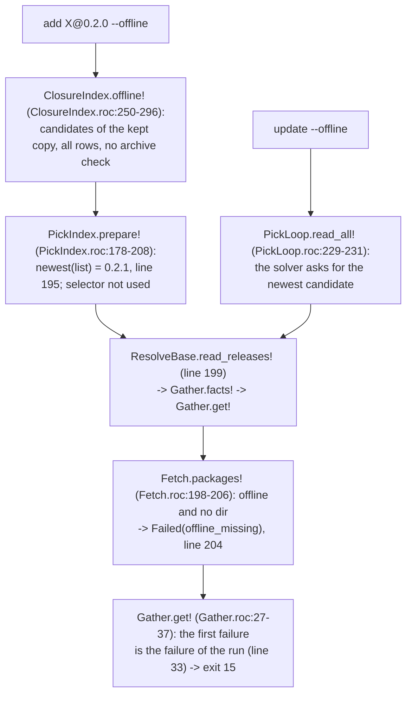

# 263 The offline pick skips a candidate with no archive

Phase: P2. Status: tests, 2026-11-24. 8 red L2 cases (`registry/op1` to `op8`), 1 guard (`op9`) and 1 red L0 test (`Index.newest_admitted`, stub `crash "todo"`). Q643-1 and Q643-2 decided by the user, 2026-11-24 (section 6). The user added the online `direct` case to the scope (op8).
Design ids (given by TalonRegistry): slice 263, Design Q643, G-C273.
Test agent: 2026-11-24. No product code (one stub).

Source: the live smoke test of 2026-11-24. A throwaway HOME kept the registry index copies of an earlier online run, but no package archive. In a new project with the header `package [] {}`:

```text
$ tln add semver@0.2.0 --no-check --offline
matched "semver": karakatiza666/roc-semver                       (stdout)
index: cached at ...                                             (stderr)
tln: error[network]: Karakatiza666/roc-semver 0.2.1 is not in the package cache and --offline is set (https://github.com/.../0.2.1/6BPn....tar.zst)
exit 15
```

| # | Problem | Rule |
| --- | --- | --- |
| P1 | A candidate with no archive stops the whole run. | CLI R-IX6, R-DI12: "a candidate whose archive is not in `packages/` is skipped" |
| P2 | `@0.2.0` is the exact version (CLI R-AD25, anchor `=0.2.0`; the brief said R-AD26, which is the range row), yet Talon reads 0.2.1. | CLI R-DI7: the archive is read "only when the solver or the closure walk asks for them" |

## 1. Rules

| Rule | Text (short) | Cases |
| --- | --- | --- |
| CLI R-IX6 | `--offline` with a registry: the candidates of a group come from the kept copies. "The kind, the deps and the `roc:` pin come from the archives (R-DI7), and a candidate whose archive is not in `packages/` is skipped." One `index: cached at` line. | op1 to op4, op6 |
| CLI R-DI12 | `--offline` in `direct`: the cached pages; "A candidate whose archive is not in `packages/` is skipped." | op5 (and op1 to op4 through R-IX6) |
| CLI R-DI7 | Kind, deps and the `roc:` pin come from the archive, only when the solver or the closure walk asks for them. | op1, op6, L0 |
| CLI R-AD25 | `tln add X@1.2.3`: new entry at 1.2.3, anchor `X = "=1.2.3"`. | op1, op6, L0 |
| CLI R-AD24, R-SL14 | `tln add X`: the version that `strategy` selects; no `talon.toml` key. | op2 |
| CLI R-AD32, R-AD33 | The kind check of the release that `add` selects (a platform with no `--platform`: exit 2). | op6, L0 |
| Design R-I5, R-I8 | `tln install` adds a `talon.toml` key that the header does not have, as `tln add`. | op3 |
| CLI R-AD37 | `--offline`: no request, R-DI12 applies. | all |

## 2. The cause (confirmed by reading the code and by the red runs)



| Fact | Where | Effect |
| --- | --- | --- |
| No code skips a candidate whose archive is not in `packages/`. `Fetch.packages!` turns a missing archive with `offline` into `offline_missing` (exit 15), and `Gather.get!` returns the first failure. | `cli/lib/Fetch.roc:198-206`, `cli/lib/Gather.roc:27-37` | P1, for every offline pick: `add`, `install` (new keys), `update`, `upgrade`, in `direct` (R-DI12) and with a registry (R-IX6). |
| The offline index gives every row of the kept copy as a candidate (`artifacts: []`). That is right: R-IX6 gives the candidates from the copy, and the skip is a later step. | `cli/lib/ClosureIndex.roc:250-296` | |
| `prepare!` reads the header of `newest(list)` (the newest candidate of the URL form, by `published_at`) for the kind check of R-AD32 and R-AD33. It only checks that SOME candidate admits the range (line 196). For `X@0.2.0` it reads 0.2.1. | `cli/lib/PickIndex.roc:195-199` | P2. Offline: exit 15 when 0.2.1 is not cached (smoke test, op1); a wrong R-AD33 stop when 0.2.1 is cached and is a platform (op6). Online `direct`: one extra download. Online with a registry: no effect (the closure answer has only the releases of the range `=0.2.0`, R-AD35 step 5). |
| The pick of `update` asks for the newest candidate first (`PickLoop.read_all!` -> `Gather.facts!`). With no archive for it, the run stops. | `cli/lib/PickLoop.roc:229-231` | P1 for `update` (op4, op5). |
| The slice 259 offline cases (`of1` to `of6`) and `ix6-update-offline` have an archive for every live candidate. So no case saw P1. The candidates with no archive in `of4`, `of5`, `yf11` (2.0.9, 1.1.0) are yanked, so the pick dropped them before the fetch. | `tests/commands/cases/registry/` | Those cases stay green. |

## 3. Behaviors

| # | Behavior | Rule |
| --- | --- | --- |
| B1 | Offline, a candidate whose archive is not in `packages/` is no candidate of the pick: the solver goes on with the other candidates. No text for the skip. | R-IX6, R-DI12 |
| B2 | The kind check of a new name of `add` and `install` reads the newest candidate that the range of the new entry admits (`Index.newest_admitted`), never a release outside the range. | R-DI7, R-AD25, R-AD32, R-AD33 |
| B3 | A skipped release costs no read: its `main.roc` is never read. | R-IX6, R-DI7 |
| B4 | (Q643-1 (a)) When every candidate in the range is skipped offline: exit 15, the R-FE7 text `<name> <version> is not in the package cache and --offline is set (<url>)` of the release that the range admits (for `=2.0.0`: 2.0.0 and its URL, not the newest release). | R-IX6, R-FE7, Q643 |
| B5 | (Q643-2) `outdated --offline` does not skip: the skip is for the pick only. | R-CM6, Q643 |
| B6 | (scope of the user) Online `direct`, `add X@<old>` downloads only the archive of the release that the selector admits, not the newest one. | R-DI7, R-AD25 |

## 4. Tests

| Layer | Case | Rules | State |
| --- | --- | --- | --- |
| L0 | `tests/unit/IndexTest.roc` (last expect): `Index.newest_admitted({ list, range })`: `=2.0.0` keeps 2.0.0 not the newer 2.1.0; `^2` the newest by `published_at`; `~2.0`; a tie keeps the first; no admitted candidate and an empty list are `Err(None)` | R-DI7, R-AD25, R-AD32, R-AD33 | RED (`crash "todo"`, stub in `cli/lib/Index.roc`) |
| L2 | `registry/op1-add-exact-offline`: `add acme/json@2.0.0 --offline`, 2.0.0 cached, 2.1.0 not: exit 0, `+ json: acme/json 2.0.0`, `json = "=2.0.0"`, the pin note | R-IX6, R-DI12, R-DI7, R-AD25, R-AD37 | RED: exit 15, `acme/json 2.1.0 is not in the package cache` |
| L2 | `registry/op2-add-newest-skipped`: `add acme/json --offline`, 2.1.0 not cached: exit 0, json 2.0.0, no `talon.toml` key | R-IX6, R-DI12, R-AD24, R-SL14 | RED: exit 15 |
| L2 | `registry/op3-install-skipped`: `install --offline`, `[dependencies] json = "acme/json@^2"`, 2.1.0 not cached: exit 0, json 2.0.0 added | R-IX6, R-I5, R-I8 | RED: exit 15 |
| L2 | `registry/op4-update-skipped`: `update --offline`, header json 2.0.0, group copy 2.0.0 and 2.1.0, 2.1.0 not cached: `nothing to change`, exit 0 | R-IX6, R-DI12 | RED: exit 15 |
| L2 | `registry/op5-update-direct-skipped`: op4 in `direct` (kept GitHub page): `nothing to change`, exit 0 | R-DI12, R-DI7 | RED: exit 15 |
| L2 | `registry/op7-add-exact-not-cached`: `add acme/json@2.0.0 --offline`, 2.0.0 not cached, 2.1.0 cached: exit 15, `acme/json 2.0.0 is not in the package cache and --offline is set (<2.0.0 URL>)`, no archive read | R-IX6, R-FE7, Q643-1 (a) | RED on calls.log only: today the text is already right, but `prepare!` reads the 2.1.0 archive first |
| L2 | `registry/op8-add-exact-direct-online`: ONLINE `direct` `add acme/json@2.0.0`, no archive cached, 2.1.0 a platform: downloads and unbundles only 2.0.0, adds the package 2.0.0 with `=2.0.0` | R-DI7, R-AD25, R-AD32, R-AD33, R-FE2 | RED: downloads 2.1.0, exit 2 `'acme/json' is a platform` |
| L2 | `registry/op9-outdated-offline-no-archive`: of1 with no archive of 2.0.1 (`wanted`) and 3.0.0 (`latest`): the same rows as of1 | R-CM6, R-IX6, Q643-2 | guard, passes |
| L2 | `registry/op6-add-exact-kind`: op1 with the 2.1.0 archive cached and a PLATFORM header: `add acme/json@2.0.0 --offline` adds the package 2.0.0, no read of the 2.1.0 archive | R-DI7, R-AD25, R-AD32, R-AD33 | RED: exit 2, `'acme/json' is a platform. Use tln add --platform acme/json.` |

No case for `upgrade`: it uses the same `PickLoop` path as `update` (op4).

How I wrote the expected files. For each case I made a variant world in `.tmp/s263/` (not in the repo) with the same files and NO 2.1.0 row in the copy (B1: a skipped release is as no release). I ran the variants and read every line of their output: each line is the text that the design gives (the add lines and the pin note of R-AD25 as in `of3` run 2, the one `index: cached at` line of R-DI12, `nothing to change` as in `oc7-offline`). stdout, stderr, exit and tree.diff are those lines. No UPDATE=1 on a real case.

calls.log (TW24 does not cover calls; the design gives no call order, so this is a proposal of the test agent for the review):

| Case | calls.log |
| --- | --- |
| op7 | The calls of op1 up to the fetch try of 2.0.0 (`random`, `list_dirs`), no read. |
| op8 | The calls of the variant world (the GitHub list with no 2.1.0); the tree.diff has the kept page with both releases (the page that the fake route gives). |
| op1, op6 | The calls of the variant world: 2.1.0 is outside the range, so it costs no call (B2, B3). |
| op2, op3, op4, op5 | The calls of the variant world plus ONE fetch try of 2.1.0 before the last fetch: `random`, `list_dirs $HOME/.cache/roc/packages`, and no `read_files` (the archive is not there). This is the form "the fetch that the pick does today finds the archive missing, the pick drops that candidate and asks again". It adds no call to the existing cases (they have every archive). |

If the code gives another call order with the same reads (no read of a skipped archive, no request, no new call in an old case), the code agent writes a dispute (TW18) and the test agent changes only the calls.log.

## 5. Output (proposed, TW24)

No new text. A skipped candidate prints nothing (R-IX6 gives no note). The texts of op1 to op6 are existing texts.

## 6. Questions (decided by the user, 2026-11-24)

| # | Question | Answer |
| --- | --- | --- |
| Q643-1 | Offline, EVERY candidate that the range admits has no archive (all skipped), but the kept copy has them. Exit and text? Options were (a) exit 15, the R-FE7 text; (b) exit 2, the `Add.no_release` text; (c) (b) plus a note. | (a). Exit 15, kind `network`, `<name> <version> is not in the package cache and --offline is set (<url>)`, for the release that the range admits (case op7). Reason: the release exists; only a run online can get it. |
| Q643-2 | Does the R-IX6 skip apply to `tln outdated --offline`? | No. The skip is for the pick only (`add`, `install`, `update`, `upgrade`). `outdated` reads no archive; its rows come from the kept copy. Guard op9. The code must not filter in `PickIndex.gather!` (which `outdated` uses). |
| Scope | (added by the user) | Online `direct` `add X@<old>` must not download the newest archive for the kind check; it reads the archive of the release that the selector admits (op8, the same fix as op6). |

Proposed DESIGN.md row (for TalonRegistry; the test agent does not edit DESIGN files):

`Q643 | G-C273: the offline pick and a candidate with no archive (CLI slice 263)? | Decided by the user, 2026-11-24. Found by a live smoke test: add X@0.2.0 --offline stopped with exit 15 on 0.2.1 (not cached), against R-IX6 and R-DI12 (skip) and R-DI7 (the kind check read a release outside the range). (1) The pick skips a candidate with no archive in packages/ (add, install, update, upgrade; direct and registry). (2) When every candidate in the range is skipped: exit 15 with the R-FE7 text of the release that the range admits. (3) outdated --offline does not skip (it reads no archive). (4) The kind check of add reads the newest candidate that the range admits, online and offline (direct add X@<old> downloads only the old archive). Tests: registry/op1 to op9, Index.newest_admitted.`

## 7. Out of scope

| Item | Reason |
| --- | --- |
| The current header value has no archive offline (`install --offline` of a header entry that is not cached, a held entry of `update`). | It is no candidate: the header names it. R-FE7 exit 15 stays (existing behavior, `fetch/` cases). |
| A short name offline (`add semver`, the `matched` line of the smoke test). | The `?short=` copy works (R-AD34); the failure was after it. op1 uses a full name, so the case needs no `?short=` copy. |
| The URL form of a new name (`Index.new_entry`: the form of the newest candidate of all forms) when the selector keeps only releases of an older form. | Not seen; R-AD35 step 5 and Q555 give "the newest release that the selector keeps" for the registry query. A gap row for the manager if wanted. |

## 8. Files of the test agent

| File | What |
| --- | --- |
| `cli/lib/Index.roc` | Stub `Index.newest_admitted` (`crash "todo"`), with its doc comment. No other change. |
| `tests/unit/IndexTest.roc` | One new expect (8 rows) at the end. |
| `tests/commands/cases/registry/op1-add-exact-offline/` to `op9-outdated-offline-no-archive/` | 9 new L2 cases (op9 a guard). op8 has a fake GitHub route and fake download and unbundle jobs for both releases. The kept R-AP1 copy of acme/json (key `115d2390e614794b0446998391b51487`), the kept group copy (`d1f9d55195a78856c1060481410244dd`, as `ix6-update-offline`), a kept GitHub page (op5). |

## 9. Red results (2026-11-24)

| Run | Result |
| --- | --- |
| `tests/commands/run.sh` (all L2), first round | 803 passed, 6 failed: `registry/op1` to `op6`, each for the reason in section 4. |
| `tests/commands/run.sh` (all L2), after the answers | 804 passed (op9 included), 8 failed: `registry/op1` to `op8`, each for the reason in section 4. |
| `roc test tests/unit/l0-5.roc` (holds IndexTest) | 149 passed, 1 failed: the new expect, `crash "todo"`. |
| Check of the L0 test (TESTING, the org rule) | With a right body (`keep_if` on `Ranges.admits`, then the newest): all 150 pass. With the body of today (the newest of the form when ANY candidate is admitted): the new expect fails. The stub is back. |
| `roc fmt --check` of the 2 Roc files, `roc check cli/main.roc` | Pass. |

## 10. Plan row (for `docs/slices/PLAN-P2-CLI.md`, the manager adds it)

| 263 | The offline pick skips a candidate with no archive | Smoke test 2026-11-24: `add X@0.2.0 --offline` exit 15 on 0.2.1. Red `registry/op1` to `op6` (add, install, update, direct) and L0 `Index.newest_admitted`: the pick skips a candidate with no archive (R-IX6, R-DI12); the kind check of `add` reads the newest candidate in the range (R-DI7). Q643-1 (a), Q643-2 (no skip in outdated), online direct add (op8). Guard op9. | R-IX6, R-DI12, R-DI7, R-AD25, R-AD32, R-AD33 | G-C273 (Design Q643) | 259 / none | 30 | Sonnet |

## 11. Dispute (code agent, 2026-11-24)

Code is green for op1 to op9 and the L0 expect. 2 older L2 cases change their calls.log, only because of P2 (B2: read only the newest candidate that the selector admits). Valid code cannot keep their old logs. The test agent changes only those 2 calls.log files (TW18).

| Case | Run | Old read | New read |
| --- | --- | --- | --- |
| `moves/hm1-noninteractive` | `add acme/lex@1.1.0` (`=1.1.0`) | `packages/7r2t7xhw.../main.roc` (the newest of the form) | `packages/FtWiVtJn.../main.roc` (1.1.0, the admitted release) |
| `resolve/rs-unmanaged` | run 11 and 13 (`^2`, 3.0.0 is the newest) | one read of 3.0.0, then a second fetch and read of 2.1.0 | one read of 2.1.0 (the 3.0.0 read and its `random`, `list_dirs` are gone) |

Also: `scripts/test.sh fmt` fails on `tests/commands/cases/registry/op8-add-exact-direct-online/fx/pkgs/json_2.1.0.roc` (a platform header fixture, not valid Roc for `roc fmt`). That is a test file; the test agent excludes it from the fmt scan or fixes it.

## 12. Dispute answers, fmt fix and mutation check (test agent, 2026-11-24)

| Item | Result |
| --- | --- |
| `moves/hm1-noninteractive` calls.log | One line changed: `add acme/lex@1.1.0` reads `FtWiVtJn...` (lex 1.1.0, the admitted release) in place of `7r2t7xhw...` (lex 1.2.0, the newest). Nothing else. Accepted (B2). |
| `resolve/rs-unmanaged` calls.log | 3 lines removed: `read_files` of `GqCT1gib...` (acme/pf 0.1.1) and its `random`, `list_dirs`. The change is in run 12 (`install acme/pf platform`, project plat2, `base = "=0.1.0"`), not run 11 and 13 as the dispute said, and the read was pf 0.1.1, not json 3.0.0. It is the same kind of change: a needless read of a release outside the range. Nothing else. Accepted (B2). |
| fmt | `op8/fx/pkgs/json_2.1.0.roc` renamed to `json_2.1.0.platform` (as `closure/cl3-frozen-none`, `registry/rg7-frozen-flag`: the fmt scan reads only `*.roc`); `fx/jobs` names the new file. `scripts/test.sh fmt`: pass. |
| Gap tests | `registry/op10-add-archive-unreadable` (no skip for a broken archive dir: exit 18 `cannot read`), `op11-update-exact-not-cached` (`update json@2.1.0 --offline`: exit 15, R-FE7 of 2.1.0), `op12-add-range-none-cached` (`add acme/json@^2`, nothing cached: R-FE7 of the FIRST skipped, 2.1.0), `op13-update-range-none-cached` (`update json@^2`, the same in the pick loop), `op14-update-current-not-cached` (the header value 2.0.0 is never skipped: R-FE7 of 2.0.0). Expected files by hand; the calls.log of each read line by line from the run (one fetch try for each release, a read only in op10). |
| L2 after the changes | 817 passed, 0 failed. |

Mutation check (`research/slice-263-revert/mutate.sh`, `RESULT.md`): 11 mutants, 10 killed, 1 equivalent.

| Mutant | Change | Killed by |
| --- | --- | --- |
| m1 | `newest_admitted` ignores the range | op1, op6, op7, op8, hm1, rs-unmanaged, L0 |
| m2 | tie takes the last | L0 |
| m3 | `read_admitted!` skips online too | equivalent: `Fail.missing` exists only offline (`Fetch.start_state`) |
| m4 | `read_admitted!` does not skip offline | op2 |
| m5 | add, all skipped: failure of the last | op12 (gap) |
| m6 | pick loop, all skipped: failure of the last | op13 (gap) |
| m7 | pick loop skips the current header value | op14 (gap) |
| m8 | skip on any offline failure | op10 (gap) |
| m9 | outdated skips (Q643-2) | op9 and 19 more |
| m10 | skipped candidate stays in the rows | op2 |
| m11 | no early stop when a range has no candidate left | op11, op13 (gap) |
