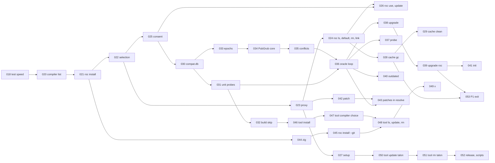

# P1 slice plan

The order of the P1 slices of the `tln` CLI (Design 7, `TESTING.md` 7.4). The manager keeps this file. It continues `docs/slices/PLAN.md` (P0, slices 001 to 017, all done). Each slice has its own file `docs/slices/NNN-<name>.md` (`TESTING.md` 7.2).

| Item | Value |
| --- | --- |
| Status | Draft 1, 2026-10-22. Not reviewed by the human. |
| Compiler, platform, generic packages | As in `docs/slices/PLAN.md` (nightly `nightly-2026-10-14-38a3029`, basic-cli 0.25.0) |
| P1 scope (Design 7) | Toolchain manager, `roc` proxy, `tln cache gc`, local probes and the PubGrub oracle, `tln tool` (CLI 6.4), `install.sh`, `install.ps1` and prebuilt Talon binaries (CLI 6.5) |
| P1 exit criteria (Design 7) | Talon finds a working tuple for parser 2.0.0 + basic-cli without help. GC frees the legacy dirs. |
| Commands (R-PH3) | `upgrade`, `init`, `outdated`, `probe`, `patch`, `x`, `tool ...`, `roc ...`, `cache ...`, `setup`, the `roc` proxy |
| Open P0 and P1 ids today | `MISSING=1 scripts/rules.sh` on the P0 groups lists 143 ids, on the P1-only groups 198 ids (2026-10-22). Section 1 gives each id a slice or a later phase. |

## 1. Scope

### 1.1 Rule groups by component, and the R-PH row that moves each into P1

| Component | Rule ids | R-PH row or phase source | Slices |
| --- | --- | --- | --- |
| Compiler list | R-CV1 to R-CV8 (direct branches), R-NS1, R-SC10, R-SC11, R-SC13, R-C7 for compilers | R-PH6 (installed compilers, downloads), R-PH3 (`roc ...`) | 020 |
| Compiler install | R-R8, R-CV4, R-CV5, R-HF2, R-HF4 (compilers), R-HF5 (`tar`), R-SE9 (`tar` part), R-SE11, R-CC4, R-GC10, R-SO15, R-NI6, R-TF1 (`.talon.json`) | R-PH6, R-PH7 | 021 |
| Selection ranks | R-SO1 to R-SO15, R-SO18, R-SO19 (ranks 4 to 6), R-NS2 to R-NS4, R-NS6, R-EV5 (P1 part) | R-PH6 ("ranks 1 to 6") | 022 |
| The `roc` proxy | R-PX1 to R-PX4, R-PX6, R-PX7, R-HF6, R-HF9, R-ST8, R-PD7, R-PD16, R-PD17, R-EV6, R-EV7, R-EV17, R-CC9, R-DL8 to R-DL10 | R-PH3 (the proxy) | 023 |
| Compiler commands | R-CM15, R-CS1 to R-CS3, R-U1 to R-U6, R-RU1 to R-RU4, R-RR1 to R-RR3, R-LK1 to R-LK4, R-R12, R-R13, R-WS13 | R-PH3 (`roc ...`), R-PH8 (`roc use`) | 024, 026 |
| Download consent | R-DL1 to R-DL7, R-NI4, R-NI5, R-SO12, R-SO13, R-SO22, R-BL3, R-P5 (`max-toolchains`) | R-PH7 ("the consent rules R-DL1 to R-DL6") | 025 |
| Setup | R-CM18, R-ST1 to R-ST15, R-NI13, R-NI14, R-HF7, R-HF11, R-LY8, R-LY9 | R-PH3 (`setup`) | 027 |
| GC and cache | R-CM17, R-GC1 to R-GC14, R-CC10, R-CC2 (GC part), R-NI7, R-NR3 | R-PH3 (`cache ...`) | 028, 029 |
| `compat.db` | R-CC8, R-P4, R-PP4, R-CV6, R-EF1 (rank 1), R-NS12, R-PK7 (`compat.db` rows), R-TF1 to R-TF3 (`compat.db`) | R-PH9 ("Unit probes, `compat.db`, the build skip") | 030 |
| Unit probes, slots | R-LD2, R-LD3, R-UM1, R-AL4, R-PP1 to R-PP7, R-P2 to R-P5, R-P8, R-FL11 | R-PH9 | 031 |
| Build skip, evidence | R-BS1, R-BS2 (with `compat.db`), R-ID6, R-EF2, R-EF3 (ranks 1, 3, 4, 5), R-CM7 (evidence) | R-PH9, R-PH12 ("The evidence for each version") | 032 |
| Epochs | R-EP1, R-EP4 to R-EP14 (direct: R-EP4 gives one epoch per release, only case (b) of R-EP6 infers) | R-PH10 (the oracle loop needs inferred facts) | 033 |
| PubGrub oracle | R-PK6, R-GP6, R-AL3, R-AL5 to R-AL7, R-EP7 to R-EP9, R-LF2, R-OV2 (free variable), R-UP7 (budget, exit 12), R-SP24 (as a decision order), R-PH13 | R-PH10 ("The PubGrub oracle loop") | 034, 035, 036 |
| `tln probe` | R-CM8, R-PB1 to R-PB4, R-PB7, R-LB3 | R-PH3 | 037 |
| `tln upgrade` | R-CM5, R-SP6 to R-SP9, R-SP12, R-SP13, R-UP1 to R-UP13, R-RP1 (upgrade part), R-RP4, R-NI12 | R-PH3, R-PH8 (`upgrade roc`) | 038, 039 |
| `tln outdated` | R-CM6 | R-PH3 | 040 |
| `tln init` | R-CM1, R-IN1 to R-IN7, R-PD15, R-SO16 (init part) | R-PH3 | 041 |
| Patches | R-CM10, R-PA1 to R-PA14, R-PX5, R-CM9 (`patched` mark) | R-PH3 (`patch`) | 042, 043 |
| Source builds, Zig | R-R1 to R-R11, R-D1 to R-D4, R-EV11, R-EV16, R-EV21, R-SE12 | R-PH3 (`roc ...`) | 044, 045 |
| Global tools, `tln x` | R-CM12, R-CM16, R-T1 to R-T21, R-T23 to R-T28, R-X1 to R-X5, R-B1 to R-B10, R-NI8, R-NI9, R-SE8, R-LY2, R-LY3 (`tools.json`), R-CC6 (`tools.json`), R-GC7 | R-PH3 (`x`, `tool ...`) | 046 to 049 |
| Talon as a tool | R-S1 to R-S5, R-T22 (Talon only), R-RM1 to R-RM10, R-NI10, R-IS1 to R-IS8, R-HF10, R-SE13, R-EV10, R-NI15 | Design 7 P1 ("`install.sh`, `install.ps1` and prebuilt Talon binaries") | 050, 051, 052 |
| Exit criteria | Design 7 P1 exit row, TW16 design examples that need P1 (the failure output of Resolution 5) | Design 7 | 053 |

The P1 parts of mixed groups: R-CM (the R-PH3 commands), R-FL (the answer flags of R-FL12 for the P1 prompts, `--slots`, `--git`, `--path`, `--range`, `--all`, `--diff`), R-EV (R-EV5 to R-EV7, R-EV11, R-EV16, R-EV17, R-EV21), R-NI (R-NI4 to R-NI15), R-HF (R-HF2, R-HF6, R-HF9 to R-HF11). Each slice names the exact ids.

### 1.2 What stays for P2 and later

| Phase | Ids | Reason |
| --- | --- | --- |
| P2 | Registry: R-RL, R-SG, R-AP, R-RE, R-IK, R-MX, R-CT, R-PU, R-TP, R-SN, R-WH, R-OT, R-PL2, R-GA2. Sharing and smoke builds: R-SH, R-SM, R-NI16, R-CM23, R-EV26. `publish`, `probe --share`: R-CM13, R-PB5, R-PB6. Registry parts of P0 and P1 groups: R-AD3 to R-AD5, R-AD34 to R-AD36, R-RG4 to R-RG6, R-E6, R-J7, R-ID7, R-DT3 (`log:` snapshot), R-EP2, R-EP3 case (a), R-EF1 ranks 2 and 6, the registry branches of R-CV1 and R-CV3, R-SE2, R-SE5, R-SE6, R-SE10, R-SE14 to R-SE16. | R-PH4, R-PH11. Needs the `cloudflare-workers` platform. |
| P3 | R-AU, R-YK, R-MV, R-CM14, R-CM21, R-CM22, R-C6 (yank and advisory data), R-B3 (yank part), R-T22 (prebuilt binaries of other tools) | R-PH5, Design 7 P3 |
| P4 | Upstream: compat id in `roc version --verbose` (R-GC10), a roc lock on `packages/` (R-CC10) | Design 7 P4 |
| Not testable here | R-CF1, R-FE9 (L5), R-GA1, R-GA3 to R-GA7, R-HF8, R-PK1 to R-PK5, R-PL1, R-PH1, R-PH2, R-OUT3, R-NI11 (removed) | As in the slice 012 audit |

## 2. Slices

Order: the first slices give value early. After 023 a user can run `tln roc install <id>` and `roc` through the proxy. After 029 the toolchain manager is complete. Then `compat.db`, unit probes and PubGrub, which the exit criteria need. The tools come last, because no other P1 slice needs them.

| # | Slice | Content | Rule groups | Depends on | New code (lines, estimate) |
| --- | --- | --- | --- | --- | --- |
| 018 (done) | Test speed | Test binaries with `--opt=dev`, L0 files in parallel, a `slow` tag and a step budget (section 3.4). No Talon code. | TW20 | none | 60 (shell) |
| 018b (done) | CI jobs | GitHub Actions: Linux, macOS and Windows jobs that run the fast set, and a nightly job with `OPT=speed`, `slow` and `net` (the user's answer 2). The release workflow stays in 052. | TW20 | 018 | 100 (YAML and shell) |
| 019 (done) | P0 leftovers | The P0 items with no owner (section 4): 2-member workspace runs of `verify` (F5, F12 of slice 009). | R-SE7, R-CM11 | 018 | 30 |
| 020 (done) | Compiler list | List the releases of `roc-lang/nightlies` (R-DI2 list call), nightly tag forms and order, the asset for a host, the sha256 from `digest`, prefix expansion and `@latest`, `@+N`, `@-N` in the `tln roc` scope. Pure, plus one fetch. The fake nightly release tools (section 3.2). | R-CV1 to R-CV3, R-CV7, R-CV8, R-NS1, R-SC10, R-SC11, R-SC13, R-C7 (compilers) | 018 | 350 |
| 021 (done) | `tln roc install <id>` | Download with the adapter, sha256 check before extract (exit 16), `tar` extract into a temp, `chmod`, `.talon.json` written last, the install lock, compat id (R-GC10), the first install is the default. `roc i` alias. Also (slice 020 review): the TW26 budget warnings apply to the fast set (`OPT=dev`) only. | R-R8, R-CV4, R-CV5, R-HF2, R-HF4, R-HF5, R-SE9 (`tar`), R-SE11, R-CC4, R-GC10, R-SO15, R-NI6, R-CM19 | 020 | 400 |
| 022 (done) | Selection ranks | `Compiler.select` with ranks 1 to 7 over installed compilers, `.roc-version` (rank 5), the global default (rank 6), `path-roc.json` and the launcher test, the held nightly of ranks 4 to 6, the R-SO18 warning in `install` and `ls`. Also slice 020 G1: `Pin.admits` and `Exactly` order 2 nightlies of one date by `published_at` (R-NS1). And slice 020 Q5: the empty-domain failure names the switch and its source (R-NS2). And slice 021 T17: an L0 row where the KB value of `Toolchain.size_text` rounds (`1550` gives `1.6 KB`). And the harness: the `check` step runs its `roc check` calls in parallel, as l0 does (it is at 8.2 s of its 10 s budget). | R-SO1 to R-SO15, R-SO18, R-SO19, R-NS2 to R-NS4, R-NS6, R-EV5, R-PH6 (P1 column) | 021 | 350 |
| 022b (done) | Launcher test | R-SO9: the launcher test, `path-roc.json`, a new `Fx` call for the `roc` files on `PATH`, the real and the fake `Fx`, an L3 job (split from 022). | R-SO9 | 022 | 140 |
| 023 (done) | The `roc` proxy | Split in the 023 review (2026-10-23). Dispatch by program name, `+<id>`, the target file, selection in the proxy, `.last-use`, the R-PD10 record, cache variables, `TALON_PROXY=0`, `TALON_IN_PROXY`, refusal of a missing compiler, `Fx.program_name!` and `Fx.exec!`. Also G1: `ROC_TOOLCHAIN` accepts git-, link- and copy- ids. | R-PX1 to R-PX3, R-PX6, R-PX7, R-HF6, R-HF9, R-ST8, R-PD7, R-PD10, R-PD16, R-PD17, R-EV7, R-EV17, R-CC9, R-SO1, R-SO2, R-SO8, R-SO9 (proxy), R-E1, R-TF5 (proxy), R-DL8, R-DL10, R-NI5 (exit 13) | 022b | 380 |
| 023b (done) | Install in the proxy | R-PX4, the prompt, `TALON_AUTO_INSTALL`, the install lock, `RocInstall` as a function. L3: 3 proxies, 1 download (R-CC4). | R-PX4, R-DL1 (proxy), R-DL8 (prompt), R-DL9, R-EV6, R-NI5, R-CC4 (proxy) | 023 | 200 |
| 023c (done) | Probes by path | Probes run the selected compiler by its path: `Probe.Spec` gets `program` and `env`, `Compiler.require` accepts an installed compiler, `.last-use` and cache variables for probes. | R-PX6 (probes), R-CC9 (probes), R-SO22, R-PH7 | 023 | 150 |
| 024 (done) | `tln roc ls`, `default`, `rm` | Split in the 024 review (2026-10-23). List, set the global default (full id), remove (the default moves, pinned projects listed, the item lock wait). | R-CS2, R-RR1 to R-RR3, R-RM2, R-CM15, R-CM19, R-GC3 (`roc rm`) | 023 | 350 |
| 024b (done) | `tln roc link` | `link` and `link --copy`: a new `Fx` call to copy a file, the proxy runs the link target, the `--copy` flag (and the R-FL12 gap G4 of slice 024). | R-R4, R-R5 (link and copy ids; `default --git` is in 045), R-R12, R-R13, R-LK1 to R-LK4 | 024 | 200 |
| 025 (done) | Download consent in resolve commands | Split in the 025 review (2026-10-23); this row is 025a. The P0 refusal (R-PH7) becomes the consent rules: one prompt per command, required and optional downloads, `--probe-downloads`, `--allow-downloads`, `TALON_AUTO_INSTALL`, the cap. The baseline compiler download. The FD gap of slice 013. Also (023b Q5): the R-SO13 text "does not download a compiler for a run" is wrong after 023b; fix it. | R-DL1 to R-DL7, R-NI4, R-NI5, R-SO12, R-SO13, R-SO22, R-BL3, R-P5 (cap), R-PH7 (P1 column), R-FL12 | 022 | 350 |
| 025b (done) | Rank 4 download and optional downloads | R-SO13: a `[toolchain] roc` range with no installed compiler downloads the newest allowed release in the range (the `nightly` switch), in the commands and the proxy, and the `NoneInRange` text fix (023b Q5). `--no-check` with a rank 4 range (025 Q3). The optional download moved to 036 (025b review). | R-SO13, R-DL1 to R-DL5, R-DL8, R-DL10 | 025 | 250 |
| 026 (done) | `tln roc update`, the `@+N` base | Split in the 026 review (2026-10-23); this row is 026a. `update`: newest allowed release, move the default (also when the newest is installed already). The base of `@+N`/`@-N` for `tln roc` commands (Base, OnPath). The second form of `Pin.toolchain_note` (024b G2). | R-CS3, R-RU1 to R-RU4, R-SL7, R-PD16 | 024, 025 | 300 |
| 026b (done) | `tln roc use` | Check with the baseline and the ladder, then the pin edit (also each member). Open from 026a: Q4 (the prompt for the baseline plus the new nightly), Q5 (a check for the workspace or for each member). | R-CS1, R-U1 to R-U6, R-WS13, R-RP1 (`roc use`), R-PH8 (`roc use`) | 026 | 300 |
| 027 (done) | `tln setup` | Bin dir entries (hard link, else copy), the launcher, `roc.old` and `link-system`, the `PATH` line, `GITHUB_PATH`, completions, R-ST11 ownership test. The Windows `Path` edit as a pure command line (L0). | R-CM18, R-ST1 to R-ST15, R-NI13, R-NI14, R-HF7, R-HF11, R-LY8, R-LY9 | 023 | 400 |
| 028 (done) | `tln cache gc` | Split in the 028 review (2026-10-23); this row is 028a. Toolchains (R-GC5 read as: the default, or pinned by a known project, or used in the GC age), the GC lock, toolchain locks, last-use, `.trash`, stale temps and `talon/tmp/<token>.locks`, `projects.json` pruning, `gc-age`, `--dry-run`. | R-GC1 to R-GC11, R-CC10, R-CC2 (GC), R-EV22 (GC ages) | 024 | 400 |
| 028b (done) | `tln cache gc`: build caches and sizes | Build-cache dirs, `packages/`, the sizes in the report and the dry run, a new `Fx.tree_info!` call, the age rule of R-GC1. R-GC7 (the `x` entries) is in 049. | R-GC1 (age), R-GC2, R-GC3 (second sentence), R-GC4 | 028 | 250 |
| 029 (done) | `tln cache clean` | `clean`, `clean --all`, the prompt, `--dry-run`, the sizes, the `talon/gc` lock (Wait). `list` and `dir` moved to 029b (029 review). | R-GC12 to R-GC14, R-NI7, R-NR3 | 028 | 200 |
| 029b (done) | `tln cache list`, `tln cache dir` | R-CM17 names them and no rule says what they print. Proposal of the 029 test agent: `dir` prints the cache root; `list` prints what `clean --all` would remove, with sizes. | R-CM17 | 029 | 80 |
| 030 (done) | `compat.db` | Split in the 030 review (2026-10-23); this row is 030a: the store. New `Fx` call for SQLite (basic-cli `Sqlite`), the schema with `PRAGMA user_version`, WAL and busy timeout, facts per (hash, nightly, target), the R-CV6 first-seen sha256, `expect/facts.tsv` in the L3 runner. First a spike in `research/compat-db/`: basic-cli `Sqlite` on the pinned nightly, and two processes in WAL. | R-CC8, R-P4, R-PP4, R-CV6, R-EF1 (rank 1), R-NS12, R-PK7 (rows), R-TF1 to R-TF3 | 025 | 350 |
| 030b (done) | R-CV6 wiring | Record every (tag, target) sha256 that a compiler list gives (both sources). A later different value: the tag is no candidate; a command that names the tag (`roc install`, `roc default`, `roc use`, a pin) stops with exit 16. An installed compiler stays in use. A busy or failing compat.db: the R-CC8 warning, no record, go on. | R-CV6, R-CV3, R-CC8 | 030 | 150 |
| 031 (done) | Unit probes and slots | Ladder step 1 (unit and platform probes), the used-module scan, the slot pool (checks 1, builds 4), `--slots`, budget, hang and crash as facts, the temp dirs of probes. L3: 13 fake probes, at most 12 at once. Also (025b review): the `[probe]` keys, with `probe.max-toolchains` (R-P5). | R-LD2, R-LD3, R-UM1, R-AL4, R-PP1 to R-PP7, R-P2 to R-P5, R-P8, R-FL11, R-CC9 (probes) | 030 | 400 |
| 031b (done) | Module split | Five modules near the limit of 600 lines are split by topic, so slice 032 and later add code to short files. No behavior change: no test, fixture or expected file changes. See `031b-module-split.md`. | none | 031 | 0 |
| 032 (done) | Build skip | Split in the 032 review (2026-10-23). The build skip with the used-closure digest; one fact row per (key, digest); pass, fail, hang and crash are recorded, and a fail blocks the skip. | R-BS1, R-BS2, R-ID6, R-EF2, R-PH9 | 031 | 300 |
| 032b (done) | Evidence lines | The evidence lines of `why` and of the summary. Open questions E1 to E6 of the 032 slice file (section 12): the compiler `why` uses, whether `why` reads compat.db, which evidence ranks P1 shows, the unit-fail note text, where it prints, the line format. | R-EF1, R-EF3, R-CM7 (evidence), R-PH12 (P1 columns) | 032 | 200 |
| 033 (done) | Epochs | `epochs : List(Release), Facts -> { epochs, inferred }` (pure). First L1 target and the `l1` step of `scripts/test.sh`. | R-EP1, R-EP4 to R-EP14 | 030 | 250 |
| 034 (done) | PubGrub core | New package `packages/resolve`: terms, incompatibilities, unit propagation, decisions by `priority` and `strategy`, the solver step `Need`, `Done`, `Fail` (`TESTING.md` 2.2 B). L0, and L1 against brute force on small graphs. | R-PK6, R-GP6, R-C1 to R-C4, R-C6, R-C7, R-C9, R-VA6 | 033 | 400 |
| 035 (done) | PubGrub conflicts | Conflict resolution, learned incompatibilities from probe facts (`not (h and roc in [a, b])`), the explanation of a failure (Resolution 5 example), the `inferred` marks. | R-EP7 to R-EP9, R-AL5 | 034 | 400 |
| 036 (done) | The oracle loop (part a, split in review) | The commands that resolve call the solver step in a loop with probe rounds, in place of the one-tuple pick of P0. The held-move second search as a decision order (slice 017 item). The budget covers both searches. `--no-probe`. Exit 12. Also (025b review): the first optional download: the optional list, the cap (R-DL6), the `skipped N compiler downloads` line, and the one prompt for required and optional downloads (R-NI4, R-DL1). Open point: how a person accepts the required download and refuses the optional ones in one prompt. | R-AL3, R-AL6, R-AL7, R-SP24, R-LF2, R-UP7, R-OV2, R-PH10, R-PH13 | 031, 035 | 400 |
| 036b (done) | Probe rounds | Split in the 036 review (2026-10-24). The facts and the used-module scan in the loop, probe rounds, `--no-probe`, the budget (R-P5) for both searches, exit 12 (R-UP7, 035 Q2), the ladder facts, a ladder failure fed back as a conflict. Questions Q1 to Q3 of `036-oracle-loop.md`. Split the scan from the rounds if over 450 lines. | R-AL6, R-AL7, R-LF2, R-OV2, R-UP7, R-EP8, R-EP9 (wiring) | 036 | 400 |
| 036b2 (done) | Used-module scan in the loop | Split in the 036b review (2026-10-24). The used-module scan (R-UM1) after `Done`: chosen releases with a known unit fail and no used-module result get a scan, then the step runs again (036 Q3). Also one run that sets `probe.max` for a held-move second search (036b gap). Also from the 036b close: B10 (a case with two free groups and a failing imported module, so the named blame differs from the whole-tuple blame) and Q7 (the pre-ladder lines print again after a dropped tuple: propose the rule, TW24). | R-UM1 (loop), R-AL4, R-P5 (held moves) | 036b | 100 |
| 036b3 (done) | Module split and l0 time | Added by the manager (2026-10-24) before 036c. No behavior change: no test, fixture or expected file changes (as 031b). `cli/lib/InstallFlow.roc` (576 lines) and other modules near 600 lines are split by topic. The l0 step (8.8 s of 10 s) is made faster, or its unit files are rebalanced, so 036c has room. | none | 036b2 | 0 |
| 036c (done) | Epochs and fix lines (optional downloads moved to 037 in review) | Split in the 036 review. The Epochs wiring and the domain D, the first optional download (R-DL6 cap, the `skipped N compiler downloads` line, one prompt: R-NI4, R-DL1), the explanation text and `fix:` lines (035 Q1, TW24), the R-RP2 hint. Questions Q4 and Q5 of `036-oracle-loop.md`. Revisit 036b D2 (the value a header has now is an assumed pass): it holds only while D is the held compiler; with more compilers in D, a current value on another compiler needs a probe. | R-DL1, R-DL6, R-NI4, R-RP2, R-EP10 (wiring) | 036b | 350 |
| 037 (done) | `tln probe` | Target forms, the ladder on the selected compiler, `--range` with rounds of 3, the cap, exit 12 with `unknown` ends. Also (036c review): the first optional download: D with the cap R-DL6, the opt-in of U5, the `skipped N compiler downloads` line (R-DL4), `max-toolchains = 0`, one prompt (R-NI4, R-DL1). See the proposal in `036c-epochs-downloads.md`. | R-CM8, R-PB1 to R-PB4, R-PB7, R-LB3, R-DL1, R-DL4, R-DL6, R-NI4 | 036 | 300 |
| 037c (done) | Optional probe downloads | Split in the 037 review (2026-10-24). The download branch of R-NI4 (`--probe-downloads`, `--yes` inside the cap R-DL6), D with the cap, the `skipped N compiler downloads` line (R-DL4), `max-toolchains = 0`, one prompt with a required download (U5). Used by `probe --range` and the resolve commands. | R-DL1, R-DL4, R-DL6, R-NI4 (download branch) | 037 | 250 |
| 037d (closed, no slice) | Optional downloads in resolve | Split in the 037c review (2026-10-24). The producer of optional downloads for the resolve commands: a probe of other compilers of D for the R-RP2 hint ("the oldest nightly that works"), with the opt-in and cap of 037c, and the one prompt when the same command also has a required download (U5). | R-RP2 (downloads), R-DL1, R-NI4 | 037c | 300 |
| 038 (done) | `tln upgrade` (packages) | Free variables, the domain with no range, new series as a replace, the range rewrite, `lowest` is an error, the report of what did not get its newest release. | R-CM5, R-SP6, R-SP7, R-UP1 to R-UP5, R-UP8, R-UP10 to R-UP13 | 036 | 380 |
| 039 (done) | `tln upgrade roc` (part a, split in review) | The free nightly, the newest nightly as a named download, the extra baseline download, `--no-check` error, held moves with the nightly. Also (037d close): the one prompt for a required and optional downloads (U5, R-NI12 with R-NI4, R-UP6), reusing `Consent.optional_*` and `ProbeSearch` of 037c. | R-SP8, R-SP9, R-SP12, R-SP13, R-RP1, R-RP4, R-UP6, R-UP9, R-NI12, R-BL3, R-PH8, R-DL1, R-NI4 (one prompt) | 038 | 300 |
| 039s (done) | Module split (Oracle) | Added by the manager (2026-10-24) before 039b. No behavior change (as 031b, 036b3). `cli/lib/Oracle.roc` is 499 lines and `Ladder.roc` 398, `Toolchain.roc` 462: split Oracle by topic (the free search, the hint, the probe rounds), and any other module over 450. Also check the `OPT=speed` l0 time (10.0 s, at its budget). | none | 039 | 0 |
| 039b (done) | Optional downloads of `upgrade roc` | Split in the 039 review (2026-10-24). The optional branch of R-NI4 for the free nightly (R-UP6: "all other compiler downloads are optional probe downloads"), the cap R-DL6, `--probe-downloads`, the `skipped N` line, and the one prompt with the required N and H (U5). Reuses `Consent.optional_*` and `ProbeSearch` of 037c. | R-NI4 (optional), R-DL1, R-DL2, R-DL4, R-DL6, R-UP6 | 039 | 120 |
| 039c (done) | Held moves with the nightly | Split in the 039 review. R-RP4 (held moves with a free nightly), the R-UP2 lag note for the nightly (039 Q4), `--no-probe` with a free nightly (039 Q5). | R-RP4, R-UP2 (nightly), R-LF2 | 039 | 150 |
| 040 (done) | `tln outdated` | The table: current, wanted, latest, nightly range (from known facts) | R-CM6 | 036 | 250 |
| 041 | `tln init` (done) | The templates, resolve as `upgrade`, the `roc:` pin, the CI file, never overwrite | R-CM1, R-IN1 to R-IN7, R-PD15, R-SO16, R-NI12 | 039 | 300 |
| 042 | `tln patch` (done) | The copy, the `[patch]` entry, `--diff`, the unified diff and its apply (pure, L1 round trip), the refusals (platform, unmanaged entry), the `patched` mark of `list` | R-CM10, R-PA1 to R-PA3, R-PA7 to R-PA9, R-PA11 to R-PA14, R-CM9 (`patched`) | 023 | 400 |
| 043 | Patches in resolve and the proxy (done) | A patched entry is an anchor, a move applies the diff, a stale patch (exit 14), `--replace-dep` in the proxy and probes | R-PA4 to R-PA6, R-PA10, R-PX5 | 036, 042 | 300 |
| 044 | Zig (done) | The Zig search order, the install from the Zig index with sha256, the dependency list and its prompt | R-D1 to R-D4, R-EV11, R-EV16, R-EV21, R-NI6 (Zig) | 021 | 300 |
| 045 | `tln roc install --git` (done) | Source archive of a ref, `zig build`, `git-<sha8>`, the nightly note, a branch again gives a new id Also (slice 020 review): a row for a non-nightly id that prefixes another id (the `named.contains` branch of `Nightlies.by_name`). Also (024b review): R-R5 `tln roc default --git`. | R-R1 to R-R3, R-R5 to R-R7, R-R9 to R-R11, R-SE12, R-DA3 | 044 | 380 |
| 046 | `tln tool install` (release) (done) | Release online, app bundle, build with the pinned compiler, bin dir, `tools.json` under its lock, binary name clash, `--as` (The GC part moved to 046b in the 046 review.) | R-CM16, R-T1 to R-T6, R-T8 to R-T12, R-T26 to R-T28, R-SE8, R-ST15, R-LY2, R-LY3, R-CC6 (`tools.json`) | 032, 027 | 400 |
| 046b (dropped) | GC protects tool packages | Dropped by the user (2026-10-25): R-GC4 does not name `tools.json`; tool packages are no GC roots, as R-T5 for the nightly; `tln tool rebuild` downloads again. Old text: Split in the 046 review (2026-10-25). Also (028b review): GC protects the packages that installed tools use: tool roots from the `source.url` of each `tools.json` entry in `Gc.protected`. Changes the old gc `calls.log` files (TW21). | R-GC4 (tools), R-T4 | 046 | 120 |
| 047 | Compiler choice of a tool (done) | Evidence pass, the R-NI8 prompt, option 2 in parallel, the record of each try | R-T13 to R-T21, R-NI8, R-PP2 (option 2) | 046 | 350 |
| 048 | `tln tool ls`, `update`, `rebuild`, `rm`, `--git` (done) | The manifest-based commands and the git source. Split in the 048 review (2026-10-25) into 048a `--git` install, 048b ls, rm, rebuild, 048c update; one test set, three code passes. | R-T7, R-T23 to R-T25, R-B6 | 047, 045 | 350 |
| 049 | `tln x` and build reuse (done) | Split in the 049 review (2026-10-25) into 049a `x` run and entry write, 049b reuse and take-over, 049c GC; one test set, three code passes. The `x` cache, the match by manifest, the take-over, offline rules, `--json` refused Also (028 review): R-GC7. | R-CM12, R-X1 to R-X5, R-B1 to R-B10, R-NI9, R-GC7, R-FL1 (`x`) | 048 | 400 |
| 050 (done) | `tln tool update talon` | Also (048 review, Q-T1): `ToolsJson.read` must accept the `talon` entry (today its source kind gives exit 19). The prebuilt binary, `--from-source`, temp, `chmod`, `--version` check, `rename`, the bin dir entries again, the Windows `.del` rule (pure) | R-S2, R-S3, R-T22 (Talon), R-ST9, R-ST10, R-SE13 | 027, 046 | 300 |
| 050c (done) | Windows `.del` files | Split in the 050 review (Q-W1, Q-W2): each start of `tln` tries to delete the `*.del` files in the bin dir and the data bin dir; `tool update`, `tool rebuild` and `tool rm` rename a tool `.exe` to `<name>.<16hex>.del` first. Pure decision plus Windows L2 cases. | R-ST10 | 050 | 100 |
| 050d (done) | Windows `.del` in the other places | Split in the 050c review (Q-D2): R-ST10 also applies when `tln setup` makes the bin dir entries again (R-ST9), at the R-B4 take-over of an `x` entry (`XTake`), and at each other replace or delete of a `.exe`. Reuse `Del` of 050c. | R-ST10, R-ST9, R-B4 | 050c | 80 |
| 051 (done) | `tln tool rm talon` | The prompt with 4 options, the groups, `--dry-run`, the order of removal, the profile line | R-S5, R-RM1, R-RM3 to R-RM10, R-NI10 | 050 | 350 |
| 052 (done) | Release and install scripts | The release workflow for the 5 targets and `sha256sums.txt` (Q2), the ids in `install/test.sh` | R-S1, R-S4, R-IS1 to R-IS8, R-HF10, R-NI15, R-EV10 | 051 | 150 |
| 060 (done) | Compiler of `roc unbundle` | From 5b (055 Q5): `Gather` and `Fetch.packages!` use `roc` on PATH. R-FE4: the selected compiler, else the newest installed, else `roc` on PATH. One shared choice for all fetches; many calls.log files change (TW21). | R-FE4 | 055 | 80 |
| 061 (done) | Zig GC | From 5b (044 Q5): `Gc` leaves `zig-*` dirs alone. R-D2 says which Zig installs GC keeps. | R-D2, R-GC5 | 044, 045, 028 | 80 |
| 053 (done) | P1 exit | L4: parser 2.0.0 + basic-cli resolves with no help (Q1), GC frees the legacy dirs on a copy of a real cache, the failure output of Resolution 5 as a case | Design 7 P1 exit, TW16 | 039, 028 | 50 |

Sum: about 10,300 lines over 36 slices. The P0 slices had about 700 lines each (12,077 lines in `cli/lib/` for 17 slices). So the manager splits a slice at the scope step when the test agent finds more than about 400 lines (TW19), as in P0.

## 2c. Follow-up slices (user answers, 2026-10-25)

The user answered the P1 report: (1) change the Resolution 5 example to the code text; (2) only a user act sets the default compiler, never a download for a probe or a pin; (3) the stale `talon` entry after `install.sh --version` is a bug: fix the rule and the code; (4) the 061 Zig readings become rules; (6) a design agent decides the 5b design gaps one by one. Items 1, 4 and 6 are design edits (a design agent). The slices below follow.

| Slice | Name | Scope | Rules | Needs | Lines |
| --- | --- | --- | --- | --- | --- |
| 062 (done) | Default compiler by user act | Answer 2: a probe, `tln upgrade` or tool-pin download does not write `default-roc` (046 G3, 053 F4). New R-SO15 text (design agent, 2026-10-25): only a user act sets it: `tln roc default` (always), `tln roc install` (when none is set, also for a compiler that is already installed), `tln roc update` (R-RU2), `tln roc rm` of the default (R-RR1). Never: a probe, `tln upgrade`, `tln init`, `tln roc use`, a tool pin, `x`, the proxy when a rank gives the compiler. (`setup` and the no-compiler case: slice 072.) Code: `install_offer!` stops setting the default (the callers `Proxy`, `Start`, `RocUse`, `NightlyFlow`, `ToolCompilerFlow`, `ToolUpdateFlow` and the probe fetches); `RocManage` and `GitInstall` set it for `roc install`. | R-SO15, R-SO14 | design edit (done) | 80 |
| 063 (done) | `talon` entry after a repair | Answer 3: after `install.sh --version <v>`, `tln setup` makes the `talon` entry match the running binary (052 G1). New R-IS6 text (design agent, 2026-10-25): `tln setup` makes the `talon` entry match the running `tln` (version and sha256); a missing or differing entry is written again as a prebuilt entry (version, release URL, sha256, target, install time); a matching entry and each other entry stay. R-S4 says the repair runs setup. | R-IS6, R-S4 | design edit (done) | 60 |
| 064 (done) | Selected compiler in all fetches | 060 G4: `remove`, `probe`, `path`, `init`, `tool`, `x` and `run` pass the selected compiler to the fetch | R-FE4 | 060 | 80 |
| 065 (done) | `fix:` line of a failed upgrade | 053 F3: the `fix:` line does not propose the command that just failed. Design agent, 2026-10-25: R-AL12 leaves `tln upgrade roc` out of the fix block when the failed command is `tln upgrade roc`; the Resolution 5 example has that text, so `ex3` `expect/stderr` and `stdout` change to the example (test agent) | R-OUT, R-AL12 | 053 | 30 |
| 066 (done) | Split of the L2 test app | `tests/commands/main.roc` is 644 lines: split under 490 lines, no change of behavior | TW | none | 0 (tests) |
| 067 (done) | Nightly real-cache step | 053 Q2: a `nightly.yml` step builds a real roc cache with an old nightly, then sets `REAL_CACHE` for `exit/ex2-gc-real-cache` | TW16 | 053 | 30 (YAML) |
| 068 (done) | `.roc-version` hint cache | 032b Q1 (design agent, 2026-10-25): `Github.hint!` keeps each answer in `talon/index/github/<owner>/<repo>/<tag>.roc-version` (R-DI8); `Evidence` gets rank 4 from these files; `tln why` and the summary show it. The `calls.log` of cases that call `Github.hint!` change (TW21). | R-DI8, R-EF1 | 032b | 80 | |
| 069 (done) | `--probe-downloads` only where it works | 037d Q4: the flag on a command other than `upgrade` and `probe` stops with exit 2 (R-FL12, flag table). `cli/lib/Args.roc` and `Opts.roc` stop parsing it for the other commands. | R-NI4, R-FL12 | 037d | 30 | |
| 070 (done) | Patches in the proxy and a missing base | 043 Q1, Q2, Q8: the proxy reads `[patch]` of the nearest `talon.toml` of the target file for every rank (also `roc +<id>` and `ROC_TOOLCHAIN`); a `base` that no release of the group has gives exit 14 (it is exit 18 now) | R-PX5, R-PA13 | 043 | 100 | |
| 071 (done) | `roc list` shows the git ref | 045 G8: `tln roc list` shows the repo and the ref that the user typed for each `git-*` id (R-R15). Output proposal for the review (TW24); `--json` `data` gets `repo` and `ref` for those rows. | R-R15 | 045 | 40 | |
| 072 (done; split: 072a setup, 072b fetch) | First default and no compiler selected | Answer 5 (design agent, 2026-10-25): `tln setup` writes `default-roc` = the latest compiler in the channel when none is set, with no download, and no failure when the list cannot be read (R-ST16, R-SO15). R-SO14 replaces exit 18: when no rank selects a compiler and nothing is installed or on `PATH`, a command that fetches, probes or builds downloads (a) in a project: the newest compiler in the channel with a recorded pass for the header hashes, else the latest in the channel; (b) outside a project: the latest compiler in the channel; and sets it as `default-roc` in both cases (only when none is set), under the R-DL consent rules (prompt R-NI5 names the default; exit 13 for a refusal, `--offline` and `TALON_AUTO_INSTALL=no`; exit 15 for no list; exit 10 for the switch off and no release). Exit 18 stays in P0 only. `install --frozen` and every fetch use this rule through R-FE4. Many `calls.log` files may change (TW21). Split in 2 slices if over 400 lines. | R-SO14, R-SO15, R-ST16, R-FE4, R-LF1 | 062, 060 | 250 | |
| 072c (done) | No rank selects a compiler: installed first, other fetch flows | User answers 2026-10-26 (DESIGN-GAPS-2026-10-26.md, Q-B1 and its follow-up): `NoRank.pick` and `offer!` use the R-SO14 order: (a) the newest installed compiler with a recorded pass, (b) probe the installed compilers newest first (ladder of R-PB2, `probe.max`, no exit 12 when spent, skip a recorded fail), (c) the newest in the channel with a pass, downloaded and made default, (d) the latest in the channel. (a) and (b) download nothing and set no default. Wire it into the fetch flows that 072b does not wire (verify, list, why, outdated, patch, remove, `roc use`, probe, path, init, run; R-SO23 rows: `run` and `init` use the project of the current dir). Also the R-CV6 changed-sha warning in `NoRank.offer!`. | R-SO14, R-SO23, R-SO15, R-CV6 | 072b | 300 |
| 072d (done) | No rank: the stops that are not a fetch (core) | Split from 072c (manager, 2026-10-26); split again in the 072d test step: the core is `check_pin` (`LockNoCheck` and `Verify` never stop) and the pick with the real step (b) closure in verify, probe, roc use and remove/install `--no-check` (new module `HeldRoc`). First scope: `check_pin`, the free-nightly `NoCompiler`, `ProbeFlow`, `ManageUse`, `Proxy` step 9 (R-PX4), the relative-selector stop (R-SL7), and the cases that still expect exit 18. | R-SO14, R-PX4, R-SL7 | 072c | 150 |
| 072e (done) | No rank: install family, R-SL7, proxy | Split from 072d (2026-10-26), see the "072e scope" table at the end of `072d-no-rank-stops.md`: the install-family pick (Q-D2), the base of a relative selector (R-SL7, Q-D3), Proxy step 9 (R-PX4, Q-D4), `roc use` with the pick and the new compiler both missing (Q-D5), `init/it4-nocompiler` (Q-D6, a code cause), and the old exit-18 cases. Q-D2 to Q-D5: design agent. | R-SO14, R-SL7, R-PX4 | 072d | 200 |
| 080 (done) | A compiler is always selected | User answer 2026-10-26 (R-SO24, DESIGN-GAPS-2026-10-26.md "Invariant"): every install of a nightly or release (probe, pin, `upgrade`, `init`, `roc use`, `x`, tool, proxy, `roc install`/`update`, R-SO14) writes `default-roc` when none is set, under the lock, before the final rename; `tln roc remove` of the default moves it to the newest installed compiler the switch admits, else the newest of any kind (R-RR1); rank 6 gives the newest installed compiler with a note when `default-roc` is unset; `tln setup` writes it (R-ST16). Remove the dead code: `NoRank.pick` steps (a) and (b), `NoRank.Probing`, the step (b) closure in `HeldRoc`, and the cases of 072c, 072d and 072e that show them (list in `072e-no-rank-install-family.md` section 12), and the old step (a)/(b) branch of `HeldRoc.picked!`. Also (072e close): `upgrade --no-check` with a free nightly and nothing installed gives exit 18 in `InstallFlow.resolve!`; by R-SO22 it needs no compiler. | R-SO24, R-SO14, R-SO15, R-SO6, R-RR1, R-ST16, R-T30 | 072e | 250 |
| 073 (done) | Tool selectors, `--json` tools, `x` flags | 056 Q2: a selector on a tool key in `update`/`upgrade` is exit 2 naming `tln add --tool` (R-PT5). 056: `data.tools` for `install`, `update`, `upgrade` (R-PT5, R-OUT4). 059 Q2: `--roc` and `--allow-unchecked` with a project tool in `tln x` are exit 2 (R-PT11). Also the 5b row `XCacheIo.has_file`: check the file that the manifest names (R-B10). | R-PT5, R-PT11, R-B10 | 056, 059 | 120 | |
| 074 (done) | Attestation in `tool update talon` | 050 Q-A1: after the release workflow makes attestations (052), `tln tool update talon` runs `gh attestation verify` on the download when `gh` is installed and logged in; exit 16 on a failure; a note otherwise (R-S2). | R-S2, R-IS3, R-SE13 | 052 | 60 | |
| 075 (done) | `--version` check for a source build | 050 Q-F2: `tln tool update talon --from-source` runs `--version` on the new file before the `rename` (R-S3), as for the prebuilt file. | R-S3 | 050 | 30 | |
| 077 (done) | `--no-cache` in every `roc build` | Decision 2026-10-26 (DESIGN-GAPS-2026-10-26.md): every `roc build` that Talon runs passes `--no-cache` (ladder, unit probe, smoke build, tool, `x`, project tool, option 2 try, `tln` from source). Today it is missing in `Probe.roc`, `ProbeUnit`, `LadderPlan`, `ToolInstall.roc`, the smoke build and the source build of `tln`. | R-LD8, R-T8 | none | 40 |
| 078 (done) | `tools.json` records bin entries | U1 (a), decided 2026-10-26: `tools.json` gets an optional `bin` field (sha256 of each bin entry that Talon made). An entry with a recorded sha256 is Talon's, also when it is stale, and `tln setup` repairs it. `format` stays 1. | R-ST9, R-ST11, R-T4 | none | 120 |
| 078b (done) | Bin records in the tool flows | 078 Q1 (manager, 2026-10-26): install, update, rebuild, take-over, `tool update talon` and the remove path read `tools.json` only when the entry is not Talon's by the data-file sha, and use `ToolInstall.verdict_bin` and `ToolManage.fate_bin`. About 5 L2 cases change (`ti2-refusals`, `tg2-gitstops`, `tr2-rebuildstops`, `ts3b-foreign`, `ts4-rocforeign`). | R-ST11, R-T4 | 078 | 80 |
| 079 (done) | No compiler selected: tool flows | User answer 2026-10-26: `tool install`, `x`, project tool builds, `tool update`, `tool rebuild` in any compiler state (Q-A1): R-T29 first (no pin is exit 2), then the R-T30 order: the selected compiler, the pin if installed, an installed compiler with a pass, try the other installed ones with no prompt (not for `tool update`, Q-A3), then the R-T14 prompt (options 1 and 3) or, with no compiler selected, download the pin, which becomes the default (R-SO23). `ToolCompiler.decide` and `ToolCompilerFlow` drop the old option 2. Today `ToolFlow.roc` passes `none: Stop` (exit 18). | R-T30, R-T14, R-T15, R-T16, R-T20, R-T21, R-T6, R-NI8, R-SO23, R-SO15, R-X1, R-NI17, R-FE4 | 072b | 200 |
| 079b (done) | `PATH` `roc` as the selected compiler for tools | 079 dispute D1 (manager, 2026-10-26): wire the `PATH` `roc` id into `ToolFlow.selected_for` (`ToolCompiler.selected_of` is done). A `PATH` `roc` with a nightly or release id counts as selected (Resolution 13 rank 7): it is tried first when a toolchain dir has that id, and a download then sets no default. Fix the test `ti4-nothing` run 1 (no "It becomes the default compiler." line) and the `calls.log` files that get a `path_roc` call (`tc1-order`, `ti3-compiler`, `ti2-refusals`). | R-T30, R-SO10 | 079 | 60 |
| 068b (done) | The solver asks for the `.roc-version` hint | 068 Q2: no command calls `Github.hint!` yet; R-DI8 says the solver asks only when it needs a hint for a candidate (Resolution 3 rank 4). | R-DI8, R-EF1 | 068 | 100 |
| 070b (done) | Fetch of a patch base | 070 Q1, Q3: when a release of the group has the `base` hash, Talon fetches it by hash for the diff (R-PA13, R-PA3, R-PA5); today the read fails with exit 18. `tln patch --diff` uses the same missing-base rule (exit 14). Also: `base_check!` skips the lookup for an entry with no GitHub name or a foreign URL (070 close). | R-PA13, R-PA3, R-PA5 | 070 | 100 |
| 076 (done) | Safe cache paths from header URLs | 068 review: `Github.repo_dir` joins owner and repo of a header URL with no check (`Ident.github_name` only checks for empty), so an owner or repo `..` makes `releases!` write `1.json` and `1.meta` outside `talon/index/github/`. Fix in `Ident` (one guard for every path part from a URL: empty, `.`, `..`, `/`, `\`, NUL), and check each other cache path that takes a part of a URL or a header (packages, index, tools, x cache). Security: do first. | R-DI1, R-ID3 | 068 | 60 |

## 2b. Transition slices (cloudflare-workers/research/talon-fit/TRANSITION.md)

Added by the manager (2026-10-24), on the user request "Schedule implementing TRANSITION.md". User decisions (2026-10-24): an agent drafts the design change of `research/talon-scripts/README.md` section 13 and the user reviews it; the platform steps 1, 2 and the helper (step 4) start now, in parallel with the P1 rows.

| Id | Work | Rules | Needs | Est. lines |
| --- | --- | --- | --- | --- |
| D-TS (done, accepted by the user 2026-10-24) | (user answers OP1 to OP10, NC1, NC2 on 2026-10-24; OP6 is (b): global and project tools stay separate) Design change of talon-scripts section 13 (an Opus agent drafts it, the user reviews it). Q-S12 to Q-S15: the lean of the study. No slice below starts before the user accepts it. | G1, G2, R-RUN, R-EA, R-PT, R-TG, R-PTH, R-IN8 | none | design text |
| 054 (done) | The build target (TRANSITION step 5, gap G1) | R-TG1 to R-TG6 | D-TS | 200 |
| 055 (done) | `tln path` and the `init --platform` stub | R-PTH1 to R-PTH5, R-IN8, R-CM25 | D-TS, 041 | 200 |
| 056 (done) | Project tools `[tools]` (split in the 056 review, 2026-10-25: 056a read and add/remove --tool, 056b install and --frozen, 056c update/upgrade, 056d GC and take-over): `add --tool`, the `url` lock, `install --frozen`, `update`, GC | R-PT1 to R-PT16 (less R-PT11) | D-TS, 047 | 400 |
| 057 (done) | `tln run` and `[scripts]` (split in the 057 review, 2026-10-25: 057a parse and plan, 057b find and flow, 057c tool steps) (no shell, `@name`, `in` steps, the list with no name) | R-RUN1 to R-RUN17, R-CM24 | 056 | 350 |
| 058 (done) | `tln run --each`: dependency order, `[run] after` | R-EA1 to R-EA8 | 057 | 250 |
| 059 (done) | `tln x` of a project tool | R-PT11 | 049, 056 | 100 |

Order: 054 and 055 run between the P1 rows as soon as D-TS is accepted. 056 follows 047, then 057 and 058. 059 follows 049. Then TRANSITION steps 7 and 8 (platform examples, CI, release) in `cloudflare-workers/`.

Platform side (no Talon slice, no TESTING.md): TRANSITION steps 1 and 2 in `cloudflare-workers/`, and step 4 (the helper `roc-cfw`) in a local repository `../roc-cloudflare-workers-cli` with no remote. The helper uses the cache-rule fallback (TRANSITION 9, row 1) until 055 is done. No GitHub repository, release or push without a user OK.

## 3. Test strategy

### 3.1 Layers per part

| Part | L0 | L1 (roc-fuzz) | L2 (fake `Fx`) | L3 (real processes, fake HTTP) | L4 (real `roc`) |
| --- | --- | --- | --- | --- | --- |
| Compiler list, asset, prefixes (020) | Yes: tag forms, order, asset pick, digest | | | One list on the fake API | |
| Install (021, 044, 045) | `.talon.json`, Zig search order | | The flow, the lock calls | Download, bad digest (exit 16), slow body, `curl` and `wget`, no `curl` (exit 18), `tar`, `chmod`, Ctrl-C and SIGKILL leave no item | |
| Selection, proxy (022, 023) | All ranks, `path-roc.json` key | | | Exit code passes through, `TALON_IN_PROXY`, 3 proxies and 1 download | The proxy runs the pinned `roc` from `toolchains/` |
| Consent (025) | The answer of each prompt in each mode | | Each command with each answer | One TTY case | |
| Setup, tools, Talon as a tool (027, 046 to 052) | Bin dir plans, reuse match, removal plan | | Flows | Hard link, copy fallback (tag `exdev`), `tools.json` race | One `tool install` of a small app (build) |
| GC (028, 029) | The selection | | The flow | GC during a fake build (R-CC10), old `beat` | GC on a copy of a real cache with legacy dirs (053) |
| `compat.db` (030) | Row encode and decode | | Fake `db` call: rows in `fx/db.tsv`, writes in the tree | WAL with 2 processes, busy timeout | |
| Probes, slots (031, 032) | Classes, used modules, digest | | Round order | 13 probes at most 12, hang kill with `probe.timeout = 1` | Unit probe and build of a real package |
| Epochs, PubGrub (033 to 036) | Yes, most tests | Epochs (properties of R-EP5, R-EP6), PubGrub against brute force, `upgrade` with fake `Fx` (`TESTING.md` 4) | The loop with fake probe results | | |
| Patches (042, 043) | Diff and apply | `apply(diff(a, b), a) == b` | Flows | Proxy with a stale patch (exit 14) | |

### 3.2 Fakes to make

| Fake | Where | Slice | How |
| --- | --- | --- | --- |
| Fake compiler release server | `tests/tools/mk-nightly.sh`, routes in `given/http/` | 020, 021 | The script makes a `.tar.gz` of a fake `roc` with fixed bytes (`tar --sort=name --mtime=@0 --owner=0`, `gzip -n`), and writes the release list JSON of `roc-lang/nightlies` with `digest` and loopback asset URLs. `fakehttp.py` serves it, also a slow body and a 404. |
| Fake toolchains dir | `tests/tools/mk-toolchain.sh` | 021, 022 | Writes `toolchains/<id>/roc` (a copy of `tests/fakes/roc`) and `.talon.json` into `given/home/` |
| Fake `roc` with an id | `tests/fakes/roc` | 021 | Gives `Roc compiler version <id>` from its dir name, and writes the id before the argv in `roc.log`. So a case sees which compiler ran. |
| Fake Zig index, fake `zig` | `given/http/`, `tests/fakes/zig` | 044, 045 | `TALON_ZIG_INDEX`. The fake `zig build` writes a fake `roc` to `zig-out/bin/`. |
| Fake source archive route | `given/http/` | 045 | `<api>/repos/<o>/<r>/tarball/<sha>` with a redirect to a loopback URL |
| Fake app bundle and release | `tests/fixtures/` | 046 | A small app bundle, made once with the real `roc bundle` and kept as a fixture |
| Fake `db` in L2 | `tests/commands/FakeFx.roc` | 030 | Rows from `fx/db.tsv`. Writes go to a file in the case dir, so `tree.diff` shows them. |
| Fake exec in L2 | `tests/commands/FakeFx.roc` | 023 | The exit code from a table. The call goes to `calls.log`. |
| Fake Talon release | `install/test.sh` (exists) | 050, 052 | As today |

### 3.3 Measured time today (2026-10-22, this machine)

| Step | Time | Where the time goes |
| --- | --- | --- |
| `scripts/test.sh` all | about 114 s | |
| l2 | 80 s | The `roc build` of `tests/commands/main.roc`: 98 s with the default `--opt=speed` (LLVM). It starts at the start of the run, so the step waits about 80 s. The 35 cases take 0.5 s. |
| l3 | 9 s | The cases. The `tln` build (87 s, `--opt=speed`) runs at the same time as l2. |
| l0 | 14 s | 50 `roc test` runs, one after the other |
| `roc build tests/commands/main.roc --opt=dev` | 5.1 s | Dev backend. All 35 L2 cases pass with this binary (0.5 s). |
| `roc build cli/main.roc --opt=dev` | 1.9 s | All 26 L3 cases pass with this binary (9 s, 1 skipped as today). |

So the time is in LLVM code generation, not in the tests. Each P1 slice adds code to both apps, so with `--opt=speed` the fast set goes past 180 s in a few slices.

### 3.4 Proposal: slice 018 (test speed)

| # | Change | Effect |
| --- | --- | --- |
| 1 | `scripts/test.sh`, `tests/run.sh`, `tests/commands/run.sh` build the test binaries (`l2`, `tln`, `fxprobe`, `flowprobe`) with `--opt=dev`. A variable `OPT=speed` gives the LLVM build. | Builds go from about 98 s to about 5 s. Fast set about 25 s. |
| 2 | A full run with `OPT=speed scripts/test.sh` before each merge and each night (with L4). | The dev backend and LLVM can differ. This run finds such a difference. A difference is a roc bug to report, and the case keeps the LLVM result. |
| 3 | The l0 step runs the `roc test` files in parallel (`xargs -P`, as l2 and l3 do) | 14 s to about 3 s |
| 4 | L3 cases with a real wait (a timeout, a slow body) set small limits (`probe.timeout = 1` in `config.toml`). A case that still takes more than 2 s gets the tag `slow`. The fast set skips `slow`. The merge run includes it. | L3 stays under 60 s |
| 5 | `scripts/test.sh` prints a warning when a step passes its share: l0 10 s, l1 60 s, l2 30 s, l3 60 s (`TESTING.md` 1) | The manager sees growth at once, not after 10 slices |

Budget for the end of P1, with the change: build 10 s, l0 10 s, l1 40 s (4 targets with a fixed `--runs`), l2 5 s (about 120 cases), l3 40 s (about 100 cases), all in parallel where possible: under 90 s.

## 4. Open P0 items and where they go

| Item | Source | Goes to |
| --- | --- | --- |
| R-SO5 (`.roc-version` rank 5), R-SO18 (the warning in `install` and `ls`) | Slice 012 Q30, manager answer: P1 | 022 |
| R-SO1, R-SO6, R-SO8, R-SO12, R-SO15, R-RP4, R-SP6, R-SP8, R-SP9, R-SP12, R-SP13, R-UP1 to R-UP13, R-WS13, R-SC10, R-SC11, R-SC13, R-PD7, R-PD15 to R-PD17, R-NS6, R-NS12, R-ID6, R-NR3, R-LB3, R-P4, R-P5, R-P8, R-PP1, R-PP2, R-PP4, R-PP6, R-PP7, R-AL4, R-AL5, R-LD2, R-LD3, R-CC8 to R-CC10, R-EV6, R-EV7, R-EV11, R-EV16, R-EV17, R-EV21, R-HF2, R-HF6, R-HF9 to R-HF11 | Ids of P0 groups with no test, marked P1 in the audits of slices 011 and 012 | The slice of section 2 that names the id |
| FD: `InstallFlow.finish!` calls `Pin.decide` with `toolchain: Err(Unset)`. Equal in P0, not with downloads. | Slice 013 code review | 025 (a run where the held nightly is a download) |
| `talon/tmp/<token>.locks` of a crashed process: GC must remove it | Slice 002 code review | 028 |
| The second search as a PubGrub decision order, R-AL5 (a failed probe changes the set), R-P5 (the budget covers both searches) | Slice 017 out of scope | 036 |
| R-PA4, R-PA14 (a patched entry never moves) | Slice 017 out of scope | 042, 043 |
| R-SC1 for `patch`, `probe`, `upgrade`. The selector filter for the scopes `Tool` and `X` (D5) | Slice 014 | 037, 038, 042, 046, 049 |
| R-PH12, R-CM7: the evidence for each version in `why` | Slice 011 out of scope | 032 |
| F5 (R-SE7: a repeated platform note in 2 members), F12 (R-CM11: `replace` made unique in 2 members) | Slice 009 code review, "accepted as gaps for P0". No later slice names them. | 019 |
| The stale take-over race of 3 processes | Slice 002 review: the limit that R-CC12 accepts | No slice (accepted) |

The other "moved to slice N" items of the reviews of slices 006 to 016 were taken by the named slice (checked in the slice files and in `tests/unit/`: the gaps of slices 003 and 005 have rows today).

## 5. Questions for the human (TW17)

| # | Question | Why it changes the plan | Proposal (not a decision) |
| --- | --- | --- | --- |
| Q1 | The P1 exit criterion "Talon finds a working tuple for parser 2.0.0 + basic-cli without help" needs the real GitHub index and real nightly downloads. All test layers run with no network (`TESTING.md` 3.2, TW15). How is the criterion checked? | Slice 053: a new tag `net` (a manual and nightly run, never in the fast set or the merge run), or a human run that the slice file records | A tag `net`, nightly only, with a pinned `--snapshot` time so the result is fixed |
| Q2 | No CI exists in the repository (no `.github/`). Is a CI with Linux, macOS and Windows jobs part of P1? | The Windows rules (R-HF11, R-ST10, R-RM5, R-S3, R-LY5 to R-LY9, `install.ps1`), the macOS case-insensitive names (`TESTING.md` 5), and the release workflow of the 5 prebuilt targets (R-IS2, slice 052) need it. Without it these get L0 tests only, and slice 052 has no release. | Yes: one small slice before 050 that adds the CI jobs and the release workflow |
| Q3 | Slice 018: do you accept `--opt=dev` test binaries in the fast set, with the `--opt=speed` run only before a merge and each night? | TW20 says the fast set runs before each hand-off. With `--opt=speed` only, the fast set passes 180 s early in P1, and slices must split for time, not for review size. | Yes (section 3.4) |

## Answers of the user (2026-10-22)

| Question | Answer | Effect on the plan |
| --- | --- | --- |
| 1, the network exit criterion | A nightly test with the tag `net`, with a fixed `--snapshot` time | Slice 053 |
| 2, CI | Add CI in P1: Linux, macOS and Windows jobs (the fast set, and the speed set each night), and the release workflow | New slice 018b after 018: the CI jobs. Slice 052 keeps the release workflow. |
| 3, `--opt=dev` | Yes: `--opt=dev` in the fast set, `OPT=speed` before a merge and each night. TESTING.md changes in slice 018. | Slice 018 |
| 2026-10-22 | Slice 022 split into 022 and 022b | TW19: about 450 lines |

## 5b. Follow-up items (manager)

| Item | Found in | What to do |
| --- | --- | --- |
| The `check` step is near its 10 s budget (10.3 s once, 2026-10-23). `roc check` runs on about 60 apps, most of them `tests/unit/*.roc`, which `l0` also compiles. `cli/main.roc` alone takes 2.5 s. | 023c close | Done (2026-10-23). `roc test` fails on the same errors and warnings as `roc check` (exit 1 and 2, `research/check-speed/RESULTS.md`), so `APPS` in `scripts/test.sh` has no unit file and `step_check` runs `cli/main.roc` first, then the other 4 apps in parallel (cold cache: 6.6 to 10 s before, 4.8 to 5.6 s after; warm: 0.3 s). Selftest row `s_unit_guard` (real roc: a warning and a type error in a unit file fail l0); `s_chk_par` updated. Budget not changed. |
| One `scripts/test.sh` run used 48 GB at peak, and several runs at the same time gave a global out-of-memory kill (2026-10-23). `roc check cli/main.roc` took 14 GB and 3.7 s with a warm cache. | Test-infrastructure task, 2026-10-23 | Done (2026-10-23). Cause: `roc check` and `roc build` read all files of the roc object cache (`objects-v7`, 11 GB after many edits of `cli/lib`) into memory. `prune_roc_objects` (`tests/lib.sh`) keeps the 3 newest files per dir. Memory rule: `TEST_MEM_GB`, `jobs_for`. Full run: 48 GB to 5 GB peak, 33 s to 24 s, `OPT=speed` 7 GB. Selftest row `s_mem`. Budgets not changed. `mod/` cache (14 GB disk) not pruned. Report the roc read-all behaviour. Numbers: `research/test-memory/RESULTS.md`. |
| Build facts are one row per (hash, nightly, target, closure digest), not per (hash, nightly, target) (032 review). `compat.db` stays at format 1, because no Talon with the old key was released. | 032 | Done (design agent, 2026-10-25), see DESIGN-GAPS-2026-10-25.md |
| R-EF1 rank 4 (the `.roc-version` hint at the release tag) has no cache, so no command shows it in P1 (032b review Q1). The pure ranking has it. | 032b | Done (design agent, 2026-10-25), see DESIGN-GAPS-2026-10-25.md. Code: slice 068 |
| The l1 step builds with `--opt=speed` only (roc: "`--fuzz` requires the LLVM backend"), and TESTING.md section 4 has no `epochs` row in its target table (033 G2). R-EP10 `epochs : List(Release), Facts` has no input for the registry matrix that R-EP2 to R-EP4 need (033 G1); `Epochs.infer` takes intervals for P2. | 033 | Done (design agent, 2026-10-25), see DESIGN-GAPS-2026-10-25.md. G1: R-EP10, R-EP15. G2 is a TESTING.md edit: not done (table "Not for the design agent"). |
| Slice 034 design gaps: Resolution 5 has no data model for the solver step (G1). TESTING.md 2.2 gives `Need(List(Probe))`, but the step also asks for R-AL8 header facts (`Ask : [Header(Str)]`, G2). The TESTING.md 4 `pubgrub` row names the failure explanation, which is slice 035 (G4). R-AL3 lists R-C2 and R-C3 as step constraints, but both read the closure of R-AL9 (G5). R-C7 names only `min-release-age` for a named version, but P0 (slice 005 D7) and 034 also let it pass the snapshot. | 034 | Done (design agent, 2026-10-25), see DESIGN-GAPS-2026-10-25.md. G1, G3, G5: R-AL13 to R-AL16, R-C7, R-AL3. G2 and G4 are TESTING.md edits: not done (table "Not for the design agent"). |
| Slice 035 design gaps: no data model for the explanation (G1). `Need(List(Probe))` in TESTING.md 2.2 should be `Need(List(Ask))` (G2, same as 034 G2). R-EP7 does not say if a run of inferred-only fails gives an incompatibility (G3; 035 says yes, inferred). R-EP8 does not name the A/B form of the second pass (G4). R-EP9 does not say that a spent budget and `--no-probe` are one solver input (G5). The Resolution 5 example's "checks on" ranges are the complement of the fail runs, and `fix:` lines have no rule (G6). | 035 | Done (design agent, 2026-10-25), see DESIGN-GAPS-2026-10-25.md. G1, G3, G4, G5: R-AL17, R-EP7, R-EP8, R-EP9. G6: R-AL10 to R-AL12 (Part A). G2 is a TESTING.md edit: not done. |
| With `OPT=speed`, the `l2` step takes 73 to 84 s (budget 30 s), because LLVM builds the L2 test app. The WARN shows only in dev mode, so nothing reports it (033 and 034 code agents). | 034 | Skipped by the design agent (2026-10-25): a TESTING.md budget, see the log table "Not for the design agent". |
| `scripts/test.sh` has no time limit for a test. A solver bug that makes the search not end hangs the `l0` or `l1` step (035 gap m01, 034 and 035 mutations). | 035 | Done (2026-10-24). `scripts/test.sh` puts a time limit on each test process with `timeout -k 5` (`run_limited`): a `roc test` file (l0), a fuzz run (l1), a start of the L2 test app for one case (l2, through a wrapper app), and an L3 case (l3, `CASE_TIMEOUT` of `tests/run.sh`, which had 120 s before). One variable, `TEST_TIMEOUT=<s>`; default is 3 times the budget of the step (`limit_of`): l0 30, l1 180, l2 90, l3 180. A process over the limit fails its step with `l0: <file>: timed out after <s> s`, `l1: <file>: timed out after <s> s (seed, runs)` or `l2: case <name>: timed out after <s> s`; l3 shows exit code 124 of the case. The builds have no limit. Selftest rows `s_limit_l0`, `s_limit_l1`, `s_limit_l2`, `s_limit_l3` (a fake process hangs, the limit is 1 s, and a control run passes); each fails when its `timeout` is removed (one hand mutation each). The rows add no measurable time to the selftest (8.8 s, as before). `test.sh` takes GNU `timeout` first (`gnutimeout`, `gtimeout`): the `timeout` of uutils coreutils waits 0.1 s on each call, which made the selftest row `mem` (60 fake l0 files, one at a time) 5.6 s slower (14.2 s) in the first version. Not limited: the tty cases of l3 (`ptyrun.py` has its own 60 s idle limit) and the selftest step itself. Copies before the change: `research/test-timeout/before/`. |
| R-EP9: "When the budget is spent, the explanation can use inferred facts." P1 exits 12 at once with the `probe.max` error and no explanation (036b Q3, 036c Q2). | 036c | Done (design agent, 2026-10-25), see DESIGN-GAPS-2026-10-25.md. R-EP9 |
| R-NI4 and the `--probe-downloads` flag table list `add`, `update`, `install` and `verify`, but those commands have no source of optional downloads (037d Q4). `--probe-downloads` is parsed for them (`cli/lib/Args.roc:256`, `cli/lib/Opts.roc:79`) and has no effect and no message. | 037d | Done (design agent, 2026-10-25), see DESIGN-GAPS-2026-10-25.md. R-NI4, flag table. Code: slice 069 |
| Optional downloads (039b gaps): R-DL1 says a download that is not in the prompt does not start, but under U5 reading (c) the opt-in flag is the consent (Gap 1). R-DL4 gives the `skipped N` line for non-interactive mode only; 037c and 039b print it in both modes (Gap 2). The count of the line when a search goes on after a skip (Gap 3). R-LF4 does not say what the line shows under `--dry-run` (Gap 4). | 039b | Done (design agent, 2026-10-25), see DESIGN-GAPS-2026-10-25.md. R-DL1, R-DL4, R-LF4. U5 stays in "For the user". |
| A free nightly reads the compiler list twice in one command: in `NightlyFlow.plan!` and again in `PickLoop.wide!` (039c review, Q3 rule: at most once per command). | 039c | Skipped by the design agent (2026-10-25): a code slice, no design question. |
| (done 2026-10-24: unit files are modules in 8 drivers, l0 6.4 to 7.3 s cold, research/l0-time/RESULTS.md; the TESTING.md text in its section 7 waits for the user) l0 is at its budget: 8.8 to 10.2 s with 81 unit files after slice 041 (WARN at 10.2 s). Each new slice adds to it. | 041 | A small infra slice before 042 ends: find the slowest unit files (shared builds, merge small files), or a user decision on the budget. |
| Slice 041 design gaps: R-DL7 omits `init`; R-FL12 "commands that resolve" is not a list (041 accepts only the consent flags for `init`, review Q3); R-IN7 names `main.roc` for the exit code but "a file" for the rule; R-IN2 does not say what the baseline of a fresh template is; files after a failed `init` (041 removes the files it created, review Q1). | 041 | Done (design agent, 2026-10-25), see DESIGN-GAPS-2026-10-25.md. R-DL7, R-FL7, flag table, R-IN7, R-IN2 |
| Slice 043 design gaps: R-PA13 fetches `packages/<base>/` but no URL exists for a base that is not the header entry (043 gives an Environment failure, Q2); R-PA10 does not name unit probes of a patched release (Q3); `[patch]` in workspace member files in the proxy (Q8); the proxy early rank reads no file, so it has no patches (Q1). | 043 | Done (design agent, 2026-10-25), see DESIGN-GAPS-2026-10-25.md. R-PX5, R-PA13, R-PA10. Code: slice 070 |
| Slice 054 design gaps: R-TG1 and R-C10 do not say what a platform header with no readable `targets` (or a platform not in the cache) does; 054 keeps the old behavior (no `--target`, host key) and admits the release (Q1, Q5). | 054 | Done (design agent, 2026-10-25), see DESIGN-GAPS-2026-10-25.md. R-TG7, R-C10 |
| R-FE4 (compiler for `roc unbundle`: the selected compiler, else the newest installed, else `roc` on PATH) is not followed: `Gather` and `Fetch.packages!` (055) use `roc` on PATH. Found in 055 review (Q5). | 055 | Done by slice 060 and 064; the rest of the R-FE4 text: see the rows of 060 and answer 5. |
| Slice 055 design gaps: R-IN8 and R-SM2 do not say how `requires` entries are split or the order of exposes (055 D8, D9; evidence only in `research/smoke-app/`); R-SM2 has no entry-list form (055 gives exit 2, Q6); `tln path` at a workspace root (055 acts as `add`, Q1). | 055 | Done (design agent, 2026-10-25), see DESIGN-GAPS-2026-10-25.md. R-SM2, R-IN8, R-PTH1 |
| Slice 044 design gaps and follow-ups: R-DL5 `TALON_AUTO_INSTALL=no` against R-DL4 for a named download (044 and 021 ignore the variable, Q7); a dev `minimum_zig_version` and a `build.zig.zon` with no key (Q2, Q3, for 045); the source of the LLVM bundle line of R-D3 (Q4); Zig GC of R-D2 (`Gc` leaves `zig-*` dirs alone, Q5): a GC follow-up after 045. | 044 | Done (design agent, 2026-10-25), see DESIGN-GAPS-2026-10-25.md. R-D1 to R-D4, R-DL5. The Zig GC part: Part A (R-D2, R-GC5). |
| Slice 045 design gaps (045 slice file section 9, G1 to G8): the commit request of R-R3; `--git` with no `@ref` and bare hex words (045 refuses); where the source is extracted when the Zig prompt comes before the lock; how R-R2 knows a nightly's commit (prefix of the tag); `build.zig.zon` with no `minimum_zig_version` (045 exit 19) and a dev version; the kind and exit code of a failed `zig build` (045: exit 1); `tln roc list` does not show the ref of a `git-*` id. | 045 | Done (design agent, 2026-10-25), see DESIGN-GAPS-2026-10-25.md. R-R2, R-R3, R-R5, R-R14, R-R15, R-D4. Code: slice 071 (output only) |
| Slice 046 design gaps: a compiler downloaded for a tool pin becomes the default when `config.toml` has none (R-SO15, 046 G3; the user may want to decide); the R-B3 yank note in direct mode (G2); the text of a newer `tools.json` `format` (G4). | 046 | Done (design agent, 2026-10-25), see DESIGN-GAPS-2026-10-25.md. G3: R-SO15 (Part A). G2: R-B3. G4: no change. |
| Slice 047 design gaps: a tool header with no `roc:` pin (evidence needs none, the R-NI8 prompt does; 047 keeps exit 2, Q-A); a normal tool build records no build fact, so evidence comes only from option 2 tries (Q-B); the R-NI8 prompt shows the archive size, not the unpacked size (G2); R-T20 does not say how many times to ask again (047 asks once more, G3). | 047 | Done (design agent, 2026-10-25), see DESIGN-GAPS-2026-10-25.md. R-T29, R-T21, R-T14, R-T20 |
| Slice 048 design gaps: R-T25 names R-DL1 but not the prompt and its default for update and rebuild (048 D9: one Required prompt, default Yes); a branch named like a sha is read as a commit (Q-U5); a failure in update-all leaves earlier tools updated (Q-U2). | 048 | Done (design agent, 2026-10-25), see DESIGN-GAPS-2026-10-25.md. R-NI17, R-T25, R-T24, R-DL3, R-DL7 |
| Slice 049 design gaps: offline `x` with `@latest` or a range matches no build (Q-O2); `tool update` does not take over an x entry (Q-T4); a crash between the rename and the entry delete (Q-X3, 049 treats a missing binary as no match); the `[tools]` part of the R-B4 copy rule and R-PT14 kept hashes wait for 056/059. | 049 | Done (design agent, 2026-10-25), see DESIGN-GAPS-2026-10-25.md. R-B7, R-T24, R-B10. The [tools] parts: slices 056 and 059 (see their rows). |
| `XCacheIo.has_file` (049) counts any dir entry other than `manifest.json`, also a subdirectory, as the binary. It should check the file that the manifest names. `XTake.held_hashes` is `[]` until 056 fills it from `[tools]`. | 049 | Done (slice 073, 2026-10-26): `has_file` checks the R-X2 file of each entry (`.exe` on Windows only). |
| Slice 056 design gaps: a selector on a tool name in `update`/`upgrade` (`foo@^2`, 056 sends it to the header, Q2); how GC finds the workspace root of a member (056 climbs to the first `[workspace]` file, Q4); the `--json` `data` of install, update and upgrade has no tools field. | 056 | Done (design agent, 2026-10-25), see DESIGN-GAPS-2026-10-25.md. R-PT1, R-PT5, R-PT9, R-PT11, R-PT14, R-RUN12. Code: slice 073 (056 and 059 parts) |
| Slice 057 design gaps: does `tln run` write `last_run` of the x entry of a project tool (R-X2; 057 does not, Q4); what R-PD9 records when no script is found (057 records nothing, Q5); a `[tools]` key shaped like `x.roc` (057 treats it as a tool, Q7). | 057 | Done (design agent, 2026-10-25), see DESIGN-GAPS-2026-10-25.md. R-PT1, R-PT5, R-PT9, R-PT11, R-PT14, R-RUN12. Code: slice 073 (056 and 059 parts) |
| Slice 059 design gaps: `--roc` and `--allow-unchecked` with `tln x <key>` of a project tool (059 ignores them, Q2); no record when the nearest talon.toml has no hit (Q3); `owner/app` compared with exact case (Q4); a failure of the project walk ends `tln x` of a short name (Q5); no R-TF4 warning on a `Miss` (Q6). | 059 | Done (design agent, 2026-10-25), see DESIGN-GAPS-2026-10-25.md. R-PT1, R-PT5, R-PT9, R-PT11, R-PT14, R-RUN12. Code: slice 073 (056 and 059 parts) |
| The selftest row `s_unit_guard` runs the real roc, which fetches `roc-semver` by URL (the `packages/resolve` header). One run failed with `DownloadFailed` (2026-10-24). TESTING.md needs the `TEST_TIMEOUT` line (default 3 times the step budget; builds have no limit) and the `CASE_TIMEOUT` default of 180 s through `test.sh`. | Time-limit task | Done (2026-10-24). Cause: each run of the row used a new `WORK` dir, so a new `ROC_CACHE_DIR` and a new package cache, and roc downloaded `roc-semver` 3 times. The row now links `$WORK/cache/roc/packages` of the row into the package cache of the run (the one that the l0 step fills), so a warm cache needs no network. With a cold cache and no network, roc prints `package download failed`: the row then prints `SELFTEST SKIP: unit guard: ... <reason>` and is not counted as passed or failed (the summary says `, N skipped`). Shown: 3 runs with the network (8.9 to 9.1 s, 63 passed), a warm cache with the network blocked (`bwrap --unshare-net`, 63 passed), a cold cache with the network blocked (62 passed, 1 skipped). Mutation: without the link the row skips with a warm cache and no network. TESTING.md still needs the 2 lines at the next edit (`TEST_TIMEOUT`, `CASE_TIMEOUT` default 180 s), and one line: a selftest row can say SKIP when a real-network need is missing. |
| The roc object cache gives a bad build after a source change (038). Done (2026-10-24). | Slice 038 test agent | Done (2026-10-24). The cause is wider than a source change: with `--opt=dev`, any `roc build` that reads objects (`objects-v7`) written by an earlier build gives a bad app, also for the same sources, and also when the earlier build was another app (tln, then the L2 app). The L2 app crashed in 33 to 42 of 93 cases (segmentation fault). `--opt=speed`, `roc check` and `roc test` are not hit. `research/roc-object-cache/` has the repro (`seq.sh`, `repro-l2.sh`, `cross.sh`; a small app did not show it) and a text for a roc bug report (not sent). Fix: `build_one` of `scripts/test.sh` gives `--no-cache` to each `roc build`, and the selftest row `s_nocache` checks it (caught when the flag is removed). Options measured for the 4 test apps built at the same time: a warm cache with objects reused 3.2 s (bad), `--no-cache` 4.0 s (6.4 s with `--jobs=1`), objects cleared before each build 8.6 s (11.0 s), cold cache 9.3 s (12.0 s). Steps in the red state of slice 038, warm, no source change: check 1.1, fmt 0.1, l0 7.9, l2 2.6, l3 9.7, selftest 10.9, l1 29.9 s (only the failures of 038). A source change costs nothing more (`--no-cache` uses no cache): l2 3.7 s after a `touch` of a `cli/lib` file. Open: `tests/run.sh` and `tests/commands/run.sh` build with no `--no-cache` when `TLN` or `L2BIN` is not set, so a standalone run with a warm cache still gets the bug (a one-line change in each). |
| After the `--no-cache` fix: the standalone runners `tests/run.sh` (tln, fxprobe, flowprobe builds) and `tests/commands/run.sh` (L2 app) also build with `--no-cache` now (manager, 2026-10-24). Open: the ladder build of Talon itself (step 3, `roc build` of the user's app, and `tln tool install`) can hit the same roc bug on users' machines with this nightly. TESTING.md needs the `--no-cache` line (research/roc-object-cache/RESULTS.md). | roc object cache task | In "For the user" of DESIGN-GAPS-2026-10-25.md (a choice of the user). Upstream report: the user. Decided 2026-10-26, see DESIGN-GAPS-2026-10-26.md: R-LD8 (all builds that Talon runs pass `--no-cache`). Code: a slice. |
| `tln tool update talon` checks the sha256 only (050 Q-A1). R-SE13 also names the attestation; R-IS3 checks it when `gh` is installed and logged in. | Slice 050 | Done (design agent, 2026-10-25), see DESIGN-GAPS-2026-10-25.md. R-S2. Code: slice 074 (after the first release makes attestations) |
| Slice 050 design gaps: the form of the `talon` entry (`prebuilt`, Q-S1); `tool ls` skips it (Q-S2) and also a bad one (Q-B1); `--from-source` tag and commit test (Q-F1, Q-F2); a foreign `tln` is exit 2 with no design source (Q-E1); no entry, version and `--version` reading (Q-M1, Q-V1, Q-D1); `tool rebuild talon` (Q-R1); chmod failure kind (Q-H1); warnings and `--quiet` (R-FL4 against R-J2, Q-Q1); the entry check again under the lock (D5); the Windows ARM64 asset. | 050 | Done (design agent, 2026-10-25), see DESIGN-GAPS-2026-10-25.md. R-S2, R-S3, R-S6, R-FL4. Code: slice 075 |
| Slice 051 design gaps (G1 to G9 of the slice file): the Windows detached launcher `cmd.exe /d /c start "" /b` and its quoting are untested (G1, no Windows machine); `GITHUB_PATH` entries stay (Q-RM3); no lock for the delete of `talon/` in the cache (Q-RM4); a foreign tool entry stays in option 2 (Q-RM5); `--json` with no answer flag is option 1 (Q-RM6); R-RM4 "the table above" has no sizes; R-RM6 and `link-system`; `powershell` that exits non-zero (G8); a failed `.del` rename (G9). | 051 | Done (design agent, 2026-10-25), see DESIGN-GAPS-2026-10-25.md. R-RM3, R-RM4, R-RM5, R-RM6, R-RM11. G1 (Windows launcher) is checked on the Windows CI job. |
| `Roots.from_env` has no Windows form (`%LOCALAPPDATA%`, `%APPDATA%`, R-LY5 to R-LY7). On a real Windows with no `HOME` and no `XDG_*`, the 050c sweep sees only the bin dir. | Slice 050c (Q-D3) | Skipped by the design agent (2026-10-25): the design (R-LY5 to R-LY7) is clear; a code check on the Windows CI job. |
| Slice 050c design gaps: a failed sweep prints nothing (Q-S1); `roc`, `--help` and `--version` count as a start (Q-D1); no rollback after a later rename fails (Q-R1); `tool rm` prints nothing about `.del` files that stay (Q-R2). | 050c | Done (design agent, 2026-10-25), see DESIGN-GAPS-2026-10-25.md. R-ST10 |
| Slice 050d design gaps: `tln setup` replaces no file until U1 (027 Q7) is settled (Q-S1); a `.del` file in `talon/x/` is never swept (Q-X1); R-RM5 and R-RM8 say nothing of Windows tool files (Q-T1, D4 renames them into the one cleanup); no rollback after a refused rename, so option 2 can leave the compilers removed and Talon installed (Q-R1); the `roc` entry of `--from-source` is read only before the build (Q-B1). | 050d | Done (design agent, 2026-10-25), see DESIGN-GAPS-2026-10-25.md. R-ST10, R-RM11, R-S3. Q-S1 is U1: in "For the user". |
| Slice 052 design gaps (G1 to G9 of the slice file): setup keeps a stale `talon` entry after `install.sh --version <older>` (R-S4 repair), so `tool update talon` reads the wrong version (G1, user decision); the scripts pass the `tln setup` exit code through, against R-IS7 "1 for the rest" (G2); no design form for the entry source and URL; `TALON_YES` scope; no design for the release workflow; the version source (`Help.version` set by a commit, a guard step in `release.yml`); PowerShell 5.1 and the 3 `install.ps1` rows never run here; an unknown machine target; the tool-update attestation. Output: `recorded talon ...` then `nothing to do`. | 052 | Done (design agent, 2026-10-25), see DESIGN-GAPS-2026-10-25.md. G1: R-IS6, R-S4 (Part A). G2 to G9: R-IS4, R-IS6, R-IS7, R-S7, R-S2. The first real release needs the OK of the user (tag push). |
| R-FE4: with no compiler installed and none on `PATH`, a fetch must download the selected compiler (R-DL2). Slice 060 gives exit 18 (`NoCompiler`) in place. Conflict to settle: R-SO14 says `install --frozen` needs no compiler, but R-FE2 runs `roc unbundle` for each fetch. | Slice 060 (Q2) | Done (design agent, 2026-10-25), answer 5: R-SO14 (rewritten), R-SO15, R-ST16 (new), R-FE4, R-LF1, R-SO22, R-PX4, R-EC18. Code: slice 072 |
| `tests/commands/main.roc` (the L2 test app) is over the 490 line limit (622 lines at `bda2854`, 644 after 060). | Slice 060 | Done (slice 066, 2026-10-25): main.roc 337 lines. |
| Slice 060 design gaps (G1 to G6): `remove`, `probe`, `path`, `init`, `tool`, `x` and `run` pass no selected compiler to the fetch yet (G4; `init` and `tool` need the default threaded from their `config.toml` read); R-FE4 does not say if a named build is "newest installed" (060 reads R-NS6: never); a release with no `published_at` has no order; no compiler gives exit 18 (the follow-up row above). | 060 | Done (design agent, 2026-10-25), see DESIGN-GAPS-2026-10-25.md. G1, G3: R-FE4. G2, G5: answer 5 (R-SO14, slice 072). G4: slice 064. G6: slice 066. |
| Slice 061 design gaps (manager readings, for the human to confirm): a source build "needs" a Zig only while it runs, so an installed `git-*` toolchain keeps no Zig (Q1); `tln roc install --git` writes the Zig `.last-use` and GC skips a Zig used in the last day (Q2, R-CC4 plus R-CC10); no GC age for a Zig (Q3); a `zig-<X.Y.Z>` dir in `toolchains/` is a Talon install by its name, so a hand copy there is removed (Q4); an unreadable `.last-use` keeps the Zig (D8); `clean` and `roc rm` say nothing of Zig. | 061 | Done (design agent, 2026-10-25): R-D2, R-GC5, R-CC9, R-GC14, R-RR (intro of `tln roc remove`). The readings are rules now: a `git-*` toolchain keeps no Zig, `roc install --git` writes the Zig `.last-use`, a Zig has no GC age, a `zig-<X.Y.Z>` dir is a Talon Zig by name, an unreadable `.last-use` keeps the Zig, `clean` and `roc rm` leave a Zig. Code: none (the code already follows them). |
| A `--opt=dev` build of `tln` made with a warm roc object cache crashes on a real GitHub answer (`boxy runtime list comparator ordering layout failed`). `--opt=dev --no-cache` and `--opt=speed` do not crash; the saved answers through the fake HTTP do not crash. It is the known object-cache bug (`research/roc-object-cache/RESULTS.md`), not a new one. Replay: `research/slice-053-revert/f1-repro/repro.sh`. The test runners and `release.yml` already avoid it. | Slice 053 (F1) | Skipped by the design agent: an upstream report, the call of the user. |
| The Resolution 5 example text differs from the code output in 4 parts (first line and prefix, "checks on" against "fails on", the "no nightly is in both ranges" line, the `fix:` lines). Same point as 035 G6. | Slice 053 (F2, Q1) | Done (design agent, 2026-10-25): R-AL10, R-AL11, R-AL12 (new) and the example of Resolution 5, which now has the text of the code for `tln upgrade roc`. One difference stays: the `or tln upgrade roc` line is left out of the example (R-AL12, slice 065), so slice 065 also changes `ex3` `expect/stderr` and `stdout` to the example text. |
| `fix:` of a failed `tln upgrade roc` proposes `or tln upgrade roc`, the command that just failed. | Slice 053 (F3) | Done (slice 065, 2026-10-25). |
| `tln upgrade` that downloads a nightly for a probe leaves `default-roc` set to it, although the pin stays (R-SO15; same as 046 G3). | Slice 053 (F4) | Done (design agent, 2026-10-25): R-SO15 (only a user act sets `default-roc`), R-SO14. Code: slice 062. |
| `tln tool rm talon`: the prompt has no L3 case on a tty. | Slice 053 (F5) | Skipped by the design agent (2026-10-25): a test slice, no design question. |
| The nightly runner has no real roc cache, so `exit/ex2-gc-real-cache` skips there. | Slice 053 (Q2) | Done (slice 067, 2026-10-25): `scripts/real-cache.sh`, step `Real roc cache` in `nightly.yml`. Not run on GitHub yet. |
| The legacy cache cutoff "before 2026-10-05" (slice 053 docs) is not exact: nightlies up to 2026-10-09 still write `nightly-*` dirs, and 2026-10-11 is the first that writes `compat-*`. | Slice 067 (P1) | Done (design agent, 2026-10-25), see DESIGN-GAPS-2026-10-25.md. Design 2.2 and R-GC2 have the exact date. The 053 slice file text is not a design file: not edited. |
| Slice 076 manager answers that need design text: a `[patch] base` that is not a safe path part is exit 19; a `[patch] path` must be inside the repository (as R-RUN8, exit 19); a Zig archive name or nightly asset name that is not a safe part is refused. | Slice 076 (Q1 to Q3) | Add to R-PA* and R-D*/R-DL* when the design files are next edited. Done (design agent, 2026-10-26), see DESIGN-GAPS-2026-10-26.md. R-PA15, R-PA16, R-SE18 (new), R-ID3, R-ID5, R-DI2, R-DI8, R-D2, R-CV2. Code: none, slice 076 is coded as the rules say. |
| Answers A and B of the user (2026-10-26): the compiler of a command with no compiler selected. A: the project or package of each command and the order of choice (a table); a tool tries installed compilers first and downloads its pin last. B: a project with no pin gets a compiler that resolves for its platform and packages, else the latest in the channel. Also: setup's first default uses `min-release-age`. | 072b, 072c, 072a | Done (design agent, 2026-10-26), see DESIGN-GAPS-2026-10-26.md. R-SO23 (new), R-SO14, R-T14, R-T20, R-SO15, R-SO22, R-FE4, R-T30 (new), R-X1, R-NI17, R-ST16. Code: a slice for the tool flows (`ToolFlow` passes `none: Stop`, exit code 18, today). Questions Q-A1 to Q-A3 and Q-B1 are answered (2026-10-26): R-T14, R-T20, R-T30 and R-SO14 changed; code: slices 072c and 079. |

## 6. Open questions for the user

| # | From | Question | Options | Recommended |
| --- | --- | --- | --- | --- |
| U1 | 027 Q7 | R-ST9 says `tln setup` repairs a bin dir entry that a `rename` over the data file left on the old file. R-ST11 says an entry is Talon's only when its sha256 equals the data file, so such a stale entry counts as foreign, and setup keeps it. | (a) `tools.json` records the sha256 of each entry that Talon made; an entry with a recorded sha256 is Talon's, also when it is stale. (b) The names `tln`, `roc` and the tool names are always Talon's: replace a differing entry with no prompt. (c) Drop the second sentence of R-ST9: the update commands always make the entries again, and `setup` only makes missing ones. | (a): no foreign file is ever replaced, and a stale entry is repaired. It changes R-ST11 and the `tools.json` form (slice 046). Decided 2026-10-26, see DESIGN-GAPS-2026-10-26.md: (a), R-ST9, R-ST11, R-T4. Code: a slice (the code is (c) today). |
| U2 | 028 Q1 | R-GC5 "keeps the default, and the toolchains that a known project pins and used in the GC age" can be read as AND or OR. | (a) OR: keep the default, every pinned toolchain, and every toolchain used in the GC age. (b) AND: keep a pinned toolchain only when it was also used in the GC age. | (a), applied in 028 by the manager: an old nightly can leave the release list, so a removed pin may not download again. Change it if you want (b). Decided 2026-10-26, see DESIGN-GAPS-2026-10-26.md: (a) OR, R-GC5. Code: none. |
| U3 | 031 Q4 | R-BL6 says unit probes still run with `--no-check`. R-SO22 says `--no-check` runs no probe, so it needs no compiler. | (a) R-SO22 wins: `--no-check` runs no probe at all, and needs no compiler. Drop the "Unit probes still run" sentence of R-BL6. (b) R-BL6 wins: unit probes run with `--no-check`, so a missing compiler is a required download; change R-SO22. | (a): `--no-check` is the fast path that needs no compiler (the user answers of P0 rely on it), and unit facts come back at the next checked run. Slice 031 tests (a) until you answer. Decided 2026-10-26, see DESIGN-GAPS-2026-10-26.md: (a), R-BL6. Code: none. |
| U4 | 033 Q1 | R-EP6: "An inferred `fail` copies the set of failing modules of its source." In case (b) (between) there are 2 sources, and their module sets can differ. | (a) The union of the 2 sets. (b) The intersection. (c) The set of the nearer source. | (a), applied in 033 by the manager: an inferred fact never decides (R-EP8), and the union makes R-EP7 probe in place of skipping a used module. Change it if you want (b) or (c). Decided 2026-10-26, see DESIGN-GAPS-2026-10-26.md: (a) union, R-EP6. Code: none. |
| U5 | 036 Q4 | R-NI4 and R-DL1: one prompt for a command that needs a required compiler download (the held or pinned compiler is missing) and could also make optional downloads (other nightlies to probe, R-DL6 cap). How does the person accept the required one and refuse the optional ones? (037 review: R-NI4 already names the opt-in, `--probe-downloads` or `--yes` inside the cap; only the one-prompt question is open.) | (a) The one prompt lists both, and one answer covers both. (b) Two prompts. (c) The prompt asks only for the required download; optional downloads happen only with a flag `--probe-downloads` (or a config key). | (c): the R-NI4 default for optional downloads is "No download", so a plain run never downloads more than it needs, and one prompt stays one prompt. Slices 039 and 039b (`upgrade roc`, R-UP6) test (c) until you answer; 037d found that only `probe --range` and the free-nightly `upgrade` make optional downloads. Decided 2026-10-26, see DESIGN-GAPS-2026-10-26.md: (c), R-DL1. Code: none. |
| U6 | 037 | R-EC has no exit code for `tln probe` when the target fails, hangs or crashes (the probe itself worked), or when `--range` finds no pass. Also (040 Q3): `tln outdated` exits 0 when a row is behind (`npm outdated` exits 1). | (a) Exit 0: the fact is the result; exit 1 only when there is no fact (R-P3). (b) Exit 10 (`no_tuple`) for a hash fail, and 11 (`app_error`) for a project-file fail, so CI sees it. | (a), tested in 037: `probe` is a measurement, and its facts and text show the fail. CI uses `tln verify` for a pass or fail gate. Decided 2026-10-26, see DESIGN-GAPS-2026-10-26.md: (a), R-E7, R-PB8, R-CM6. Code: none. |
