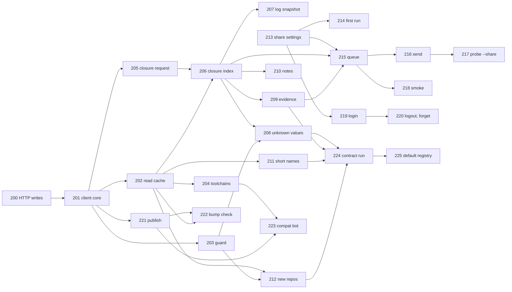

# P2 slice plan: the CLI client track

The order of the P2 slices of the `tln` CLI: the registry index, sharing, `tln publish` and the compat bot (Design 7 P2). The manager of the client track keeps this file. It continues `docs/slices/PLAN-P1.md` (slices 001 to 087). The registry Worker is a separate plan: `docs/registry/PLAN.md` (slices 100 to 122, section C.4 names this track). Each slice has its own file `docs/slices/NNN-<name>.md` (`TESTING.md` 7.2).

| Item | Value |
| --- | --- |
| Status | Draft 1, 2026-11-02. Not reviewed by the human. |
| Compiler | `ROC_TAG` of `scripts/env.sh` (the CLI nightly). `packages/records` builds on `ROC_TAG` and `ROC_TAG_WORKER` (TW28, TW31). |
| Wire types | The CLI imports `packages/records` (R-PK7) for the API types, the JSON codecs, `name_id`, the nightly id, the codes and `Compat.encode_post`. `records` is a Talon package in this repository, not a generic package, so a path entry is allowed (CLAUDE.md names only the 4 generic packages). A change to `records` goes through TalonRegistry ("ask TalonRegistry" in a row). |
| `compat.db` rows (G16, Design Q68) | They stay in the CLI (`cli/lib/Db.roc`, `Facts.roc`, `Evidence.roc`). No slice of this plan moves them. The new tables `share_queue` and `smoke` are CLI tables too. |
| Shared files | `scripts/test.sh`, `tests/lib.sh`, `tests/selftest.sh` and `TESTING.md` belong to the owner of the W2 harness. A row that needs a change there says "ask TalonRegistry". `tests/run.sh`, `tests/tools/fakehttp.py` and `tests/commands/` are CLI files. |
| Registry routes, state 2026-11-02 | Green and stable: 106 reads, 107 short names, 109 toolchains, 110 closure, 111 archive read, 112a ingest, 115 compat bot routes. Not stable: 112b (429, `Retry-After`, cache drop), 113 (repository identity), 114 (OIDC publish), 116 (user hints), 117 (login, JWT, tracker), 122 (`provenance` member). |
| Open ids today | `MISSING=1 scripts/rules.sh R-SH R-SM R-RG R-AD ...` lists R-AD3 to R-AD5, R-AD34 to R-AD36, R-RG4 to R-RG6, R-SH1 to R-SH11, R-SM1, R-SM3 to R-SM7, R-NI16, R-PB5, R-EP15 with no test. R-SM2 has a test (the stub of `tln init --platform`, R-IN8). |

## 1. Scope

### 1.1 Rule ids by component

| Component | Rule ids | Slices |
| --- | --- | --- |
| HTTP writes and the fake registry | Harness for R-AP8 to R-AP10, R-AP36 to R-AP38 (method, body, parallel requests, waits). R-AP23 and R-AP45 (client side: media type, `User-Agent: tln/<v>`). | 200 |
| Registry client core | R-E6, R-J7, R-AP21, R-AP22, R-AP45 (the `unsupported-client` message), R-AP46 (the `too-large` message), R-AP51 (reader), R-AP69 (the URL function), R-PK7 (CLI side), R-EC15, R-EC20 | 201 |
| Read cache and freshness | R-AP24, R-AP43 (cases 1 and 2), R-AP54 (client side), R-AP55 (`no-cache`, `Talon-Bookmark`), R-AP41 row 5 (client side), R-LY1 (`talon/index/` for a registry) | 202 |
| Privacy guard | R-RG3 (token only to GitHub), R-RG4 to R-RG6, R-EC2 (the R-RG6 case) | 203 |
| Compilers from the registry | R-CV1 and R-CV3 (registry branches), R-AP5, R-AP47, R-AP19 (toolchain rows) | 204 |
| Closure query | R-DI1 (registry part), R-AP16, R-AP17, R-AP18, R-AP19 (releases), R-AP20, R-AP42, R-AP59 to R-AP61, R-AP63, R-AP64, R-ID7, R-DT3 (`log:` snapshot), R-DT5 (`log_size`), R-SP24 (second query), R-AP49 (reader) | 205, 206, 207 |
| Unknown header values | R-AP28, R-AP65, R-PU40, R-DI11 (registry part), R-AP9 (client), R-AP25 (client) | 208 |
| Evidence from the registry | R-EF1 ranks 2 and 6, R-EF3 (registry rows), R-EP2, R-EP3 case (a), R-EP6 (case (b) inside the epochs of the answer), R-EP15, R-AP58, R-SM6, R-SE5 (hints order only), R-CM7 (registry evidence) | 209 |
| Index notes | R-AP29, R-AP30, R-AP32, R-AP33 (the `moved from` text) | 210 |
| Short names | R-AD3 to R-AD5, R-AD7 (registry matches as full names), R-AD34, R-SN1, R-SN4 to R-SN6 (client side), Design 4.3 R-I8 | 211 |
| Full names and new repositories | R-AP1 (client), R-AD35, R-AD36, R-AD37, R-SC3, R-SC4 (registry part) | 212 |
| Sharing settings | R-CM23, R-SH1, R-SH5, R-SH6, R-SH8 (local part), R-SH10, R-SE15, R-LY3 (`share.json.lock`), R-TF1 (`share.json`) | 213 |
| First-run prompt | R-SH11, R-NI16, R-NM12 | 214 |
| Share queue | R-SH2, R-SH3, R-EV26, R-SH4 (queue cap) | 215 |
| Queue send | R-SH4, R-SH6 (totals), R-AP10 (user hint path, client), R-CT1, R-CT2, R-CT4, R-CT14 (client), R-AP34 (no wait for hints) | 216 |
| `tln probe --share` | R-PB6, R-CM8 (`--share`), R-EC2 (the R-PB6 cases) | 217 |
| Smoke builds | R-SM1, R-SM3 to R-SM5, R-SM7 (client part) | 218 |
| Login and account | R-SH7, R-SH8 (account part), R-SH9, R-AP35 to R-AP38 (client), R-CT8 (client steps), R-EC13 (login case), R-SE16 (no test: accepted) | 219, 220 |
| `tln publish` | R-CM13, R-TP2, R-AP8 (client), R-AP26, R-AP27, R-AP34, R-PB5, R-PU2, R-PU5, R-PU39, R-EC2 (publish cases) | 221, 222 |
| Compat bot | R-MX1, R-MX15 (the bot script, `PUT /v1/toolchains/{tag}` and `POST /v1/compat` calls as a client), R-TP2 (bot token) | 223 |
| Default registry, exit | R-RG1, R-RG2, Design 7 P2 exit (client part), TW16 design examples that need P2 (CLI 1 `tln add parser@2.0.0`, CLI 3 JSON examples) | 224, 225 |

### 1.2 What stays P3 or has no test

| Phase | Ids | Reason |
| --- | --- | --- |
| P3 | R-AU (`tln audit`), R-YK and R-CM21 (`tln yank`), R-MV and R-CM22 (`tln move`), R-AP31 and R-PU28 to R-PU30 (client parts), R-AP34 for yank and move, R-C6 yank data, R-B3 yank part, R-T22 for other tools, R-SE2 (inclusion proofs), R-SE6 (mirror), R-SE10 (attestation), the log tile reads (R-AP11) | Design 7 P3, registry plan C.3 |
| No test | R-SE14, R-SE16 (accepted risks), R-RL4 (it is `direct` mode, P0) | Security rows that name no mechanism of the client |
| Registry only | The `provenance` member of registry slice 122 (R-AP49, Design Q158) | No client rule reads it. The reader ignores an unknown member (R-AP51), so 122 changes no CLI test. |

## 2. Slices

Rules for all slices: one rule group or one command path, about 400 lines of code or less (TW19). Each slice names its rule ids. Model: "Opus medium" only for the 2 hardest slices, "Sonnet high" for the others. Lines are code lines, not tests.

| # | Slice | Content | Rule ids | Design refs | Depends on (CLI / registry) | Lines | Model |
| --- | --- | --- | --- | --- | --- | --- | --- |
| 200 | HTTP writes, fake registry | `Fx`: `http_send!` (method, URL, headers, body, timeout), `http_all!` (a list of requests, a limit, results in list order: R-AD35 step 3 runs 4 at one time), `sleep!` (R-AP34 waits, device flow poll). Real `Fx` with basic-cli `Http` (or `curl` jobs for `http_all!`, as R-DA5). Fake `Fx` (L2): routes by method, the request body in `calls.log`, the Nth answer of one route. `fakehttp.py` (L3): `POST`, `PUT`, `DELETE`, the same route form, a body log. `tests/run.sh`: optional `expect/http-bodies/`. One example case of each new check. TESTING 3.1 gains the route form: ask TalonRegistry. (status: done, file 200-http-writes.md) | Harness. R-AP23, R-AP45 (client) | TESTING 2.3, 2.4, 3.1, 3.2; Registry 4.2 | 003 (fake HTTP) / none | 300 | Sonnet high |
| 201 | Registry client core (status: done, file 201-registry-client-core.md) | `cli/lib/Registry.roc` (pure, L0): the URLs of R-AP1, R-AP2, R-AP13 with the percent-encoding of R-AP69 (one function, the member order of R-AP69), the headers, the problem read (`records.Problem`), the R-E6 table, `error.details` of R-J7, the messages of `unsupported-client` and `too-large`. The import of `records` in `cli/main.roc` and `tests/commands/`. | R-E6, R-J7, R-AP21, R-AP22, R-AP45, R-AP46, R-AP51, R-AP69, R-PK7, R-EC15, R-EC20 | CLI 3; Registry 4.2 | 200 / 104 | 300 | Sonnet high |
| 201b | Busy registry message | `Registry.problem_fail` for a 503 `/errors/busy` (records 104j, Design Q440, Q445, Registry R-AP82, R-AP34, CLI R-E6 row): exit 15 at once, no retry on a read; the text `the registry is busy (503). Try again in <n> s.` with `n` from `Retry-After`, or `Try again later.` without it; `--json` `error.details` keeps status 503 and the type. A plain 5xx keeps the general text. Added by the manager, 2026-11-03. (status: done, file 201b-busy-message.md) | R-AP82, R-E6, R-AP34 | Registry 4.2 | 201, 208 / 104j | 50 | Sonnet high |
| 202 | Read cache (status: done, file 202-read-cache.md) | GET flow over `http_get!`: the answer and its ETag in `talon/index/` (layout: G-C1), use with no request when younger than `max-age`, `If-None-Match`, 304 keeps the copy, `Cache-Control: no-cache` and `Talon-Bookmark` on the reads of R-AP43. A 404 is not kept. | R-AP24, R-AP43, R-AP54, R-AP55, R-AP41 row 5 | Registry 4.2; CLI 6.1, 7.3 R-DI2 | 201 / 106 | 250 | Sonnet high |
| 203 | Privacy guard (status: done, file 203-privacy-guard.md) | `GET /repos/{owner}/{repo}` with the token rules of R-RG3, before the first registry request with the name, group, URL or hash. Keep a public answer with no end in `talon/index/github/<owner>/<repo>/`. Private or 404: exit 2, the 2 messages of R-RG6 (with and without a token). Not with `--offline`, not for `--frozen`, not for `?short=`. Pure decision (which names need a check) plus flow. | R-RG3, R-RG4, R-RG5, R-RG6, R-EC2 | CLI 1 | 201 / none | 250 | Sonnet high |
| 202b | Cache and guard answers (status: done, file 202b-cache-guard-answers.md) | Follow-up of 202 and 203 for G-C38 to G-C40 (Design Q218 to Q220): a copy with no ETag or no max-age is kept, a 3xx or a 304 with no `If-None-Match` is exit 15, the guard reads each `github.com` text, one lower-case check for each name, an unsafe typed name is exit 2, a 200 with no boolean `private` is exit 15, a public answer stays before a private one. | R-IX2, R-IX7, R-RG4 (rows 1 to 5), R-RG5, R-RG6 | CLI 6.1, 1 | 202, 203 / none | 120 | Sonnet high |
| 201p | Provenance in CLI fixtures (status: done, file 201p-provenance-fixtures.md) | Slice 122 adds `provenance` to each release record. A check of all CLI tests and fixtures found no release record (`Release.Row`, `Release.Wire`, `Closure.Answer`), so no fixture changes. | R-AP49, R-PU15 | Registry 4.2 | 201 / 122 | 20 | Sonnet low |
| 204 | Compilers from the registry (status: done, file 204-registry-toolchains.md) | `GET /v1/toolchains?after=<n>` pages with `more`, the rows in `talon/index/` (G-C1), only rows after the largest kept log index, sha256 from the row (R-CV3), rows above N hidden with `log:N`. `Nightlies` gets a registry source next to the GitHub source. | R-CV1, R-CV3 (registry), R-AP5, R-AP47, R-AP19 | CLI 6.2; Registry 4 | 202 / 109 | 300 | Sonnet high |
| 204b | Toolchain size and answers (status: done, file 204b-toolchain-size-answers.md) | Follow-up of 204 and 211 for G-C42 to G-C44 (Design Q340, Q222, Q223): the asset size is the `size` of the row and a row with size 0 is no asset (R-AP80), the URL is built from the tag and the asset name. A later row of one tag and target with another sha256 is the R-CV6 change. Unknown members of `toolchains.json` are kept on write, a newer `format` is read from `after=0` into memory. Several failing short names give one exit-2 stop that lists each name (also `tln add`), the selector stays with the matched name, a failed `?q=` read gives no suggestion. | R-AP80, R-CV3, R-CV6, R-IX4, R-TF2, R-TF3, R-AD34, R-I8, R-AD4, R-AD5, R-AD7 | Registry 4.2; CLI 6.1, 6.2; Design 4.3 | 204, 211 / 109b | 120 | Sonnet high |
| 205 | Closure request (status: done, file 205-closure-request.md) | Pure: the body of R-AP16 from the resolve request: `groups` with `series` and `range`, `hashes` (each header value, R-ID7), `compilers` from the held pin or from the `nightly` switch, the `[toolchain] roc` range, `min-release-age` and the snapshot. `tln probe --range` sends no window. Client limits: G-C8. | R-DI1 (registry), R-AP16, R-AP60, R-AP61, R-ID7 | Registry 4.1; Resolution 1, 2, 9 | 201 / 110 | 250 | Sonnet high |
| 205b | Closure answers (status: done, file 205b-closure-answers.md) | Follow-up of 201 and 205 for G-C24 to G-C29 (Design Q194 to Q199, R-AP74): `POST /v1/closure` is a read (exit 15), `unsupported-client` with no `minimum`, `join_ranges`, `Report` window and `no_compiler` (exit 10), `hashes` once each. | R-AP74, R-AP16, R-AP61, R-E6 | Registry 4.1 | 201, 205 / 110 | 60 | Sonnet medium |
| 206 | Closure answer as the index | The seam: `PickIndex`, `ResolveBase` and `Gather` get candidates, kinds, deps and pins from one closure answer in place of GitHub pages and archive reads (`records.Closure`). `roc_version` gives rank 4. The winner rule of R-AL9 on `artifacts`. One command uses one index (R-DI14). `--offline` with a registry: G-C9. (status: done, file 206-closure-index.md) | R-AP17, R-AP18, R-AP20, R-AP42, R-AP49 (reader), R-AP63, R-AP64, R-DI14 | Registry 4.1, 5; CLI 7.3; Resolution 5 | 202, 205 / 110 | 400 | Opus medium |
| 206b | Closure query in `tln update` | The query step of R-AL2 step 2 in the flows: which groups and window a command sends (R-DI1, R-AP16), and `Request.index` set to `Answer` after the query. `PickLoop.read_all!` and `hinted!` with a registry, at L2 through a whole command. Split from 206 (manager, 2026-11-03). It also lifts the P0 refusal of a registry URL (`Opts.check_registry`, R-FL5, R-RG1), so a command reaches a registry through `--registry`, `TALON_REGISTRY` or `config.toml`; the built-in default stays `direct` until 225 (R-RG2). Correction 2026-11-03: 206b does not wait for 224 (the contract run). From 207: when a command sends the second query (R-SP16, R-SP23, R-SP24), `--snapshot` into the command, the R-DT5 line and JSON `snapshot` of a whole command, R-AD36 (a name with no release left after the snapshot). From 210: the index notes inside a real `update`, `outdated`, `add` run (the call on the answer, stderr, `--quiet`, the exit code, the place of `json_notes` in `--json` `data`, no note with `--offline` or `direct`). From 209: `PickLoop` and `ProbeRange` use `Matrix.rows`, `real`, `found` in place of `Epochs.epochs`; `hinted!` with `PairOrder.order_shared`; `EvidenceFlow.blocks!` with `Evidence.of_all` and `differ` (where `why` gets an answer is open); the R-EF3 note in the resolve commands. From 208: the call of `ClosureIndex.query!` then `UnknownValues.settle!` in a command and its `urls`, the solver and `Gather` use of `Label` and `Archive` ends (R-DI7, R-C9), the `fixed: not in the registry index` line in `update`, `upgrade`, `outdated`, the guard-then-closure order. From 212: `FullName.read!` in `add`, `tool install`, `x` (the parsed selector, `known`), the use of its answer, the warnings and `--json` data, the no-candidate text of a command, a first R-AP1 read that answers 5xx, 429 or 3xx, an L3 case with real `curl`. (status: done, file 206b-registry-commands.md) | R-AL2, R-DI1, R-AP16 (client) | Registry 4.1; Resolution 5 | 206, 207, 208, 209, 210, 212 / 110 | 200 | Sonnet high |
| 206d | Registry in update: unknown values, second query, offline | After the 206b query in `tln update`: `UnknownValues.settle!` with the `Label` and `Archive` ends and the `fixed: not in the registry index` line; the second query of a held move (R-SP16, R-SP23, R-SP24); `--offline` with a registry (`Offline` index, the R-IX6 note). Split from 206b (manager, 2026-11-03). From the 206b close: `--json` `snapshot` with a time snapshot (Q438: time and log size apart, `Report.Outcome`), and `log:N` in the compiler range step (`ResolveSelect.snapshot_of` refuses it on a registry run). (status: done, file 206d-update-registry-followups.md) | R-AP28, R-SP16, R-SP23, R-SP24, R-IX6 | Resolution 9, 11 | 206b / 110 | 300 | Opus medium |
| 206d2 | Registry in update: held move, JSON snapshot | Parts 2 and 4 of the 206d row: the second query of a held move (R-SP16, R-SP23, R-SP24, `LogSnapshot.second!`), the anchor hold (206d mutation M8); `--json` `snapshot` with a time snapshot (Q438); `log:N` in the compiler range step (`ResolveSelect.snapshot_of`). Split from 206d (manager, 2026-11-03). (status: done, file 206d2-update-held-move.md) | R-SP16, R-SP23, R-SP24, R-DT5 | Resolution 9, 11 | 206d / 110 | 250 | Opus medium |
| 206e | Registry in install, verify, upgrade <names> | (status: done, file 206e-registry-resolve-commands.md) `install` with no names, `verify`, `upgrade` (`Free` window), `outdated` (`Report` window); probe runs with an answer (`read_all!`, `hinted!`, `Matrix` in `PickLoop` and `ProbeRange`, `order_shared`, R-EF3), `why`, the index notes of slice 210 and `index_notes` in `--json`. May split again. From 206d2: the other compiler reads of a registry run (`HeldRoc.picked!`, `offer!`, `NightlyFlow`) use the registry compiler list (R-CV1); an L2 case with an R-AP28 ingest and a held move together (Q460). Also the end-of-command hooks of `ShareQueue.enqueue!` (215) and `QueueSend.send!` (216), with `tln update`. Split from 206b (manager, 2026-11-03). | R-AL2, R-EF1, R-EF3, R-AP29, R-AP30 | CLI 7.3; Resolution 5 | 206d, 209, 210 / 110 | 400 | Opus medium |
| 206e2 | Registry compiler list in resolve commands | (status: done, file 206e2-registry-compiler-list.md) The registry compiler list (R-CV1): `upgrade` with a free nightly (`Free` window, `NightlyFlow`), `HeldRoc.picked!`, `offer!`, `outdated` (`Report` window, `OutdatedFlow`: the list before the query, groups with no series and no range, to check), and an L2 case with an R-AP28 ingest and a held move (Q460). Split from 206e (manager, 2026-11-03). | R-CV1, R-AP16, R-AP74 | CLI 7.3; Resolution 5 | 206e / 109, 110 | 300 | Opus medium |
| 206e2b | Registry list in every compiler read | (status: done, file 206e2b-registry-list-reads.md) From 206e2 D1 and D2. R-CV1: in a registry run, each compiler read uses the registry list (`GET /v1/toolchains`, one read per command, R-IX4), also when no pick read it first (an installed held compiler: `PickLoop.releases!`, the offers, the optional compilers); `registry/sp24-held-move-drop` changes. R-IX6: `--offline` with a registry reads the kept rows of `toolchains.json` in `HeldRoc`, `NightlyFlow`, `PickLoop`, not the GitHub cache. Split from 206e2 (manager, 2026-11-03). | R-CV1, R-IX4, R-IX6 | CLI 6.2, 7.3 | 206e2 / 109 | 150 | Sonnet high |
| 206e3 | Registry evidence in probes and why | (status: done, file 206e3-registry-evidence-probes.md) Probe runs with an answer: `read_all!`, `hinted!` with `PairOrder.order_shared`, `Matrix` in `PickLoop` and `ProbeRange`, `Matrix.unknown_sets`, the R-EF3 note, `tln why` with the registry evidence. Split from 206e (manager, 2026-11-03). | R-EF1, R-EF3, R-EP15, R-AL4 | Resolution 4, 5 | 206e2, 209 / 110 | 300 | Opus medium |
| 206e3b | Registry facts in verify and ladder step 1 | (status: done, file 206e3b-registry-facts-verify.md) From 206e3 plan note P1: `verify` and ladder step 1 read unit facts with `Ladder`'s own `Facts.load!`, so the rank 2 facts of the answer (R-DI1) do not reach them. Also 206e3 P2: the evidence of the second answer of a held move (`Probed.second`). From the 206e3 close: `why --registry <url>` in `Opts.reads_registry` (Q499), and Design Q501 (G-C134: `verify` prints the R-EF3 note, stdout and `data.notes`) and Q502 (G-C135: the `why` window is the workspace nightly when the pins agree; with different pins no `compilers` member, and each member block shows the facts of its own pin; a code change). Split from 206e3 (manager, 2026-11-03). | R-DI1, R-EF1 | Resolution 4, 5 | 206e3 / 110 | 150 | Sonnet high |
| 206e4 | Index notes and share hooks | (status: done, file 206e4-index-notes-share-hooks.md) The index notes of slice 210 and `data.index_notes`; the end-of-command hooks `ShareQueue.enqueue!` (215, with the Q450 header read) and `QueueSend.send!` (216), in `update` and the resolve commands. Split from 206e (manager, 2026-11-03). | R-AP29, R-AP30, R-SH2, R-SH3, R-SH4 | CLI 1; Registry 4 | 206e3, 210, 215, 216 / 116 | 250 | Sonnet high |
| 206f | Registry for names, refusal gone | (status: done, file 206f-registry-names.md) `add`, `install <names>`, `tool install`, `x` with `FullName.read!` and short names, the `NoMatch` texts (Q430), R-AD36, a first R-AP1 read that gets 5xx, 429 or 3xx, an L3 case with real `curl`. Then `Opts.check_registry` goes for every command, with the R-RG7 row 6 / R-TF4 config check for commands with no index call. Until 206f, a command that is not wired keeps the P0 refusal. From 206e4 (Q541): an L2 guard that `roc update` (and `roc install`, `init`) with a registry sends no share queue. Split from 206b (manager, 2026-11-03). | R-AD35, R-AD36, R-AD37, R-SN4, R-RG7 | CLI 2, 7.3 | 206e, 211, 212 / 106, 112a | 300 | Sonnet high |
| 206c | Platform entry from the closure answer | `Release.pf` and `is_platform` from the `is_platform` member of each artifact dep (Design Q251, Registry R-AP81, R-RE19, R-PU38 row 13): the marked dep is the platform edge and its url is `pf`; an app record gives no `pf`; no archive read. Two marked deps: the first mark in the answer order wins; a mark in an app record is ignored (Design Q400). Split from 206 Q1 (manager, 2026-11-03). (status: done, file 206c-closure-platform.md) | R-AP81, R-AP49 (Dep), R-C3 | Registry 4.1 | 206 / records 104i | 100 | Sonnet high |
| 206g | Registry compiler list in the roc commands | (status: done, file 206g-roc-commands-registry-list.md) From 206f Q4: `roc install`, `roc use`, `roc default`, `roc update`, the proxy and `init` still list compilers from GitHub (`RocUse` has `registry: Off`). R-CV1: with a registry, the list is `GET /v1/toolchains` (R-IX4 kept rows, R-IX6 offline). The `share/sh62-*` guards (no queue send, Q541) stay; their registry calls change. Split from 206f (manager, 2026-11-03). | R-CV1, R-IX4, R-IX6, R-CV5 | CLI 6.2, 7.3 | 206f, 206e2b / 109 | 200 | Sonnet high |
| 206h | roc-semver 0.2.0 | Move the CLI from roc-semver 0.1.0 to 0.2.0 by release URL (R-GP3; https://github.com/Karakatiza666/roc-semver/releases/download/0.2.0/BzgH68Q1yBkg7F1ZpFsiEg73ZwkaBrFdcLpX2pUkay9i.tar.zst). 0.2.0 adds only `key_bounds`; the VersionReq tables are the same, so the Worker and the CLI read range text the same (Q555). Run all tests. Never a path entry (R-GP1 to R-GP7). From TalonRegistry (manager, 2026-11-03). (status: done, file 206h-semver-020.md) | R-GP3 | Design 6.1 | none | 30 | Sonnet high |
| 206i | Registry platform read in `tln init` | (status: done, file 206i-init-registry.md) Design Q560: with a registry, `init` reads its platform as `add` does (R-AP1, the ingest, the closure query), not from the GitHub release list. Then `init` joins R-SH4 row 11 (the share queue, Q541), and the guard `share/sh62-no-send-init` changes. From 206g (manager, 2026-11-03). | R-IN1, R-AP1, R-AD35, R-SH4 | CLI 1, 2 | 206g, 206f / 106 | 150 | Sonnet high |
| 209b | Bot smoke results in the ladder | (status: done, file 209b-smoke-ladder.md) R-SM6 in the ladder: a bot smoke `fail` counts as a step 3 fail with no build, and gives a learned interval for its target. Slice 209 gives the smoke row only as a rank 2 fact of its target. Proposed by the 209 test agent (manager, 2026-11-03). | R-SM6 | CLI ladder | 209, 206b / none | 150 | Sonnet high |
| 207 | Log snapshot, second query | `--snapshot log:N` with a registry: hide releases above N (R-AP19), print `resolved at log:<log_size>` (R-DT5), JSON `snapshot`. The second query of a held move with the first `log_size` as `log:N` (R-AP16, R-SP24). (status: done, file 207-log-snapshot.md) | R-DT3, R-DT5, R-AP19, R-SP24 (registry) | Resolution 9, 11; Registry 4.1 | 206 / 110 | 200 | Sonnet high |
| 208 | Unknown header values | R-AP28 cases 1 to 3 in order: the label with another hash (warning, source 1 of R-AP65), ingest of each public `github.com` URL at the same time, then the closure again once with the largest bookmark and `no-cache`. A 409 `label-conflict` is case 1 (R-AP65 source 2). Other host or `log:N`: no ingest, archive read (R-PU40, R-DI7), `fixed: not in the registry index`. (status: done, file 208-unknown-header-values.md) | R-AP28, R-AP65, R-PU40, R-DI11 (registry), R-AP9, R-AP25, R-ID7 | Registry 4.1, 7; CLI 7.3 | 203, 206, 200 / 112a, 112b (429 only) | 350 | Sonnet high |
| 209 | Evidence from the registry | `Matrix` (R-EP15): `epochs`, `runs`, `nearest`, `hints` of the answer into `Epochs`, `Evidence`, `PairOrder`. Rank 2 facts from `bot` and `author` runs (a `bot` row wins, R-EF3), case (a) of R-EP3 from the epochs, case (b) only inside an epoch of the answer, rank 6 hints for the order only. `error_digest` null (R-AP58). `tln why` shows ranks 2 and 6. (status: done, file 209-registry-evidence.md) | R-EF1 (ranks 2, 6), R-EF3, R-EP2, R-EP3 (a), R-EP6, R-EP15, R-AP19 (evidence not hidden), R-AP58, R-SM6, R-SE5, R-CM7 | Resolution 3, 4; Registry 4.1, 6 | 206 / 110, 115 | 400 | Opus medium |
| 210 | Index notes | `index: <owner>/<repo> checked <age> ago` and `not checked since its first ingest` from `checked` (R-AP29, R-AP30) in `update`, `outdated`, `add`. JSON `notes[]` kind `index-stale` (proposal). `repos` states shown where a rule says so. (status: done, file 210-index-notes.md) | R-AP29, R-AP30, R-AP32 | Registry 4 | 206 / 106, 113 | 150 | Sonnet high |
| 211 | Short names (status: done, file 211-short-names.md) | One `GET /v1/packages?short=a&short=b` for all short names of a command (R-SN6), entry i for value i, matches above N hidden with `log:N` (R-SN4). 1 match: use it and print `matched ...` (with `moved from`, R-AP33). 2 or more: stop, list. 0: stop, suggestions from `?q=` (R-SN5). `tln tool install` and `tln x`: no registry pick, list the matches (R-AD7). `Lookup` gets the registry result. | R-AD3, R-AD4, R-AD5, R-AD7, R-AD34, R-SN1, R-SN4, R-SN5, R-SN6, R-AP33, R-I8 | CLI 2; Registry 4.3; Design 4.3 | 202 / 107 | 300 | Sonnet high |
| 212 | Full names, new repositories | R-AP1 for a full name in `add`, `tool install`, `x`. A 404: guard, GitHub list (R-DI2 to R-DI5), the selector, ingest newest first with 4 at one time, 409 and 422 skip with a warning, 429 exit 15, then R-AP1 again with `no-cache` and the largest bookmark. `log:N`: no ingest, exit 2 (R-AD36). (status: done, file 212-full-names.md) | R-AD35, R-AD36, R-AD37, R-AP1, R-SC3, R-SC4 (registry) | CLI 2, 7.3; Registry 4 | 202, 203, 200 / 106, 112a | 350 | Sonnet high |
| 213 | Sharing settings (status: done, file 213-share-settings.md) | `share.json` (id of 16 random bytes in hex, totals, times, JWT slot, `format`, mode `0600`, lock), `tln share on`, `off` (empties the queue), `tln share` with no word (local part: state, the R-SH2 condition that turns it off, 8 characters of the id, totals, queue count). `on` with `direct` prints that nothing is sent. File form: G-C2. | R-CM23, R-SH1, R-SH5, R-SH6, R-SH8 (local), R-SH10, R-SE15, R-LY3, R-TF1 | CLI 1, 6.1 | none / none | 300 | Sonnet high |
| 214 | First-run prompt (status: done, file 214-first-run-prompt.md) | R-NI16 before the work of the first interactive command, the skip cases of R-SH11, a consent prompt that `--yes` does not answer (R-NM12), end of input writes nothing. | R-SH11, R-NI16, R-NM12 | CLI 1, 4 | 213 / none | 200 | Sonnet high |
| 213b | Share follow-ups (status: done, file 213b-share-followups.md) | Design answers Q213 and Q215: `tln share` with no `share.json` prints `id: none` (no file), `chmod 0600` on the temp file before the `rename`, the prompt once for each process tree (`TALON_SHARE_ASKED=1`, also for the in-process steps of `tln run`). | R-SH5, R-SH8, R-SH11, R-SH13, R-EV29, R-SE15, R-CC1 | CLI 1, 6.1; Design Q213, Q215 | 213, 214 / none | 150 | Sonnet high |
| 215 | Share queue | Pure: the 5 conditions of R-SH2 (`DO_NOT_TRACK`, `CI`), the 6 filters of R-SH3 and the 3 tool-app conditions. Filter 4 and 5 read the set of hashes and `bot` pairs of the registry answers of this command (from 206, 209). The table `share_queue` in `compat.db` (G-C2), cap 10,000 with the oldest rows dropped. (status: done, file 215-share-queue.md) | R-SH2, R-SH3, R-SH4 (cap), R-EV26 | CLI 1 Also the L3 contract case of the real `Fx` for `Db.Query` `QueueCount` and `Db.Write` `ClearQueue` (slice 213 leaves their SQL in `cli/RealDb.roc` with no `fxprobe` line: add the `fxprobe` lines and the dump of the table). | 213, 206, 209 / none | 300 | Sonnet high |
| 216 | Queue send | At the end of a command that sent a registry request, after its output: at most 2 requests of 500 rows in 5 s, oldest first. `Talon-Contributor`, `talon_version`. Rows leave after 200, 201, `skipped`, or a 4xx other than 429. Totals of R-SH6 from `written` and `first`. No change of exit code, output or JSON. Needs a hint type in `records` (G-C4): ask TalonRegistry. (status: done, file 216-queue-send.md) | R-SH4, R-SH6, R-AP10, R-CT1, R-CT2, R-CT4, R-CT14, R-AP34 | CLI 1; Registry 6.1 | 215, 200 / 116 | 300 | Sonnet high |
| 217 | `tln probe --share` | (status: done, file 217-probe-share.md) Send the real facts of the target hash from `compat.db` once, also with sharing off, `CI` or `DO_NOT_TRACK`, with the R-SH3 filters except filter 1. The guard first for a `github.com` entry. Exit 2: `direct`, no argument, a bundle file. | R-PB6, R-CM8, R-EC2 | Resolution 4; CLI 1 | 203, 215, 216 / 116 | 200 | Sonnet high |
| 218 | Smoke builds | (status: done, file 218-smoke-builds.md) After the work, before the queue send, only with sharing on: one smoke build for each built (platform hash, nightly, target) that passes R-SM3 rows 1 to 5, with the app of R-SM2 (existing stub code), `probe.timeout`, no budget, no change of output. The table `smoke` (G-C2). Machine errors are not queued (R-SM7). | R-SM1, R-SM3, R-SM4, R-SM5, R-SM7 | Resolution 4 | 215 / none | 300 | Sonnet high |
| 219 | `tln share login` | (status: done, file 219-share-login.md) The text before the code, the device flow with the client id of R-CT8 row 1 (G-C10: test hook), `POST /v1/tokens` with the id, the JWT in `share.json`, never the GitHub token. Decline or expired code: exit 13. No answer: exit 15. `direct`: exit 2. | R-SH7, R-AP37, R-CT8 (client), R-EC13, R-SH10 | CLI 1; Registry 6.1 | 213, 200 / 117 | 300 | Sonnet high |
| 220 | Logout, forget, account | (status: done, file 220-share-logout-forget.md) `logout`: `DELETE /v1/tokens`, remove the JWT. `forget`: `DELETE /v1/contributors/me` with the JWT or the id, new id, totals 0, the message about `compat_hints`. `tln share` with a JWT: `GET /v1/contributors/me`, a 401 removes the JWT and prints `run tln share login`. | R-SH8, R-SH9, R-AP35, R-AP36, R-AP38 | CLI 1; Registry 6.1 | 219 / 117 | 250 | Sonnet high |
| 221 | `tln publish` | (status: done, file 221-publish.md) The OIDC token (R-TP2, audience = registry base URL: G-C11). No token: exit 2 with the `id-token: write` text. The asset URL (G-C6). The body `{url, compat}` with the real facts of the hash from `compat.db` (G-C3: ask TalonRegistry for the `records` type). Retries of R-AP34 (`Retry-After` at most 60 s, else 2, 8, 30 s, a new token after 401). R-E6 exit 20 with the CLI 3 example text. | R-CM13, R-TP2, R-AP8, R-AP26, R-AP27, R-AP34, R-PB5, R-PU2, R-PU5, R-EC2 | Registry 7, 7.1; Resolution 4 | 200, 201 / 114 | 400 | Sonnet high |
| 222 | Publish API check | (status: done, file 222-publish-api-check.md) Before the send: the newest indexed release of the group with a smaller version that is not yanked (R-AP13), `roc bump --old <URL> --expect <version>` with the compiler of the `roc:` pin, the warning, the note for a first release or a failed bump. The exit code does not change. | R-PU39 | Registry 7; Design 2 | 221, 202 / 106 | 200 | Sonnet high |
| 223 | Compat bot | (status: done, file 223-compat-bot.md) `.github/workflows/compat-bot.yml` and the bot script (R-MX15): the work lists (R-AP39, R-AP40), `PUT /v1/toolchains/{tag}`, `tln probe`, `POST /v1/compat` with rows and the sweep, the OIDC token as R-TP2. The form and language: G-C12. | R-MX1, R-MX15 | Registry 6 | 204, 221 (token code) / 108, 109, 115 | 300 | Sonnet high |
| 217b | `tln probe --range --json` facts | (status: done, file 217b-range-facts.md) Q580, Q581 (`data.facts`): `data.range.facts`, the facts that this run probed, as `{nightly, target, result}` in probe order. No inferred or earlier facts. A new data member; the schema does not change (R-J6). The bot range search (Q574) comes after it. | R-PB9, R-J6 | Resolution 4; CLI 1 | 217 / none | 150 | Sonnet high |
| 218b | `tln probe --smoke` | (status: done, file 218b-probe-smoke.md) Q579: `tln probe --smoke <alias or release URL> [--target <t>]...`. It fetches the platform by URL and checks the hash. It builds the smoke app on the selected compiler (`ROC_TOOLCHAIN` for the bot) for each `--target`, or for each target of the platform header. It always builds, also when `smoke` has the key, and writes the result to `smoke`. `--json`: `data.smoke` is a list of `{target, result}`, where result is pass, fail, hang, crash or machine-error. The operand is a URL, not a bundle file (Q549). Exits as R-PB8. Exit 2: a bad target, an operand that is not a platform, or a mix with `--range` or `--share`. After it, the bot uses it for R-MX10 and the platform pairs of R-MX13. | R-PB10, R-CM8, R-FL12 | Resolution 4; CLI 1 | 218 / none | 250 | Sonnet high |
| 224 | Contract run (optional) | A few L3 cases tagged `worker` run `tln` against the built `app.wasm` in Miniflare with local D1 and the fake GitHub of W2, in place of `fakehttp.py`. They check that the fake routes of 200 to 222 agree with the real routes. A step in `scripts/test.sh`: ask TalonRegistry. Only when the user accepts the cost. (status: done, file 224-contract-run.md) | Contract of R-AP1, R-AP5, R-AP7, R-AP9, R-AP13, R-AP16, R-AP17 | TESTING 3, 9 | 208, 209, 211, 212 / 101 harness, 106 to 115 | 200 | Sonnet high |
| 225 | Default registry, P2 exit | The built-in default becomes the registry URL (R-RG2, G-C11). TW16 examples of CLI 1 and CLI 3 that need P2. L4 with the real Worker on the edge (`net` tag), only with the user and a deployed Worker. (status: done, file 225-default-registry.md) | R-RG1, R-RG2, Design 7 P2 exit (client) | CLI 1, 3; Design 7 | all above / 121, deploy | 100 | Sonnet high |
| 226 | Probe a bundle with no project | (status: done, file 226-probe-bundle-no-project.md) Found by the first live compat bot run. A bundle operand searches for the project, and when no project file is found it takes the no-project path of Q591 (ROC_TOOLCHAIN rank 2). Every other search failure still stops. | R-PB1, R-SO2, R-SO15 | Resolution 4; Design Q566, Q591 | 223 / 108 | 100 | Sonnet high |
| 230 | Format constants | (status: done, file 230-format-constants.md) One format constant for each JSON file kind (F9). L0 test of the frozen temp name forms (F15). | R-TF1, R-TF2, R-CC2 | G-C237 (Design Q607); research/cli-format-audit/PLAN.md | D / none | 80 | Sonnet |
| 231 | Unknown value hint, lenient self-update | (status: done, file 231-unknown-value-hint.md) Exit 19 for an unknown value form gets the hint line. `tln tool update talon` reads config.toml leniently (F3, F13). | R-TF4, R-TF8 | G-C237 (Design Q607) | D / none | 120 | Sonnet |
| 232 | Unknown tool source kind | (status: done, file 232-unknown-tool-kind.md) `tools.json` entry with an unknown `source.kind`: kept, listed, targeted command exit 19. Setup replaces an unreadable `talon` entry. L0 for an unknown compat.db word (F2, F5, F11). | R-TF8, R-TF7 | G-C237 (Design Q607) | 231 / none | 200 | Sonnet high |
| 233 | Keep unknown `[tools]` keys | (status: done, file 233-keep-tools-keys.md) Unknown `bin` targets give a warning and are kept. An entry write keeps unknown subkeys (F4, F8). | R-PT18, R-PT19 | G-C237 (Design Q607) | D / none | 120 | Sonnet |
| 234 | Record step never stops | (status: done, file 234-record-never-stops.md) `projects.json` failure of kind input in the record step: warning, no write. GC still exit 19 (F1). | R-TF9 | G-C237 (Design Q607) | D / none | 80 | Sonnet |
| 235 | One `.talon.json` reader | (status: done, file 235-one-talon-json-reader.md) All readers use one function. A newer format reads as no fields. L2 for a foreign toolchains/ dir (F7, F14). | R-TF3, R-GC5 | G-C237 (Design Q607) | 230 / none | 120 | Sonnet |
| 236 | tln version gate | (status: done, file 236-tln-version-gate.md) Optional key in the root talon.toml. Each command and the proxy check it first: exit 19 (F3, user decision 2026-11-08). | R-TF10 | G-C237 (Design Q607) | 231 / none | 150 | Sonnet high |
| 237 | GC of the registry copies | (status: done, file 237-gc-registry-copies.md) `tln cache gc` removes the old pages of `get/` (2 files) and the dirs of other registries that no file changed in the GC age. It keeps `toolchains.json` of the registry of the run. Code is missing (found 2026-11-08). | R-GC15, R-IX5 | Design Q200 | 202 / none | 150 | Sonnet high |
| 238 | Channel tables | (status: done, file 238-channel-tables.md) The built-in `nightly` table. Parse `[channels]` in config.toml and talon.toml: names, table equality, R-TF8 for unknown values, older-tln behavior. | R-CH1 to R-CH3, R-CH10, R-CH17 | G-C242 (Design Q612); research/compiler-channels/PROPOSAL.md | design / none | 150 | Sonnet high |
| 239 | github-release shape | (status: done, file 239-github-release-shape.md) Make `Nightlies.roc` work over a channel table. Build and parse ids (`reify-<date>-<sha>`). `Pin.is_nightly`, `kind_of` and `Age.compiler_name` work by channel. | R-CH4, R-CH5, R-CH9 | G-C242 (Design Q612); research/compiler-channels/PROPOSAL.md | 238 / none | 200 | Sonnet high |
| 240 | Install from a channel | (status: done, file 240-install-from-channel.md) Always `direct` for a user channel. `channel` and `source` go into `.talon.json` and the R-CV6 row. Trust check: a channel that only the project declares gives exit 19 (Q612 item 1). | R-CH11, R-CH13, R-CH16 | G-C242 (Design Q612); research/compiler-channels/PROPOSAL.md | 239 / none | 200 | Sonnet high |
| 241 | Channel selection | (status: done, file 241-channel-selection.md) Ranges and refs for each channel. `*` and `>=nightly-` do not match user channels (Q612 item 3). | R-CH6 to R-CH8 | G-C242 (Design Q612); research/compiler-channels/PROPOSAL.md | 239 / none | 200 | Sonnet high |
| 242 | Channel commands | (status: done, file 242-channel-commands.md) `tln roc channel add <name> <URL> [--tag-prefix]` (name required, reads the network), `add <name>` copies from the project (no network), `rm`, `list`. | R-CH12, R-CH13 | G-C242 (Design Q612); research/compiler-channels/PROPOSAL.md | 238 / none | 250 | Sonnet high |
| 243 | use, upgrade and GC for channels | (status: done, file 243-channel-use-upgrade-gc.md) `roc use`, `upgrade roc` and `roc update [<name>]` for a channel. Default moves. `roc list` marks. GC and remove of channel dirs. No share. | R-CH14 to R-CH17 | G-C242 (Design Q612); research/compiler-channels/PROPOSAL.md | 240, 241 / none | 300 | Sonnet high |

## 3. Test strategy

### 3.1 The fake registry

The CLI tests already have a fake HTTP for GitHub. The registry is one more set of routes on the same fake. No new server.

| Layer | How the registry answers are given | Check |
| --- | --- | --- |
| L0 | Pure functions get the answer body as text. The texts are copies of the bodies in `worker/tests/cases/*/expect/responses.jsonl` (the real Worker answers, headers included). The copy goes into the CLI test file or `tests/fixtures/registry/`. Never edit the W2 files. | Decoders, R-E6 table, R-AP69 URLs, R-AP28 cases, R-SH3 filters |
| L2 | `tests/commands/` fake `Fx`: `fx/http/<host>/v1/...` files, as the GitHub routes today (`FakeJobs.http_get!`). Slice 200 adds the method form and the Nth answer. The registry host in a case is a fixed loopback text, for example `127.0.0.1:9`. `calls.log` has each request line, its headers and its body. | The order of calls: guard before the first registry request, closure once, ingests, closure again with the bookmark |
| L3 | `tests/tools/fakehttp.py` serves `given/http/v1/...`. The cmd sets `TALON_REGISTRY=$TALON_HTTP` (already set by `with-http.sh`), and GitHub stays on `TALON_GITHUB_API`. The paths do not collide (`/v1/...` and `/repos/...`). `.meta` gives the status, `ETag`, `Cache-Control`, `Talon-Bookmark`, `Retry-After`. `expect/http.log` and `expect/http-bodies/` check what `tln` sent. | Exit codes, `--json` `error.details`, stderr texts, files in `talon/index/`, `share.json`, `compat.db` rows |
| L1 | roc-fuzz targets on the decoders of `records` answers: no crash on any text (R-AP51 reader) | |

A tool `tests/tools/mk-registry.sh <W2 case> <request n> <route>` (slice 200) copies one W2 answer into a route file and its `.meta`, so the shapes stay true. The R-AP69 URL text of the CLI must be the route name that the fake serves, so a wrong encoding gives a 404 in the test.

### 3.2 Which slices need a real Worker

| Need | Slices | When |
| --- | --- | --- |
| None (fakes only, L0 to L3) | 200 to 223 | Each slice |
| Local Worker (Miniflare, local D1, fake GitHub, no account) | 224 | Optional, with the user |
| Real Worker on the edge (L4, `net` tag) | 225, and the real OIDC token of 221 and 223 in a GitHub Actions job | Only with the user and a deployed Worker |

## 4. Order

| Can start | Slices | Reason |
| --- | --- | --- |
| Now | 200, 201, 203, 205, 213, 214 | No registry route and no gap. 213 and 214 need nothing from the registry. |
| Now, after their CLI deps | 202 and 204 (pure parts now, the file layout after G-C1), 206 to 212, 215, 218 | Their routes are green (106, 107, 109, 110, 112a, 115). 208 reads 429 of 112b from the design. 210 reads `repos` states of 113 from the design. |
| Design is the contract, route not stable | 216, 217, 219, 220, 221, 222 | Routes 114, 116, 117. They can start from the design, but each waits for its gap answer (G-C3, G-C4, G-C6, G-C10, G-C11). Copy the W2 answers when the route is green. |
| Waits for a decision | 223 (G-C12), 224 (user, harness owner), 225 (G-C11, deployed Worker) | |

Two tracks can run at one time: the index track (200 to 212) and the sharing track (213 to 218). Publish (221, 222) needs only 200 and 201.

## 5. Design gaps (TW17 questions)

Each gap is a question. No slice decides it. The gap stops only the part of the slice that it names. TalonRegistry gives a Design Q id when its design agents take the question.

| # | For | Slices | Gap |
| --- | --- | --- | --- |
| G-C1 | The user / design agent | 202, 204 | The layout of registry answers in `talon/index/`. R-AP24 and CLI 6.1 say "in `talon/index/`", but give no path. GitHub has `talon/index/github/<owner>/<repo>/` (R-DI2). Open: one dir for each registry origin or not, the file name for a URL with a query (R-AP13 `group=`), the store of the toolchain rows of R-CV1 (one file or pages), and what happens to the copies when the registry setting changes. |
| G-C2 | The user / design agent | 213, 215, 218 | The forms of `share.json` (member names for the id, the totals `sent`, `counted`, `first`, the 2 times, the JWT and its `expires_at`), of the table `share_queue` (columns, the order key for "oldest first") and of the table `smoke` (R-SM4) in `compat.db`, and the `compat.db` `user_version` step. R-TF1 needs the `format` value. |
| G-C3 | TalonRegistry | 221 | The `compat` member of the publish body (R-AP8, R-PU5): its row form (the rows of R-AP10 with `error_digest`?), whether each row must have the hash of the URL, a limit of rows, and the `records` type for it. |
| G-C4 | TalonRegistry | 216, 217 | The user hint body: R-AP10 says a user hint row has no `error_digest` (R-CT2), but `records.Compat.Post` requires it, and `Post` has no `talon_version` (R-CT2). The answer `{written, first, skipped}` (R-CT14) has no `records` type. A `records` change is needed. |
| G-C5 | TalonRegistry | 202, 204, 211, 212, 219, 220 | `records` has no types for the answer objects of R-AP1, R-AP13, R-AP14 (`{releases, checked, repos}`), R-AP2, R-AP5 (`{toolchains, more}`, the R-RE4 row), R-AP7 (`{matches}`, R-SN6), R-AP37 and R-AP35. The CLI can decode them itself, but R-PK7 puts the API types in `records`. Ask for them or say that the client writes its own. |
| G-C6 | The user / design agent | 221 | How `tln publish` finds the asset URL. R-CM13 has no argument. Possible sources: `$GITHUB_REF` and the release of that tag (R-DI4), or an argument. Also: a repository with 2 or more packages, and a release with no `<hash>.tar.zst` asset yet (the upload runs before `tln publish`, R-PB5). |
| G-C7 | The user / design agent | 221 | Output of `tln publish` on success (201, 200) and the `--json` `data` fields are a proposal (TW24), but which facts it sends when `compat.db` has none for the hash (send no `compat`, or stop) is not given. |
| G-C8 | The user / design agent | 205, 211 | Client limits. R-AP46 and R-AP62 say that `tln` keeps to the limits (300 groups, 1000 hashes, 256 KB body, 50 `short` values), but not what `tln` does for a larger workspace: split the query (R-AP18 then gives 2 states), or stop with an exit code. |
| G-C9 | The user / design agent | 206 | `--offline` with a registry. R-AD37 and R-DI12 say "use the cached pages", but the closure answer is `no-store` and a `POST`. Which cached data stands in for the closure answer: the R-AP13 copies, the archives (R-DI7), or nothing (exit 15)? |
| G-C10 | The user / design agent | 219 | A test hook for the GitHub device flow. `TALON_GITHUB_API` replaces only `https://api.github.com`. The device flow uses `https://github.com/login/device/code` and `/login/oauth/access_token`. A test needs a base URL for them (for example `TALON_GITHUB_WEB`), as TQ1. Also the poll rules (`interval`, `slow_down`, the end time) are not given: follow RFC 8628, or state them. |
| G-C11 | The user / design agent, and TalonRegistry for `AUDIENCE` | 221, 223, 225 | The registry base URL: the default URL of R-RG2, and its one text form. R-TP2 sends `audience=<registry base URL>`, and the Worker compares it with `AUDIENCE`, so a trailing `/` or a case change fails the token. Also: how `tln` joins the base URL and `/v1/...` when the setting has a path or a trailing `/`. |
| G-C12 | The user / design agent | 223 | The form of the compat bot script: a Roc app, a shell script with `curl`, or a hidden `tln` subcommand. Where it gets the probe results (`tln probe --json` `data`, or `compat.db`). Its test layer (L2, L3, or the W2 harness). R-MX15 says only "a small bot script beside the workflow". |
| G-C13 | The user / design agent | 201, all L3 | The URL schemes of a registry setting. CLI 1 says "a URL" with no check. The L3 cases need `http://127.0.0.1:<port>`. Is `http://` allowed only for a loopback host, as package URLs (R-EV25)? What does `tln` do with a setting that is not a URL (exit 19 or 2)? |
