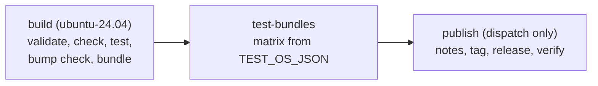

# Workflows for the generic package repositories

Templates for `roc-app-header`, `roc-semver`, `roc-base58` and `roc-toml` (Design 6.1, R-GP2, R-GP5). Copy both files to `.github/workflows/` of each repository. They are not used in the Talon repository.

| File | Use |
| --- | --- |
| `ci.yml` | L0 (`roc check`, `roc test`) and L1 (roc-fuzz) on push to `main`, on pull request, and by hand |
| `release.yml` | Build, test and publish one GitHub Release. A pull request runs it as a dry run. |

Research date: 2026-10-16. All statements below are from the files and commands in section 7.

## 1. Repository layout that the templates assume

Each path is an `env` value at the top of the file (`ci.yml` lines 18 to 29, `release.yml` lines 26 to 37). Change it there only.

| Variable | Default | Used by |
| --- | --- | --- |
| `ROC_NIGHTLY` | `nightly-2026-10-09-258ab27` | Both. The nightly that Talon pins. |
| `PACKAGE_DIR` | `package` | `release.yml`: `roc bundle` runs here |
| `PACKAGE_MAIN` | `package/main.roc` | Both: `roc check`, `roc bump` entry point. Must be in `PACKAGE_DIR`. |
| `TEST_PATHS` | `package/main.roc` | Both: `roc test` on each path (separated by spaces). `roc test` follows imports. |
| `FUZZ_DIR` | `fuzz` | `ci.yml`: each `*.roc` file with an `app [` header is one target. A helper module (no app header) is not a target. |
| `FUZZ_RUNS`, `FUZZ_SEED` | `100000`, `1` | `ci.yml`: `--runs` and `--seed` of each target |
| `BUNDLE_DIR` | `dist` | `release.yml`: output of `roc bundle` |
| `TEST_OS_JSON` | `["ubuntu-24.04","macos-26"]` | `release.yml`: runners that test the bundle (Linux x86-64, macOS arm64) |

A fuzz target imports the package with a path dependency, for example `pkg: "../package/main.roc"`. `roc-lang/unicode` (`fuzz/utf8.roc`) and `roc-ansi` (`fuzz/piece-table/main.roc`) use this form. A local build of this form on the pinned nightly passed (section 6).

## 2. Trigger and how to run a release

| Event | `ci.yml` | `release.yml` |
| --- | --- | --- |
| `push` to `main` | Runs | No |
| `pull_request` | Runs | Dry run: version `999.999.999`, no bump check, no publish job |
| `workflow_dispatch` | Runs | Real release. Input `release_version` (required). Only from the default branch. |

There is no tag-push trigger. The workflow makes the tag. This is the form of the release-package README template and of all 4 caller repositories in section 7.

```sh
gh workflow run release.yml -R Karakatiza666/<repo> --ref main -f release_version=0.1.0
gh run watch -R Karakatiza666/<repo>
```



## 3. Release properties (R-GP2) and how each is met

| Property | release-package default | What the template adds |
| --- | --- | --- |
| Tag `X.Y.Z`, no `v` | Default. `validate-release` and `publish-release` parse the version with `RELEASE_VERSION_RE` (`release.py` lines 20 to 29). They reject `v1.2.3`, `1.2`, `1.2.3+build.1`, `0.0.0` (README lines 655 to 660, `release.py` line 749). `publish-release` makes tag `<version>` with no prefix (`release.py` line 491 on). | `-f release_version=X.Y.Z` |
| Not a draft | Default. `gh release create` has no `--draft` (`release.py` lines 522 to 539). | Step "Verify the published release" (line 248) reads it back. |
| Not a prerelease | Not by default. A version with a suffix (`1.2.3-rc1`) passes and gets `--prerelease` (`release.py` line 538). | Step "Require a stable X.Y.Z version" (line 83) stops when `is_prerelease` is `true`. The verify step checks `isPrerelease == false`. |
| Exactly one asset `<hash>.tar.zst` | Partly. `prepare-bundles` accepts 1 or more files that end in `.tar.zst` (`validate_artifact_filename`, line 838). It does not check the hash. | `roc bundle` names the file with the base58 BLAKE3 of the compressed file (section 6). Step at line 137: `jq -e 'length == 1'` (from `ageron/roc-package-template`) and the base58 name pattern. Step at line 190: `roc unbundle` stops with "Hash mismatch" when the name is not the hash. The verify step checks the list of `.tar.zst` assets equals the one bundle name. |
| Other assets allowed, no second `.tar.zst` | Not checked. `additional_assets` takes any file (`release.py` line 1155). | The template gives no `additional_assets`. If you add one (for example docs), do not add a `.tar.zst`. The verify step fails if you do. |

## 4. Steps of `release.yml`

| Line | Step | Source | Why |
| --- | --- | --- | --- |
| 50 | Require the default branch | `roc-ansi` | A release is made from `main` only |
| 56 | Checkout, `fetch-depth: 0` | `roc-ansi`, `roc-random` | Local tag check in `validate-release` |
| 62 | `roc-lang/setup-roc` with `nightly-tag` | All callers | The caller installs Roc (README line 21). No Zig for a pure package (README lines 25 to 26). |
| 68 | Require the pinned compiler | New | `roc version` must name `ROC_NIGHTLY` |
| 73 | `validate-release` | README template | Version form. Fails if the tag or release exists. |
| 83 | Require a stable X.Y.Z version | New | R-GP2 (section 3) |
| 88 | `roc check`, `roc test` | README `./ci/all_tests.sh` | Same L0 as `ci.yml` |
| 97 | `resolve-previous-release` (dispatch only) | README template | URL of the `.tar.zst` of the latest stable release |
| 104 | `run-bump-check` | `ageron/roc-package-template` | `roc bump --old <url> --expect <X.Y.Z> <main>`. See section 5. |
| 116 | Bundle package | `ageron/roc-package-template` `scripts/bundle.sh` | `main.roc` first, then all other `.roc` files. The output directory must exist before `roc bundle`. |
| 130 | `prepare-bundles` | README template | Copies to `.release/bundles`, writes the test matrix |
| 137 | Require one bundle, base58 name | `ageron` (`jq`), new (pattern) | Section 3 |
| 144, 152 | Upload bundles and metadata | README template | The later jobs use the same bytes |
| 190 | `test-bundle` | README template | On each runner: `roc unbundle` (hash check), then `roc check` and `roc test` on the extracted `main.roc` |
| 219 | Checkout (with credentials) | README template | `publish-release` runs `git tag` and `git push origin` |
| 234 | `make-release-notes` | README template | GitHub generated notes, plus the `roc bump` output |
| 242 | `publish-release` | README template | Tag and release in one `gh release create` call with the asset |
| 248 | Verify the published release | New (idea from `roc-ansi`, which reads the release back) | Section 3 |

Permissions: `permissions: {}` at the top. `contents: read` for `build` and `test-bundles`. `contents: write` only for `publish` (README lines 71 to 82). Each action gets `github_token: ${{ github.token }}`.

The docs actions (`docs-snapshot`, `docs-index`, `docs-validate`, `create-followup-pr`) are optional and not used.

## 5. `run-bump-check` on a first release

| Case | `previous_url` | `bump_check` | Result |
| --- | --- | --- | --- |
| Pull request | not resolved | `warn` | Dry run. Writes "roc bump check skipped for dry-run release". No `roc` call (`release.py` lines 303 to 308). |
| First release (no release yet) | empty: `releases/latest` gives 404, the repository is readable (`release.py` lines 258 to 265) | `warn` | Writes "No previous release bundle found; roc bump check skipped." Exit 0 (`release.py` line 321). |
| Later release | URL of the latest stable `.tar.zst` | `require` | `roc bump` must pass. If not, the release stops. |

With `require` and no URL, the action fails (`release.py` lines 314 to 320, README lines 578 to 581). The template selects the mode with the expression of `ageron/roc-package-template` `release.yml` line 65.

## 6. Local checks (2026-10-16)

| Check | Result |
| --- | --- |
| `gh release view nightly-2026-10-09-258ab27 -R roc-lang/nightlies` | Published, not a prerelease. Assets: `roc_nightly-linux_x86_64-2026-10-09-258ab27.tar.gz`, `..._macos_apple_silicon_...tar.gz`, linux arm64, macOS x86_64, Windows. The top directory is `roc_nightly-linux_x86_64-2026-10-09-258ab27/`, which matches the `DIR_PATTERN` of setup-roc. |
| setup-roc and this tag | Accepts it. `nightly-tag` is used as is in `releases/tags/<tag>` (setup-roc `action.yml` lines 159 to 162). No pattern check. Only with `version: nightly-new-compiler`. |
| `roc bundle main.roc` on a copy of `layout-probe/package` | `ECKEjhWqeHFcpCRx9RQ65Vvsq7sM5jCxCk1dUpZLJMgU.tar.zst`. The name is base58 of BLAKE3 of the compressed file (checked with Python `blake3` 1.0.11). Not of the uncompressed tar. The same file results with all modules on the command line. |
| `roc unbundle` of a renamed file | Exit 1, "Hash mismatch" |
| Shell steps with the real `release.py` and `run-command.sh` | Bundle, `prepare-bundles`, name check and the `test-bundle` command pass. A renamed bundle fails. |
| Fuzz step | A target with `../package/main.roc` builds in 0.6 s and runs 2,000 inputs. A planted bug: exit 1, the target is named, a `crash-*` file is saved. No target: exit 1. A helper module is skipped. |
| Verify step query | Passes on `kili-ilo/roc-random` 0.9.2. Fails on a wrong name and on `roc-parser` `2.1.0-rc.1` (prerelease). |
| `actionlint` 1.7.12 (with shellcheck), `yamllint` | No findings |

## 7. Evidence

| Item | Value |
| --- | --- |
| `roc-lang/release-package` | Head of `main` `af2f0cd8662874b825ff3917f4286e793ba18c55` (2026-08-08). No tags and no releases, so the pin is the full SHA (README lines 28 to 37). Files read: `README.md`, `actions/*/action.yml` (11), `scripts/release/release.py`, `scripts/release/run-command.sh`, `tests/`, `.github/workflows/ci.yml`. |
| `roc-lang/setup-roc` | `f5a74bf90aa694b43ab4a7cbfdb19273bc6aa697` (2026-07-07, head of `main`). Used by `roc-ansi`, `roc-parser`, `roc-random`, `roc-fuzz`. Tag `v0.3.0` is `cbe782d6f165b89c87d99f50a59ac4f5f73b4427` (used by `ageron`, `roc-lang/unicode`). Both have `nightly-tag`. |
| `actions/checkout` | `3d3c42e5aac5ba805825da76410c181273ba90b1` = `v7.0.1` |
| `actions/upload-artifact` | `cf430e030ddbb5b0abf93d22962f4752f3646cd9` = `v7.0.2` (as `roc-ansi`) |
| `actions/download-artifact` | `9000827ccba6bdab643e8b6fd33ac0654aef8333` = `v8.0.2` (as `roc-ansi`) |
| `ageron/roc-package-template` at `7113ff207aad94aa94c75d617900d995670c88e6` | `release.yml`: all 7 release steps at `af2f0cd`, first-release `bump_check` expression (line 65), `jq` one-bundle check (line 80). `scripts/bundle.sh`. `.github/actions/setup-roc`. |
| `kili-ilo/roc-random` at `d01ba10c6268b60d86c797cee41c6213a1316685` | `release.yml` at `bb018c8`: same structure, `prepare-bundles` with one runner. Release `0.9.2`: one `.tar.zst` plus a docs `.tar.gz`, not a draft, not a prerelease. |
| `lukewilliamboswell/roc-parser` at `0c67c541ea3c51cc7c52721fb3bc652cca9f0c2c` | `release.yml` at `af2f0cd`, `bump_check: warn` (old bundles may not compile on a new nightly). `fuzz.yml`: fuzz on `ubuntu-latest` only, `run --runs=2000` for each target (`scripts/run_fuzz.py`). |
| `lukewilliamboswell/roc-ansi` at `86ada165b9249ff84eb0a47080b69d7989a52d4e` | Uses only `validate-release`. Own publish with a draft that is read back. Default-branch guard. |
| `roc-lang/unicode` at `8405346db30a8f1d28acfe87e29e09aa929b3409` | `tests.yaml` job `fuzz-smoke`: Linux x64 only, `--runs=2000 --seed=50`. Flat `fuzz/*.roc` with a helper `FuzzSupport.roc`. Not a release-package caller. |
| Search | `gh search code "roc-lang/release-package"`, also with `--owner roc-lang` and `--owner lukewilliamboswell`. Pure package callers: the 4 above. Platform callers: `basic-cli`, `basic-webserver`, `basic-ssg`, `roc-ray`, `roc-pandoc`. |

## 8. Risks and open questions

| Id | Item |
| --- | --- |
| K1 | `roc bump` needs the old bundle to compile on the current nightly (`roc bump --help`). After a nightly change, a `require` bump check can fail for no API reason. `roc-parser` uses `warn` for this. Fix: release on the same nightly, or set `bump_check: warn` for that run. |
| K2 | `prepare-bundles` and `publish-release` do not check the hash or the count of `.tar.zst`. The template adds the checks (section 3). Keep them if you change the template. |
| K3 | release-package has no tags. A new fix needs a new SHA by hand. |
| K4 | setup-roc does no checksum check for a nightly (`action.yml` lines 137 to 139, 177). It extracts into `$GITHUB_WORKSPACE`, so `roc_nightly-*/` is in the checkout. A glob over the whole repository can see it. |
| K5 | `macos-26` doubles the fuzz time. TESTING.md 4 asks for Linux. Human review: keep it or remove it. |
| K6 | `FUZZ_RUNS=100000` is a proposal. The callers use 2,000. `research/roc-fuzz-check/` ran 200,000 inputs in 0.85 s. Each run also stops at the roc-fuzz default `--time=60`. |
| K7 | A repository with no fuzz target fails `ci.yml` (R-GP5 needs L1). Human review: fail or warn. |
| K8 | Release notes are the GitHub generated notes. R-GP2 gives no rule for the notes. |
| K9 | No GitHub `environment` with required reviewers (as `roc-ansi` and `roc-parser`). Add `environment: release` to `publish` if a second approval is wanted. |
