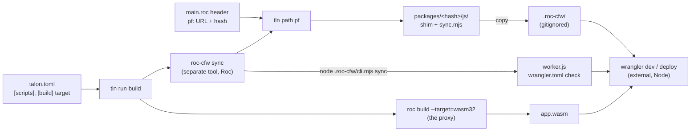

# Talon scripts, the build target, and a Workers setup with no npm

Date: 2026-10-23. Design study. No change to `DESIGN*.md`, `cli/`, `tests/` or `docs/`. Each rule below is marked PROPOSED. It is input for the human review, not part of the spec. The user answered the open questions on 2026-10-23: section 12 has the decisions, and this revision follows them.

Goal: a Roc Cloudflare Workers project that has no `package.json` and no `npm install`, with features of the first Talon version. The previous check is `cloudflare-workers/research/talon-fit/README.md` (gaps G1 to G7). The platform transition note is `cloudflare-workers/research/talon-fit/TRANSITION.md`.

Sources, as in the working tree on this date. A path such as `CLI R-T2` is the rule id in `DESIGN-CLI.md`.

| Short name | File |
| --- | --- |
| Design | `DESIGN.md` |
| CLI | `DESIGN-CLI.md` |
| Resolution | `DESIGN-RESOLUTION.md` |
| Registry | `DESIGN-REGISTRY.md` |
| Platform | `cloudflare-workers/` (`js/cli.mjs`, `js/runner.js`, `scripts/bundle.sh`, `examples/`) |

## 1. Summary

| # | Decision or proposal | Status | Section |
| --- | --- | --- | --- |
| 1 | The helper CLI is a separate tool | User decision (fixed) | 6 |
| 2 | `tln run <name>`: a list of commands in `[scripts]` of `talon.toml`. No shell. Explicit call only. In Talon v1 | Decided (Q-S1, Q-S2). Rules PROPOSED, phase P1 | 3 |
| 2a | `tln run --each`: dependency order between workspace directories (header path entries and `[run] after`). No parallel runs | Decided (Q-S6). Rules PROPOSED | 3.4 |
| 2b | Project tools: a `[tools]` table in the root `talon.toml`, with a range and a locked release URL for each tool. `tln run` and `tln x` use the project version before a global one | Decided (Q-S4). Rules PROPOSED, phase P1 | 6.2 |
| 3 | No hooks. Talon never runs a script by itself, and never runs code of a dependency | PROPOSED | 4 |
| 4 | A `.roc` script is an ordinary app that names its own platform (usually basic-cli). No Talon script platform | PROPOSED | 5 |
| 5 | G1: the build target of a project comes from the platform `targets`, or from `[build] target` | PROPOSED, phase P0 (ladder step 3 runs in P0, R-PH9) | 7 |
| 6 | The JS shim and the version-specific part of `sync` go into the platform bundle. So the hash of the header pins them, and G5 (two pins) goes away | PROPOSED (platform side) | 6, 8 |
| 7 | `tln path <alias>`: print the directory of a header entry. Read-only | Decided (Q-S3). Rules PROPOSED, phase P1 | 8 |
| 8 | The helper copies the shim to the project directory `.roc-cfw/`. `worker.js` imports it with a relative path | PROPOSED (platform side). Tested: Wrangler bundles it | 8, 9 |
| 9 | Node and Wrangler stay external prerequisites, as `git` and `curl` are | Fact | 10 |



## 2. Use cases with no npm

| # | Use case | How, with this proposal | New Talon part |
| --- | --- | --- | --- |
| U1 | Install and pin the platform and the nightly | `tln add --platform Karakatiza666/roc-cloudflare-workers` (R-AD29 to R-AD31). The ladder builds for `wasm32` | G1 (R-TG1 to R-TG6) |
| U2 | Build `--target=wasm32 --no-cache --output=app.wasm` | A step of a script: `roc build --target=wasm32 --no-cache --output=app.wasm main.roc`. `roc` is the proxy (R-PX2) | `tln run` |
| U3 | `sync` after the build, `sync --check` in CI | Script steps `roc-cfw sync` and `roc-cfw sync --check` | `tln run` |
| U4 | Several Workers in one repository, `sync` reads the wasm of another Worker | `tln run --each build`: the Worker directory that reads the other wasm declares `[run] after = ["../ledger"]`, so the other Worker builds first (R-EA1 to R-EA8). Or one root script with `{ in = "<dir>", run = "..." }` steps (R-RUN8) | `tln run` |
| U5 | The shim JS where Wrangler can bundle it, at the platform version | The shim is in the platform bundle. `roc-cfw` copies it from `tln path pf` to `.roc-cfw/` | `tln path` |
| U6 | `init` of a new project from a template | `tln init --platform Karakatiza666/roc-cloudflare-workers` (main.roc, nightly, CI), then `roc-cfw init` (wrangler.toml, talon.toml, .gitignore, the app body) | R-IN8 (template text, question Q-S5) |
| U7 | Get, version and pin the helper CLI | `tln add --tool Karakatiza666/roc-cloudflare-workers-cli` writes `[tools] roc-cfw` with a range and the locked release URL. `tln install` builds it. A step `roc-cfw sync` runs the project version. No global install | `[tools]` (R-PT1 to R-PT16) |

## 3. `tln run` and `[scripts]`

### 3.1 Syntax

```toml
[scripts]
build = [
  "roc build --target=wasm32 --no-cache --output=app.wasm main.roc",
  "roc-cfw sync",
]
check = ["@build-wasm", "roc-cfw sync --check"]
build-wasm = "roc build --target=wasm32 --no-cache --output=app.wasm main.roc"
dev = ["@build", "wrangler dev --local"]
deploy = ["@check", "wrangler deploy"]
release-notes = "scripts/notes.roc --since v0.3.0"     # a .roc script (R-RUN6)
all = [
  { in = "workers/ledger", run = "@build" },             # another directory (R-RUN9)
  { in = "workers/web", run = "@build" },
]
```

| # | Rule (PROPOSED) |
| --- | --- |
| R-RUN1 | `[scripts]` is a table of `talon.toml`. A key is a script name: `[a-z0-9][a-z0-9:_-]*`, at most 64 characters. A value is a step, or an array of steps. A step is a string (a command line, or `@<name>`), or an inline table `{ in = "<dir>", run = "<step string>" }`. Another form gives exit code 19 (`input`, CLI 3). |
| R-RUN2 | Talon splits a command line into words. A space or a tab separates two words. `"..."` and `'...'` quote a word, with the escapes `\"` and `\\` in `"..."` only. Talon does no expansion: no `$VAR`, no `~`, no glob, no command substitution. An unquoted word that is `\|`, `&&`, `\|\|`, `;`, `>`, `>>`, `<`, `&`, or a word that starts with `$(` or a backquote, gives exit code 19. The message names the step and says: "a step is one command; use 2 steps, or a .roc script". Reason: the same text runs on Linux, macOS and Windows (section 11, row A3). |
| R-RUN3 | The first word is the program. Talon finds it in this order: (1) the words `roc` and `tln` run the `tln` binary that runs `tln run` (proxy mode for `roc`, R-PX1), so the step gets the compiler that Talon selects (Resolution 13), also when `tln setup` did not run; (2) a key of `[tools]` (R-PT1) runs the binary of the locked release of that key (R-PT9); (3) else `PATH` of the environment of `tln run`, as `Cmd` does. Talon adds no directory to `PATH`, so a child of a step does not see the project tools (R-PT10). |
| R-RUN4 | A step `@<name>` runs the script `<name>` of the same `talon.toml`, with all its steps. A name that the file does not have gives exit code 19. A cycle (`a` runs `b`, `b` runs `a`) gives exit code 19 before the first step runs. |
| R-RUN5 | `tln run <name>` runs the steps in order. Each step runs as a child with inherited stdin, stdout and stderr (Design R-HF6: a child, not `execve`, because more steps can follow). The next step starts only when the step before it exits with 0. |
| R-RUN6 | A first word that ends with `.roc` is a Roc script: Talon runs `roc <file> -- <other words>` through the proxy (rule R-RUN3). The file is relative to the working directory of the step (R-RUN8). Its header names its own platform (section 5). |
| R-RUN7 | Exit code: the exit code of the first step that fails, else 0 (R-E1). A step that a signal stops gives 128 + the signal number. When Talon itself fails before or between steps (a bad table, a missing program, a cycle), it uses its own codes with the line `tln: error[<kind>]: ...` (R-E4). A program that is not in `PATH` gives exit code 18 (`environment`), and the message names the program and the step. |
| R-RUN8 | The working directory of each step is the directory of the `talon.toml` that holds the script. A step `{ in = "<dir>", run = ... }` runs in `<dir>`, relative to that directory. `<dir>` must be inside the repository (the stop directory of R-PD2); else exit code 19. An `@<name>` step in an `in` table runs the script of the `talon.toml` in `<dir>`; that file must exist and have the name, else exit code 19. |
| R-RUN9 | Environment: the environment of `tln run`, plus `TALON_SCRIPT` (the name of the script that the user named) and `TALON_SCRIPT_DIR` (the absolute working directory of the step). Talon reads no `.env` file and sets no other variable. |
| R-RUN10 | `tln run <name> -- <args>` adds `<args>` as words to the end of the last step. When the last step is `@<name>`, the rule applies to that script. With no `--`, a word after the name gives exit code 2. |
| R-RUN11 | `tln run` with no name prints each script of the `talon.toml` that R-RUN12 finds, with its steps. With `--json`, `data` is `{ file, scripts: [{ name, steps: [...] }] }` (proposal, R-OUT2). `tln run <name> --json` gives exit code 2, as `tln x` (R-FL1): the steps write to stdout. |
| R-RUN12 | Which `talon.toml`: Talon walks up from the current directory as in R-PD2, and stops at the workspace root (R-PD3) when there is one. The first `talon.toml` on the walk that has the name in `[scripts]` holds the script. With none, exit code 2. The message lists the files that the walk checked. `--file` is not a flag of `run` (R-FL12): a script is not for one project file. |
| R-RUN13 | `tln run --each <name>` runs the script in each directory of the workspace whose `talon.toml` has the name, except the root file, in the dependency order of section 3.4 (R-EA1 to R-EA8). With no workspace, exit code 2. A root script with `in` steps (R-RUN8) is the other way to give an order. |
| R-RUN14 | `[scripts]` is allowed in the root `talon.toml` and in each other `talon.toml` of a workspace (a change of Design R-WS5, which lists the tables of each file). Talon never reads `[scripts]` of a `talon.toml` in a package archive (R-I1). |
| R-RUN15 | No other command runs a script. `install`, `add`, `update`, `upgrade`, `remove`, `init`, `tool install`, `x`, the proxy and the probes never read `[scripts]` (section 4). |
| R-RUN16 | `tln run` uses no resolve flag (R-FL7), and does not resolve, fetch or write a project file. A step can be `tln install --frozen` when a script needs it. |
| R-RUN17 | Names of Talon commands are not script names: `tln build` is not `tln run build`. Reason: a new Talon command can never change what an old script name does (section 11, row A7). |

### 3.2 Flow

```text
tln run build -- --verbose
  |
  v
find the talon.toml (R-RUN12) ---- none ----> exit 2
  |
  v
parse [scripts], expand @names, check cycles and words (R-RUN1, R-RUN2, R-RUN4) ---- bad ----> exit 19
  |
  v
for each step, in order (R-RUN5):
   cwd = dir of the file, or `in` (R-RUN8)
   program = roc|tln -> this tln; *.roc -> roc <file> --; else PATH (R-RUN3, R-RUN6) ---- not found ----> exit 18
   run as a child, inherited stdio
   exit != 0 ----> stop, exit with that code (R-RUN7)
  |
  v
exit 0
```

### 3.3 What `tln run` is not

| Feature of other runners | In `tln run` | Reason |
| --- | --- | --- |
| A shell (`sh -c`, `cmd /c`) | No (R-RUN2). A user who wants a shell writes `sh -c "..."` as a step, which shows that the step is not portable | Portable text, no quoting bugs, no injection through `-- <args>` |
| `node_modules/.bin` on `PATH` | No (R-RUN3) | No shadowing of a system program by a dependency |
| Implicit `pre<name>` and `post<name>` | No (section 4) | Explicit steps (`@name`) say the same with no hidden order |
| File dependencies, caching, parallel tasks (make, just, turbo) | No | Design N2 and "Left to others": Talon is not a build system. `make` and `just` stay usable as a step |
| `tln <script>` with no `run` | No (R-RUN17) | A name collision with a future command |
| `.env` loading | No (R-RUN9) | Secrets in files that tools read by themselves |

### 3.4 Dependency order of `--each`

The nodes are directories, not files: a script is in a `talon.toml`, and `--each` runs one script in each directory.

```toml
# workers/web/talon.toml
[run]
after = ["../ledger"]      # web reads ledger.wasm in its sync, so ledger runs first

[scripts]
build = ["roc build --target=wasm32 --no-cache --output=web.wasm main.roc", "roc-cfw sync"]
```

| # | Rule (PROPOSED) |
| --- | --- |
| R-EA1 | A node is a directory of the workspace with a `talon.toml`, except the root directory. Its member files are the member files (R-PD3) in that directory or below it, up to the next directory with a `talon.toml`. |
| R-EA2 | Edge kind 1, from the headers: node A comes after node B when a member file of A has a path entry (R-H7) that names a member file of B, or a file in the directory of B. Talon reads only the project headers, as for R-H7: no import, no build. |
| R-EA3 | Edge kind 2, declared: `after` in the `[run]` table of a `talon.toml` is an array of directories, relative to that file. Node A comes after each of them. Use it for an order that is not a Roc dependency, for example a Worker whose `sync` reads the wasm of another Worker. Each entry must be a node of R-EA1; else exit code 19, and the message names the file and the entry. `[run]` is allowed in each `talon.toml` of the workspace except the root file (a change of R-WS5). |
| R-EA4 | The edges apply to all scripts. When a node in the middle of a path has no script of that name, the order of the other nodes stays: if A is after B and B is after C, A runs after C also when B has no such script. |
| R-EA5 | A cycle stops the command with exit code 19 (`input`) before the first step runs. The message prints each cycle as a list of directories with the kind of each edge, for example `workers/web -after-> workers/ledger -path-> workers/web`. |
| R-EA6 | Ties: of the nodes that are ready, Talon runs the one with the smallest path (byte order of the path relative to the root). So the order is a function of the files only (Design G3). |
| R-EA7 | One node at a time. Talon prints one line for each node before its steps. Without `--keep-going`, the first failure stops the command, and Talon exits with that code (R-RUN7). With `--keep-going`, Talon skips each node that comes after a failed node (direct or not), prints `skipped <dir> (after <failed dir>)`, runs all other nodes, and exits with the code of the first failure. |
| R-EA8 | `tln run --each` with no name prints the order and the edges (with `--json`: `data` is `{ order: [dir], edges: [{ from, to, kind }] }`, a proposal, R-OUT2), and runs nothing. |

Limits. These keep `--each` a list in order, not a build system (section 11, A10):

| Not in `--each` | Reason |
| --- | --- |
| Parallel runs | Output of two Workers would mix, Wrangler and `roc` use shared caches, and Windows process groups differ. Not clean in v1 (question Q-S12) |
| File-change detection, skip of an up-to-date node | Needs inputs and outputs of each step: a build system. Each run runs each step |
| A cache of results | Same reason. `roc` has its own build cache |
| Edges from `import` lines, from Wrangler service bindings, or from file names in steps | Talon does not read them. An order that the headers do not give is one `after` line |
| An order between scripts of one node, or other script names in the graph | The steps of a script are already in order (R-RUN5, R-RUN4) |

## 4. Hooks

| Hook kind | In npm, Bun, pnpm, Cargo | Talon v1 | Reason |
| --- | --- | --- | --- |
| Install scripts of a dependency (`preinstall`, `install`, `postinstall`) | npm runs them by default. Bun and pnpm (v10) run them only for packages on an allow list. Cargo `build.rs` runs at build | Never. A package has no way to declare code for Talon to run | Supply-chain attacks use them first. Talon runs no package output (Design R-SE4). A Roc package needs no build step: `roc` compiles it as part of the app |
| Install scripts of the project (`postinstall` in the root) | npm runs them on `npm install` | No | `tln install --frozen` in CI must be a pure fetch. A hook makes the result of `install` depend on the machine. The user adds a script and calls it |
| `pre<name>` and `post<name>` of the project | npm runs them around `npm run <name>` | No | Hidden order. An explicit `@name` step does the same (R-RUN4) |
| A hook on `roc build` (the proxy) | None | No | The proxy passes each command with no change (R-PX3) and has a cost target of 5 ms (R-PX2) |
| A hook after `tln add` or `tln update` (for example `sync` after a platform change) | None | No. The summary of `tln add --platform` and `tln update` already prints a notice when the platform changes (R-SE7). The text of that notice can name `tln run` when the project has `[scripts]` (an output proposal, R-OUT2) | A command that changes the header must not run project code by itself |
| Git hooks | husky (npm `prepare`) | Out of scope | Not a package manager job |

R-HK1 (PROPOSED): Talon runs a command of `[scripts]` only in `tln run`, only when the user names the script, and only from the `talon.toml` files of the project or workspace of the current directory (R-RUN12, R-RUN13). No other command, no package, and no file in the cache can make Talon run a program, except the programs of the design: `roc`, the tools that the user installs or names (CLI 6.4), the project tools of `[tools]` when a step or `tln x` names them (R-PT9, R-PT11), and the child programs of Design 6.2 (`curl`, `tar`, and so on). A build of a project tool (`tln install`, R-PT6) does not run the tool.

Trust: `tln run` in a cloned repository runs the commands of that repository. It is the same trust as `make` or `cargo build` in that repository. The user names the script, so no code runs on `git clone`, `tln install` or `tln add`.

## 5. The platform of a `.roc` script

A script needs files, processes, the environment and the exit code. Options:

| # | Option | Effects | Pin | Cost for Talon | Verdict |
| --- | --- | --- | --- | --- | --- |
| P1 | The app with no platform (`app [main!] {}`) | Probe `probes/no-platform/`: it runs, takes args and gives an exit code (`Err(Exit(3))` gives 3). It has no I/O: `Stdout.line!` "does not exist". Only `dbg` prints | None needed | None | Not enough for any script of this study (copy, spawn, read files) |
| P2 | A Talon-shipped platform for scripts | Any that Talon builds | A Talon release | Talon maintains, releases and tests a platform. The scripts break when Talon moves it. Scope: Talon becomes a platform owner (N2) | No |
| P3 | basic-cli inside `tln` (Talon gives a fixed basic-cli URL to each script) | basic-cli | Hidden: the URL is in the Talon binary, not in the project | An implicit dependency. A Talon update changes the platform of each script. A second lock outside the header (G1) | No |
| P4 | The script names its own platform in its header, as each Roc app does | What its platform has: basic-cli has files, `Cmd`, env, HTTP (R-PL1) | The header of the script: URL and hash, and `roc:` (G1) | None new. The script is a project file (R-PD8): `tln add`, `tln update` and the workspace rules work on it | Yes |

Recommendation: P4. A script is an ordinary app file. Put it in the workspace `members` so that one `tln update` moves its basic-cli, and so that it shares the nightly of the workspace (R-WS4, R-WS9). A member on basic-cli and a member on `cloudflare-workers` are 2 platform variables (R-WS9), so this is allowed. `roc <file>` builds with the dev backend and keeps the build in the roc cache, so a second run is fast.

## 6. The helper CLI as a separate tool

The user decided that the helper CLI is a separate tool. The open part is the language, and where the version-specific logic lives.

### 6.1 Where the logic lives

What `sync` needs (`js/cli.mjs`, `js/runner.js:401`):

| Part | Depends on the platform version? | Needs execution of the app? |
| --- | --- | --- |
| Read the manifest: `new WebAssembly.Instance`, `init`, `handle(Manifest)`, decode the reply (`manifestOf`) | Yes: event encoding, outcome decoding, the stack-first check | Yes. The manifest is the reply of the app to the `Manifest` event, made by Roc code at run time |
| Write `worker.js` (`entryOf`) | Yes: the names `makeHandler`, `objectClass`, `entrypointClass` | No |
| Check the Wrangler config (`checkConfig`): flags, `MIN_DATE`, binding kinds | Yes: `FLAGS`, `MIN_DATE`, `BINDING_KINDS` change with the platform | No |
| Parse TOML and JSONC | No | No |
| `init`: template files | Yes: the template is the example of that version | No |

Can a tool read the manifest with no execution? Not today. `roc build` has no step that runs app code or writes a custom wasm section, and the manifest comes from `Worker.new` values inside a handler. A static form needs (a) the compiler to fold the manifest into a constant that the host can export, or (b) a build hook in roc. Both are upstream changes (question Q-S7). A third way is a native host target of the platform that only answers `Manifest` (build the app twice). It removes Node from `sync`, but Wrangler still needs Node, so the gain is zero for the user and the platform cost is large.

Options for the helper:

| # | Option | Node needed | Version skew with the platform | Pin and integrity | Verdict |
| --- | --- | --- | --- | --- | --- |
| H1 | Today: npm tarball (shim + `cli.mjs`) | Yes | None (same tarball) | npm URL, second pin (G5) | Not allowed: npm |
| H2 | One `.mjs` file as a release asset, `curl` it, run with `node` | Yes | Possible | None (no hash, no tool) | No |
| H3 | Roc tool with all logic. It spawns `node` with JS that it carries | Yes | Yes: the tool must know each platform version | `tln tool` (hash of the app bundle) | No: each platform release needs a tool release |
| H4 | Roc tool, thin. The version-specific JS (shim, `cli.mjs sync`, template) is in the platform bundle. The tool copies it and runs `node .roc-cfw/cli.mjs` | Yes (already there for Wrangler) | None: the header hash pins the JS | Tool: `tln tool` (CLI 6.4). JS: the header hash | Yes |
| H5 | H4, and the platform gets a native target that answers `Manifest` | No for `sync`, yes for Wrangler | None | As H4 | Later, if ever |

Recommendation: H4. The tool (binary `roc-cfw`, repository `Karakatiza666/roc-cloudflare-workers-cli`) is a Roc app on basic-cli. Its own repository is necessary: a release has one `<hash>.tar.zst` asset (R-DI4), and the platform release already has its bundle; also one group cannot hold a `platform` and an `app` (R-C4).

| `roc-cfw` command | Does |
| --- | --- |
| `roc-cfw shim [--file <app.roc>]` | Reads the header of the app file (default: the project file of R-PD4, through `tln path`). Runs `tln path <platform alias>`. Copies `<dir>/js/` to `.roc-cfw/` next to the Wrangler config, with a stamp file that holds the platform hash. Writes nothing when the stamp is equal |
| `roc-cfw sync [args]` | `shim`, then `node .roc-cfw/cli.mjs sync [args]`. The exit code of `node` passes through |
| `roc-cfw init` | After `tln init --platform ...`: copies `<dir>/js/template/` (the app body, `wrangler.toml`, `talon.toml` with `[scripts]`, `.gitignore`). Writes over no file except a `main.roc` body that is still the stub of R-IN8 |
| Version check | `<dir>/js/cfw.json` has `{ "api": N }`. The tool knows the API numbers that it supports. An unknown `N` stops with a message that names `tln tool update roc-cfw`. `api` changes only when the contract between tool and bundle changes (file names, arguments), not on each platform release |

Pin of the tool: each project pins it in `[tools]` of its `talon.toml` (section 6.2, decision Q-S4). The `api` check stays: it gives a clear message when a project pins an old helper and updates the platform.

### 6.2 Project tools: `[tools]`

Prior art: Go 1.24 `tool` lines in `go.mod` (the module file pins the tool, `go tool <name>` runs it), and `uv tool run` with a version. The helper `roc-cfw` is the first user: each project pins its own version, and CI needs no global install.

```toml
# talon.toml (the root file of a workspace, or the file of a standalone project)
[tools]
roc-cfw = { ref = "Karakatiza666/roc-cloudflare-workers-cli@^1", url = "https://github.com/Karakatiza666/roc-cloudflare-workers-cli/releases/download/1.0.3/<hash>.tar.zst" }
```

The lock. Design G1 says that the app header is the lock, and G2 says that `talon.toml` holds intent only. A tool is an app: it cannot be an entry of the project header (Resolution R-C4: an `app` release is never a candidate, and an unused header entry joins MVS, Design 2). So the lock of a tool is the `url` field next to its intent (`ref`). This is the only lock value in `talon.toml`, and it needs a change of G1 and G2 (question Q-S11). There is no lock file.

```text
[tools] key ──ref──▶ intent: owner/app + range       (the human writes it, or tln add --tool)
            └─url──▶ lock: release URL + hash          (Talon writes it; the tool's own header locks its closure and roc:)
```

| # | Rule (PROPOSED) |
| --- | --- |
| R-PT1 | `[tools]` is a table of `talon.toml`. A key is the name of the program in a step: `[a-z0-9][a-z0-9._-]*`. A value is an inline table with `ref` (required: a ref of CLI 2, `owner/app` and a selector; no selector is `@latest`, as R-T26) and `url` (a release URL of Design 4.1 with a version and a hash, R-H3). Another form gives exit code 19. |
| R-PT2 | Where: a standalone project has `[tools]` in its own `talon.toml` (R-PD6). In a workspace, only the root `talon.toml` has `[tools]` (a change of R-WS5, as `[toolchain]`). A `[tools]` table in another file of the workspace gives exit code 19. So a workspace has one version of each tool, as it has one nightly (R-WS4). |
| R-PT3 | `tln add --tool owner/app[@sel] [--as <key>]` selects a release, builds it (R-PT6), and only then writes the entry: `ref` with the selector, or `^<version>` when there is none (as R-I4), and `url`. The default key is the binary name of the app (R-T28 form). A key that exists gives exit code 2 unless the `ref` names the same app: then the command acts as `tln update <key>`. `tln remove --tool <key>` removes the entry. `--tool` takes no project resolve flag except `--snapshot`, `--dry-run` and `--allow-downloads` (R-FL7). |
| R-PT4 | Selection of a release, in `add --tool`, `update`, `upgrade` and `install` of an entry with no `url`: the rules of `tln tool install` for one release: candidates of R-T10 (one app bundle), R-DI3 (no draft, no prerelease), `min-release-age` (R-T9, R-C7) for a range, no yanked release (R-B3), and `--snapshot` (Resolution 11). The newest candidate in the range wins. A tool is not a variable of the project resolve: its closure, its platform and its nightly come from its own header (R-T1), and no probe runs against the project. |
| R-PT5 | Which commands move a `url`. `tln update` and `tln upgrade` with no names move each tool, as each header entry: `update` inside the `ref` range, `upgrade` to the newest release, with the `ref` range changed to match (R-CM5). With names, a name that is a `[tools]` key moves that tool. A name that is a header alias and a `[tools]` key gives exit code 2 and names `--tool` (as R-WS8). `tln install` with no names writes the `url` of an entry that has only `ref` (as R-I5). No other command writes `url`. A hand edit of `url` is accepted, as a hand edit of the header (R-ID7). |
| R-PT6 | Build. A project tool builds with the path of `tln x` (R-X1, R-T1, R-T8, R-T12 to R-T21) from its app bundle at `url`. The hash of the bundle is checked (CLI 7.1, R-FE2). Talon prints the platform URL and hash before the build (R-SE8). The binary goes in `talon/x/<build digest>/` with its manifest (R-X2, R-B9), and the manifest also holds the bundle hash. `tln install` (with or without `--frozen`) builds each tool that has no binary, after the fetch of the closure. So a CI job that runs `tln install --frozen` runs no build in `tln run`. |
| R-PT7 | `--frozen` (Resolution 12, R-LF1). `tln install --frozen` fails with exit code 14 when an entry has no `url`, or when the version of `url` is not in the range of `ref`, or when the app of `url` is not the app of `ref` (its group, Design 4.1). It makes no index call (R-DI1): it fetches the bundle at `url` and builds. So it does not see a yank (R-AU6). |
| R-PT8 | No online check at run time. A run of a project tool (R-PT9, R-PT11) uses the `url` as the lock, as a build uses the header: no resolve, no yank check, no R-B3 request and no R-B7 prompt. Reason: the project chose the hash, as it chose the header hashes. A cache entry is not a leftover here. Yanks and advisories of tool URLs are findings of `tln audit` (R-AU1 to R-AU12: the `[tools]` URLs join the list of hashes) and rows of `tln outdated`. |
| R-PT9 | `tln run`: a step whose first word is a `[tools]` key (R-RUN3) runs the binary of that `url`. Talon finds it in this order: (1) an installed global tool (R-T4) whose bundle hash and target are equal: it runs in place (R-B5); (2) a `talon/x/` entry with the same bundle hash and target; (3) else Talon builds it (R-PT6) and then runs it. A build in `tln run` follows the consent rules R-DL1 to R-DL6 (add `run` to R-DL7): a compiler download is a required download (R-DL2). In non-interactive mode it needs `TALON_AUTO_INSTALL=yes`, else exit code 13. |
| R-PT10 | Talon adds no directory to `PATH` (R-RUN3). A program that a step starts does not find a project tool by its key. A step that needs it in a child names it as a step of its own. |
| R-PT11 | `tln x <key> [-- args]`, in a directory where the walk of R-RUN12 finds a `talon.toml` with that key in `[tools]` (the root file in a workspace), runs the project tool as R-PT9. `tln x owner/app` with no selector, when a `[tools]` entry has the same app (group), also runs the project version, and prints `project tool <key> <version> (talon.toml)`. `tln x owner/app@<sel>` with a selector keeps the rules of R-X1 to R-X5: the user asked for a version. Outside a project, `tln x` is as today. |
| R-PT12 | Global and project tools are independent. `tln tool install`, `update`, `rebuild` and `rm` never read or write `[tools]`. `tln add --tool` and `tln update` never change `tools.json`. A global tool with the same bundle hash is reused in place (R-PT9 row 1). A global tool with another version does not change what a step runs: inside `tln run`, the project version wins. Outside `tln run` and `tln x`, a shell finds the global tool on `PATH` (R-T3), not the project version. |
| R-PT13 | `tln tool install` of a `talon/x/` entry that a project tool also uses: R-B4 moves the binary to the bin dir, and R-PT9 row 1 then finds it there. `tln tool rm` deletes it (R-B6), and the next run builds it again. |
| R-PT14 | GC (CLI 6.3). R-GC7 keeps a `talon/x/` entry whose bundle hash is a `[tools]` URL of a known project (R-PD9) that was used in the GC age, also when no `tln x` run used the entry. R-GC4 keeps the extracted bundle `packages/<hash>/` of such a URL in the same way. GC reads the `talon.toml` of each known project file again when it runs (as R-PD12). `tln cache clean` removes them (R-GC12, R-GC13): the next run builds again. |
| R-PT15 | `--offline` (R-FL3): a run needs the binary or the cache. With no binary, Talon builds from `packages/<hash>/` and an installed compiler. With neither, exit code 15. |
| R-PT16 | A tool of `[tools]` must be an app with a native platform (R-T2). Talon checks the platform header of the bundle before the build. A wasm platform gives exit code 2. |

| Case | Network | Prompt | Exit code |
| --- | --- | --- | --- |
| `tln run` with the binary present | None | None | The code of the step |
| `tln run` with no binary, bundle and compiler in cache | None | None | The code of the step |
| `tln run` with no binary, compiler missing, interactive | Bundle, compiler | R-NI5 (required download) | 13 on No |
| Same, CI with `TALON_AUTO_INSTALL=yes` | Bundle, compiler | None | The code of the step |
| `tln install --frozen` with an entry with no `url` | None | None | 14 |
| `--offline` with no binary and no cache | None | None | 15 |

## 7. G1: the target of a project build

Today R-LD5 builds "for the host target". The platform `cloudflare-workers` has only `wasm32` in `targets`, so step 3 fails on each machine, and Talon blames the platform (R-P4 stores the fail).

| # | Rule (PROPOSED) |
| --- | --- |
| R-TG1 | The build target of an app project file is the first of: (1) `target` in the `[build]` table of its `talon.toml` (R-PD6); (2) the host target, when the `targets` of the platform header has it. The host target is the target that `roc build` uses with no `--target`: the musl target of the host, else its glibc target (R-T8); (3) the one target of the platform, when its `targets` has exactly one. Else Talon stops with exit code 2. The message lists the targets of the platform and names `[build] target`. |
| R-TG2 | Ladder step 3 (R-LD5) runs `roc build --target=<build target> main.roc --output=<tmp>`. The key of R-P4, of the build skip (R-BS1 row 1) and of the smoke build (R-SM3 row 1) has the build target. |
| R-TG3 | `[build] target` is a Roc target name (Registry R-IK7 list). Another value gives exit code 19. A platform release whose `targets` does not have the build target is not a candidate (a hard constraint, as R-C4). Reason: the release cannot build the app, and Talon knows it from the header with no probe. |
| R-TG4 | A package or platform project file has no build (R-LD7). `[build]` in its `talon.toml` has no effect. |
| R-TG5 | In a workspace, each member has its own build target (R-TG1 with the member `talon.toml`). A Worker member builds `wasm32` and a script member on basic-cli builds the host target. `[build]` is allowed where `[dependencies]` is allowed (a change of R-WS5). |
| R-TG6 | The proxy does not use the build target: roc flags pass with no change (R-PX3). The build of a tool (R-T8) does not use it. `tln init --platform` uses R-TG1 rules 2 and 3 for the ladder of R-IN2, because there is no `talon.toml` yet (R-IN5). |

For `cloudflare-workers`, rule 3 selects `wasm32` with no `talon.toml` key. The `--no-cache` flag of the platform build (a warm build cache gave other code) does not matter for step 3: Talon does not use the output.

## 8. The shim at a stable project path

### 8.1 What Wrangler accepts

Probe `probes/wrangler-resolve/run.sh`, Wrangler 4.151.0, `wrangler deploy --dry-run --outdir`. The fake shim is outside the project (as `packages/<hash>/js/`), and imports a second file.

| Case | `worker.js` import | Other setup | Result |
| --- | --- | --- | --- |
| a-copy | `./.roc-cfw/index.js` | A copy in the project | Pass |
| b-symlink | `./.roc-cfw/index.js` | A symlink to the cache directory | Pass |
| c-alias | `roc-cloudflare-workers` | `[alias]` in `wrangler.toml` to `./.roc-cfw/index.js` | Pass |
| d-alias-abs | `roc-cloudflare-workers` | `[alias]` to an absolute cache path | Pass |
| e-flag | `roc-cloudflare-workers` | `wrangler deploy --alias name:<cache path>` | Pass |
| f-abs | An absolute cache path | None | Pass |
| g-bare | `roc-cloudflare-workers` | None (control) | Fail, as expected |
| h-nm-link | `roc-cloudflare-workers` | `node_modules/roc-cloudflare-workers` as a symlink, made with no npm | Pass |

Not tested: `wrangler dev` file watch through a symlink, and Windows symlinks.

### 8.2 Choice

| Option | Machine-independent files | Survives `tln cache clean --all` | Windows | Wrangler config change | Verdict |
| --- | --- | --- | --- | --- | --- |
| Copy to `.roc-cfw/` (gitignored), relative import | Yes | Yes | Yes | None | Yes |
| Symlink `.roc-cfw/` to the cache | Yes (the link is not committed) | No: the link breaks until the next fetch | Symlinks need a privilege | None | No |
| `[alias]` or `--alias` to the cache path | No: the path has the home directory and the hash | No | Yes | Yes | No |
| `node_modules/` link | Yes | No | As symlink | None | No: it brings back the `node_modules` convention with no npm |
| Committed copy (vendored) | Yes | Yes | Yes | None | Possible. Big diffs on each platform update. The hash of the header already pins it, so a commit adds nothing |

`.roc-cfw/` is a build output, as `app.wasm` is. `roc-cfw sync --check` also writes it (it writes no committed file), so a CI job can deploy after the check.

### 8.3 `tln path`

| # | Rule (PROPOSED) |
| --- | --- |
| R-PTH1 | `tln path <alias>` prints the absolute directory of the header entry `<alias>` of the project file (R-PD4, `--file`): `packages/<hash>/` under the packages root (Design R-CR1) for a release URL, and the directory of the file for a path entry (R-H7). One line on stdout. With `--json`, `data` is `{ alias, kind: "url" \| "path", dir }` (proposal, R-OUT2). |
| R-PTH2 | When `packages/<hash>/` is missing, Talon fetches the entry first, as `tln install --frozen` fetches (CLI 7.1, R-FE2, R-FE3). It resolves nothing and writes no project file. `--offline` and a missing directory give exit code 15. |
| R-PTH3 | An alias that is not in the header gives exit code 2. A foreign URL (R-H4) gives exit code 2: roc keeps it under another cache rule. |
| R-PTH4 | The command uses a project (add `path` to R-PD14), so it records the project file (R-PD9). So GC keeps the directory while the project is in use (R-GC4). |
| R-PTH5 | Talon reads and runs no file in the directory. A caller must not write in it: roc and Talon treat `packages/<hash>/` as fixed by the hash. |

Without `tln path`, the helper must compute the cache path by itself (R-CR1) and run `roc check` to fetch. That puts the cache rule in a second program (question Q-S3).

### 8.4 Template text of `tln init --platform`

R-IN8 (PROPOSED): with `--platform <name>` (R-IN1), the body of `main.roc` is the R-SM2 app for that platform: each `requires` value is a stub with the body `crash "write the app"`. The ladder of R-IN2 builds it (R-TG6). Reason: Talon knows no example of another platform, and the stub needs no file other than `main.roc` (R-DI7). The platform helper then puts in a real body (`roc-cfw init`). The stub text is question Q-S5.

## 9. The example project after the change

```text
hello/
  main.roc          header: pf URL + hash, roc: pin (tln add --platform, tln init)
  talon.toml        [tools] roc-cfw (range + locked url), [scripts]
  worker.js         made by roc-cfw sync, committed
  wrangler.toml     committed
  .gitignore        app.wasm, .roc-cfw/, .wrangler/
```

```toml
# talon.toml
[tools]
roc-cfw = { ref = "Karakatiza666/roc-cloudflare-workers-cli@^1", url = "https://github.com/Karakatiza666/roc-cloudflare-workers-cli/releases/download/1.0.3/<hash>.tar.zst" }

[scripts]
build = ["roc build --target=wasm32 --no-cache --output=app.wasm main.roc", "roc-cfw sync"]
check = ["roc build --target=wasm32 --no-cache --output=app.wasm main.roc", "roc-cfw sync --check"]
dev = ["@build", "wrangler dev --local"]
deploy = ["@check", "wrangler deploy"]
```

```js
// Made by roc-cloudflare-workers sync from the manifest of the app. Run it again after a change of the classes in Roc.
import app from './app.wasm';
import { makeHandler } from './.roc-cfw/index.js';

export default makeHandler(app);
```

CI (the file of R-IN6, with the steps that the user adds):

```yaml
- run: curl -fsSL https://github.com/roc-talon/talon/releases/download/v0.1.0/install.sh | sh -s -- --yes --version 0.1.0
- run: tln install --frozen                # fetches the closure, builds roc-cfw from the locked url (R-PT6)
- uses: actions/setup-node@v4
  with: { node-version: '26' }
- run: npm install -g wrangler@4.151.0     # external prerequisite, not a project file
- run: tln run check
```

## 10. What stays external

| Program | Needed for | Why it stays | Alternative studied |
| --- | --- | --- | --- |
| Node (a version with JSPI, `WebAssembly.Suspending`) | Wrangler. `cli.mjs sync` (the manifest) | Wrangler is a Node program. The manifest needs the app to run | H5 (native manifest host) removes Node from `sync` only |
| Wrangler | Bundle, `dev`, `deploy`, D1, R2, secrets | It is the Cloudflare tool. Its only distribution is npm, as a global or CI install, never a project file | A deploy through the Cloudflare API with the module files (no bundle) is possible, but `dev`, migrations and secrets stay in Wrangler. Not in scope |
| npm | Only to install Wrangler on a machine | As above | None |

The project has no `package.json`, no `node_modules/` and no lockfile of npm.

## 11. Anti-patterns of npm and the JS ecosystem

| # | Anti-pattern | Why it is bad | How this design avoids it |
| --- | --- | --- | --- |
| A1 | Install scripts of dependencies (`postinstall`) | Code of any transitive package runs on `npm install`, with the rights of the user. The main path of supply-chain attacks | No install hooks (section 4, R-HK1). A package cannot declare a command. Talon runs no package output (R-SE4) |
| A2 | Lifecycle hooks of the project (`prepare`, `postinstall`, `pre<name>`, `post<name>`) | Hidden order. `install` does more than install. CI is not a pure fetch | No hooks. Explicit `@name` steps (R-RUN4) |
| A3 | Scripts run in a shell | `&&`, quotes, `$VAR`, `rm -rf` differ between `sh` and `cmd`. Helper packages (`cross-env`, `rimraf`, `shx`) exist only for this. Arguments can inject shell code | No shell, words only, shell operators refused (R-RUN2). Logic goes in a `.roc` script (R-RUN6) |
| A4 | `node_modules/.bin` on `PATH` | A dependency can shadow a system program in each script | Talon adds nothing to `PATH` (R-RUN3) |
| A5 | Two pins for one thing (the platform URL and the shim tarball, G5) | They can disagree. A silent mismatch at run time | The shim is in the platform bundle: the header hash pins both (section 6, H4) |
| A6 | Global installs that use the `node` on `PATH` (`npm i -g`) | The tool runs with another Node than the one it was tested with (CLI 6.4) | The helper is a native Roc tool (CLI 6.4). The JS that it runs is pinned by the header, and Node is only the runtime of that JS and of Wrangler |
| A7 | Script names that are also commands (`bun <script>`, `npm test`) | A new command changes the meaning of an old script | Only `tln run <name>` (R-RUN17) |
| A8 | `.env` files read by the runner | Secrets go into files and logs | No `.env` (R-RUN9). Wrangler secrets stay in Wrangler |
| A9 | `npx <pkg>` with no version | Runs the newest release of a name on each run, with no age rule | A project tool runs the locked `url` (R-PT8, R-PT9). A new release comes only through `tln update`, with `min-release-age` and a hash (R-PT4) |
| A10 | Task runners that grow into build systems (implicit graphs, caches, parallel pipelines: lerna, nx, turbo) | Hard to read. Two sources of truth for order. Cache bugs give stale output | The graph has 2 edge kinds only: header path entries and one `after` list (R-EA2, R-EA3). No file-change detection, no cache, no parallel runs (section 3.4). `tln run --each` with no name prints the graph (R-EA8). `make` or `just` can be a step |
| A13 | Dev tools in `devDependencies`: one resolve and one `node_modules` for the app and its tools | A tool raises or breaks a version of an app dependency. Tool binaries go on `PATH` of each script | A tool has its own closure and nightly from its own header (R-PT4). It is not a variable of the project resolve. Talon adds it to no `PATH` (R-PT10) |
| A14 | Global tools that each project needs at one version (`npm i -g`, a README that says "install X 1.2") | Two projects need two versions. CI and laptops differ | `[tools]` locks the tool in the project (R-PT1). Global and project tools are independent (R-PT12) |
| A11 | Files fetched from a URL with no hash (`curl ... \| node`) | No integrity, no pin | Each fetched file has a hash: the platform bundle (header), the tool bundle (R-T10) |
| A12 | Huge transitive trees for small tasks | Each package is an attack surface | The project has 2 external programs (Node, Wrangler) and the Roc closure that the header locks |

## 12. Decisions (2026-10-23)

The user answered the questions of the first version of this study.

| # | Question | Decision | Where |
| --- | --- | --- | --- |
| Q-S1 | Does Talon v1 get `tln run` and `[scripts]`? | Yes, in v1 | Section 3 |
| Q-S2 | Shell or no shell in a step? | No shell (R-RUN2) | 3.1 |
| Q-S3 | `tln path`, or the cache rule in the helper? | `tln path` (R-PTH1 to R-PTH5) | 8.3 |
| Q-S4 | Project-pinned tools? | Yes, in v1: `[tools]` in `talon.toml`, locked with the project (as Go 1.24 `tool`) | 6.2 (R-PT1 to R-PT16) |
| Q-S5 | Text of `main.roc` for `tln init --platform` | The R-SM2 stub (R-IN8) | 8.4 |
| Q-S6 | Order of `tln run --each` | Dependency order: a directory that others need runs first. Ties in path byte order | 3.4 (R-EA1 to R-EA8) |
| Q-S7 | Manifest in a custom wasm section | Upstream question, not for v1 | 6 |
| Q-S8 | One `[build] target` or a list | One (R-TG1) | 7 |
| Q-S9 | `tln run --dry-run` | No. `tln run` with no name prints the scripts, and `tln run --each` with no name prints the order (R-RUN11, R-EA8) | 3 |
| Q-S10 | `in` steps and `--each` | Both (R-RUN8, R-RUN13) | 3 |
| Q-S11 | The lock of `[tools]` | (a) Change G1 and G2: `talon.toml` holds intent, and the lock (`url`) of each project tool. No lock file | 6.2, 13 |
| Q-S12 to Q-S15 | See 12.1 | The lean of the study (12.1), unless the user objects | 12.1 |

### 12.1 New open questions (TW17)

| # | Question | Options | Lean of the study |
| --- | --- | --- | --- |
| Q-S11 | `[tools]` puts a lock value (`url`) in `talon.toml`. Design G1 ("no second lock") and G2 ("intent only") then need a change | (a) Change G1 and G2: "`talon.toml` holds intent, and the lock of each project tool, because a tool has no header entry". (b) A separate file for tool locks (a second lock file) | (a): one file, the lock next to its intent, and no lock file |
| Q-S12 | Parallel runs in `--each` (R-EA7) | (a) Never in v1. (b) `--jobs N` later, with output kept per node | (a) in v1. A later `--jobs` needs output rules first |
| Q-S13 | Does `after` (R-EA3) also apply to `in` steps of a root script? | (a) No: the steps of a script are in the order that the user wrote. (b) Yes | (a) |
| Q-S14 | `tln add --tool` and `update` of a tool: is a build on this machine required before the `url` is written (R-PT3)? | (a) Yes: the lock is known to build here. (b) No: write the `url`, build on the first run | (a), as `tln add` runs the ladder before it writes the header |
| Q-S15 | A `[tools]` key that is also a program on `PATH` (for example `wrangler` if Wrangler were a Roc tool): does Talon warn? | (a) No: inside `tln run` the key wins (R-RUN3). (b) A note in `tln run` with no name | (b), as an output proposal (R-OUT2) |

## 13. Changes to the design files, if accepted

| File | Section | Change |
| --- | --- | --- |
| `DESIGN.md` | 1 | G1 and G2: the `url` of `[tools]` (Q-S11) |
| `DESIGN.md` | 4.3 | `[scripts]`, `[build]`, `[tools]` and `[run]` in the `talon.toml` example |
| `DESIGN.md` | 4.4, R-WS5 | `[scripts]`, `[build]` and `[run]` in each file. `[tools]` in the root file only |
| `DESIGN.md` | 5 | Rows for R-RUN, R-EA, R-PT, R-TG, R-PTH, R-HK |
| `DESIGN.md` | 7, R-PH3 | `run`, `path` in P1. R-TG1 to R-TG6 in P0 (ladder step 3 runs in P0) |
| `DESIGN.md` | 8 | R-SE row: `tln run` runs project commands; trust as `make` (R-HK1) |
| `DESIGN_OVERVIEW.md` | Left to others | Build graphs and caches: `make`, `just` |
| `DESIGN-CLI.md` | 1 | R-CM24 `tln run`, R-CM25 `tln path`. R-FL12 rows `--each`, `--keep-going`, `--tool`. R-PD14 adds `path`. R-AU: `[tools]` URLs in the audit list |
| `DESIGN-CLI.md` | 6.2, 6.3, 6.4 | R-DL7 adds `run`. R-GC4 and R-GC7: project tools (R-PT14). R-X: project tools (R-PT11). The manifest of R-B9 holds the bundle hash |
| `DESIGN-RESOLUTION.md` | 9, 10, 12 | `update`, `upgrade`, `install`, `--frozen` and `[tools]` (R-PT5, R-PT7) |
| `DESIGN-CLI.md` | 5 | R-IN8 |
| `DESIGN-RESOLUTION.md` | 4 | R-LD5 text, diagram at line 337, R-TG1 to R-TG6, a constraint row for R-TG3 in section 2 |

## 14. Probes

| Directory | Question | Result |
| --- | --- | --- |
| `probes/no-platform/` | What can an app with no platform do? (option P1 of section 5) | Args and an exit code only. No I/O |
| `probes/wrangler-resolve/` | Which import forms does Wrangler bundle? | Section 8.1: all forms pass except a bare name with no alias |
| `probes/bundle-js/` | Do `roc bundle` and `roc unbundle` keep `.js`, `.mjs` and `.json` files? (the shim in the platform bundle) | Yes, on `nightly-2026-10-21-5349569`: the files come back at their paths |
