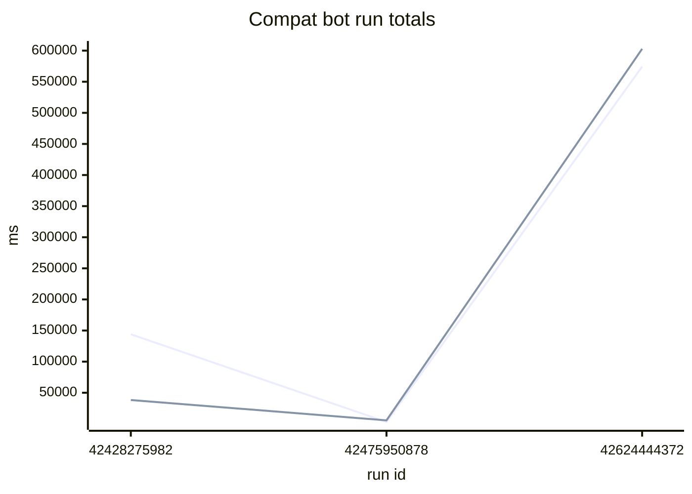

# Compat bot stats

The compat bot keeps the time and the resources of each probe. `runs.csv` has one row per run, `<YYYY-MM>.csv` has one row per probe (the columns are the first line of each file).

Run totals of the last 3 runs (ms). The first line is wall time and the second line is CPU time (user plus system).

